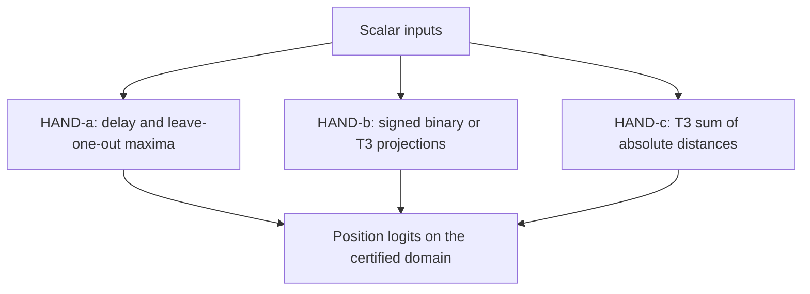
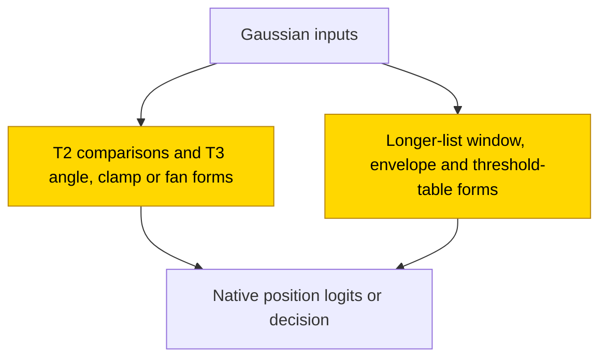
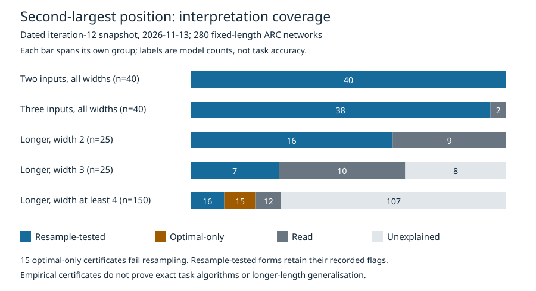

# Second-argmax in ARC's AlgZoo

The task is to find the position of the second-largest number in a list: with two numbers this means choosing the smaller, and with three it means finding the middle one. This study inspected 280 frozen recurrent networks, which update a small memory after each number, from ARC's AlgZoo; no networks were trained here. In the dated 2026-11-13 iteration-12 snapshot, 117 networks had passed registered substitution and resampling tests, while 15 more had optimal-ablation-only certificates that failed resampling, 33 had readings without a certificate and 115 remained unexplained. Interpretation is partly solved and the closed-form status is partial: these sampled tests describe particular fixed-length networks, including their mistakes, rather than proving exact task algorithms or longer-length generalisation.

## At a glance

| Fact | Value |
|---|---|
| Task | Return the zero-based position of the second largest independent Gaussian input |
| Input → output example | Values 1, 3, 2 → position 2 |
| Model | Bias-free, one-layer ReLU recurrent network, widths 2, 3, 4, 5, 6, 8, 16, 32 |
| Rungs and seeds | External TRAIN: five original seeds in each of 56 width/length cells; 280 final nets; nine HAND references; no PART or KD |
| Closed form status | Partial (117 resample-tested + 15 flagged optimal-only = 132 certificates among 280 networks; optimal-only forms fail resampling; sampled domains and control flags apply) |
| Status | Partly solved (interpretation snapshot, not a task-accuracy seed count); analysis snapshot 2026-11-13, Sol iteration 12; later analysis excluded |
| Weights | [Hugging Face: algzoo-2nd-argmax](https://huggingface.co/jc1122/circuit-atlas-nets/tree/main/algzoo-2nd-argmax), hand-built archive revision `1a04d29`; ARC nets linked, not re-uploaded |
| Reproduce | Not available yet: analysis code for this task is not yet in `code/`; see [archive](#25-archive) |

HAND denotes formula-set weights and TRAIN denotes training from scratch ([rungs](../GLOSSARY.md#the-three-rungs)). A ReLU keeps only positive input ([glossary](../GLOSSARY.md#standard-machine-learning-terms)). A closed form is an equation-based replacement; resampling the complement replaces everything outside the claimed circuit using other inputs ([verification](../GLOSSARY.md#verifying-a-circuit)). Here “read” means an interpretation without a passing certificate; “proven” is the source's registered-test category, not an all-input theorem.

## Limitations (read first)

- The 15 optimal-ablation-only proofs fail resampling. Optimal ablation replaces a discarded component with a chosen constant; it is weaker than keeping accuracy when that component receives independent donor values. Two width-16 proofs sit exactly at the size bar. The T8 width-32 seed-3 table alone agrees only .891/.896 and needs constants.
- Eight proofs use activation-level complements, replacing hidden activity rather than establishing an identity for the recurrence. Three have a codimension-one control, which keeps all but one linear direction, instead of a size-matched control. Thin passes and oversized tables remain read.
- A formula may explain a weak network, including its wrong answers, rather than solve second-argmax. Exact final-kernel complements can preserve the native output algebraically; the joint test then repeats standalone substitution and is not independent mechanism evidence. Checked auxiliary boxes prove native contrast/ideal factoring algebra, not approximate classifier equivalence. The binary ridge additionally has complete native regions and a rational sign lemma.
- Failed tests remain failed: five empty-unit failures, the width-2 T5 seed-0 specificity failure, old floating-projector and quotient failures, the auxiliary expression-size failure, the separate width-4 seed-4 omission, and both shared-veto attempts. Later accepted successors have separately registered tests and fresh rows; they do not repair those failures retrospectively.
- The literal h3 T3 seed-0 final-cut circuit is only a rank2/rank1 reduction. The width-3 T4/T5/T6 seed-4 envelopes explain weak nets with activation-residual complements and rank-2 rather than rank-3 random controls. Modest recurrent-scalar savings are not full low-dimensional algorithms.
- No fixed-length position readout defines longer-length generalisation. This is a dated snapshot: 33 read and 115 unexplained remain. Fresh replication is finite-sample evidence, not ARC's sampling-efficiency or surprise-accounting standard. [Section 6](#6-controls-limitations-and-open-questions) retains the deciding margins and failed-test details.

## 1. Task and data

Given T independent standard-Gaussian scalars (single numbers drawn from a normal distribution with mean 0 and variance 1), the label is the zero-based position of the second largest; T∈{2,3,4,5,6,8,10}. Values 1, 3, 2 have label 2. T denotes input length and h denotes recurrent width; a label such as h3 T3 seed 1 specifies all three. There are 56 width/length cells, each with five original seeds, for 280 networks. Task accuracy is the fraction of correct labels; formula agreement is the fraction matching the native network, the original frozen ARC model, which may itself be wrong.

The interpretation snapshot is frozen at iteration 12; later research is excluded. Table 1 separates the evidence categories, and Appendix B retains the full accounting history, registered additions and failed tests. A later passing test never changes the recorded outcome of an earlier failed one.

### How to read the mechanisms

For a list of two inputs, second-largest means the smaller value. For three, it means the middle value. Short-list networks often reduce this to a comparison or an angle between input differences. Longer-list forms may keep only a recent window, a running maximum or a table of thresholds; a form can reproduce a weak network's wrong answers as well as its correct ones. The mechanism partition is in Section 4; the complete registered-addition and failed-test record is in [Appendix B](#appendix-b-reading-the-detailed-evidence).
## 2. Model

### 2.1 Architecture

The network has no attention, embedding or biases. With zero initial state h_(−1)=0, its recurrence is h_t=relu(I x_t+H h_(t−1)) and its logits (output scores) are O h_(T−1) ([logits](../GLOSSARY.md#standard-machine-learning-terms)). The matrices I, H and O are the input, recurrent and output weights. Width h∈{2,3,4,5,6,8,16,32}; parameter count h²+h+Th, under 1,500.

### 2.2 Frozen and trained parts

All tensors were trained by ARC and frozen for this study. There was no partly trained (PART) or knowledge-distillation (KD) arm.

### 2.3 Training and analysis settings

Credit: [ARC AlgZoo code/models, MIT-0](https://github.com/alignment-research-center/alg-zoo), [ARC's blog](https://www.alignment.org/blog/algzoo-uninterpreted-models-with-fewer-than-1-500-parameters). Synthetic iid N(0,1) rows; CPU native fp32, formulas fp64. Every deciding form, row seed, complement, control and bar was registered before its test. Standard bar: substitution and complement each retain ≥.90 of native accuracy; answer agreement ≥.90. Later tests require ≥.01 margins on two row sets. New interval test: 32,768 held-out rows each at seeds 51129/51229, three donor permutations; unit-length rows decide, raw rows reported separately. Publishing replication uses seed 60129; older binary-subspace replays use 61129/61229 plus sign strata. New exact-kernel T3 replications use 68329/68629,71329/71629 and72329/72629/72929; the binary ridge uses raw seed69329. Replication coefficients are frozen; new Sol coefficients are weight-derived, while the older behavioural tables are fitted. Training precision and optimiser-step grok dates are unavailable. A grok date would locate delayed generalisation during training ([glossary](../GLOSSARY.md#counting-results)); these frozen checkpoints do not supply it.

### 2.4 Reproduction

Reproduce: not available yet: analysis code for this task is not yet in `code/`; the hand-built networks and recorded checks are on [Hugging Face](https://huggingface.co/jc1122/circuit-atlas-nets/tree/main/algzoo-2nd-argmax).

### 2.5 Archive

The archive contains our nine hand-built nets at revision `1a04d29`. ARC's 280 networks are listed there by public URL and hash, not re-uploaded. A hash fingerprints the unchanged contents ([glossary](../GLOSSARY.md#standard-machine-learning-terms)).

## 3. Hand-built solution
HAND-a: positive-input delay and leave-one-out maxima, L_i=(x_i)⁺+2 max(0,x_j:j≠i), exact on positive separated inputs. HAND-b: signed binary comparator and two signed T3 projections. HAND-c: T3 medoid L_i=−Σ_j|x_i−x_j|. None is assumed to be the learned mechanism merely because it computes the task.

In Figure 1, scalar inputs take separate reference routes: HAND-a uses delay and leave-one-out maxima, HAND-b uses signed projections, and HAND-c uses absolute distances. Each produces position scores on its stated domain. No part was trained in a PART cell; HAND-a remains restricted to positive separated inputs.

*Figure 1. The three hand-built references. No node is marked as trained: there was no PART cell. HAND-a's exactness is restricted to positive separated inputs; a matching task output does not assign a learned mechanism.*

## 4. What training finds

The following is a disjoint partition of all 280 nets; “read” is not certified. The shorter tasks are more fully described, but interpretation coverage is not task accuracy. All 40 binary models are accounted for, including the weak and constant predictors in Table 1.

*Table 1. A disjoint partition of all 280 final networks at the iteration-12 snapshot. Proven includes the separately flagged optimal-only forms.*

| group | nets | proven | read | unexplained | mechanisms |
|---|---|---|---|---|---|
| T2, all widths | 40 | 40 | 0 | 0 | 35 two-sided comparators, 3 one-sided near-7/8 solutions, 2 constants; h6 seed3 now has an exact one-ridge sign proof |
| T3, all widths | 40 | 38 | 2 | 0 | 25 one-angle median maps, 4 width-2 arc/register forms, interval-veto, 3 saturated fall/rise forms, 2 balanced clamps and 3 contrast-fan forms |
| h2, T≥4 | 25 | 16 | 9 | 0 | last-two arc tables, maximum registers and three-input detector/delay forms; T5 seed 0 fails fresh specificity |
| h3, T≥4 | 25 | 7 | 10 | 8 | 4 window forms and 3 maximum/inhibitory envelopes; full-state register form stays read |
| h≥4, T≥4 | 150 | 31 | 12 | 107 | 16 resample proofs (5 activation-level, 8 modest two-stage clamps/fans); 15 optimal-only threshold-table proofs |

*Table 2. Best logged validation accuracy (%) among five seeds per width/length cell. This is task accuracy, not the certificate count or formula agreement.*
| h | T2 | T3 | T4 | T5 | T6 | T8 | T10 |
|---|---|---|---|---|---|---|---|
| 2 | 99.9919 | 41.0300 | 32.7963 | 30.5511 | 26.9049 | 21.3631 | 20.2094 |
| 3 | 99.9975 | 90.8432 | 43.3364 | 37.5299 | 34.0642 | 28.5172 | 23.8887 |
| 4 | 99.9963 | 98.4534 | 60.1992 | 42.8359 | 39.4123 | 34.5943 | 31.7937 |
| 5 | 99.9978 | 99.9134 | 74.5662 | 54.2300 | 45.0205 | 38.3694 | 34.6842 |
| 6 | 99.9918 | 99.9223 | 86.4660 | 70.3007 | 48.4254 | 40.4798 | 37.5098 |
| 8 | 99.9979 | 99.9454 | 98.7488 | 88.1508 | 78.8639 | 46.5771 | 42.6648 |
| 16 | 99.9974 | 99.9511 | 99.8319 | 99.2499 | 98.4539 | 97.6339 | 94.8445 |
| 32 | 99.9979 | 99.9533 | 99.8795 | 99.7301 | 99.3825 | 99.3058 | 99.4402 |
## 5. Mechanism and verification

The population status is partial: 117 resample proofs and 15 optimal-only proofs are distinct evidence categories. The forms below reproduce network decisions on registered sampled domains; algebraically invariant final kernels and auxiliary box checks do not independently prove an exact recurrent algorithm.

In Figure 2, short lists use comparison, angle, clamp or fan descriptions; longer lists use window, envelope or threshold-table descriptions. Each family describes externally trained networks and ends at their native scores or decisions. The population status remains partial, with optimal-only and activation-level exceptions; sampled agreement is not a global recurrent identity.

*Figure 2. Families identified in ARC-trained networks; both family nodes are marked as trained. Status: partial, with 15 optimal-only and eight activation-level proofs flagged; sampled agreement and exact final-kernel algebra are not global recurrent identities.*

*Figure 3. The iteration-12 partition of 280 fixed-length networks. Each bar spans its own group, not a common number of models. Status: partial; the 15 optimal-only certificates fail resampling, and resample-tested forms retain their activation-level and control flags. Counts describe sampled, domain-qualified evidence, not exact task algorithms or longer-length generalisation.*

### Binary decisions (T2)

With two inputs the second-largest value is the smaller one, so a correct model chooses position 1 when the second value is below the first. The accounted-for population nevertheless includes two constant predictors and three one-sided weak solutions, alongside the 35 two-sided comparators. An arc table assigns an answer to each angular sector in the two-input plane; it describes what a model predicts, not necessarily the correct comparison. The notation v⁺ means max(v,0), applied to each entry for a vector or matrix, and atan2(y,x) is the angle of the point (x,y).

The exact first state is I⁺x0⁺+(−I)⁺(−x0)⁺, so each final neuron is one ramp in x1. For h6 seed3, all contrast gains are positive: answer1 iff −x1−tau(−x0)⁺>0, tau=439424844068038381/439424838562480128; ties0. The decision is an arc lookup of atan2(x1,x0). All 40 tables agree with their nets on all 65,536 held-out rows. Two-sided rays are within .038° of the comparison boundary; one-sided nets forget positive x0 and are right on approximately 7/8 of the plane.
### Angle maps (T3, 25 accurate nets)

For three inputs, only their differences matter to the correct middle-value choice: shifting every number by the same amount leaves its position unchanged. The following projection removes that shared shift; each model's angular lookup table supplies its own decisions.

Project onto e_a=(1,−1,0)/√2 and e_b=(1,1,−2)/√6; answer by each net's own arc table of atan2(x·e_b,x·e_a). Agreement .9928–.9998. Five with an empty unit complement are instead proven by a per-neuron two-entry threshold table and a nonempty function-space complement, replicated on fresh rows.
### Interval and veto (T3, width 3, seed 1)

A veto suppresses the answer within a silent interval. Here p(u)=u⁺=max(u,0), and dist measures distance outside an interval.

 For (u,v,w), a=.9392046332, c=6.1445968844, k=33.0218429626, let b=|u|, L=a u⁺−c(−u)⁺, U=c u⁺−a(−u)⁺, and dist(z,[l,h])=(l−z)⁺+(z−h)⁺. Set R=dist(v,[L,U]), P=(v−L)⁺, Q=(U−v)⁺, L2=aP−cQ+kb, U2=cP−aQ−kb. Then S=(U2−L2)⁺+dist(w,[min(L2,U2),max(L2,U2)]); substitute (S/2,R,S/2) with the native readout. The second interval is inverted on about .929 of sampled rows: the veto creates a silent band. The pair's summed activity, not its sign, carries the decision. Three scalars replace nine recurrent entries; none is fitted.
### Saturated fall (T3, width 3, seed 0)

A saturated fall is a difference of decreasing ramps that stops changing beyond its thresholds.

 For (u,v,w), P=(−p u⁺+a(−u)⁺−v)⁺, Q=(−q u⁺+c(−u)⁺−v)⁺, R=(v−r u⁺+d(−u)⁺)⁺, K=Q−P; substitute ((aQ+gK−pR−w)⁺,0,(cQ+kK−qR−w)⁺). Eight exact weight-derived scalars: (p,q,r,a,c,d,g,k)≈(.506833,.234368,.804196,.096235,−.233314,3.514283,3.621294,2.646011). Final helper is the native complement; no retained-pair residual is hidden in it.
### Additional clamps (T3, width 3, seeds 3/4)

A clamp limits a value between thresholds. A gauge rescales hidden coordinates without changing the output; M denotes recurrent weights in the stated gauge.

 All scalars below are weight-derived in positive gauge M: input neurons have unit-magnitude input, memory neurons unit principal drive. Seed3: g=−M00, a=−M00−M02, l=(M20+M22)/2, ell=1+M12, j=−M01, s=−M11, k=−M21, epsilon=I1. Put p=u⁺, n=(−u)⁺, A=(−v−an−j epsilon p)⁺, C=(−v+2ln−k epsilon p)⁺, E=(epsilon v+ell n−s epsilon p)⁺, K=C−A; F=((−w−aC+gK−jE)⁺,(epsilon w+ell C−K−sE)⁺,(−w+2lC−lK−kE)⁺). Seed4: a=−M00−M01,b=−M02,c=M10+M11,d=M12,e=M20+M21,f=M22,alpha=−(M00+M11)/2,t=M21; lo=−cp−dn, hi=ap+bn, A=(v−hi)⁺, K=min((v−lo)⁺,hi−lo), C=(ep+fn−v)⁺; F=((w−aA+(alpha−a)K−bC)⁺,(w+cA−alpha K+dC)⁺,(−w+eA+tK+fC)⁺). Keep the native readout. Their exact final decision/kernel tests pass, not the earlier floating-projector tests; neither is an all-input approximate/native equality theorem.
### Wide short networks

A signed capped ramp is a difference of ReLU ramps; unlike an unsigned clamp, it can be negative. A population fan combines a common rising response, a common falling response and bounded differences between individual neurons. The full equations retain those differences.

 A final neuron compares the last input with a threshold indexed by the earlier top positions. With m1≥m2≥m3, p1,p2 their positions, the top-two table is `relu(s(x_last−m3)+g[p1](m1−m2)+g[{p1,p2}](m2−m3)+a)`. Four-to-six inputs need 6/10/15 table numbers per neuron; optimal-only proofs add one fitted constant. Other accepted forms sort a zero with the prefix (15 numbers at T4), watch one position in three cases (7), or use an additive pair table (14 at T8). These are fitted behavioural tables, not recovered recurrent identities.

Separately, width4 T4 seeds1/2/4 have a weight-derived two-stage clamp: order neurons as rising A/B and falling C/D; a_i=M_iA+M_iB,b_i=M_iB except b_A=0,c_i=M_iC+M_iD,d_i=M_iC. For (u,v,w,z), prefix ramps have thresholds ta=−a_Au⁺−c_A(−u)⁺,tb=−a_Bu⁺−c_B(−u)⁺,tc=a_Cu⁺+c_C(−u)⁺,td=a_Du⁺+c_D(−u)⁺. Put A1=(v−ta)⁺,D1=(td−v)⁺,Kr1=(v−tb)⁺−A1,Kf1=(tc−v)⁺−D1,r_i=a_iA1+b_iKr1+c_iD1+d_iKf1. Then A2=(w+r_A)⁺,D2=(r_D−w)⁺,Kr2=(w+r_B)⁺−A2,Kf2=(r_C−w)⁺−D2,F_i=(s_i z+a_iA2+b_iKr2+c_iD2+d_iKf2)⁺,s=(1,1,−1,−1),with the native readout. Both differences are signed capped ramps. This preserves the first prefix and omits only one later rising-contrast coupling;15vs16 scalars,not a full low-dimensional algorithm.

Width4 T4 seed0 uses the same paired form in native order with b2=0 instead of bA=0, removing M21=.0102879 into M20.

Seed3 uses S_i=Σ_(j∈{0,2,3})M_ij,R_i=M_i1,C0_i=M_i0 except C0_2=0,C3_i=M_i3; at each cut the common fall is neuron2, the rise is1 and the signed falling differences are0−2 and3−2. The only transfer is M20=.268892 into M22, preserving both first-input rays; its full two-stage input formula and 15vs16 scalar reduction pass independently.

Width5 T4 seeds1/2/4 use rising/falling populations with reference pairs(3,2),(0,3),(1,3),respectively: population sums a_i,c_i drive two common amplitudes,while three signed bounded differences carry every other prefix ramp. At each of two cuts the drive is a_i A+c_i D+Σ_j d_ij K_j;final F_i=(s_i z+a_i A2+c_i D2+Σ_j d_ij K2_j)⁺. Only the registered transfers M14->M13,M31->M33,M14->M11,respectively,are omitted from the differential paths;24vs25 scalars. The references fix thresholds from u⁺,(−u)⁺,then the first-cut drives fix the second-cut thresholds;both initial rays are preserved exactly. All three full input forms pass their own tests,not an extrapolation to seeds0/3.
### Maximum and envelope networks

An envelope bounds the alternating partial sums defined below.

 M_t=max(0,x_0,…,x_t), A_t=M_t−M_(t−1), f_t=−x_t+alpha A_(t−1)+beta M_(t−2). The third coordinate is the alternating min/max envelope of partial sums Σ_(j=0..k)(−rho)^j f_(t−j), with an outer maximum with zero. Use (A_t,M_(t−1),E_t) and the native readout. Three weight-derived constants, no fitted recurrence; agreement on native errors ≥.9935. These explain weak nets, not the task.
### Narrow windows and a read-only band

 Earlier proofs use last-two angles or named detector/delay recurrences on at most half the inputs, flagged as truncated rounded recurrences. Width2 T3 seed2 has an explicit detector/memory band: P=(v−a u⁺−b epsilon(−u)⁺)⁺,E=(u⁺−epsilon v−d epsilon(−u)⁺)⁺,L=aP+bE,F=P−dE,U=F/epsilon,mix(t)=(F+tL)/(epsilon+t),T2=min(U,mix(tau_high)),T1=max(L,mix(tau_low)); answer2 belowT2,1 aboveT1,else0. Exact weight-derived values a≈.999364,b≈1.000699,d≈4.013977,epsilon≈.000024396,tau_low≈.093438,tau_high≈1327.289. Two fresh sampled sets agree1, but its complement is empty and near-chance task controls fail necessity/specificity: READ, not proven. The band box verifier is unknown; exact native-region coverage does not certify band equality. Whole-input rounded recurrences and unpassed approximations remain readings.
### Relation to published work
[ARC's repository](https://github.com/alignment-research-center/alg-zoo) (code/models, MIT-0) supplies our frozen weights. [ARC's blog](https://www.alignment.org/blog/algzoo-uninterpreted-models-with-fewer-than-1-500-parameters) (primary blog) already gives the binary reading, approximate four-neuron T3 symmetries and five of sixteen neurons of its separate T10 example; our binary/max roles overlap, not a new discovery. [Leeuwenhoek](https://github.com/Xabilimon1/leeuwenhoek) (code, November 2026) derives rise/fall comparison and memory pairs, and exact paths for argmedian h4 T3: task-equivalent to second argmax at T3, not a reading of all our seeds. [mogar](https://github.com/mogar/algzoo_interp) (code) reads h4 T3 and h32 T10 event/value/clock/position codes; its position-only surrogate reproduces correct answers but none of the net's errors, the same limitation our failed rank chart exposes.
[DraggonZ](https://github.com/DraggonZ/algzoo-interp-public) (code, October 2026) builds hand-written copies of ARC's separate h16 T10 example, with partial job-by-job fidelity; [mrsirrisrm](https://gist.github.com/mrsirrisrm/d6850ff8647d1ed2f67cc92d5bce3ed0) (code gist) uses canonical activation/matrix-product lookups for two top impulses, not arbitrary Gaussian lists. [Snider](https://www.lesswrong.com/posts/sAhFp6gYoyw3xeCaF) (forum, 2026-10-26) fits population-level accuracy estimators, not a deductive closed form of these nets. None supplies our 280-net certificates. [Dutta et al. (2026)](#references), an arXiv preprint, constructs shallow ReLU rank-value approximators; relevant at T3, not evidence for a learned recurrent index circuit.
## 6. Controls, limitations and open questions

All items in the [near-top Limitations](#limitations-read-first) apply. Distributed-variable interventions are motivated by [Geiger et al. (2023)](#references); replacing an ablated component by an optimised constant follows [Li and Janson (2024)](#references), which is weaker evidence than resampling in this study. Region-by-region recurrent analysis is contextualised by [Durstewitz (2017)](#references), and explicit affine-region constraints by [Chu et al. (2018)](#references). These are method sources, not proofs of the circuits or their numerical acceptance bars.

For the exact-kernel tests, the kernel is the discarded hidden-state direction that the final readout maps to zero. “FC=native” means the complement intervention algebraically leaves the native output unchanged; “joint=standalone” means adding that intervention to substitution adds no independent evidence.

The new interval form passes substitution, native complement resampling and their joint intervention on both row sets; endpoints reconstruct every native/donor label, same-rank random controls and necessity drop >.05, and formula/native common-bundle swaps agree ≥.9960. Its complement contains .484 of hidden energy, so this is not an empty-complement exception. No all-input exact learned identity or independently causal scalar variables are claimed.
The 15 optimal-only proofs fail resampling and are flagged; two width-16 proofs use exactly half the width in numbers per neuron. The T8 width-32 seed-3 table alone agrees only .891/.896 and passes with constants. Eight activation-level proofs retain that flag; three also have a codimension-one, not size-matched, control. Thin passes and oversized tables stay read. No fixed-T position readout defines longer-length generalisation. Fresh-row table and Sol replications all pass, including the weakest optimal-only table (margin +.01138); unit replications are complete, with one additional specificity demotion; all three proper binary-subspace replications pass. Wide late-step top-two charts fail despite near-full native interchange fidelity; no new long-wide proof from those charts. The saturated-fall proof replicates on a third fresh row set (agreement .9932, joint .9684). Two earlier quotient tests failed: the rise form agreed .9987–.9989 alone but .8420–.8446 under joint resampling; the signed-fall quotient also failed. Those failed tests remain failed. New, separately registered exact-kernel tests pass for both nets, retaining the same rise form but a lower-row-only tied fall form with the helper input preserved. Remaining at this snapshot: 33 read and 115 unexplained.
### Detailed contrast forms and failed alternatives

 Let R(v;a,b)=(v−a)⁺−(v−b)⁺ and D(v;a,b)=(a−v)⁺−(b−v)⁺, each a signed capped ramp. Width4 seed2 has common rise A, common fall B and contrasts Kr,Kf; F_i=(s_i w+S_i A+U_i Kr+N_i B+V_i Kf)⁺, with S=M[:,0]+M[:,2],U=M[:,0],N=M[:,1]+M[:,3],V=M[:,3] except V1=0. Width4 seed3 has common fall A, its contrast K, rise B and helper E: F_i=(s_i w+S_i A+C_i K+M_i1 B+M_i3 E)⁺, S=M[:,0]+M[:,2],C=M[:,2] except C0=0. Width5 seed0 has common fall A, rise B and K0,K2,K3: F_i=(s_i w+S_i A+M_i1 B+M_i0 K0+M_i2 K2+C_i K3)⁺, S=Σ_(j∈{0,2,3,4})M[:,j],C=M[:,3] except C1=0. Prefix thresholds are direct weight contractions of u⁺,(−u)⁺; no fitted values or recurrent rollout. These modest 15/16,14/15,24/25 scalar reductions pass both main sets and fresh replications; full bounded contrasts and tiny helper inputs survive elsewhere. Width3 seed2/width4 seed1 retain their earlier balanced clamps. One separate width4 seed4 omission fails and stays failed. A shared-veto form fails standalone/joint agreement(.885–.889); a separately registered prefix-preserving compensation still fails(.8884–.8915), despite passing accuracy-share and every other gate. Both native final veto gains must remain distinct. The T4 clamp/fan proofs use exact final rank3/rank1 kernels at width4 and rank3/rank2 at width5, with genuinely same-rank controls; all current proofs have fresh replications. Exact-kernel limits: FC=native and joint=standalone algebraically, not independent mechanism evidence. Nonempty kernels, exact endpoints, native precision, necessity and truly same-rank controls pass. Checked boxes certify native contrast algebra/ideal factoring, NOT approximate classifier equivalence; the binary additionally has complete native regions and a rational sign lemma.
## 7. Prediction record

Written before opening the zoo weights, not before ARC's training: universal binary comparison, symmetric projections at T3, maximum/leave-one-out hybrids at longer T. Comparison is right for 35/40 binary nets, not universal; good T3 nets depend nearly only on input differences; individual maximum registers recur at longer T but do not explain the whole population. No retrospective prediction edits.

## Appendix A. Weights excerpt and reading

*Table 3. Weight-derived examples. These slices support the stated reading but do not replace the substitution and complement tests.*

| Net | Weight-derived structure | Interpretation |
|---|---|---|
| h2 T2 seed 1 | input (4.7229,−6.2045); effective threshold .9995; rays −134.978°,44.986° | opposite ramps balance at x1=x0; neither neuron alone has that kink |
| h3 T3 seed 1 | pair self −.938/−.940, cross 6.144/6.145, memory inhibition −33.029/−33.015; memory self −5.207 | near-mirror pair, distance memory and common veto; the near-equal readout columns make the pair contrast dispensable |

## Appendix B. Reading the detailed evidence

Tables 1 and 2 distinguish mechanism-certificate counts from task accuracy. In the detailed tests, substitution is formula-only evaluation, a joint intervention applies substitution and complement resampling together, and specificity asks whether a size- or rank-matched random circuit also works. Rank is the number of independent linear directions ([analysis measures](../GLOSSARY.md#analysis-measures)); final rank2/rank1 and rank3/rank2 labels describe kept/discarded directions, not a minimal recurrent state. All snapshot counts exclude analysis after Sol iteration 12.

### Snapshot accounting

The recorded partition is 132 proven / 33 read / 115 unexplained. Proven = 117 resample proofs and 15 optimal-ablation-only proofs. Resample-only accounting: 117 proven / 43 read / 120 unexplained. The publishing audit demoted h3 T10 seed2 and h6 T2 seed3 for empty old complements; the latter is now restored only by its new one-ridge/native-kernel proof. Fresh-row replication passes all 28 frozen tables and every currently counted Sol form. The unit batch's serialisation-only replay finishes 80/86: five empty-unit failures and one new specificity failure. Width 2, T5, seed 0 leaves proven for read (random-control accuracy drop .0344<.05). All three proper older binary-subspace certificates also replicate on two fresh row sets and sign strata; failed unit tests remain failed.

### Registered additions and retained failures

Width5 T4 seeds1/2/4 pass two-stage signed population fans, agreement .9259–.9802 across both main sets and independent fresh replications; twenty-four recurrent scalars replace twenty-five, with one fixed balanced differential coupling removed. The remaining width4 T4 seeds0/3 pass distinct two-stage paired-clamp/falling-fan forms, agreement .943–.998 on main sets and fresh replications; all five width4 T4 seeds are now proven under their own tests, not one identical mechanism. Each new form removes one balanced differential coupling, fifteen versus sixteen scalars.

Earlier width4 T4 seeds1/2/4 pass a two-stage signed-clamp form, agreement .9462–.9671 on both main sets and fresh replications; fifteen recurrent scalars replace sixteen. Their original tests failed the auxiliary verifier expression-size gate and remain failed. A new registered complete test removes only redundant zero-state syntax, preserves every cap/form/control and proves the required auxiliary algebra.

Width4 T3 seeds2/3 and width5 T3 seed0 pass explicit double-clamp, fall/memory and falling-fan forms, with main-set agreement .9870–.9946 and independently registered fresh replications. Width3 T3 seed2 and width4 T3 seed1 previously passed balanced rising/falling clamps, with main-set agreement .9991–.9996 and fresh replications. Exact-prefix-preserving transfers remove one final differential coupling each: modest seven-versus-eight and fourteen-versus-fifteen scalar reductions, not full recurrent algorithms.

Earlier width3, T3, seeds3/4 pass saturated fall/rise forms in exact native decision coordinates (agreement .9973–.9990), with independent fresh replications. Their final rank2/rank1 kernel complement is algebraically invariant, not independent algorithm evidence. Width6, T2, seed3 passes a one-threshold one-sided ridge, with checked region coverage, rational all-real sign proof and fresh controls. All old floating-projector failures remain failed.

Earlier width3, T3, seed0 uses a saturated fall contrast and two falling thresholds. Agreement .9922/.9923, joint resampling .9665/.9668; checked auxiliary pair-extraction algebra on the unit box. Flag: modest eight-versus-nine recurrent-scalar reduction, literal final-cut rank2/rank1 circuit only; no all-input classifier proof.

Width 3, T3, seed 1 is a two-interval distance comparison with an inhibitory veto, using three weight-derived recurrent scalars. Standalone agreement .9961–.9962, wrong-row agreement .9798–.9828; joint substitution/resampling agreement .9204–.9214 on two fresh row sets. The discarded pair contrast is a nonempty rank-1 complement; truly same-rank-2 random controls drop to .367–.441 accuracy. The earlier failed formula with a missing feedback term stays failed; this is a separately tested successor.

Also collected: width 16, T5, seed 2 passes its earlier registered one-position-table optimal-ablation test (agreement .9153/.9195), exactly at the size bar; resampling fails (.634 exact), and the table alone agrees .894 on one set. Width 16, T5, seed 1 becomes read, not proven: its additive table exceeds the size bar.

Earlier Sol proofs: width-3 T4/T5/T6 seed 4, running maximum plus inhibitory envelope, agreement .9946–.9983. Flags: weak nets, activation-residual complement and rank-2 rather than rank-3 random control. Five earlier wide T4 proofs also use activation-level complements. The 15 optimal-only proofs remain separate; none is called a resample proof.

## What to read next

Compare [AlgZoo median](algzoo-median.md), where the output is a value rather than a position and formulas can also explain inaccurate networks. For the difference between explaining a model and solving its task, read [the verification guide](../GLOSSARY.md#verifying-a-circuit).

## References

The earlier analysis read the public pages and READMEs below and checked the scholarly DOI metadata with scite. This is source
credit, not a claim that those sources certify these networks or that our tests establish ARC's sampling-efficiency or
surprise-accounting standard.

- Alignment Research Center (n.d.). AlgZoo: Uninterpreted models with fewer than 1,500 parameters. *ARC blog*.
  https://www.alignment.org/blog/algzoo-uninterpreted-models-with-fewer-than-1-500-parameters (published binary and partial T3/T10 readings)
- Alignment Research Center (n.d.). AlgZoo. *GitHub software and model repository; MIT-0*.
  https://github.com/alignment-research-center/alg-zoo (the frozen networks analysed here)
- Chu, L., Hu, X., Hu, J., Wang, L., & Pei, J. (2018). Exact and consistent interpretation for piecewise linear neural networks.
  *ACM SIGKDD International Conference on Knowledge Discovery & Data Mining* (conference paper).
  https://doi.org/10.1145/3219819.3220063 (region-wise interpretation, not these recurrent-network certificates)
- DraggonZ (2026, October). algzoo-interp-public. *GitHub software repository*.
  https://github.com/DraggonZ/algzoo-interp-public (hand-written copies of a separate ARC example, with partial fidelity)
- Durstewitz, D. (2017). A state space approach for piecewise-linear recurrent neural networks for identifying computational
  dynamics from neural measurements. *PLOS Computational Biology* (journal article).
  https://doi.org/10.1371/journal.pcbi.1005542 (piecewise-linear recurrent dynamics)
- Dutta, A., Safran, I., & Valiant, P. (2026). The median is easier than it looks: Approximation with a constant-depth, linear-width
  ReLU network. *arXiv preprint*. https://doi.org/10.48550/arxiv.2602.07219 (rank-value approximation, not a learned recurrent index circuit)
- Geiger, A., Wu, Z., Potts, C., Icard, T., & Goodman, N. D. (2023). Finding alignments between interpretable causal variables and
  distributed neural representations. *arXiv preprint*. https://doi.org/10.48550/arxiv.2303.02536 (intervention-based causal descriptions)
- Li, M., & Janson, L. (2024). Optimal ablation for interpretability. *arXiv preprint*.
  https://doi.org/10.48550/arxiv.2409.09951 (input-independent ablation constants, distinct from resampling)
- mogar (n.d.). algzoo_interp. *GitHub software repository*. https://github.com/mogar/algzoo_interp
  (event/value/clock/position readings and a task-only surrogate for a separate example)
- mrsirrisrm (n.d.). AlgZoo interpretation code. *GitHub code gist*.
  https://gist.github.com/mrsirrisrm/d6850ff8647d1ed2f67cc92d5bce3ed0 (activation and matrix-product lookups for two top impulses)
- Snider (2026, October 26). [Forum post on AlgZoo population accuracy]. *LessWrong forum post*.
  https://www.lesswrong.com/posts/sAhFp6gYoyw3xeCaF (population accuracy estimators, not deductive forms of these networks)
- Xabilimon1 (2026, November). Leeuwenhoek. *GitHub software repository*. https://github.com/Xabilimon1/leeuwenhoek
  (rise/fall and memory-pair readings; separate h4 T3 argmedian paths)
