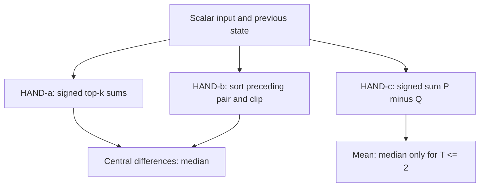
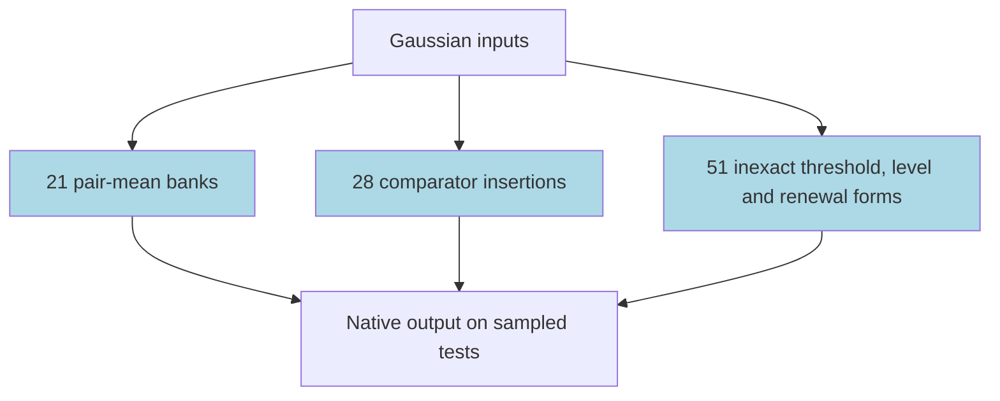

# Median in ARC's AlgZoo recurrent networks

These recurrent networks read a sequence of numbers and estimate its median, the middle value after sorting. We analysed 100 frozen networks trained by ARC, without training new models. At the 2026-11-13 snapshot, all 100 had forms passing their registered sampled tests, but 51 were inexact median approximators and 20 had empty complements, making that part of the verification vacuous. The task is partly solved: the forms explain the networks, including their errors; several are nearly as large as the networks and are not compressed explanations.

## At a glance

| Fact | Value |
|---|---|
| Task | Estimate the median of independent standard-Gaussian scalars; average the central pair for even length |
| Input → output example | Values 1, 3 → median 2 (a pair mean) |
| Model | Bias-free, one-layer ReLU recurrent network; widths 2, 4, 8, 16, 32 |
| Rungs and seeds | External TRAIN: 20 width/length cells × five original seeds = 100 terminal nets; nine HAND references; no PART or KD |
| Closed form status | Partial: 100 proven / 0 read / 0 unexplained under registered sampled tests; 20 empty-complement exceptions and other flags below; no global native equivalence |
| Status | Partly solved (49 accurate pair-mean/comparator-insertion nets; 51 inexact approximators); analysis snapshot 2026-11-13, Sol iteration 22 |
| Weights | [Hugging Face: algzoo-median](https://huggingface.co/jc1122/circuit-atlas-nets/tree/main/algzoo-median), hand-built archive revision `28a5e5d`; ARC nets linked by URL and hashes, not redistributed |
| Reproduce | Not available yet: analysis code for this task is not yet in `code/`; see [archive](#25-archive) |

Here HAND means weights set by formula and TRAIN means weights trained from scratch ([rungs](../GLOSSARY.md#the-three-rungs)). A ReLU keeps the positive part of a number ([glossary](../GLOSSARY.md#standard-machine-learning-terms)). A closed form replaces a network computation with equations; a complement test resamples everything outside the claimed circuit ([verification](../GLOSSARY.md#verifying-a-circuit)). The word “proven” below is the source's sampled-certificate category, not an all-input theorem.
## Limitations (read first)
### Size: several forms are as large as the net

Several forms retain nearly as many independent real coefficients as their networks have weights. The table gives each form's coefficient count, with the net count in brackets, alongside the network's h²+2h parameters; 0 means a parameter-free formula. Fixed discrete signs and offsets are disclosed separately. At h16 T10, 274 numbers replace 288 weights; at h32 T10, 1056 replace 1088. These forms re-express the network and do not provide compression or a short explanation.

*Table 1. Independent real coefficients per form, with network counts in brackets. Fixed discrete signs and offsets are disclosed separately; zero denotes a parameter-free formula.*

| Width (params) | T2 | T3 | T5 | T10 |
|---|---|---|---|---|
| h2 (8) | pair mean 0 (2); one-sided 2 + a sign (3) | dead-zone 3 (1); O/P levels 6 per shared set (4) | dead-zone 3 (1); O 6 (3); input mean 0 (1) | dead-zone 3 (1); O 6 (3); input mean 0 (1) |
| h4 (24) | pair mean 0 (4); one-sided 2 (1) | Z1 10 (1); V9 9 (1); L9 9 (1); BR10 10, shared by 2 (2) | W5, B5, C10 10 each (3); D5 10 shared (2) | S10, W10, G10 10 each (3); O10 10 shared (2) |
| h8 (80) | pair mean 0 (5) | comparator insertion 0 (5) | 36 each (5) | 36 each (5) |
| h16 (288) | pair mean 0 (5) | comparator insertion 0 (5) | comparator insertion 0 (5) | 136 gains + 138 information-bearing rational offsets = 274, 394 expanded loads, + 14 readout signs (5) |
| h32 (1088) | pair mean 0 (5) | comparator insertion 0 (5) | comparator insertion 0 (5) | comparator insertion 0 (3); 1056 + fixed μ=.05 + 30 fixed readout signs (2) |
### Inexact approximators

51 of 100 nets are inexact median approximators (all except the 21 pair means and 28 comparator insertions): their form explains the net, including its error, not the median.

### What “proven” means

A counted form keeps ≥.90 of the net's skill R² under substitution and ≥.90 under complement resampling, then passes a fresh pre-registered replication. These are finite Gaussian samples: later rounds use 20,000 held-out rows and three donors; early accurate-net proofs use numerical certificates with a stated ε. Tests are not exhaustive over inputs. Several sufficient masks exist, so neither uniqueness nor minimality is claimed. The wide forms have no global native-equivalence proof; h32 current-pair drive sums have mixed signs.
### Flagged or fragile proofs

The labels give width, sequence length and seed (e.g. h4 T3 s3 = width 4, length 3, seed 3).

The published catalogue records 20 empty-complement exceptions and 11 other flagged proofs. Every individual flag is retained below; these are qualifications to the sampled certificates.

*Table 1a. Fragile or differently scoped proofs. A same-size random complement that also works does not establish specificity.*

| Flag | Networks and deciding evidence |
|---|---|
| Thin agreement margin | h4 T3 s3, form Z1. |
| Specificity not shown | Random same-size complement also keeps >.90: h4 T2 s0 .976, s1 .972, s4 .928; h8 T2 s0 .903. |
| Empty complement, whole-net exception | 20 nets: h2 T2 s0–4, h4 T2 s2–3, h2 T3 s0–4, h2 T5 s0/s1/s3/s4, h2 T10 s0/s1/s3/s4. The complement test is vacuous. |
| Input-direction complement only | h2 T5 s2 and h2 T10 s2; the cap remains a reading. |
| Message-level complement | h4 T3 s0 and s1. |
| Fit-informed multi-node masks | h32 T10 s1 and s4; 256 finite random-mask controls, not exhaustive. |

Per-net margins of the other proofs are not tabulated here.

### Scope

Only the 100 terminal checkpoints (2^30 training sequences); ARC saved 12 snapshots per seed, and the other 1,100 (initialisation, 2^20–2^29) got early diagnostic screens only, no closed form. Only h∈{2,4,8,16,32}, T∈{2,3,5,10}; no length generalisation is claimed.
## 1. Task and data

Inputs are independent standard-Gaussian scalar sequences of length T=2,3,5,10. The output is the median, averaging the central pair for even T. For example, values 1, 3 have median 2. Error is root mean square error (RMSE), not classification accuracy. Skill R² compares mean squared error with the variance of the true median; its acceptance criterion is in [Section 6](#6-controls-limitations-and-open-questions).

Of 100 terminal nets: **100 proven / 0 read / 0 unexplained**, all freshly replicated under their individually pre-registered tests. Earlier rounds established 69; Sol adds 31 input-only semantic forms whose substitution and complement interventions retain the registered skill share with controls. These are sampled interpretation certificates, not all-domain native equivalences or ARC surprise-accounting completion. Forty-nine nets are accurate pair means/comparator insertion sorts; 51 are nonexact median approximators whose formula explains the net, not exact median. Complement breakdown: 76 nonempty native-neuron resample proofs, two causal-message resample proofs, two flagged input-direction proofs, and 20 existing flagged whole-net/empty-complement exceptions. Twenty-nine additions use tied-gain/distribution controls; five width16 forms additionally disclose 138 information-bearing offsets each. The final two forms retain 1,056 independent coefficients each: **not description compression**. No new empty-complement exception or approximate-residual explanation column is created.
## 2. Model

### 2.1 Architecture

ScalarRNN: one bias-free ReLU recurrent layer, h=2,4,8,16,32; zero initial state; W_in[h,1], W_rec[h,h], W_out[1,h]. Parameters h²+2h. No attention, vocabulary, embeddings or positional parameters. Original-key safetensors were losslessly checked; all 100 terminal tensor identities are recorded with proof provenance and fresh-row replication seeds.
### 2.2 Frozen and trained parts

All ARC tensors were frozen for this analysis. There was no partly trained (PART) arm or knowledge-distillation (KD) arm.

### 2.3 Training and analysis settings

[Shared methods](https://github.com/jc1122/mechanistic-interpretability-circuit-atlas/blob/main/METHODS.md). Terminal weights follow ARC's 2^30 training sequences; CPU interventions use independent synthetic fit/test draws, fp32-generated inputs and frozen weights evaluated in fp64. No optimiser sweep, new training run, GPU use or measured grok step was reported. A grok step would locate delayed test improvement during training ([glossary](../GLOSSARY.md#counting-results)); the saved sequence counts do not measure it.

### 2.4 Reproduction

Reproduce: not available yet: analysis code for this task is not yet in `code/`; the hand-built weights and recorded checks are on [Hugging Face](https://huggingface.co/jc1122/circuit-atlas-nets/tree/main/algzoo-median). The external networks come from [ARC's code/model repository](https://github.com/alignment-research-center/alg-zoo).

### 2.5 Archive

Our nine hand-built nets, `config.json`, the native loader and a roundtrip report are archived at revision `28a5e5d`; the 100 ARC nets are referenced by public URL and two sha256 hashes, not redistributed. A sha256 hash identifies unchanged file contents ([glossary](../GLOSSARY.md#standard-machine-learning-terms)). Archive roundtrip: 109/109 reloads byte-identical with identical RMSE/R² on 8,192 fresh rows per length.

## 3. Hand-built solution

The references test three ideas: retain the largest prefix values through signed sums, insert a value into a sorted pair by clipping, or maintain an ordinary sum. In HAND-a, S_k denotes a top-k prefix sum, with A and B its signed registers. HAND-b's L and U are the sorted preceding pair. HAND-c uses P and Q for positive and negative parts of a running sum; division by length gives a mean and is a median only at the stated short lengths.

With p(u)=max(u,0): a uses signed top-k sums A'_k=S_k, B'_k=p(±x+S_(k−1)−S_k), S=A+B; central differences recover median. b is L+p(x−L)−p(x−U), where L/U sort the preceding pair (T3). c uses P'=p(P−Q+x), Q'=p(−P+Q−x), y=(P−Q)/T (median only T≤2). Real-arithmetic derivations and exhaustive/grid/random CPU checks pass; a's 8/12/24-register layouts at T3/5/10 are not global width lower bounds.

*Figure 1. The three hand-built references. No node is marked as trained: there was no PART cell. HAND-a's register counts are constructions, not width lower bounds.*

## 4. What training finds

The accurate nets use pair means or comparator insertion. Insertion maintains ordered prefix values and inserts each new input among them. Inaccurate nets use signed thresholds, bounded levels or histories of past inputs; those forms follow the network's errors rather than repair them.

Accurate, 49: balanced pair-mean hinge banks, 21; comparator insertion, 28 (15 T3, ten T5, three T10).

Inaccurate, 51: one-sided hinges, five; h2 dead-zone/level-excess/capped means, 15; h4 sign-conditioned level/spread/released-carrier forms, four, distinct accumulators, five, ordered-spread brackets, two, T10 output-normalised renewals, three; h8 triangle/lower-ramp/alternating-cap/signed-spread machines, ten; h16 signed-current/fourteen-renewal machines, five; h32 signed-current/thirty-renewal machines, two. Mirror sisters share fixed gain ties only after each seed passes its own test. No HAND-a assignment remains; no net is unexplained. Diagnostics below are descriptive, not causal algorithm assignments. Candidate N counts distinct native neurons touched by fresh Gaussian discovery, not a certified minimum. R² is the best site in layer L0, rounded; early input encoding can make it trivial. a lists A−/A+ exceptions (other variables≈1); b lists lower-signed exceptions (other variables≈1); c lists p/q/sum. Effective rank remains unmeasured and attention JS is inapplicable throughout; heads=0.

*Table 2. Descriptive diagnostics and terminal zoo RMSE. Each row spans five original seeds; candidate neurons are not certified minimum circuits.*

| h,T | Heads; candidate N | Best HAND-variable R², L0 (seed ranges) | Effective rank vs HAND | Attention JS | Best / final zoo RMSE (five-seed range) |
|---|---|---|---|---|---|
| 2,2 | 0;2 | c:.376–1/.387–1/.790–1 | unmeasured | N/A | unavailable / 1.352e-6–.5144 |
| 4,2 | 0;3–4 | c:.376–1/≈1/.807–1 | unmeasured | N/A | unavailable / 1.629e-7–.5144 |
| 8,2 | 0;5–6 | a:A− .443–.992,A+ .632–.976,others≈1; c:all≈1 | unmeasured | N/A | unavailable / 2.689e-7–5.060e-6 |
| 16,2 | 0;8–10 | a:A− .999998–1,A+ .982–1,others≈1; c:all≈1 | unmeasured | N/A | unavailable / 2.078e-6–4.962e-5 |
| 32,2 | 0;14–16 | a:A− .999995–1,A+ .999991–1,others≈1; c:all≈1 | unmeasured | N/A | unavailable / 8.272e-7–2.610e-5 |
| 2,3 | 0;2 | c:.373–1/.383–1/.798–1 (control) | unmeasured | N/A | unavailable / .3259–.5261 |
| 4,3 | 0;4 | c:all≈1 (control) | unmeasured | N/A | unavailable / .1319–.2945 |
| 8,3 | 0;8 | a,b,c:all≈1; c control | unmeasured | N/A | unavailable / 2.698e-6–6.340e-5 |
| 16,3 | 0;12–16 | a,b,c:all≈1; c control | unmeasured | N/A | unavailable / 6.954e-6–9.719e-5 |
| 32,3 | 0;17–24 | a,b,c:all≈1; c control | unmeasured | N/A | unavailable / 4.761e-6–4.663e-5 |
| 2,5 | 0;2 | c:.403–1/.395–1/.814–1 (control) | unmeasured | N/A | unavailable / .2846–.4303 |
| 4,5 | 0;4 | c:all≈1 (control) | unmeasured | N/A | unavailable / .2067–.2611 |
| 8,5 | 0;8 | b:lower .982–1,others≈1; c:all≈1 (both controls) | unmeasured | N/A | unavailable / .03919–.1107 |
| 16,5 | 0;15–16 | a,b,c:all≈1; b,c controls | unmeasured | N/A | unavailable / 1.645e-5–.0002578 |
| 32,5 | 0;26–32 | a,b,c:all≈1; b,c controls | unmeasured | N/A | unavailable / 1.555e-5–4.578e-5 |
| 2,10 | 0;2 | c:.340–1/.330–1/.784–1 (control) | unmeasured | N/A | unavailable / .1888–.2986 |
| 4,10 | 0;4 | c:all≈1 (control) | unmeasured | N/A | unavailable / .1267–.1759 |
| 8,10 | 0;8 | b:lower .9961–1,others≈1; c:all≈1 (controls) | unmeasured | N/A | unavailable / .08311–.09472 |
| 16,10 | 0;16 | b:lower .999628–1,others≈1; c:all≈1 | unmeasured | N/A | unavailable / .04143–.05460 |
| 32,10 | 0;32 | a:A− .9999998–1,others≈1; b:lower .9999998–1,others≈1 | unmeasured | N/A | unavailable / .0003413–.01610 |
## 5. Mechanism and verification

The status is partial at the population level. All 100 pass their own registered sampled tests, subject to the [near-top limitations](#limitations-read-first): 20 complements are empty, several proofs have weaker control types, and none establishes a global native identity for the wide nets. A working formula is not automatically a compact or unique mechanism.

*Figure 2. The trained families in the 100 terminal networks. All family nodes were trained by ARC, not in this analysis. Status: partial; sampled substitution/complement certificates include 20 empty-complement exceptions, other flagged proofs and large uncompressed forms, not global native equivalence.*

### Pair means and comparator insertion

Mean banks, 21: y=(x1+x2)/2, from cancellation of opposite kink masses, including two huge-gain/tiny-readout carrier terms.

Comparator insertion, 28: m'_k=m_k+p(x−m_k)−p(x−m_(k−1)), with m_k the k-th largest prefix input; odd T ends in clip(x_T;m_K,m_(K−1)), K=(T+1)/2. T10 ends in (m5+m6)/2+(p(x_T−m6)−p(x_T−m4))/2 over nine prefix inputs. Final comparator masses match +1/−1 or +.5/−.5, including cancellation of mirrored/split kinks; weight-level role substitutions support the mechanism, rather than task-output agreement alone.

### Small inaccurate networks

 one-sided y=Vs·p(σx2+p(σx1))+Vg·p(σx2)·1[σx1≤0]. Dead-zone u'=x+λu when its sign is retained, x+κu after a sufficiently large opposite input, otherwise0; y=gu, with (λ,κ,g)≈(.85,3.06,.406)/(.94,3.35,.236)/(.98,3.53,.114) at T3/5/10. One-sided level/excess a'=p(z+αa−βb), b'=p(z−γa+δb), y=σ(ρb·b−ρa·a), with constants shared across same-length mirror seeds. Capped means use P'=p(z+k0P+k1Q), Q'=p(−z+k2P+k3Q), y=k4P+k5Q; T5/T10 s2 count only as mean(x), under flagged input-direction complements, not as exact cap interpretations. The h4 T3 one-sided formula y=c+.054x3+.365p(x3−θ) uses fixed sign-split prefix blends c/θ; its thin agreement margin is flagged.
### Sign cases and width-4 histories

 V9/L9 use nine tied gains, signed prefix levels/spreads, carrier release and exchanged ramps; five fresh fidelities .0657–.0677/.03224–.03258. BR10's two mirror nets use ten shared gains, a bounded negative-level spread and two released carriers; fidelities .008213–.008319/.013424–.013593, message complements≥.952676/≥.951957. W5/W10/B5/C10/D5/O10/G10 use signed or capped levels, signed/ordered spreads, and complete own-injection reflected workloads, not literal ranks. Each has ten fixed nominal independent tied gains; all own tests and replications pass: five distinct accumulator nets, two ordered-spread sisters and three T10 renewal nets. S10's explicit example: P'=p(x+.975P−5.5N−6.5E−D), N'=p(−x−2.15P+.075N−.15E), E'=min(N',.05P+.5N+.125(E+D)), D'=p(−x−120P−.125N+4.75E+.8D), with P=p(u),N=p(−u),u'=P'−N'; y=.117P−.042N−.142E−.05D. Its rational invariant is exact; native substitution is sampled.

### Current and renewal histories

A current is the signed state z. A renewal history R_j records accumulated injections I_j with its own recurrent gain α_j (the pole); negative gains require separate even/odd histories. The form names below identify fixed equations, not additional circuit counts.

 old signed current z supplies P=p(z),N=p(−z); fixed input/state equations give ga,gb and self-edge-excluded own injections I_j. With u=x+(ga−gb)/2,D=(ga+gb)/2, z'=u+sign(D)clamp(u,−abs(D),abs(D)); the omitted common release p(D−abs(u)) is explicit, not an exact native-equivalence assumption. For α_j≥0, R_j(t)=max(0,max_k Σ_(l=k)^t α_j^(t−l)I_j(l)); for α_j<0, both parity chains use R_j(t)=min(p(I_j(t)),p(I_j(t)+α_jI_j(t−1)+α_j²R_j(t−2))). h8 forms additionally retain their distinct signed-input caps/spreads; WN36/WP36 retain a same-input common base rather than applying this opposing-current projection. TC/AC/LC/RC/SR/CH/DS/NS/WN/WP each pass five own fresh tests. The five CQ136 width16 forms use 14 histories; fidelities range 1.178e−6–8.914e−4, complements≥.999987. CQ1056 width32 s1/s4 use 30 histories; fidelities4.80680e−11–4.93291e−11/6.60421e−11–6.72268e−11, substitution shares within1.2e−12 of1, complements≥.969482303/≥.972646809. Every complete fixed coefficient equation is retained with its test evidence; the high-dimensional forms are semantic accounts, not compact description claims.
### Relation to published work
[ARC's blog](https://www.alignment.org/blog/algzoo-uninterpreted-models-with-fewer-than-1-500-parameters) (blog) explains 2nd argmax M(2,2), approximately M(4,3), and five neurons of its separate M(16,10), not scalar median; [ARC](https://github.com/alignment-research-center/alg-zoo) (code) supplies our models. [Leeuwenhoek](https://github.com/Xabilimon1/leeuwenhoek) (code, November2026) explains argmedian h4,T3 rise/fall and memory channels, path enumeration and round-tripped twins: methodological overlap with our cone geometry, but a position-output task. [Mogar](https://github.com/mogar/algzoo_interp) (code) studies a 2nd-argmax h32,T10 online top-two/position surrogate and h4,T3 geometry; [DraggonZ](https://github.com/DraggonZ/algzoo-interp-public) (code, October2026) builds h16,T10 copies; [mrsirrisrm](https://gist.github.com/mrsirrisrm/d6850ff8647d1ed2f67cc92d5bce3ed0) (code) gives a top-two impulse/lookup predictor; [Snider](https://www.lesswrong.com/posts/sAhFp6gYoyw3xeCaF) (forum, 2026-10-26) fits population accuracy estimators, not deductive circuit proofs. These are related-family methods, not prior scalar-median identifications. [Dutta et al. (2026)](#references) (arXiv preprint; abstract read) construct constant-depth, linear-width median approximators by eliminating noncentral candidates; this is a theoretical comparator, not AlgZoo interpretation or a recurrent-width lower bound. Our substitution/complement criterion is not ARC's loss-estimation/surprise-accounting criterion.
## 6. Controls, limitations and open questions

The [Limitations section near the top](#limitations-read-first) is part of this verdict, including every size, approximation, proof-type and scope flag.

Primary later-round acceptance: skill R²=1−MSE/Var(median), substitution and complement resampling each≥.90 of native skill; inaccurate-net forms additionally require RMSE(form,net)≤native RMSE/3. Twenty-thousand held-out rows, three donors, independent fit selection and fresh publication replication; original gates are preserved. Early numerical certificates used ε=32·fp32_eps·T·max(1,max|x|). Older neuron specificity used its registered minimum; four non-full T2 nets have random maxima above.90, disclosed rather than waived. Later singleton/message tests use prospectively registered full-distribution mean/median gates and expose every sufficient alternative; no uniqueness claim. The last two freeze fit-only multi-node masks retaining196/244 of320 nodes, with all256 finite random-mask MAX controls below.90 on every donor; greatest random shares−.529303/−.629415, needed maxima−.980823/−1.001702. All endpoints/live/needed/rational/compiled/physical gates pass. Twenty old empty complements remain exceptions, not sparse discoveries; two input-direction and two message-level proofs remain flagged separately. Failed CB36,SP36,D10/SB10 and BF tests stay failed; their successors have separately registered changes and entirely fresh deciding rows. Exact region tables, coordinate charts and approximate residual-bound scaffolds never count alone. BF's wrong same-input projection is mandatorily refuted before its corrected-reference successor counts. Source scopes, scite DOI, 100 unique proof/tensor identities and each own fresh replication are checked. The high-dimensional renewal forms retain extensive coefficients/cross-feedback; tests do not establish minimal circuits, information compression, completeness of an all-real explanation or an unsampled Gaussian tail bound.
Exact rational cone/invariant checks and checked whole-box identities are regional/internal claims, not global native-form equality. The h32 current-pair raw drive sums have mixed signs; observed zero common release is not a universal exclusivity proof. No length-generalising median circuit is certified: h8,T3 in-range RMSE2.493e−6–6.185e−5 becomes .503–2.317 at length6; h32,T10 .0003355–.01653 becomes .04283–.54283 at length20. Unsupported effective-rank/path/edge tests are not claimed measured.
## 7. Prediction record

Pre-analysis predictions without weight access: c (mean) at T2; b (sort/clip) at T3,h≥8; a (top-k sums) at larger sufficient widths. Outcome: 21 T2 nets use generalised mean banks, 15 T3 nets use sort/clip, and 13 longer accurate nets use comparator insertion, not a. The other 51 use asymmetric level, cap, spread and renewal mechanisms. These predictions preceded our probing, not ARC's already completed training.

## Appendix A. Weights excerpt and reading

HAND-c has W_in=(1,−1), W_rec=[[1,−1],[−1,1]], W_out=(1,−1)/2. For the last two trained nets, canonical input weights of the selected pair are (1,−1); other states are output-normalised so their readout magnitude is .05. Example feedback entries for seed 1's positive current are .012397831306 on P and 1.2162917824 on N; one history pole is −31.489189148, requiring bounded parity rather than a stable linear filter. Full coefficients are not reproduced as a small matrix excerpt.

*Table 3. Width 32, length 10: frozen weight-derived readouts, not fitted gains. Each form retains 1056 independent coefficients and 30 fixed readout signs ×.05.*

| Seed | Native current pair | op on p(z) | om on p(−z) | Other readouts | Independent coefficients |
|---|---|---|---|---|---|
| 1 | 3,15 | .0073262424835 | −.10454311995 | 30 fixed signs ×.05 | 1056 |
| 4 | 31,19 | .0015174139703 | .51602319486 | 30 fixed signs ×.05 | 1056 |

## Appendix B. Reading the detailed evidence

The diagnostics in Table 2 are descriptive. Their HAND-variable R² values measure linear decodability, not causal use ([analysis measures](../GLOSSARY.md#analysis-measures)). The fixed form labels (Z1, V9, L9, BR10, W5, B5, C10, D5, S10, W10, G10, O10, TC, AC, LC, RC, SR, CH, DS, NS, WN, WP, CQ136 and CQ1056) name the registered equations described in Section 5; they do not denote a universal median algorithm. The coefficient-count table in Limitations is Table 1.

## References

- ARC. (n.d.). AlgZoo. https://github.com/alignment-research-center/alg-zoo (MIT-0 code/models; original frozen networks).
- ARC. (n.d.). AlgZoo: Uninterpreted models with fewer than 1,500 parameters. https://www.alignment.org/blog/algzoo-uninterpreted-models-with-fewer-than-1-500-parameters (blog; detailed readings concern second-argmax, not scalar median).
- DraggonZ. (October 2026). AlgZoo interpretation. https://github.com/DraggonZ/algzoo-interp-public (code; h16 T10 copies of a related-family example).
- Dutta, Safran, & Valiant (2026). https://doi.org/10.48550/arxiv.2602.07219 (arXiv preprint, abstract read and DOI checked in the source study; median approximation constructions, no AlgZoo analysis).
- Leeuwenhoek. (November 2026). https://github.com/Xabilimon1/leeuwenhoek (code; argmedian h4 T3 mechanisms, path geometry and round-tripped twins).
- Mogar. (n.d.). AlgZoo interpretation. https://github.com/mogar/algzoo_interp (code; h32 T10 tracker and h4 T3 geometry, not scalar-median identification).
- mrsirrisrm. (n.d.). https://gist.github.com/mrsirrisrm/d6850ff8647d1ed2f67cc92d5bce3ed0 (code gist; top-two impulse lookup).
- Snider. (2026-10-26). https://www.lesswrong.com/posts/sAhFp6gYoyw3xeCaF (forum post; fitted population accuracy estimators, not deductive circuit proofs).
