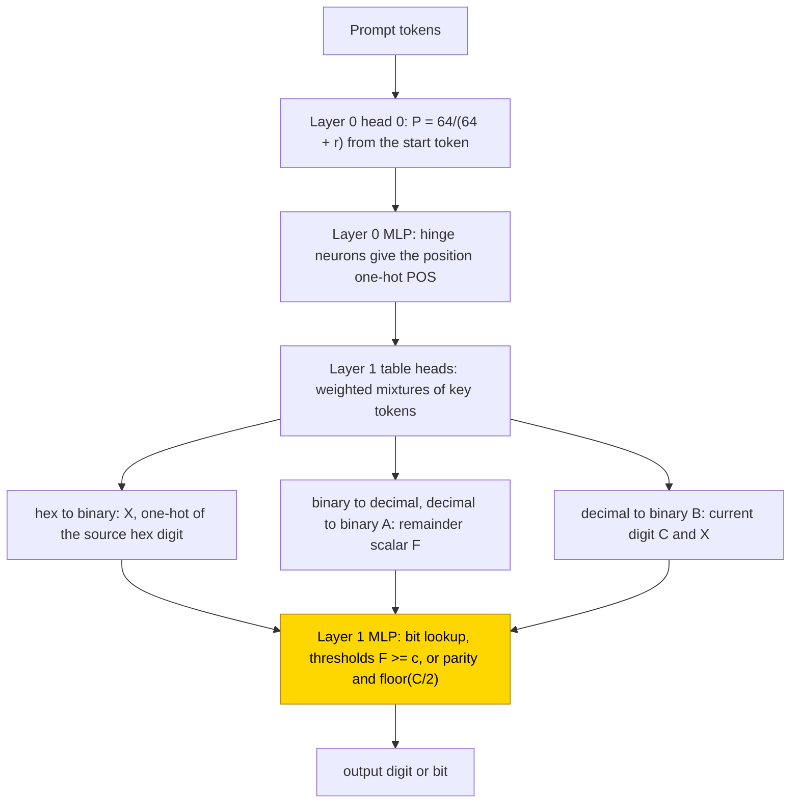
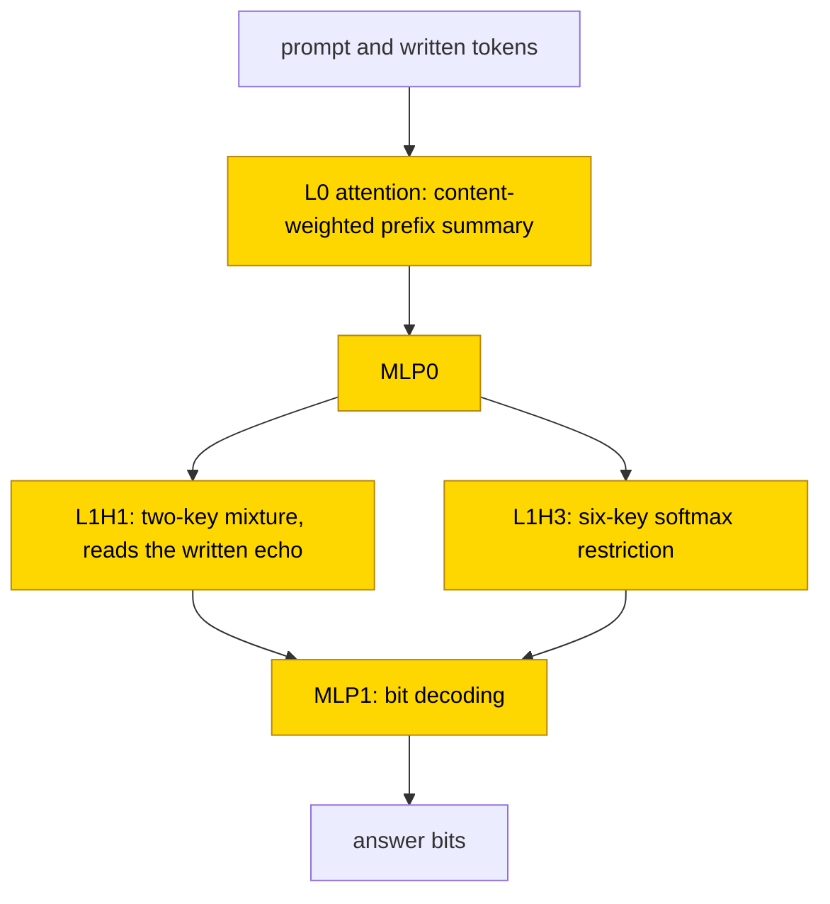

# Base conversion: hexadecimal, binary and decimal

Each hexadecimal digit names a block of binary bits, whereas conversion between decimal and binary combines place values across
digits. Two-layer transformers were tested on every number from 0 to 255, writing either the answer directly or intermediate steps
first. From-scratch hexadecimal-to-binary training reached held-out whole-output exact match ≥ .99 in 16/40 seeds; substituting a
fitted digit code gave 1.00 on all 256 inputs in 36/40 networks, including networks whose own answers were wrong, but the fit included
test inputs. With frozen hand-built attention, decimal-to-binary answer-only training reached the same criterion in 6/10 seeds. The
task is partly solved and the closed forms are partial: the digit code is a sufficient readout at the tested boundary, while later
context interventions rule out a complete digit-only routing mechanism; no test resampled everything outside the claimed circuit
([verification glossary](../GLOSSARY.md#verifying-a-circuit)).

| Fact | Value |
|---|---|
| Task | Convert x = 0..255 from hexadecimal to binary, binary to decimal, or decimal to binary |
| Input → output example | Decimal to binary, answer only: `^255=` → `11111111` (eight 1 bits) |
| Model | GPT-NeoX, 2 layers × 4 heads, d_model 256, MLP 256 ReLU, no LayerNorm, no positional encoding; PART trains only the layer-1 MLP |
| Rungs and seeds | HAND (formula-set weights) exact in 6/6 cells; PART (one learned stage) and TRAIN (all weights learned) 10 seeds per cell; TRAIN also at .8, 10 seeds ([rungs](../GLOSSARY.md#the-three-rungs)) |
| Closed form status | Partial (hex digit-code substitution 1.00 on all 256 inputs in 36/40 TRAIN nets, fit includes test; decimal-to-binary PART threshold rule; no complement test; joint digit-only scrub fails in probe seeds 1 and 4: [cohort and retained displays](#52-circuit-probes)) |
| Status | Partly solved (hex-to-binary TRAIN 16/40 and decimal-to-binary answer-only PART 6/10 reach best test ≥ .99; three carry-type cells PART 0/30, TRAIN 0/60); last run 2026-11-05; circuit probes 2026-11-06 |
| Weights | [Hugging Face: base-conversion](https://huggingface.co/jc1122/circuit-atlas-nets/tree/main/base-conversion) (6 HAND, 77 PART/TRAIN) |
| Reproduce | [Commands](#24-reproduction), run from `code/` |

## 1. Task and data

Every cell uses all 256 inputs x = 0..255, one sequence each. Hex to binary is `^h1h0=` followed by 8 bits, binary to decimal is
`^b7..b0=` followed by 3 digits, and decimal to binary is `^d2d1d0=` followed by 8 bits, where `^` is the start token. Two output
formats were studied (Table 1); the [scratchpad](../GLOSSARY.md#task-formats) format writes intermediate steps before the answer. An
output counts as correct only on exact match of all output tokens, with each next token scored after the correct preceding tokens
([teacher-forcing](../GLOSSARY.md#task-formats)). The split is over
inputs, with train fraction .5 for every cell; TRAIN was also run at .8 as a data control. The carry-type cells are binary to decimal
and scratchpad decimal to binary, whose steps carry a value from digit to digit.

*Table 1. Output formats.*

| Format | Output |
|---|---|
| `A` (answer only) | the converted number |
| `B` (scratchpad) | hex to binary: each hex digit echoed, then its 4 bits; binary to decimal: Horner doubling v_k = 2 v_(k-1) + b_k, written as 3 digits per step; decimal to binary: halving, remainder bit then quotient, then `=` and the answer |

The vocabulary has 18 tokens, and the sequence lengths are 12 / 14 (hex to binary A / B), 13 / 34 (binary to decimal) and 13 / 46
(decimal to binary). For example, decimal-to-binary answer only maps `^255=` to `11111111` (eight 1 bits).

## 2. Model

The shared architecture, optimiser and instrumentation are described in [METHODS.md](../METHODS.md), section 7. The three
[rungs](../GLOSSARY.md#the-three-rungs) are HAND (every weight set by formula), PART (frozen hand-built parts with one trained stage)
and TRAIN (all weights trained from scratch).

### 2.1 Architecture

All networks (HAND, PART, TRAIN) are GPT-NeoX-shaped with 2 layers, d_model 256, 4 heads x 64, MLP 256, ReLU, no LayerNorm, no
positional embedding or rotary embedding, a sequential residual stream, a vocabulary of 18 (start, 0-9, a-f, `=`) and an untied
readout. The parameters are embed_in [18, 256], per layer qkv [768, 256] + [768], dense [256, 256] + [256], h_to_4h [256, 256] + [256]
and 4h_to_h [256, 256] + [256], and lm_head [18, 256]; 798,720 in total. The non-zero HAND weights number 225 / 318 (hex to binary
A / B), 271 / 904 (binary to decimal) and 241 / 1,796 (decimal to binary). Layers are numbered from zero.

### 2.2 Frozen parts and trained part

PART keeps everything except the layer-1 MLP from HAND. The trained tensors are `gpt_neox.layers.1.mlp.dense_h_to_4h`, W_in [256, 256]
and b_in [256], and `dense_4h_to_h`, W_out [256, 256] and b_out [256] (131,584 parameters), initialised N(0, .02) / 0. TRAIN trains all
798,720 weights from N(0, .02) / 0. Table 2 lists the residual dimensions that the trained stage reads in PART.

*Table 2. Input blocks of the trained stage in PART (residual dimensions at the layer-1 MLP input).*

| Block | Dimensions | Content |
|---|---|---|
| TOK | 0-17 | token one-hot |
| P | 18 | position scalar of the position frame |
| POS | 19..(18 + L - 1) | position one-hot (L = sequence length) |
| HAND's layer-1 variable | following | X (16-wide one-hot code of a hex digit, or nibble), F (remainder scalar, binary to decimal and decimal to binary A) or C, X (current digit and higher digit or written bit, decimal to binary B) |

### 2.3 Training

Training used minibatches of 64 training inputs and an evaluation every 500 steps, PART for at most 10,000 steps and TRAIN for at most
50,000, with seeds 0-9. The controls were TRAIN at fraction .8 and, for decimal to binary A, one TRAIN run at learning rate 3e-4 and
weight decay .1 (fraction .8, up to 100,000 steps). The published runs packed the 10 seeds in one GPU process (one consumer GPU per
cell, 5-25 minutes); `code/` trains one network at a time on CPU.

### 2.4 Reproduction

The commands below run from `code/` after `pip install -r requirements.txt`:

```
python run.py convert check                                                   # the 6 hand-built networks, exact on all 256 inputs (min margin >= 5)
python run.py convert --variant hex2bin --fmt A --rung part  --seeds 0 1 2 3 4 5 6 7 8 9      # PART: exact within ~500 steps
python run.py convert --variant hex2bin --fmt A --rung train --steps 50000 --frac 0.8 --seeds 0 1 2 3 4 5 6 7 8 9
python run.py convert --variant dec2bin --fmt A --rung part  --seeds 0 1 2 3 4 5 6 7 8 9      # thresholds on the remainder
```

The options are `--variant hex2bin|bin2dec|dec2bin`, `--fmt A|B` and `--frac` (default .5). A smoke run is `--steps 400 --every 100
--seeds 0 1` (seconds for the answer-only cells; about 30 s per network for the long scratchpads). The output keys per network are
`best_test`, `final_test`, `grok_step` (the first evaluation with test ≥ .99), `analysis.best.exact_substituted` (substitution) and
`analysis.best.thresholds` (decimal to binary A). A full 50,000-step TRAIN network takes on the order of an hour on 4 CPU threads at
length 14. Reruns do not reproduce the published seeds bit for bit (different initialiser order, batching and hardware), but they
reproduce the cell-level outcomes.

### 2.5 Archive

The archive holds one file per network (PART: the four stage tensors; TRAIN: the full state dict; both with `test_idx`), the six HAND
files, `config.json` and `manifest.json` (seed, rung, fraction, test accuracy, circuit type, sha256): 77 trained nets (hex to binary:
all 20 PART and 40 TRAIN nets; decimal to binary A: all 10 PART and one best TRAIN-at-.8 net; one best PART and one best TRAIN-at-.8 net for each remaining cell) and 6
HAND nets. Each was reloaded and checked to reproduce its recorded test accuracy to one input. They are published on Hugging Face at
[huggingface.co/jc1122/circuit-atlas-nets/tree/main/base-conversion](https://huggingface.co/jc1122/circuit-atlas-nets/tree/main/base-conversion);
`code/convert.py` rebuilds the six HAND nets bit for bit.

## 3. Hand-built solution

All six hand-built networks share a position frame and differ in their layer-1 stage (Figure 1, Table 3).

The position frame is frozen in PART. Layer 0, head 0 attends the start token with score ln 64 and writes P = 64/(64 + r). The layer-0
MLP has one hinge neuron per position (L - 2 of them) that interpolates the position one-hot POS[m] on the P grid, with coefficients
from one linear solve. Layer-1 "table" heads use key = POS one-hot and query = the sum over designed (r, j, w) of POS_r times a row,
with score 30 + ln w.

A table head scores 30 + ln w on a designed (query position, key position, weight) triple, so the softmax over those keys, plus the
start token as a value-0 sink, returns exactly the weighted mixture of the key tokens' values. Hex to binary needs one weight 1, which
copies a digit. Decimal to binary A needs the weights 100/(111 2^i), 10/(111 2^i), 1/(111 2^i) and a sink weight 1 - 2^-i, which with
value 111 x digit yield F = N/2^i. The written bits are then subtracted with weights 2^(j-i)/254, so F is the remainder x/2^i minus the
higher bits, in [0, 2), and the bit is [F >= 1].

*Table 3. The per-cell stage of the hand-built networks (layer-1 heads, then MLP).*

| Cell | Layer-1 heads | MLP stage | Readout | Used heads + neurons |
|---|---|---|---|---|
| hex to binary A | head 0 reads the source hex digit (h1 for answer bits b7..b4, h0 for b3..b0): X = its one-hot | 4 neurons relu(sum over v with bit j set of X_v + gate_j - 1) | output one-hot, '1' by 2 x neuron, '0' by bias | 1 + 4 |
| hex to binary B | as A; also copies the echoed digit | 8 neurons (bit-1 and bit-0 per j) | same | 1 + 7 |
| binary to decimal A | head 0: exact weighted mixture of the 8 bits, F = N/s (s = 100, 10, 1); head 1 subtracts the written digits | 18 step neurons [F >= c], c = 1..9 | logit_d = Z_d - Z_(d+1) (thermometer) | 3 + 18 |
| binary to decimal B | head 0: F = 2 x previous value digit + new bit | 38 steps at 1..19 | floor mod 10 | 1 + 37 |
| decimal to binary A | head 0: F = N/2^i (mixture of d2, d1, d0); head 1 subtracts the written higher bits | 2 neurons: [F >= 1] | '1' vs bias '0' | 2 + 2 |
| decimal to binary B | heads read the current digit C and X (higher digit, or the written bit) | 26: parity of X (hinges) and floor(C/2) | quadratic logit in the digit | 2 + 26 |

All six networks are exact on 256/256 inputs (token accuracy 1.0000), with a minimum logit margin of 10.0 / 10.0 (hex to binary),
9.0 / 9.9 (binary to decimal) and 8.8 / 5.0 (decimal to binary), checked with `python run.py convert check`. Answer only is smaller
than the scratchpad here, because with a fixed length one mixture head reads both the input and the answer digits already written.

In Figure 1, the frozen position frame addresses the table heads. Depending on the conversion, these deliver the source hexadecimal digit code X, remainder F, or current digit C and X. The final MLP turns those variables into an output digit or bit. Only that final stage is trained in PART.



*Figure 1. The hand-built networks. A frozen position frame locates every position; layer-1 table heads deliver the cell's variable
(the hex digit one-hot X, the remainder F, or C and X); the layer-1 MLP decodes it. The shaded layer-1 MLP is the part that PART
replaces with a trained stage.*

## 4. What training finds

Table 4 summarises every cell. Test is exact match on held-out inputs; n is the number of nets whose best test reached .99; grok is
the first evaluation with test ≥ .99. Best / final are the best evaluation over the run and the last evaluation; final weights can be
far lower.

*Table 4. Results per cell (ranges over 10 seeds).*

| Cell | PART best / final, n, grok | TRAIN .5 best / final, n, grok | TRAIN .8 best / final, n, grok |
|---|---|---|---|
| hex to binary A | 1.00 / 1.00, 10/10, 500 | .70-.99 / .52-.86, 1/10, 35.5k | .94-1.00 / .08-.98, 6/10, 8.5k-23.5k |
| hex to binary B | 1.00 / 1.00, 10/10, 500 | .81-.99 / .75-.99, 2/10, 39k and 40.5k | .96-1.00 / .02-1.00, 7/10, 3k-29k |
| binary to decimal A | .56-.76 / .50-.71, 0 | .02-.05 / .00-.03, 0 | .06-.19 / .00-.10, 0 |
| binary to decimal B | .40-.48 / .27-.48, 0 | .23-.47 / .03-.44, 0 | .31-.73 / .04-.63, 0 |
| decimal to binary A | .98-1.00 / .89-1.00, 6/10, 500-8k | .04-.16 / .02-.09, 0 | .12-.58 / .04-.52, 0; lr 3e-4, wd .1: .10-.25, 0 |
| decimal to binary B | .33-.51 / .15-.42, 0 | .11-.28 / .00-.18, 0 | .29-.62 / .13-.35, 0 |

### 4.1 Hex to binary

Hex to binary is the only conversion learned from scratch: it groks in TRAIN in 1/10 seeds at fraction .5 and 6/10 at .8
(answer only), and in 2/10 and 7/10 (scratchpad). 38 of the 40 TRAIN nets carry HAND's variable, the one-hot of the source
hex digit (substituting it keeps exact match at 1.00 in 36 of 40), read by 2-4 layer-1 heads (4-8 heads in all, counting layer 0) and
310-490 neurons, where HAND uses 1 head and 4-7 neurons (1 + 4 / 7 in Table 3).

In PART all 20 networks were exact by step 500 (20/20). The only head read is the frozen nibble head, and the trained MLP is a lookup on
the nibble one-hot: substituting HAND's X fit gives 1.00. The nibble as a linear value does not suffice for format B (.02-.04). The
networks use 7-38 (A) and 51-72 (B) neurons, against HAND's 4 / 7.

Trained from scratch, the networks first memorised, by 2.5-13k steps, and then [grokked](../GLOSSARY.md#counting-results) at
3k-40.5k steps (16/40 nets). Training was unstable afterwards: the final test fell as low as .02 while the best snapshot was exact.
38/40 nets are of the nibble one-hot type, meaning that one hex-digit one-hot fit of the residual after layer 1 suffices as a readout;
this is not a complete native mechanism. The early screen described 2-4 layer-1 heads with fixed attention patterns (2-7 keys, cosine
to HAND's pattern .5-.97), after 2-4 layer-0 heads averaging all positions. Later causal probes instead found content-weighted prefix
summaries and, in scratchpad examples, substantial use of the written digit echo (Section 5.2). In all layers the networks use 4-8
heads + 310-490 neurons, against HAND's 1 + 4 / 7.

### 4.2 Decimal to binary, answer only

In PART all 10 networks read HAND's remainder F (substitution .95-1.00, equal to the networks' own accuracy), and 6/10 reach test ≥ .99
at their best. They learn HAND's rule with theta in [.94, 1.06] instead of 1: each answer bit is a single threshold [F >= theta], and the network agrees with this rule on .984-1.000 of inputs per position.
Trained from scratch, no network reached .99, also not with learning rate 3e-4 and weight decay .1.

### 4.3 Carry-type cells

The three carry-type cells, binary to decimal in both formats and decimal to binary with a scratchpad, fail the best test ≥ .99
criterion in PART (0/30 seeds) and TRAIN (0/60 across fractions .5 and .8). The broader non-hex TRAIN group is 0 of 80 nets: it also
includes decimal to binary A at both fractions, which likewise has no success in Table 4. Binary to decimal A in PART reads F: in the
substitution-analysis batch, substituting F raises exact match from .72-.81 to .82-.94 in 8/10. Its errors are off-by-one digits in tens and units, which points to a blurred threshold ladder plus memorising
features, with about 200 neurons against HAND's 18. In binary to decimal B in PART, F alone gives .02, and the read tokens (or the
current token) are needed (.54-.64). All carry-type TRAIN nets use all 8 heads and both MLPs (420-510 neurons) and have no closed form.

Per-cell diagnostics (used parts, patching, interchange, edges) are in Appendix B. In short, the top patched component in PART is
the frozen read head L1H0 (hex to binary, 16/20) or the trained L1 MLP. Edge attribution in PART matches the HAND wiring (jaccard 1.0,
hand_recall 1.0; 43/48 solved nets trusted, also in the failed PART cells). TRAIN wiring differs (jaccard .11-.50; heads not aligned,
which is a different-wiring flag, not a match score), and the top patched component in TRAIN is MLP1 (63/64 solved). In decimal to
binary B, C and X are present but not linear (PART interchange .47/.63, DAS .98). In binary to decimal, F is neither linearly used nor found by DAS
(interchange ≤ .17, DAS ≤ .48 in every rung; HAND 0 / .32).

## 5. Mechanism and verification

### 5.1 Closed forms

For hex to binary, bit_j = bit_j(X) of the read nibble X. Substituting the per-position least-squares fit of the nibble one-hot for the
residual after layer 1 gives exact 1.00 on all 256 inputs in 36 of 40 TRAIN nets (A .5: 9/10, A .8: 10/10, B .5: 8/10, B .8: 9/10;
the others .94), above the nets' own accuracy (.85-.99). This supports a sufficient digit-code readout and can repair native errors;
it does not establish how the trained heads compute that code or prove that the remaining residual components are irrelevant.

For decimal to binary A in PART, bit_q = [F_q >= theta_q] with theta_q in [.94, 1.06]. The network agrees with its own best-threshold
rule on .984-1.000 of inputs per answer position; with theta = 1, HAND's rule, the rule is HAND and exact. All errors of the networks
lie between theta and 1, at the high bits where F's grid is finest (1/128).

These closed forms are supported by substitution. The substitution fit uses all 256 inputs, test included. A joint scrub of the
nibble-only story fails (Section 5.2), and no [resample ablation of the complement](../GLOSSARY.md#verifying-a-circuit) is reported,
so neither closed form is verified under the atlas rule, and the carry-type cells have none.

### 5.2 Circuit probes

Circuit probes were run on best snapshots on 2026-11-06, for decimal to binary PART on its final snapshot (Table 5). All 256 inputs
were used, teacher-forced, and fits used training rows only. The probe records used the historical label “verified” for a causal
intervention plus an accuracy-preserving substitution, a weaker test than the atlas rule; here these are substitution-supported
components, not atlas-verified circuits. The records labelled causal evidence alone “supported”. Scores are full / held-out exact, ablation numbers are
accuracy retained, and components are zero-indexed.

*Table 5. Components probed (causal intervention plus substitution).*

| Component | Role | Evidence (causal intervention plus substitution) |
|---|---|---|
| Hex TRAIN A seed 0 / B seed 1: L0 attention | content-weighted prefix summary, not a position clock | equal non-BOS affinities: full exact .215 (A) / .324 (B); rank-1 substitution 1/1 each, drop 0 |
| Hex TRAIN B seeds 1 / 4: L0 attention + MLP0 + MLP1 | jointly substituted operational circuit | 48 + 80 / 48 + 48 neurons: full / held-out / agreement 1/1/1 in both seeds |
| Hex TRAIN B seed 1: L1H1 | two-key mixture; echo-to-bit route | echo value-edge ablation .250 / .227; head substitution 1/1, drop 0 |
| Hex TRAIN B seed 1: L1H3 | six-key softmax restriction | substitution 1/1/1; top-2 .984, top-5 .996: not a two-key copy |
| Hex PART A / B seed 0: L1H0 + MLP1 | original-nibble read, bit decoding | head ablation .0039 / 0; 12- / 16-neuron substitutions 1/1, drop 0 |
| Decimal to binary PART seed 3: MLP1 | remainder thresholds incl. native errors | F interchange 1.000 on 1254 changed targets; threshold substitution .992 / 1, agreement 1 |
| Failed binary to decimal PART seed 2: MLP1 | token-conditioned decision intervals | F-only interchange .912, same-token donors 1.000; interval substitution .844 / .758, 100% token agreement |

The closed forms behind Table 5 are as follows. A prefix head is
`H_h(t,c) = Σ_u c_u exp(λ_h(t)κ_h(u)) V_h(u) / Σ_u c_u exp(λ_h(t)κ_h(u))`, with prefix counts c, learned OV values V and rank-1
token-score factors λκ. An MLP is `F_R(z) = b + Σ_{n∈R} v_n ReLU(w_n·z + a_n)`, with the original input rows and refitted outputs; in
answer-only seed 0, MLP1 needs only R = {182, 86, 130, 244} (1/1/1), but its compact L0 and MLPs together give only .977 / .942, so
they are not a joint circuit. The two-key head is `H(q) = σ(ℓ_qa − ℓ_qb) OV(x_a) + (1 − σ) OV(x_b)`, with key pairs {1,2} at q3, {4,2}
at q4–8 and {9,4} at q9–12. Decimal PART is `[F ≥ θ_q]` for q4..11 with θ = (.995, 1.0004, .981, .984, .915, .878, .755, .541): .992 / 1,
reproducing both native errors. In the failed binary PART network, an upper envelope of query- and token-conditioned ReLU logit lines
explains all 43 wrong tokens; for example, after tens token 5 the units ladder jumps from 5 to 8 at F = 6.524. HAND's floor(F) ladder
repairs that network to 1/1, which is a repair and not its mechanism.

Supported only: in hex B TRAIN seed 1, echoed-digit transplants through H1 flip .179 / .263 of targets (original digits .016 / .005),
and original-digit transplants through H3 flip .095 / .152 (echoes 0). The bits are therefore read mainly from the written echo,
unlike HAND (Figure 2).

The probes also set limits. A joint scrub of the selected-nibble-only story fails (.556 / .923 in seeds 1 / 4; .379 / .686 after
pruning), and installing every accepted head form at once gives .992 / .996 full exact, not identity. The scrub values retain the
circuit-probe report's rounded display on the full teacher-forced input grid; this is a semantic-hypothesis test, not complement
resampling. Coordinated head and frame context remains unexplained.

Size, from greedy deletion at ≥ .99 × native (not minima): hex B TRAIN seed 1 needs 8 heads + 347 neurons and seed 4 8 + 258 (full /
held-out .992 / 1 and .992 / .981); under the same pruning HAND needs 2 + 20 and 1 + 4.

The seed census covers 42 solved seeds and gives causal classes, not basins: hex PART A 10 single-original-head; hex PART B 10
original-driven (echo values unused); hex TRAIN A 7 distributed original + written/context; hex TRAIN B 9 echo-dominant mixed/context
(neither original-only nor echo-only routing preserves all decisions); decimal to binary PART 6 F-threshold-compatible (final
snapshots, full .965–.992).

Two statements need reconciling with Section 4. Section 4.1 describes the hex TRAIN layer-0 heads as averaging all positions; the
probes show that the prefix content matters (equalising affinities drops exact to .215 / .324). The θ_q above are from the later final-snapshot probe, whereas
[.94, 1.06] in Section 5.1 is the earlier best-agreement threshold summary on the discrete F grid (Appendix A). At the low bits F's
grid is coarse, so θ values between the same adjacent grid points give the same decisions; the parameter fits need not coincide. The 12 / 16-neuron PART decoders are refitted replacements, not the 7–38 / 51–72 used-neuron counts from ablation.

In Figure 2, the content-weighted prefix summary passes through MLP0 to the echo-reading L1H1 and restricted-softmax L1H3 routes; MLP1 decodes the bits. All these computational blocks were trained. Status remains partial: local substitutions pass, the joint digit-only scrub fails, and complement resampling was not reported.



*Figure 2. The probed hex-to-binary TRAIN scratchpad circuit (seed 1). The shaded L0 attention, MLP0, L1H1, L1H3 and MLP1 are trained.
L0 attention, MLP0 and MLP1 are jointly substituted with full / held-out / agreement 1/1/1 (Table 5); the bits mainly use the written
echo. Status is partial: the digit-code readout is sufficient, but a joint digit-only scrub fails and no complement test was reported.*

### 5.3 Relation to the hand-built network and to published work

The sufficient readouts resemble HAND: hex to binary admits a per-digit lookup in PART and TRAIN, and decimal to binary A in PART
admits a remainder threshold. Their status remains partial, with no complement test; TRAIN's native content- and echo-dependent
routing is not reduced to a digit-only circuit. The trained nets are 50-100x larger than HAND (4-8 heads and 310-490 neurons against 1
head and 4-7 neurons), and TRAIN spreads the digit read over several heads. HAND's answer-only mixture heads (place-value weights,
written digits subtracted) were not found by training: no trained net solved a carry-type cell from scratch. Scratchpads for
intermediate computation were introduced by [Nye et al. (2021)](#references), and output order and scratchpads in arithmetic were
studied by [Lee et al. (2023)](#references). No published circuit for these conversions was checked for this entry, so no comparison
to the literature is made.

## 6. Limitations and open questions

Length generalisation is not testable: every cell has a fixed input width and sequence length, and HAND and PART read by absolute
position (the position one-hot from the start-token head). The substitution fit uses all 256 inputs, test included, and mean-ablation
sizes do not count the input-independent position frame. The TRAIN outcome depends on the data size, 128 (fraction .5) or 205 (.8)
training inputs; the carry-type cells may need more data, more steps or a different optimiser, and learning rate 3e-4 with weight
decay .1 did not help decimal to binary A. Final weights are unstable under weight decay 1 (a net can fall from exact to .02 after
grokking), so the best numbers are best snapshots on the test split, an optimistic selection. With 10 seeds per cell, "n = 0" means
that no seed reached .99, not that none can.

## 7. Prediction record

The prediction was recorded in the design notes before any PART or TRAIN run (committed 2026-11-04 23:24; the first training run
finished after 23:44). It was to look in the trained nets for weighted-mixture attention heads (place-value weights) versus a
per-digit lookup, and for thresholds on a scalar remainder (answer-only formats) versus doubling and halving tables (scratchpad
formats). It held at the readout level in two places: a per-digit lookup suffices for hex to binary (PART and TRAIN), and a remainder
threshold describes decimal to binary A in PART. These are partial forms, not complete verified circuits: the fit included test
inputs, the digit-only joint scrub failed, and no complement test was reported. The mixture-head prediction was not testable, because no carry-type cell was learned from scratch. No
prediction about grokking, network size or which cells would fail was recorded; the failure of the carry-type cells and the 50-100x
size gap are post-hoc observations.

## Appendix A. Weights excerpt and reading

HAND hex to binary A (non-zero pattern). Layer-1 head 0 has 8 / 11 / 16 non-zero entries in q / k / v. The four MLP neurons j = 0..3
have bias -1, weight 1 on X_v for the 8 nibble values with bit j set (j = 0: v = 1, 3, 5, ..., 15; j = 1: 2, 3, 6, 7, ...; j = 2: 4-7,
12-15; j = 3: 8-15) and weight 1 on the position one-hot entries of the answer slots that carry bit j (j = 0: slots 6 and 10; j = 1: 5,
9; j = 2: 4, 8; j = 3: 3, 7).

HAND decimal to binary A. The two step neurons have weight 128 on F and bias -127 and -128, with output weights +2 / -2 on the '1'
logit, that is, [F >= 1] on the 1/128 grid; the value rows are digit value x 111 (head 0) and x -254 (head 1).

Table A1 is computed from the archived PART hex to binary A network, seed 0 (test 1.00): a forward pass on all inputs, grouped by the
source digit. It gives the mean over inputs of logit('1') - logit('0') at the answer bits from the first hex digit (b7..b4), by its
value v.

*Table A1. PART hex to binary A, seed 0: mean logit('1') - logit('0') by source digit. Bold marks positive values.*

| v | b7 | b6 | b5 | b4 | bits of v |
|---|---|---|---|---|---|
| 0 | -11.9 | -11.2 | -10.8 | -11.1 | 0000 |
| 1 | -9.2 | -8.5 | -7.9 | **7.4** | 0001 |
| 2 | -9.2 | -7.5 | **7.4** | -9.2 | 0010 |
| 5 | -8.6 | **7.9** | -8.0 | **8.8** | 0101 |
| 8 | **7.9** | -9.0 | -8.0 | -8.5 | 1000 |
| a | **8.3** | -7.8 | **7.9** | -8.2 | 1010 |
| d | **10.1** | **7.5** | -7.5 | **9.8** | 1101 |
| f | **12.3** | **11.0** | **10.5** | **11.4** | 1111 |

The sign pattern equals the bits for all 16 values; the h0-driven bits b3..b0 give the same table to within 1.

Table A2 gives, for PART decimal to binary A, the best threshold theta per answer bit with its agreement with the network
(`convert.thresholds`); bits b3..b0 are 1.000 (1.00) in every seed.

*Table A2. PART decimal to binary A: best threshold per answer bit (agreement 1.00 unless shown).*

| seed (test) | b7 | b6 | b5 | b4 |
|---|---|---|---|---|
| 0 (.953) | 1.008 | 1.000 | 1.031 | 1.000 |
| 1 (.945) | 0.961 | 1.000 | 0.969 | 1.000 |
| 2 (.922) | 1.055 | 0.984 | 0.938 (.98) | 1.000 |
| 3 (1.000) | 1.000 | 1.016 | 1.000 | 1.000 |
| 4 (.891) | 1.016 | 1.000 | 1.063 | 1.063 |
| 9 (.977) | 1.000 | 1.000 | 1.000 | 1.000 |

For PART hex to binary B and TRAIN hex to binary, the substitution results are in Section 5.1. The A TRAIN net at fraction .8, seed 0
(test 1.00) has the same sign pattern as Table A1 but with logit differences of 6-42 instead of 7-12: the extra residual components
inflate the margins.

Reading. In hex to binary the frozen head delivers the nibble one-hot, so the stage is a 16-entry table per answer bit; a ReLU layer
realises it as a bit-pattern lookup. The sign table above is HAND's bit pattern, with the same +-8 magnitude for all values (HAND's own
margin is 10). In decimal to binary the frozen heads deliver F exactly (a multiple of 1/2^i), so a learned single step must sit between
the largest F below 1 and 1. The 128 training inputs pin theta only to the nearest observed F values, so theta drifts by up to .06 at
the high bits, where the F grid is finest and unseen values fall between theta and 1.

## Appendix B. Detailed evidence

*Table B1. Diagnostics per cell and rung.*

| cell | HAND | PART | TRAIN frac .5 | TRAIN frac .8 |
|---|---|---|---|---|
| hex2bin A | 1+1; L1H0; X 1/1; edges 1/1 | 1+1; L1H0 6, MLP1 4; X 1/1; edges 1/1 (10); 1 / 1 | 7-8+2; MLP1 9/9; X untested (nf < 30); edges .50/.67 (3); .85-1 / .54-.93 | 7-8+2; MLP1 10/10; X untested; edges .20/.67 (7); .98-1 / .09-1 |
| hex2bin B | 1+1; L1H0; X 1/1; edges 1/1 | 1+1; L1H0 10/10; X .94/1; edges 1/1 (9); 1 / 1 | 5-8+2; MLP1 9, MLP0 1; X 1/1; edges .33/.50 (7); .91-1 / .87-1 | 4-8+2; MLP1 10/10; X 1/1; edges .33/.50 (9); .96-1 / .01-1 |
| dec2bin A | 2+1; MLP1; F 1/1; edges untrusted | 2+1; MLP1 10/10; F 1/1; edges 1/1 (4 of 9); final .93-.99 | * 5-8+2; MLP1 9, MLP0 1; F .87/.87; edges .25/.50 (4); final .11-.55 | * 8+2; MLP1 7, MLP0 3; F .89/.95 (lr 3e-4: .82/.94); edges .25/.40 (8); final .24-.86 |
| dec2bin B | 2+1; MLP1; C .24/.49, X .42/.42; edges 1/1 | * 2+1; MLP1 10/10; C .47/.98, X .63/.98; edges 1/1 (5); final .21-.52 | * 0-8+0-2; MLP0 7, MLP1 2; C .18/.91, X .32/.86; edges .25/.40 (7); final .00-.52 | * 8+2; MLP0 4, L1H2 2; C .15/.93, X .29/.44; edges .25/.40 (4); final .24-.66 |
| bin2dec A | 3+1; MLP1; F 0/.32; edges untrusted | * 2+1; MLP1 10/10; F .11/.42; edges 1/1 (4); final .71-.81 | * 7-8+2; MLP0 6, MLP1 4; F .07/.30; edges .11/.40 (8); final .43-.51 | * 8+2; MLP0 6, MLP1 4; F .05/.30; edges .11/.40 (10); final .73-.80 |
| bin2dec B | 1+1; L1H0; F .09/–; no edges | * 1+1; MLP1 10/10; F .17/.48; edges 1/1 (8); final .43-.64 | * 8+2; MLP0 10/10; F .10/.31; edges .20/.33 (6); final .08-.71 | * 0-8+0-2; MLP0 7, MLP1 2; F .12/.31; edges .20/.33 (7); final .03-.88 |

Key: medians over solved nets (exact ≥ .9); * = cell without a solved net, all 10 nets. Each cell lists the used heads+MLPs; patch,
the component with the largest patching drop (number of nets); var inter/DAS, the linear [interchange](../GLOSSARY.md#analysis-measures)
flip / DAS flip at the best layer (nf = number of flips tested); edges, the EAP-IG jaccard/hand_recall against HAND over trusted nets
(spearman_exact ≥ .8, the exactness check of the edge attribution), with their number in brackets;
and the diagnostic exact match best / final.

## What to read next

Read [output order in base conversion](output-order-base-conversion.md) for a comparison of how answers are written, or [binary addition](binary-addition.md) for another case where fixed routing and learned arithmetic have different length limits.

## References

- Lee, N., Sreenivasan, K., Lee, J. D., Lee, K., & Papailiopoulos, D. (2023). Teaching arithmetic to small transformers.
  *arXiv preprint*. https://doi.org/10.48550/arxiv.2307.03381 (output order, scratchpads)
- Nye, M., Andreassen, A. J., Gur-Ari, G., et al. (2021). Show your work: Scratchpads for intermediate computation with language
  models. *arXiv preprint*. https://doi.org/10.48550/arxiv.2112.00114 (scratchpads)
