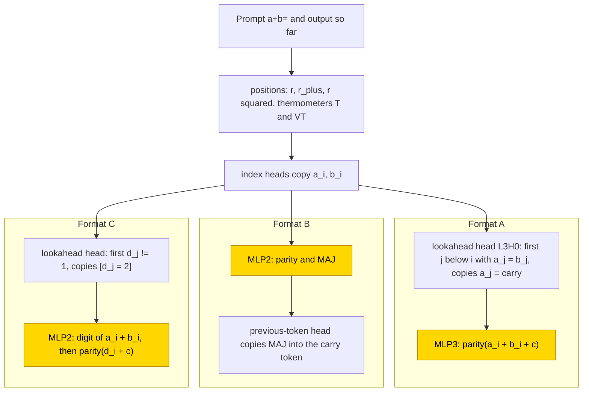
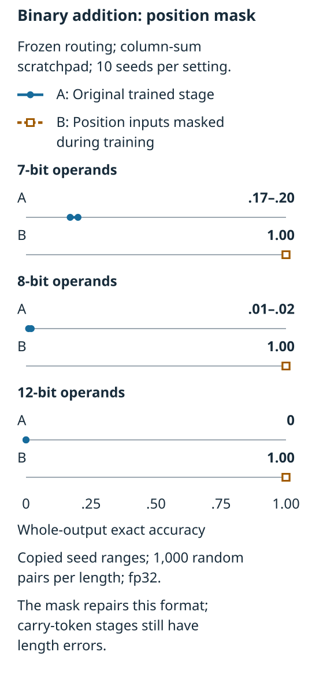
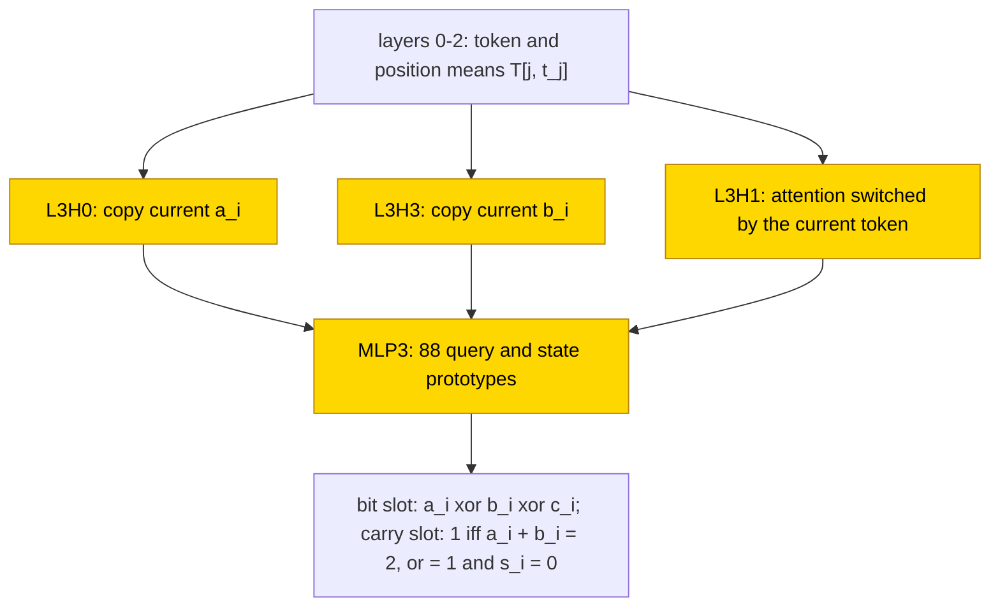

# Binary addition

Binary addition tests whether a network can pass a carry across columns instead of memorising short sums. Four-layer transformers were trained on 6-bit operands, either from scratch or with hand-built routing frozen and one feed-forward block learned. A column-sum scratchpad, which writes each pair of input bits' sum before the answer ([glossary](../GLOSSARY.md#task-formats)), exposed a position shortcut: preventing the learned block from reading absolute position made it exact on 1000 sampled 12-bit pairs in all 10 independent training runs (seeds, [glossary](../GLOSSARY.md#counting-results)). The from-scratch networks still failed at 12 bits, so the task is partly solved across the tested lengths. The local sum-table formula is partial, supported by replacement only in the formats and seeds listed below, without a test that resamples everything outside the claimed circuit (the complement, [glossary](../GLOSSARY.md#verifying-a-circuit)); the separate from-scratch replacement is seed-specific and its pruned circuit fails stronger intervention checks.

| Fact | Value |
|---|---|
| Task | Add two n-bit binary numbers; train at n = 6 and test longer inputs, with answer-only and two intermediate-step formats |
| Input → output example | n = 6, a = 5, b = 3 → answer only s_6..s_0 = 0001000 (8); 1 + 1 → 10 in binary |
| Model | 4 layers × 4 attention heads; running-state and feed-forward widths 256, no state normalisation or added position vectors. Frozen-routing runs train one feed-forward block (MLP3 or MLP2 by format) |
| Rungs and seeds | Formula-set reference (HAND); one stage on frozen routing (PART), 10 seeds per format plus position-masked carry-token and column-sum runs; from scratch (TRAIN), 10 seeds per format, with retries retained |
| Closed form status | Partial (PART sum-bit lookup: 1.00 in 10/10 answer-only and column-sum seeds, 3/10 carry-token seeds; complement not tested. TRAIN replacement is seed-specific, with failed pruned-circuit scrubbing) |
| Status | Partly solved (in-range TRAIN outcomes reported as 10/10 per format after retries; selected snapshots have qualifications below. Every TRAIN net fails at n = 12); last run 2026-11-05 |
| Weights | [Hugging Face: binary-addition](https://huggingface.co/jc1122/circuit-atlas-nets/tree/main/binary-addition) (recorded publication inventory: 62 networks; earlier task archive record: 59, unresolved; [archive scope](#25-archive)) |
| Reproduce | Not available yet: training code for this task is not yet in `code/` |

## 1. Task and data

The prompt is `a+b=` and the target is a + b, where a and b are n-bit binary numbers. Three output formats were studied (Table 1); format
C is a scratchpad ([glossary](../GLOSSARY.md#task-formats)) that writes the column sums first. The training data are all 4096 pairs at
n = 6, split 40% train / 60% test, and an output is correct only on exact match of all output tokens. Length generalisation was tested in
fp32 on CPU on 1000 random pairs at n = 7, 8 and 12. For example, at n = 6, operands a = 5 and b = 3 give 8, written as the
seven-bit answer 0001000. In ordinary binary notation, 1 + 1 is 10. A carry is the extra unit passed into the next column when a
column total reaches two.

*Table 1. Output formats.*

| Format | Output |
|---|---|
| `A` (answer only) | s_n..s_0, most significant bit first (MSB first) |
| `B` (carry tokens) | s_0 k_1 s_1 .. k_n, least significant first (LSB first), carry token k ∈ {`c`, `.`} |
| `C` (column sums) | column sums d_{n-1}..d_0 ∈ {0,1,2}, `=`, then s_n..s_0 |

## 2. Model

The shared architecture and instrumentation are described in [METHODS.md](../METHODS.md). The three
[rungs](../GLOSSARY.md#the-three-rungs) are HAND (every weight set by formula), PART (frozen hand-built parts with one trained stage)
and TRAIN (all weights trained from scratch).

### 2.1 Architecture

All networks are GPT-NeoX-shaped decoders, transformers that predict the next token from earlier tokens, with 4 layers × 4 heads, d_model 256, d_head 64, a feed-forward block
([MLP](../GLOSSARY.md#standard-machine-learning-terms)) of 256 ReLU units, no LayerNorm and no positional encoding
(NoPE). Here d_model is the running-state width and d_head each attention head's vector width. A head reads information from earlier positions; ReLU keeps positive responses and sets negative ones to zero. LayerNorm would centre and rescale the running state, while NoPE means no added position vectors. The vocabulary has 9 tokens (BOS, `0 1 2 + = . c`), and there are 1,583,616 parameters, the same for every rung. BOS marks the start of the sequence. Layers are
numbered from zero, so L3 is the last layer.

### 2.2 Frozen parts and trained part

PART trains only the stage MLP: layer 3 in format A and layer 2 in formats B and C (dense_h_to_4h [256, 256] + bias, dense_4h_to_h
[256, 256] + bias). The stage reads TOK (the token one-hot), X1 and X2 (the operand bits), X3 (in C, the column sum d_i), CY (the carry),
PH (the phase in C) and the position blocks P, R, R2, RP, T and VT (Section 3). In the mask retry the columns of the position blocks are
zeroed.

### 2.3 Training

The original result summary was dated 2026-11-05; the later circuit probes used best snapshots on 2026-11-06. All runs used AdamW
with betas (.9, .98), batch 256 and cross-entropy on the output tokens; accuracy was evaluated every 500 steps, and
the seed sets both the initialisation and the split. Table 2 gives the runs. Length was evaluated in fp32 on CPU, because TF32 breaks
HAND from n = 7 ([glossary](../GLOSSARY.md#hand-built-machinery)). All runs used one GPU class (consumer 10-12 GB).

*Table 2. Training settings per run.*

| Run | Steps | Learning rate | Weight decay | Schedule | Snapshot |
|---|---|---|---|---|---|
| PART | 10k | 1e-3 | 1 | TF32; mask retry fp32 | |
| TRAIN run 1 | 20k | 1e-3 | 1 | | final weights |
| TRAIN run 2 | 30k | 1e-3 | 1 | clip 1 | best-train |
| TRAIN run 3 (A, C) | | 3e-4 | .1 | warmup 1000 + cosine, clip 1 | best-train |
| TRAIN run 4 (A) | 40k | 1e-3 | .1 | warmup 1000 + cosine over 40k, clip 1 | final (= best) |

### 2.4 Reproduction

Reproduce: not available yet: training code for this task is not yet in `code/`; the weights, held-out splits and recorded
accuracies are on Hugging Face at
[huggingface.co/jc1122/circuit-atlas-nets/tree/main/binary-addition](https://huggingface.co/jc1122/circuit-atlas-nets/tree/main/binary-addition)
(62: 3 HAND, 30 PART, 20 PART with position mask, 9 TRAIN).

### 2.5 Archive

The Hugging Face folder holds `hand_{A,B,C}`, `part_<F>_s<seed>` and `partmask_<F>_s<seed>` (the 4 stage tensors + test_idx, all
seeds), `train_<F>_s<seed>` (full networks, 3 seeds per format: A 0/2/7, B 2/5/8, C 1/2/9), `config.json` and `manifest.json`
(sha256). Each network was reloaded in fp32 and checked against its recorded test accuracy.

The earlier task archive record lists 59 networks, whereas the publication inventory above lists 62. The available task record does
not reconcile these counts. The reload statement describes the recorded archive check, not a fresh inventory or completeness audit.

## 3. Hand-built solution

The hand-built networks first compute positions. A uniform head gives 1/(r+1) at position r, a hinge MLP turns it into r, an anchor head
on `+` gives r_plus, further hinge MLPs give r², and the thermometer codes mark which position thresholds have been passed:
T[m] = [r ≥ m] and VT[m] = [r − r_plus ≥ m] ([glossary](../GLOSSARY.md#standard-machine-learning-terms)). Index heads, attention
heads that fetch a token at a computed position ([glossary](../GLOSSARY.md#hand-built-machinery)), score
−20(r_j − t)², with t linear in r and r_plus, and copy the bit at position t. The formats then differ (Figure 1).

Format A. A lookahead head attends to the first column j < i with a_j = b_j and copies a_j, which is the carry into column i (the `=`
sentinel gives 0). The MLP writes parity(a_i + b_i + c).

Format B. The MLP writes the parity and MAJ, the majority of (a, b, c), which is the carry out; a previous-token head copies MAJ into the
carry token.

Format C. A lookahead head attends to the first d_j ≠ 1 and copies [d_j = 2]. The MLP writes the digit of a_i + b_i in phase 1 and
parity(d_i + c) in phase 2.

The networks use 3 + 8 / 3 + 6 / 4 + 10 heads + neurons (A / B / C). They are exact on all pairs for n = 1..6 and on 2000 pairs per n =
7..12, with minimum logit margin 30.

In Figure 1, frozen position and index heads fetch the operand bits. Answer-only A uses carry lookahead before MLP3 writes parity; carry-token B uses MLP2 to write parity and carry, then copies the carry token; column-sum C combines lookahead with MLP2's two phases. Only the named MLP is trained in each PART cell. Learned sum-table status remains partial, with complement untested.

*Figure 1. The hand-built binary adders: A is answer only, B interleaves carry tokens, and C writes column sums first. Gold MLP3
or MLP2 is the only block trained in each PART network. The learned sum tables have partial status: substitution is supported in
the named seed subsets, but complement resampling was not reported.*

## 4. What training finds

Table 3 summarises every cell; Appendix B gives the full diagnostics. The source's TRAIN success rule was train accuracy 1.0 and
held-out exact match ≥ .99 at an evaluation. Its reported outcome count and a later re-score of a saved snapshot are not always
the same measurement. In particular, column-sum run 3 was reported as 10/10, while its best-train snapshots scored .988–1.000;
the diagnostics display .99–1 for those snapshots. Both recorded ranges are retained here.

*Table 3. Results per cell (test exact match at n = 6 unless stated; ranges over seeds; run numbers as in Table 2).*

| Cell | PART | PART with position mask | TRAIN |
|---|---|---|---|
| A | f(sum) 10/10, exact at n = 12 | – | run 2 (wd 1) 4/10; run 3 (lr 3e-4) 1/10 (memorises: train 1.0, test .53-.98); run 4 10/10 |
| B | lookup(a, b, c, pos) 7/10; f(sum) 3/10 | n = 7 .99-1.00, n = 12 .53-1.00 (was .00-1.00); f(sum) 6/10 | run 2 10/10 (≥ .99 at 3-8.5k) |
| C | f(sum, phase) 10/10, but n = 12 = 0 | n = 7/8/12 = 1.00 in 10/10 (was .17-.20 / .01-.02 / 0; 49-87 neurons) | run 2 9/10 (6.5-19.5k); run 3 10/10 |

Length for TRAIN, all cells: n = 7 .00-.76, n = 8 ≤ .07, n = 12 ≤ .001.

### 4.1 Stage on frozen parts (PART)

In PART, test accuracy equalled train accuracy from step 500 in 28/30 original networks, with no delayed-generalisation phase
([grokking](../GLOSSARY.md#counting-results)). A sum-bit function f(a + b + c), where c is the incoming carry, reproduced the trained
stage under substitution in A 10/10, C 10/10 and B 3/10, rising to B 6/10 with the position mask. The remaining carry-token stages
cannot all be described by that sum-only table; they can depend on operand identity and slot context. The frozen heads kept their
roles (attention substitution 1.00, 30/30).

The PART B and C stages also read absolute position, which breaks length: they read the T and VT thermometers as a phase or slot cue (C
read-subspace overlap with HAND .36-.39). Holding their position inputs at 0 removes the failure in C, which becomes exact at n = 12 in
10/10 (was 0). This repair is format-specific. The masked carry-token stages reached .99–1.00 at n = 7, .95–1.00 at n = 8, and
.53–1.00 at n = 12; their remaining 12-bit errors, .53–.88 in 9/10 seeds, were unexplained.

*Figure 2. Original and position-masked column-sum stages, 10 seeds per setting, on 1000 random pairs per length in fp32. Intervals
are copied seed ranges, not confidence intervals. This figure concerns PART only: the carry-token mask remained imperfect, and
TRAIN failed at 12 bits. The local sum-table status is partial, with substitution supported and the complement not tested.*

### 4.2 Training from scratch (TRAIN)

In format A, run 2 (wd 1) solved 4/10 and run 3 (lr 3e-4) 1/10; run 3 memorised (train 1.0, test .53-.98). Run 4 (default) solved
10/10; test accuracy reached .9 at 4.5-10.5k steps and ≥ .99 at 8-14k. These networks use 9-13 heads + 254-591 neurons, with heads
anchored on `=` or BOS (8/10) and a+0/b+0 index heads in 2/10. Run 3 lacks the operand and carry bits at the query (a/b ≤ .46, c ≤ .64)
and has a full-rank W_in (159-184), consistent with memorisation. Run 4's successful snapshots carry a stronger linear c signal
(.71-.86). The source attributes the change to the higher peak learning rate, but the run also fixed snapshot saving, so the
comparison does not isolate learning rate as the only cause.

In format B, run 2 solved 10/10 (≥ .99 at 3-8.5k), with index heads a+0 and b+0 in 6/10 (+ a carry-token head in 2/10). In format C, run
2 solved 9/10 (6.5-19.5k), with index heads on a, b and d in 7/9 and `=2` phase anchors in 2/9; run 3 solved 10/10 with 8-16 heads.

No HAND-style single carry-lookahead head was identified in TRAIN, and every network failed at n = 12. The source attributes this
length failure to no positional encoding with only one training length; that is an interpretation of the tested setting, not an
isolated comparison of alternative position encodings.

### 4.3 Causal evidence

In PART the top patching component is the trained stage MLP in 50/50 networks, and edge attribution (EAP-IG,
[glossary](../GLOSSARY.md#analysis-measures)) recovers HAND's wiring (Jaccard 1.0, hand_recall 1.0, 49/49 trusted, spearman .99). TRAIN
wiring differs (Jaccard 0-.15; heads are not aligned, so this flags different wiring and is not a match score). X2 and X3, the inputs of
the C lookahead, flip 0-.23 under linear interchange in HAND, PART and TRAIN but 1.0 under DAS (distributed alignment search): they are
present, though not in linear directions. TRAIN C carries CY the same way (.12 / 1).

## 5. Mechanism and verification

### 5.1 Closed forms

The partial closed form is a table of the stage's mean output at each discrete input, rather than a neuron-by-neuron identity
([truth table](../GLOSSARY.md#verifying-a-circuit)). Substitution supports it, but the complement was not tested. The stage MLP was
replaced by its mean output given a + b + c (in C, and the phase): PART A 1.00 (10/10), C 1.00 (10/10, also masked
10/10), B 1.00 in 3/10 (masked 6/10). Given (a, b, c, slot position) the mean table gives 1.00 in 30/30 PART networks. The sum bit is
(a + b + c) mod 2.

Written on the internal channels, the PART closed forms are: in A, `MLP3 = T[round(X1 + X2 + CY)]` (four vectors), which keeps E = 1 in
all 10 seeds at n = 6/7/8/12, where E is whole-sequence exact accuracy; in C, eight vectors `T[phase, round(X1 + X2) or round(X3 + CY)]`,
which give E = 1 at n = 6 in all 10 seeds and repair n = 7/8/12 to 1 (native .16–.20 / .01–.02 / 0). The unmasked C length failure
therefore sits in the learned stage, not in the frozen carry circuit. These substitutions support the closed forms; a resample ablation
of the complement ([glossary](../GLOSSARY.md#verifying-a-circuit)) was not reported for PART.

### 5.2 Circuit probes

Circuit probes were run on best snapshots on 2026-11-06 (Table 4). These are component substitution tests, not atlas verification:
causal intervention plus an accuracy-preserving local replacement does not test resampling everything outside the claimed circuit. Fits use the
1638 training pairs only; substitutions are checked on all 4096 pairs (2458 held out); ablation screens use 256 held-out pairs and
matched swaps 128 answer-changing pairs. Ablation E is accuracy retained. Layers are zero-based. A matched swap takes an activation
from another input selected to test one arithmetic variable. QK denotes the attention query/key scores, while OV denotes its value
and output write. Linear discriminant analysis (LDA) fits a classifier to the network's own states; a prototype replacement uses
one representative activation vector per classified state. These are native-state readouts, not externally supplied carry labels.

*Table 4. Components probed.*

| Component | Role | Evidence (causal + substitution) |
|---|---|---|
| B TRAIN run 2 seed 2: L3H0 / L3H3 | copy current a_i / b_i | ablation E .0117 / .0117; matched swaps flip 1 each; hard routes E = 1 each |
| B TRAIN seed 2: L3H1 | attention switched by the current token | carry swaps act through QK (flip .617), not OV (0); A[q, current token] substitution E = 1, drop 0 |
| B TRAIN seed 2: MLP3 | finite-state sum/carry readout | ablation E = 0; native LDA → prototype substitution E = 1, drop 0, logit R² .850; rank-4 input bottleneck E = 1 |
| A PART seed 0: MLP3 ensemble | parity; redundant "total = 2 → 0" votes | MLP3 ablation E .0195; eight-neuron ensemble ablation E .178 (errors only at total 2); four-vector substitution E = 1 |
| B PART seed 7: MLP2 neuron 165 | asymmetric b − a / context hinge, not a sum = 2 detector | ablation E .641; `ReLU(−.1256·X1 + .1258·X2 + γ[token] + β[q])` substitution E = 1, activation R² ≈ 1 |
| C TRAIN run 2 seed 2: MLP3 | phase/query decision readout | ablation E = 0; 44-vector native classifier substitution E = 1, drop 0, logit R² .883 |

In Table 4's hinge formula, γ[token] is an offset for the current token and β[q] an offset for the query position q. For B TRAIN
seed 2 a joint replacement was built: layers 0–2 as token/position means `T[j, t_j]`, where t_j is the token at position j, hard
operand routes, the other heads as
`g_h = Σ_j A_h[q, t_q, j] V_h(T[j, t_j])`, and MLP3 as 88 query/state prototypes, all at once. It scores **4096/4096**. Read locally, a
bit slot emits a_i ⊕ b_i ⊕ c_i, and a carry slot (current token s_i) emits 1 if and only if a_i + b_i = 2 or (a_i + b_i = 1 and s_i = 0)
(supported). No scalar MAJ gate is recovered. The tied exact seed 0 rejects the same joint formula (3/4096), so the mechanism is not
seed-universal (Figure 3). Here A_h is head h's fitted attention table and V_h its value/output write; both read the live tokens
and their positions. The fit bank includes only training pairs, while the 4096-pair substitution bank includes training and held-out
pairs.

Supported only: A TRAIN seed 2 assembles the carry over several heads (joint final-head swap flips .742); C TRAIN seed 2 carries it
through L3H2 (flip .852), with the lower-column statistic unresolved; the failed C seed 9 also carries causal carry information (.805),
so the carry there is diffuse, not absent.

Size was measured by greedy joint pruning, which does not give a global minimum. B seed 2 keeps **4 heads + 163 neurons** (E .9907) and
seed 0 5 + 216 (E .9902; held-out .9886 misses a separate 99% bar); HAND B has 3 + 6 (E 1). The pruned seed-2 circuit fails a 99%
semantic scrub, which swaps activations between inputs that agree on the arithmetic variables assigned to each component
([glossary](../GLOSSARY.md#verifying-a-circuit)). Its retained accuracies are .980 / .985 / .983, although the joint formulas restore
4096/4096: pruning and explanation do not compose.

In Figure 3, earlier token and position summaries feed the operand-copy heads L3H0 and L3H3 and the current-token-switched L3H1. Their outputs enter MLP3's prototypes, which write bit or carry slots. These heads and the MLP were wholly trained. This seed-specific replacement remains partial: the stronger semantic scrub fails, and no seed-universal native algorithm is verified.

*Figure 3. The seed-specific replacement for carry-token TRAIN run 2, seed 2. Gold heads and MLP3 were wholly trained; there is no
separate PART block here. The joint replacement scores 4096/4096 on the full operand bank for seed 2, but 3/4096 on seed 0, and the
pruned circuit fails a 99% semantic scrub. Closed-form status remains partial: these tests do not verify a seed-universal native
algorithm or establish the complement acceptance rule.*

### 5.3 Seed census

The seed census groups networks into causal routing families (Table 5). A head counts as a copy head when its ablation drop is ≥ .05, its
target attention mass ≥ .8 and a hard route preserves accuracy.

*Table 5. Routing families per cell.*

| Cell | Routing families |
|---|---|
| A / B / C PART, B / C mask PART | frozen HAND routing, 10 each |
| A TRAIN run 4 | 10 distributed/anchor |
| B TRAIN run 2 | 1 two-operand copy, 9 distributed/anchor |
| C TRAIN run 2 / run 3 | 6 partial-index + 3 distributed (9 solved) / 10 distributed |

These copy counts use a stricter causal criterion than the attention-mass index-head counts of Section 4.2 (B 6/10, C 7/9, A 2/10); the
two are compatible and should not be compared directly. The slot-aware f(sum) table of the probes passes in 4/10 B PART networks,
against 3/10 for the sum-only table of Section 5.1.

### 5.4 Relation to the hand-built network and to published work

The sum-only table supports the same arithmetic function f(sum) in the named PART subsets; the carry route differs. HAND uses one lookahead head, while trained networks spread the carry over
several heads and MLPs, as in [decimal-hex-addition](decimal-hex-addition.md). B seed 2 fetches operands and adds in L3, instead of
HAND's L2 arithmetic and MAJ relay, and PART learns redundant, asymmetric responses rather than sparse thresholds. The PART position read
is a shortcut available only because one length was trained. Per-digit streams and carry heads in small addition transformers were
described by [Quirke and Barez (2023)](#references). The role of position inputs in length generalisation of arithmetic was studied by
[Jelassi et al. (2023)](#references), [Shen et al. (2023)](#references) and [McLeish et al. (2024)](#references).

## 6. Limitations and open questions

Only one training length was used, and the analyses use 1000-pair subsets. TF32 TRAIN networks were evaluated in fp32 (±1 pair). Final
weights exist only for TRAIN runs 1 and 4 (run 4 final = snapshot); runs 2 and 3 report the best-train snapshot. The TRAIN circuit types
in Section 4.2 are attention-mass labels, not substitution-verified.

Open questions:

- a compact circuit that survives scrubbing;
- how A and C TRAIN aggregate the carry;
- the length failure of B with the mask.

## 7. Prediction record

The design notes, recorded before any run, predicted sum = XOR3(a, b, c) and carry = MAJ(a, b, c), and that A needs a carry-chain
detector. Nothing was recorded for PART or TRAIN (lookup against sum, length, grokking); "PART stage = parity of a + b + c" is a
retrospective prediction, labelled as such. It held for A and C and for 6/10 position-masked B stages, not every carry-token seed.

## Appendix A. Weights excerpt and reading

The numbers are computed from the archived files: the logit of output 0/1 at the sum-bit query, from the stage output through the
unembedding, per value s = a + b + c (Table A1).

*Table A1. Output logits 0/1 at the sum-bit query, format A.*

| Network | s = 0 | s = 1 | s = 2 | s = 3 |
|---|---|---|---|---|
| HAND A | 30/−30 | −30/30 | 30/−30 | −30/30 |
| PART A seed 1 | 18/−1 | −1/18 | 18/0 | 0/18 |
| PART A seed 0 | 20/7 | 7/19 | 19/7 | 7/19 |

Every PART A seed writes the parity of s, with margins 11-20 (HAND 60). The lookahead head (L3H0) has 96 non-zero query and 50 key
weights, and 1 non-zero value weight. In C seeds, the phase-1 digit logits peak on the true digit (s=1: 7/19/4), and the phase-2 bits are
the parity of d + c. B's MAJ write rises gradually with s (s=0 about 0, s=3 .40-.74), instead of HAND's 0/1 step at s = 2.

## Appendix B. Detailed evidence

Table B1 gives, per cell and rung: used heads+MLPs; probe R² at L4 of a / b / carry-in c / sum bit (C: + d, PH); residual PR at L4; JS of
used heads to the best HAND head; test best (final). After ‖ come causal results, medians over solved networks (exact ≥ .9): patch = the
component with the largest patching drop (networks); var inter/DAS = linear interchange / DAS flip, best layer; edges = EAP-IG
Jaccard/hand_recall against HAND, over trusted networks (spearman_exact ≥ .8). Terms are defined in the
[glossary](../GLOSSARY.md#analysis-measures).

*Table B1. Diagnostics per cell.*

| cell | HAND | PART | PART mask | TRAIN failed run | TRAIN final run |
|---|---|---|---|---|---|
| A | 3+2; 1/1/1/1; PR 5.5; 0; 1 ‖ patch MLP3; CY, c, s 1/1 | 3+2; 1/1/1/.94-1; 4.7; 0; 1 (1) ‖ MLP3 10/10; CY 1/1, c 1/1, s .99/1; edges 1/1 (10) | – | r3: 16+4; .38-.45/.36-.46/.49-.64/.53-.71; 1.4-3.4; .05-.18; .53-.98 ‖ MLP3 3/4 solved; CY 1/.99, c 1/.99, s .99/.99; edges .15/.33 (2) | r4: 9-13+4; .58-.78/.57-.78/.71-.86/.84-.91; 1.2-2.6; .11-.24; .99-1 (= best) ‖ MLP3 9/10; CY, c, s 1/1; edges .09/.33 (10) |
| B | 3+2; .83/.82/.72/1; 7.3; 0; 1 ‖ MLP2; PAR, MJP, s, k 1/1 | 3+2; .81-.83/.81-.83/.75-.82/.95-.99; 5.3-5.8; .14-.16; 1 (1) ‖ MLP2 10/10; PAR .96/1, MJP .93/1, s .96/1, k .93/1; edges 1/1 (10) | 3+2; .80-.84/.81-.84/.71-.83/.98-1; 5.5-5.7; .14-.16; 1 (1) ‖ MLP2 10/10; PAR 1/1, MJP .84/1, s 1/1, k .84/1; edges 1/1 (10) | r1: 0-4+0-4; .24-.44/.19-.46/.75-.86/.50-.68; 1.1-1.6; 0-.29; ≥ .99 in 7/10 (.01-.19) ‖ no solved net | r2: 2-5+3-4; .44-.98/.45-.99/.73-.96/.90-.98; 2.0-3.0; .20-.40; 1 ‖ MLP0 5, MLP3 5; PAR, MJP, s, k 1/1; edges .09/.33 (8) |
| C | 4+1; .62/.61/.60/.52, d .83, PH 1; 4.6; 0; 1 ‖ MLP2; X2 0/1, X3 0/1, CY, c, s, d 1/1 | 4+1; .62-.67/.64-.68/.60-.61/.53-.57; 4.1-4.3; 0; 1 (1) ‖ MLP2 10/10; X2 .23/1, X3 0/1, CY .64/1, c 1/1, s .66/1, d .86/1; edges 1/1 (9) | 4+1; .64-.69/.66-.71/.60-.61/.53-.56; 4.1; 0; 1 (1) ‖ MLP2 10/10; X2 0/1, X3 0/1, CY .75/1, c 1/1, s .82/1, d .83/1; edges 1/1 (10) | r1: 0-16+0-4; .25-.41/.25-.49/.39-.59/.16-.42; 1.9-3.6; 0-.16; (.01-.62) ‖ no solved net | r2: 3-13+4; .38-.96/.38-.95/.46-.64/.47-.57, PH .97-1; 2.9-4.2; .19-.35; .91-1 ‖ r2 MLP3 6, MLP0 4; r3 MLP0 6, MLP3 4; X2 .01-.05/1, X3 0/1, CY .12/1, c, s, d .99-1/1; edges 0/0 (9, 9) |

*Key: r1–r4 = TRAIN runs 1–4 (Table 2); PAR = parity, MJP = the diagnostics label read here as the MAJ (carry-out) variable, k = carry token.*

## What to read next

Read [decimal and hexadecimal addition](decimal-hex-addition.md) for the corresponding digit-table and carry questions in larger bases, or [base conversion](base-conversion.md) for another distinction between a useful readout and a complete routing mechanism.

## References

- Jelassi, S., d'Ascoli, S., Domingo-Enrich, C., Wu, Y., Li, Y., & Charton, F. (2023). Length generalization in arithmetic
  transformers. *arXiv preprint*. https://doi.org/10.48550/arxiv.2306.15400 (length generalisation in arithmetic)
- McLeish, S., Bansal, A., Stein, A., et al. (2024). Transformers can do arithmetic with the right embeddings. *arXiv preprint*.
  https://doi.org/10.48550/arxiv.2405.17399 (position inputs and length generalisation)
- Quirke, P., & Barez, F. (2023). Understanding addition in transformers. *arXiv preprint*. https://doi.org/10.48550/arxiv.2310.13121
  (per-digit streams, carry heads)
- Shen, R., Bubeck, S., Eldan, R., Lee, Y. T., Li, Y., & Zhang, Y. (2023). Positional description matters for transformers arithmetic.
  *arXiv preprint*. https://doi.org/10.48550/arxiv.2311.14737 (positional description in arithmetic)
