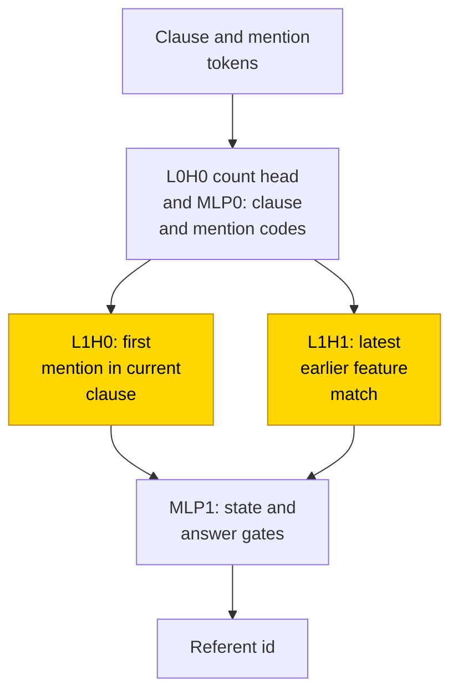
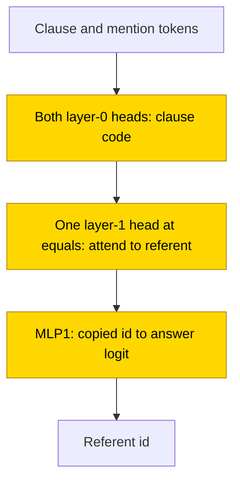

# Binding and coreference

This task asks a small two-layer transformer which earlier name a pronoun-like token refers to in a synthetic sentence. A reflexive token selects the current clause's subject; a feature-marked pronoun selects the latest matching name in an earlier clause. All 7 exact answer-only models trained from scratch used one final-layer attention head to retrieve the referent, instead of the formula-set design's separate subject and pronoun heads; those successes came from 3/30 screening runs and 4/10 retry runs, with exactness defined on 2048 held-out sentences.

Writing the local subject on a scratchpad did not solve the remaining choice among several pronoun matches. The task is partly solved and the attention rule is a sufficient readout only: substitution scored .965-1.0, but every shared circuit template failed complement resampling, including the scratchpad template at .898 against the .90 acceptance share.

## At a glance

| Fact | Value |
|---|---|
| Task | Resolve SELF to the current clause's first mention and PRO_f to the latest earlier-clause feature-f mention |
| Input → output example | Earlier clause: e0; current clause: e1. SELF selects e1; PRO_0 selects e0 |
| Model | 2-layer decoder, 2 heads × width 64, d_model 128, ReLU MLP 64; no positional encoding or LayerNorm |
| Rungs and seeds | HAND-a and HAND-c references; PART screening: 10 seeds per format; TRAIN screening: 10 seeds per format and weight decay; TRAIN retry: 10 seeds per format; no final run |
| Closed form status | Sufficient readout only (attention substitution .965-1.0 on 2048 test draws; every shared circuit template fails complement resampling; scratchpad .898 < .90) |
| Status | Partly solved (answer-only TRAIN run 2: 4/10 at final exact match 1.0 on 2048 sentences; scratchpad TRAIN run 2: 0/10); last run 2026-11-12 |
| Weights | [Hugging Face: binding-coreference](https://huggingface.co/jc1122/circuit-atlas-nets/tree/main/binding-coreference), revision `e409d98` |
| Reproduce | Not available yet: training code for this task is not yet in `code/` |

HAND sets every weight by formula; PART retrains one stage on frozen hand-built parts; TRAIN learns all weights ([rungs](../GLOSSARY.md#the-three-rungs)). A scratchpad writes the local subject after each input token ([task formats](../GLOSSARY.md#task-formats)). A complement test resamples everything outside a proposed circuit; passing substitution alone does not verify its mechanism ([verification](../GLOSSARY.md#verifying-a-circuit)).

## 1. Task and data

A clause is a sentence unit with its own subject, the first name introduced in that unit. Sentences contain right-branching clauses `C subj obj*`: the current clause is the last one opened. Mentions are e0..e7 with feature f(e_i) = i mod 4, followed by one anaphor, a token that refers to an earlier mention. SELF selects the first mention of the current clause; PRO_f selects the latest feature-f mention in an earlier clause.

Training sentences have 1-8 mention positions and 1-4 clauses, with fresh draws per step; test sentences are held out by a hash split. Extra evaluations use `wide` (9-16 mention positions) and `deep` (5-8 clauses). These ranges count positions and clauses, not new entity ids: the same e0..e7 labels can recur. PRO_f is included only when an earlier clause contains a feature-f mention, so its answer is defined. A emits only the answer; B interleaves scratchpad states S_t, each the current local subject `S<i>` or `_`.

For example, take an earlier clause containing e0 and a current clause containing e1. SELF selects e1, while PRO_0 selects e0, whose feature is 0. Feature f is an entity's id modulo 4, not its grammatical gender. The current clause is the last one opened; no closing-clause operation is implied by this right-branching task.

*Table 1. Output formats. S_t records the current local subject, not a full parse tree.*

| Format | Sequence |
|---|---|
| A, answer only | `BOS s_1..s_n = ANS` |
| B, scratchpad | `BOS s_1 S_1 .. s_n S_n = ANS`, where S_t is `S<i>` or `_` |

Solved means final exact match 1.0 on 2048 held-out sentences. Diagnostics use 128 test rows and may differ from that metric.

## 2. Model

### 2.1 Architecture

The decoder uses GPT-NeoX layer names ([architecture terms](../GLOSSARY.md#standard-machine-learning-terms)), with 2 layers x 2 heads, d 128, MLP 64, no positional encoding (NoPE) and no LayerNorm. Details and masks follow below.

### 2.2 Frozen and trained parts

GPT-NeoX names, d_model 128, 2 heads x 64, ReLU MLP 64, vocab 26 (0 BOS, 1 PAD, 2 `=`, 3 `_`, 4-11 `S<i>`, 12 C, 13-20 e_i, 21 SELF, 22-25 PRO_f). PART: HAND-a frozen; layer-1 attention retrained (query_key_value [384, 128] + dense [128, 128]), inputs masked to the dims HAND reads (QC, MK, BOS, CNT_T, CNT_PF, FEAT, ID), outputs to TOP, TOPN, PR. TRAIN: all weights.

The mask labels denote clause code QC, mention-in-clause code MK, beginning-of-sequence BOS, token count CNT_T, pronoun-feature counts CNT_PF, entity feature FEAT and entity id ID. TOP/TOPN carry the selected local subject and PR the pronoun referent. A one-hot code has a separate coordinate for each value ([glossary](../GLOSSARY.md#standard-machine-learning-terms)).

### 2.3 Training

Shared architecture and instrumentation: [METHODS.md](../METHODS.md). Cells: {A, B} x {PART, TRAIN}; TRAIN wd sweep .1/.3/1 (r1), r2 at each cell's best wd (A .1, B .3). PART wd .1. AdamW lr 1e-3, warmup 1000, cosine, clip 1; plateau stop (r1 at 60k, r2 at min_steps 120k); fp32 PART, TF32 TRAIN; consumer and rented CUDA cards. Learning rate, weight decay (wd) and schedule terms are defined in the [glossary](../GLOSSARY.md#standard-machine-learning-terms); fp32 and TF32 distinguish full and reduced-precision matrix multiplication ([precision](../GLOSSARY.md#hand-built-machinery)).

*Table 2. Training budgets. Run 2 is a longer-budget retry of slow progress, not a final ten-seed cell.*

| Run | Cells | Seeds per cell | Planned steps | Date |
|---|---|---|---|---|
| Screening r1 | A, B × PART | 10 | 20k | 2026-11-11 |
| Screening r1 | A, B × TRAIN | 10 per weight decay | 80k | 2026-11-11 |
| Retry r2 | A, B × TRAIN | 10 | 160k | 2026-11-12 |

The answer-only screening total of 3/30 pools the .1/.3/1 weight-decay cells; the retry's 4/10 uses .1 only. The scratchpad screening total of 1/30 pools the same weight-decay cells, and its retry uses .3. There was no final run because the programme wound down.

### 2.4 Reproduction

Reproduce: not available yet: training code for this task is not yet in `code/`; the weights, held-out splits and recorded accuracies are on [Hugging Face](https://huggingface.co/jc1122/circuit-atlas-nets/tree/main/binding-coreference).

### 2.5 Archive

Revision `e409d98` contains HAND-a/-c per format, best + final of every solved seed and of B r2 s1 (transient 1.0), safetensors + `config.json` + `manifest.json` (seed, rung, wd, circuit type, accuracy, sha256). Safetensors stores numeric weights without executable objects; sha256 fingerprints file contents ([glossary](../GLOSSARY.md#standard-machine-learning-terms)).

## 3. Hand-built solution

An attention head copies values from positions whose keys match its query ([glossary](../GLOSSARY.md#standard-machine-learning-terms)). HAND uses a count head whose unused attention goes to BOS (an attention sink), a subject head selecting the earliest mention in the current clause, and a recency head selecting the latest eligible earlier mention ([hand-built machinery](../GLOSSARY.md#hand-built-machinery)).

L0H0 counts symbols, C, SELF and PRO_f using the BOS sink. MLP0 converts these counts into clause one-hot QC_m and mention-in-clause MK_m codes. L1H0 queries QC_m against MK_m with score BETA [same clause] - EPS x position, so the earliest mention wins; its ID value writes TOP_i.

L1H1 scores BETA [feature f] + BETA [key clause < query clause] + EPS x position in HAND-a, selecting the latest match. HAND-c instead uses -BETA [same clause] and 2 BETA on feature. Its ID value writes PR_i. MLP1 gates GS_i/GN for state lines and AS_i/AP_i for answers, gated by EQ and the anaphor count. L0H1 is empty. Constants are BETA 1e4, EPS 20, G 2000, K 4, U 20.

Both variants and formats were exact on 129640 inputs: exhaustive to 4 mentions plus 36000 seeded inputs to 16 mentions and 8 clauses.

The symbols GS_i/GN gate state-line outputs; AS_i/AP_i gate SELF/PRO answer outputs. EQ identifies the answer delimiter. BETA rewards a match, EPS breaks ties by position, G scales readout gates, K is the feature count and U a fixed scale.

In Figure 1, L0H0 and MLP0 form clause and mention codes. L1H0 selects the first mention in the current clause, while L1H1 selects the latest earlier feature match; frozen MLP1 gates write the referent identifier. Only the two selecting heads are trained in PART. HAND-c changes the pronoun head's clause scoring.

*Figure 1. HAND-a's two referent heads. L1H0 and L1H1 are the only trained stage in PART; HAND-c changes the pronoun head's clause scoring.*

## 4. What training finds

Three circuit types were identified. The one solved PART net rebuilds HAND-a's subject and pronoun heads (P). All 7 solved answer-only TRAIN seeds use an additional layer-0 head that HAND leaves empty; at `=`, one layer-1 head attends to the referent, and MLP1 reads it out (T). The one solved scratchpad seed reads SELF from the last state line (S). Attention-level closed forms pass substitution (.965-1.0), but every type-level circuit fails complement resampling (.31-.90 of native exact match, rounded); no closed form is accepted.

The first evaluation at exact match 1.0 was step 5000 for P, 40000-45000 in run 1 and 40500-82000 in run 2 for T, and 18500 for S. These are first-exact steps, called grok steps in the source ([glossary](../GLOSSARY.md#counting-results)); train and test track each other with fresh draws, so the staircase curves are not evidence of a long train/test gap. [Abbe et al. (2023)](#references) provide a staircase-learning comparison, not a derivation of these networks' dynamics.

*Table 3. Circuit types among solved seeds, not success rates across all seeds.*

| Type | Solved-seed count | Mechanism |
|---|---|---|
| P | 1/1 solved A PART | Rebuilds HAND-a's subject and pronoun heads |
| T | 7/7 solved A TRAIN (r1 3, r2 4) | Extra L0H1; one layer-1 head attends to the referent |
| S | 1/1 solved B TRAIN | Reads SELF from the last state line |

Unsolved TRAIN seeds fail only PRO answers with >= 2 out-of-clause feature matches: the difficulty is choosing the latest candidate. PART also fails on state lines and on particular entity ids because the frozen readout gates can remain inactive from initialisation. PART reads the frozen count head and MLP0 (paths L0H0>* drop .89), and MLP1 gates (MLP1>out drop 1.0). Path drop is the share of the corruption effect carried by a tested connection, not the same as exact-match loss ([analysis measures](../GLOSSARY.md#analysis-measures)).

*Table 4. Per-cell outcomes and diagnostics. Solved means final exact match 1.0 on 2048 sentences; diagnostics use 128 rows.*

| cell | solved | best / final test | used comps | best probe R^2 (layer) | eff. rank (PCA r90 L2, HAND pc R^2 L2) | attn JS L1H0 / L1H1 | discover edges, faith |
|---|---|---|---|---|---|---|---|
| A PART wd .1 | 1/10 | .42-1 / .42-1 | 5 (L0H1 empty), n90 15/19 | clause 1.0 (L1), answer .94 (L2) | 12, .90 | .36 / .20 | 12, .92 |
| B PART wd .1 | 0/10 | 0-1 / 0-.9995 | 5 | clause 1.0 (L1), ref_state .97 (L2) | - | - | 9-13, 0-1.0 |
| A TRAIN wd .1 r1 | 2/10 | .974-1 / .967-1 | 6, n90 39-42/42 | clause .99 (L1), ans_self .97, ans_pro .48-.85 (L2) | 6, .72-.85 | .45-.47 / .52-.53 | 17, .84-.98 |
| A TRAIN wd .3 r1 | 1/10 | .974-1 / .969-1 | 6 | clause .99 (L1), answer .65 (L2) | 5, .61 | .41 / .41 | 21, .97 |
| A TRAIN wd .1 r2 | 4/10 | .979-1 / .971-1 | 6, n90 41-47/25-30 | clause 1.0 (L1), ans_pro .78-.90 (L2) | 5-6, .61-.84 | .40-.48 / .48-.55 | 15-18, .87-1.0 |
| B TRAIN wd .3 r1 | 1/10 | .959-1 / .959-1 | 6, n90 48/28 | top .80, ref_state .89, answer .94 (L2) | 7, .96 | .67 / .58 | 20, .87 |
| B TRAIN wd .3 r2 | 0/10 | .976-1 / .971-.9995 | 6 | top .36-.90, answer -.09-.71 (L2) | - | - | 16-23, .81-.97 |
| A, B TRAIN other wd (r1) | 0/10 each | .92-.9995 / .92-.999 | 6 | answer .13-.72 (L2) | - | - | 15-23, .67-.99 |

The probe, rank and JS columns describe solved seeds where a cell has any. Probe R² measures linear decodability; PCA r90 counts principal directions for 90% variance; HAND-PC R² measures predictability of HAND's principal coordinates; attention JS measures divergence from HAND; faith measures held-out discovered-circuit accuracy ([analysis measures](../GLOSSARY.md#analysis-measures)). n90 counts the fewest neurons covering 90% of squared input/output norm products, not a certified minimal neuron circuit. L1 and L2 in residual diagnostics mean after layers 0 and 1. B PART fails with per-entity-id all-or-nothing readout: frozen ReLU gates stay dead.

## 5. Mechanism and verification

These are sufficient readouts only, not accepted mechanisms. Substitution works, but the shared type-level edge templates fail complement resampling. The .31-.90 summary is rounded: type S is .898, below the .90 acceptance share. This distinction is retained in the fact table and figure.

*Table 5. Attention-level substitutions and type-level complement tests. P and S each describe one solved seed; T describes seven.*

| Type | Substitution | Complement | Verdict |
|---|---|---|---|
| P | 1.0 | .589, 12 edges | Not accepted |
| T | .965-1.0 in 7/7 | .31-.63, shared 15-edge template | Not accepted |
| S | .983 | .898, 20 edges | Not accepted |

### Type P: separate subject and pronoun heads

For P, L1H0 at `=` becomes one-hot on the first mention of the current clause, L1H1 on the latest feature-f mention in an earlier clause, and MLP1 uses HAND-a's gates. Substitution gives 1.0; replacing layer-1 weights with HAND-a also gives 1.0, while swapping heads gives .681. Complement of the 12-edge circuit is .589 and fails.

### Type T: one head retrieves either kind of referent

For T, one L1 head at `=` becomes one-hot on the referent: the subject for SELF, otherwise the latest feature-f mention in an earlier clause. This is L1H0 in 4 seeds and L1H1 in 3; MLP1 writes the copied id's logit. Substitution gives .965–1.0 in 7/7. HAND's separate subject and pronoun heads give .73–.98. Complement of the shared 15-edge circuit, including L0H1, gives .31–.63 and fails; per-seed discovered circuits pass in 5 of 7, with .88–1.0 reported across the seven. Their passing criterion is at least .90 of native exact match, not merely membership in that range.

### Type S: copy the written subject

For S, L1H0 at `=` becomes one-hot on the last state line for SELF and on the referent otherwise. Substitution gives .983; complement of the 20-edge circuit gives .898, just below .90, and fails.

In Figure 2, both early heads form a clause code, a final-layer head retrieves the referent at the equals token, and MLP1 turns the copied identifier into an answer score. All computational stages were trained. Status remains sufficient readout only: substitution passes, but resampling outside the shared circuit fails.

*Figure 2. Type T in the seven solved answer-only TRAIN seeds; both head stages and MLP1 are trained. Status: sufficient readout only. Substitution is .965-1.0, but complement resampling of the shared 15-edge circuit gives .31-.63 and fails; no closed form is accepted.*

### Relation to HAND and published work

P reproduces HAND-a inside the frozen scaffold (edge Jaccard HAND-a .846 > HAND-c .769). Edge Jaccard is the fraction of edges shared by two circuits relative to their combined edge set. From scratch, no analysed net splits SELF and PRO over two heads as HAND does. A single layer-1 head acts as a name mover, copying the selected mention into the answer path, like the copy step in [Wang et al. (2022)](#references). Clause position is computed by two layer-0 heads rather than one. Every type scores .91–.99 on wide inputs; on deep inputs (unseen clauses 5–8), P gives .23, S .57 and T .90–.92. The trained clause code extrapolates here, while HAND's one-hot clause rows do not.

Direct comparisons concern retrieving the correct earlier name. [Frank and Petty (2020)](#references) study reflexive interpretation; [Lin et al. (2019)](#references) and [Ryu and Lewis (2021)](#references) analyse attention to earlier referents. [Davis (2022)](#references) tests Principle B, a restriction on local pronoun reference, and [Patil and Chetia (2026)](#references) train binding-theory constraints. These are comparisons, not replications of this exact SELF/PRO recency rule. The [reading guide](#related-work-reading-guide) groups the wider retained literature by what it tests.

## 6. Limitations and open questions
Diagnostics used 128 rows; P and S rest on one seed each, and there was no final run. The seven exact answer-only models are selected successes, not a 7/7 training success rate. T seeds are not one low-loss weight basin (linear mode connectivity barrier 1.97-2.67), but their representations can be mapped between networks at layer 1 (stitch accuracy .94-1.0, map R^2 .97-.99; [analysis measures](../GLOSSARY.md#analysis-measures)). The type-level edge templates fail resampling while per-seed circuits mostly pass: the needed edges vary by seed. [Bali et al. (2026)](#references) supply a cross-seed attention-head comparison, not evidence that the failed templates are universal. MLP0 is largely an offset, an input-independent contribution (optimal-constant ablation .52-.91 versus resample .38-.48). B PART's frozen per-id ReLU gates can remain inactive and never receive gradient; [Lu et al. (2020)](#references) are the inactive-ReLU comparison. Diagnostic `layers` and `cands` reports are missing from the run-1 method-v2 files; wrong-row buckets in run 2 have too few examples for a verdict.

## 7. Prediction record

Written before run 1 and before run 2. Held: A TRAIN mostly unsolved in r1 (<= 3/10; got 2, 1, 0) and 4-7/10 in r2 (got 4); SELF near 1.0 with PRO the error site; A PART grok step (5000) and deep < .3 (.23); B state lines exact; r2 PRO via the L0H1-assisted circuit nearest HAND-a. Missed: B PART >= 7/10 (0/10, dead per-id readout gates), A PART >= 6/10 (1/10), B TRAIN >= 5/10 (r1 1/10, r2 0/10), HAND-c lean for B's pro head (closer to HAND-a, neither matches), A TRAIN wide < .9 (.97-.99).

## Appendix A. Weights excerpt and reading

The hand-built pronoun head uses the exact constants BETA = 1e4 and EPS = 20. HAND-a adds BETA for a feature match and BETA when the key is in an earlier clause, then EPS times position to select the latest eligible name. HAND-c instead assigns -BETA to a same-clause match and 2 BETA to a feature match. These are formula-set constants, not fitted trained weights; substitution of HAND-a's layer-1 weights scores 1.0 in the single solved PART seed, while swapped heads score .681.

The archive's `binding` excerpts print HAND-a versus HAND-c pronoun-head query rows: thermometer `key clause < query clause` versus one-hot `same clause` with a negative sign, with nonzero counts and values. A thermometer code fills coordinates up to a threshold ([glossary](../GLOSSARY.md#standard-machine-learning-terms)). For each archived final network they also print each head's direct mention-copy score U[e_i] W_O W_V E[e_j] over the 8 mention tokens: diagonal minus off-diagonal mean, and the rows with a diagonal maximum. U is the output readout, E the embedding, W_V the head's value map and W_O its output map. This covers the embedding path only. The reading above rests on substitution, patching and complement, not on these slices; no small numeric matrix is reproduced in the published excerpt.

## Appendix B. Detailed evidence and scope

The per-cell diagnostics are retained in Table 4 and the closed-form tests in Section 5. A circuit type groups mechanisms, not weight basins. A linear mode connectivity (lmc) barrier measures the extra loss between two weight sets; stitching tests mapped representations ([analysis measures](../GLOSSARY.md#analysis-measures)). The 7/7 type-T count is conditional on the seven solved networks: across all tested answer-only seeds it is r1 3/30 and r2 4/10. The scratchpad has r1 1/30 and r2 0/10. “Sufficient readout only” preserves the published verdict that no form passed both tests; it does not claim the failed complement was untested.

### Related-work reading guide

Grammatical locality describes which earlier mentions can be referred to from a given clause. These comparisons test related questions; none certifies the failed circuit templates or replicates this synthetic feature-and-recency rule. Oh and Demberg's comparison was limited to the title and abstract, as stated in its reference record.

*Table B1. Related-work scope. These are literature comparisons, not additional atlas runs or acceptance tests.*

| Topic | Sources and scope |
|---|---|
| Learning reflexive reference | [Frank et al. (2013)](#references) study anaphora acquisition in recurrent networks; [Frank and Petty (2020)](#references) study reflexive interpretation and generalisation in sequence-to-sequence networks. |
| Structural reflexive tests | [Marvin and Linzen (2018)](#references), [Shen et al. (2018)](#references) and [Goldberg (2019)](#references) evaluate clause-sensitive reflexive dependencies. |
| Training and architecture choices | [Kuncoro et al. (2019)](#references), [van Schijndel et al. (2019)](#references), [Zhang et al. (2019)](#references) and [Bhatt et al. (2020)](#references) include reflexive evaluations when comparing architectures, data or training choices. |
| Evaluation and lexical variation | The controlled reflexive-licensing re-evaluation ([Hu et al., 2020](#references)) and broader syntax assessment ([Hu et al., 2020](#references)) complement the evaluation and lexical studies of [Niu and Penn (2020)](#references) and [Yu et al. (2020)](#references). [Warstadt et al. (2020)](#references) supply corrected BLiMP results; the cited source is the erratum. |
| Negative training examples | [Noji and Takamura (2020)](#references) and [Wick et al. (2020)](#references) study explicit negative examples with reflexive tests. |
| Languages and incremental processing | [Zaczynska et al. (2020)](#references), [Pérez-Mayos et al. (2021)](#references) and [Wilcox et al. (2021)](#references) test German, multilingual models or incremental processing. [Karakaş (2026)](#references) tests Turkish reflexive locality, not this local-subject scratchpad. |
| Attention and referential information | [Voita et al. (2018)](#references), [Clark et al. (2019)](#references), [Jumelet et al. (2019)](#references) and [Sorodoc et al. (2020)](#references) examine antecedent attention, default gender-based retrieval or decodable referential information. |
| Causal pronoun and reflexive analysis | [Yamakoshi et al. (2023)](#references) study pronoun-resolution interventions, and [Lepori et al. (2023)](#references) study reflexive subroutines and pruning. [Adhikari (2025)](#references) and [Ahmad et al. (2025)](#references) analyse related name-copying or pronoun tasks. |
| Entity-binding and retrieval mechanisms | [Feng and Steinhardt (2023)](#references), [Gur-Arieh et al. (2025)](#references), [Dai et al. (2026)](#references), [Oh and Demberg (2026)](#references), [Trinley et al. (2026)](#references) and [Bogdan and Lindsey (2026)](#references) compare binding and retrieval mechanisms. [Xu (2026)](#references) distinguishes selective activation patterns from task-causal structure. |

## What to read next

Compare [Dyck brackets and agreement](dyck-k-and-agreement.md) for another pointer-based account with an unidentified partner computation. [Arithmetic registers](compose-arithmetic-registers.md) show how positional conventions can substitute for binding names.

## References

- Abbe, E., Boix-Adsera, E., & Misiakiewicz, T. (2023). SGD learning on neural networks: leap complexity and saddle-to-saddle dynamics. *arXiv preprint*. <https://arxiv.org/abs/2302.11055> (arXiv preprint; staircase-learning comparison).
- Adhikari, R. (2025). Emergence of Minimal Circuits for Indirect Object Identification in Attention-Only Transformers. *arXiv preprint*. <https://arxiv.org/abs/2510.25013> (arXiv preprint; small-network name-copying circuits).
- Ahmad, A., Joshi, A., & Modi, A. (2025). Beyond Components: Singular Vector-Based Interpretability of Transformer Circuits. *arXiv preprint*. <https://arxiv.org/abs/2511.20273> (arXiv preprint; name-copying and pronoun-task mechanisms).
- Bali, K., Stanley, J., Suresh, P., & Bzdok, D. (2026). Quantifying LLM Attention-Head Stability: Implications for Circuit Universality. *arXiv preprint*. <https://arxiv.org/abs/2602.16740> (arXiv preprint; cross-seed attention-head stability).
- Bhatt, G., Bansal, H., Singh, R., & Agarwal, S. (2020). How much complexity does an RNN architecture need to learn syntax-sensitive dependencies? *Proceedings of the 58th Annual Meeting of the Association for Computational Linguistics: Student Research Workshop*. <https://doi.org/10.18653/v1/2020.acl-srw.33> (conference paper; reflexive dependency tests).
- Bogdan, P. C., & Lindsey, J. (2026). Slot Machines: How LLMs Keep Track of Multiple Entities. *arXiv preprint*. <https://arxiv.org/abs/2604.21139> (arXiv preprint; entity-binding slots and retrieval).
- Clark, K., Khandelwal, U., Levy, O., & Manning, C. D. (2019). What Does BERT Look at? An Analysis of BERT’s Attention. *Proceedings of the 2019 ACL Workshop BlackboxNLP: Analyzing and Interpreting Neural Networks for NLP*. <https://doi.org/10.18653/v1/w19-4828> (conference paper; antecedent-selecting attention heads).
- Dai, Q., Heinzerling, B., & Inui, K. (2026). Cell-Based Representation of Relational Binding in Language Models. *arXiv preprint*. <https://arxiv.org/abs/2604.19052> (arXiv preprint; relational binding and retrieval subspaces).
- Davis, F. (2022). Incremental Processing of Principle B: Mismatches Between Neural Models and Humans. *Proceedings of the 26th Conference on Computational Natural Language Learning (CoNLL)*. <https://doi.org/10.18653/v1/2022.conll-1.11> (conference paper; restrictions on local pronoun reference).
- Feng, J., & Steinhardt, J. (2023). How do Language Models Bind Entities in Context? *arXiv preprint*. <https://arxiv.org/abs/2310.17191> (arXiv preprint; binding identifiers).
- Frank, R., Mathis, D., & Badecker, W. (2013). The Acquisition of Anaphora by Simple Recurrent Networks. *Language Acquisition*. <https://doi.org/10.1080/10489223.2013.796950> (journal article; neural anaphora acquisition).
- Frank, R., & Petty, J. (2020). Sequence-to-Sequence Networks Learn the Meaning of Reflexive Anaphora. *arXiv preprint*. <https://arxiv.org/abs/2011.00682> (arXiv preprint; reflexive interpretation and generalisation).
- Goldberg, Y. (2019). Assessing BERT's Syntactic Abilities. *arXiv preprint*. <https://arxiv.org/abs/1901.05287> (arXiv preprint; reflexive licensing tests).
- Gur-Arieh, Y., Geva, M., & Geiger, A. (2025). Mixing Mechanisms: How Language Models Retrieve Bound Entities In-Context. *arXiv preprint*. <https://arxiv.org/abs/2510.06182> (arXiv preprint; positional, lexical and reflexive retrieval comparisons).
- Hu, J., Chen, S. Y., & Levy, R. P. (2020). A Closer Look at the Performance of Neural Language Models on Reflexive Anaphor Licensing. *University of Mass Amherst*. <https://doi.org/10.7275/67qw-mf84> (conference paper; controlled reflexive-licensing re-evaluation).
- Hu, J., Gauthier, J., Qian, P., Wilcox, E., & Levy, R. (2020). A Systematic Assessment of Syntactic Generalization in Neural Language Models. *Proceedings of the 58th Annual Meeting of the Association for Computational Linguistics*. <https://doi.org/10.18653/v1/2020.acl-main.158> (conference paper; architecture and data comparisons including reflexives).
- Jumelet, J., Zuidema, W., & Hupkes, D. (2019). Analysing Neural Language Models: Contextual Decomposition Reveals Default Reasoning in Number and Gender Assignment. *Proceedings of the 23rd Conference on Computational Natural Language Learning (CoNLL)*. <https://doi.org/10.18653/v1/k19-1001> (conference paper; gender-based cross-clause retrieval).
- Karakaş, S. (2026). Clause-Internal or Clause-External? Testing Turkish Reflexive Binding in Adapted versus Chain of Thought Large Language Models. *arXiv preprint*. <https://arxiv.org/abs/2602.00380> (arXiv preprint; reflexive locality, not the state-line scratchpad used here).
- Kuncoro, A., Dyer, C., Rimell, L., Clark, S., & Blunsom, P. (2019). Scalable Syntax-Aware Language Models Using Knowledge Distillation. *Proceedings of the 57th Annual Meeting of the Association for Computational Linguistics*. <https://doi.org/10.18653/v1/p19-1337> (conference paper; syntax-aware training evaluated on reflexives).
- Lepori, M. A., Serre, T., & Pavlick, E. (2023). Break It Down: Evidence for Structural Compositionality in Neural Networks. *arXiv preprint*. <https://arxiv.org/abs/2301.10884> (arXiv preprint; reflexive subroutines and pruning).
- Lin, Y., Tan, Y. C., & Frank, R. (2019). Open Sesame: Getting inside BERT’s Linguistic Knowledge. *Proceedings of the 2019 ACL Workshop BlackboxNLP: Analyzing and Interpreting Neural Networks for NLP*. <https://doi.org/10.18653/v1/w19-4825> (conference paper; structural antecedents and distractors).
- Lu, L., Shin, Y., Su, Y., & Karniadakis, G. E. (2020). Dying ReLU and Initialization: Theory and Numerical Examples. *Communications in Computational Physics*. <https://doi.org/10.4208/cicp.oa-2020-0165> (journal article; inactive ReLU units).
- Marvin, R., & Linzen, T. (2018). Targeted Syntactic Evaluation of Language Models. *Proceedings of the 2018 Conference on Empirical Methods in Natural Language Processing*. <https://doi.org/10.18653/v1/d18-1151> (conference paper; clause-sensitive reflexive tests).
- Niu, J., & Penn, G. (2020). Grammaticality and Language Modelling. *Proceedings of the First Workshop on Evaluation and Comparison of NLP Systems*. <https://doi.org/10.18653/v1/2020.eval4nlp-1.11> (conference paper; reflexive-licensing evaluation).
- Noji, H., & Takamura, H. (2020). An Analysis of the Utility of Explicit Negative Examples to Improve the Syntactic Abilities of Neural Language Models. *Proceedings of the 58th Annual Meeting of the Association for Computational Linguistics*. <https://doi.org/10.18653/v1/2020.acl-main.309> (conference paper; negative reflexive training examples).
- Oh, S., & Demberg, V. (2026). A retrieval conditioned rebinding circuit for dynamic entity tracking in large language models. *arXiv preprint*. <https://arxiv.org/abs/2606.08644> (arXiv preprint; entity-update retrieval, title and abstract comparison).
- Patil, T., & Chetia, B. (2026). BindNet: A Constraint-Regularized Transformer for Modeling Binding Principles in Neural Syntax Adaptation. *Advances in Natural Language Processing and Information Retrieval, Lecture Notes in Networks and Systems*. <https://doi.org/10.1007/978-3-032-20897-2_12> (conference paper; binding-theory constraints).
- Pérez-Mayos, L., Táboas García, A., Mille, S., & Wanner, L. (2021). Assessing the Syntactic Capabilities of Transformer-based Multilingual Language Models. *Findings of the Association for Computational Linguistics: ACL-IJCNLP 2021*. <https://doi.org/10.18653/v1/2021.findings-acl.333> (conference paper; multilingual reflexive evaluation).
- Ryu, S. H., & Lewis, R. L. (2021). Accounting for Agreement Phenomena in Sentence Comprehension with Transformer Language Models: Effects of Similarity-based Interference on Surprisal and Attention. *Proceedings of the Workshop on Cognitive Modeling and Computational Linguistics*. <https://doi.org/10.18653/v1/2021.cmcl-1.6> (conference paper; reflexive distractor and attention analysis).
- Shen, Y., Tan, S., Sordoni, A., & Courville, A. (2018). Ordered Neurons: Integrating Tree Structures into Recurrent Neural Networks. *arXiv preprint*. <https://arxiv.org/abs/1810.09536> (arXiv preprint; ordered-neuron reflexive tests).
- Sorodoc, I., Gulordava, K., & Boleda, G. (2020). Probing for Referential Information in Language Models. *Proceedings of the 58th Annual Meeting of the Association for Computational Linguistics*. <https://doi.org/10.18653/v1/2020.acl-main.384> (conference paper; pronominal referential information).
- Trinley, K., Alabi, J. O., Klakow, D., & Gautam, V. (2026). A Mechanistic Understanding of Pronoun Fidelity in LLMs. *arXiv preprint*. <https://arxiv.org/abs/2606.16407> (arXiv preprint; pronoun binding and recency-copying routes).
- van Schijndel, M., Mueller, A., & Linzen, T. (2019). Quantity doesn’t buy quality syntax with neural language models. *Proceedings of the 2019 Conference on Empirical Methods in Natural Language Processing and the 9th International Joint Conference on Natural Language Processing (EMNLP-IJCNLP)*. <https://doi.org/10.18653/v1/d19-1592> (conference paper; data and size comparisons including reflexives).
- Voita, E., Serdyukov, P., Sennrich, R., & Titov, I. (2018). Context-Aware Neural Machine Translation Learns Anaphora Resolution. *Proceedings of the 56th Annual Meeting of the Association for Computational Linguistics (Volume 1: Long Papers)*. <https://doi.org/10.18653/v1/p18-1117> (conference paper; translation attention and coreference).
- Wang, K., Variengien, A., Conmy, A., Shlegeris, B., & Steinhardt, J. (2022). Interpretability in the Wild: a Circuit for Indirect Object Identification in GPT-2 small. *arXiv preprint*. <https://arxiv.org/abs/2211.00593> (arXiv preprint; name-mover heads).
- Warstadt, A., Parrish, A., Liu, H., et al. (2020). Erratum: “BLiMP: The Benchmark of Linguistic Minimal Pairs for English”. *Transactions of the Association for Computational Linguistics*. <https://doi.org/10.1162/tacl_x_00375> (journal article; corrected benchmark results, not the flagged original).
- Wick, M. L., Silverstein, K., Tristan, J.-B., Pocock, A., & Johnson, M. (2020). Detecting and Exorcising Statistical Demons from Language Models with Anti-Models of Negative Data. *arXiv preprint*. <https://arxiv.org/abs/2010.11855> (arXiv preprint; negative-data training and reflexive tests).
- Wilcox, E., Vani, P., & Levy, R. (2021). A Targeted Assessment of Incremental Processing in Neural Language Models and Humans. *Proceedings of the 59th Annual Meeting of the Association for Computational Linguistics and the 11th International Joint Conference on Natural Language Processing (Volume 1: Long Papers)*. <https://doi.org/10.18653/v1/2021.acl-long.76> (conference paper; reflexive dependencies with clause modifiers).
- Xu, Y. (2026). Pattern Selectivity is Not Task-Causal Structure: A Cross-Architecture Mechanistic Study of Composed-Task Circuits in 1B-Class Language Models. *arXiv preprint*. <https://arxiv.org/abs/2606.05378> (arXiv preprint; selective patterns versus task-causal structure).
- Yamakoshi, T., McClelland, J., Goldberg, A., & Hawkins, R. D. (2023). Causal interventions expose implicit situation models for commonsense language understanding. *Findings of the Association for Computational Linguistics: ACL 2023*. <https://doi.org/10.18653/v1/2023.findings-acl.839> (conference paper; pronoun-resolution causal interventions).
- Yu, C., Sie, R., Tedeschi, N., & Bergen, L. (2020). Word Frequency Does Not Predict Grammatical Knowledge in Language Models. *Proceedings of the 2020 Conference on Empirical Methods in Natural Language Processing (EMNLP)*. <https://doi.org/10.18653/v1/2020.emnlp-main.331> (conference paper; lexical variation and reflexive dependencies).
- Zaczynska, K., Feldhus, N., Schwarzenberg, R., Gabryszak, A., & Möller, S. (2020). Evaluating German Transformer Language Models with Syntactic Agreement Tests. *arXiv preprint*. <https://arxiv.org/abs/2007.03765> (arXiv preprint; German reflexive feature agreement).
- Zhang, X., Yang, Y., Yuan, S., Shen, D., & Carin, L. (2019). Syntax-Infused Variational Autoencoder for Text Generation. *Proceedings of the 57th Annual Meeting of the Association for Computational Linguistics*. <https://doi.org/10.18653/v1/p19-1199> (conference paper; syntax-infused model reflexive experiments).
