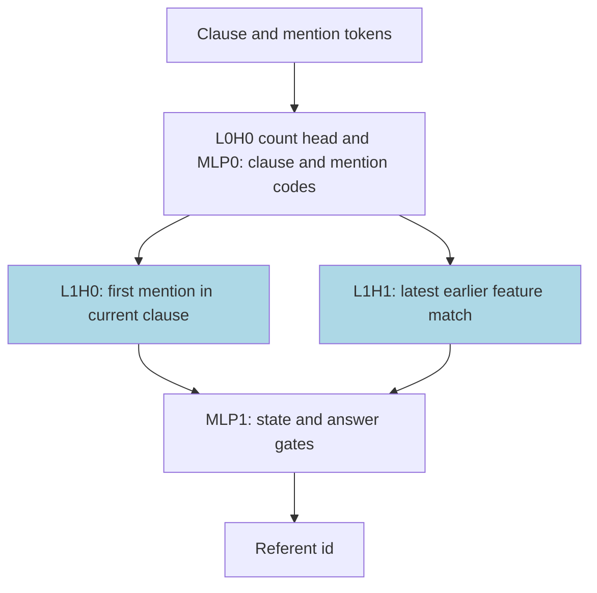
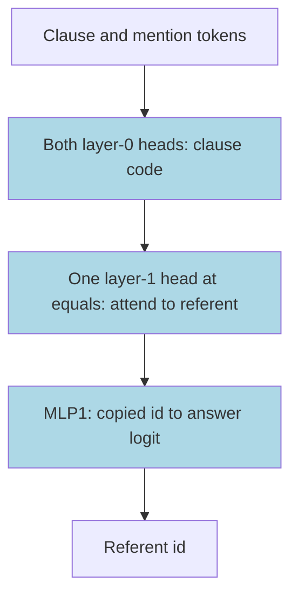

# Binding and coreference

These small transformers resolve a pronoun-like token to an earlier name in a sentence. A reflexive token selects the subject of the current clause; a feature-marked pronoun selects the latest matching name in an earlier clause. Among networks that reached exact match 1.0 on 2048 held-out sentences, all 7 answer-only TRAIN seeds used one head that attends directly to the referent, while the one solved scratchpad seed copied its local subject from the written state. The task is partly solved, and the closed forms are sufficient readouts only: substitution keeps .965-1.0 accuracy, but every type-level complement test fails.

## At a glance

| Fact | Value |
|---|---|
| Task | Resolve SELF to the current clause's first mention and PRO_f to the latest earlier-clause feature-f mention |
| Input → output example | Earlier clause: e0; current clause: e1. SELF selects e1; PRO_0 selects e0 |
| Model | 2-layer decoder, 2 heads × width 64, d_model 128, ReLU MLP 64; no positional encoding or LayerNorm |
| Rungs and seeds | HAND-a and HAND-c references; PART/ TRAIN screens with 10 seeds per cell; TRAIN retry with 10 seeds per cell; no final run |
| Closed form status | Sufficient readout only: substitution .965-1.0; no accepted form, as type-level complement resampling keeps only .31-.90 of native exact match (rounded summary) |
| Status | Partly solved (answer-only TRAIN run 2: 4/10 at final exact match 1.0 on 2048 sentences; scratchpad TRAIN run 2: 0/10); last run 2026-11-12 |
| Weights | [Hugging Face: binding-coreference](https://huggingface.co/jc1122/circuit-atlas-nets/tree/main/binding-coreference), revision `e409d98` |
| Reproduce | Not available yet: training code for this task is not yet in `code/` |

HAND sets every weight by formula; PART retrains one stage on frozen hand-built parts; TRAIN learns all weights ([rungs](../GLOSSARY.md#the-three-rungs)). A scratchpad writes the local subject after each input token ([task formats](../GLOSSARY.md#task-formats)). A complement test resamples everything outside a proposed circuit; passing substitution alone does not verify its mechanism ([verification](../GLOSSARY.md#verifying-a-circuit)).

## 1. Task and data

Sentences contain right-branching clauses `C subj obj*`: the current clause is the last one opened. Mentions are e0..e7 with feature f(e_i) = i mod 4, followed by one anaphor, a token that refers to an earlier mention. SELF selects the first mention of the current clause; PRO_f selects the latest feature-f mention in an earlier clause.

Training uses mentions 1-8 and clauses 1-4 with fresh draws per step; test sentences are held out by a hash split. Extra evaluations use `wide` (mentions 9-16) and `deep` (clauses 5-8). A emits only the answer; B interleaves scratchpad states S_t, each the current local subject `S<i>` or `_`.

For example, take an earlier clause containing e0 and a current clause containing e1. SELF selects e1, while PRO_0 selects e0, whose feature is 0. Feature f is an entity's id modulo 4, not its grammatical gender. The current clause is the last one opened; no closing-clause operation is implied by this right-branching task.

*Table 1. Output formats. S_t records the current local subject, not a full parse tree.*

| Format | Sequence |
|---|---|
| A, answer only | `BOS s_1..s_n = ANS` |
| B, scratchpad | `BOS s_1 S_1 .. s_n S_n = ANS`, where S_t is `S<i>` or `_` |

Solved means final exact match 1.0 on 2048 held-out sentences. Diagnostics use 128 test rows and may differ from that metric.

## 2. Model

### 2.1 Architecture

The decoder uses GPT-NeoX layer names ([architecture terms](../GLOSSARY.md#standard-machine-learning-terms)), with 2 layers x 2 heads, d 128, MLP 64, no positional encoding (NoPE) and no LayerNorm. Details and masks follow below.

### 2.2 Frozen and trained parts

GPT-NeoX names, d_model 128, 2 heads x 64, ReLU MLP 64, vocab 26 (0 BOS, 1 PAD, 2 `=`, 3 `_`, 4-11 `S<i>`, 12 C, 13-20 e_i, 21 SELF, 22-25 PRO_f). PART: HAND-a frozen; layer-1 attention retrained (query_key_value [384, 128] + dense [128, 128]), inputs masked to the dims HAND reads (QC, MK, BOS, CNT_T, CNT_PF, FEAT, ID), outputs to TOP, TOPN, PR. TRAIN: all weights.

The mask labels denote clause code QC, mention-in-clause code MK, beginning-of-sequence BOS, token count CNT_T, pronoun-feature counts CNT_PF, entity feature FEAT and entity id ID. TOP/TOPN carry the selected local subject and PR the pronoun referent. A one-hot code has a separate coordinate for each value ([glossary](../GLOSSARY.md#standard-machine-learning-terms)).

### 2.3 Training

Shared architecture and instrumentation: [METHODS.md](../METHODS.md). Cells: {A, B} x {PART, TRAIN}; TRAIN wd sweep .1/.3/1 (r1), r2 at each cell's best wd (A .1, B .3). PART wd .1. AdamW lr 1e-3, warmup 1000, cosine, clip 1; plateau stop (r1 at 60k, r2 at min_steps 120k); fp32 PART, TF32 TRAIN; consumer and rented CUDA cards. Learning rate, weight decay (wd) and schedule terms are defined in the [glossary](../GLOSSARY.md#standard-machine-learning-terms); fp32 and TF32 distinguish full and reduced-precision matrix multiplication ([precision](../GLOSSARY.md#hand-built-machinery)).

*Table 2. Training budgets. Run 2 is a longer-budget retry of slow progress, not a final ten-seed cell.*

| Run | Cells | Seeds per cell | Planned steps | Date |
|---|---|---|---|---|
| Screening r1 | A, B × PART | 10 | 20k | 2026-11-11 |
| Screening r1 | A, B × TRAIN | 10 | 80k | 2026-11-11 |
| Retry r2 | A, B × TRAIN | 10 | 160k | 2026-11-12 |

There was no final run because the programme wound down.

### 2.4 Reproduction

Reproduce: not available yet: training code for this task is not yet in `code/`; the weights, held-out splits and recorded accuracies are on [Hugging Face](https://huggingface.co/jc1122/circuit-atlas-nets/tree/main/binding-coreference).

### 2.5 Archive

Revision `e409d98` contains HAND-a/-c per format, best + final of every solved seed and of B r2 s1 (transient 1.0), safetensors + `config.json` + `manifest.json` (seed, rung, wd, circuit type, accuracy, sha256). Safetensors stores numeric weights without executable objects; sha256 fingerprints file contents ([glossary](../GLOSSARY.md#standard-machine-learning-terms)).

## 3. Hand-built solution

An attention head copies values from positions whose keys match its query ([glossary](../GLOSSARY.md#standard-machine-learning-terms)). HAND uses a count head whose unused attention goes to BOS (an attention sink), a subject head selecting the earliest mention in the current clause, and a recency head selecting the latest eligible earlier mention ([hand-built machinery](../GLOSSARY.md#hand-built-machinery)).

L0H0 counts symbols, C, SELF and PRO_f using the BOS sink. MLP0 converts these counts into clause one-hot QC_m and mention-in-clause MK_m codes. L1H0 queries QC_m against MK_m with score BETA [same clause] - EPS x position, so the earliest mention wins; its ID value writes TOP_i.

L1H1 scores BETA [feature f] + BETA [key clause < query clause] + EPS x position in HAND-a, selecting the latest match. HAND-c instead uses -BETA [same clause] and 2 BETA on feature. Its ID value writes PR_i. MLP1 gates GS_i/GN for state lines and AS_i/AP_i for answers, gated by EQ and the anaphor count. L0H1 is empty. Constants are BETA 1e4, EPS 20, G 2000, K 4, U 20.

Both variants and formats were exact on 129640 inputs: exhaustive to 4 mentions plus 36000 seeded inputs to 16 mentions and 8 clauses.

The symbols GS_i/GN gate state-line outputs; AS_i/AP_i gate SELF/PRO answer outputs. EQ identifies the answer delimiter. BETA rewards a match, EPS breaks ties by position, G scales readout gates, K is the feature count and U a fixed scale.

*Figure 1. HAND-a's two referent heads. L1H0 and L1H1 are the only trained stage in PART; HAND-c changes the pronoun head's clause scoring.*

## 4. What training finds

Three circuit types were identified. The one solved PART net rebuilds HAND-a's subject and pronoun heads (P). All 7 solved answer-only TRAIN seeds use an additional layer-0 head that HAND leaves empty; at `=`, one layer-1 head attends to the referent, and MLP1 reads it out (T). The one solved scratchpad seed reads SELF from the last state line (S). Attention-level closed forms pass substitution (.965-1.0), but every type-level circuit fails complement resampling (.31-.90 of native exact match, rounded); no closed form is accepted.

The first evaluation at exact match 1.0 was step 5000 for P, 40000-45000 in run 1 and 40500-82000 in run 2 for T, and 18500 for S. These are first-exact steps, called grok steps in the source ([glossary](../GLOSSARY.md#counting-results)); train and test track each other with fresh draws, so the staircase curves are not evidence of a long train/test gap.

*Table 3. Circuit types among solved seeds, not success rates across all seeds.*

| Type | Solved-seed count | Mechanism |
|---|---|---|
| P | 1/1 solved A PART | Rebuilds HAND-a's subject and pronoun heads |
| T | 7/7 solved A TRAIN (r1 3, r2 4) | Extra L0H1; one layer-1 head attends to the referent |
| S | 1/1 solved B TRAIN | Reads SELF from the last state line |

Unsolved TRAIN seeds fail only PRO answers with >= 2 out-of-clause feature matches: the difficulty is recency among candidates. PART has a separate frozen-readout failure and is not covered by that PRO-only diagnosis. PART reads the frozen count head and MLP0 (paths L0H0>* drop .89), and MLP1 gates (MLP1>out drop 1.0). Path drop is the share of the corruption effect carried by a tested connection, not the same as exact-match loss ([analysis measures](../GLOSSARY.md#analysis-measures)).

*Table 4. Per-cell outcomes and diagnostics. Solved means final exact match 1.0 on 2048 sentences; diagnostics use 128 rows.*

| cell | solved | best / final test | used comps | best probe R^2 (layer) | eff. rank (PCA r90 L2, HAND pc R^2 L2) | attn JS L1H0 / L1H1 | discover edges, faith |
|---|---|---|---|---|---|---|---|
| A PART wd .1 | 1/10 | .42-1 / .42-1 | 5 (L0H1 empty), n90 15/19 | clause 1.0 (L1), answer .94 (L2) | 12, .90 | .36 / .20 | 12, .92 |
| B PART wd .1 | 0/10 | 0-1 / 0-.9995 | 5 | clause 1.0 (L1), ref_state .97 (L2) | - | - | 9-13, 0-1.0 |
| A TRAIN wd .1 r1 | 2/10 | .974-1 / .967-1 | 6, n90 39-42/42 | clause .99 (L1), ans_self .97, ans_pro .48-.85 (L2) | 6, .72-.85 | .45-.47 / .52-.53 | 17, .84-.98 |
| A TRAIN wd .3 r1 | 1/10 | .974-1 / .969-1 | 6 | clause .99 (L1), answer .65 (L2) | 5, .61 | .41 / .41 | 21, .97 |
| A TRAIN wd .1 r2 | 4/10 | .979-1 / .971-1 | 6, n90 41-47/25-30 | clause 1.0 (L1), ans_pro .78-.90 (L2) | 5-6, .61-.84 | .40-.48 / .48-.55 | 15-18, .87-1.0 |
| B TRAIN wd .3 r1 | 1/10 | .959-1 / .959-1 | 6, n90 48/28 | top .80, ref_state .89, answer .94 (L2) | 7, .96 | .67 / .58 | 20, .87 |
| B TRAIN wd .3 r2 | 0/10 | .976-1 / .971-.9995 | 6 | top .36-.90, answer -.09-.71 (L2) | - | - | 16-23, .81-.97 |
| A, B TRAIN other wd (r1) | 0/10 each | .92-.9995 / .92-.999 | 6 | answer .13-.72 (L2) | - | - | 15-23, .67-.99 |

The probe, rank and JS columns describe solved seeds where a cell has any. Probe R² measures linear decodability; PCA r90 counts principal directions for 90% variance; HAND-PC R² measures predictability of HAND's principal coordinates; attention JS measures divergence from HAND; faith measures held-out discovered-circuit accuracy ([analysis measures](../GLOSSARY.md#analysis-measures)). n90 counts the fewest neurons covering 90% of squared input/output norm products, not a certified minimal neuron circuit. L1 and L2 in residual diagnostics mean after layers 0 and 1. B PART fails with per-entity-id all-or-nothing readout: frozen ReLU gates stay dead.

## 5. Mechanism and verification

These are sufficient readouts only, not accepted mechanisms. Substitution works, but the shared type-level edge templates fail complement resampling. The .31-.90 summary is rounded: type S is .898, below the .90 acceptance share. This distinction is retained in the fact table and figure.

*Table 5. Attention-level substitutions and type-level complement tests. P and S each describe one solved seed; T describes seven.*

| Type | Substitution | Complement | Verdict |
|---|---|---|---|
| P | 1.0 | .589, 12 edges | Not accepted |
| T | .965-1.0 in 7/7 | .31-.63, shared 15-edge template | Not accepted |
| S | .983 | .898, 20 edges | Not accepted |

For P, L1H0 at `=` becomes one-hot on the first mention of the current clause, L1H1 on the latest feature-f mention in an earlier clause, and MLP1 uses HAND-a's gates. Substitution gives 1.0; replacing layer-1 weights with HAND-a also gives 1.0, while swapping heads gives .681. Complement of the 12-edge circuit is .589 and fails.

For T, one L1 head at `=` becomes one-hot on the referent: the subject for SELF, otherwise the latest feature-f mention in an earlier clause. This is L1H0 in 4 seeds and L1H1 in 3; MLP1 writes the copied id's logit. Substitution gives .965–1.0 in 7/7. HAND's separate subject and pronoun heads give .73–.98. Complement of the shared 15-edge circuit, including L0H1, gives .31–.63 and fails; per-seed discovered circuits pass in 5 of 7, within the reported .88–1.0 range.

For S, L1H0 at `=` becomes one-hot on the last state line for SELF and on the referent otherwise. Substitution gives .983; complement of the 20-edge circuit gives .898, just below .90, and fails.

*Figure 2. Type T in the seven solved answer-only TRAIN seeds; both head stages and MLP1 are trained. Status: sufficient readout only. Substitution is .965-1.0, but complement resampling of the shared 15-edge circuit gives .31-.63 and fails; no closed form is accepted.*

### Relation to HAND and published work

P reproduces HAND-a inside the frozen scaffold (edge Jaccard HAND-a .846 > HAND-c .769). From scratch, no analysed net splits SELF and PRO over two heads as HAND does. A single layer-1 head acts as a name mover, copying the selected mention into the answer path, like the copy step in [Wang et al. (2022)](#references). Clause position is computed by two layer-0 heads rather than one. Every type scores .91–.99 on wide inputs; on deep inputs (unseen clauses 5–8), P gives .23, S .57 and T .90–.92. The trained clause code extrapolates here, while HAND's one-hot clause rows do not.

The retained anaphora literature covers neural acquisition and reflexive interpretation ([Frank et al., 2013](#references); [Frank & Petty, 2020](#references)), clause-sensitive tests and syntax-aware models ([Marvin & Linzen, 2018](#references); [Shen et al., 2018](#references); [Goldberg, 2019](#references); [Kuncoro et al., 2019](#references); [Zhang et al., 2019](#references)), and attention to antecedents ([Voita et al., 2018](#references); [Clark et al., 2019](#references); [Lin et al., 2019](#references); [Ryu & Lewis, 2021](#references)). [Jumelet et al. (2019)](#references) study default gender-based retrieval. [Davis (2022)](#references) tests Principle B and [Patil and Chetia (2026)](#references) train binding-theory constraints. These are comparisons, not replications of this exact SELF/PRO recency rule.

Evaluation choices are covered by the reflexive-licensing study of [Hu et al. (2020)](#references), the systematic syntactic evaluation of [Hu et al. (2020)](#references), [Niu and Penn (2020)](#references) and the corrected BLiMP results of [Warstadt et al. (2020)](#references). Data, model and lexical comparisons include [van Schijndel et al. (2019)](#references), [Bhatt et al. (2020)](#references), [Yu et al. (2020)](#references), [Zaczynska et al. (2020)](#references), [Noji and Takamura (2020)](#references), [Wick et al. (2020)](#references), [Pérez-Mayos et al. (2021)](#references) and [Wilcox et al. (2021)](#references). [Sorodoc et al. (2020)](#references) probe referential information; [Karakaş (2026)](#references) studies Turkish reflexive locality, not this written-state scratchpad.

Related mechanistic comparisons concern pronoun circuits and structural subroutines ([Yamakoshi et al., 2023](#references); [Lepori et al., 2023](#references)), binding and retrieval ([Feng & Steinhardt, 2023](#references); [Gur-Arieh et al., 2025](#references); [Adhikari, 2025](#references); [Ahmad et al., 2025](#references); [Dai et al., 2026](#references); [Oh & Demberg, 2026](#references); [Trinley et al., 2026](#references); [Bogdan & Lindsey, 2026](#references)). [Xu (2026)](#references) distinguishes pattern selectivity from task-causal structure. Methodological comparisons are dead-ReLU initialisation ([Lu et al., 2020](#references)), staircase feature learning ([Abbe et al., 2023](#references)) and cross-seed attention-head stability ([Bali et al., 2026](#references)). These sources contextualise the tests; they do not certify the failed type-level complements.

## 6. Limitations and open questions
Diagnostics on 128 rows; P and S rest on one seed each; no final run. T seeds are not one basin (lmc barrier 1.97-2.67) but stitch at layer 1 (.94-1.0, map R^2 .97-.99). The type-level edge templates fail resample while per-seed circuits mostly pass: the needed edges vary by seed. MLP0 is largely an offset (optimal-constant ablation .52-.91 vs resample .38-.48). B PART failure: frozen per-id ReLU gates never receive gradient (dead from init).

## 7. Prediction record

Written before run 1 and before run 2. Held: A TRAIN mostly unsolved in r1 (<= 3/10; got 2, 1, 0) and 4-7/10 in r2 (got 4); SELF near 1.0 with PRO the error site; A PART grok step (5000) and deep < .3 (.23); B state lines exact; r2 PRO via the L0H1-assisted circuit nearest HAND-a. Missed: B PART >= 7/10 (0/10, dead per-id readout gates), A PART >= 6/10 (1/10), B TRAIN >= 5/10 (r1 1/10, r2 0/10), HAND-c lean for B's pro head (closer to HAND-a, neither matches), A TRAIN wide < .9 (.97-.99).

## Appendix A. Weights excerpt and reading

The archive's `binding` excerpts print HAND-a versus HAND-c pronoun-head query rows: thermometer `key clause < query clause` versus one-hot `same clause` with a negative sign, with nonzero counts and values. A thermometer code fills coordinates up to a threshold ([glossary](../GLOSSARY.md#standard-machine-learning-terms)). For each archived final network they also print each head's direct mention-copy score U[e_i] W_O W_V E[e_j] over the 8 mention tokens: diagonal minus off-diagonal mean, and the rows with a diagonal maximum. U is the output readout, E the embedding, W_V the head's value map and W_O its output map. This covers the embedding path only. The reading above rests on substitution, patching and complement, not on these slices; no small numeric matrix is reproduced in the published excerpt.

## Appendix B. Detailed evidence and scope

The per-cell diagnostics are retained in Table 4 and the closed-form tests in Section 5. A circuit type groups mechanisms, not weight basins. A linear mode connectivity (lmc) barrier measures the extra loss between two weight sets; stitching tests mapped representations ([analysis measures](../GLOSSARY.md#analysis-measures)). The 7/7 type-T count is conditional on the seven solved networks: across all tested answer-only seeds it is r1 3/30 and r2 4/10. The scratchpad has r1 1/30 and r2 0/10. “Sufficient readout only” preserves the published verdict that no form passed both tests; it does not claim the failed complement was untested.

## References

- Abbe, Boix-Adserà, & Misiakiewicz (2023). Leap complexity and saddle-to-saddle dynamics. https://arxiv.org/abs/2302.11055 (arXiv preprint; staircase-learning comparison).
- Adhikari (2025). Minimal IOI circuits in attention-only transformers. https://arxiv.org/abs/2510.25013 (arXiv preprint; symbolic coreference-like task).
- Ahmad, Joshi, & Modi (2025). Beyond components: Singular vector-based interpretability. https://arxiv.org/abs/2511.20273 (arXiv preprint; IOI and gender-pronoun mechanisms).
- Bali, K., Stanley, J., Suresh, P., & Bzdok, D. (2026). Quantifying LLM attention-head stability: Implications for circuit universality. https://arxiv.org/abs/2602.16740 (arXiv preprint; cross-seed head stability).
- Bhatt et al. (2020). How much complexity does an RNN need to learn syntax-sensitive dependencies? https://doi.org/10.18653/v1/2020.acl-srw.33 (conference paper; reflexive tests).
- Bogdan & Lindsey (2026). Slot machines. https://arxiv.org/abs/2604.21139 (arXiv preprint; entity slots and causal retrieval).
- Clark et al. (2019). What does BERT look at? https://doi.org/10.18653/v1/w19-4828 (conference paper; antecedent-selecting heads).
- Dai, Heinzerling, & Inui (2026). Cell-based representation of relational binding. https://arxiv.org/abs/2604.19052 (arXiv preprint; causal binding/retrieval subspaces).
- Davis (2022). Incremental processing of Principle B. https://doi.org/10.18653/v1/2022.conll-1.11 (conference paper; exclusion of local antecedents).
- Feng & Steinhardt (2023). How do language models bind entities in context? https://arxiv.org/abs/2310.17191 (arXiv preprint; causal binding-ID comparison).
- Frank, Mathis, & Badecker (2013). The acquisition of anaphora by simple recurrent networks. https://doi.org/10.1080/10489223.2013.796950 (journal article; neural anaphora acquisition).
- Frank & Petty (2020). Sequence-to-sequence networks learn the meaning of reflexive anaphora. https://arxiv.org/abs/2011.00682 (arXiv preprint; synthetic reflexive interpretation).
- Goldberg (2019). Assessing BERT's syntactic abilities. https://arxiv.org/abs/1901.05287 (arXiv preprint; reflexive licensing).
- Gur-Arieh, Geva, & Geiger (2025). Mixing mechanisms. https://arxiv.org/abs/2510.06182 (arXiv preprint; positional and lexical binding retrieval).
- Hu, Chen, & Levy (2020). A closer look at reflexive anaphor licensing. https://doi.org/10.7275/67qw-mf84 (conference paper; controlled licensing evaluation).
- Hu et al. (2020). A systematic assessment of syntactic generalization. https://doi.org/10.18653/v1/2020.acl-main.158 (conference paper; architecture/data comparison).
- Jumelet, Zuidema, & Hupkes (2019). Contextual decomposition reveals default reasoning in number and gender assignment. https://doi.org/10.18653/v1/k19-1001 (conference paper; default pronoun retrieval).
- Karakaş (2026). Clause-internal or clause-external? Turkish reflexive binding and chain of thought. https://arxiv.org/abs/2602.00380 (arXiv preprint; reflexive locality, not this scratchpad).
- Kuncoro et al. (2019). Scalable syntax-aware language models using knowledge distillation. https://doi.org/10.18653/v1/p19-1337 (conference paper; syntax-aware reflexive evaluation).
- Lepori, Serre, & Pavlick (2023). Break it down: Structural compositionality in neural networks. https://arxiv.org/abs/2301.10884 (arXiv preprint; reflexive subroutines and pruning).
- Lin, Tan, & Frank (2019). Open Sesame: Getting inside BERT's linguistic knowledge. https://doi.org/10.18653/v1/w19-4825 (conference paper; structural antecedents versus distractors).
- Lu et al. (2020). Dying ReLU and initialization. https://doi.org/10.4208/cicp.oa-2020-0165 (journal article; frozen dead-gate comparison).
- Marvin & Linzen (2018). Targeted syntactic evaluation of language models. https://doi.org/10.18653/v1/d18-1151 (conference paper; clause-sensitive reflexive tests).
- Niu & Penn (2020). Grammaticality and language modelling. https://doi.org/10.18653/v1/2020.eval4nlp-1.11 (conference paper; reflexive evaluation methodology).
- Noji & Takamura (2020). Explicit negative examples to improve syntactic abilities. https://doi.org/10.18653/v1/2020.acl-main.309 (conference paper; negative reflexive training examples).
- Oh & Demberg (2026). A retrieval conditioned rebinding circuit. https://arxiv.org/abs/2606.08644 (arXiv preprint; retrieval circuit comparison).
- Patil & Chetia (2026). BindNet: A constraint-regularized transformer for modeling binding principles. https://doi.org/10.1007/978-3-032-20897-2_12 (conference paper; trained binding constraints).
- Pérez-Mayos et al. (2021). Syntactic capabilities of transformer-based multilingual language models. https://doi.org/10.18653/v1/2021.findings-acl.333 (conference paper; multilingual reflexive evaluation).
- Ryu & Lewis (2021). Agreement phenomena, similarity-based interference, surprisal and attention. https://doi.org/10.18653/v1/2021.cmcl-1.6 (conference paper; reflexive distractor attention).
- Shen et al. (2018). Ordered neurons. https://arxiv.org/abs/1810.09536 (arXiv preprint; syntax-sensitive model evaluation).
- Sorodoc, Gulordava, & Boleda (2020). Probing for referential information in language models. https://doi.org/10.18653/v1/2020.acl-main.384 (conference paper; antecedent information probes).
- Trinley et al. (2026). A mechanistic understanding of pronoun fidelity. https://arxiv.org/abs/2606.16407 (arXiv preprint; pronoun binding versus recency copying).
- van Schijndel, Mueller, & Linzen (2019). Quantity doesn't buy quality syntax. https://doi.org/10.18653/v1/d19-1592 (conference paper; model/data-size comparison).
- Voita et al. (2018). Context-aware neural machine translation learns anaphora resolution. https://doi.org/10.18653/v1/p18-1117 (conference paper; attention and coreference).
- Wang et al. (2022). Interpretability in the wild (IOI, name movers). https://arxiv.org/abs/2211.00593 (arXiv preprint; mention-copy comparator).
- Warstadt et al. (2020). Erratum: BLiMP (corrected results). https://doi.org/10.1162/tacl_x_00375 (journal article; corrected evaluation results, not the flagged original).
- Wick et al. (2020). Statistical demons and anti-models of negative data. https://arxiv.org/abs/2010.11855 (arXiv preprint; anti-model reflexive evaluation).
- Wilcox, Vani, & Levy (2021). A targeted assessment of incremental processing. https://doi.org/10.18653/v1/2021.acl-long.76 (conference paper; clause-modifier dependencies).
- Xu (2026). Pattern selectivity is not task-causal structure. https://arxiv.org/abs/2606.05378 (arXiv preprint; causal-screen comparison).
- Yamakoshi et al. (2023). Causal interventions expose implicit situation models. https://doi.org/10.18653/v1/2023.findings-acl.839 (conference paper; pronoun circuits and syntactic controls).
- Yu et al. (2020). Word frequency does not predict grammatical knowledge. https://doi.org/10.18653/v1/2020.emnlp-main.331 (conference paper; lexical variation in reflexives).
- Zaczynska et al. (2020). Evaluating German transformer language models with syntactic agreement tests. https://arxiv.org/abs/2007.03765 (arXiv preprint; reflexive feature agreement).
- Zhang et al. (2019). Syntax-infused variational autoencoder for text generation. https://doi.org/10.18653/v1/p19-1199 (conference paper; reflexive agreement experiments).
