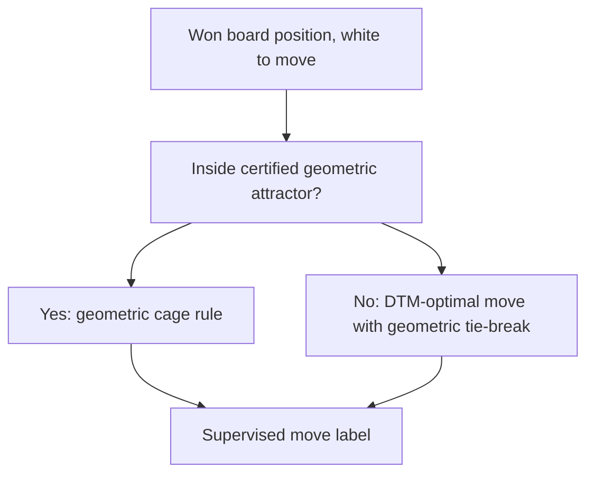
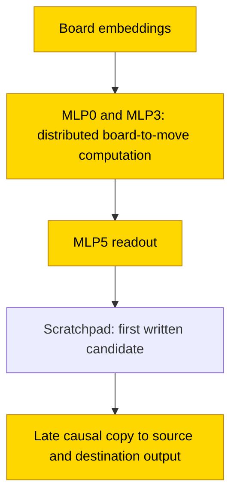

# King and two bishops versus king

This entry studies small transformers trained to choose a mating move with a white king and two opposite-colour bishops against a
black king. None of the nine trained seeds solves the task on its 2,048-row held-out screen: direct-answer networks reach best exact
match .58–.63, while writing candidate moves first reaches .39–.41. The networks use distributed board-to-move computations; no
faithful sparse circuit or accepted closed form was found. The task is unsolved, with no hand-built neural reference. In the
scratchpad, all three seeds causally copy their first written candidate into the move, locating their failure upstream in candidate
generation rather than in the final copy.

| Fact | Value |
|---|---|
| Task | Choose the verified hybrid policy's move for king and two opposite-colour bishops versus king, white to move |
| Input → output example | A board position → a source square and destination square; the label follows the policy in Section 1 |
| Model | GPT-NeoX-shaped, 6 layers × 12 heads, d_model 384 (width retry 768), ReLU MLP 4 × width; all weights trained |
| Rungs and seeds | TRAIN only, 3 seeds each for answer-only run 1, scratchpad run 1 and answer-only width retry; no HAND or PART |
| Closed form status | None (no solved cell; affine geometry candidate retains ≥ 99% of baseline in 0/12 tested snapshots) |
| Status | Unsolved (TRAIN 0/9 exact across three cells; width retry truncated); last run 2026-11-11 |
| Weights | [Hugging Face: chess-kbbk-mate](https://huggingface.co/jc1122/circuit-atlas-nets/tree/main/chess-kbbk-mate), published revision `15eb9d53b409` |
| Reproduce | Not available yet: training code for this task is not yet in `code/` |

## 1. Task and data

The domain contains all 2,503,608 won positions with a white king, opposite-colour bishops and a black king, white to move. Bishops
are identified by square colour; 520 drawn positions are excluded. The fixed split is 2,253,248 training / 250,360 held-out positions.
Prompts encode the board in 73 tokens.

Labels come from a verified hybrid policy, not a compact hand-built neural algorithm. Geometric cage rules (MATE, RESCUE, BARRIER,
APPROACH, REGROUP, WAIT) apply where their closed attractor holds, 0.37% of states; a closed attractor means the policy stays inside
a certified winning region under every defender reply. The remaining 99.63% use a distance-to-mate (DTM) optimal move with a geometric
tie-break key. The source also gives the coarser 99.6% summary. The geometric list certifies only 9,257 of 2,503,608 won states within
50 moves; no claim is made that another compact policy is impossible.

*Table 1. Output formats.*

| Format | Output | Total sequence length |
|---|---|---|
| `A` (answer only) | source and destination squares | 75 |
| `T` ([scratchpad](../GLOSSARY.md#task-formats)) | phase, cage area, 8 ordered candidate destination squares, then source/destination | 85 |

Exact match is the whole output, teacher-forced with correct previous tokens supplied
([glossary](../GLOSSARY.md#task-formats)). Reported training scores use a fixed 2,048-row held-out screen, not every one of the
250,360 held-out positions. Diagnostics use 128 held-out rows per snapshot.

Label generation was checked by exhaustive retrograde analysis: 0 Bellman discrepancies on 4,194,304 slots. Comparison with
[python-chess](https://python-chess.readthedocs.io/) gave 0 move-set mismatches on 3,000 states per side; 150 games per policy mated
at the certified ply. The hybrid mates every won state against every defence, maximum 22 and mean 14.37 moves; DTM's maximum is 19.
This certifies labels, not free-play performance by a trained network.

## 2. Model

Shared conventions are in [METHODS.md](../METHODS.md). This is a TRAIN-only study: every weight is trained from scratch. There is no
HAND formula-weight network or PART cell ([rungs](../GLOSSARY.md#the-three-rungs)).

### 2.1 Architecture

Models are GPT-NeoX-shaped, 6 layers × 12 heads, no LayerNorm, no positional encoding, ReLU MLP of 4 × width, untied readout and
vocabulary 280. Run 1 has d_model 384, d_head 32, MLP 1536: 72 heads and 9,216 neurons. The answer-only retry has d_model 768,
d_head 64, MLP 3072 and 18,432 neurons.

### 2.2 Trained parts

All embeddings, attention, MLPs and readout are trained. No frozen geometric, tablebase or register-execution stage is provided.
The geometric policy and tablebase generate labels only.

### 2.3 Training

AdamW used learning rate 1e-3, weight decay .1, betas (.9, .98), warmup 1000, cosine, clip 1 and batches of 64 fresh training-split
positions. TRAIN used TF32, evaluated every 500 steps on the fixed 2,048-row screen, with best snapshots and a 5k plateau stop after
75% of budget. A's budget was 132k; T's was 150k. A run 2 was wall-capped at 23.5k of 132k, 18% of budget; its archived final is
step 22,500. Only weight decay .1 was run; .3 and 1 were not. Training used consumer GPUs.

### 2.4 Reproduction

Reproduce: not available yet: training code for this task is not yet in `code/`; the weights, held-out splits and recorded
accuracies are on Hugging Face at
[huggingface.co/jc1122/circuit-atlas-nets/tree/main/chess-kbbk-mate](https://huggingface.co/jc1122/circuit-atlas-nets/tree/main/chess-kbbk-mate).

### 2.5 Archive

Published revision `15eb9d53b409` contains `train_{A,T}_r1_{best,final}_s{0-2}`, `train_A_r2_final_s{0-2}` at step 22,500,
`screen_{A,T}`, `config.json` and `manifest.json`. The source publication inventory has 20 files. The publication verification records
no missing/mismatched hashes and two reproduced networks. This is the earlier archive check, not a new model re-score for this rewrite.

## 3. Reference policy, with no hand-built network

No HAND network was constructed. A formula-weight implementation of the remaining labels would, under the recorded construction,
be a 2.5M-state DTM table, so there is no compact neural reference or PART comparison. Figure 1 diagrams label selection, not a
hand-built circuit. The negative result does not show that no smaller geometric policy could exist.

*Figure 1. The verified label policy, not a HAND neural network. There is no PART cell and no trained node in this diagram. The
geometric branch covers 0.37% of won states; the DTM fallback covers the recorded 99.63%.*

## 4. What training finds

The final analysis dated 2026-11-11 reports no solved cell, 0/9 seeds (Table 2). Training and test remain close: the networks cannot
fit the task, with no recorded memorisation or solved [grokking](../GLOSSARY.md#counting-results) transition. The width step gives no
gain at matched step, but its truncated schedule does not test full-budget width scaling.

*Table 2. Exact match on the 2,048-row screen, seed order 0 / 1 / 2; all three cells are TRAIN.*

| Cell | Seeds solved | Best exact | Final exact | Final train | Stop | Failure class |
|---|---|---|---|---|---|---|
| A run 1, d 384 | 0/3 | .627/.590/.582 | .620/.586/.575 | .63/.61/.62 | plateau 130.5k | cannot fit |
| T run 1, d 384 | 0/3 | .410/.394/.407 | .402/.391/.405 | approximately test, gap ≤ .03 | ran to 146k | cannot fit |
| A run 2, d 768 | 0/3 | .190/.195/.178 | .171/.175/.149 at 22.5k | .19/.18/.15 | wall cap 23.5k | cannot fit; truncated |

At matched step 23.5k, d 384 gives .183–.217 and d 768 .149–.184, no gain at fixed learning rate. The earlier coarser best summaries
are .58–.63, .39–.41 and .18–.20 respectively; these remain distinct from Table 2's precise values.

### 4.1 Computation and diagnostics

All nine failed networks share a distributed board-to-move description: embedding through MLP0/MLP3 to the MLP5 readout. No discovered
sub-circuit is faithful: held-out faith .05–.69. T adds a causal first-candidate copy in all three seeds, not a distinct successful
mating algorithm. Logit-lens exactness is ≤ .06 through L5 and .16–.55 only after MLP5.

*Table 3. Diagnostics on 128 held-out rows per snapshot. Used means single-component mean-ablation drop > .05; neuron counts are
not measured. R² is a probe score; residual rank is L6 rank at 90% energy. A “pass” in the last column denotes tool self-checks,
not a faithful discovered circuit.*

| Snapshot | Exact | Used heads + MLPs | Best probe R², layer | Residual rank | JS | Discovery faith / complement |
|---|---|---|---|---|---|---|
| A run 1 best, seeds 1/2 | .55/.50 | 15+6 / 12+6 | dtm_plies, eligible, optimal_count, king_distance ≤ .03; cage_u_hi .30–.40 L2–3 | 49/46, no HAND | N/A | – |
| A run 1 final, seeds 0/1/2 | .55/.55/.53 | 22/16/16 + 6 | same; policy_to ≤ .08; cage_v_hi .40 L6, seed 1 | 59/49/46 | N/A | .27/.69/.41 / checks pass |
| T run 1 best, seeds 0/1/2 | .41/.42/.49 | 14/10/31 + 6 | policy_to .79/.71/.40 L6; dtm_plies .16–.45 L6; candidate_to < 0 | 52/44/62 | N/A | – |
| T run 1 final, seeds 0/1/2 | .43, seed 1 | 11+6, seed 1 | policy_to .70 L6, seed 1 | 44, seed 1 | N/A | .05/.08/.10 / checks pass |
| A run 2 final, seeds 0/2 (1) | .16/.24 (.16) | 2H+2M / 2H+4M | every variable ≤ .30; DTM variables ≤ .021 all layers | 46/42 | N/A | .44/.33, seeds 0/1; complement .75/.48 |

Key: dtm_plies is distance to mate in plies; eligible and optimal_count count eligible/optimal moves; policy_to is the target
destination; candidate_to denotes candidate destination labels. cage_u_hi/cage_v_hi are bounds of the geometric cage. H and M mean
heads and MLPs. Probe, lens, ablation, interchange and rank are defined in the [glossary](../GLOSSARY.md#analysis-measures).

The ≤ .03 DTM-ordering result applies to answer-only run 1, and ≤ .021 to the width retry. It is not a universal claim that T has
no decodable DTM information: T's raw dtm_plies probe is .16–.45 in the retained best-snapshot table. No compact causal DTM ordering
was established in T either. Every A variable is untested by interchange, nf 0, not proven unused. T's policy_to at L6 flips 1.0
(nf 63, all 3 seeds), including wrong rows: the copy works even when the first candidate is wrong.

## 5. Mechanism and verification

No closed form is accepted. An affine geometry substitution, 44 features replacing one MLP, keeps ≥ 99% of baseline in 0/12
snapshots. No faithful circuit is available to substitute, and passing complement self-checks does not override low held-out
faithfulness. T's final destination copy is causally supported, but candidate generation remains unexplained.

*Figure 2. The failed TRAIN computation. Shaded embedding, MLP and late-copy components are trained; the candidate node is an emitted
token, not an extra module. Closed-form status: none; only the late copy is causally localised, not a complete mating algorithm.*

### 5.1 Relation to prior work

There is no HAND algorithm to compare. The related [king-and-rook entry](chess-krk.md) learns a compact 8-rule policy at .99 with a
scratchpad; here the hybrid labels are predominantly tablebase-optimal and no comparable compact intermediate was found. The source
comparison gives answer only 0/6 (72 heads + 9,216 / 18,432 neurons) versus scratchpad 0/3 (72 + 9,216); writing candidates lowers
whole-output exactness in these cells, not in every possible KBBK format.

Tablebase-trained neural policies and endgame failures are discussed by [Ruoss et al. (2024)](#references),
[Haworth (2019)](#references), [de Brito Neto et al. (2023)](#references) and [Haque et al. (2022)](#references). Broad model scaling
is background from [Kaplan et al. (2020)](#references); width-dependent learning-rate transfer from
[Kim et al. (2026)](#references) motivates a possible controlled trial, not a completed rescue. Software validation uses
[Fiekas (n.d.)](#references), not a claim that library agreement proves the trained policy correct.

## 6. Limitations and open questions

There are three seeds per cell and only weight decay .1; the sweep was not run. T's log was lost after 67k although networks were
kept. The width retry stops at 18% of budget, so it remains untested at full schedule; a width-scaled learning rate was not tried.
Missing diagnostics are the A run-2 seed-1 ablation set, seed-2 discovery/dictionary and checkpoint dynamics. No HAND/PART comparison
exists and weak linear probes cannot exclude every nonlinear code.

Exactness is teacher-forced on 2,048 held-out rows; free play by trained networks is unmeasured. Length generalisation is not
applicable to the fixed 8×8 board. The exhaustive policy certificate belongs to the label generator, not to any of the nine networks.
No training continuation or new trial is implied by this negative result.

## 7. Prediction record

*Table 4. Predictions recorded before TRAIN.*

| Prediction | Outcome |
|---|---|
| A exact .3–.7 | Held, .58–.63 best |
| T exact .4–.8 | Broken as recorded, .39–.41 |
| T phase near 1 | Held, .98–1.0 |
| T first candidate approximately the move, no lift over A | Held |
| Budget-limited and still rising at end | Broken for A run 1, plateau; not recorded for T or A run 2 |
| Record wall-cap truncation separately | Held for A run 2 |

## Appendix A. Weights excerpt and reading

The archived excerpt measures `U[SQ] W_out`, the MLP5-to-destination-logit map, not a fitted algorithm. SQ denotes destination-square
readout rows. Per final network, 90%-mass rank is A run 1 21–22/64, T run 1 42/64 and A run 2 17/64.

*Table A1. Neurons carrying 50% / 90% of destination-readout mass, not causal neuron minima.*

| Cell | 50% mass | 90% mass | MLP width |
|---|---|---|---|
| A run 1 | 185–211 | 399–457 | 1,536 |
| T run 1 | 537–551 | 1130–1164 | 1,536 |
| A run 2 | 180–210 | 1119–1247 | 3,072 |

The readout is not sparse under this measure. The source describes T as spreading it over approximately 3x A's neurons; this is a
recorded qualitative comparison, not a newly computed ratio or a full circuit size.

## Appendix B. Evaluation denominators

The complete won domain, fixed train/held-out split, 2,048-row training screen and 128-row diagnostic bank are different evaluations.
The label generator's full-domain mating certificate does not turn a sampled network score into a certificate. No new model
inference or game rollout was run for this presentation update.

## References

- de Brito Neto et al. (2023). Evaluating Deep Learning-based Chess-Engine Endgame Strategies. *Conference paper*. https://doi.org/10.5753/sbgames_estendido.2023.233983 (endgame-policy comparison)
- Fiekas, N. (n.d.). python-chess: A chess library for Python. *Software documentation*. https://python-chess.readthedocs.io/ (move-set validation; version not recorded)
- Haque et al. (2022). On the Road to Perfection? Evaluating Leela Chess Zero Against Endgame Tablebases. *Conference paper*. https://doi.org/10.1007/978-3-031-11488-5_13 (tablebase endgame evaluation)
- Haworth. (2019). Chess endgame news: an endgame challenge for neural nets. *Journal article*. https://doi.org/10.3233/icg-190109 (neural endgame limits)
- Kaplan et al. (2020). Scaling Laws for Neural Language Models. *Preprint*. https://doi.org/10.48550/arxiv.2001.08361 (scaling background)
- Kim et al. (2026). Let's Scale Step by Step: Compute-Efficient Hyperparameter Transfer for Large-Scale Mixture-of-Experts. *Preprint*. https://doi.org/10.48550/arxiv.2608.20061 (learning-rate shifts with width without parameterised transfer)
- Ruoss et al. (2024). Amortized Planning with Large-Scale Transformers: A Case Study on Chess. *Preprint*. https://doi.org/10.48550/arxiv.2402.04494 (tablebase-trained policy comparison)
