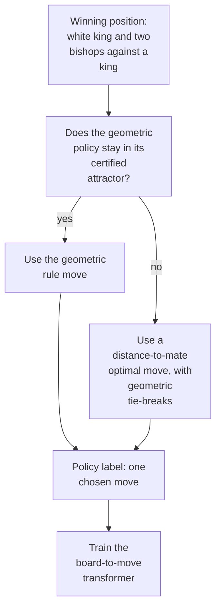
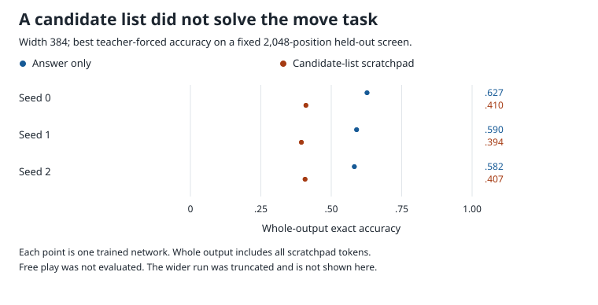

# King and two bishops versus king

A king and two bishops can force checkmate against a lone king, but predicting one chosen winning move is a separate learning problem. Six-layer transformers were trained on a policy for 2,503,608 winning positions; 99.63% of its labels came from a distance-to-mate table, with geometric rules supplying the rest. The task remained unsolved across nine independent training runs (seeds, [glossary](../GLOSSARY.md#counting-results)): the best answer-only accuracy was .627 on the fixed 2,048-position held-out screen, and the candidate-list scratchpad did worse. In all three scratchpad seeds, interventions supported a copy from the first candidate in the supplied trace to the destination output, placing the failing step upstream in candidate generation. No hand-built neural reference or accepted replacement formula was recovered; these scores supply the correct earlier output tokens and do not measure free play.

| Fact | Value |
|---|---|
| Task | Match the move selected by a fixed winning policy, with White to move |
| Input → output example | A board position with a white king, two opposite-colour bishops and a black king produces a from-square and a to-square |
| Model | 6-layer transformer; width 384 in run 1, width 768 in the answer-only retry; all weights trained |
| Rungs and seeds | TRAIN only: 3 seeds each for answer-only run 1, scratchpad run 1 and answer-only run 2; no HAND or PART network |
| Closed form status | None (no faithful replacement; geometry substitute retained ≥ 99% of baseline in 0/12 snapshots) |
| Status | Unsolved (0/9 at the requested ≥ .99 whole-output exact target); last run 2026-11-11 |
| Weights | [Hugging Face: chess-kbbk-mate](https://huggingface.co/jc1122/circuit-atlas-nets/tree/main/chess-kbbk-mate) |
| Reproduce | Not available yet: training code for this task is not yet in `code/` |

## 1. Task and data

The board contains a white king and bishops on opposite-coloured squares against a lone black king. KBBK names these four pieces. Bishops are identified by square colour, so swapping their argument order does not create a new position. All 2,503,608 winning white-to-move positions were included; 520 drawn positions were excluded. The fixed split contains 2,253,248 training and 250,360 held-out positions. The board prompt has 73 tokens.

The label is one move chosen by a deterministic hybrid policy. Its geometric rules are used only inside a certified set of positions that remains safe under every defender reply. Outside that set, it uses a distance-to-mate (DTM) optimal move, with geometric tie-breaks. DTM measures the remaining distance to checkmate under optimal play ([glossary](../GLOSSARY.md#standard-machine-learning-terms)). Matching this one tie-broken label is stricter than merely finding any winning move.

*Table 1. Output formats. A scratchpad writes intermediate information before the answer ([glossary](../GLOSSARY.md#task-formats)).*

| Format | Output |
|---|---|
| `A`, answer only | From-square, to-square |
| `T`, candidate-list scratchpad | Phase, cage area, 8 ordered candidate destination squares, from-square, to-square |

Whole-output exact accuracy counts a position correct only when every output token matches. Scores are teacher-forced: each token is scored given the correct preceding tokens, rather than the model's own generated history ([glossary](../GLOSSARY.md#task-formats)). The requested target was ≥ .99. Training evaluations used a fixed 2,048-row held-out screen, not the whole 250,360-position held-out partition. Diagnostics used a separate 128-row bank.

## 2. Model

The shared analysis conventions are in [METHODS.md](../METHODS.md). Every neural run was TRAIN, meaning that all weights were learned from scratch ([glossary](../GLOSSARY.md#the-three-rungs)). No formula-weight neural reference, HAND, or partly trained HAND network, PART, was built.

### 2.1 Architecture

The GPT-NeoX-shaped transformer has 6 layers × 12 heads, no LayerNorm, no positional encoding, a ReLU MLP of 4 × width, an untied readout and vocabulary 280. Sequence length is 75 for A and 85 for T. Run 1 uses d_model 384, d_head 32 and MLP width 1536: 72 heads and 9,216 allocated neurons. The answer-only retry uses d_model 768, d_head 64 and MLP width 3072: 18,432 neurons. It predicts the next token from earlier tokens. Here d_model is the running-state width and d_head each head's vector width. An MLP is a feed-forward block, and a head lets one position read information from earlier positions. ReLU keeps positive responses and sets negative ones to zero. LayerNorm would centre and rescale the state; positional encoding would add position vectors. Untied readout means separate input and output weights ([glossary](../GLOSSARY.md#standard-machine-learning-terms)).

### 2.2 Frozen parts and trained part

There are no frozen neural parts; all embeddings, heads, MLPs and output weights were trained. The exact policy used for labels is an external reference, not a hand-built transformer.

### 2.3 Training

AdamW used learning rate 1e-3, weight decay .1, betas (.9, .98), warmup 1000, cosine decay, clipping at 1 and batch 64 fresh draws from the training partition. Updates used TF32, with evaluation every 500 steps and best-snapshot selection. The plateau window was 5k after 75% of the budget. The budgets were 132k steps for A and 150k for T. Runs used consumer GPUs. Weight decays .3 and 1 were not run.

Run 2 was wall-capped at 23.5k of 132k, or the recorded 18% of its budget. Its archived network is from step 22,500, not the best logged step. It therefore does not test the wider model at a completed schedule. The learning rate stayed fixed across widths; a width-scaled learning rate was not tested.

### 2.4 Reproduction

Reproduce: not available yet: training code for this task is not yet in `code/`; the weights, held-out splits and recorded accuracies are on Hugging Face at [chess-kbbk-mate](https://huggingface.co/jc1122/circuit-atlas-nets/tree/main/chess-kbbk-mate).

### 2.5 Archive

Published revision `15eb9d53b409` contains `train_{A,T}_r1_{best,final}_s{0-2}`, `train_A_r2_final_s{0-2}` at step 22,500, `screen_{A,T}`, `config.json` and `manifest.json`. The manifest records seed, rung, accuracy and sha256 fingerprints. The source publication inventory lists 20 files; the publication record reports no missing or mismatched hashes and two reproduced networks. These are earlier archive checks, not a new download or re-score for this article. The run-1 scratchpad log was lost after 67k, but its networks were retained; the recorded final network had run to 146k.

## 3. Hand-built solution

No HAND neural network was built. The reference is an exhaustive retrograde solver, which works backwards from checkmate positions, and a hybrid policy, illustrated in Figure 1. Geometric cage rules alone were inadequate: their universal-defender attractor certified only 9,257 of 2,503,608 won states within 50 moves. The earlier public summary describes the geometric branch as 0.37% of states. The retained rule set uses MATE, RESCUE, BARRIER, APPROACH, REGROUP and WAIT. A smaller local cage is not by itself a guarantee of progress after the defender's move.

The remaining 2,494,351 states use `DTM_FALLBACK`, a share of 99.6302536%. The earlier public text reports this same fallback share at precisions 99.63% and 99.6%; none is a measured share of DTM-optimal moves for the whole hybrid policy. The geometric branch was not separately measured for optimality. No compact HAND policy was recovered in this study; that is not a proof that none could exist.

In Figure 1, a winning position takes the geometric move only when that policy stays in its certified safe attractor. Otherwise it takes a distance-to-mate table move with geometric tie-breaking. The chosen move becomes a training label. This is label generation, not a hand-built neural circuit; there is no HAND or PART component.

*Figure 1. The reference policy used to label the data. This is a label-generation diagram, not a hand-built neural circuit. No HAND or PART network exists, so no node is marked as a trained PART component. The fallback fraction measures use of the distance-to-mate table, not the policy's optimal-move rate.*

The solver had 0 Bellman discrepancies, inconsistencies between a state's solved value and the values of its legal successors, on all 4,194,304 raw slots. Validation against [python-chess, by Fiekas](#references), using its [software documentation](https://python-chess.readthedocs.io/), found 0 move-set mismatches on 3,000 random legal states per side. There were 150 games per policy, each finishing in checkmate at the certified ply count; a ply is one player's move. The actual hybrid mates every won state against every defence, with maximum 22 white moves and mean 14.365783 in the source verification; the earlier public summary reports mean 14.37. The DTM-optimal maximum is 19 white moves. The 50-move guarantee assumes a fresh halfmove clock, the counter since the last capture or pawn move; arbitrary nonzero clocks cannot have the same guarantee.

## 4. What training finds

The last reported analysis was dated 2026-11-11. The candidate list did not improve whole-output accuracy (Figure 2). Both run-1 formats had training accuracy close to test accuracy, consistent with underfitting rather than memorising the training partition. There was no delayed generalisation jump, or grokking ([glossary](../GLOSSARY.md#counting-results)).

*Figure 2. Best whole-output exact accuracy on the fixed 2,048-position held-out screen, three seeds per width-384 format. Scratchpad scoring includes every candidate token and supplies the correct preceding tokens. Free play was not evaluated. The truncated wider retry is excluded from this plot; no closed form was recovered.*

*Table 2. Training-screen results. Best and final are snapshots of the same seed. The width-768 final is the saved 22.5k-step network, while the wall cap occurred at 23.5k.*

| Cell | Seeds solved | Best exact (seed 0/1/2) | Final exact | Train (final) | Stop | Failure class |
|---|---|---|---|---|---|---|
| TRAIN A run 1, width 384 | 0/3 | .627/.590/.582 | .620/.586/.575 | .63/.61/.62 | Plateau 130.5k | Cannot fit |
| TRAIN T run 1, width 384 | 0/3 | .410/.394/.407 | .402/.391/.405 | ≈ test (gap <= .03) | Ran to 146k | Cannot fit |
| TRAIN A run 2, width 768 | 0/3 | .190/.195/.178 | .171/.175/.149 (22.5k) | .19/.18/.15 | Wall cap 23.5k | Cannot fit within truncated run |

The original summary ranges were .58–.63 for answer-only run 1, .39–.41 for the scratchpad and .18–.20 for the wider retry. At the matched step 23.5k, width 384 scored .183–.217 and width 768 scored .149–.184. There was no gain in this fixed-learning-rate, truncated comparison, but a full-budget width comparison was not completed.

All 9/9 networks were diagnosed as a distributed board-to-move lookup; the three scratchpad networks additionally copied the written first candidate into the move output. This is a diagnostic circuit-type label, not a verified formula for the whole network. Appendix B separates the linear probes by format: the scratchpad does have partially decodable DTM values, unlike the answer-only runs.

## 5. Mechanism and verification

The closed-form status is none. No faithful substitute was recovered. An affine geometry replacement using 44 features and one MLP retained at least 99% of baseline accuracy in 0/12 snapshots. Discovered subcircuits were not faithful: run-1 retained shares were .05–.69, below the acceptance share. Run-2 circuit shares were .44/.33, with complement shares .75/.48. Passing the resampling self-checks does not make those circuits sufficient.

In scratchpad networks, the final destination copy had interchange flip 1.0 at L6 with nf 63 in 3/3 seeds. An interchange replaces a proposed variable between examples and checks whether the output changes as predicted ([glossary](../GLOSSARY.md#analysis-measures)). The copy also worked on wrong rows, placing the diagnosed error upstream in the first candidate. Under teacher forcing that candidate is supplied in the preceding gold trace; no autonomous candidate-generation or free-play guarantee follows.

The answer-only networks assembled the move late, with output accuracy at most .06 through L5 and .16–.55 only after MLP5. Their distributed readout and poor DTM linear probes do not prove that every possible internal DTM representation is absent. No causal DTM test was available: every answer-only variable had nf 0, meaning untested.

The comparison with [chess-krk](chess-krk.md), which reports a compact 8-rule policy and scratchpad accuracy .99, concerns different label policies and endgames. Here no compact intermediate policy was recovered, and the candidate-list trace added more tokens that could be wrong. The full answer-only cohort was 0/6 across widths (72 heads and 9,216 / 18,432 neurons), compared with scratchpad 0/3 (72 heads and 9,216 neurons).

[Ruoss et al. (2024)](#references) studied supervised chess prediction at larger scales. [Haworth (2019)](#references), [Brito Neto et al. (2023)](#references) and [Haque et al. (2022)](#references) provide endgame/tablebase comparisons, not evidence that this label mapping is impossible to learn. [Kaplan et al. (2020)](#references) provides general scaling context. [Kim et al. (2026)](#references) studies width-dependent hyperparameter transfer in mixture-of-experts models; it motivates a possible learning-rate concern, but does not establish that learning rate caused this truncated retry's outcome.

## 6. Limitations and open questions

There were 3 seeds per cell and only weight decay .1. The weight-decay sweep was not run. The scratchpad log was lost after 67k even though the networks were kept. The width retry was cut at the recorded 18% of its budget, and a width-scaled learning rate was never tried. Missing diagnostics include the run-2 seed-1 ablation set, seed-2 discovery/dictionary results and checkpoint dynamics.

Exact accuracy is teacher-forced on the fixed 2,048-row screen; it is neither free-play success nor exhaustive held-out evaluation. No free play was measured. Length generalisation is not applicable to the fixed 8×8 board. Linear probe failure is not proof that no other value code exists, and the trained nets' policy-matching scores are not rates of winning against optimal defence.

The geometric-only policy failed outside its small certified region. The hybrid's universal-mate claim depends on the tablebase fallback and a fresh halfmove clock; it must not be transferred to the learned networks or arbitrary nonzero clocks.

## 7. Prediction record

Before training, answer-only best accuracy was predicted at .3–.7; the observed .58–.63 held. Scratchpad accuracy was predicted at .4–.8; .39–.41 missed that range. The phase token prediction near 1.0 held at .98–1.0. The prediction that the first candidate would determine move accuracy without improving over answer only held under teacher forcing.

The prediction of budget-limited improvement to the end failed for answer-only run 1, which plateaued. It was not recorded for scratchpad run 1 or the truncated answer-only retry. The retry's wall-cap truncation was recorded as such, rather than treated as convergence.

## Appendix A. Weights excerpt and reading

The excerpt is the final MLP5-to-destination map `U[SQ] W_out`, where SQ names a square token. Rank and mass counts are computed from those archived output weights, not from a recovered geometric formula.

*Table A1. Final destination readout. Rank counts directions holding 90% of readout mass; neuron counts give 50% / 90% of that mass.*

| Cell | 90%-mass rank | Neurons for 50% / 90% mass | Allocated MLP neurons |
|---|---|---|---|
| A run 1 | 21-22/64 | 185-211 / 399-457 | 1,536 |
| T run 1 | 42/64 | 537-551 / 1130-1164 | 1,536 |
| A run 2 | 17/64 | 180-210 / 1119-1247 | 3,072 |

The readout was not sparse. The original summary described scratchpad readout mass as spread over about 3× as many neurons as answer only. That comparison is descriptive; neither readout is a recovered chess rule.

## Appendix B. Detailed evidence

*Table B1. Diagnostics on 128 held-out rows per snapshot, separate from the training screen. Probe R² measures linear decodability, not causal use; r90 is the 90%-variance residual rank; faith is the retained held-out share of baseline under discovery ([glossary](../GLOSSARY.md#analysis-measures)).*

| Snapshot | Exact | Used heads + MLPs | Best probe R² (layer) | Effective rank L6 r90 (vs HAND) | Attention JS | Discover faith / complement |
|---|---|---|---|---|---|---|
| A run 1 best seeds 1/2 | .55/.50 | 15+6 / 12+6 | dtm_plies, eligible, optimal_count, king_distance <= .03; cage_u_hi .30-.40 (L2-3) | 49/46 (no HAND) | N/A | - |
| A run 1 final seeds 0/1/2 | .55/.55/.53 | 22/16/16 + 6 | same; policy_to <= .08; cage_v_hi .40 (L6, seed 1) | 59/49/46 | N/A | .27/.69/.41 / self-checks pass |
| T run 1 best seeds 0/1/2 | .41/.42/.49 | 14/10/31 + 6 | policy_to .79/.71/.40 (L6); dtm_plies .16-.45 (L6); candidate_to < 0 | 52/44/62 | N/A | - |
| T run 1 final seeds 0/1/2 | .43 (seed 1) | 11+6 (seed 1) | policy_to .70 (L6, seed 1) | 44 (seed 1) | N/A | .05/.08/.10 / self-checks pass |
| A run 2 final seeds 0/2 (seed 1) | .16/.24 (.16) | 2H+2M / 2H+4M | every variable <= .30; DTM variables <= .021 at all layers | 46/42 | N/A | .44/.33 (seeds 0/1); complement .75/.48 |

Used components have single-component mean-ablation drop > .05; neurons were not counted by this diagnostic. H means an attention head and M means a whole MLP. The reference variables name DTM in plies (`dtm_plies`), counts of eligible/optimal moves, king distance and cage boundaries in rotated board coordinates (`cage_u_hi`, `cage_v_hi`). `policy_to` is the chosen destination; `candidate_to` is the candidate-list destination variable. There is no HAND attention pattern to compare, so JS is not applicable.

The ≤ .03 DTM probe bound applies to answer-only run 1, and ≤ .021 to answer-only run 2. Scratchpad run 1 instead has DTM R² .16–.45 at L6. Thus the data do not support the old universal claim of no linearly decodable DTM code in all nine nets. Every answer-only interchange remained untested with nf 0; scratchpad destination interchange had nf 63 and flip 1.0 in 3/3, also on wrong rows.

## What to read next

Compare [KRK mate](chess-krk.md) for a different endgame with a compact reference policy. [Mate-in-one selection](chess-mate-in-one.md) isolates a local decision among supplied moves rather than learning the full policy.

## References

- Brito Neto, E. P. de, Menezes e Silva Filho, T. de, Rêgo, T. G. do, & Malheiros, Y. (2023). Evaluating Deep Learning-based Chess-Engine Endgame Strategies. *Anais Estendidos do XXII Simpósio Brasileiro de Jogos e Entretenimento Digital (SBGames Estendido 2023)* (conference paper). https://doi.org/10.5753/sbgames_estendido.2023.233983 (endgame strategy comparison)
- Fiekas, N. (n.d.). python-chess: A chess library for Python [Computer software; GPL-3.0; repository since 2012, PyPI package `chess`; version used 1.11.2]. *GitHub*. https://github.com/niklasf/python-chess (independent move-set and checkmate validation; original documentation link retained in Section 3)
- Haque, R., Wei, T. H., & Müller, M. (2022). On the Road to Perfection? Evaluating Leela Chess Zero Against Endgame Tablebases. *Advances in Computer Games* (conference-proceedings chapter). https://doi.org/10.1007/978-3-031-11488-5_13 (endgame tablebase comparison)
- Haworth, G. (2019). Chess endgame news: an endgame challenge for neural nets. *ICGA Journal* (journal article). https://doi.org/10.3233/icg-190109 (neural endgame benchmarks)
- Kaplan, J., McCandlish, S., Henighan, T., et al. (2020). Scaling Laws for Neural Language Models. *arXiv preprint*. https://doi.org/10.48550/arxiv.2001.08361 (general model-scaling context)
- Kim, N., Lee, H., Bak, Y., Park, J., & Kim, B. (2026). Let's Scale Step by Step: Compute-Efficient Hyperparameter Transfer for Large-Scale Mixture-of-Experts. *arXiv preprint*. https://doi.org/10.48550/arxiv.2608.20061 (scope-limited width/hyperparameter comparison)
- Ruoss, A., Delétang, G., Medapati, S., et al. (2024). Amortized Planning with Large-Scale Transformers: A Case Study on Chess. *arXiv preprint*. https://doi.org/10.48550/arxiv.2402.04494 (supervised chess prediction at larger scales)
