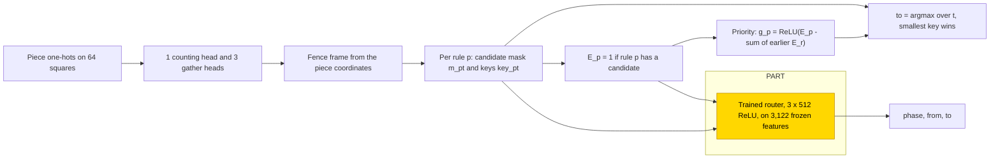
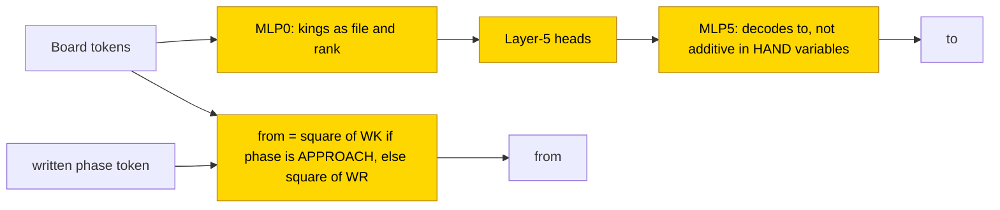

# KRK mate (king + rook vs king)

This entry studies how small transformers choose a move in the king + rook vs king endgame, with white to move. The label is the
move of a fixed 8-rule fence policy, not the tablebase-optimal move; the policy mates from every position and compiles to a sparse
hand-built network of 4 heads + 6,666 ReLU neurons. A 3 × 512 router trained on frozen hand-built rule features reached .993–.999 in
60/60 seed-runs, none exact. Trained from scratch with a scratchpad (format G), 120k steps gave .990–.997 in 7/7 final seeds, none
exact, while answer only gave .968–.976; the trained networks code the kings as coordinates rather than as the hand-built squares. The
task is partly solved (scratchpad G from scratch, 7/7 at ≥ .99 but none exact). The closed form is partial: the PART phase rule (20/20)
and the TRAIN G source-square rule (7/7) keep accuracy under substitution, with the complement not tested, while an additive model of
how G decodes the destination square fails (from .995 to .34).

| | |
|---|---|
| Task | In a king + rook vs king position with white to move, write the move chosen by a fixed 8-rule fence policy (not the tablebase-optimal move) |
| Input → output example | In words: the 64-square board with the three pieces → the policy's move as its from square and to square (answer only) |
| Model | GPT-NeoX-shaped, 6 layers × 12 heads, d_model 384, MLP 1536 ReLU, trained from scratch; PART: a 3 × 512 ReLU router trained on 3,122 frozen hand-built features |
| Rungs and seeds | HAND (4 heads + 6,666 neurons, exact); PART 10 seeds per setting; TRAIN 30k (10 seeds), 60k (3), 120k (3 per A/G/C); final G 120k: 7 of 10 seeds |
| Closed form status | Partial: PART phase rule 20/20 and TRAIN G source-square rule 7/7 keep accuracy; supported by substitution, complement not tested; an additive model of G's `to` decoding fails (.995 → .34) |
| Status | Partly solved (scratchpad G from scratch, 7/7 at ≥ .99, none exact); last run 2026-11-08 |
| Weights | [Hugging Face: chess-krk](https://huggingface.co/jc1122/circuit-atlas-nets/tree/main/chess-krk) |
| Reproduce | Not available yet: training code for this task is not yet in `code/` |

## 1. Task and data

The data are all 175,168 won king + rook vs king positions with white to move. A fixed permutation holds out 10% (17,516 positions) and
leaves 157,652 for training. The prompt has 73 tokens: BOS, side to move, castling, en passant, the 64 squares and `=`.

The label is the move of a deterministic fence policy with 8 rules in priority order: FLEE, SHRINK, CHECK, WAIT, REPOS, APPROACH, DIVIDE
and FAR. Integer keys break ties between candidate moves. The policy is not optimal play by depth to mate (DTM): it mates from every
position in at most 48 moves (mean 24.1) against a mean DTM of 9.86.

An output counts as correct on exact match of the whole [teacher-forced](../GLOSSARY.md#task-formats) output. Length generalisation
does not apply, because the board is fixed. Games were played greedily from 512 held-out starts with a 60-move cap, against tablebase
and random defenders, with legality checked by python-chess ([Fiekas, n.d.](#references)).

*Table 1. Output formats.*

| Format | Output |
|---|---|
| `A` (answer only) | from, to |
| `G` ([scratchpad](../GLOSSARY.md#task-formats)) | the fence box fl fh rl rh, area, rook-safety flag, phase (the active rule), then from, to |
| `C` (scratchpad with candidates) | G plus the active rule's candidate moves in key order (padded to 14) |

## 2. Model

The shared conventions are described in [METHODS.md](../METHODS.md). The three [rungs](../GLOSSARY.md#the-three-rungs) are HAND (every
weight set by formula), PART (frozen hand-built parts with one trained stage) and TRAIN (all weights trained from scratch).

### 2.1 Architecture

TRAIN networks are GPT-NeoX-shaped with 6 layers × 12 heads (d_head 32), d_model 384, MLP 1536 ReLU, no LayerNorm, no positional
encoding and an untied readout, with a vocabulary of 293 tokens; sequence length is 75, 82 and 96 for A, G and C. HAND is a stack of
sparse ReLU levels on the piece one-hots with 1 counting head and 3 gather heads; the levels have 2592/662/647/430/1282/137/2/7/907
neurons.

### 2.2 Frozen parts and trained part

PART reads the 3,122 frozen HAND features below the priority level and replaces the priority and argmax levels by a trained router:
h1 = ReLU(x W1 + pos[p] + b1), two further ReLU layers, and logits = h3 W4 + b4, with W1 [3122, 512], W2 and W3 [512, 512], W4 [512, 293]
and pos [9, 512], where p is the output position.

### 2.3 Training

TRAIN used AdamW with learning rate 1e-3, weight decay .1, betas (.9, .98), warmup 1000 steps, a cosine schedule and gradient clip 1.
Each step drew a batch of 64 fresh training positions, in TF32. Test accuracy was evaluated every 250 steps on a fixed 2,048-row
held-out batch; the best snapshot was kept, with a plateau stop after 5k steps without improvement once 75% of the budget had passed.
PART ran in [fp32](../GLOSSARY.md#hand-built-machinery) with batch 256 and was evaluated on all held-out positions. Its continuation
used online hard example mining (OHEM), which keeps the 256 highest-loss rows of 1,024 ([Koksal et al., 2022](#references)). Training
ran on consumer GPUs.

### 2.4 Reproduction

Reproduce: not available yet: training code for this task is not yet in `code/`; the weights, held-out splits and recorded
accuracies are on Hugging Face at
[huggingface.co/jc1122/circuit-atlas-nets/tree/main/chess-krk](https://huggingface.co/jc1122/circuit-atlas-nets/tree/main/chess-krk)
(manifest keys `recorded_test` and `rescored_test`).

### 2.5 Archive

The Hugging Face folder `chess-krk/` holds `train_{G,C}_s{0-2}_{best,final}`, `train_A_s{0-2}_best`, `train_G_s{6,7}_final`,
`train_G_s{8,9}_{best,final}`, `part_G_ohemc_s{0-9}_{best,final}`, `heldout.safetensors`, `config.json` and `manifest.json`.

## 3. Hand-built solution

The hand-built network computes the fence frame from the piece coordinates, then, for each rule p, a candidate mask m_pt over
destination squares t together with integer keys key_pt (Figure 1). A rule applies when it has a candidate, E_p = 1[Σ_t m_pt > 0]. The
priority level keeps the first applicable rule, g_p = ReLU(E_p − Σ_{r<p} E_r). The destination is

to = argmax_t ReLU(10000 g_p + 10000 m_pt + 10000 P_to − 64 key_pt − 20000 − t),

so the smallest key among the active rule's candidates wins. The network writes 0 wrong tokens on all states.

*Figure 1. The hand-built network. The frozen levels compute the fence frame, each rule's candidates and keys, and whether each rule
applies; the priority and argmax levels pick the move. The shaded router is the trained part of PART; it reads the frozen features
below the priority level in place of the priority and argmax levels.*

## 4. What training finds

### 4.1 PART

The router on frozen features reached G .9965–.9976 and, with the OHEM continuation, .99829–.99892; A reached .9934–.9946 and, with the OHEM
continuation, .99657–.99732. Test accuracy reached ≥ .99 by 16.8–19.8k steps; in total .993–.999 in 60/60 seed-runs, none exact. The
router is a ray and distance router in 50/50 seed-runs: zeroing the rook rays or the king distances costs ≥ 1 point each, while
zeroing the raw piece one-hots costs < 1 point. The remaining errors are at the `to` token.

### 4.2 TRAIN

From scratch, the scratchpad format G improves with budget: 30k steps give .72–.86, 60k .96–.98, and 120k .990–.997 in 7/7 final
seeds (none exact), with a win rate against the tablebase defender of .85–1.0. Answer only (A) reached .968–.976 (win .53–.60).
Scratchpads learn earlier and play better. Fresh positions at every step give no memorisation phase, unlike the grokking runs of
[Power et al. (2022)](#references).

In the 120k G final, best test is .993–.998 and final test .990–.997 (7/7 ≥ .99, 0 exact). Test accuracy first passed .9 at
63.5–75.8k steps. Per position, box, area and flag are 1.0, phase .996–.999, from .9995–1.0 and to .996–.998. Format C reached
.985–.991, with its errors moved into the candidate list; A reached .968–.976.

*Table 2. Results per cell.*

| Cell | Seeds | Best / final test | ≥ .99 |
|---|---|---|---|
| PART G | 10 per setting | .9965–.9976; OHEM continuation .99829–.99892 | by 16.8–19.8k |
| PART A | 10 per setting | .9934–.9946; OHEM continuation .99657–.99732 | by 16.8–19.8k |
| TRAIN G 30k | 10 | .72–.86 | 0/10 |
| TRAIN G 60k | 3 | .96–.98 | |
| TRAIN G 120k final | 7 of 10 | .993–.998 / .990–.997 | 7/7, 0 exact |
| TRAIN C 120k | 3 | .987–.991 / .985–.991 | |
| TRAIN A 120k | 3 | .970–.977 / .968–.976 | |

### 4.3 Circuit types

The diagnosed networks were G seeds 0–2, C seeds 0–1 and 6 A networks. Four circuit types were found (Table 3; diagnostics in Appendix
B). The trained networks share HAND's inputs (rays, distances) and its phase decoder, but not its priority or argmin, and they code the
kings as coordinates rather than squares.

*Table 3. Circuit types.*

| Type | Seeds | Description |
|---|---|---|
| G coordinate decoder | 3/3 (all 12 G nets, 30k–120k) | MLP0 codes the kings as file and rank, then layer-5 heads, then MLP5 decodes (patch .98–.99) |
| Phase-conditioned source copy | 7/7 final seeds | the source square is copied according to the written phase |
| C candidate pointer | 2/3 | a layer-5 head points at the first candidate |
| A histogram | 6/6 | MLP0 + one layer-0 histogram head |

## 5. Mechanism and verification

### 5.1 Closed forms

Table 4 lists the substitutions. The PART phase rule and the TRAIN G source rule have 0 fitted numbers.

*Table 4. Substitutions: accuracy with the closed form against native.*

| Component | Closed form | Substituted vs native | Kept |
|---|---|---|---|
| PART phase | phase = first p with E_p | .99829–.99897 vs .99772–.99892 | 20/20 |
| PART phase, alternative | linear in E | .968–.970 | fails |
| TRAIN G source | from = square(WK) if the written phase is APPROACH, else square(WR) | .99035–.99623 vs .99018–.99623 | 7/7 final seeds |
| TRAIN C pointer | z_h(to) = W_V x[candidate 0] at L5H4 | 1,024/1,024 kept | |
| TRAIN G `to` | additive model of MLP5 on HAND variables | .995 → .34 | fails |

Key: WK, WR = white king, white rook; L5H4 = layer 5, head 4; z_h = the head's output.

The PART phase rule and the TRAIN G source rule are supported by substitution; no
[resample ablation of the complement](../GLOSSARY.md#verifying-a-circuit) was run, so the closed-form status is partial. Two controls
test the source rule: always copying the rook gives .869–.875, and a shuffled phase gives .780–.786. How G decodes the destination
square stays open, because the additive model fails (Figure 2).

*Figure 2. The circuit training finds in TRAIN G (120k steps). The source rule keeps accuracy in 7/7 final seeds and is supported by
substitution with the complement not tested (partial); the decoding of the destination by MLP5 has no closed form, since an additive
model fails (from .995 to .34).*

### 5.2 Relation to the hand-built network and to published work

The trained networks share HAND's inputs and phase decoder; they do not reproduce HAND's priority and key argmin, and they code the
kings as coordinates. A transcoder reading of the chess MLPs, as in [Lin et al. (2026)](#references), is the proposed next test for
G's destination decoder.

## 6. Limitations and open questions

Best and final differ by ≤ .007. "Grok" here means the first evaluation with test ≥ .9
([glossary](../GLOSSARY.md#counting-results)). Some diagnostics are unavailable (U in Appendix B), because there is no dense
hand-built network of the same architecture for the rule labels, and so no HAND JS or rank. Final seeds 6–9 are undiagnosed; seeds 3–5
never finished.

## 7. Prediction record

The predictions were recorded before any rule-label step (Table 5).

*Table 5. Predictions and outcomes.*

| Prediction | Outcome |
|---|---|
| PART ≥ .99 in ≥ 8/10 | held (10/10) |
| G box/area/flag ≥ .99 | held (1.0) |
| G move exact .65–.95, 2–6/10 ≥ .99 at 30k | broken (.72–.86, 0/10; 4x budget gives 7/7) |
| A .5–.8 | held (.77–.88) |
| Fence variables linear (R² ≥ .9) | broken (≤ .76; ub/uk ≤ .35) |
| Phase interchange flips the move ≥ 80% | tested on the phase token only (.81–.86) |
| Win ≥ .8 at move exact ≥ .8 | broken for A |

## Appendix A. Weights excerpt and reading

In HAND, g_p has +1 on E_p and −1 on each earlier E_r, and the −64 key_pt term makes the smallest key win. The PART W4 phase block,
read by a centred SVD (`excerpts.py krk`), has rank 7 (7 of 8 phases), with s_7/s_1 .47–.53. TRAIN G's source rule needs no weights: it
reads the written phase and the piece squares.

## Appendix B. Detailed evidence

*Table B1. Diagnostics per cell.*

| cell | used | best probe R² (layer) | eff. rank | attn JS | best / final |
|---|---|---|---|---|---|
| PART G | 1,334–1,340 of 1,536 units | phase from h3 .89–.91 | W4 phase block 7 of 8 | n/a (no heads) | .9989 / .9987 max |
| TRAIN G 120k | 23–34 of 72 heads + 6 MLPs | kings .85–.99 (L2–5), fl .66–.76 (L4–6), area .56–.62, ub/uk ≤ .35, phase .12–.18 | MLP ranks 41–239 | U | .993–.998 / .990–.997 |
| TRAIN C 120k | 27–39 heads + 6 MLPs | kings .81–.97, box .33–.73, phase .40–.49 | 75–239 | U | .987–.991 / .985–.991 |
| TRAIN A 120k | 22–31 heads + 6 MLPs | kings .78–1.0, rl ≤ .37, rest < .3 | U | U | .970–.977 / .968–.976 |

Key: used = components whose ablation drops accuracy; R² = best linear [probe](../GLOSSARY.md#analysis-measures) (layer); fl, rl and
ub/uk are fence-frame variables of HAND; eff. rank = effective rank; attn JS = attention divergence to HAND; U = unavailable (no dense
HAND of the same architecture).

## References

- Fiekas, N. (n.d.). python-chess: a chess library for Python (software). *GitHub*. https://github.com/niklasf/python-chess;
  https://python-chess.readthedocs.io/ (legality checks in games)
- Koksal, A., Tuzcuoglu, O., Ince, K. G., Ataseven, Y., & Alatan, A. A. (2022). Improved hard example mining approach for single shot
  object detectors. *2022 IEEE International Conference on Image Processing (ICIP)*. https://doi.org/10.1109/ICIP46576.2022.9897806
  (online hard example mining)
- Lin, R., Jin, Z., Zhou, G., et al. (2026). Tracing the thought of a grandmaster-level chess-playing transformer. *arXiv preprint*.
  https://doi.org/10.48550/arxiv.2604.10158 (transcoder reading of chess MLPs, the proposed next test)
- Power, A., Burda, Y., Edwards, H., Babuschkin, I., & Misra, V. (2022). Grokking: Generalization beyond overfitting on small
  algorithmic datasets. *arXiv preprint*. https://arxiv.org/abs/2201.02177 (grokking with a memorisation phase)
