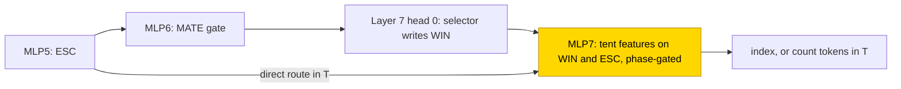

# Chess mate-in-one selection

This entry studies how a transformer picks the first mating move from a supplied list of checks against a bare black king. A frozen
hand-built 8-layer network counts the black king's escape squares after each candidate (0–8), gates mate on a zero count and writes
the first mating slot; only its final MLP was retrained. That trained MLP decodes the hand-built escape count in 3/3 seeds per format
(answer only and scratchpad). Trained on lists of at most 8 candidates, the networks fail a stress set with up to 16 (52–64% exact); a
retry with coverage data fixes answer only (608/608). No from-scratch run has finished. The task is partly solved (frozen-parts setting
3/3 per format; from-scratch training unmeasured). The closed form is partial: 442 fitted scalars replace the answer-only MLP on all 6
first-run snapshots, while the 7,693-scalar scratchpad form holds only locally and fails the stress set on 2 snapshots; both are
supported by substitution with the complement not tested.

| | |
|---|---|
| Task | Given a bare black king and K = 1–16 supplied legal checking moves, output the first move that mates, or NONE |
| Input → output example | In words: if only the second of three supplied checks leaves the king no escape square, the answer is the second |
| Model | GPT-NeoX-shaped, 8 layers, d_model 480, 24 heads × 20, MLP 640, hand-built and frozen; PART trains only the layer-7 MLP (615,520 parameters) |
| Rungs and seeds | HAND A and T; PART A and T, 3 seeds each, in run 1 (K ≤ 8) and the coverage retry run 2 (K ≤ 16); TRAIN: no finished run |
| Closed form status | Partial: A 442 scalars on all 6 run-1 snapshots; T 7,693 scalars only locally (K3/K5), failing stress on 2 snapshots; supported by substitution, complement not tested |
| Status | Partly solved (PART 3/3 per format; TRAIN unmeasured); last run 2026-11-07 |
| Weights | [Hugging Face: chess-mate-in-one](https://huggingface.co/jc1122/circuit-atlas-nets/tree/main/chess-mate-in-one) |
| Reproduce | Not available yet: training code for this task is not yet in `code/` |

## 1. Task and data

Each position has a bare black king (KQK or KRK type, optionally with one extra white piece) and K = 1–16 supplied legal checking
candidates. The network outputs the first candidate that mates, or NONE, as a 17-way index. This is candidate selection, not move generation. Fresh boards
are drawn for every batch, with an 80/20 split by board hash. An output counts as correct on exact match of the whole
[teacher-forced](../GLOSSARY.md#task-formats) continuation. Legality is cross-checked with python-chess ([Fiekas, n.d.](#references)).

Natural three-piece lists are short (the enumerated KQK and KRK maxima are 12 and 6 distinct checks), so K 13–16 needs extra pieces.
Run 1 used K ≤ 8 and 128 test sequences. Run 2 (retry rule: data) used K ≤ 16, a balanced index of the first zero count, exposure to
extra pieces and to escape counts 7–8, and 512 test sequences, with 64k / 68k presentations per A / T seed. The best snapshot is
selected on the test set, which doubles as monitor, so a K ≤ 16 stress set of 608 legal sequences is the independent check.

*Table 1. Output formats.*

| Format | Output |
|---|---|
| `A` (answer only) | one 17-way index |
| `T` ([scratchpad](../GLOSSARY.md#task-formats)) | `from to \| count ;` per candidate (count = black-king escape squares, 0–8), then `! index` |

## 2. Model

The shared conventions are described in [METHODS.md](../METHODS.md). The three [rungs](../GLOSSARY.md#the-three-rungs) are HAND (every
weight set by formula), PART (frozen hand-built parts with one trained stage) and TRAIN (all weights trained from scratch).

### 2.1 Architecture

All networks are GPT-NeoX-shaped with ReLU, no LayerNorm, no positional encoding and untied embeddings, with a vocabulary of 928 tokens
and a context of 128. HAND and PART have 8 layers, d_model 480, 24 heads × 20 and MLP width 640; 84 heads and ~1,270–1,290 neurons are
structurally active. The planned TRAIN network has 4 layers, d_model 384, 8 heads × 48 and MLP width 768.

### 2.2 Frozen parts and trained part

PART trains only the layer-7 MLP (MLP7; 615,520 parameters), with its input masked to ONE (a constant channel), the phase flags, the
from- and to-square coordinates, ESC (the escape count) and WIN (the first-mate slot). Everything else is frozen at the hand-built
values.

### 2.3 Training

The optimiser was AdamW with learning rate 1e-3, weight decay .1, betas (.9, .98), warmup 1,000 steps, a cosine schedule and gradient
clip 1. Each step used a batch of 8 fresh boards, in [fp32](../GLOSSARY.md#hand-built-machinery), with a 10k-step budget and a stop
once all seeds are exact. Test accuracy was evaluated every 500 steps and checkpoints were saved every 2,500. Training ran on GPU
accelerators, and re-scoring on CPU in fp32; the archived networks re-score to the recorded accuracies.

### 2.4 Reproduction

Reproduce: not available yet: training code for this task is not yet in `code/`; the weights, held-out splits and recorded
accuracies are on Hugging Face at
[huggingface.co/jc1122/circuit-atlas-nets/tree/main/chess-mate-in-one](https://huggingface.co/jc1122/circuit-atlas-nets/tree/main/chess-mate-in-one).

### 2.5 Archive

The Hugging Face folder holds `hand_{A,T}`; `part_{A,T}_{r1,r2}_{best,final}_s0…2` (the 4 MLP tensors, to be inserted into
`hand_<fmt>`); `test_<run>` (each run's test sequences and scored-position masks); `config.json`; and `manifest.json` (seed, steps,
recorded and fp32 re-scored exact match, sha256).

## 3. Hand-built solution

The hand-built network plays each candidate on a virtual board and counts the king's escapes (Figure 1). Source and capture terms
delete the mover's old square, and a virtual destination inserts it. Nearest-live rays and leaper ORs test each square next to the
black king, with the old king square removed. MLP5 sums the escapes into ESC. The MLP6 gate computes MATE = ReLU(u) − ReLU(u − 1) with
u = 2·TO − 2·EQS − 4·ESC − 1, where TO and EQS are two binary flags of the hand-built design (their meaning is not documented here); for binary inputs MATE is 1
exactly when TO = 1, EQS = 0 and ESC = 0.
It feeds an earliest-prefix selector head (layer 7 head 0) that writes WIN, the slot of the first mating candidate.

The network was verified on 339 stratified sequences per format, with K 1–16 and counts 0–8, all exact; the minimum gold logit margin
is 30.0 for A and 29.9 for T. Mate is exact only for a bare black king: with a black piece the count is of escapes only, because a
capture of the checker can be legal at 0 escapes.

*Figure 1. The hand-built network. Frozen layers play each candidate, count the black king's escape squares into ESC and gate mate on a
zero count; the selector head writes the first mating slot WIN. The shaded MLP7 is the only part that PART retrains.*

## 4. What training finds

Table 2 gives every cell. The first exact step is the first evaluation at which test exact match reached 1.

*Table 2. Results per cell. Test exact match, given for seeds 0 / 1 / 2; stress = sequences exact of the 608 K ≤ 16 stress set.*

| Cell | Solved | Best → final test (s0 / s1 / s2) | First exact step | K ≤ 16 stress (608) |
|---|---|---|---|---|
| PART A run 1 (K ≤ 8) | 3/3 | 1 / 1 / 1 → 1 / 1 / 1 | 4k / 2.5k / 2.5k | 344–388 |
| PART T run 1 (K ≤ 8) | 3/3 | 1 / 1 / 1 → 1 / 1 / 1 | 2.5k / 2.5k / 4k | 317–328 |
| PART A run 2 coverage | 3/3 | 1 / 1 / 1 → 1 / 1 / 1 (512) | 6.5k / 8k / 8k | 608 on all 6 snapshots |
| PART T run 2 coverage | 3/3 | 1 / 1 / 1 → 1 / 1 / 1 (512) | 8–8.5k | not landed |
| TRAIN A / T | no finished run | | | |

Key: s = seed.

With every earlier stage frozen, the trained MLP7 reads HAND's escape count ESC and first-mate slot WIN and decodes the index in
2.5–8.5k steps in both formats. Trained on lists of at most 8 candidates (run 1), the networks are exact on their monitor but only
52–64% exact on the K ≤ 16 stress set; with coverage data (K ≤ 16, balanced first-mate index, escape counts 7–8) the A networks are
608/608 on the same stress set. There is one circuit type per PART cell, 3/3 seeds: frozen count plus learned decoder.

The run-1 failure is one of length coverage: long lists and late first-mate indices were rare in K ≤ 8 training. Softmax over more
attended tokens compresses logit gaps ([Zsámboki et al., 2025](#references)), which is consistent with the small margins at late
indices (Appendix A).

PART A and T both solve 3/3 with similar first exact steps. T keeps more heads causally live (34–43 against 14–17) because its count
tokens keep the escape stages in use. Coverage makes T's use of the count more uniform (interchange .96–.98 against .85–1.00), and the
learned output has a lower rank than HAND's (Appendix B). The [grok step](../GLOSSARY.md#counting-results), scratchpad against answer
only from scratch, TRAIN size and length generalisation are open, because no TRAIN run has finished.

## 5. Mechanism and verification

### 5.1 Closed forms

The run-1 closed forms were accepted at the substitution bar (substituted ≥ .99 × native). With tent features
φ_j(v) = (1 − |v − j|)₊ and phase gates g,

MLP7 ≈ g_A Σ_j φ_j(WIN) θ_j + g_COUNT Σ_c φ_c(ESC) η_c + a from/to-gated coordinate lookup + syntax constants.

For A, 442 fitted scalars (a 17-wide basis) replace 615,520 parameters on all 6 run-1 snapshots and keep every prediction, including
the stress set. For T, 7,693 fitted scalars keep 256/256 fresh K = 3 sequences on all 6 run-1 snapshots (and 128/128 K3 / K5 whole-path
for seed 0), but fail stress retention for the final snapshots of seeds 0 and 1, so the T form is accepted locally only. A WIN-only
selector in T was rejected (interchange flip .82). Controls on T seed 0: zeroing the terminal MLP gives 0 exact, and shuffled inputs
give token accuracy .467. The run-2 networks have no substitution test yet. No
[resample ablation of the complement](../GLOSSARY.md#verifying-a-circuit) was run, so both forms are supported by substitution with
the complement not tested (status partial).

### 5.2 Wiring

The decoder is not a copy of HAND. In T it also uses a direct route from ESC to MLP7, next to HAND's route from MLP6 through the
selector head to WIN (Figure 2). The largest patching drop is at layer 7 head 0 and MLP5 for A (1.0), and at MLP7 for T (1.0), followed
by layer 2 head 3 (.66). JS 0 and the layer-6 count probe come from the frozen parts by construction, not from learned agreement.
Edge-attribution checks fail (Spearman .35–.68 < .8), so edge wiring is not claimed.

*Figure 2. The decoder training finds. MLP7 reads WIN through HAND's selector route and, in T, ESC directly. The tent closed form keeps
every prediction for A and holds only locally for T; both are supported by substitution with the complement not tested (partial).*

## 6. Limitations and open questions

Substitutions are on fixed K3 / K5 / stress sets, not on all positions. Seed counts are screening counts (3;
[glossary](../GLOSSARY.md#counting-results)). Size counts are component-level single ablations, not minimal circuits.

Open questions:

- the TRAIN rung has no finished run (earlier runs were cut by host loss at 7k / 4.5k steps; a relaunch is in training), so
  scratchpad against answer only from scratch, the grok step and the TRAIN circuits are unmeasured;
- there is no ten-seed final;
- the K ≤ 16 stress replay of T coverage run 2 has not landed;
- the T closed form is accepted only locally (K3/K5), not at K ≤ 16;
- the small margin to the neighbouring index (Appendix A) is a hypothesis for the late-index stress errors, not yet tested;
- public code is pending.

## 7. Prediction record

The predictions were recorded before the runs. PART would reach 3/3 ≥ .99 by 2,000 steps: solved, but later (2.5–4k in run 1). TRAIN
would reach T ≥ 2/3 and A ≤ 1/3: not yet testable; the cut runs were at A .97 and T .49, pointing the other way.

## Appendix A. Weights excerpt and reading

The frozen MLP6 on (TO, EQS, ESC) has input rows (2, −2, −4) twice, biases (−1, −2) and output (1, −1), which is the bounded MATE gate.
The fitted T seed-0 response for WIN = 6 on the output directions (YINDEX5, YINDEX6) is (.714, .579) for the best snapshot and (.763,
.734) for the final one, with unembedding scale 30; for A seed 0 the best snapshot gives (.953, .963). The small margin to the
neighbouring index is a hypothesis for the late-index stress errors, not yet tested.

## Appendix B. Detailed evidence

*Table B1. Diagnostics per cell. 64 K = 3 rows per snapshot; ranges over seeds, best and final.*

| Cell | Used H+MLP | count R²; WIN R² | inter count; WIN | r90 / r99 | JS | Best / final |
|---|---|---|---|---|---|---|
| HAND A | 17+5 | 1.00 (6); .983 (8) | n/a; .90 | 11 / 34 | 0 | 1 / 1 |
| PART A run 1 (5 of 6) | 14–17+5 | 1.00 (6); .992–.997 (8) | n/a; .82–1.00 | 9–10 / 31–32 | 0 | 1 / 1 |
| PART A run 2 | 14–17+5 | 1.00 (6); .994–.997 (8) | n/a; .95–1.00 | 8–9 / 30–31 | 0 | 1 / 1 |
| HAND T | 38+5 | 1.00 (6); .979 (8) | 1.00; 1.00 | 20 / 91 | 0 | 1 / 1 |
| PART T run 1 | 34–43+5 | 1.00 (6); .990–.994 (8) | .85–1.00; .80–1.00 | 16–17 / 72–75 | 0 | 1 / 1 |
| PART T run 2 | 36–40+5 | 1.00 (6); .993–.995 (8) | .96–.98; .91–1.00 | 15–17 / 71–74 | 0 | 1 / 1 |

Key: used H+MLP = heads + whole MLPs whose mean ablation drops exact match by > .05; R² = best linear
[probe](../GLOSSARY.md#analysis-measures) (layer); inter = linear interchange flip; r90/r99 = output-residual components for 90% / 99%
variance; JS = attention divergence to HAND.

## References

- Fiekas, N. (n.d.). python-chess: a chess library for Python (software). *GitHub*. https://github.com/niklasf/python-chess (legality
  cross-check)
- Zsámboki, P., Levi, B., Smith, D. A. J., Kagalwala, M., Kell, A., Liechty, S., & Wang, C. (2025). Post-norm can resharpen attention.
  *arXiv preprint*. https://doi.org/10.48550/arXiv.2510.08341 (softmax over more tokens compresses logit gaps)
