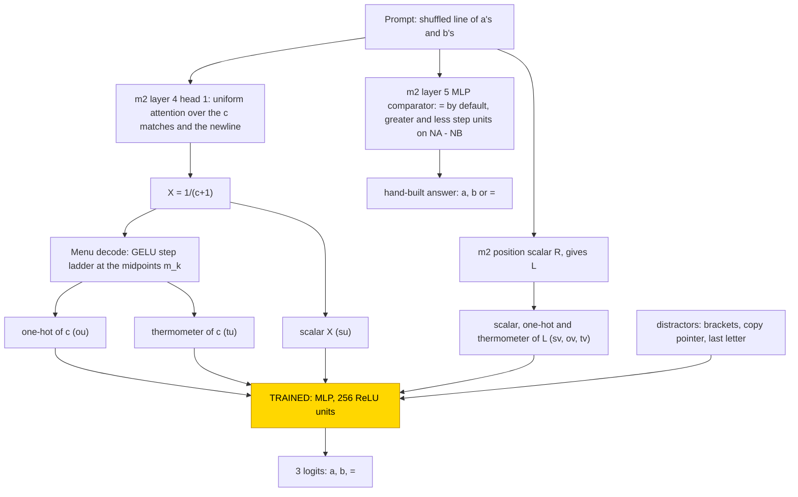
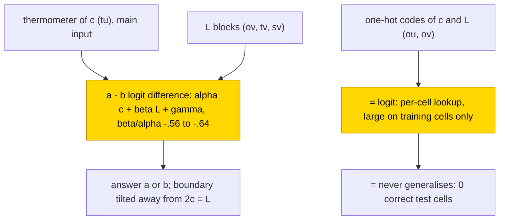

# Compare two counts

This entry asks how a small network decides which of two letters is more frequent in a line. A frozen transformer whose every weight
was set by formula counts the letter a in a line of a's and b's and re-encodes the count c and the line length L in three ways; only a
one-layer MLP on top was trained to answer `a`, `b` or `=` (a tie). All 30 trained networks (10 seeds at each of three train
fractions) learned a linear comparator in c and L with a slope ratio of −.56 to −.64, where the exact rule is −.50, and memorised the
`=` class: none of the 30 answered a single held-out `=` cell correctly. The task is partly solved (greater and less are learned, test
.91–.96; `=` never generalises, 0 correct test cells in 30/30). The closed form, a linear rule, is partial: it is supported by
substitution (accuracy .93–.96, agreement .92–.94), and the complement was not tested.

| Fact | Value |
|---|---|
| Task | Say whether a's or b's are more frequent in a line of up to 45 letters, or `=` if they tie |
| Input → output example | A line of 20 letters with 12 a's and 8 b's → `a` |
| Model | Frozen hand-built 6-layer transformer and a frozen menu of encodings; trained: one MLP layer, 256 ReLU units, 3 outputs |
| Rungs and seeds | Hand-built network, exact on all cells; MLP trained on frozen hand-built parts, 10 seeds × train fractions .4/.6/.8 (30 networks), 200,000 steps each; 18 control runs |
| Closed form status | Partial: linear rule answer = a if αc + βL + γ > 0 else b, accuracy .93–.96, agreement .92–.94; the exact variable 2c − L scores lower, .90–.94 (supported by substitution; complement not tested; never outputs `=`) |
| Status | Partly solved (greater/less learned, test .91–.96; `=` 0 correct test cells in 30/30); last run 2026-11-04 |
| Weights | [Hugging Face: compare-counts](https://huggingface.co/jc1122/circuit-atlas-nets/tree/main/compare-counts) (hand-built base in `_shared/m2`) |
| Reproduce | [Commands](#24-reproduction), run from `code/` |

## 1. Task and data

The prompts are the same as in [count mod 5](count-mod-5.md): a one-shot example followed by a shuffled line of c a's and L − c b's.
The answer is `a` if c > L − c, `b` if c < L − c and `=` if 2c = L, so there are 3 classes; as labels, class 0 if 2c > L, 1 if
2c < L and 2 (`=`) if 2c = L. The data cover every cell (c, L) with L = 1..45, which gives 1080 cells with one prompt each, of which 22
are `=`. The trained stage must therefore compare c with L/2. The split into training and test data is over cells, with train fractions
.4, .6 and .8. Accuracy is the share of held-out cells answered correctly; the `=` cells are also scored on their own.

## 2. Model

The shared architecture, optimiser and instrumentation are described in [METHODS.md](../METHODS.md); this section gives only what is
specific to the task.

### 2.1 Frozen hand-built network

The base is [m2](../GLOSSARY.md#hand-built-machinery), a GPT-NeoX-shaped decoder with 6 layers, d_model 528 and 4 heads (d_head 132),
MLP width 512, exact GELU, fixed-gain LayerNorm (eps 1e-5), no positional embedding and no rotary embedding, a sequential residual
stream and a character vocabulary of 70 ids. It has 10,041,408 parameters, of which 13,443 are non-zero, and nothing in it was
trained. It is read at the last prompt position, from the residual stream before the final LayerNorm. `code/m2.py` rebuilds it bit for
bit (safetensors sha256 `3dbb5226…cd9a6a`). The base computes the count c through a segment-match attention head, the line length L
through a position scalar, and, in its layer 5 MLP, a hand-built comparator (Section 3).

### 2.2 Frozen menu and trained part

The [menu](../GLOSSARY.md#hand-built-machinery) is a frozen layer, defined by formula with no learned parameters, that places three
encodings of each integer at the answer position: the raw scalar, a one-hot code and a thermometer code (a vector whose k-th unit is
[n ≥ k]), together with distractor features. It is computed from m2's count X = 1/(c+1) and position scalar R, which gives L. Each
block is centred and divided by its rms row norm. Table 1 lists the blocks of the 326-wide input.

*Table 1. Input blocks of the frozen menu (index ranges of the 326-wide input).*

| Block | Indices | Content |
|---|---|---|
| su | 0 | X |
| sv | 1 | R |
| ou | 2–47 | one-hot c = 0..45 |
| ov | 48–93 | one-hot L = 0..45 |
| tu | 94–138 | [c ≥ k], k = 1..45 |
| tv | 139–183 | [L ≥ k] |
| brackets (distractor) | 184–185 | constant, so 0 |
| copy pointer (distractor) | 186–255 | |
| last letter (distractor) | 256–325 | |

The trained stage is one MLP, `logits = W2 ReLU(W1 x + b1) + b2`, with W1 [256, 326], b1 [256], W2 [3, 256] and b2 [3], which is
84,483 parameters; the three outputs are the classes a, b and `=`.

### 2.3 Training

Training followed [count mod 5](count-mod-5.md): hidden width 256, 200,000 steps on the full batch, an evaluation every 500 steps, and
10 seeds at each train fraction .4 / .6 / .8. Two controls, a random frozen base of the same shape and a menu holding only the scalars,
were run with 3 seeds each at each fraction, which gives 18 control runs.

### 2.4 Reproduction

The commands below run from `code/`:

```
python run.py atlas --task compare_counts --frac 0.4 --seeds 0 1 2 3 4 5 6 7 8 9    # repeat with --frac 0.6 and 0.8
python run.py atlas --task compare_counts --kind random --seeds 0 1 2 --probe
python run.py atlas --task compare_counts --kind scalar --seeds 0 1 2
python run.py table out/compare_counts_*.json
```

The headline numbers of each network are in the output keys `final` (test accuracy), `eq_test_acc` (test accuracy on the `=` cells),
`cmp_ratio` and `cmp_r2` (the linear comparator), and `form_line` / `form_line_agree` (substitution accuracy and agreement).

### 2.5 Archive

Each network is stored as one safetensors file (`W1`, `b1`, `W2`, `b2`, `test_idx`), with `config.json`, `inputs.safetensors` (the
frozen menu rows X, the integers and the labels) and `manifest.json` (seed, rung, train fraction, accuracy, circuit type, sha256). Every
file was re-loaded, and its forward pass reproduces the recorded test accuracy exactly. The 30 networks (`s<seed>_f<40|60|80>`) are
published on Hugging Face at [huggingface.co/jc1122/circuit-atlas-nets/tree/main/compare-counts](https://huggingface.co/jc1122/circuit-atlas-nets/tree/main/compare-counts).

## 3. Hand-built solution

The hand-built network counts with a single attention head, decodes the count with step functions and compares with three step pairs, two of which act on
the difference of the counts (Figure 1).

The count is computed by layer 4, head 1 of m2. Its query is the question letter, supplied by an earlier has-letter head. Every key
token equal to that letter, and the newline that ends the counted line, scores 300, plus a recency term of 3 per position of the
segment anchor, which selects the current `:` segment; the scores are centred so that tied keys score exactly 0. Attention is
therefore uniform over the c matches and the 1 newline. The value reads only the newline indicator, so the head writes X = 1/(c+1).
The head has 95 non-zero entries in the query weights, 52 in the key weights and 2 in the value and output weights.

The menu decodes X with pairs of GELU steps, `step(z; c, s) = (gelu(s(z − c) + 8) − gelu(s(z − c) − 8))/16`. The thermometer unit is
[c ≥ k] = step(−X; −m_k, 32/g_k), where m_k = (1/k + 1/(k+1))/2 is the midpoint and g_k = 1/k − 1/(k+1) the gap between neighbouring
values of X. The one-hot unit is the difference of neighbouring thermometer units. The decoder is exact on all cells.

The hand-built comparator, `compare_answer`, sits in m2's layer 5 MLP as three step pairs with slope 40, gated by
g = 200·[task flag] + 200·[space token]. The `=` unit fires at g ≥ 300 and writes +`=`; the `>` unit fires at
100(NA − NB) + g ≥ 400.5, where NA and NB are the two letter counts, and writes +`>` and −`=`; the `<` unit is symmetric. Equality is
therefore the default output, what remains when neither difference unit fires, and it is exact on unseen cells. Weights are in
Appendix A.



*Figure 1. The hand-built network and the trained stage. Frozen parts, set by formula, compute the count c through layer 4, head 1
of m2 and re-encode it, together with the line length L, in the 326-wide menu; m2's layer 5 MLP holds the hand-built comparator. The
shaded MLP is the only trained part.*

## 4. What training finds

Test accuracy reached its plateau at the first evaluation (step 500) and never improved: .91–.94 at fraction .4 to .92–.96 at
fraction .8 (Table 2). This is neither [grokking](../GLOSSARY.md#counting-results) nor a clean failure, and the weight norm stays flat.

*Table 2. Results per cell. Test accuracy is the range over seeds.*

| Cell | Seeds | Plateau step | Final test | Correct `=` test cells |
|---|---|---|---|---|
| MLP on the frozen hand-built menu, fraction .4 | 10 | 500 | .91–.94 | 0 in every network |
| MLP on the frozen hand-built menu, fraction .8 | 10 | 500 | .92–.96 | 0 in every network |
| Control: random frozen base | 3 per fraction | | .99–1.000 | |
| Control: scalar-only menu | 3 per fraction | | .97–.99 | .17–.44 |

All 30 networks fall into one [circuit type](../GLOSSARY.md#counting-results) (30/30): a linear comparator with a tilted boundary, and
`=` memorised. The a − b logit difference is 83–87% linear in (c, L), with an L/c slope ratio (β/α in Section 5) of −.56 to −.64 where the exact rule is
−.50; the errors sit at |2c − L| ≤ 2. The `=` class never generalises: 0 correct `=` test cells in 30/30.

At fraction .4 the thermometer code of c is the main input: ablating it lowers test accuracy to .59, while the one-hot and the scalar
contribute little.

## 5. Mechanism and verification

Each network was fitted with the closed form

answer = a if αc + βL + γ > 0 else b (never `=`),

with α, β and γ fitted per network. Substituted for the network, it reaches accuracy .93–.96 (the networks score .95–.96) and agrees
with the network on .92–.94 of cells. A form built on the exact variable 2c − L scores lower (.90–.94), so the networks do not use
2c − L. The closed form is supported by substitution; no [resample ablation of the
complement](../GLOSSARY.md#verifying-a-circuit) was reported, so the status is partial.

The weights show the tilt (Figure 2; numbers in Appendix A). The a − b difference is a tilted line, β/α ≈ −.6 instead of the exact
−.5, so the boundary drifts away from 2c = L as L grows. The `=` logit is large only on the 22 × fraction training cells with 2c = L and
very negative on the held-out ones (margin over the best other class +13.7 on training cells and −15.5 on test cells for seed 0): it
is a per-cell lookup on the one-hot codes, not a function of 2c − L.



*Figure 2. The circuit training finds. The trained MLP computes the a − b difference as a tilted linear function of c and L and gives
`=` its own logit, which is a lookup over the training cells; the linear rule is supported by substitution, with the complement not
tested.*

The hand-built comparator makes `=` the default output and subtracts two steps on the difference (greater, less), so equality is
"neither" and is exact on unseen cells. The trained stage instead gives `=` its own logit. On one-hot or thermometer codes, equality is a
non-linear (XOR-like) feature, so the trained stage can only memorise it; the hand-built unit avoids this by never giving `=` a positive
detector.

Both controls did better than the hand-built menu: a random frozen base scored .99–1.0 against .91–.96 for the menu
networks. A random frozen base reached .99–1.000; its residual stream encodes c,
L and 2c − L linearly (ridge R² 1.000), so a few ReLUs give an exact comparator, `=` included. A menu with only the scalars reached
.97–.99 and got .17–.44 of the `=` test cells right, also better than the full menu. Counting and histogram tasks in small
transformers were studied by [Behrens et al. (2024)](#references), and the length generalisation of formal-language tasks such as
counting by [Delétang et al. (2022)](#references).

## 6. Limitations and open questions

One hypothesis, untested, is that exact one-hot codes make `=` and the boundary cells memorisable at a lower weight norm than learning
the line 2c − L. No test on lines longer than 45 letters was reported.

## 7. Prediction record

No prediction was recorded before these runs; the entry predates the prediction record. A retrospective prediction, labelled as such,
is that the hand-built comparator (`compare_answer`) makes `=` learnable only as the default "neither greater nor less". The trained
stage gives `=` its own logit instead and never generalises it (0 correct `=` test cells in 30/30), so the hand-built design did not
predict the trained circuit.

## Appendix A. Weights excerpt and reading

The hand-built comparator in m2's layer 5 MLP has three step pairs with slope 40 and gate g = 200·[task flag] + 200·[space token]. The
`=` unit fires at g ≥ 300 (writes +`=`); the `>` unit at 100(NA − NB) + g ≥ 400.5 (writes +`>`, −`=`); the `<` unit is symmetric.
Equality is what remains when neither difference unit fires.

Table A1 gives the least-squares fit of the a − b logit difference of each trained network to αc + βL + γ over all cells, at
fraction .4.

*Table A1. Linear comparator per seed, fraction .4.*

| seed | 0 | 1 | 2 | 3 | 4 | 5 | 6 | 7 | 8 | 9 |
|---|---|---|---|---|---|---|---|---|---|---|
| α | 4.43 | 4.47 | 4.27 | 4.40 | 3.84 | 4.22 | 4.19 | 4.17 | 4.12 | 4.31 |
| β | −2.55 | −2.51 | −2.74 | −2.72 | −2.31 | −2.65 | −2.52 | −2.40 | −2.62 | −2.60 |
| β/α | −.58 | −.56 | −.64 | −.62 | −.60 | −.63 | −.60 | −.58 | −.64 | −.60 |

Table A2 gives the logits of seed 0 at L = 20 on test cells.

*Table A2. Logits (a, b, `=`) of seed 0 at L = 20, all test cells.*

| c | a | b | `=` |
|---|---|---|---|
| 8 | −1.0 | 6.8 | −10.1 |
| 9 | −6.6 | 10.9 | −8.3 |
| 10 (`=`) | 6.4 | −0.4 | −9.9 |
| 11 | 1.6 | 0.7 | −4.7 |
| 12 | 2.8 | −1.7 | −2.9 |

The margin of the `=` logit over the best other class on `=` cells was +13.7 on training cells and −15.5 on test cells. The W1 column
norm per input block for seed 0 was tu 7.3, ov 7.0, ou 6.4, tv 4.1, sv 2.5, su 2.4.

Reading. β/α ≈ −.6 instead of −.5 tilts the boundary, so the errors sit at |2c − L| ≤ 2. At c = 10, L = 20 (a held-out `=` cell) the
`=` logit is the lowest of the three.

## References

- Behrens, F., Biggio, L., & Zdeborová, L. (2024). Counting in small transformers: The delicate interplay between attention and
  feed-forward layers. *ICML 2025 (arXiv preprint)*. https://doi.org/10.48550/arxiv.2407.11542 (counting and histogram tasks)
- Delétang, G., Ruoss, A., Grau-Moya, J., et al. (2022). Neural networks and the Chomsky hierarchy. *arXiv preprint*.
  https://doi.org/10.48550/arxiv.2207.02098 (length generalisation on formal-language tasks)
