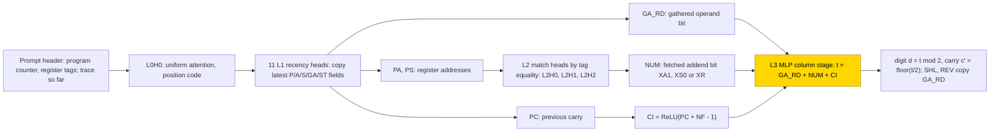
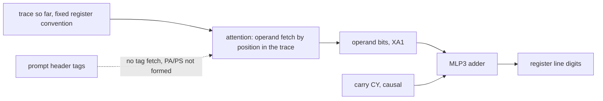

# Composing arithmetic through scratchpad registers

This entry asks whether a small transformer that writes a full execution trace can learn a base-2 register machine, in which a STEP
line runs ADD, SHL (shift left) or REV (reverse) on registers named by tags in the prompt header, and SUM k, MUL n and POW e chain
STEP lines. Trained from scratch on STEP plus all compositions, 10/10 seeds solve every trained composition but fail the bare STEP
line (final .54-.61): they never build the hand-built register-address code and fetch operands by their position in the trace
instead. With the hand-built tag router frozen and only the column MLP trained, 3/3 seeds learn the hand-built column rule exactly.
The task is unsolved (0/10 from scratch). The closed-form status is partial: the column rule of the frozen-router stage passes
substitution (1.0 in 18/18 tests) and a resample ablation of everything outside the circuit (1.0), and there is no closed form for
the networks trained from scratch.

| | |
|---|---|
| Task | Execute a base-2 register program (STEP: ADD, SHL or REV on tagged registers, operands up to 15 bits; SUM k, MUL n, POW e chain STEP lines) and write the whole trace |
| Input → output example | In words: a STEP that ADDs registers holding 101 (5) and 11 (3) writes 1000 (8) |
| Model | GPT-NeoX-shaped, 4 layers (format O: 16 heads, d_model 256), NoPE, no LayerNorm; TRAIN trains all weights, PART trains only the layer-3 MLP of the frozen hand-built network |
| Rungs and seeds | HAND exact on every cell in bases 2/8/10/16 (21/64 heads used); TRAIN format O arm c, 10 seeds (final); PART format S, 3 seeds per arm; TRAIN screens with 3 (S) or 10 (O) seeds |
| Closed form status | Partial (PART format S arm a only: substitution 1.0 in 18/18 tests, resample ablation of the complement 1.0, final snapshots only; none for TRAIN) |
| Status | Unsolved (TRAIN O c, 0/10); solved PART S a (3/3, screen); last run 2026-11-08 |
| Weights | [Hugging Face: compose-arithmetic-registers](https://huggingface.co/jc1122/circuit-atlas-nets/tree/main/compose-arithmetic-registers) |
| Reproduce | Not available yet: training code for this task is not yet in `code/` |

## 1. Task and data

The machine works in base 2. A STEP line runs ADD, SHL or REV on registers named by tags in the prompt header, with operands up to 15
bits. SUM k (k operands), MUL n (n multiplier bits) and POW e compose STEP lines. Each header names a program counter and the register
tags, and every digit carries a significance tag. The network writes the whole trace, which is a
[scratchpad](../GLOSSARY.md#task-formats), a sequence of intermediate lines written before the answer. Two trace formats were used
(Table 1). Fresh samples were drawn at every training step; the evaluation sets hold 128 samples per cell. A trace counts as correct
only when every [teacher-forced](../GLOSSARY.md#task-formats) trace token is exact (each token scored given the correct previous
tokens).

*Table 1. Trace formats and training arms.*

| Label | Meaning |
|---|---|
| `O` | the trace writes register lines only |
| `S` | the trace also writes the gathered bits and the carry |
| arm `a` | STEP only |
| arm `b` | STEP plus SUM2-3, MUL1-2, POW2 |
| arm `c` | STEP plus SUM2-5, MUL1-4, POW2-3 |

The depth+1 cells SUM6, MUL5 and POW4, one composition step deeper than any trained cell, were never trained and test depth
generalisation.

## 2. Model

The shared architecture and instrumentation are described in [METHODS.md](../METHODS.md). The three
[rungs](../GLOSSARY.md#the-three-rungs) are HAND (every weight set by formula), PART (frozen hand-built parts with one trained stage)
and TRAIN (all weights trained from scratch).

### 2.1 Architecture

Format O (TRAIN): 4 layers, d_model 256, 16 heads × 16, MLP 1024, ReLU, no positional encoding (NoPE), no LayerNorm, untied readout,
vocabulary 296; all weights are trained. Format S (PART): 4 layers, d_model 208, 13 heads × 16, MLP 134, vocabulary 424.

### 2.2 Frozen parts and trained part

In format S the hand-built network is frozen and only the layer-3 MLP is trained: W_in [134, 208] and W_out [208, 134], masked to
HAND's stage ports, which is 8,728 parameters. The stage reads the ports that HAND's own column stage reads (Section 3).

### 2.3 Training

The optimiser was AdamW with learning rate 1e-3, weight decay 0.1 and betas (.9,.98), warmup 1000 steps, a cosine schedule and gradient
clipping at 1. TRAIN ran in TF32; PART and all evaluations ran in fp32. Each training step used one cell (STEP .4, compositions .6),
with a batch of ≈ 8000 tokens, and the networks were evaluated every 1000 steps. The final cell, O c, used seeds 0-9 and 30k steps;
the screens used 3 seeds (S) or 10 seeds (O). Each run used a single consumer or data-centre GPU.

### 2.4 Reproduction

Reproduce: not available yet: training code for this task is not yet in `code/`; the weights, held-out splits and recorded
accuracies are on Hugging Face at
[huggingface.co/jc1122/circuit-atlas-nets/tree/main/compose-arithmetic-registers](https://huggingface.co/jc1122/circuit-atlas-nets/tree/main/compose-arithmetic-registers).

### 2.5 Archive

The folder holds `hand_O` and `hand_S` (hand-built networks), `part_S_a_{best,final}_s0-2` (the 4 stage tensors of each PART seed),
`train_O_c_final_{best,final}_s{0,1,8}`, `config.json` and a manifest (seed, rung, accuracy, sha256).

## 3. Hand-built solution

The hand-built network finds each operand by its register tag and adds one column per step (Figure 1). Layer 0 head 0 (L0H0) attends
uniformly and supplies a position code. Eleven layer-1 recency heads, which attend to the most recent matching token, copy the latest
P/A/S/GA/ST fields of the trace; among their outputs are PA and PS (the tags of the registers named in the current A and S fields,
that is, the register addresses), GA_RD (the gathered operand bit) and PC (the previous carry bit). Layer-2 match heads fetch operands
by tag equality: L2H0 gives XA1, L2H1 gives XS0 and L2H2 gives XR (the fetched addend bits), with match scores 30(2v·id − v²).

The layer-3 MLP is the column stage. It computes t = GA_RD + NUM + CI, where NUM is the fetched addend bit and CI = ReLU(PC + NF − 1)
is the carry-in (the previous carry PC, passed only when NF, a layer-1 flag set from the column index for every column but the
lowest, is on). It writes the digit d = t mod 2 and the carry
c' = ⌊t/2⌋; SHL and REV copy GA_RD. The network is exact (margin 30) on every cell in bases 2/8/10/16, tested with 200 or 50
examples per cell, and uses 21/64 heads. The set of ADD-stage neurons is shared by STEP, SUM and MUL (Jaccard 1.00), so one adder
serves every task.

*Figure 1. The hand-built network. Recency heads copy the current register fields, match heads fetch operands by tag, and the
layer-3 MLP adds one column. The shaded layer-3 MLP is the part that PART (format S) replaces with a trained stage; TRAIN trains all
parts.*

## 4. What training finds

Table 2 gives the results per cell. The mean is over the trained cells of each arm; "full" counts every trace token exact.

*Table 2. Results per cell (ranges over seeds; run 2 is the retry).*

| Rung / fmt / arm | Seeds | best → final (mean trained cells) | Outcome |
|---|---|---|---|
| TRAIN O c (final) | 10 | .877-.899 → .871-.897 | 0/10; compositions 1.00, STEP ADD/SHL/REV ≤ .59/.61/.54, depth+1 0/10 |
| TRAIN O a / O b (run 1) | 10 each | .51-.68 / .81-.83 | O a run lost; O b: SUM4/MUL3/POW3 never ≥ .9 |
| PART S a (run 1) | 3 | 1.00 → 1.00 | solved 3/3 (STEP primitives) |
| PART S b / S c (runs 1, 2) | 3 each | .968-.970 / .80-.83 | b: untrained depth+1 cells; c: budget-limited, still rising |
| TRAIN S a/b/c (runs 1, 2) | 3 each | .37-.48 | underfit (train .42-.56); 2× budget gave nothing |

### 4.1 Trained from scratch (TRAIN O c)

Trained from scratch on STEP plus SUM2-5/MUL1-4/POW2-3, the network solves every trained composition in 10/10 seeds, but fails the
bare STEP primitive in 10/10 (final .54-.61), so the cell is unsolved (final .871-.897 over the trained cells). The grok step, here
the first evaluation at which full exact match reached .9 ([glossary](../GLOSSARY.md#counting-results)), was 17-18k for SUM5 and 14k
for MUL4; STEP never reached it. At depth+1 the best seed reached, in full and line-digit (exec) exact match, SUM6 .24/.81, MUL5
0/.17 and POW4 .07/.52.

The cause is a missing variable. The network never builds HAND's register-address code PA/PS ([probe](../GLOSSARY.md#analysis-measures)
R² .29-.55 at L2, ~0 at L4; HAND .99). The carry is present and causal (interchange flip .96-1.00, the share of answers that change
as predicted when the carry is swapped between inputs). The network fetches operands by their position in the trace, which works only
while the compositions keep a fixed register convention; in a bare STEP line the registers are free. All 10 seeds fall into one
failure type, positional-convention fetch with an MLP3 adder: the compositions are solved and STEP has no tag fetch.

### 4.2 Frozen tag router (PART S)

With HAND's tag router frozen and only the column-stage MLP trained (S a PART), the stage learns HAND's rule exactly in 3/3 seeds:
d = t mod 2, c' = ⌊t/2⌋. This is one circuit type, frozen tag router with HAND's column stage (3 of 3). Arm b reached .968-.970,
limited by its untrained depth+1 cells, and arm c reached .80-.83 and was still rising when its budget ended. Trained from scratch in
format S, all arms underfit (.37-.48, train .42-.56), and twice the budget gave nothing.

No discovery pass and no alternative HAND were run. Per-cell diagnostics (exact match, used heads and MLPs, probes, interchange,
effective rank, attention divergence and patching) are in Appendix B.

## 5. Mechanism and verification

### 5.1 Closed form of the PART stage

For the trained MLP3 of S a PART, per column: t = GA_RD + NUM + CI; d = t mod 2; c' = ⌊t/2⌋ (ADD); SHL and REV copy GA_RD with
c' = 0. The closed form has 0 fitted numbers. Substituting HAND's stage for the trained MLP3 gives 1.0 in 18/18 tests (best and final
snapshots, seeds 0-2, ADD/SHL/REV, 256 fresh traces each; native .992-1.0). Zeroing MLP3 gives 0, and HAND's MLP3 with shuffled
hidden-to-output wiring gives 0.

A [resample ablation of the complement](../GLOSSARY.md#verifying-a-circuit), which replaces every component outside the claimed
circuit with its values on other inputs, was run with the circuit L0H0, MLP0, L1H0/1/2/5/7/8/9/11/12, MLP1, L2H0/1/2, MLP2, MLP3. It
gives 1.0 = base (ADD seeds 0-2, SHL seed 0, REV seed 0). Resampling the circuit itself gives .15-.42, and a random set of the same
size gives .19-.54. The complement test used final snapshots only, with SHL and REV on one seed. The status of the entry stays
partial, because the closed form covers only the PART stage and the final cell TRAIN O c has none (unsolved).

### 5.2 The circuit trained from scratch

The networks trained from scratch use a different code from HAND (Figure 2). The centred kernel alignment (CKA) of layer 4 with HAND
is .01-.05, and 55-64 of 64 heads best-match HAND's uniform head. Operands come from the trace convention, not from HAND's tag lookup.
In the solved SUM5 sub-cell PA is also low (R² .40 at L2), the fetched operand XA1 is causally used under DAS (.92-1.0), and MLP3
has the largest patching drop.

*Figure 2. The failure type that training from scratch finds (TRAIN O c, 10 of 10 seeds). Operands are fetched by trace position
and added by MLP3; the header-tag address is not formed, so bare STEP lines fail. No closed form exists for this circuit.*

### 5.3 Relation to the hand-built network and to published work

PART computes the same algorithm as HAND: the stage function is equal under substitution. TRAIN does not: it binds operands by order
in the trace rather than by tag. Dereferencing variables in symbolic programs was studied by
[Wu, Geiger and Millière (2025)](#references). Positional shortcuts under low layout diversity were described by
[Nevermann and Gros (2026)](#references), and mixed-layout exposure was studied by [Shintani (2026)](#references). Position ids derived from task structure were proposed for arithmetic transformers by
[Cho et al. (2024)](#references), and scratchpads and output order in arithmetic were studied by [Lee et al. (2023)](#references).

## 6. Limitations and open questions

Scoring is teacher-forced, not a rollout of the network's own outputs. Depth and length are confounded at depth+1. Lengths beyond 16
digits lie outside the frozen router's id range, so S a PART has no longer-input test; its position shift (pad 256) is exact. The
complement test used final snapshots only, with SHL/REV on one seed. The method v2 discovery tools (discover, dict, bucket) were not
run. The O c final has no pre-registered prediction. Lost runs (O a run 1, S b TRAIN run 2, S c PART run 2 final) are not counted.

## 7. Prediction record

Before run 1 of O c the prediction was: depth+1 full ≥ .9 in ≥ 8/10 seeds, with ADD-stage neurons shared across tasks as in HAND. For
format S: PART ≥ .99 in 3/3 by 10k steps, and c TRAIN depth+1 ≥ .9 in ≥ 1/3. All were falsified except S a PART (3/3, solved by 16k).
The O c final run had no pre-registered prediction and is reported without one.

## Appendix A. Weights excerpt and reading

In the hand-built stage the tag-match scores are 30(2v·id − v²) and the stage bias offsets are integers. HAND's stage has 134 live
neurons with W_in values in {-1000, 1, 10, 1000, 10000}. Each PART seed keeps 134 live neurons. Its top neurons, ranked by |W_out|
times |W_in on ports| on the final snapshot and printed by the archive's excerpt script `compose`, read mostly GA_RD and CI (|w| up to
.85) and write the digit outputs YD[0]/YD[1] (|w| .5-.76) with real-valued, seed-specific weights. Reading: the substitution and
complement results show that the trained stage computes the same function as HAND's stage on its ports; no neuron-level identity is
claimed.

## Appendix B. Detailed evidence

*Table B1. Diagnostics per cell.*

| Cell (seeds) | exact | used heads / MLPs | R² CY / PA / PS / XA1 | inter flip (nf>0) | r90 L4 vs HAND 3 | JS vs HAND | patch |
|---|---|---|---|---|---|---|---|
| O c STEP_ADD final (s0-9) | .41-.535 (s8 .785) | 0-5 / 2-4 | .85-.89@4 / .29-.55@2 / .29-.55@2 / .65-.70 | CY .96-1.00@4 | 9-11 | .11-.13 | MLP0 / MLP3 |
| O c SUM5 final (s0-9) | .99-.9975 | 11-21 / 4 | .92@4 / .40@2 / .60@2 / .87@4 | XA1 DAS .92-1.0 | 26-29 | .19-.21 | MLP3 |
| S a PART STEP_ADD final (s0-2) | 1.0 | 7 (mean) / MLP2, MLP3 | carry .40-.44; operands .98-.99 | carry .52-.91 | 2 | 0 (frozen) | MLP3 |

Key: s = seed; CY = carry; R² is the best-layer ridge probe, with @k the layer; inter flip = interchange flip, counted only where the
number of tested flips nf > 0; DAS = distributed alignment search; r90 L4 = rank of the layer-4 residual stream at 90% of the variance,
against 3 for HAND; JS = Jensen-Shannon divergence of attention against HAND; patch = component with the largest patching drop. Terms
are defined in the [glossary](../GLOSSARY.md#analysis-measures). Best against final snapshot: O c best .877-.899, final .871-.897;
S a PART 1.00 at both snapshots.

## References

- Cho, H., Cha, J., Awasthi, P., Bhojanapalli, S., Gupta, A., & Yun, C. (2024). Position coupling: Improving length generalization of
  arithmetic transformers using task structure. *arXiv preprint*. https://arxiv.org/abs/2405.20671 (position ids from task structure)
- Lee, N., Sreenivasan, K., Lee, J. D., Lee, K., & Papailiopoulos, D. (2023). Teaching arithmetic to small transformers.
  *arXiv preprint*. https://arxiv.org/abs/2307.03381 (scratchpads and output order in arithmetic)
- Nevermann, D. H., & Gros, C. (2026). Distance generalization in transformers: Why bother with positional encoding?. *arXiv
  preprint*. https://arxiv.org/abs/2609.11913 (low layout diversity, positional shortcuts)
- Shintani, S. A. (2026). Arithmetic OOD failure unfolds in stages in minimal GPTs. *arXiv preprint*.
  https://arxiv.org/abs/2603.26828 (mixed-layout exposure)
- Wu, Y., Geiger, A., & Millière, R. (2025). How do transformers learn variable binding in symbolic programs?. *arXiv preprint*.
  https://doi.org/10.48550/arxiv.2505.20896 (dereferencing in symbolic programs)
