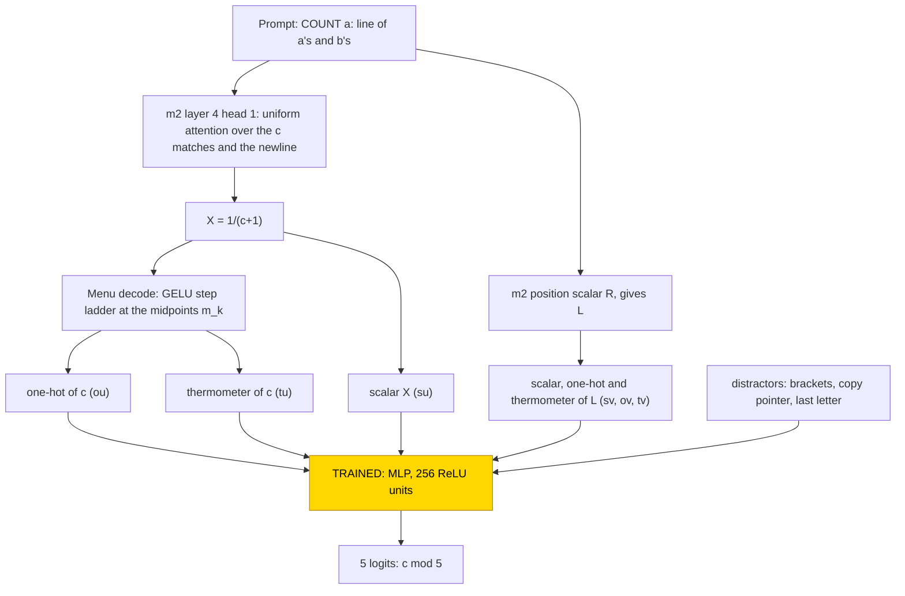
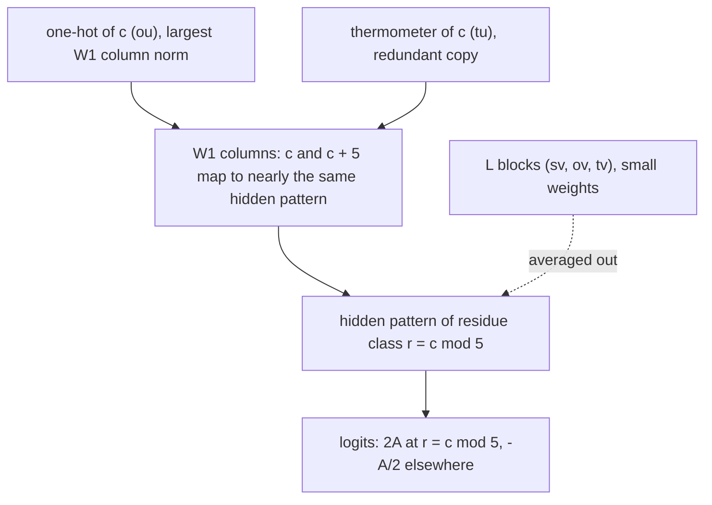

# Count mod 5

This entry asks how a small network computes the remainder of a count modulo 5. A frozen transformer whose every weight was set by
formula counts how often a letter occurs in a line of a's and b's and re-encodes the count in three ways; only a one-layer MLP on top
was trained. All 30 trained networks (10 seeds at each of three train fractions) learned a flat lookup from the count to its residue
mod 5 and ignored the length of the line, reading mainly the one-hot code of the count. A closed form of two cosines with equal
amplitudes, which is a delta on the residue, reproduces every network with accuracy 1.000, and test accuracy equalled train accuracy
from the first evaluation, so the networks did not grok. The task is solved (30/30). The closed form is partial: it is supported by
substitution, but no resample ablation of the complement was run.

| Fact | Value |
|---|---|
| Task | Count how often a letter occurs in a line of a's and b's (up to 45 letters) and answer the count mod 5 |
| Input → output example | After the fixed one-shot prefix, `COUNT a: a a b a a a b a a` → `2` (seven a's) |
| Model | Frozen hand-built 6-layer transformer and a frozen menu of encodings; trained: one MLP layer, 256 ReLU units |
| Rungs and seeds | Hand-built network, exact on all cells; MLP trained on frozen hand-built parts, 10 seeds × train fractions .4/.6/.8 (30 networks), 200k steps each; 18 control runs |
| Closed form status | Partial: two cosines with equal amplitudes, accuracy 1.000 in every network; supported by substitution, complement not tested |
| Status | Solved (30/30); closed form partial; last run 2026-11-04 |
| Weights | [Hugging Face: count-mod-5](https://huggingface.co/jc1122/circuit-atlas-nets/tree/main/count-mod-5) (hand-built base in `_shared/m2`) |
| Reproduce | [Commands](#24-reproduction), run from `code/` |

## 1. Task and data

Each prompt holds a fixed one-shot example followed by the query line:
`COUNT b: a b\nANSWER: 1\nCOUNT a: <c a's and L−c b's, shuffled>\nANSWER: `. The answer is c mod 5, so there are 5 classes. The data
cover every cell (c, L) with line length L = 1..45 and count c = 0..L, which gives 1080 cells with one prompt each. The split into
training and test data is over cells, so every value of c appears in training; train fractions of .4, .6 and .8 were used. Accuracy
is the share of held-out cells answered correctly.

## 2. Model

The shared architecture, optimiser and instrumentation are described in [METHODS.md](../METHODS.md); this section gives only what is
specific to the task.

### 2.1 Frozen hand-built network

The base is [m2](../GLOSSARY.md#hand-built-machinery), a GPT-NeoX-shaped decoder with 6 layers, d_model 528 and 4 heads (d_head 132),
MLP width 512, exact GELU, fixed-gain LayerNorm (eps 1e-5), no positional embedding and no rotary embedding, a sequential residual
stream and a character vocabulary of 70 ids. It has 10,041,408 parameters, of which 13,443 are non-zero, and nothing in it was
trained. It is read at the last prompt position, from the residual stream before the final LayerNorm. `code/m2.py` rebuilds it bit for
bit (safetensors sha256 `3dbb5226…cd9a6a`). The base computes the count c through a segment-match attention head, which gives
1/(c+1), and an MLP step ladder that decodes it; it also computes the line length L (Section 3).

### 2.2 Frozen menu

The [menu](../GLOSSARY.md#hand-built-machinery) is a frozen layer, defined by formula with no learned parameters, that places three
encodings of each integer at the answer position: the raw scalar, a one-hot code and a thermometer code (a vector whose k-th unit is
[n ≥ k]), together with distractor features. It is computed from m2's count X = 1/(c+1) and position scalar R, which gives L. Each
block is centred and divided by its rms row norm, so every block has rms 1. Table 1 lists the blocks of the 326-wide input.

*Table 1. Input blocks of the frozen menu (index ranges of the 326-wide input).*

| Block | Indices | Content |
|---|---|---|
| su | 0 | X |
| sv | 1 | R |
| ou | 2–47 | one-hot c = 0..45 |
| ov | 48–93 | one-hot L = 0..45 |
| tu | 94–138 | [c ≥ k], k = 1..45 |
| tv | 139–183 | [L ≥ k] |
| brackets (distractor) | 184–185 | constant, so 0 |
| copy pointer (distractor) | 186–255 | |
| last letter (distractor) | 256–325 | |

### 2.3 Trained part and training

The trained stage is one MLP, `logits = W2 ReLU(W1 x + b1) + b2`, with W1 [256, 326], b1 [256], W2 [5, 256] and b2 [5], which is
84,997 parameters: hidden width 256 ReLU units and 5 outputs. It was trained with AdamW, learning rate 1e-3 and weight decay 1.0, on
the full batch for 200,000 steps, with an evaluation every 500 steps and no early stop. Ten seeds were run at each train
fraction .4 / .6 / .8. Two controls, a random frozen base of the same shape and a menu holding only the scalars, were run with 3 seeds
at each fraction.

### 2.4 Reproduction

The commands below run from `code/`:

```
python run.py atlas --task count_mod5 --frac 0.4 --seeds 0 1 2 3 4 5 6 7 8 9     # repeat with --frac 0.6 and 0.8
python run.py atlas --task count_mod5 --kind random --seeds 0 1 2 --probe        # random-base control with ridge probes
python run.py atlas --task count_mod5 --kind scalar --seeds 0 1 2
python run.py table out/count_mod5_*.json                                         # min-max over seeds, as quoted here
```

The headline numbers of each network are in the output keys `final` (test accuracy), `form_res5` and `form_u_only` (substitution
accuracy), and `form_fourier` / `fourier_r2`.

### 2.5 Archive

Each network is stored as one safetensors file (`W1`, `b1`, `W2`, `b2`, `test_idx`), with `config.json`, `inputs.safetensors` (the
frozen menu rows X, the integers and the labels) and `manifest.json` (seed, rung, train fraction, accuracy, circuit type, sha256).
Every file was re-loaded, and its forward pass reproduces the recorded test accuracy exactly. The 30 networks (`s<seed>_f<40|60|80>`)
are published on Hugging Face at
[huggingface.co/jc1122/circuit-atlas-nets/tree/main/count-mod-5](https://huggingface.co/jc1122/circuit-atlas-nets/tree/main/count-mod-5).

## 3. Hand-built solution

The hand-built network counts with a single attention head and decodes the count with step functions (Figure 1).

The count is computed by layer 4, head 1 of m2. Its query is the question letter, supplied by an earlier has-letter head. Every key
token equal to that letter, and the newline that ends the counted line, scores 300, plus a recency term of 3 per position of the
segment anchor, which selects the current `:` segment; the scores are centred so that tied keys score exactly 0. Attention is
therefore uniform over the c matching letters and the 1 newline. The value reads only the newline indicator, so the head writes
X = 1/(c+1). The head has 95 non-zero entries in the query weights, 52 in the key weights and 2 in the value and output weights.

The menu decodes X with pairs of GELU steps, `step(z; c, s) = (gelu(s(z − c) + 8) − gelu(s(z − c) − 8))/16`. The thermometer unit is
[c ≥ k] = step(−X; −m_k, 32/g_k), where m_k = (1/k + 1/(k+1))/2 is the midpoint and g_k = 1/k − 1/(k+1) the gap between neighbouring
values of X. The one-hot unit is the difference of neighbouring thermometer units. The decoder is exact on all cells.



*Figure 1. The hand-built network and the trained stage. Frozen parts, set by formula, compute the count c through layer 4, head 1
of m2 and re-encode it, together with the line length L, in the 326-wide menu; the shaded MLP is the only trained part.*

## 4. What training finds

Training was fast and showed no delay between fitting and generalising. For every train fraction, train accuracy and test accuracy
both reached 99% at step 500, the first evaluation, and the final test accuracy was .992–1.000 (Table 2). This is not
[grokking](../GLOSSARY.md#counting-results).

*Table 2. Results per cell. Final test accuracy is the range over seeds.*

| Cell | Seeds | Solved | Train 99% step | Test 99% step | Final test |
|---|---|---|---|---|---|
| MLP on the frozen hand-built menu, fractions .4/.6/.8 | 10 per fraction | 30/30 | 500 | 500 | .992–1.000 |
| Control: random frozen base | 3 per fraction | | | | .24–.40 |
| Control: scalar-only menu | 3 per fraction | | | | .29–.34 (chance .2) |

All 30 networks fall into one circuit type, a residue lookup on c that ignores L (30/30). Setting the L input to its mean kept
.995–1.000 test accuracy, and replacing each c embedding by the mean of its residue class kept 1.000.

The networks read mainly the one-hot code of c (Table 3). With all c features ablated, test accuracy at fraction .4 fell to .16; with
all L features ablated it stayed at .997. Kept alone, the one-hot pair gave .997, the thermometer .86 and the scalars .21. The one-hot
is the primary input, and the information is redundant across the one-hot and thermometer codes.

*Table 3. Test accuracy after ablating or isolating input encodings (fraction .4).*

| Inputs | Test accuracy |
|---|---|
| all c features ablated | .16 |
| all L features ablated | .997 |
| one-hot pair kept alone | .997 |
| thermometer kept alone | .86 |
| scalars kept alone | .21 |

## 5. Mechanism and verification

Each network was fitted with the closed form

logit_r(c) = A cos(2π(c − r)/5) + B cos(4π(c − r)/5),

with R² .989–.999 and accuracy 1.000 in every network when the closed form replaces the network. The closed form is therefore
supported by substitution; the complement was not tested, so its status is partial. The two amplitudes are nearly equal
(A ≈ B, for example 6.77 and 6.68). With A = B the profile is a delta: 2 at c ≡ r and −1/2 elsewhere, in units of A. The trained MLP
therefore computes a flat lookup and not a [Fourier mechanism](../GLOSSARY.md#analysis-measures).

The weights show how the lookup is wired (Figure 2; numbers in Appendix A). The largest first-layer weights sit on the one-hot of c
(block ou), so each count value is mapped by its own column to the hidden pattern of its residue class, and the logits take nearly the
same value for c and c + 5 (14.25 and 13.40 for c = 0 and 5 in Table A1). The L blocks receive small weights whose effect the network
averages out, since setting L to its mean keeps .995–1.000.



*Figure 2. The circuit training finds. The trained MLP pools the one-hot code of c by residue class into an equal-height delta on the
residue; the line-length blocks carry small weights whose effect cancels. The closed form is supported by substitution; the
complement was not tested (status partial).*

The two controls change the frozen encodings. A random frozen base of the same shape reached .24–.40 test accuracy; its
residual stream holds c linearly (ridge R² 1.000) but carries no residue feature. A menu with only the scalars reached .29–.34 against
chance .2, because 1/(c+1) cannot be cut into residues by 256 ReLU units at this weight decay.

Relation to the hand-built design: the hand-built count decoder is a step ladder on 1/(c+1), the same construction as the menu's
one-hot and thermometer codes. The trained stage reads the one-hot output and pools it by residue, which is one more linear map. No
hand-built mod-5 component was given. Counting and histogram tasks in small transformers, and the division of labour between
attention and feed-forward layers in them, were studied by [Behrens et al. (2024)](#references). The entry reports no
[resample ablation of the complement](../GLOSSARY.md#verifying-a-circuit); the evidence rests on substitution of the closed form
and on the input ablations above, so the closed form is supported by substitution with the complement not tested.

## 6. Limitations and open questions

Holding out values of c, rather than cells, to test whether the period extrapolates was not run. It is also open why the one-hot code
is preferred over the thermometer code when both are exact.

## 7. Prediction record

No prediction was recorded before these runs; the entry predates the prediction record. A retrospective prediction, labelled as such,
is that because the hand-built decoder already turns X into exact one-hot and thermometer codes, the cheapest solution is a linear
pooling of the one-hot code by residue, with L ignored. This held in 30/30 networks. It did not anticipate that the thermometer alone
also carries most of the accuracy (.86).

## Appendix A. Weights excerpt and reading

Table A1 gives the logits of seed 0 at fraction .4, centred over the 5 classes and averaged over L, for c = 0..9; c = 10..45 repeat
the pattern.

*Table A1. Centred logits, seed 0, fraction .4. Bold marks the class r = c mod 5.*

| c | r = 0 | 1 | 2 | 3 | 4 |
|---|---|---|---|---|---|
| 0 | **14.25** | −2.59 | −3.42 | −3.93 | −4.30 |
| 1 | −2.95 | **13.56** | −3.30 | −3.42 | −3.88 |
| 2 | −3.35 | −3.10 | **13.35** | −3.12 | −3.78 |
| 3 | −3.57 | −3.33 | −3.31 | **13.83** | −3.63 |
| 4 | −3.50 | −3.40 | −3.28 | −3.22 | **13.40** |
| 5 | **13.40** | −3.29 | −3.39 | −3.34 | −3.38 |
| 9 | −3.57 | −3.63 | −3.42 | −3.34 | **13.97** |

The two-cosine fit (A, B) of the logits over seeds 0–9 at fraction .4 gave A = 6.73–6.77 and B = 6.61–6.68 (seed 0: 6.77, 6.68). The
W1 column norm per input block for seed 0 was ou 14.6, tu 6.5, su 4.2; ov 1.9, tv 4.0, sv 3.1; copy 3.3, last 2.9.

With A = B the closed form gives 2A ≈ 13.5 at r = c mod 5 and A(cos 72° + cos 144°) = −A/2 ≈ −3.4 elsewhere, which matches Table A1:
a flat delta of nearly equal height on the residue, nearly identical for c and c + 5 (14.25 against 13.40 at r = 0).

## References

- Behrens, F., Biggio, L., & Zdeborová, L. (2024). Counting in small transformers: The delicate interplay between attention and
  feed-forward layers. *ICML 2025 (arXiv preprint)*. https://doi.org/10.48550/arxiv.2407.11542 (counting and histogram tasks)
