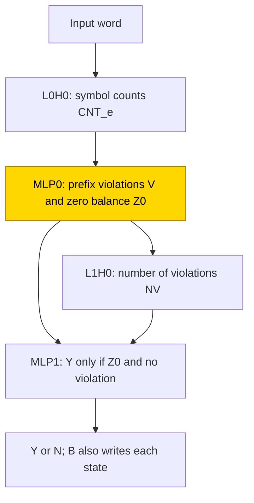
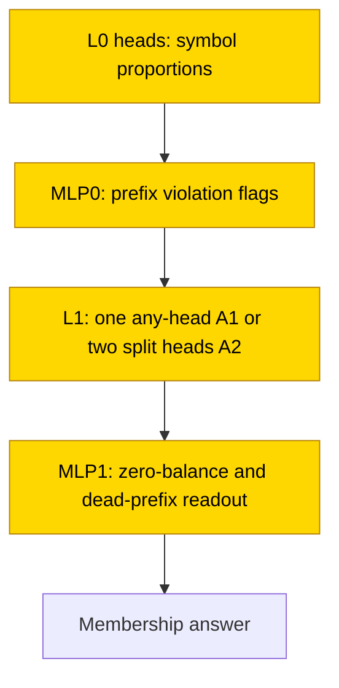

# Recognising counter languages

Balanced brackets and equally sized runs of letters require a model to check both counts and the order in which symbols arrive. These tiny transformers answered whether a word obeyed those rules, either directly or after writing a state after each symbol. Answer-only training solved the final equal-three-runs task in 10/10 seeds, with exact answers on 2048 held-out words per seed; writing the state sequence was harder and solved only one screened cell in 1/3 seeds. The answer-only networks used symbol proportions and accumulated prefix violations, with the final violation check carried by one attention head or split across two. The task is solved in the headline answer-only cell, while its formula is verified in 9/10 final seeds; the remaining seed passes substitution but fails complement resampling.

| Fact | Value |
|---|---|
| Task | Recognise balanced brackets, aⁿbⁿ or aⁿbⁿcⁿ for nonempty words of training length 1–40. |
| Input → output example | `aabbcc` is in aⁿbⁿcⁿ; `aabcbc` is not, despite equal symbol counts. |
| Model | 2-layer transformer, 2 heads × 32 per layer, width 64, ReLU MLP width 64; TRAIN learns every weight. |
| Rungs and seeds | HAND per language and format; PART retrains the first MLP; screening runs 1–3 used 3 seeds per cell and weight decay; final answer-only aⁿbⁿcⁿ used 10 seeds. |
| Closed form status | Verified on 9/10 final seeds (4-entry readout substitutes at 1.0 on 2048 words per seed; complement ≥ .90 × native on 128 words with 3 resampling draws). Seed 7 is Sufficient readout only: substitution 1.0, complement .880. |
| Status | Solved (answer-only aⁿbⁿcⁿ final, 10/10 at exact 1.0 on 2048 words per seed); last run 2026-11-10; interpretation 2026-11-11. Scratchpad cells remain mostly unsolved. |
| Weights | [Hugging Face: counter-languages](https://huggingface.co/jc1122/circuit-atlas-nets/tree/main/counter-languages) (weights and test evidence archive; published revision `6ca84a561e25`). |
| Reproduce | Not available yet: training code for this task is not yet in `code/`. |

## 1. Task and data

Dyck-1 is the language of nonempty balanced brackets: every prefix has at least as many opening as closing brackets, and the final counts are equal. The language aⁿbⁿ consists of a run of a symbols followed by an equally long run of b symbols; aⁿbⁿcⁿ adds an equally long final run of c symbols. Here the exponent is the run length, while the data's n denotes the total word length. For example, `aabbcc` is a member and `aabcbc` is not, even though the counts agree. The word `aabccc` is also a nonmember, because its counts differ.

Training words have 2–3 symbols in their alphabet and total length n = 1–40. Fresh samples mix members, one-symbol mutations, words with ≤ 3 runs and random words. A run is a maximal uninterrupted block of one symbol. The hash split provides 2048 held-out words per seed. Exact match requires every scored token correct with the correct preceding tokens supplied (teacher forcing; [glossary](../GLOSSARY.md#task-formats)).

*Table 1. Output formats. A scratchpad writes intermediate states before the answer ([glossary](../GLOSSARY.md#task-formats)).*

| Format | Token sequence and meaning |
|---|---|
| A, answer only | `BOS s_1 .. s_n = Y\|N`: is the word a member? |
| B, scratchpad | `BOS s_1 S_1 .. s_n S_n = Y\|N`. S_t is X for a dead prefix, otherwise D<d>, the fewest symbols needed to complete a member. |

A dead prefix cannot be extended to any word in the language. Length tests use n = 80 and 160; the later reported trainer tests have 512 words per length from the same word mix. Answering N everywhere scores approximately .75 on those tests.

## 2. Model

### 2.1 Architecture

The GPT-NeoX-shaped decoder has 2 layers × 2 heads × 32, d_model 64, an MLP of width 64 with ReLU, no positional encoding, no LayerNorm and an untied output matrix `lm_head`. Attention heads read earlier positions and MLPs transform each position's running vector ([glossary](../GLOSSARY.md#standard-machine-learning-terms)). Vocabulary size is 6 + k + DMAX + 1: k input symbols and state tokens D0..D160/D320, with the larger state range used for aⁿbⁿcⁿ.

### 2.2 Frozen parts and trained part

HAND sets weights by formula, PART trains one stage while freezing HAND, and TRAIN learns everything from the Hugging Face model initialisation ([glossary](../GLOSSARY.md#the-three-rungs)). PART trains only L0's MLP: W_in [64, 64], masked to symbol (SYM) and count (CNT) dimensions, and W_out [64, 64]. Outputs are not masked, allowing this stage to bypass the intended frozen state readout.

### 2.3 Training

AdamW used learning rate 1e-3, betas (.9, .98), warmup 1000 followed by cosine decay, clipping at 1, batch 128 and evaluation every 500 steps. The plateau was 5000 steps after 30k; the budget was 40k, with B retries at 80k. Weight decay (wd) was swept over .1/.3/1, with .1 in the final run. TRAIN used TF32, evaluations fp32; PART used 20k steps in fp32. Training ran on consumer GPUs. The final pack stopped solved at 15500.

### 2.4 Reproduction

Reproduce: not available yet: training code for this task is not yet in `code/`; the weights, held-out splits and recorded accuracies are on Hugging Face at [counter-languages](https://huggingface.co/jc1122/circuit-atlas-nets/tree/main/counter-languages). The recorded result keys include `best_test` for held-out exact match and `ext` for length tests.

### 2.5 Archive

Published revision `6ca84a561e25` includes a HAND network per language and format, TRAIN best/final snapshots for seeds 0–2 of solved run-1 cells, and seeds 0–9 of the final run, stored as safetensors. This is not an archive of every failed retry. The publication record reports prior hash/reload verification; this article does not claim a fresh re-evaluation or a separate trained-network round-trip census. A trained numerical weight excerpt is not reported here; Appendix A distinguishes the HAND constants from the described extraction procedure.

## 3. Hand-built solution

HAND counts symbols, flags invalid prefixes, checks whether any violation has occurred and reads out the answer. Its L0H0 count head gives BOS, the beginning-of-sequence token, score ln 2^23 and each symbol value 2^23. This makes CNT_e approximate the unnormalised count #e rather than a proportion. L0's MLP flags each forbidden token/prefix combination and detects a zero final balance. L1H0 sums violation flags into NV; the last MLP answers Y only for zero balance and no violation.

In Figure 1, L0H0 counts symbols, MLP0 flags invalid prefixes and zero balance, and L1H0 sums violations. MLP1 answers membership from zero balance and no violation; the scratchpad also writes intermediate states. Only MLP0 is trained in PART, while TRAIN learns all components.

*Figure 1. HAND's count/violation/readout construction. MLP0 is the only trained stage in PART; all remaining nodes are frozen. TRAIN learns all components instead.*

HAND uses L0 2F + 3 neurons, with F = 1, 2, 6 violation flags by language, and L1 5 neurons. It was exact on every word of length 1–16 for k = 2 and 1–10 for k = 3, and all ≤ 3-run words through 40 and at 80 and 160: 183k–399k inputs per language, both formats, 0 mismatches. Only this HAND, called HAND-a, was built.

## 4. What training finds

*Table 2. Whole-output exact outcomes on 2048 held-out words per seed. r1 means run 1; wd means weight decay. A solved seed reaches exact 1.0, so the two near-exact scratchpad seeds do not count as solved.*

| Cell | Solved / seeds | Timing or final accuracy |
|---|---|---|
| A TRAIN, dyck1, r1 wd .1/.3/1 | 9/9 | Exact 1.0. |
| A TRAIN, anbn, r1 wd .1/.3/1 | 9/9 | Exact 1.0. |
| A TRAIN, anbncn, r1 wd .1/.3 | 6/6 | Exact 1.0; wd 1 drifts, 0/3. |
| A TRAIN, anbncn final wd .1 | 10/10 | Exact 1.0 best/final; first exact 2500–10500, median 5750 steps. |
| B TRAIN, anbn wd .1 | 1/3 | Other seeds .998 and .9985; all three use the same recurrence family. |
| B TRAIN, dyck1 / anbncn, r1–r3 | 0/21 each | Best .715–.999; not exact. |
| PART, all reported cells | 0/18 | A .96–.997; B .23–.61. |

The 24/24 solved run-1 answer-only seeds first reached exact match at 1000–12500 steps. The final ten seeds use the same count/violation route. In A1, one L1 head carries the any-violation sum: 13/24 run-1 seeds and 7/10 final seeds, with final single-head retention .95–1.0. In A2 it is split over both L1 heads: 11/24 and 3/10. These are mechanism families, not identical weights.

The scratchpad anbn family, Bs, reads the previous state token (ref_state interchange flip .91–1.0). It includes all 3/3 seeds of that cell, although only 1/3 is task-exact. No corresponding HAND recurrence was built. Dyck-1 B fails on the final answer and rare deep states; anbncn B fails on the transition from a violation to a dead state (V and DEAD flips .35–.69 at L1). PART A skips the any-violation path and answers from final counts; PART B writes past the frozen quadratic readout.

## 5. Mechanism and verification

The final run was recorded on 2026-11-10 and its interpretation on 2026-11-11. For A1/A2, the count code is a ratio: d = sum_e c_e #e/(t+1), with #e the prefix count of symbol e and c_e the language's balance coefficient. Here t is the current word position; the denominator also counts the initial BOS token. The coefficients are (1, −1) for dyck1/anbn and (2, −1, −1) for anbncn. Each forbidden-prefix test z_e(t) compares relevant counts; for example a closing bracket violates the rule when closing brackets outnumber opening brackets. MLP0 writes V_t = [s_t = e] AND [z_e(t) ≥ 1]. DEAD means sum_t V_t > 0, Z0 means zero final balance, and the answer is Y if Z0 and not DEAD.

The final MLP's write at `=` is replaced by a 4-entry mean-response table T[Z0, DEAD]. The main substitution keys come from the independent reference computation, not from decoding the trained network. In a separate test, a multinomial linear probe reads keys from the residual entering MLP1; those probe-keyed substitutions are imperfect. The table was fitted on 8192 fresh training-split words and scored on each seed's 2048 held-out words.

*Table 3. Final aⁿbⁿcⁿ answer-only verification. Complement checks use the discovered 10–17-edge sets, 128 words of length 24 and 3 resampling draws; the acceptance share is ≥ .90 × native exact match.*

| Check | Result |
|---|---|
| Reference-keyed readout substitution | 1.0 exact and agreement 1.0 in 10/10 seeds. |
| Probe-keyed substitution | .964–1.0; probe accuracy .82–.96. |
| Shuffled reference keys | .685–.817. |
| Resample outside discovered circuit | .880–.995; accepted in 9/10 (A1 6/7, A2 3/3). |
| Seed 7 exception | Substitution 1.0, complement .880 < .90; discovered held-out faith .849. |
| Resample circuit / random same-size controls | .52–.60 / .55–.70; check full_eq_base true and empty_eq_source 1.0. |

The status is Verified on 9/10 final seeds, and Sufficient readout only on seed 7. Passing reference-keyed substitution alone does not show that the network extracts those keys. Complement resampling tests whether the proposed circuit remains sufficient when everything outside it receives activations from other inputs ([glossary](../GLOSSARY.md#verifying-a-circuit)).

In Figure 2, trained symbol-proportion heads feed prefix flags. Either a single any-violation head or a split-head route carries them to the membership readout. All computational nodes were trained. The reference-keyed table is verified only for the stated passing seeds; the exception remains sufficient readout only because its complement fails. Probe-keyed substitution is separately imperfect.

*Figure 2. Answer-only TRAIN, with all computational nodes trained. The reference-keyed table is Verified with the discovered circuit on 9/10 final seeds; seed 7 is Sufficient readout only because complement .880 fails .90. Probe-keyed substitution is .964–1.0, so reference keys are not silently treated as the network's own decoded state.*

In run 1, substitution 1.0 and discovered-circuit complement .91–1.0 passed in 24/24 seeds. The narrower HAND-shaped edge claim passed only 2/24; the discovered sets also retained direct answer and cross-layer paths. For Bs, the proposed MLP1 table T[S_t−1, s_t] scores .38–.74 and is rejected. A previous-state recurrence can be causally present without being localised wholly in MLP1; the B closed form remains open.

The count/violation route follows the counter-attention construction of [Bhattamishra et al. (2020)](#references), replacing HAND's unnormalised count by a ratio. Bs resembles the state recurrence in the [DFA scratchpad entry](https://github.com/jc1122/mechanistic-interpretability-circuit-atlas/blob/main/entries/dfa-group-automata.md). [Bayat Makou et al. (2026)](#references) inform the distinction between a component-level readout and an accepted circuit. The retained source citations to [Pracher et al. (2026)](#references) concern weight-decay-driven feature learning, and [Gu et al. (2025), including Lagasse](#references) concern cooperating edges omitted by attribution pruning; neither establishes a new successful retry here.

## 6. Limitations and open questions

Final-snapshot length results are .910–1.0 at n = 80 and .855–.975 at n = 160, on 512 words per length. The ratio code loses resolution with length; dyck1 at n = 160 is near the N-everywhere baseline of approximately .75. B also faces state tokens D41+ never emitted in training. The historical, lower-precision length summaries remain in Appendix B.

Diagnostics use a fixed length of 24 and 128 words, not all training shapes. Only one HAND was built, NV interchange was untested in dyck1, and B has no accepted closed form. Final networks are one run, identical to a paired trial control, not independent replication. Interpolation loss barriers of 37–71 show separate basins. A tighter discovery test for seed 7 is an open diagnostic suggestion, not an accepted circuit or an authorised new training run.

## 7. Prediction record

The predictions were written before each round. In run 1, dyck1 A TRAIN was predicted unsolved but reached 9/9; anbn A ≥ 1/3 held at 9/9; anbncn A was predicted unsolved but reached 6/9. B TRAIN ≥ 2/3 for dyck1 and anbn failed (dyck1 0/21 over runs 1–3, anbn 1/3); anbncn B unsolved held at 0/21. B PART 3/3 failed at 0/3.

For the final run, 8–10/10 solved held at 10/10. The predicted grok median 3500–5000 missed the observed 5750; both A1 and A2 ≥ 2/10 held, with counts 7/3. The n80 prediction .85–1.0 held. Ratio counts in A and previous-state-token use in B were observations, not newly written predictions.

## Appendix A. Weights excerpt and reading

HAND's L0 violation flag uses `relu(2z − 1) − relu(2z − 2)`, gated by G = 2000 on the current symbol. Z0 is a triangular hat at d = 0 using 3 neurons. L1 computes DD for the completion count, DEAD = clamp(NV, 0, 1) and OUT_Y = relu(Z0 − 2 NV) at `=`. The output row for D<k> is `2k DD − k² + 1/2`; rows for X, Y and N complete the quadratic readout. HAND has MLP0 2F + 3 and MLP1 5 active neurons.

The old excerpt specified an internal extraction procedure rather than numerical trained weights: measure |OV(sym0 − sym1)| and |OV BOS| for L0 heads, then the five MLP1 neurons with the largest U[Y] − U[N] outgoing vote and their share. OV is a head's value/output map, U the output-token matrix. Those trained numerical slices are not reported here and the helper is not public reproduction code. The ratio-count interpretation is supported by the interventions above, not by an invented excerpt.

## Appendix B. Detailed evidence

*Table 4. Diagnostics on final snapshots; R² is a best-layer linear probe, rank is r90 of the last residual, HAND PC R² is recovery of HAND's principal components, and JS is attention divergence from HAND's count head. Used means mean-ablation exact drop > .05; n90 is the fewest neurons covering 90% of the squared input-norm-times-output-norm weights ([glossary](../GLOSSARY.md#analysis-measures)).*

| Cell | Used heads + MLPs / n90 neurons L0, L1 | Probes | Rank, HAND PC R² | JS L0 | Best / final |
|---|---|---|---|---|---|
| anbncn A TRAIN wd .1 (final, 10 seeds) | 1–4 + 2 / 20–42, 18–35 | d .65–.89 (L1), NV .61–.76 (L2), OUT_Y .15–.97 | 1, .76–.87 | .40–.50 | 1 / 1 (10/10) |
| dyck1 A TRAIN wd .1/.3/1 | 1–4 + 2 / 35–51, 18–33 | d .55–.81 (L1), OUT_Y .66–.99 (L2), DEAD .42–.81 | 1, .85–.97 | .53–.58 | 1 / 1 (9/9) |
| anbn A TRAIN wd .1/.3/1 | 1–4 + 1–2 / 27–46, 4–39 | d .72–.88 (L1), V .71–.94, OUT_Y .98–1.0 | 1, .96–1.0 | .39–.41 | 1 / 1 (9/9) |
| anbncn A TRAIN wd .1/.3 | 3–4 + 2 / 24–46, 14–40 | d .71–.84 (L1), NV .53–.72, OUT_Y .45–.98 | 1, .69–.89 | .50 | 1 / 1 (6/6) |
| anbn B TRAIN wd .1 | 4 + 2 / 48–55, 34–46 | ref_state .89–.90, DD .81–.87, DEAD .86–.90, CNT0 ≤ .25 | 2, .72–.76 | .47–.50 | .998–1 / .998–1 (1/3) |
| dyck1 / anbncn B TRAIN (failed) | 4 + 2 / 18–48, 9–45 | DD .76–1.0, ref_state .84–1.0, CNT ≤ .7 | - | - | .715–.999 best (0/21 each) |

Here ref_state is the previous written state token. NV is the number of violating positions, DEAD its nonzero flag, OUT_Y the yes-answer score and CNT a symbol count. Final aⁿbⁿcⁿ NV interchange was 1.0 at L2 in 10/10; this does not supply the missing Dyck-1 test. The entry's legacy rounded final substitution summary was probe-keyed .96–1.0, shuffled .69–.82 and complement .88–.995; Section 5 uses the later source precision. Its old length summary, n 80 / 160, was final anbncn A .91–1.0 / .86–.98; run-1 dyck1 A .88–.98 / .75–.83; anbn A .86–.99 / .85–.99; anbn B .44–.56 / .18–.45. These are retained reporting precisions and cell-specific summaries, not a new pooled range.

## What to read next

Compare [group automata](dfa-group-automata.md) for explicit state updates and their length limits. [Dyck brackets and agreement](dyck-k-and-agreement.md) add bracket types and referent selection beyond the single-bracket balance task.

## References

- Bayat Makou, A., Niu, J., Dutta, S., & Gurevych, I. (2026). Many circuits, one mechanism: Input variation and evaluation granularity in circuit discovery. *Transactions on Machine Learning Research (2026)*; [arXiv preprint](https://arxiv.org/abs/2606.06267). https://doi.org/10.48550/arxiv.2606.06267 (Circuit claims and evaluation granularity.)
- Bhattamishra, S., Ahuja, K., & Goyal, N. (2020). On the Ability and Limitations of Transformers to Recognize Formal Languages. *Proceedings of the 2020 Conference on Empirical Methods in Natural Language Processing (EMNLP)*. https://doi.org/10.18653/v1/2020.emnlp-main.576 (Conference paper; counter-attention construction.)
- Gu, H., Nair, V., Kumar, A. A., Sharma, J., & Lagasse, R. (2025). Discovering Transformer Circuits via a Hybrid Attribution and Pruning Framework. *arXiv preprint*. https://doi.org/10.48550/arxiv.2510.03282 (Cooperating components omitted by attribution pruning; the earlier entry attributed this citation to Lagasse.)
- Pracher, L., de Jong, P., Lieshaus, O., Jeffares, A., & Rulands, S. (2026). A Spectral Theory of Grokking: Weight Decay induces Feature Learning. *arXiv preprint*. https://doi.org/10.48550/arxiv.2609.26679 (Weight decay and late feature learning.)
