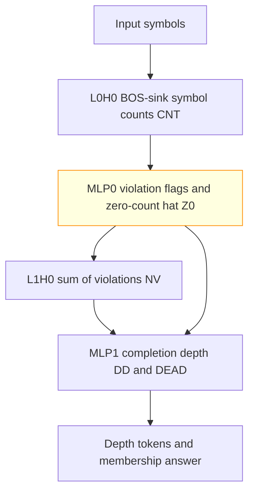
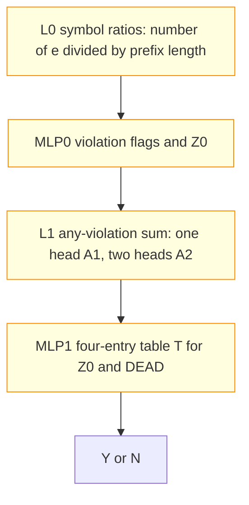

# Counter languages

Small transformers were trained to recognise balanced parentheses and words with equal-sized symbol blocks. When asked for the answer alone, they counted symbol ratios, marked invalid prefixes and combined those flags before answering. All 10/10 seeds in the final three-symbol experiment reached exact match 1.0 on 2048 held-out words per seed, so this answer-only cell is solved. Its four-entry answer table substituted exactly in 10/10, but complement resampling passed in 9/10 only; the cell-level closed-form status is partial, and scratchpad training solved only one of the three languages.

## At a glance

| Fact | Value |
|---|---|
| Task | Recognise Dyck-1, aⁿbⁿ and aⁿbⁿcⁿ words. |
| Input → output example | `aabbcc` is a member of aⁿbⁿcⁿ; `aabccc` is not. |
| Model | Two-layer decoder, width 64, two heads per layer and ReLU MLP width 64. |
| Rungs and seeds | HAND reference; PART retrains L0 MLP; TRAIN screens three seeds per cell and weight decay; final aⁿbⁿcⁿ answer only, 10 seeds at weight decay .1. |
| Closed form status | Partial (answer-table substitution 1.0 in 10/10; discovered-edge complement accepted in 9/10, one seed .880 < .90). |
| Status | Solved (final answer-only TRAIN 10/10 exact; scratchpad aⁿbⁿ 1/3); last run 2026-11-10; interpretation 2026-11-11. |
| Weights | [Hugging Face: counter-languages](https://huggingface.co/jc1122/circuit-atlas-nets/tree/main/counter-languages), published revision `6ca84a561e25`. |
| Reproduce | Not available yet: training code for this task is not yet in `code/`. |

## 1. Task and data

A word is accepted when it belongs to the requested language. Dyck-1 contains correctly nested parentheses of one type. In aⁿbⁿ, a block of `a` symbols is followed by the same number of `b` symbols. In aⁿbⁿcⁿ, the three successive blocks have equal size. For example, `aabbcc` belongs to aⁿbⁿcⁿ and `aabccc` does not.

Training used fresh words over 2–3 symbols at each step, with word length `n` from 1..40. This `n` is the total input length, not the exponent in the language name. The mixture contained members, one-symbol mutations, words with ≤ 3 runs and random words. A deterministic hash split separated training from 2048 held-out test words per seed. Exact match means every scored output token is correct ([counting results](../GLOSSARY.md#counting-results)).

*Table 1. Output formats. A scratchpad writes intermediate state before the answer ([glossary](../GLOSSARY.md#task-formats)).*

| Format | Prompt and output | State meaning |
|---|---|---|
| A, answer only | `BOS s_1 .. s_n = Y\|N` | Membership answer. |
| B, scratchpad | `BOS s_1 S_1 .. s_n S_n = Y\|N` | `S_t` is `X` for a dead prefix or `D<d>` for the fewest symbols needed to append a valid completion. |

Length tests used `n = 80` and `160`; they are not part of the in-range solve criterion. `BOS` is the beginning-of-sequence token, and `s_t` is the symbol at position `t`.

## 2. Model

### 2.1 Architecture

The model has the [GPT-NeoX-shaped decoder](../GLOSSARY.md#standard-machine-learning-terms) layout: 2 layers × 2 heads × head width 32, residual width 64, MLP width 64, ReLU activation, no positional embeddings (NoPE), no LayerNorm and an untied `lm_head` readout. The vocabulary size is `6 + k + DMAX + 1`, for `k` symbols and state tokens D0..D160/D320.

### 2.2 Frozen and trained parts

HAND fixes every weight; PART retrains one stage in HAND; TRAIN learns every weight from the Hugging Face initialisation ([rungs](../GLOSSARY.md#the-three-rungs)). PART trains only L0 MLP, with `W_in [64, 64]` masked to symbol (`SYM`) and count (`CNT`) input dimensions and `W_out [64, 64]`. Its outputs were not masked. All other HAND weights remain frozen. The unmasked output lets this stage bypass the intended frozen state readout, a failure discussed in Section 4.

### 2.3 Training

AdamW used learning rate 1e-3, betas (.9, .98), warmup 1000 followed by cosine decay, clipping at 1, batch 128, evaluation every 500 and a plateau stop of 5000 after 30k. The weight-decay sweep was .1/.3/1; final weight decay was .1. TRAIN used TF32 and fp32 evaluations; PART used fp32 for 20k steps. The TRAIN budget was 40k; B retries used 80k. Hardware was consumer GPUs. Screens ran three seeds per cell and weight decay across runs 1–3. The final aⁿbⁿcⁿ A pack stopped with all seeds solved at 15500.

### 2.4 Reproduction

Reproduce: not available yet: training code for this task is not yet in `code/`; the weights, held-out splits and recorded accuracies are on Hugging Face at [counter-languages](https://huggingface.co/jc1122/circuit-atlas-nets/tree/main/counter-languages). Recorded output keys are `best_test` and `ext`.

### 2.5 Archive

Published revision `6ca84a561e25` contains HAND for each language and format, best and final TRAIN snapshots for seeds 0–2 of the solved run-1 cells, and seeds 0–9 of the final run, as safetensors. These are the archived cells, not every failed retry. The publication record reports prior hash/reload verification; this article does not claim a new re-evaluation of the archive.

## 3. Hand-built solution

HAND counts each symbol, marks any prefix that violates the language rule, and accepts only when the final counts balance and no violation occurred. Only this design, HAND-a, was built.

L0H0 is a BOS-sink count head, using an [attention sink](../GLOSSARY.md#hand-built-machinery) to undo averaging: its BOS score is `ln 2^23`, and each symbol has value `2^23`, yielding `CNT_e = #e`. For each of `F` violation flags, L0 MLP uses two step neurons:

```text
ReLU(2z - 1) - ReLU(2z - 2)
```

Here `z` is the flag's count-based discriminant; token identity gates it with gain `G = 2000`. A three-neuron triangular hat computes `Z0`, the indicator that the signed count difference `d` is zero ([hinges and tents](../GLOSSARY.md#hand-built-machinery)). L1H0 adds the violation flags to form `NV`. L1 MLP computes the completion depth `DD`, `DEAD = clamp(NV, 0, 1)`, and `OUT_Y = ReLU(Z0 - 2 NV)` at `=`. `DEAD` marks a prefix that cannot be completed. The clamp limits its argument to the interval from zero to one.

```text
lm_head D<k> = 2k DD - k^2 + 1/2
```

This quadratic readout selects the depth token; the other output rows are X, Y and N. L0 uses `2F + 3` neurons (`F = 1, 2, 6` flags for the three languages) and L1 uses 5.


*Figure 1. HAND-a's count, flag and sum algorithm. MLP0 is the only trained component in PART. TRAIN learns every component and need not retain these head indices.*

HAND was exact on every word of length 1..16 for `k = 2` and 1..10 for `k = 3`, and on ≤ 3-run words to lengths 40, 80 and 160: 183k–399k inputs across the checks, both formats, with 0 mismatches. These finite checks are separate from longer-word TRAIN performance.

## 4. What training finds

### 4.1 Results

*Table 2. Solves at final exact match 1.0 on 2048 held-out words per seed. Compact ranges from the published entry are retained; detailed diagnostic denominators appear in Appendix B.*

| Cell | Solved | Result and timing |
|---|---|---|
| A TRAIN, run 1, solved weight-decay cells | 24/24 | All three languages; .1/.3 for all, also 1 for Dyck-1 and aⁿbⁿ. First exact 1000–12500 steps. |
| Final aⁿbⁿcⁿ A TRAIN, weight decay .1 | 10/10 | Best and final 1.0; first exact 2500–10500, median 5750. |
| aⁿbⁿcⁿ A TRAIN, weight decay 1 | 0/3 | Accuracy drifts after a better mid-run snapshot. |
| PART, all languages and formats | 0/18 | A .96–.997; B .23–.61. |
| aⁿbⁿ B TRAIN, weight decay .1 | 1/3 | Other two final seeds .998 and .9985; same state-recurrence family. |
| Dyck-1 B TRAIN, runs 1–3 | 0/21 | Rare deep-state and answer-readout errors remain. |
| aⁿbⁿcⁿ B TRAIN, runs 1–3 | 0/21 | Violation-to-dead transition remains incomplete. |

A PART answers from final counts and skips the any-violation route. In B PART the retrained MLP0 writes past the frozen quadratic readout; the failure is not a lack of neuron capacity. Scratchpad TRAIN instead reads the previous state token. Dyck-1 still misses `OUT_Y` at `=` and rare deep states; aⁿbⁿcⁿ misses the violation-to-dead step (V/DEAD interchange flips .35–.69 at L1). Higher weight decay did not close those failures; [Pracher et al. (2026)](#references) provide the comparison with feature learning suppressed by decay.

### 4.2 Circuit types

The answer-only types share a route: L0 averages symbols to count ratios, MLP0 forms violation flags, L1 combines them and MLP1 answers. A1 uses one any-violation head; A2 distributes the sum over both L1 heads. A1 accounts for 13/24 run-1 seeds and 7/10 final seeds; A2 for 11/24 and 3/10. A1's retained-head accuracy (`keep_in_layer`) is .95–1.0. These counts classify mechanisms, not independent basins.

The scratchpad type Bs appears in all 3/3 aⁿbⁿ B weight-decay-.1 seeds, including the two .998 near-solves in the compact summary. It reads the previous state token, with `ref_state` interchange flip .91–1.0; no matching HAND was built. Only 1/3 is an exact solve.

### 4.3 Length generalisation

*Table 3. Recorded final-snapshot exact match on longer words. The source evaluated 512 words at each length. Answering N everywhere scores approximately .75, so Dyck-1 at length 160 is near that baseline.*

| Cell | n 80 | n 160 |
|---|---|---|
| Final aⁿbⁿcⁿ A, compact published range | .91–1.0 | .86–.98 |
| Final aⁿbⁿcⁿ A, source precision | .910–1.0 | .855–.975 |
| Run-1 Dyck-1 A | .88–.98 | .75–.83 |
| Run-1 aⁿbⁿ A | .86–.99 | .85–.99 |
| aⁿbⁿ B | .44–.56 | .18–.45 |

The ratio code loses resolution as words lengthen, especially when Dyck-1 requires valid counts at every prefix. The scratchpad's longer depth tokens were not trained. In-range solves do not establish length generalisation.

## 5. Mechanism and verification

For A1/A2, let `#e` be the number of occurrences of symbol `e` in the prefix, `c_e` its language-specific signed coefficient and `t` the prefix position. The proposed route is:

```text
d = sum_e c_e #e/(t+1)
V_t = [s_t = e] and [z_e(t) >= 1]
DEAD = [sum_t V_t > 0]
answer Y iff Z0 and not DEAD
MLP1(x_=) = T[Z0, DEAD]
```

`z_e(t)` is the rule's violation discriminant, `Z0` tests balanced final counts, and `T` is a four-entry table of MLP1 outputs keyed by those two Boolean variables ([truth-table closed forms](../GLOSSARY.md#verifying-a-circuit)). The table describes a successful substituted readout, not an equality for every native real-valued activation.

Final substitution kept exact match 1.0 in 10/10 on 2048 held-out words per seed. Probe-decoded keys gave the compact .96–1.0 (source .964–1.0); shuffled keys gave .69–.82 (source .685–.817). Complement resampling used the discovered edges, with 128 diagnostic words of length 24 and three resample draws. It kept .88–.995 (source .880–.995): accepted in 9/10, split A1 6/7 and A2 3/3. Seed 7, type A1, gave .880 < .90 and failed. The whole-cell status is therefore partial, despite exact substitution in ten seeds. [Lagasse (2025)](#references) motivated the recorded suggestion to restore pruned cooperative edges; that repair was not run here.

The older run-1 test accepted 24/24: substitution 1.0 and discovered-edge complement .91–1.0. It is a different seed collection, not a replacement for the final failure. The narrower HAND-shaped edge claim passed only 2/24; the accepted discovered sets include extra direct routes. Random-same-size and circuit-resampled controls accompany the resampling; shuffled keys control the table replacement. [Bayat Makou et al. (2026)](#references) contextualise why component-level success need not transfer to an edge-level claim.

For Bs, the candidate `MLP1 = T[S_(t-1), s_t]`, using the previous state and current symbol, scored .38–.74 under substitution and was rejected. The state is assembled across the two MLPs, so a state-copy description does not certify a closed form for MLP1 alone.


*Figure 2. The answer-only route found by TRAIN, with all computational nodes marked trained. Closed-form status: partial; final substitution passes 10/10, but complement resampling passes 9/10 and seed 7 fails. The accepted claim uses discovered edges, not just HAND's narrower route.*

This route follows HAND-a's count, flags, any-violation sum and readout, while using ratios instead of its de-normalised sum. It matches the counter-attention construction discussed by [Bhattamishra et al. (2020)](#references). Bs uses a state recurrence, as in the [DFA scratchpad entry](https://github.com/jc1122/mechanistic-interpretability-circuit-atlas/blob/main/entries/dfa-group-automata.md), rather than that counter construction.

## 6. Limitations and open questions

Only one HAND was built. Diagnostics used a fixed length of 24 and 128 words, not the full variable-length test. Dyck-1's NV flip was untested, so the summed-violation causal result must not be silently extended to it. The B closed form remains open and its MLP1-only table failed. A joint replacement of the state-building MLPs was suggested, not completed.

The final networks came from one run and are identical to a paired trial's control, not an independent replication. Loss barriers of 37–71 separate the tested seeds into different basins ([LMC](../GLOSSARY.md#analysis-measures)); the two mechanism types do not imply one basin. Final complement acceptance is 9/10 only. Shuffled-key, circuit-resampled and random controls do not turn the remaining .880 failure into a pass. The run-1 narrower HAND-shaped claim also failed in most seeds. Longer lengths remain imperfect and Dyck-1 approaches the N-everywhere baseline.

## 7. Prediction record

Predictions were written before each round. The compact record is retained below; “held” refers to the stated count or range, not a retrospective mechanism claim.

*Table 4. Recorded predictions and outcomes.*

| Prediction | Outcome |
|---|---|
| Run 1: Dyck-1 A TRAIN not solved | Missed: 9/9 solved. |
| aⁿbⁿ A at least 1/3 | Held: 9/9. |
| aⁿbⁿcⁿ A not solved | Missed: 6/9 solved. |
| B TRAIN at least 2/3 in Dyck-1 and aⁿbⁿ | Missed: aⁿbⁿ 1/3; Dyck-1 0/21 over runs 1–3. |
| aⁿbⁿcⁿ B not solved | Held: 0/21. |
| B PART 3/3 | Missed: 0/3 in each cell. |
| Final 8–10/10 solved | Held: 10/10. |
| Final median first exact 3500–5000 | Missed: 5750. |
| A1 and A2 each at least 2/10 | Held: 7/10 and 3/10 (the earlier compact record wrote 7/3). |
| Final n80 .85–1.0 | Held. |

The ratio count in answer only and the previous-state-token route in scratchpads were recorded surprises.

## Appendix A. Weights excerpt and reading

HAND's active-neuron counts are MLP0 `2F + 3` and MLP1 `5`. The archive's `excerpts.py counter` reports each L0 head's `|OV(sym0 - sym1)|` and `|OV BOS|`: a symbol-dependent value averaged with BOS is the ratio-count signature. It also reports the five MLP1 neurons with largest `(U[Y] - U[N])` vote and their share, where `U` is the output readout. These are weight slices, not new fitted accuracy estimates. The source names these slices but does not supply their per-network numeric values; no missing matrix is invented here.

## Appendix B. Detailed evidence

*Table B1. Final-snapshot diagnostics. Probes are best-layer R²; rank is r90 of the last residual; HAND-PC R² is a linear readout of HAND's principal components; JS is divergence from HAND's count head ([measures](../GLOSSARY.md#analysis-measures)). n90 is the fewest neurons covering 90% of squared input/output norm products, not a count established by individual-neuron ablation.*

| Cell | Used heads + MLPs / n90 neurons L0, L1 | Probes | Rank, HAND-PC R² | L0 JS | Best / final test |
|---|---|---|---|---|---|
| aⁿbⁿcⁿ A TRAIN .1 final, 10 seeds | 1–4 + 2 / 20–42, 18–35 | d .65–.89 (L1), NV .61–.76 (L2), OUT_Y .15–.97 | 1, .76–.87 | .40–.50 | 1 / 1 (10/10) |
| Dyck-1 A TRAIN .1/.3/1 | 1–4 + 2 / 35–51, 18–33 | d .55–.81 (L1), OUT_Y .66–.99 (L2), DEAD .42–.81 | 1, .85–.97 | .53–.58 | 1 / 1 (9/9) |
| aⁿbⁿ A TRAIN .1/.3/1 | 1–4 + 1–2 / 27–46, 4–39 | d .72–.88 (L1), V .71–.94, OUT_Y .98–1.0 | 1, .96–1.0 | .39–.41 | 1 / 1 (9/9) |
| aⁿbⁿcⁿ A TRAIN .1/.3 | 3–4 + 2 / 24–46, 14–40 | d .71–.84 (L1), NV .53–.72, OUT_Y .45–.98 | 1, .69–.89 | .50 | 1 / 1 (6/6) |
| aⁿbⁿ B TRAIN .1 | 4 + 2 / 48–55, 34–46 | ref_state .89–.90, DD .81–.87, DEAD .86–.90, CNT0 ≤ .25 | 2, .72–.76 | .47–.50 | .998–1 / .998–1 (1/3) |
| Dyck-1 / aⁿbⁿcⁿ B TRAIN failed | 4 + 2 / 18–48, 9–45 | DD .76–1.0, ref_state .84–1.0, CNT ≤ .7 | — | — | .715–.999 best (0/21 each) |

`ref_state` is the previous state token; all other variables are defined in Section 3. Final NV interchange was 1.0 at L2 in 10/10; this does not supply the missing Dyck-1 test. The compact ranges in Tables 2–3 and this table retain their published precision rather than replacing them with newly rounded values.

## References

- Bayat Makou, A., Niu, J., Dutta, S., & Gurevych, I. (2026). Many circuits, one mechanism: Input variation and evaluation granularity in circuit discovery. *Transactions on Machine Learning Research (2026); arXiv preprint*. https://doi.org/10.48550/arxiv.2606.06267 (component- versus edge-level evaluation).
- Bhattamishra, S., Ahuja, K., & Goyal, N. (2020). On the ability and limitations of transformers to recognize formal languages. *Proceedings of the 2020 Conference on Empirical Methods in Natural Language Processing (EMNLP), conference paper*. https://doi.org/10.18653/v1/2020.emnlp-main.576 (counter-attention construction and length limits).
- Lagasse (2025). https://doi.org/10.48550/arxiv.2510.03282 (arXiv preprint; pruning cooperative circuit components).
- Pracher et al. (2026). https://doi.org/10.48550/arxiv.2609.26679 (arXiv preprint; feature learning and excessive weight decay).
