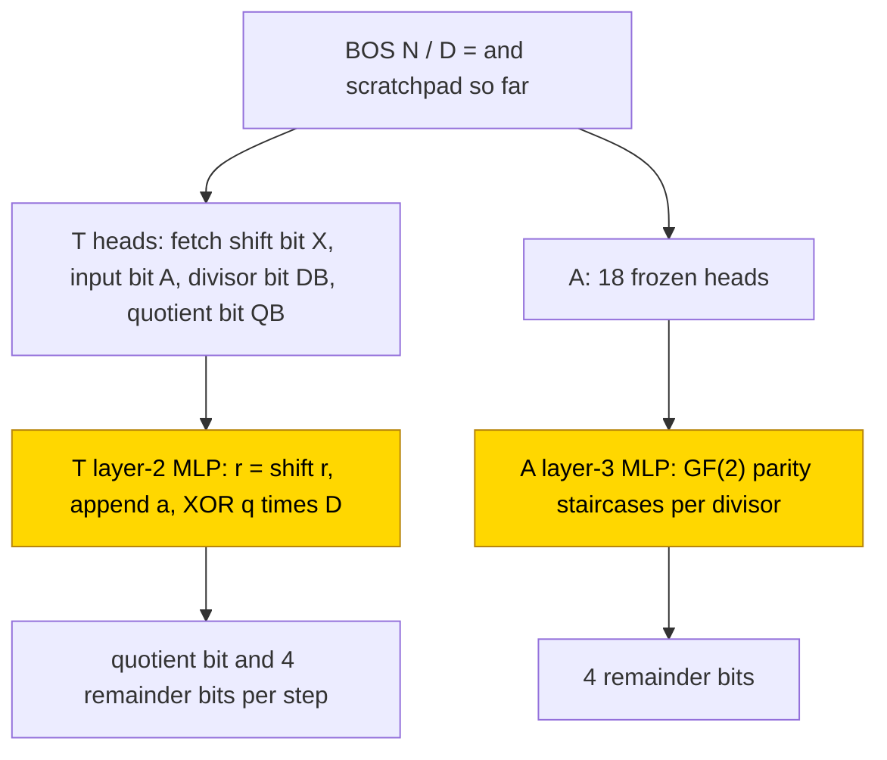
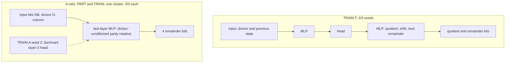

# CRC remainder

This entry studies how small transformers compute the remainder of a bit string N divided by a degree-4 divisor D over GF(2), that is,
polynomial division with XOR as subtraction (not a standard CRC format), writing either the 4 remainder bits or the quotient and
remainder after each input bit. In the hand-built scratchpad network, each step shifts the state left, appends the next bit and XORs in
the divisor when the quotient bit is 1. With the routing frozen, one trained MLP learned this step in 500 steps on 10/10 seeds, and
from scratch the scratchpad was learned too (3/3, first exact at 11.5–16k). Answer only was learned (frozen parts 3/3, from scratch
2/3) through a last-layer divisor-conditioned parity readout that differs from the hand-built one, and neither format generalises
reliably to longer inputs from scratch. The task is partly solved (scratchpad frozen-part 10/10, from scratch 3/3; answer only from
scratch 2/3). The closed form is partial: for frozen-part scratchpad seeds 0–2 an eight-ReLU table keeps 11,587 of
11,587 rows (supported by substitution; complement not tested; seeds 3–9 lack matched zero controls), and there is none from scratch.

| Fact | Value |
|---|---|
| Task | Remainder of an n-bit string N (n 8/9/10) divided by a monic degree-4 divisor D over GF(2); answer only or a per-bit scratchpad |
| Input → output example | Answer only: `BOS 10000000 / 10001 =` → `1000` (x^7 mod x^4 + 1 = x^3) |
| Model | GPT-NeoX, ReLU, no LayerNorm, NoPE, d_model 128; A 4 layers × 16 heads, T 3 layers × 4 heads and MLP 256; PART trains only the stage MLP |
| Rungs and seeds | HAND A and T exact; PART T ten-seed final (seeds 0–9); PART A, TRAIN A, TRAIN T 3 screening seeds each |
| Closed form status | Partial (PART T eight-ReLU table keeps 11,587 → 11,587 rows on seeds 0–2; zero controls open for seeds 3–9; none for TRAIN) |
| Status | Partly solved (PART T 10/10 in 500 steps, TRAIN T 3/3 with first exact at 11.5–16k, TRAIN A 2/3); last run 2026-11-07 |
| Weights | [Hugging Face: crc-remainder](https://huggingface.co/jc1122/circuit-atlas-nets/tree/main/crc-remainder) |
| Reproduce | Not available yet: training code for this task is not yet in `code/` |

## 1. Task and data

The target is the GF(2) polynomial remainder N mod D. N has n input bits (n 8/9/10 in training and test), and D is monic of degree 4
(16–31, with D ∈ {19, 25, 28, 30} withheld from training). The prefix is `BOS N_MSB…N_LSB / D_MSB…D_LSB =`, most significant bit
first. Two output formats were studied (Table 1). This is algebraic division, not a standardised CRC encoding.

*Table 1. Output formats.*

| Format | Output |
|---|---|
| `A` (answer only) | the 4 remainder bits |
| `T` ([scratchpad](../GLOSSARY.md#task-formats)) | after each input bit, the quotient bit and the full 4-bit remainder, with `;` between states (5n bits + n − 1 separators) |

The split is a width-invariant hash of (N, D), 80/20, so zero-padding cannot leak test pairs into training; fresh pairs are drawn
every batch. An output counts as exact when the whole [teacher-forced](../GLOSSARY.md#task-formats) output is correct. Test accuracy
is the mean over 512 held-out pairs at each of n 8/9/10 (1,536 per seed). Length was tested at n 11 and 12, and unseen divisors at
n 10.

## 2. Model

The shared conventions are described in [METHODS.md](../METHODS.md). The [rungs](../GLOSSARY.md#the-three-rungs) are HAND (every
weight set by formula), PART (frozen hand-built parts with one trained stage) and TRAIN (all weights trained from scratch).

### 2.1 Architecture

All networks are GPT-NeoX with ReLU, no LayerNorm, no positional encoding, untied embeddings, vocabulary 7, context 128 and d_model 128.
Format A uses 4 layers × 16 heads (d_head 8) and MLP 1,024; format T uses 3 layers × 4 heads (d_head 32) and MLP 256.

### 2.2 Frozen parts and trained part

PART trains only the stage MLP (A layer 3, T layer 2), with W_in masked to the hand-built input coordinates; all routing stays frozen
HAND. TRAIN uses the same shapes with all weights from random initialisation.

### 2.3 Training

The optimiser was AdamW with learning rate 1e-3, weight decay .1 and betas (.9, .98), warmup 1,000 steps, a cosine schedule, clipping
at 1 and batches of 256 fresh pairs. The budget was 30k steps, with a plateau stop after 5,000 steps without improvement once past a
minimum of 22.5k, checkpoints every 2,500 steps and evaluation every 500 steps. PART ran in fp32; TRAIN used TF32 updates with fp32
evaluations and out-of-distribution tests. Success is test exact 1. Training ran on GPU accelerators and re-scoring in fp32 on CPU.
Test pairs are regenerated from the seed (see `config.json`).

### 2.4 Reproduction

Training code for this task is not yet in `code/`; the weights, held-out splits and recorded
accuracies are on Hugging Face at
[huggingface.co/jc1122/circuit-atlas-nets/tree/main/crc-remainder](https://huggingface.co/jc1122/circuit-atlas-nets/tree/main/crc-remainder).

### 2.5 Archive

The folder holds `hand_{A,T}`, `part_T_{best,final}_s0…9` and `part_A_{best,final}_s0…2` (the 4 stage-MLP tensors, to be inserted into
`hand_<fmt>`), `train_{A,T}_{best,final}_s0…2` (full state dicts), `config.json` and `manifest.json` (seed, steps, recorded and fp32
re-scored exact, sha256). The archived networks re-score to the recorded accuracies.

## 3. Hand-built solution

The scratchpad network T (7 used heads + 236 neurons) performs one step of long division per input bit (Figure 1). Its heads fetch the
previous state's shift bit X, the input bit A, the divisor bit DB and the quotient bit QB, and one XOR-AND stage in the layer-2 MLP
computes r = ((r ≪ 1) | a) XOR (q·D): the remainder r is shifted left, the input bit a appended, and the divisor XORed in when the
quotient bit q is 1. The answer-only network A (18 heads + 344 neurons) instead computes GF(2) coefficient-parity staircases per
divisor, step functions whose alternating output gives the parity of a sum of input bits. Both are exact on 9,568 sequences per format
(n ≤ 6 exhaustive, n 7–12 stratified over all D), with margin 30.

*Figure 1. The hand-built networks for the scratchpad (T) and answer-only (A) formats. The shaded stage MLPs (T layer 2, A layer 3)
are the parts that PART replaces with a trained stage; the heads stay frozen.*

## 4. What training finds

*Table 2. Results per cell (s = seed). The third column gives the test exact of the best, then the final snapshot.*

| Cell | Solved | Best → final test (s0 / s1 / s2) | First exact step (s0 / s1 / s2) | Stop |
|---|---|---|---|---|
| PART T, 10 seeds | 10/10 | 1 → 1 (all) | 500 (all) | solved 500 |
| PART A | 3/3 | 1 / 1 / 1 → 1 / 1 / 1 | 5.5k / 5.5k / 7k | solved 7k |
| TRAIN T | 3/3 | 1 / 1 / 1 → 1 / 1 / 1 | 16k / 13k / 15k | solved 18k |
| TRAIN A | 2/3 | .9954 / 1 / 1 → .9935 / 1 / 1 | 26k (best) / 23k / 24.5k | plateau 28k |

The scratchpad is learned faster and more reliably than answer only: PART 10/10 at 500 against 3/3 at 5.5–7k, and TRAIN 3/3 against
2/3. The answer-only networks use about twice the heads (zero ablation 16 against 7 in PART, 25–32 against 12 in TRAIN). There is no
classic delayed [grokking](../GLOSSARY.md#counting-results) ([Power et al., 2022](#references)): test ≥ .9 never lags train ≥ .99.

Length and divisor transfer are limited. PART T seeds 0–2 pass n 1–12. TRAIN T at n 11 goes from best .84 / .86 / .83 to final
.18 / .92 / .57, and n 12 ≈ 0. PART A at n 12 with seen divisors is ≈ 1/3, and with unseen D at n 10 .09–.10.

There is one circuit type per cell. PART T is the hand-built table (10/10). TRAIN T forms one type by diagnostics (3/3), in which the
quotient, shift and next-remainder variables are causally used (interchange/DAS 1) but through an MLP, head, MLP path rather than
the hand-built direct fetches. The answer-only networks (PART and TRAIN) form one coarse cluster, a last-layer readout (3/3 each): every
A net reads the remainder out only in the last layer, through a final-MLP code that is not the hand-built parity staircase. TRAIN A
seed 2 additionally routes through a single dominant layer-3 head.

The one failed TRAIN A seed is explained by its diagnostics. Seed 0 (train 1, test .9954 at the best and .9935 at
the final snapshot) misses 3/256 rows of the diagnostic batch, all at answer bit 3, for D = 22 (1/24) and D = 29 (2/23). The count and next variables are both used at layer 4 (interchange flip 1 / .996, DAS flip 1), so no
hand-built variable is missing; the fault is a divisor-specific readout in MLP3 (ranked first by activation patching). In the checkpoint dynamics, seed 0 and
the solved seed 1 follow one trajectory to 20k (no memorisation alerts) and split only in the cosine decay (seed 1 reaches 1 at 25k;
seed 0 peaks at .992 and ends at .988): a late residual, not a different path. Full diagnostics are in Appendix B.

## 5. Mechanism and verification

### 5.1 Closed forms

Closed forms were accepted on fresh held-out screens (n 8/9/10, 768 rows per snapshot), best and final snapshots.

For PART T seeds 0–2, an eight-ReLU table with 8 fitted coefficients, which writes `;` at SEP, X at QF and otherwise
(if LOW then A, else X) XOR (DB AND QB), keeps 11,587 of 11,587 rows. Here SEP, QF and LOW are position flags, read here as the separator,
the quotient-bit slot and the lowest remainder-bit slot. Seeds 3–9 (the ten-seed final) solve identically but have no matched zero controls yet.

For PART A seeds 1–2, a native ReLU ridge bank over the input bits NB, the divisor and the column (36,867 numbers against 263,296 in
the stage) reproduces the learned behaviour, errors included (768/768; seed 2 767/767). Projecting the ridges onto one hand-built
low-bit count direction keeps only 191–237/768, so that projection is rejected. TRAIN has no accepted closed form.

The supporting controls are these. Zeroing the final MLP drives exact to 0; on shuffled tokens the circuit drops to chance and
patching restores it 1 / 1. Native donor-path tests agree on 6,155/6,155 T and 2,336/2,336 A queries. No
[resample ablation of the complement](../GLOSSARY.md#verifying-a-circuit) was reported, so the closed forms are supported by
substitution and the status is partial.

*Figure 2. The circuits that training finds. TRAIN T computes the hand-built variables through an MLP, head, MLP path; the
answer-only nets read the remainder out in the last-layer MLP with a divisor-conditioned code. Neither has an accepted closed form
from scratch; the PART A ridge bank reproduces the learned behaviour but is not a hand-built parity staircase.*

### 5.2 Relation to the hand-built network and to published work

The scratchpad reaches the hand-built step 10–20× faster in PART and solves every TRAIN seed; answer only needs about 2× the heads and
keeps a divisor-specific readout gap. Learning parities without intermediate supervision is hard, and a curriculum over widths helps
([Cornacchia & Mossel, 2023](#references)); length transfer of arithmetic transformers depends on the training widths
([Jelassi et al., 2023](#references)); scratchpads as intermediate computation follow [Nye et al. (2021)](#references).

## 6. Limitations and open questions

Scores are teacher-forced, and greedy rollout was not run. Neuron necessity was not measured, and only PART T has ten seeds. PART A's
n 12 high-bit repair and a full hand-built-stage swap (65,536/65,536) are repairs, not native generalisation. Open: ten-seed finals
for PART A and both TRAIN cells; matched zero controls for the PART T closed form on seeds 3–9; the TRAIN A data retry (wider training
widths, proposed, not run) and the checkpoint dynamics of TRAIN A seed 2; and public code.

## 7. Prediction record

Predictions were committed before any smoke run, and the outcomes are as follows. PART T by 2.5k: confirmed (500). PART A by 15k with
poor unseen-D and n 12 accuracy: confirmed (5.5–7k; unseen D .09–.10). TRAIN T 3/3 by 15k: mostly confirmed (seed 0 took 16k).
TRAIN A ≥ 1/3 by 30k: confirmed (2/3). TRAIN T fails n 12: confirmed (0/3).

## Appendix A. Weights excerpt and reading

The PART T MLP2 bank is a_j = ReLU(β_j0 + β_j·[X, A, DB, QB, QF, LOW, SEP]), 256 units, 2,819 numbers. Its response clusters (159–184
units) are the 8 truth-table cells of the hand-built XOR-AND step; the substitute ReLUs are not identified native neurons.

The PART A bank is a_j = ReLU(β_j0 + Σᵢ α_ji·NB_i + u_j[D] + v_j[col]). A dense per-divisor parity surrogate covers the seen divisors
and the low ten bits only, which is why unseen D and n 12 fail.

## Appendix B. Detailed evidence

*Table B1. Diagnostics per cell (n 10 batch of 256 teacher-forced rows).*

| Cell | E best / final | H; M | Best probe R² | Inter → DAS; R / X | Top patch (drop / rec) | Edges ρ; J | r99 (HAND); JS |
|---|---|---|---|---|---|---|---|
| PART T s0–2 | 1 / 1 | 4/7; 1/3 | .88–.91, 1, .90–.91, .66–.68, .88–.89 (3) | .92–1 → 1; 1 / 0 | MLP2 1 / 1 | .996; 1 | 9 (10); 0 |
| PART A s0–2 | 1, 1, .996 | 14/16; 2/4 | .52–.57 / .51–.60 (4) | .58–.73 → .97–1; .30–.42 / .13–.16 | MLP3 1 / 1 | .94–.97; .60–1 | 25; 0 |
| TRAIN T s0–2 | 1 / 1 | 4–5/12; 3/3 | .83–.88, .71–.88, .85–.95, .69–.90, .78–.91 (3) | .99–1 → 1; 1 / 0 | MLP2 1 / 1 | .81–.93; .29–.39 | 4–10 (10); ≤ .45 |
| TRAIN A s1 | 1 / 1 | 19–20/30–32; 4/4 | .74 / .69–.72 (4) | .98–1 → 1; 1 / .04–.05 | MLP0 1.01 / .86–.90 | .82–.87; .09 | 31–33; ≤ .47 |
| TRAIN A s2 | 1 / 1 | 16–18/25–28; 4/4 | .74 / .63–.68 (4) | .85–.99 → 1; .98–1 / .07–.08 | MLP3 1.03 / .45–.47 | .83–.86; .03 | 28–29; ≤ .46 |
| TRAIN A s0 (failed) | .988 / .988 | 20–21/26; 4/4 | .78 / .68–.70 (4) | 1 → 1; .98 / .09 | MLP3 1.01 / .73–.76 | .74–.83; .10 | 40; ≤ .45 |

Key: E = exact; H = used heads, M = used MLPs (mean/zero ablation > 5 pp; each cell gives the mean-ablation count, then the zero-ablation count, and the zero counts are the head counts quoted in Section 4); probe = best linear R² at the layer in parentheses (T:
shift, divisor, quotient, AND, next; A: count, next); the Inter column gives the interchange flip, then the distributed alignment search (DAS) flip; R / X =
restricted / excluded exact on the probe subspace; edges ρ = EAP-IG exactness check, J = edge Jaccard against HAND; r99 = last-layer
residual rank; JS = attention divergence to HAND. Terms are defined in the [glossary](../GLOSSARY.md#analysis-measures).

In format T the divisor and AND variables have no answer-fixing pairs, and step, column and phase are constant at the query, so they
are untested, not unused. The final edge ρ of TRAIN A seed 0 is .74 (< .8), so its edge reading is not trusted.

## References

- Cornacchia, E., & Mossel, E. (2023). A mathematical model for curriculum learning for parities. *ICML 2023 (arXiv preprint)*.
  https://doi.org/10.48550/arXiv.2301.13833 (parity learning and curriculum over widths)
- Jelassi, S., d'Ascoli, S., Domingo-Enrich, C., Wu, Y., Li, Y., & Charton, F. (2023). Length generalization in arithmetic
  transformers. *arXiv preprint*. https://doi.org/10.48550/arXiv.2306.15400 (length transfer and training widths)
- Nye, M., Andreassen, A. J., Gur-Ari, G., et al. (2021). Show your work: Scratchpads for intermediate computation with language
  models. *arXiv preprint*. https://doi.org/10.48550/arXiv.2112.00114 (scratchpads)
- Power, A., Burda, Y., Edwards, H., Babuschkin, I., & Misra, V. (2022). Grokking: Generalization beyond overfitting on small
  algorithmic datasets. *arXiv preprint*. https://doi.org/10.48550/arXiv.2201.02177 (grokking)
