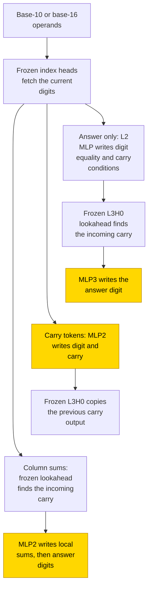
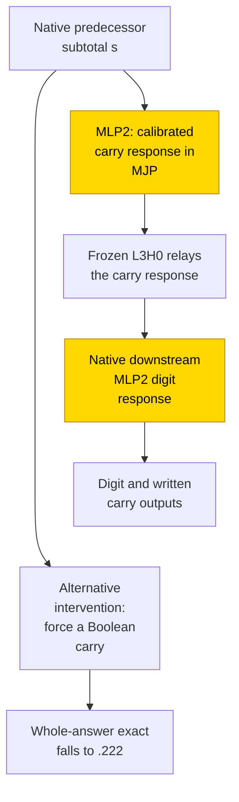

# Decimal and hexadecimal addition

Decimal and hexadecimal addition use the same column rule: add the two digits and the incoming carry, then keep the remainder in that base. Four-layer transformers were tested with answer-only, written-carry and column-sum outputs, either training one block on frozen arithmetic routing or training the whole network from scratch. A column-total readout appeared in 60/60 selected frozen-routing networks; this counts a family of readouts, not exact task successes. Longer training brought 37/40 independent from-scratch runs with answer-only or column-sum outputs (seeds, [glossary](../GLOSSARY.md#counting-results)) to test exact match ≥ .99, without recovering the hand-built head that fetches the carry from lower columns. The task is partly solved: longer inputs still fail, and the formula's status is partial because replacing individual components does not verify the whole from-scratch mechanism, while tests resampling everything outside the claimed circuit (the complement, [glossary](../GLOSSARY.md#verifying-a-circuit)) were not reported for the learned block on frozen routing.

| Fact | Value |
|---|---|
| Task | Add two three-digit numbers in decimal (base 10) or hexadecimal (base 16) |
| Input → output example | In decimal, 345 + 678 → 1023; answer-only output is the four digits 1 0 2 3 |
| Model | Four-layer transformer; one feed-forward block trained on frozen routing, or all weights trained from scratch |
| Rungs and seeds | HAND: 6 base/format cells; PART and TRAIN: 10 seeds per cell, with failed cells retried once and both runs retained |
| Closed form status | Partial (PART column-total readouts; substitution evidence only, complement not tested; no whole TRAIN closed form) |
| Status | Partly solved (TRAIN answer-only/column-sum retry: 37/40 at test exact match ≥ .99); last run 2026-11-05 |
| Weights | [Hugging Face: decimal-hex-addition](https://huggingface.co/jc1122/circuit-atlas-nets/tree/main/decimal-hex-addition) |
| Reproduce | Not available yet: training code for this task is not yet in `code/` |

## 1. Task and data

The task is ordinary addition with different ways of writing the working. In decimal, 345 + 678 = 1023: the units column writes 3 and carries 1 to the next column. Hexadecimal uses the same rule with base 16. The experiment asks whether providing the carry or column totals changes what a transformer learns.

Each operand has n = 3 digits, written most significant first. The prompt is `BOS a+b=`. Write β for the base, a_i and b_i for the operand digits, c for the incoming carry, s_i for an answer digit and d_i = a_i + b_i for a column total before carrying. The archive labels the bases `b10` and `b16`; formulas in the original records use b for β.

*Table 1. The three output formats. MSB-first and LSB-first mean most and least significant digit first.*

| Format | Output | What is supplied by the written working |
|---|---|---|
| A: answer only | s_3..s_0, MSB-first | No intermediate tokens |
| B: carry tokens | s_0 k_1 s_1 k_2 s_2 k_3, LSB-first; k is `c` or `.` | The carry after each digit |
| C: column sums | d_2..d_0 in 0..2b−2, `=`, then s_3..s_0 | The local sums before carrying |

B and C are scratchpads, outputs that include intermediate working ([glossary](../GLOSSARY.md#task-formats)). Per seed, 20k training pairs and 2k test pairs were sampled at random. Exact match requires every output token to be correct. The primary analysis summary reports fp32 CPU exact match on 1000 test pairs unless marked otherwise; individual later probe banks are identified separately. Length transfer was tested at 4 and 6 digits, called n + 1 and 2n.

## 2. Model

### 2.1 Architecture

All cells used a GPT-NeoX-shaped decoder, a transformer that reads earlier tokens to predict the next one ([glossary](../GLOSSARY.md#standard-machine-learning-terms)). It has 4 layers × 4 attention heads, d_model 256, d_head 64 and MLP width 256. Here d_model is the running-state width and d_head each head's vector width; a head reads information from earlier positions. An MLP is a feed-forward block applied at each position; its ReLU activation keeps positive inputs and sets negative inputs to zero. There is no LayerNorm, which would centre and rescale the running state, and no positional encoding (NoPE), meaning no added position vectors. These terms are defined in the [glossary](../GLOSSARY.md#standard-machine-learning-terms).

The vocabulary has 25 tokens in base 10 and 37 in base 16: BOS, unk, values 0..2b−2 and `+ = . c`. TRAIN updates all 1.6M weights. Layers are zero-based; MLP3 is the final feed-forward block. General methods are in [METHODS.md](../METHODS.md).

### 2.2 Frozen parts and trained part

The three rungs are HAND, with every weight set by formula; PART, with hand-built routing frozen and one block trained; and TRAIN, with all weights learned from scratch ([glossary](../GLOSSARY.md#the-three-rungs)). PART trains MLP3 in A and MLP2 in B/C. Each block has `dense_h_to_4h [256, 256]` plus bias and `dense_4h_to_h [256, 256]` plus bias.

*Table 2. Named inputs available to the PART block. These are internal channels, not additional labels given to TRAIN.*

| Channel | Meaning |
|---|---|
| TOK | Current token represented by a one-hot vector, one coordinate per possible token |
| X1, X2 | Fetched operand digits |
| X3 | Written column total d_i in C |
| CY | Carry channel |
| PH, EQS | Which phase of C is being written |
| T, VT | Position thermometers: cumulative indicators of the current position |

A fetch head copies a token from a computed position; a thermometer is a vector whose successive coordinates indicate whether the position has reached each threshold ([glossary](../GLOSSARY.md#hand-built-machinery), [number codes](../GLOSSARY.md#standard-machine-learning-terms)).

### 2.3 Training

AdamW used learning rate 1e-3, weight decay 1 and batch 256. Evaluation was every 500 steps, with the best-train snapshot saved. Training used consumer GPUs; analysis used fp32 on CPU. TF32 is reduced-precision matrix multiplication and fp32 is full precision ([glossary](../GLOSSARY.md#hand-built-machinery)).

*Table 3. Run settings. The diagnostic label “v2 best” refers to run 1; “v1 final” is an earlier run, not the end of that same training trajectory.*

| Run | Budget | Settings and stopping rule |
|---|---|---|
| Earlier v1 | TRAIN 20k | Final weights; no best snapshot in the diagnostic record |
| Run 1 (v2) | PART 10k; TRAIN 20k | TF32; betas (.9, .98); stop on a 2k plateau after 5k |
| PART retry | 20k | fp32; warmup, cosine schedule and clip 1 |
| TRAIN retry | 40k | β2 .95; warmup 1000, cosine schedule, clip 1; b10 A plateau 5k after 20k, other cells plateau 20k |

A warmup/cosine schedule first raises then lowers the learning rate; clipping caps update size ([glossary](../GLOSSARY.md#standard-machine-learning-terms)). Mean ablations replaced components by their mean output; probes tested whether arithmetic variables could be decoded; PCA/SVD measured state and weight dimensions; attention JS compared attention patterns ([glossary](../GLOSSARY.md#analysis-measures)).

### 2.4 Reproduction

Reproduce: not available yet: training code for this task is not yet in `code/`; the weights, held-out splits and recorded accuracies are on Hugging Face at [decimal-hex-addition](https://huggingface.co/jc1122/circuit-atlas-nets/tree/main/decimal-hex-addition). The public `python run.py` has no addition task.

### 2.5 Archive

The last recorded run was 2026-11-05. The public archive contains 42 networks: 6 HAND and 36 PART/TRAIN, selecting the best and worst learned seed per cell × rung × run. The suffix `*_r2` means retry. It includes lossless safetensors weights, `config.json` and `manifest.json` with sha256 fingerprints. Each network was reloaded in fp32 and checked against its recorded accuracy. This is a weight/data archive, not a public training implementation.

## 3. Hand-built solution

The reference adapts [binary addition](binary-addition.md) to base-b digit tables. It separates fetching the digits, deciding the carry and writing a digit. In A, a lower column with sum b−1 propagates its incoming carry; the nearest lower column with any other sum decides it. A lookahead head can fetch that decision without stepping through every intervening column ([glossary](../GLOSSARY.md#hand-built-machinery)).

L0/L1 construct positions: a uniform head gives 1/(r+1), a hinge MLP recovers position r, an anchor head finds `+`, and T/VT encode positions. A hinge neuron is zero below its threshold and linear above it ([glossary](../GLOSSARY.md#hand-built-machinery)).

*Table 4. Arithmetic weights and routes by format. Brackets denote a true/false indicator.*

| Format | Hand-built computation |
|---|---|
| A | Index heads fetch a_i and b_i with score −20(r_j − t)². The L2 MLP writes EQ = [a + b ≠ b−1] and GEN = [a + b ≥ b]. L3H0 fetches GEN from the first lower column with EQ. MLP3 writes a one-hot answer for (X1 + X2 + CY) mod b. |
| B | MLP2 writes DIG = s mod b and MAJ = [s ≥ b], where s is the digits plus the written incoming carry. L3H0 copies the previous MAJ to the carry-output slot. |
| C | A chain head finds the first d_j ≠ b−1 and copies [d_j ≥ b]. MLP2 writes d = a + b in phase 1, then (d + c) mod b in phase 2, with gate M = 4b. |

In Figure 1, frozen index heads fetch digits. Answer only uses carry lookahead before its digit MLP; carry tokens use a digit-and-carry MLP followed by a frozen carry-copy head; column sums use lookahead and a two-phase MLP. Only the marked stage MLPs are trained in PART. Their status remains partial, with complement untested and no whole TRAIN mechanism established.

*Figure 1. The hand-built decimal and hexadecimal adders. Gold nodes are the stage blocks trained in PART. The learned column-total readouts have partial status: local substitutions support them, but complement resampling was not reported. This diagram does not establish the whole TRAIN mechanism or equal weights on its native carry input.*

The HAND tests were exact for n = 1..12, with minimum logit margin 30. Coverage was exhaustive for n = 1..2 and sampled at each n = 3..12, with 4000 random pairs per format and length. “Exact” here does not mean every longer pair was enumerated.

## 4. What training finds

### 4.1 One trained stage on frozen routing

A column-total readout was reported in 10/10 selected seeds of b10 A/B/C, b16 A, b16 B retry and b16 C retry, giving the reported 60/60 family count. This does not mean all these networks solved the task: some readouts still wrote wrong digits. The first evaluation at test exact match .9 occurred at 0.5–8.5k steps; this is not evidence of a long delay after fitting the training set, called grokking ([glossary](../GLOSSARY.md#counting-results)).

*Table 5. PART results, 10 seeds per cell. Training-summary and fp32 analysis displays are kept separate where they disagree.*

| Cell | Selected-stage result | Retry or qualification |
|---|---|---|
| b10 A | Summary fp32 .99–1.00; primary analysis 1.00 | Column-total readout 10/10 |
| b10 B | Summary .99–1.00; primary fp32 analysis .97–1.00 | Column-total readout 10/10 |
| b10 C | .99–1.00 | Column-total readout 10/10 |
| b16 A | Summary .96–.99; primary analysis .97–.99 | Column-total readout 10/10 |
| b16 B | Original .13–.98, 8/10 ≥ .5 | Retry .989–1.00 in 8/10; seed 9 .895, seed 7 .644; readout 10/10 |
| b16 C | Original .87–.91 in the primary table, .85–.91 in diagnostics | Retry .954–.981, also summarised .95–.98; readout 10/10 |

The older entry reports b16 B retry as “8/10 ≥ .99”. The primary result instead gives .989–1.00 in 8/10; the raw separate analysis records seed 0 `full = 0.9886666536331177`. The published ratio is retained as a reporting discrepancy, not an unqualified ≥ .99 success count. No replacement seed count is inferred from rounding.

The original hex failures concerned the digit table despite complete frozen inputs. For b16 C, carry probe R² was 1 and attention JS 0; for the two failed b16 B seeds, the carry token was learned more successfully than the digit. fp32 and 20k steps improved these cells, but did not make every seed exact: b16 C was still rising at 18–20k and b16 B seed 7 remained .644 at its budget.

*Table 6. PART length transfer, 10 seeds per cell, fp32 sampled-pair analysis. A's transfer is partial, not universal exactness.*

| Cell | Four digits (n + 1) | Six digits (2n) |
|---|---|---|
| b10 A | .99–1.00 | .98–1.00 |
| b16 A | .93–.98 | .46–.92 |
| A, original aggregate display | .93–1.00 | .46–1.00 |
| B and C, selected runs | ≤ .08 | ≤ .08 |

B/C read absolute-position thermometers that correlate with phase at the single training length. A inherits a length-independent carry route; its digit table transfers more successfully. Canonical-stage length repairs are discussed separately in Section 5, not counted as native transfer.

### 4.2 Whole-network training

Run 1 did not solve any answer-only/column-sum cell in all ten seeds. Some individual seeds scored highly. Errors increased with carry-chain length in A/C: b16 A fell from .56 to 0 at chain length 3, whereas B's chain profile was flat. The longer scheduled retry brought the reported total to 37/40 at ≥ .99. A changed budget, schedule and optimiser settings were used together; this is not an isolated test of any one change.

*Table 7. TRAIN exact match, 10 seeds per cell. Parentheses give the original training-summary final values, not the separate v1 diagnostic finals in Appendix B.*

| Cell | Run 1 best (final where given) | Retry outcome | First retry test ≥ .9 |
|---|---|---|---|
| b10 A | .09–.94 (.00–.59) | 10/10 ≥ .99; .998–1.00 | 8–19.5k |
| b10 B | .81–.99 (.01–.77) | Not retried; 10/10 learned ≥ .5, 8/10 diagnostic ≥ .9 | Not applicable |
| b10 C | .14–1.00 | 10/10 ≥ .99; .999–1.00 | 5.5–18.5k |
| b16 A | .00–.84 | 7/10 ≥ .99; GPU .035–1.00, fp32 .033–1.00 | 11.5–37k, 9 seeds |
| b16 B | .88–.99 | Not retried; 10/10 learned ≥ .5, 8/10 diagnostic ≥ .9 | Not applicable |
| b16 C | .27–.93 | 10/10 ≥ .99; .999–1.00 | 7.5–25.5k |

The old summary describes b10 A, b10 C and b16 C as 10/10 ≥ .998, consistent with the displayed retry ranges. It gives the combined .9 crossing display as 5.5–37k. The b16 A exceptions were reported as seed 5 .93, seed 3 .97 and seed 8 .04. Final equalled best in the retry summary; run 1 had collapsed after earlier peaks, with best/final gaps up to .98. Original stopping included plateaux at 14.5k, 13.5k and 17.5k; some C cells hit 20k while still improving.

The retry networks used 4–16 heads + 590–980 neurons. The original overview calls the final MLP a sum lookup in 6–9/10; the detailed primary census gives b10 A 4, b10 C 6, b16 A 9 and b16 C 6 of 10. These displays are retained rather than silently merged. Other seeds need an operand-pair key. Earlier TRAIN layers have no closed form. The original log summary gives n + 1 = 0 in all retry networks; the separate fp32 analysis gives n + 1 ≤ .04. Neither supports useful native length transfer.

Carry probe R² and resemblance to a HAND head did not separate successful retries from failures. The reported head matches appeared in only 1–3/10 networks with JS ≥ .34; a linear probe measures decodability, not the use or absence of a variable. A recovered lookahead circuit was not established.

### 4.3 Causal diagnostics

Activation patching, which swaps component outputs between inputs, identified the trained stage as the largest-drop PART component in 113/113 solved networks across recorded runs and snapshots. Here the diagnostic “solved” screen means exact ≥ .9, not the retry ≥ .99 criterion. Edge attribution estimated HAND wiring in PART: hand_recall 1.0, Jaccard .78–.80 in A/B and 1.0 in C. These scores are attribution screens, trusted only when their exactness check passed ([glossary](../GLOSSARY.md#analysis-measures)).

TRAIN edge overlap was 0–.13 and the largest patching drop was usually MLP0 or MLP3. Since heads were not aligned, this flags different wiring rather than a matched-circuit score. Linear interchange swaps a proposed variable; DAS searches a rotation for the same swap ([glossary](../GLOSSARY.md#analysis-measures)). No HAND variable was missed by linear interchange but found by DAS here. The reverse occurred for the B digit: interchange .96–1, DAS .07–.83, and HAND .07–.20.

## 5. Mechanism and verification

### 5.1 Partial stage readouts, and a separate repair

A sum-response readout replaces the learned block by its mean output at each column total. In C it also conditions on phase. The old summary reports substitution equal to native accuracy, .95–1.00, with hex B retry seed 7 .69. That seed is an exception to literal equality: the separate raw analysis gives native `0.643666684627533` and sum replacement `0.6880000233650208`. The family classification does not imply exact response identity or task success. In TRAIN, replacing the last MLP gives .88–.99 in B and .50–1.00 in retry A/C, with ≥ .99 in about half according to the original overview. There is no formula for the preceding TRAIN stack.

A canonical arithmetic block is a different intervention. With s = round(X1 + X2 + CY) in A and s = round(X1 + X2 + TOK[c]) in B, its channel formulas are:

| Format | Canonical replacement, with other stage outputs zero |
|---|---|
| A | `Y[(s mod b) + 2] = 1` |
| B | `DIG = s mod b`; `MAJ = [s ≥ b]` |
| C before phase token | `Y[round(X1 + X2) + 2] = 1` |
| C after phase token | `Y[(round(X3 + CY) mod b) + 2] = 1` |

Y contains vocabulary output scores; value v has index v + 2 after BOS and unk. The canonical stage scored 1.000 in 80/80 tested PART snapshots, 40,960/40,960 pairs. Failed networks were included: making them correct is a repair, not evidence that they already computed this canonical rule. For one b16 B PART case it also lifted 4 / 6-digit accuracy from .066 / .032 to 1.000, localising that length failure to the trained stage. Complement resampling, which replaces everything outside a proposed circuit by values from other inputs, was not reported for this stage claim ([glossary](../GLOSSARY.md#verifying-a-circuit)). Status remains partial.

### 5.2 A written carry need not be an internal bit

The b16 B PART retry seed 1 used an analogue carry state: a real-valued channel calibrated to the following digit block. Replacing it by canonical 0/1 values gave only .222 whole-answer exact match. A compact hinge response on the live predecessor subtotal s gave 1.000 on 1,024 fresh pairs:

`MJP = a + b·s + c·ReLU(s − 15) + d·ReLU(s − 16)`.

MJP is the native carry-output channel, called MAJ in HAND; a, b, c and d in this equation are fitted coefficients, not the operands, base or carry. At the first carry query they were (−2.0873, .1209, .0511, −.1162). This is a component substitute for one tested seed, not a length-general whole-network algorithm. Using carry-bit means instead gave .949; the hinge fit had R² .9964.

Equal operand contribution is also distinct from identical carry weights. In b16 B PART, setting own-carry weights equal to operand weights reduced exact match to .938 for two top neurons and .303 for all neurons. The stronger equal-weight claim is refuted at the weight level.

In Figure 2, the native subtotal enters the trained carry response, a frozen head relays it, and the downstream trained digit response reads it. The alternative Boolean-carry intervention damages whole-answer accuracy. This component substitution remains partial, with complement untested; it is not length-general or a claim of equal native carry weights.

*Figure 2. A component substitution in b16 B PART retry seed 1. The hinge replacement scored 1.000 on 1,024 fresh pairs; the Boolean replacement scored .222. Gold marks the trained MLP2's carry and digit responses at successive output positions; L3H0 is frozen. Closed-form status is partial; complement resampling was not reported, and the substitute is not length-general.*

### 5.3 Why the TRAIN algorithm remains unresolved

The b10 A retry uses a distributed stack: MLP0/1/2/3 mean ablations retained .001 / .003 / .047 / .007. Joint substitution of MLP0 and the periodic digit embeddings gave 1024/1024 exact and agreement in both tested seeds, with later layers native. That local success did not extend to the whole proposed stack. Resampling every component within its claimed local-variable class retained .74–.80 in seed 1 and .81–.82 in seed 2. Lower digits stayed 1.000; every error was in the top carry, whose context-dependent readout remains unresolved. These are separate recorded ranges, not a new combined range.

The 105-neuron sum population in b10 C TRAIN was necessary, with ablation .002, but a pure-sum substitute gave .933. The failed b16 A TRAIN case had units accuracy .054 despite carry interchange/DAS .976 / .996. It is not explained by a carry-only failure.

Search-only keep-sets were also insufficient: b10 A TRAIN seeds 1 / 2 retained 7 heads + 608 / 597 neurons, but independent exact match was .980 / .985, below the 99% bar. HAND under the same procedure kept 3 + 22 with .992. These are local search minima, not verified or globally minimal circuits.

### 5.4 Relation to earlier work

The frozen-routing stage resembles the digit-table part of HAND, with approximately 100–200 hinges; native B can require a calibrated carry response. From-scratch networks acquired useful digit and carry computation without a recovered lookahead head. PART A showed partial length transfer, as in [binary addition](binary-addition.md).

[Quirke and Barez (2023)](#references) describe per-digit addition streams and carry heads; [Quirke et al. (2024)](#references) compare addition and subtraction. [Lee et al. (2023)](#references) study arithmetic output order and scratchpads. Fourier-feature accounts in pretrained language models ([Zhou et al., 2024](#references); [Kantamneni & Tegmark, 2025](#references)) and heuristic accounts ([Nikankin et al., 2024](#references)) provide comparisons, not verification of these small networks.

## 6. Limitations and open questions

Only one length, n = 3, was trained. Transfer was sampled at 4 and 6 digits only; neither native TRAIN nor all PART formats became length-general. TF32 run-1 PART scores were up to .03 lower when rescored in fp32. Linear probes were evaluated at scored positions and cannot establish the absence of nonlinear arithmetic variables.

Run-1 best and diagnostic final rows can refer to different training cohorts: v2 best snapshots versus earlier v1 final weights. The .99 boundary for b16 B and the final-MLP type counts also have conflicting source displays, preserved above. Canonical repairs do not identify a failed network's native mechanism. Local substitutions and a few-seed component probes do not establish the complete TRAIN computation; PART complement resampling was not reported. The stricter later census is not interchangeable with the original readout-family count.

Open questions concern the top carry in TRAIN A, compact joint forms for TRAIN B/C and the failed hex A units digit. The analogue B carry substitute does not generalise in length. Neuron keep-sets failed independent acceptance, so their sizes cannot be presented as verified circuit sizes.

## 7. Prediction record

Before training, the design notes predicted a “mod-b clock or lookup per digit + carry bit”. The lookup branch was supported; no clock neurons were found in the learned PART stages. TRAIN used carry information without a recovered HAND chain head, and a native B carry channel need not itself be Boolean. No grokking-time or length prediction was recorded in advance.

## Appendix A. Weights excerpt and reading

These excerpts were computed from archived weights. HAND A L3 neurons read [X1, X2, CY] = [1, 1, 1] with bias −v; b10 n11–n15 have biases −10..−14, making hinges relu(s − v). PART A examples are b10 seed 0 n196 [.04, .04, .04], bias −.03, and b16 seed 7 n114 [−.08, −.08, −.08], bias .04.

Across the 92–122 active neurons of each archived A network, the median ratio of the absolute mean to the root-mean-square of these three weights was 1.00. This supports f(X1 + X2 + CY) for those A responses. C's phase-1 operand weights had median alignment .99–1.00; B's ratio was .67–.84 and its own-carry input had a separate weight. The weight-equalising intervention in Section 5 rejects universal equality.

TRAIN has no shared internal basis with HAND. Its digit-token embeddings were periodic in digit value: the top-2 discrete Fourier transform frequencies, 1 and 2 or 3, contained .71–.97 of their power in both original and retry networks. A Fourier transform measures periodic components of a vector ([glossary](../GLOSSARY.md#analysis-measures)); this observation alone is not a complete addition algorithm.

## Appendix B. Detailed evidence

### B.1 Diagnostics

Table B1 retains the original compact diagnostics. Each cell first gives used heads+MLPs, best-layer probe R² for operand a, carry-in c and answer digit, residual participation ratio PR at L4, attention divergence JS in nats, and best exact match with final in parentheses. PR measures effective dimension. R² measures linear decodability. JS compares each used head with its closest HAND head, not an aligned causal role. Terms are defined in the [glossary](../GLOSSARY.md#analysis-measures).

After ‖ are causal medians over networks at exact ≥ .9: patch is the component with the largest patching drop, with counts; `inter/DAS` are linear interchange and distributed alignment search flip rates; `co` means carry-out. Edges are attribution Jaccard/hand_recall against HAND, restricted to trusted networks with spearman_exact ≥ .8. A dash means not reported. These scores are not whole-mechanism verification. Diagnostic best means v2; diagnostic final means v1, explaining such pairs as .00–.59 in the training summary versus .00–.93 below.

*Table B1. Diagnostics by base, format and rung. Ten seeds per learned cell; causal subgroup sizes are given inside cells.*

| cell | HAND | PART | PART retry | TRAIN (v2) | TRAIN retry |
|---|---|---|---|---|---|
| b10 A | 3+2; a 1, c 1, dig 1; PR 2.2; JS .00; 1 ‖ patch MLP3; c 1, dig 1 (no DAS) | 3+2; a 1, c 1, dig .84–.87; PR 2.1–2.2; JS .00; .99–1 (.99–1) ‖ MLP3 10/10; c 1/1, dig .89/.95; edges .78/1 (10) | – | 4–16+4; a .57–.85, c .55–.81, dig .70–.92; PR 2.1–4.5; JS .08–.29; .09–.94 (.00–.93) ‖ 2 solved: MLP0, L3H3; c .97/.99, dig .97/.98; edges .13/.29 (2) | 4–12+4; a .67–.97, c .72–.94, dig .81–.95; PR 1.6–6.8; JS .27–.43; 1 (1) ‖ MLP0 8, MLP1 2; c .97/1, dig .97/1; edges .07/.12 (10) |
| b10 B | 3+2; a .86, c .62, dig 1; PR 3.8; JS .00; 1 ‖ MLP2; dig 1/.20, co 1/1 | 3+2; a .83–.89, c .62–.68, dig .76–.79; PR 2.6–2.9; JS .15–.16; .97–1 (.87–.98) ‖ MLP2 10/10; dig .96/.83, co .85/.99; edges .80/1 (10) | – | 1–16+4; a .46–.93, c .63–.84, dig .80–.96; PR 2.1–4.2; JS .07–.30; .81–.99 (.00–.99) ‖ 8 solved: MLP3 4, MLP0 4; dig .97/.99, co .96/1; edges .10/.33 (6) | – |
| b10 C | 4+1; a .73, c 1, dig 1; PR 2.7; JS .00; 1 ‖ MLP2; c 1/1, dig 1/1 | 4+1; a .75–.79, c 1, dig .64–.73; PR 3.0–3.2; JS .00; .99 ‖ MLP2 10/10; c .99/1, dig .64/.85; edges 1/1 (10) | – | 2–16+4; a .43–.71, c .55–.92, dig .74–.86; PR 2.0–5.0; JS .08–.32; .14–1 ‖ 4 solved: MLP3 2, MLP1 2; c .92/.99, dig .98/.99; edges 0/0 (3) | 4–15+4; a .48–.68, c .57–.96, dig .78–.92; PR 1.8–4.2; JS .18–.41; 1 (1) ‖ MLP0 5, MLP3 5; c 1/1, dig 1/1; edges 0/.11 (10) |
| b16 A | 3+2; a 1, c 1, dig 1; PR 1.9; JS .00; 1 ‖ MLP3; c 1, dig 1 (no DAS) | 3+2; a 1, c 1, dig .84–.88; PR 1.8–1.9; JS .00; .96–.99 (.93–.97) ‖ MLP3 10/10; c 1/1, dig .83/.78; edges .79/1 (10) | – | 0–14+0–4; a .65–.99, c .51–.81, dig .54–.93; PR 1.8–4.1; JS .00–.42; .00–.85 (.00–.20) ‖ no solved net | 0–16+0–4; a .54–.93, c .46–.88, dig .64–.96; PR 1.5–4.0; JS .00–.33; .03–1 (.03–1) ‖ 9 solved: MLP0 7, MLP3 2; c .91/1, dig .99/.99; edges .07/.29 (8) |
| b16 B | 3+2; a .86, c .61, dig 1; PR 3.2; JS .00; 1 ‖ MLP2; dig 1/.07, co 1/1 | 2–3+1–2; a .80–.86, c .62–.66, dig .68–.79; PR 2.1–2.4; JS .00–.16; .12–.98 (.02–.96) ‖ 7 solved: MLP2 7; dig .99/.27, co .77/1; edges .78/1 (7) | 3+2; a .84–.89, c .60–.64, dig .72–.79; PR 2.2–2.5; JS .13–.16; .64–1 (.64–1) ‖ 8 solved: MLP2 8; dig 1/.27, co .79/1; edges .78/1 (8) | 2–16+4; a .46–.94, c .57–.84, dig .81–.96; PR 1.8–3.8; JS .14–.39; .88–.99 (.00–.91) ‖ 8 solved: MLP0 6, MLP3 2; dig .97/.98, co .95/1; edges .13/.38 (8) | – |
| b16 C | 4+1; a .72, c 1, dig 1; PR 2.5; JS .00; 1 ‖ MLP2; c 1/1, dig 1/.99 | 4+1; a .75–.78, c 1, dig .63–.72; PR 2.6–2.7; JS .00; .85–.91 (.72–.90) ‖ 2 solved: MLP2 2; c .98/1, dig .41/.66; edges 1/1 (2) | 4+1; a .76–.78, c 1, dig .65–.73; PR 2.6–3.2; JS .00; .95–.98 (.95–.98) ‖ MLP2 10/10; c .90/1, dig .61/.64; edges 1/1 (10) | 3–16+4; a .44–.65, c .59–.90, dig .72–.92; PR 2.2–5.8; JS .09–.39; .28–.94 (.00–.82) ‖ 1 solved: MLP2; c .82/.97, dig .99/.99; edges 0/0 (1) | 5–16+4; a .38–.63, c .55–.94, dig .75–.92; PR 3.2–6.1; JS .17–.44; 1 (1) ‖ MLP3 6, MLP0 4; c .93/1, dig 1/1; edges 0/.22 (8) |

### B.2 Component substitutions

Circuit probes used best snapshots on 2026-11-06 and fresh pairs disjoint from stored splits. Exact means teacher-forced three-digit whole-answer exact: the correct earlier output tokens are supplied ([glossary](../GLOSSARY.md#task-formats)). Ablation values are accuracy retained. These are component substitutions plus causal interventions, not the atlas's stronger verification rule.

*Table B2. Selected component evidence. A row concerns the named seed unless a second tested seed is explicitly stated.*

| Component | Role | Evidence |
|---|---|---|
| b10 A TRAIN retry seed 1: MLP0 + digit embeddings | Position/token table + Fourier k = 1, 2, 3 embeddings | MLP0 mean ablation .001; joint replacement 1024/1024 exact and agreement in both tested seeds, later layers native |
| b10 A PART seed 0: L2H0 / L2H1 | Fetch b / a | Mean ablation .002 / .000; correct-variable substitutions 1.000 / 1.000 |
| b10 A PART seed 0: L3H0 | First decisive lower-column carry | Mean ablation .127; carry-table substitution 1.000, R² = 1 |
| b10 A PART seed 0: MLP3, 121 neurons | Sum-response digit stage | Population ablation .001; substitution 1.000, drop 0 |
| b16 B PART retry seed 1: L3H0 | Analogue carry state | Carry-bit means .949; compact hinge substitute 1.000, R² .9964 |
| b16 B TRAIN seed 4: L3H0 | Copy preceding arithmetic position | Joint hard copies .993, agreement 1; bit-only / subtotal-only content .820 / .903 |
| b16 B TRAIN seed 4: MLP3, 231 neurons | Sum-coded digit readout | Ablation .001; substitution .993 = baseline, agreement .998, not identity |
| b10 C TRAIN retry seed 0: L3H0 | Fetch b digits, then written column sums | Head ablation .000; joint six-query hard substitute 1.000 |

### B.3 Stricter snapshot census

This census covered 180 snapshots, 131 at ≥ .90. Signatures required agreement within .01 exact match plus token agreement. Every solved PART seed had frozen lookahead/two-phase routing plus a canonical stage; this is a readout signature, subject to the repair/native distinction above. In B the carry head was bit-sufficient / subtotal-required in b10 8/2 and b16 3/5 tested cases. “Bit-sufficient” means a bit-conditioned response sufficed; “subtotal-required” means the tested bit-only substitute did not.

*Table B3. TRAIN census: sufficient sum table / main effects / unresolved, copied from the stricter census. Counts concern eligible snapshots, not a new ten-seed exact-success criterion.*

| Cell | Counts |
|---|---|
| b10 A | 4/0/6 |
| b16 A | 3/3/3 |
| b10 B | 6/0/3 |
| b16 B | 5/1/2 |
| b10 C | 3/2/5 |
| b16 C | 2/0/8 |

A sufficient sum table retains decisions using the column total; a main-effects fit uses separate operand contributions. The HAND chain carry route appeared in 0 A networks. This census applies stricter sufficient-table criteria than the earlier TRAIN f(sum) family labels, so the two counts must not be treated as interchangeable.

## What to read next

Read [binary addition](binary-addition.md) for the corresponding carry and position-shortcut questions in base two. [Base conversion](base-conversion.md) provides another comparison between local digit tables and cross-digit computation.

## References

- Kantamneni, S., & Tegmark, M. (2025). Language models use trigonometry to do addition. *arXiv preprint*. https://doi.org/10.48550/arxiv.2502.00873 (comparison with number representations in language models)
- Lee, N., Sreenivasan, K., Lee, J. D., Lee, K., & Papailiopoulos, D. (2023). Teaching arithmetic to small transformers. *arXiv preprint*. https://doi.org/10.48550/arxiv.2307.03381 (output order and scratchpads)
- Nikankin, Y., Reusch, A., Mueller, A., & Belinkov, Y. (2024). Arithmetic without algorithms: Language models solve math with a bag of heuristics. *arXiv preprint*. https://doi.org/10.48550/arxiv.2410.21272 (comparison with heuristic arithmetic)
- Quirke, P., & Barez, F. (2023). Understanding addition in transformers. *arXiv preprint*. https://doi.org/10.48550/arxiv.2310.13121 (per-digit streams and carry heads)
- Quirke, P., Neo, C., & Barez, F. (2024). Understanding addition and subtraction in transformers. *arXiv preprint*. https://doi.org/10.48550/arxiv.2402.02619 (shared arithmetic routing and borrow)
- Zhou, T., Fu, D., Sharan, V., & Jia, R. (2024). Pre-trained large language models use Fourier features to compute addition. *arXiv preprint*. https://doi.org/10.48550/arxiv.2406.03445 (comparison with Fourier arithmetic)
