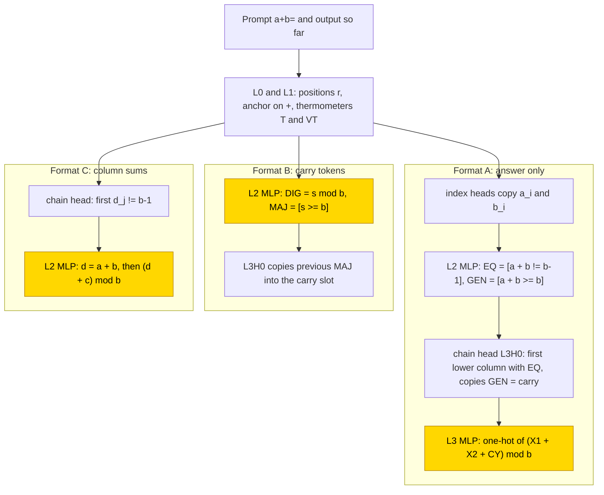
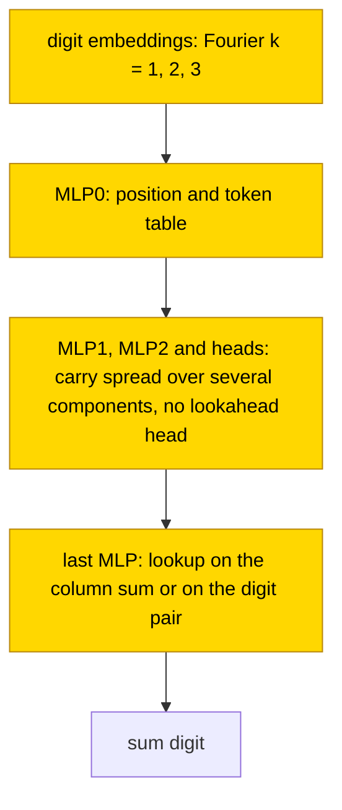

# Decimal and hexadecimal addition

This entry studies how small transformers add two 3-digit numbers in base 10 and base 16, in three output formats: the answer only,
the answer with a carry token after each digit, and the column sums followed by the answer. When the hand-built parts were frozen and
only one stage MLP was trained, the stage became a lookup on the column sum s = a + b + c (the two digits plus the carry) in all 60
networks of the final runs. Networks trained from scratch needed late grokking (test accuracy first reached .9 at up to 37k steps): the first run solved none of the answer-only or
column-sum cells, and the retry solved 37/40 (base-16 answer only 7/10) without the hand-built carry-lookahead head and without length
generalisation. The task is partly solved. The closed form status is partial: the trained stage's sum lookup substitutes at the
network's own accuracy (.95–1.00), which is supported by substitution with the complement not tested, and the earlier layers of the
networks trained from scratch have no closed form.

| Fact | Value |
|---|---|
| Task | Add two 3-digit numbers in base 10 or base 16 (`a+b=` → a + b), answer only, with carry tokens, or with column sums first |
| Input → output example | Base 10, in words: 345 + 678 → 1023, written in answer only as the four sum digits 1 0 2 3 |
| Model | GPT-NeoX-shaped, 4 layers × 4 heads, d_model 256, MLP 256 ReLU, no LayerNorm, no positional encoding; PART trains one stage MLP (layer 3 or 2) |
| Rungs and seeds | HAND per base × format (6 cells); PART and TRAIN 10 seeds per cell; failed cells retried once (both runs kept) |
| Closed form status | Partial (PART stage lookup on the column sum, substitution = net accuracy .95–1.00; supported by substitution, complement not tested; none for the earlier TRAIN layers) |
| Status | Partly solved (from scratch 37/40 after one retry; b16 A 7/10); last run 2026-11-05 |
| Weights | [Hugging Face: decimal-hex-addition](https://huggingface.co/jc1122/circuit-atlas-nets/tree/main/decimal-hex-addition) (42 networks) |
| Reproduce | Not available yet: training code for this task is not yet in `code/` |

## 1. Task and data

The prompt is `a+b=` and the target is a + b, where a and b are 3-digit numbers in base 10 (b10) or base 16 (b16). Three output
formats were studied (Table 1); format B writes a carry token k after each sum digit, and format C, a scratchpad
([glossary](../GLOSSARY.md#task-formats)), writes the column sums first. Each seed has 20k training pairs and 2k test pairs, drawn at
random, and an output is correct only on exact match of all output tokens. Length generalisation was tested at 4 and 6 digits.

*Table 1. Output formats (b = base).*

| Format | Output |
|---|---|
| `A` (answer only) | s_3..s_0, most significant digit first (MSB first) |
| `B` (carry tokens) | s_0 k_1 s_1 k_2 s_2 k_3, least significant first (LSB first), k = carry token |
| `C` (column sums) | column sums d_2..d_0 ∈ 0..2b−2, `=`, then s_3..s_0 |

## 2. Model

The shared architecture and instrumentation are described in [METHODS.md](../METHODS.md). The three
[rungs](../GLOSSARY.md#the-three-rungs) are HAND (every weight set by formula), PART (frozen hand-built parts with one trained stage)
and TRAIN (all weights trained from scratch).

### 2.1 Architecture

All networks are GPT-NeoX-shaped with 4 layers × 4 heads, d_model 256, d_head 64, MLP 256 ReLU, no LayerNorm and no positional encoding
(NoPE). The vocabulary has 25 tokens (b10) or 37 (b16): BOS, unk, the values 0..2b−2 and `+ = . c`. TRAIN trains all 1.6M weights.
Layers are numbered from zero, so L3 is the last layer.

### 2.2 Frozen parts and trained part

PART trains the stage MLP only: layer 3 in format A and layer 2 in formats B and C (dense_h_to_4h [256, 256] + bias, dense_4h_to_h
[256, 256] + bias). The stage reads TOK (the token one-hot), X1 and X2 (the two column digits), X3 (in C, the column sum d_i), CY (the
carry), PH and EQS (the phase in C) and T and VT (position thermometers, vectors whose m-th unit is [position ≥ m]).

### 2.3 Training

All runs used AdamW with learning rate 1e-3, weight decay 1 and batch 256; accuracy was evaluated every 500 steps and the best-train
snapshot was kept. Table 2 gives the per-run settings. Analyses ran in fp32 on CPU: mean ablation, probes, PCA/SVD, attention JS and
length at 4 / 6 digits. Training was on consumer GPUs.

*Table 2. Training settings per run. Run 1 is also called v2 in the diagnostics.*

| Run | Precision | Steps | Optimiser and schedule | Stop |
|---|---|---|---|---|
| Run 1 (v2) | TF32 | PART 10k, TRAIN 20k | betas (.9, .98) | 2k plateau after 5k |
| Retry | PART fp32 | PART 20k, TRAIN 40k | TRAIN: b2 .95, warmup 1000, cosine, clip 1 | TRAIN: 5k plateau (b10 A) or 20k after 20k |

### 2.4 Reproduction

Reproduce: not available yet: training code for this task is not yet in `code/`; the weights, held-out splits and recorded
accuracies are on Hugging Face at
[huggingface.co/jc1122/circuit-atlas-nets/tree/main/decimal-hex-addition](https://huggingface.co/jc1122/circuit-atlas-nets/tree/main/decimal-hex-addition)
(42: 6 HAND, 36 PART/TRAIN).

### 2.5 Archive

The Hugging Face folder holds the HAND networks, the best and worst learned seed per cell × rung × run (`*_r2` = retry), `config.json`
and `manifest.json` (sha256). Each network was reloaded in fp32 and checked against its recorded test accuracy.

## 3. Hand-built solution

The hand-built network is the [binary-addition](binary-addition.md) network with base-b tables (Figure 1). L0 and L1 compute positions:
a uniform head gives 1/(r+1) at position r, a hinge MLP turns it into r, an anchor head finds `+`, and the thermometers T and VT encode
positions.

Format A. Index heads copy a_i and b_i (score −20(r_j − t)², which peaks at the target position t). The L2 MLP computes EQ = [a + b ≠
b−1], which marks a column that decides the carry, and GEN = [a + b ≥ b], which marks a column that generates one. The chain head L3H0
attends to the first lower column with EQ and copies its GEN, which is the carry. The L3 MLP writes the one-hot of (X1 + X2 + CY) mod b.

Format B. The L2 MLP computes DIG = s mod b and MAJ = [s ≥ b]; L3H0 copies the previous MAJ into the carry slot.

Format C. A chain head attends to the first d_j ≠ b−1; the L2 MLP computes d = a + b in the first phase, then (d + c) mod b (gate M = 4b).

The networks are exact for n = 1..12 with margin 30.

*Figure 1. The hand-built networks for the three formats. In A a chain head finds the first lower column that decides the carry; in B
the carry is passed through the written carry token; in C the carry is read from the column sums. The shaded MLPs are the stages that
PART replaces with a trained MLP.*

## 4. What training finds

Table 3 gives the results per cell from the training runs; Appendix B gives the full diagnostics, whose test ranges come from the
diagnostics run and differ slightly in two cells.

*Table 3. Test exact match per cell (best snapshot; final in parentheses where reported).*

| Cell | PART (fp32) | TRAIN run 1 (v2) | TRAIN retry |
|---|---|---|---|
| b10 A | .99–1.00 | .09–.94 (.00–.59) | 10/10 ≥ .998 |
| b10 B | .99–1.00 | .81–.99 (.01–.77) | – |
| b10 C | .99–1.00 | .14–1.00 | 10/10 ≥ .998 |
| b16 A | .96–.99 | .00–.84 | 7/10 |
| b16 B | retry 8/10 ≥ .99 | .88–.99 | – |
| b16 C | retry .95–.98 | .27–.93 | 10/10 ≥ .998 |

### 4.1 Stage on frozen parts (PART)

Every trained stage that works is a lookup on the column sum s = a + b + c, read as X1 + X2 + CY with equal weights, which is the HAND
input: f(sum) in 10/10 seeds in b10 A, B and C, b16 A, the b16 C retry and the b16 B retry, all 60 networks of the final runs, with
substitution equal to the network's accuracy. There was no grokking delay: the first evaluation at which test accuracy reached .9 came
at 0.5–8.5k steps ([glossary](../GLOSSARY.md#counting-results)). At length n + 1 / 2n, A scores .93–1.00 / .46–1.00, so PART A
extrapolates to 4 and 6 digits; B and C score ≤ .08.

Two cells failed in run 1, PART b16 C and b16 B (2 seeds), missing the digit table although their inputs were complete (carry probe R² 1,
JS 0). They were under-trained, and fp32 with 20k steps fixed them.

### 4.2 Training from scratch (TRAIN)

Run 1 (20k steps, 2k-plateau stop) solved none of A and C. Errors grow with the length of the carry chain in A and C (b16 A: .56, falling to 0 at
carry-chain length 3) and are flat in B. The retry (40k, warmup + cosine + clip) solved b10 A, b10 C and b16 C in 10/10 at ≥ .998 and
b16 A in 7/10, 37/40 in total, with grokking late: the first evaluation at test .9 came at 5.5–37k steps, and final = best. These
networks use 4–16 heads + 590–980 neurons, and their last MLP is a sum lookup in 6–9/10 (otherwise a pair lookup). They have no
HAND-like carry-lookahead head, and at length n + 1 they score ≤ .04.

Format B, with the carry written as a token, trains in 10/10 at both bases according to the training summary; the diagnostics of run 1
(Appendix B) count 8 solved networks (exact ≥ .9) in each base, with best test .81–.99 (b10) and .88–.99 (b16).

The failed TRAIN A and C networks of run 1 failed on long carry chains. Neither the carry probe R² nor a match to the chain head (1–3/10
networks, JS ≥ .34) separates them from the solved retries; the learning curves do.

### 4.3 Causal evidence

In PART the top patching component is the stage MLP in 113/113 solved networks. Edge attribution (EAP-IG,
[glossary](../GLOSSARY.md#analysis-measures)) shows that PART keeps HAND's wiring (hand_recall 1.0; Jaccard .78-.80 in A and B, with
extra edges; 1.0 in C). TRAIN wiring differs (Jaccard 0-.13; heads are not aligned, so this flags different wiring and is not a match
score), and its top patching component is MLP0 or MLP3. No HAND variable fails linear interchange while DAS (distributed alignment
search) finds it here; the reverse holds for the B digit (interchange .96-1, DAS .07-.83, HAND .07-.20).

## 5. Mechanism and verification

### 5.1 Closed forms

The PART stage was replaced by its mean output given s (in C, given the phase and its sum): substitution equals the network's accuracy
(.95–1.00; retry b16 B seed 7 .69). The sum digit is s mod b and the carry [s ≥ b]. For TRAIN, the last MLP replaced by f(sum) gives
.88–.99 in B and .50–1.00 in the retry A and C networks (≥ .99 in about half); the earlier layers have no closed form.

Written on the actual internal channels, with the other stage outputs zero, the PART closed forms are (Y is the stage's output over the
vocabulary, where index v + 2 is the digit v, after BOS and unk): A `Y[(s mod b) + 2] = 1`; B
`DIG = s mod b`, `MAJ = [s ≥ b]`; C `Y[round(X1 + X2) + 2] = 1` before the phase token and `Y[(round(X3 + CY) mod b) + 2] = 1` after.
Replacing only the learned stage gives 1.000 in 80/80 PART snapshots (40,960/40,960 pairs), failed seeds included (for those a repair,
not their mechanism). In b16 B PART it also lifts 4 / 6 digits from .066 / .032 to 1.000, so the length failure is in the learned stage,
not in the frozen routing. These substitutions support the closed forms; a resample ablation of the complement
([glossary](../GLOSSARY.md#verifying-a-circuit)) was not reported for PART.

The equal weights on X1, X2 and CY hold at the decision level only: in b16 B PART, setting the own-carry weights equal to the operand
weights drops exact match to .938 (two top neurons) and .303 (all).

### 5.2 Circuit probes

Circuit probes were run on best snapshots on 2026-11-06, on fresh pairs disjoint from all stored splits (Table 4). The probe
records label a component verified after a causal intervention plus a successful component substitution (not a whole-network
algorithm), and supported with causal evidence only; neither label meets the atlas acceptance rule, so Table 4 writes "causal +
substitution" for the first. Exact is teacher-forced 3-digit whole-answer exact match unless
stated, ablation numbers are accuracy retained, and layers are zero-based. s = round(X1 + X2 + CY) (A) or round(X1 + X2 + TOK[c]) (B).

*Table 4. Components probed.*

| Component | Role | Evidence (causal + substitution) |
|---|---|---|
| b10 A TRAIN retry seed 1: MLP0 + digit embeddings | position/token table + Fourier k = 1, 2, 3 embeddings | MLP0 mean ablation .001; joint replacement 1024/1024 exact and agreement in both tested seeds (later layers native) |
| b10 A PART seed 0: L2H0 / L2H1 | fetch b / a | mean ablation .002 / .000; correct-variable substitutions 1.000 / 1.000 |
| b10 A PART seed 0: L3H0 | first decisive lower-column carry | mean ablation .127; carry-table substitution 1.000, R² = 1 |
| b10 A PART seed 0: MLP3 (121 neurons) | sum-response digit stage | population ablation .001; sum-response substitution 1.000, drop 0 |
| b16 B PART retry seed 1: L3H0 | analog carry state, not a Boolean bit | carry-bit means .949; compact hinge substitute 1.000, R² .9964 |
| b16 B TRAIN seed 4: L3H0 | copies the preceding arithmetic position | joint hard copies .993, agreement 1; bit-only / subtotal-only content .820 / .903 |
| b16 B TRAIN seed 4: MLP3 (231 neurons) | sum-coded digit lookup | ablation .001; substitution .993 = baseline, agreement .998 (not identity) |
| b10 C TRAIN retry seed 0: L3H0 | one head reused: b digits, then written column sums | head ablation .000; joint six-query hard substitution 1.000 |

In b16 B PART the carry is analog: the carry-out value (MAJ in HAND), written MJP, is MJP = a + b·s + c·ReLU(s − 15) + d·ReLU(s − 16) on the live predecessor s, with for example (a, b, c,
d) = (−2.0873, .1209, .0511, −.1162) at the first carry query. It scores 1.000 on 1,024 pairs, while a canonical 0/1 output gives .222.
It is not length-general.

Supported only: b10 A TRAIN uses a distributed stack (MLP0/1/2/3 ablations .001 / .003 / .047 / .007). Scrubbing every component within
the local-variable classes at once gives .74–.80 (seed 1) and .81–.82 (seed 2); the lower digits stay at 1.000 and every error is in the
top carry, whose context-dependent read-out is unresolved. b10 C TRAIN's 105-neuron sum population is necessary (.002), but a pure-sum
model gives .933. The failed b16 A TRAIN has units accuracy .054 although carry interchange/DAS is .976 / .996, so its failure is not a
carry-only failure.

Sizes are local minima of a search, not verified circuits: b10 A TRAIN seeds 1 / 2 keep 7 heads + 608 / 597 neurons, with independent
exact .980 / .985 (failing the 99% bar); HAND under the same procedure keeps 3 + 22 (.992).

*Figure 2. The circuit that training from scratch finds in format A (b10 A TRAIN retry, seeds 1 and 2). Fourier-coded digit embeddings
and an MLP0 table feed a distributed carry stack and a last-MLP lookup. MLP0 with the embeddings is supported by joint substitution;
scrubbing the whole stack keeps only .74–.82, so the carry read-out is unresolved.*

### 5.3 Seed census

The census covers 180 snapshots, 131 at ≥ .90, grouped by signatures within .01 exact match and by token agreement. In PART, every solved
seed uses the frozen lookahead or two-phase routing with a canonical stage; the B carry head is bit-sufficient / subtotal-required in
b10 8/2 and b16 3/5. Table 5 gives the TRAIN classes. The census's sufficient sum table is stricter than the f(sum) counts of Section
5.1, hence fewer TRAIN networks pass here.

*Table 5. TRAIN seed census: sum table sufficient / main effects / unresolved.*

| Cell | Counts |
|---|---|
| b10 A | 4/0/6 |
| b16 A | 3/3/3 |
| b10 B | 6/0/3 |
| b16 B | 5/1/2 |
| b10 C | 3/2/5 |
| b16 C | 2/0/8 |

The HAND chain carry route appears in 0 A networks.

### 5.4 Relation to the hand-built network and to published work

PART computes HAND's algorithm (a sum lookup with ~100–200 hinges); TRAIN finds the digit table and a carry, without the lookahead head.
As in [binary-addition](binary-addition.md), PART A extrapolates. Per-digit streams and carry heads were described in small addition
transformers by [Quirke & Barez (2023)](#references), and a shared skeleton for addition and subtraction with a borrow by
[Quirke et al. (2024)](#references); [Lee et al. (2023)](#references) studied output order and scratchpads in arithmetic. Pre-trained
language models were reported to use Fourier features or trigonometric representations of numbers ([Zhou et al., 2024](#references);
[Kantamneni & Tegmark, 2025](#references)) or a bag of heuristics ([Nikankin et al., 2024](#references)).

## 6. Limitations and open questions

Only one training length (n = 3) was used, and length was tested at 4 and 6 digits only. The run-1 PART networks are TF32 (up to .03
lower in fp32). Probes are linear and taken at scored positions.

Open questions:

- the top-carry state of the A TRAIN networks;
- compact joint forms for B and C TRAIN;
- why the failed hex A networks lose the units digit.

## 7. Prediction record

The design notes, written before any run, predicted a "mod-b clock or lookup per digit + carry bit". The lookup held (no clock neurons);
the carry is used everywhere it is needed, but TRAIN builds it without the HAND chain head. Nothing was predicted about grokking time or
length (not recorded in advance).

## Appendix A. Weights excerpt and reading

The numbers are computed from the archived files. The HAND A L3 neurons read [X1, X2, CY] = [1, 1, 1] with bias −v (b10 n11–n15: −10..−14),
which are hinges relu(s − v). The PART A stages, trained from noise, have top neurons that read the same dimensions with equal weights:
b10 seed 0 n196 [.04, .04, .04] with bias −.03, and b16 seed 7 n114 [−.08, −.08, −.08] with bias .04. The ratio |mean|/rms of the three
weights has median 1.00 over the 92–122 active neurons of each archived A network, so the stage is f(X1 + X2 + CY). C reads X1 = X2 (the
phase-1 sum, median .99–1.00); B reads X1 = X2 and the own-carry token with its own weight (median .67–.84).

TRAIN networks have no shared basis with HAND. Their digit-token embeddings are periodic in the value: the top-2 DFT frequencies (1 and 2
or 3) hold .71–.97 of their power (run-1 and retry networks alike).

## Appendix B. Detailed evidence

Table B1 gives, per cell and rung: used heads+MLPs; best-layer probe R² of a, carry-in c and digit; residual participation ratio at L4;
JS (nats) of used heads to their best HAND head; test best (final), where TRAIN v2 final = run v1. After ‖ come causal results, medians
over solved networks (exact ≥ .9): patch = the component with the largest patching drop (networks); var inter/DAS = linear interchange /
DAS flip, best layer (co = carry_out); edges = EAP-IG Jaccard/hand_recall against HAND, over trusted networks (spearman_exact ≥ .8). Terms are defined in the [glossary](../GLOSSARY.md#analysis-measures).

*Table B1. Diagnostics per cell.*

| cell | HAND | PART | PART retry | TRAIN (v2) | TRAIN retry |
|---|---|---|---|---|---|
| b10 A | 3+2; a 1, c 1, dig 1; PR 2.2; JS .00; 1 ‖ patch MLP3; c 1, dig 1 (no DAS) | 3+2; a 1, c 1, dig .84–.87; PR 2.1–2.2; JS .00; .99–1 (.99–1) ‖ MLP3 10/10; c 1/1, dig .89/.95; edges .78/1 (10) | – | 4–16+4; a .57–.85, c .55–.81, dig .70–.92; PR 2.1–4.5; JS .08–.29; .09–.94 (.00–.93) ‖ 2 solved: MLP0, L3H3; c .97/.99, dig .97/.98; edges .13/.29 (2) | 4–12+4; a .67–.97, c .72–.94, dig .81–.95; PR 1.6–6.8; JS .27–.43; 1 (1) ‖ MLP0 8, MLP1 2; c .97/1, dig .97/1; edges .07/.12 (10) |
| b10 B | 3+2; a .86, c .62, dig 1; PR 3.8; JS .00; 1 ‖ MLP2; dig 1/.20, co 1/1 | 3+2; a .83–.89, c .62–.68, dig .76–.79; PR 2.6–2.9; JS .15–.16; .97–1 (.87–.98) ‖ MLP2 10/10; dig .96/.83, co .85/.99; edges .80/1 (10) | – | 1–16+4; a .46–.93, c .63–.84, dig .80–.96; PR 2.1–4.2; JS .07–.30; .81–.99 (.00–.99) ‖ 8 solved: MLP3 4, MLP0 4; dig .97/.99, co .96/1; edges .10/.33 (6) | – |
| b10 C | 4+1; a .73, c 1, dig 1; PR 2.7; JS .00; 1 ‖ MLP2; c 1/1, dig 1/1 | 4+1; a .75–.79, c 1, dig .64–.73; PR 3.0–3.2; JS .00; .99 ‖ MLP2 10/10; c .99/1, dig .64/.85; edges 1/1 (10) | – | 2–16+4; a .43–.71, c .55–.92, dig .74–.86; PR 2.0–5.0; JS .08–.32; .14–1 ‖ 4 solved: MLP3 2, MLP1 2; c .92/.99, dig .98/.99; edges 0/0 (3) | 4–15+4; a .48–.68, c .57–.96, dig .78–.92; PR 1.8–4.2; JS .18–.41; 1 (1) ‖ MLP0 5, MLP3 5; c 1/1, dig 1/1; edges 0/.11 (10) |
| b16 A | 3+2; a 1, c 1, dig 1; PR 1.9; JS .00; 1 ‖ MLP3; c 1, dig 1 (no DAS) | 3+2; a 1, c 1, dig .84–.88; PR 1.8–1.9; JS .00; .96–.99 (.93–.97) ‖ MLP3 10/10; c 1/1, dig .83/.78; edges .79/1 (10) | – | 0–14+0–4; a .65–.99, c .51–.81, dig .54–.93; PR 1.8–4.1; JS .00–.42; .00–.85 (.00–.20) ‖ no solved net | 0–16+0–4; a .54–.93, c .46–.88, dig .64–.96; PR 1.5–4.0; JS .00–.33; .03–1 (.03–1) ‖ 9 solved: MLP0 7, MLP3 2; c .91/1, dig .99/.99; edges .07/.29 (8) |
| b16 B | 3+2; a .86, c .61, dig 1; PR 3.2; JS .00; 1 ‖ MLP2; dig 1/.07, co 1/1 | 2–3+1–2; a .80–.86, c .62–.66, dig .68–.79; PR 2.1–2.4; JS .00–.16; .12–.98 (.02–.96) ‖ 7 solved: MLP2 7; dig .99/.27, co .77/1; edges .78/1 (7) | 3+2; a .84–.89, c .60–.64, dig .72–.79; PR 2.2–2.5; JS .13–.16; .64–1 (.64–1) ‖ 8 solved: MLP2 8; dig 1/.27, co .79/1; edges .78/1 (8) | 2–16+4; a .46–.94, c .57–.84, dig .81–.96; PR 1.8–3.8; JS .14–.39; .88–.99 (.00–.91) ‖ 8 solved: MLP0 6, MLP3 2; dig .97/.98, co .95/1; edges .13/.38 (8) | – |
| b16 C | 4+1; a .72, c 1, dig 1; PR 2.5; JS .00; 1 ‖ MLP2; c 1/1, dig 1/.99 | 4+1; a .75–.78, c 1, dig .63–.72; PR 2.6–2.7; JS .00; .85–.91 (.72–.90) ‖ 2 solved: MLP2 2; c .98/1, dig .41/.66; edges 1/1 (2) | 4+1; a .76–.78, c 1, dig .65–.73; PR 2.6–3.2; JS .00; .95–.98 (.95–.98) ‖ MLP2 10/10; c .90/1, dig .61/.64; edges 1/1 (10) | 3–16+4; a .44–.65, c .59–.90, dig .72–.92; PR 2.2–5.8; JS .09–.39; .28–.94 (.00–.82) ‖ 1 solved: MLP2; c .82/.97, dig .99/.99; edges 0/0 (1) | 5–16+4; a .38–.63, c .55–.94, dig .75–.92; PR 3.2–6.1; JS .17–.44; 1 (1) ‖ MLP3 6, MLP0 4; c .93/1, dig 1/1; edges 0/.22 (8) |

## References

- Kantamneni, S., & Tegmark, M. (2025). Language models use trigonometry to do addition. *arXiv preprint*.
  https://doi.org/10.48550/arxiv.2502.00873 (contrasting mechanism in LLMs)
- Lee, N., Sreenivasan, K., Lee, J. D., Lee, K., & Papailiopoulos, D. (2023). Teaching arithmetic to small transformers.
  *arXiv preprint*. https://doi.org/10.48550/arxiv.2307.03381 (output order, scratchpads)
- Nikankin, Y., Reusch, A., Mueller, A., & Belinkov, Y. (2024). Arithmetic without algorithms: Language models solve math with a bag
  of heuristics. *arXiv preprint*. https://doi.org/10.48550/arxiv.2410.21272 (contrasting mechanism in LLMs)
- Quirke, P., & Barez, F. (2023). Understanding addition in transformers. *arXiv preprint*. https://doi.org/10.48550/arxiv.2310.13121
  (per-digit streams, carry heads)
- Quirke, P., Neo, C., & Barez, F. (2024). Understanding addition and subtraction in transformers. *arXiv preprint*.
  https://doi.org/10.48550/arxiv.2402.02619 (shared add/sub skeleton, borrow)
- Zhou, T., Fu, D., Sharan, V., & Jia, R. (2024). Pre-trained large language models use Fourier features to compute addition.
  *arXiv preprint*. https://doi.org/10.48550/arxiv.2406.03445 (contrasting mechanism in LLMs)
