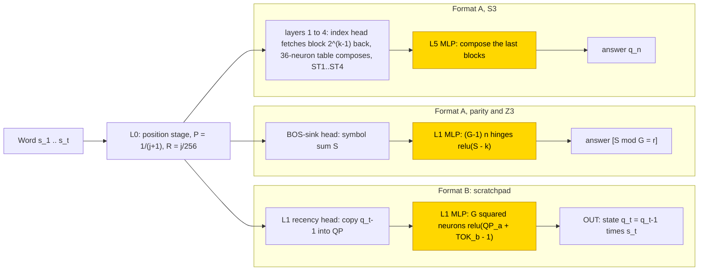
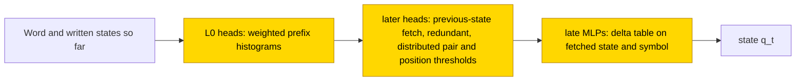

# Group automata (parity, Z3, S3)

This entry studies how small transformers track the state of an automaton whose states and symbols are elements of a group: parity
(Z2), a counter modulo 3 (Z3) and the six permutations of three objects (S3). With a scratchpad that writes the state after every
symbol, a stage trained on frozen hand-built parts and networks trained from scratch both learned the transition table within 2500
steps in 10/10 seeds per group; the stage on frozen parts stays exact to n = 128, while the networks trained from scratch break at about
twice the training length. With the answer only, the stage on frozen parts reproduced the hand-built composition table on top of the frozen
prefix-doubling layers for S3 (10/10, exact to n = 31), but for parity and Z3 it learned the residue S mod G of the symbol sum S only for S ≤ 11–18; trained from scratch on fresh
words, parity and Z3 reached 10/10 and S3 2/10 at ≥ .99. The task is partly solved. The closed forms (a transition table and residue
tables) keep accuracy 1.0 on the stated words, but the transition table is rejected as a universal reduction and an audit on
2026-11-07 found that no closed form passes the full bar, so they are sufficient readouts, not verified mechanisms.

| | |
|---|---|
| Task | Give the final state of a parity, Z3 or S3 automaton after a word of 1..16 symbols, answer only or with the state written after every symbol |
| Input → output example | Parity, answer only: a word of five symbols with values 1 0 1 1 0 → state 1 (three symbols of value 1) |
| Model | GPT-NeoX-shaped, 6 layers × 4 heads, d_model 256, MLP 512 ReLU, no LayerNorm, no positional encoding; PART trains one MLP (layer 1, or layer 5 for answer-only S3) |
| Rungs and seeds | HAND exact in all 6 cells; PART and TRAIN 10 seeds per cell; failed cells retried (fresh words, then tail-balanced counts; answer-only S3 TRAIN one size step) |
| Closed form status | Sufficient readout only (δ table keeps accuracy 1.0 on the stated words but is rejected as universal; audit 2026-11-07: no closed form passes the full bar) |
| Status | Partly solved (scratchpad 10/10 per group; answer-only S3 TRAIN 2/10 at ≥ .99); last run 2026-11-05; audit 2026-11-07 |
| Weights | [Hugging Face: dfa-group-automata](https://huggingface.co/jc1122/circuit-atlas-nets/tree/main/dfa-group-automata) (219 networks) |
| Reproduce | Not available yet: training code for this task is not yet in `code/` |

## 1. Task and data

A word s_1..s_n is a sequence of group elements: parity (Z2, 2 symbols), a Z3 counter (3 symbols) or S3 (the 6 permutations of 3
objects). The automaton starts at q_0 = identity and updates q_t = q_{t-1} · s_t; the task is the state after the word. Two formats were
studied (Table 1); in the scratchpad format the network writes intermediate results before the answer
([glossary](../GLOSSARY.md#task-formats)).

*Table 1. Output formats. Q(q) is the token of state q.*

| Format | Sequence |
|---|---|
| `A` (answer only) | `BOS s_1 .. s_n = Q(q_n)` |
| `B` (scratchpad) | `BOS s_1 Q(q_1) .. s_n Q(q_n)`, teacher forced |

The word length n is uniform in 1..16. Each seed has 20k unique training words and 2k disjoint test words, and an output is correct
only on exact match of every answer token. Format B is teacher-forced: each token is scored given the correct previous tokens
([glossary](../GLOSSARY.md#task-formats)). Length generalisation was tested on 1000 random words at n = 32, 64 and 128. For the
answer-only abelian cells, S denotes the sum of the symbol values, so that the answer is S mod G with G = 2 or 3.

## 2. Model

The shared architecture and instrumentation are described in [METHODS.md](../METHODS.md). The three
[rungs](../GLOSSARY.md#the-three-rungs) are HAND (every weight set by formula), PART (frozen hand-built parts with one trained stage)
and TRAIN (all weights trained from scratch).

### 2.1 Architecture

All networks are GPT-NeoX-shaped with 6 layers × 4 heads (d_head 64), d_model 256, MLP 512 ReLU, no LayerNorm, no positional encoding
(causal mask only) and an untied read-out. The vocabulary has 7 / 9 / 15 tokens for parity / Z3 / S3 (BOS, PAD, the G symbols, `=` and
the G states).

### 2.2 Frozen parts and trained part

PART re-initialises and trains one MLP on the frozen HAND: layer 1 in format B and in answer-only parity and Z3, layer 5 in answer-only
S3 (dense_h_to_4h [512, 256] + bias, dense_4h_to_h [256, 512] + bias). In the "mask" arms the PART stage's input weights on the position
dimensions are held at 0. TRAIN trains all weights from the default initialisation.

### 2.3 Training

All runs used AdamW with learning rate 1e-3, weight decay .1, betas (.9, .98), warmup 1000 and a cosine schedule, clipping at 1, batch
256 and fp32. Test accuracy was evaluated every 500 steps and the best-test snapshot was kept. Runs were on consumer GPUs (10–24 GB).
Table 2 gives the runs.

*Table 2. Runs. Each later run is a retry of the cells that failed before it.*

| Run | Data | Steps |
|---|---|---|
| run 1 | static 20k words | PART 10k (Z3 A 30k), TRAIN 40k; plateau stop 5k after 15k |
| run 2 (data rule) | fresh random words every batch (test words masked) | PART 30k, TRAIN 40k |
| run 3 | PART with tail-balanced symbol counts (per-word symbol probabilities ~ Dirichlet(1)) | as run 2 |
| run 3 (size step, A S3 TRAIN) | fresh words, d_model 512, 10 seeds | 40k |
| run 3b (size step, A S3 TRAIN) | fresh words, d_model 512, 3 seeds, 2× budget from scratch | 80k |

### 2.4 Reproduction

Reproduce: not available yet: training code for this task is not yet in `code/`; the weights, held-out splits and recorded
accuracies are on Hugging Face at
[huggingface.co/jc1122/circuit-atlas-nets/tree/main/dfa-group-automata](https://huggingface.co/jc1122/circuit-atlas-nets/tree/main/dfa-group-automata)
(219: 6 HAND, 200 PART, 13 TRAIN; held-out test words per group and seed in `test_<group>.safetensors`).

### 2.5 Archive

The archive holds `hand_<group>_<F>` (state dicts), `part_<run>_<F>_s<seed>` (stage tensors, all seeds), `train_<run>_<F>_s<seed>`
(full networks, best and worst seed per run), `config.json` and `manifest.json` (seed, rung, run arguments, fp32 test accuracy,
recorded accuracy, sha256). Every file was reloaded bit-identically and its test accuracy reproduced.

## 3. Hand-built solution

Layer 0 is a position stage with BOS as attention sink: it computes P = 1/(j+1) at position j, and hinges give R = j/256. The later
layers differ by format (Figure 1).

Scratchpad (B). A layer-1 recency head, with score 100·[state token] + 20 j, copies the previous state q_{t-1} into a block QP. The
layer-1 MLP has G² neurons relu(QP_a + TOK_b − 1), each writing OUT[a·b], where TOK_b is the one-hot of the current symbol. This is one
head and 4 / 9 / 36 neurons at any n.

Answer only, abelian groups. A BOS-sink head averages the symbols, which gives S, the sum of the symbol values. (G−1)·n hinge neurons
relu(S − k) are read out as [S mod G = r]. This is one head and 16 / 32 neurons at n = 16, and it grows with n.

Answer only, S3. The network uses prefix doubling. In layer k an index head fetches the block 2^(k−1) back and a 36-neuron table composes
the two blocks into the block states ST1..ST4. This is 5 heads and 180 neurons, exact for n ≤ 31.

Every cell is exact on 2000 words with n = 1..16.

*Figure 1. The hand-built networks. Format B copies the previous state with one recency head and applies the transition with a G²
neuron table; answer-only parity and Z3 sum the symbols and read the residue with hinges; answer-only S3 composes blocks by prefix
doubling. The shaded MLPs are the parts that PART replaces with a trained stage.*

## 4. What training finds

Table 3 summarises every cell; Appendix B gives the diagnostics per cell.

*Table 3. Results per cell (test exact match on held-out words, ranges over seeds; run numbers as in Table 2).*

| Cell | PART | TRAIN |
|---|---|---|
| B, all groups | 10/10 exact by step 500, masked or not; exact at n = 128 | groks at steps 500–2500 (10/10 per group); n = 32 .05–.99, n = 64 ≤ .14 |
| A S3 | 10/10 by step 1000; n = 32 .18 (HAND .18) | run 1 memorises (sign right in 8/10); run 2 best .70–.9995 (2/10 ≥ .99); size step: run 3 .487–.988, run 3b .36–.51 (not saved) |
| A parity | runs 1 / 2 / 3: best .96–.99 / .986–.999 / .988–1.0; run 3 masked 4/10 exact (7/10 on fresh batches), unmasked 1/10 | run 1 .50–.52; run 2 10/10 (grok at 13–21k) |
| A Z3 | runs 1 / 2 / 3: .91–.98 / .92–.97 / .88–.97; run 3 0/10 | run 1 9/10 (.998–1); run 2 10/10 (grok at 3.5–18k) |

### 4.1 Scratchpad (format B)

PART (all groups, masked or not) was exact on 10/10 seeds by step 500. It keeps the recency head (previous-state attention mass 1.0) and
the stage is a (q_prev, symbol) table, exact at n = 128.

TRAIN grokked at steps 500–2500 (10/10 per group); grokking means that test accuracy rises after training accuracy
([glossary](../GLOSSARY.md#counting-results)). The late MLPs are the δ table (substitution 1.0: parity MLP5, Z3 MLP3–5, 10/10). The fetch
of the previous state differs from HAND: parity spreads it over sharp heads in layers 2–5 (a single HAND-like head in 1/10), and Z3 has
one sharp head (mass .85–.95) in 7/10. Length generalisation is poor: n = 32 gives .05–.99, n = 64 ≤ .14, and token accuracy breaks at
t = 24–48.

### 4.2 Answer only, S3

PART reached 10/10 by step 1000 and reproduces the hand-built composition tables, exact to n = 31, the hand-built depth bound. The block states ST1..ST4 are decodable at accuracy 1.0 in layers 2..5 (the HAND layers), and at n =
32 PART scores .18, equal to HAND's .18 (HAND is exact only for n ≤ 31).

TRAIN run 1 (20k static words) memorised and learned only the sign of the permutation (right sign in 8/10 seeds). TRAIN run 2 (fresh
words) has sign accuracy 1.0 (10/10) and is exact up to n ≈ 9–13; its best test accuracy is .70–.9995 (2/10 ≥ .99), still rising at the
budget. ST2..ST4 are at chance, so there is no doubling.

The one size step of the retry order (d_model 512, fresh words) produced no saved network. Run 3 (10 seeds, 40k) reached test .487–.988,
still rising, but the networks were lost: the GPU ran out of memory in the final length evaluation, before the save. Run 3b (3 seeds,
80k from scratch, 2× budget) stopped at step 27.5k when the rented host's disk filled, at test .36–.51. No best snapshot exists, so
neither run is diagnosed or archived, and the answer-only S3 TRAIN result stands at 2/10 ≥ .99 (run 2). An audit on 2026-11-07 of the
unrounded curves found 2/10 seeds ≥ .99 in run 2 (maximum .9995, none exact), not 3/10.

### 4.3 Answer only, parity and Z3

The PART stage computes S exactly (probe R² 1.00; [glossary](../GLOSSARY.md#analysis-measures)) and is a function f(S), but whole large
S values are wrong. With fresh words (run 2), S = 13 is wrong for parity in 10/10 seeds, and every S ≥ 17–19 is wrong for Z3. With
tail-balanced S (run 3, large S now ~12% of words), parity masked was exact on the original test split in 4/10 (7/10 on fresh batches),
unmasked in 1/10, and Z3 in 0/10. Coverage of large S in the data is therefore not the cause.

TRAIN run 1 (20k static words): parity counts S but has no S mod 2 (test .50–.52, train also at chance); Z3 solved 9/10 (q decodable at
1.00 at L4). TRAIN run 2 (fresh words): parity and Z3 10/10 (grok at 13–21k and 3.5–18k steps). S is decodable at L1–L2 and q at 1.00
from L2–L3, and the MLPs are functions of S. These networks use HAND's variables (interchange in Section 5) in a different code (no
orthogonal map to HAND's residual, CKA .11–.23), but the residue staircase covers only the trained S (parity at n = 32 at chance; Z3 at
n = 32 ≥ .95 in 3/10).

### 4.4 Causal evidence

The failed abelian PART stages use S (interchange flip .92–1; [glossary](../GLOSSARY.md#analysis-measures)) and carry q, which DAS
(distributed alignment search) recovers (.85–1) although it is only about half linearly readable (.48–.79). The miss is therefore the
large-S read-out, not the count. Deleting the S/q subspace drops every parity A PART and parity TRAIN run 2 network to chance
(.46–.52), and keeping only that subspace leaves accuracy unchanged. Parity TRAIN run 1 has S but no answer-controlling variable (all
flips at chance). Solved TRAIN networks use HAND's variables in their own basis (residual alignment fit R² < 0), and a high CKA does not
mark success (failed parity run 1 .99, solved run 2 ≤ .23). S3 TRAIN shows no linear trace of HAND's block states; whether some other
code carries them was not tested.

## 5. Mechanism and verification

### 5.1 Closed forms

In format B the closed form is q_t = δ(q_{t-1}, s_t), a G × G table applied to the fetched previous state. Substituting the (q_prev,
symbol) mean table for the stage keeps accuracy 1.0 (PART 30/30; TRAIN parity and Z3 10/10) on the stated words. As a universal
reduction it is rejected: on a re-check, parity seed 9 keeps 126/128 (< .99 of the network). In answer-only S3 PART, MLP5 = f(q) and
MLP4 = f(ST4) tables, 10/10. In the answer-only abelian cells each stage is a table f(S) (substitution = the network's own accuracy,
PART 40/40, TRAIN run 2 parity 10/10, Z3 8–9/10); replacing it by the exact table [S mod G] gives 1.0, so the closed form exists and the
trained stage misses only its large-S teeth.

These are [sufficient readouts](../GLOSSARY.md#verifying-a-circuit), not verified mechanisms. The audit of 2026-11-07 found that no
closed form passes the full bar: every substitution is on best snapshots and none on final snapshots.

### 5.2 Circuit probes

Circuit probes were run on selected best snapshots on 2026-11-06 (Table 4). The probe records label a component verified when a causal intervention
plus an accuracy-preserving substitution hold on the stated finite domain, and supported with causal evidence only; neither label meets
the atlas acceptance rule, so Table 4 writes "causal + substitution" for the first, and the audit caveat above applies. H = heads, N = neurons; B is teacher-forced.

*Table 4. Components probed.*

| Component | Role | Evidence |
|---|---|---|
| S3 B TRAIN, all L0 heads | weighted prefix histogram | substitution 512/512 in both tested seeds (causal + substitution) |
| S3 B TRAIN, joint forms (histogram heads, ideal L2 routing, MLP2..5 tables) | answer-preserving reduction | seed 4 full net 100%; both pruned circuits 100% with refitted coefficients, 512 words (causal + substitution, answer reduction only) |
| S3 B PART, L1 fetch + MLP1 | displayed-state transport, local product | fetch zeroed: exact 0; changed-state patch 100%; 36-number substitution 256/256 (causal + substitution) |
| S3 A PART, MLP5 | composes the last frozen blocks | 36-number substitution 256/256, drop 0 (causal + substitution) |
| S3 A TRAIN (run 2), MLP5 | sign + inverse-image-of-zero readout | rank-4 projection 250/256, agreement 100%; sign-only 88/256, point-only 171/256 (causal + substitution, readout only) |
| Z3 A TRAIN (run 2), MLP5 | in-range periodic readout | seven-number cosine form 256/256, drop 0; MLP5 deletion 45.3% (causal + substitution at n = 16) |

The closed forms behind Table 4 are as follows. A histogram head computes H = Σ_t C_t exp(q·k_t/8) OV_t / Σ_t C_t exp(q·k_t/8), where C_t
are the prefix token counts. S3 PART writes the state logit T[MUL[q_a, q_b]] with 36 fitted numbers, where q_a and q_b are the fetched
and frozen-block states. In S3 A TRAIN the state write is δ_e = c(x) + u(x) sign(e) + v_{e⁻¹(0)}(x), which explains 99.96% of the
state-write variance; the coefficients are still neural (no input algorithm). In Z3 A TRAIN, with d = max(0, 1 − (S − 6)/29.5), the
write is δ_{6+e} = d a_e cos(2π(S − e)/3) and the other channels are d b_{S mod 3}, with a = (24.439, 27.467, 24.795) and b = (−62.595,
2.495, −38.438); the write R² is .764, and the form scores 228/256 at n = 32 and 65/256 at n = 64, so it is not faithful out of range.

Supported only: the S3 B TRAIN previous-state transport (whole-L2 changed-state patch 100%; ideal routing 512/512 in both seeds, but
seed 0 improves 115/128 to 128/128 on random-display words, which is a repair), and the S3 A TRAIN sign and point factors (DAS
transfers 256/256 and 181/187). The two late heads alone transfer the point in only 61/351 donor patches, so the upstream point-product
algorithm is unresolved.

A resample ablation of the whole S3 B TRAIN hypothesis at once ([glossary](../GLOSSARY.md#verifying-a-circuit)) fails: it gives
71.42% (seed 4) and 1.69% (seed 0) on the sufficient circuits (mean of 3 draws), although each is 100% unscrubbed and under joint
substitution. The replacements therefore do not prove independent causal modules.

Sizes are sufficient upper bounds, not minima. S3 B TRAIN seed 4 keeps 7H + 2202N and seed 0 8H + 1333N (of 24H + 3072N), 512/512 each;
HAND B has 2H + 292N (256 position hinges + 36 pair gates), not re-minimised. In the learned PART stage, 34/512 (B) and 22/512 (A)
neurons suffice, 256/256.

*Figure 2. The circuit that training from scratch finds in format B (S3 B TRAIN, seeds 0 and 4). Prefix-histogram heads in layer 0
feed a later, redundant fetch of the previous state, and late MLPs apply the δ table. Each part is a sufficient readout; scrubbing the
joint hypothesis fails (71.42% and 1.69%), and per the 2026-11-07 audit no closed form passes the full bar.*

### 5.3 Relation to the hand-built network and to published work

Unlike HAND, S3 B TRAIN fetches later and redundantly, with distributed pair and position thresholds. PART keeps HAND's interfaces but
not its single-neuron AND gates (pair dependence R² .9993 against product-only .148 for the best-fitting neuron).

With a scratchpad, one G² table works at any length (HAND uses 4–36 neurons) and is learned at once; the length limit comes from the
previous-state fetch (PART n = 128, TRAIN ≈ 2× training length). With the answer only, HAND needs (G−1)·n neurons (abelian) or log2 n
layers (S3); PART reproduces the S3 depth bound. The abelian residue staircase has only ~16–18 correct teeth, a resolution limit of a
one-layer ReLU MLP learning a period-G sawtooth on a scalar, consistent with the spectral bias of ReLU networks
([Hong et al., 2022](#references)), and not a data limit. Transformers are known to learn logarithmic-depth "shortcut" solutions to
automata that are brittle out of distribution ([Liu et al., 2022](#references)); here S3 PART is exactly such a log-depth solution, and
the answer-only TRAIN networks are length-bound. Fresh samples per step rescue the parity and Z3 count-then-residue cells (run 1 0/10,
run 2 10/10), in line with the advantage of fresh-sample SGD on parities ([Abbe & Sandon, 2023](#references)). Scratchpads as an aid to
intermediate computation were introduced by [Nye et al. (2021)](#references).

## 6. Limitations and open questions

Probes, ablation, activation patching, interchange and DAS were run on the best snapshots; final snapshots are unchecked and neuron
counts were not measured. The scratchpad is teacher-forced. The width is d 256 throughout; the one d 512 step (answer-only S3 TRAIN)
ended without saved networks (out of memory at 40k, disk full at 27.5k of 80k), so size against solved is untested. Each cell has 10
seeds, and length was evaluated on random words. The masked and unmasked PART pairs control for the position shortcut. The abelian PART
run 3 retry rules out coverage; a structured (hinge) initialisation of the stage was not tried.

The weights excerpt (Appendix A) reads B PART neurons as group characters; the probes support pair dependence but not a unique
group-character role. The f(S) tables for Z3 A TRAIN hold on random test words, but on a balanced histogram grid MLP2..5 = f(S) gives
only 90.41% agreement, so a global f(S) reduction is refuted. The parity A PART run-3 networks that are exact on test words still miss 2
of 17 counts on that grid.

Open questions:

- final-snapshot substitutions for every form above (0 final-weight diagnostics);
- the d 512 S3 answer-only size final (not completed);
- six solved seeds (6/9) of a context-reset S TRAIN follow-up, mechanism unclassified;
- the S3 answer-only point product;
- what the failed whole-hypothesis scrub omits;
- the smallest sufficient circuits under length extension.

## 7. Prediction record

The predictions were recorded in the task specification before any PART or TRAIN run. Table 5 lists them with the outcome.

*Table 5. Predictions and outcomes.*

| # | Prediction | Outcome |
|---|---|---|
| 1 | B PART exact, masked exact at 8× length | held, unmasked too |
| 2 | B TRAIN ≥ 7/10, hand-built circuit, half the seeds ≥ .9 at 2× length | 10/10; hand-built single fetch head 1/10 (parity); ≥ .9 at 2× length only 1–2/10 |
| 3 | A abelian PART exact | failed (large S) |
| 4 | A abelian TRAIN ≤ 5/10 with a length-bound count shortcut | run 1 parity 0/10, Z3 9/10; run 2 10/10 and length-bound (shortcut held, count broken) |
| 5 | A S3 PART = HAND including length | held |
| 6 | A S3 TRAIN ≤ 3/10, depth-bound | run 2 2/10 (≥ .99) with a length frontier, held |
| 7 | grokking order B < A abelian < A S3 | B first held; at PART the order is inverted |

## Appendix A. Weights excerpt and reading

In the B PART (masked) layer-1 stage, 65–85% of the input-weight energy (squared norm of dense_h_to_4h columns) sits on the QP and
symbol dimensions. The neurons are group characters rather than HAND's AND gates. Parity seed 0 neuron 116 reads QP (−.77, .22) and the
symbol (.73, −.26), a ± pattern that fires on (q, s) of unequal parity, which is XOR. S3 seed 0 neuron 106 reads QP and the symbols with
the permutation-sign pattern (+ − − + + −). The values are dense_h_to_4h rows of `part_<group>_mask_B_s0`, restricted to the QP and
symbol blocks. The probes of Section 5.2 support pair dependence but not a unique group-character role.

## Appendix B. Detailed evidence

Table B1 gives medians over seeds. The probe is the best layer, one-hot accuracy, with R² for S and position t; r90 = principal
components for 90% of the last residual's variance; attention divergence to HAND is ≈ 0 throughout because HAND's unused heads are
uniform; patch = activation patching on a shuffled batch, the component with the largest accuracy drop; uses = interchange flip, then
DAS flip of the HAND variable at its best layer, ranges over 167 seeds; "untested" = no answer-fixing pairs, not unused. Terms are
defined in the [glossary](../GLOSSARY.md#analysis-measures).

*Table B1. Diagnostics per cell.*

| cell | used heads + MLPs | probes | r90 | patch (drop) | uses (inter → DAS) | best / final |
|---|---|---|---|---|---|---|
| B PART (3 groups) | 1 + 1 | q_prev, q 1.00 (L2) | 2–10 | MLP1 1.0, fetch head L1H0 .94 | sym 1, q .93–1 → 1; q_prev untested | 1 / 1 |
| A S3 PART | 5 + 5 | ST1..ST4 1.00 (L2..L5), q 1.00 | 35 | index heads L1–L3 ≈ 1 | q .26–.54 → .78–1; ST1–4 untested | 1 / 1 |
| B TRAIN parity / S3 | 1–6 + 4–6 / 0–3 + 4–6 | q_prev, q 1.00 (L3–6), t R² .88–.99 | 1.5 / 2 | MLP0 (6/10, 7/9), late MLPs .84–.98 | sym 1, q .99–1 → 1 | 1 / 1 |
| A parity PART r1 / r2 / r3 (+mask) | 1 + 1 | S 1.00 (L2), q .84–.97 / .93–1 / .93–1 | 1 | L1H0 and MLP1 1.0 (55/55) | S .92–1; q .48–.79 → .85–1 | .96–.99 / .986–.999 / .988–1.0 |
| A Z3 PART r1 / r2 / r3 | 1 + 1 | S 1.00 (L2), q .80 / .76 / .79 | 1 | L1H0 and MLP1 1.0 (11/11) | S .82–.90 (2 seeds); q .64–.86 → .70–.88 | .91–.98 / .92–.97 / .88–.97 |
| A parity TRAIN r1 / r2 | 0 + 0 / 3–10 + 4–6 | S 1.00 (L1), q .52 / 1.00 (L3) | 2 / 1 | — / layer-0 heads + MLP0 1.0 | S, q .48–.53 → .48–.53 / S 1.00, q .85–1 → .97–1 | .50–.52 / 1 |
| A Z3 TRAIN r1 / r2 | 2–6 + 5–6 / 3–6 + 4–6 | S R² .95 / .98 (L1 / L2), q 1.00 (L4 / L2) | 2 | MLP5 or layer-0 heads ≈ 1 | q .94–.96 → 1.00 (2 seeds) | .998–1 / 1 |
| A S3 TRAIN r1 / r2 | 0–4 + 0–5 / 4–20 + 4–6 | ST1 .37 / .55, ST2..4 .18–.23, q .34 / .64 | 2.5 / 4.5 | layer-0 heads, MLP5 ≈ 1 | untested / q .62–.99 → .57–.99 (5/7); ST1–4 untested | .21–.37 / .70–1.0 |
| A S3 TRAIN r3 / r3b (d 512) | not diagnosed (no best snapshot) | — | — | — | — | .49–.99 at 40k / .36–.51 at 27.5k (logged test) |

*Key: r1, r2, r3, r3b = runs 1, 2, 3 and 3b (Table 2); best / final = test exact match of the best and final snapshot.*

Seed census (150 best snapshots in 17 cells; mechanism classes, not basins). Table B2 lists the classes per cell.

*Table B2. Seed census.*

| Cell | Mechanism classes |
|---|---|
| B PART parity / Z3 / S3 | 20 / 20 / 20 frozen fetch + product, compact substitution 100% |
| B TRAIN (10 each), display-local / history-sensitive | parity 3/7, Z3 7/3, S3 9/1; the strongest-attention layer is an exactly sufficient fetch in 0/10, 2/10, 6/10 |
| A S3 PART (20) | 14 faithful compact products, 6 one-error repairs, all on frozen doubling |
| A parity TRAIN run 2 | 10 late-count codes |
| A Z3 TRAIN run 1 / run 2 | 9 count + context / 1 faithful late count, 9 count + context |
| A S3 TRAIN run 2 | seed 4 has the faithful sign + point readout; seed 0 (also ≥ .99) and seed 3 (.99 only after rounding) need extra directions |
| A parity PART run 3 | 8 scalar-hinge codes |
| Z3 A PART | 0 solved |

## References

- Abbe, E., & Sandon, C. (2023). Polynomial-time universality and limitations of deep learning. *Communications on Pure and Applied
  Mathematics, 76*. https://doi.org/10.1002/cpa.22121 (fresh-sample SGD on parities)
- Hong, Q., Siegel, J. W., Tan, Q., & Xu, J. (2022). On the activation function dependence of the spectral bias of neural networks.
  *arXiv preprint*. https://doi.org/10.48550/arxiv.2208.04924 (spectral bias of ReLU networks)
- Liu, B., Ash, J. T., Goel, S., Krishnamurthy, A., & Zhang, C. (2022). Transformers learn shortcuts to automata. *arXiv preprint*.
  https://doi.org/10.48550/arxiv.2210.10749 (logarithmic-depth shortcuts to automata)
- Nye, M., Andreassen, A. J., Gur-Ari, G., et al. (2021). Show your work: Scratchpads for intermediate computation with language
  models. *arXiv preprint*. https://doi.org/10.48550/arxiv.2112.00114 (scratchpads)
