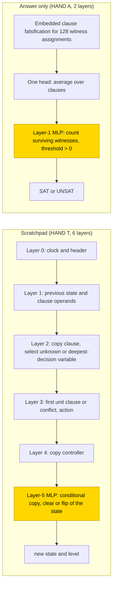
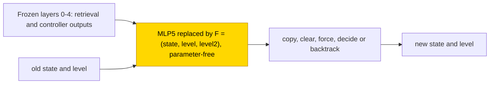

# DPLL search on small 3-SAT

This entry studies how small transformers decide whether a 3-SAT formula with 4–6 variables and 10–25 clauses is satisfiable, either
answering directly (answer only) or after writing out the state of a DPLL solver (unit propagation, decision and backtrack) at every
step (a scratchpad). With every earlier stage frozen at hand-built values, a trained last MLP solved both formats in 3/3 seeds (answer
only in 0.5–1k steps, scratchpad in 3–5.5k). Networks trained from scratch did not: answer only reached .72–.86 test exact match and the
scratchpad .00–.02 complete traces; their probes decode the step clock and the variable well but not the new state or the conflict. The task is partly solved (frozen-parts setting 3/3 in
both formats; from scratch 0/3; the ten-seed final has not finished). The closed form is partial: a parameter-free seven-field update
replaces the trained scratchpad MLP and keeps 52/52 traces per seed while zero and shuffle controls give 0/52, so it is supported by
substitution with controls, with the complement not tested; the answer-only threshold was not substituted.

| | |
|---|---|
| Task | Decide whether an ordered 3-SAT formula (n = 4–6 variables, m = 10–25 clauses) is satisfiable, answer only or with the DPLL solver state written at each step |
| Input → output example | In words: a formula that some assignment satisfies → SAT; one that every assignment falsifies → UNSAT |
| Model | GPT-NeoX-shaped, ReLU, no LayerNorm, no positional encoding; A: 2 layers, d_model 272; T: 6 layers, d_model 160; PART retrains only the last MLP (layer 1 in A, layer 5 in T) |
| Rungs and seeds | HAND A (1 head + 130 neurons) and T (14 heads + 71 neurons); PART A and T, TRAIN A and T, 3 screening seeds each; T PART ten-seed final (seeds 3–9) not finished |
| Closed form status | Partial: T PART seven-field update keeps 52/52 traces per seed, zero/shuffle 0/52; supported by substitution with controls, complement not tested; A PART threshold not substituted |
| Status | Partly solved (PART 3/3 in both formats; TRAIN 0/3); last run 2026-11-07 |
| Weights | [Hugging Face: dpll-search](https://huggingface.co/jc1122/circuit-atlas-nets/tree/main/dpll-search) |
| Reproduce | Not available yet: training code for this task is not yet in `code/` |

## 1. Task and data

The formulas are ordered 3-SAT with n = 4–6 variables and m = 10–25 clauses, balanced between satisfiable and unsatisfiable outcomes,
with unsatisfiable proposals enriched for unsatisfiable cores. A canonical hash of the clause multiset assigns each formula to the
train, monitor or test bucket in the ratio 8:1:1, so variants that differ only in clause order or clock never cross splits. The test
set holds 192 formulas per seed. An output counts as correct on exact match of every non-PAD
[teacher-forced](../GLOSSARY.md#task-formats) output token, that is, every token scored given the correct previous tokens; in format T
this is the complete trace. Length was tested at n = 7, m = 10–17, with 24 formulas per seed.

*Table 1. Output formats.*

| Format | Output |
|---|---|
| `A` (answer only) | one SAT/UNSAT token |
| `T` ([scratchpad](../GLOSSARY.md#task-formats)) | after each DPLL update (unit propagation, decision, backtrack) the full solver state, namely the assignment, the decision levels and tried flags, a clock, the clause in focus and the conflict flag; then SAT/UNSAT |

## 2. Model

The shared conventions are described in [METHODS.md](../METHODS.md). The three [rungs](../GLOSSARY.md#the-three-rungs) are HAND (every
weight set by formula), PART (frozen hand-built parts with one trained stage) and TRAIN (all weights trained from scratch).

### 2.1 Architecture

All networks are GPT-NeoX-shaped with ReLU, no LayerNorm, no positional encoding (clocks are explicit tokens) and untied embeddings,
with a vocabulary of 1,104 tokens and a context of 16,384. Format A uses 2 layers, d_model 272, 1 head (d_head 272) and MLP width 128.
Format T uses 6 layers, d_model 160, 5 heads × 32 and MLP width 96. TRAIN uses the same shapes with all weights trained.

### 2.2 Frozen parts and trained part

PART A retrains only the layer-1 MLP, with its input masked to the witness-count channel and its output to the answer channel. PART T
retrains only the layer-5 MLP (MLP5), with its inputs masked to the old state and level and the controller and comparison channels, and
its outputs to the new state and level. Everything else is frozen at the hand-built values. PART masks preserve HAND.

### 2.3 Training

The optimiser was AdamW with learning rate 1e-3, weight decay .1, betas (.9, .98), warmup 1,000 steps, a cosine schedule and gradient
clip 1. Each step used a batch of 8 fresh formulas, with a 30k-step budget and a plateau stop 5k steps without improvement after
22.5k. Test accuracy was evaluated every 500 steps and checkpoints were saved every 2,500. PART ran in
[fp32](../GLOSSARY.md#hand-built-machinery); TRAIN used TF32 updates and fp32 evaluations. The best snapshot is selected by a
96-formula monitor set (exact match, then cross-entropy), not by test. Success is a best test exact match ≥ .99. Training ran on GPU
accelerators, and re-scoring on CPU in fp32.

### 2.4 Reproduction

Reproduce: not available yet: training code for this task is not yet in `code/`; the weights, held-out splits and recorded
accuracies are on Hugging Face at
[huggingface.co/jc1122/circuit-atlas-nets/tree/main/dpll-search](https://huggingface.co/jc1122/circuit-atlas-nets/tree/main/dpll-search).
The test formulas are regenerated from their seed (see `config.json`).

### 2.5 Archive

The Hugging Face folder holds `hand_{A,T}`; `part_{A,T}_{best,final}_s0…2` (the 4 MLP tensors, to be inserted into `hand_<fmt>`);
`train_{A,T}_{best,final}_s0…2` (full state dicts); `config.json`; and `manifest.json` (seed, steps, recorded and fp32 re-scored exact
match, sha256). The archived networks re-score to the recorded accuracies. For T PART, best and final are the same bytes.

## 3. Hand-built solution

The two hand-built networks solve the task in different ways (Figure 1). The scratchpad network runs DPLL one update at a time. Layer 0
retrieves the clock and the header; layer 1 retrieves the previous state and the clause operands; layer 2 copies the clause and selects
the unknown or deepest-decision variable; layer 3 finds the first unit clause or conflict and the action; layer 4 copies the
controller; and layer 5 does the conditional copy, clear or flip of the state. Signed binary clock matching keeps stale conflicts from
winning.

The answer-only network checks a fixed set of 128 witness assignments. Clause falsification for each witness is embedded, one head
averages over the clauses, and an MLP counts the surviving witnesses and thresholds the count (> 0 gives SAT).

The structural size is 1 head + 130 neurons for A and 14 heads + 71 neurons for T. A was verified on 128/128 formulas; T on 264 traces
(172,395 tokens) through 83 rows and all actions, plus a free 261-token rollout. All 216 local clause cells were checked exhaustively,
and the minimum logit margin is 30 for A and 15 for T. The formula tests are stratified, not exhaustive. HAND also passes an
independent SAT oracle, causal-prefix and right-padding checks, clock shifts and clause reversal.

*Figure 1. The hand-built networks. In T the first five layers retrieve and route the solver state and layer 5 writes the update; in A
a single head pools clause falsification over 128 witnesses and an MLP thresholds the count. The shaded MLPs are the parts that PART
retrains.*

## 4. What training finds

Table 2 gives every cell. The first test-exact step is the first evaluation recorded as exact on the test set.

*Table 2. Results per cell. Test exact match on 192 formulas per seed, given for seeds 0 / 1 / 2.*

| Cell | Solved | Best → final test (s0 / s1 / s2) | Stop | First test-exact step |
|---|---|---|---|---|
| PART A | 3/3 | 1 / 1 / 1 → 1 / 1 / 1 | solved 1k | 1k / .5k / .5k |
| PART T | 3/3 | 1 / 1 / 1 → 1 / 1 / 1 | solved 5.5k | 4.5k / 3k / 5.5k (earlier hits regressed) |
| TRAIN A | 0/3 | .719 / .833 / .865 → .745 / .828 / .859 | plateau 28k | never |
| TRAIN T | 0/3 | .010 / .005 / .005 → .016 / 0 / .005 | budget 30k | never |
| T PART final, 10 seeds | not finished | | | |

Key: s = seed.

With every earlier stage frozen, the trained last MLP solves both formats in 3/3 seeds (A in 0.5–1k steps, T in 3–5.5k). In T the
learned MLP5 sits on HAND's retrieval and controller outputs and does the conditional copy, clear or flip of the state. In A the learned
MLP1 reads HAND's witness count and thresholds it, on HAND's four-edge path of pooling, count and threshold (edge check ρ = 1, Jaccard
1). From scratch, A reaches only .72–.86 and T .00–.02 test exact match on the same data. The
[grok step](../GLOSSARY.md#counting-results) is not established, because the fit on the training set was not measured.

The circuit types are as follows. PART A forms one type in 3/3 seeds (HAND's pooling, count and threshold path), and PART T one type in
3/3 seeds (frozen retrieval plus a learned local update). TRAIN A (pooling followed by dense classification) and TRAIN T (seeds 0 and 1
dominated by retrieval, seed 2 a late update) are provisional groupings from diagnostics, not verified algorithms.

The failures are explained by the diagnostics (Appendix B). TRAIN T decodes where it is in the search (step, variable, action) but not
what the update writes (new state ≤ .48, conflict ≤ .51): the missing variable is the state update itself. TRAIN A uses a dense code
(MLP r99 93–102, against HAND's threshold) with no linear witness count (≤ .19). T PART aligns with HAND's weights up to rotation
(overlap .84–1, fit R² 1), while TRAIN overlap is ≤ .04 and CKA, a similarity of representations, ≤ .34. The T TRAIN seeds sit in
different basins (linear mode connectivity barrier 6.5–6.8; [glossary](../GLOSSARY.md#analysis-measures)). The T edge checks are below the faithfulness bar
(ρ .38–.87).

Scratchpad and answer only compare as 3/3 against 3/3 in PART and 0/3 against 0/3 in TRAIN, but answer only gets much closer from
scratch (.72–.86 against ≤ .016 complete traces); T's whole-trace bar is far stricter. In size, PART A uses 1 head and no
individually necessary neuron, and PART T 9–11 heads + 21–23 neurons against HAND's 14 + 71 structural. Table 3 gives the length test.

*Table 3. Length test: n = 7, m = 10–17, 24 formulas per seed; seeds 0 / 1 / 2.*

| Cell | Exact match |
|---|---|
| PART T | .79 / .92 / .71 |
| TRAIN A | .79 / .63–.67 / .79 |
| TRAIN T | 0 |
| PART A | not measured |

## 5. Mechanism and verification

### 5.1 Closed form of the PART T update

The PART T update has a closed form that was accepted in 3/3 seeds (best and final are byte-identical). The learned MLP5 equals a
parameter-free seven-field update F = (state, level, level²): a conditional copy, clear, force, decide or backtrack of the old state.
The test used 52 fresh complete teacher-forced traces per seed, at (n, m) = (4, 10), (5, 17), (6, 20), (6, 25) and (7, 20).
Substituting F for MLP5, alone or with the whole frozen path replaced by its HAND formulas, gives 52/52 per seed against native 48 /
51 / 48, so all native errors are repaired. Zeroing or position-shuffling MLP5's output gives 0/52. A 14-scalar affine fit of F's
fields also keeps 52/52 (14 < 2,887 learned parameters). No [resample ablation of the complement](../GLOSSARY.md#verifying-a-circuit)
was reported, so the closed form is supported by substitution with zero and shuffle controls and the complement not tested (status
partial). Other component claims stay identities of the frozen HAND parts.

F is decision-equivalent on the measured inputs. It is not a reconstruction of the learned neurons: its implementation thresholds
flags, takes the argmax of the old state and clamps the old level (Figure 2).

*Figure 2. The closed form that replaces the trained PART T stage (level2 stands for level squared). It keeps 52/52 traces per seed
while zero and shuffle controls give 0/52; it is supported by substitution with controls, the complement was not tested (partial), and
it is decision-equivalent, not a reconstruction of the learned neurons.*

### 5.2 Rejected forms and untested parts

Three other forms were rejected (Table 4). A PART's threshold form has not yet been substituted.

*Table 4. Rejected closed forms: accuracy native and then substituted.*

| Cell | Form | Native → substituted |
|---|---|---|
| T PART MLP5 | 14-scalar raw-activation fit | 96/96 → 0/96 windows; 0/52 complete traces |
| TRAIN A | 817-scalar count bottleneck | .70–.84 → .47–.56 |
| TRAIN T | 4,822-scalar update bottleneck | .31–.68 → 0 on its windows |

### 5.3 Relation to published work

A transformer hand-constructed to run DPLL with chain of thought was given by [Pan et al. (2024)](#references), and full-state
inductive scratchpads were studied by [Abbe et al. (2024)](#references). Here a single trained MLP on the frozen hand-built path reaches
exact match and is decision-equivalent to the update on measured inputs, while networks trained from scratch linearly decode their
position in the search (step, variable, action) but not the new state.

## 6. Limitations and open questions

T scores are teacher-forced; greedy rollout was checked on one n = 4 formula per seed only (T PART and TRAIN A 1/1, TRAIN T 0/1).
There is no evidence beyond m = 25. Seed counts are screening counts (3; [glossary](../GLOSSARY.md#counting-results)); the ten-seed
final is pending. Size counts are single ablations on a small batch, not minimal circuits.

Open questions:

- the ten-seed final cell (T PART, seeds 3–9) has not finished: four launches were lost to host failures, and the current one is in
  training;
- no TRAIN retry is admissible under the retry rules: the data is already ≥ 3×, and a size step needs train accuracy < 1, which is
  unmeasured;
- the A PART n = 7 replay and the A PART threshold substitution are not run;
- public code is pending.

## 7. Prediction record

The predictions were recorded before the runs. A PART would reach ≥ 2/3 at .99: confirmed (3/3). A TRAIN would reach ≤ 1/3: confirmed
(0/3). T PART would reach ≥ 2/3 by 5k steps: partly held (first exact hits by 5k but unstable; all seeds exact at 5.5k). T TRAIN would
reach 1–2/3 by 30k: refuted (0/3, ≤ .016).

## Appendix A. Weights excerpt and reading

No trained-weight formula is promoted. The accepted seven-field form is decision-equivalent on measured inputs, not a reconstruction of
learned neurons, and its implementation thresholds flags, takes the argmax of the old state and clamps the old level. The frozen HAND
identity in PART is architectural; it is not evidence that the learned stage has HAND's weights.

## Appendix B. Detailed evidence

*Table B1. Diagnostics per cell. T batch: 32 windows at n = 6, m = 20; A: 128 answers; ranges over seeds, best and final.*

| Cell | Used H+N | Best probe R² (layer) | r99 res. | JS | inter; DAS | Best / final |
|---|---|---|---|---|---|---|
| PART A | 1+0 each | witness count 1 (2); SAT ≤ .15 (thresholded) | 6–8 | 0 | 1; 1 | 1 / 1 |
| PART T | 11+23, 10+23, 9+21 | clock .82–.99; unit sign .55–1 (0); state/level ≤ .39 (6) | 2 (HAND 2) | 0 | 0–.56 (nf 1–9); joint 22-input 1 | 1 / 1 |
| TRAIN A | 1+0 each | SAT .16–.31; witness count ≤ .19 | 2–3 | .28–.44 | .64–.93; .87–.90 | .72–.86 |
| TRAIN T | 13–17 + 1–55 | step .95–.98 (3–4); variable .99 (0); action .87–.91; new state .37–.48; conflict ≤ .51 | 19–25 (HAND 2) | .19–.66 | 0–.8; .87–.90 | .00–.02 |

Key: used H+N = heads + neurons whose single mean ablation drops exact match by > .05 (not joint pruning); R² = best linear
[probe](../GLOSSARY.md#analysis-measures) of a HAND variable (layer); r99 res. = residual components for 99% variance; JS = attention
divergence to HAND; inter = linear interchange flip, with nf the number of swaps tested; DAS = distributed alignment search.

## References

- Abbe, E., Bengio, S., Lotfi, A., Sandon, C., & Saremi, O. (2024). How far can transformers reason? The globality barrier and
  inductive scratchpad. *Advances in Neural Information Processing Systems 37 (NeurIPS 2024)*. https://doi.org/10.52202/079017-0874
  (arXiv version: https://arxiv.org/abs/2406.06467) (full-state inductive scratchpads)
- Pan, L., Ganesh, V., Abernethy, J., Esposo, C., & Lee, W. (2024). Can transformers reason logically? A study in SAT solving.
  *arXiv preprint*. https://arxiv.org/abs/2410.07432 (hand-constructed transformer DPLL with chain of thought)
