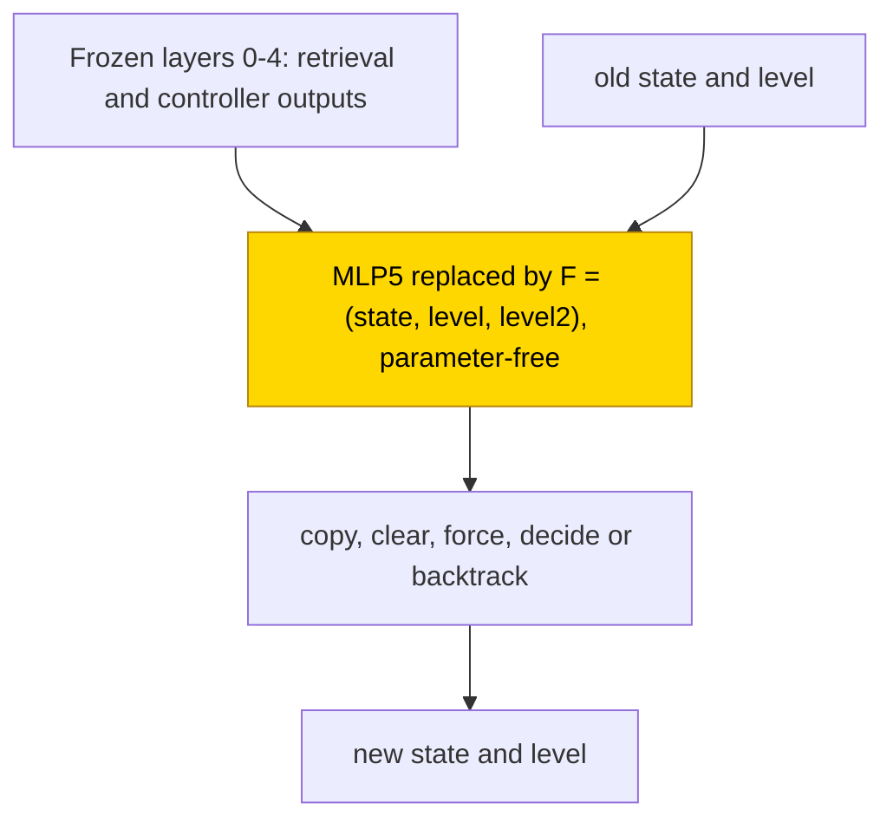

# DPLL search on small 3-SAT

This entry studies how small transformers decide whether a formula with 4–6 Boolean variables and 10–25 three-literal clauses can be
satisfied. A scratchpad writes the state of a DPLL search, which assigns forced variables, makes decisions and backtracks; answer
only gives SAT or UNSAT directly. With the hand-built retrieval and controller frozen (the PART setting), a trained last MLP, a feed-forward block ([glossary](../GLOSSARY.md#standard-machine-learning-terms)), learned the local state
update in 10/10 final seeds, but training the whole network from scratch solved neither format (0/3 screening seeds each).
The task is partly solved. The seven-field update is verified for the PART scratchpad stage on the measured inputs: substitution
keeps 192/192 test traces per seed and complement resampling keeps exact 1.0 in 10/10, establishing decision equivalence rather than
reconstructing the learned neurons.

| Fact | Value |
|---|---|
| Task | Decide whether an ordered 3-SAT formula (n = 4–6 variables, m = 10–25 clauses) is satisfiable, answer only or with the DPLL solver state written at each step |
| Input → output example | In words: a formula that some assignment satisfies → SAT; one that every assignment falsifies → UNSAT |
| Model | GPT-NeoX-shaped, ReLU, no LayerNorm, no positional encoding; A: 2 layers, d_model 272; T: 6 layers, d_model 160; PART retrains only the last MLP (layer 1 in A, layer 5 in T) |
| Rungs and seeds | HAND A (1 head + 130 neurons) and T (14 heads + 71 neurons); PART A and T, TRAIN A and T, 3 screening seeds each; T PART final 10 seeds (0–9) |
| Closed form status | Verified (PART scratchpad update only: 192/192 per seed and complement 1.0 on 10/10; decision-equivalent on measured inputs, not a neuron reconstruction; A PART threshold not substituted) |
| Status | Partly solved (PART scratchpad final 10/10 exact; PART answer only 3/3 and TRAIN 0/3 per format, screening); last run 2026-11-08 |
| Weights | [Hugging Face: dpll-search](https://huggingface.co/jc1122/circuit-atlas-nets/tree/main/dpll-search), revision `30eb66049a35` |
| Reproduce | Not available yet: training code for this task is not yet in `code/` |

## 1. Task and data

The formulas are ordered 3-SAT with n = 4–6 variables and m = 10–25 clauses, balanced between satisfiable and unsatisfiable outcomes,
with unsatisfiable proposals enriched for unsatisfiable cores. A canonical hash of the clause multiset assigns each formula to the
train, monitor or test bucket in the ratio 8:1:1, so variants that differ only in clause order or clock never cross splits. The test
set holds 192 formulas per seed. An output counts as correct on exact match of every non-PAD
[teacher-forced](../GLOSSARY.md#task-formats) output token, that is, every token scored given the correct previous tokens; in format T
this is the complete trace. Length was tested at n = 7, m = 10–17, with 24 formulas per seed.

*Table 1. Output formats.*

| Format | Output |
|---|---|
| `A` (answer only) | one SAT/UNSAT token |
| `T` ([scratchpad](../GLOSSARY.md#task-formats)) | after each DPLL update (unit propagation, decision, backtrack) the full solver state, namely the assignment, the decision levels and tried flags, a clock, the clause in focus and the conflict flag; then SAT/UNSAT |

## 2. Model

The shared conventions are described in [METHODS.md](../METHODS.md). The three [rungs](../GLOSSARY.md#the-three-rungs) are HAND (every
weight set by formula), PART (frozen hand-built parts with one trained stage) and TRAIN (all weights trained from scratch).

### 2.1 Architecture

All networks are GPT-NeoX-shaped with ReLU, no LayerNorm, no positional encoding (clocks are explicit tokens) and untied embeddings,
with a vocabulary of 1,104 tokens and a context of 16,384. Format A uses 2 layers, d_model 272, 1 head (d_head 272) and MLP width 128.
Format T uses 6 layers, d_model 160, 5 heads × 32 and MLP width 96. TRAIN uses the same shapes with all weights trained.

### 2.2 Frozen parts and trained part

PART A retrains only the layer-1 MLP, with its input masked to witness-count channel 258 and its output to answer channel 259. PART T
retrains only the layer-5 MLP (MLP5): W_in [96, 160], b_in [96], W_out [160, 96], b_out [160]. Its inputs are masked to the old state
and level (OLD, OL, OL2), the equality/keep flags from MLP4 (EQF, EQD, EQB, KEEP), and the controller (CTRL); its outputs are masked to
the new state and level (Y, YL, YL2). OL2 and YL2 are squared-level channels. Everything else is frozen at hand-built values. PART
masks preserve HAND. Layer and channel indices are zero-based.

### 2.3 Training

The optimiser was AdamW with learning rate 1e-3, weight decay .1, betas (.9, .98), warmup 1,000 steps, a cosine schedule and gradient
clip 1. Each step used a batch of 8 fresh formulas, with a 30k-step budget and a plateau stop 5k steps without improvement after
22.5k. Test accuracy was evaluated every 500 steps and checkpoints were saved every 2,500. PART ran in
[fp32](../GLOSSARY.md#hand-built-machinery); TRAIN used TF32 updates and fp32 evaluations. The best snapshot is selected by a
96-formula monitor set (exact match, then cross-entropy), not by test. Success is a best test exact match ≥ .99. Training ran on GPU
accelerators, and re-scoring on CPU in fp32. The final PART T run (2026-11-08) used 10 seeds, stopping when all seeds in each pack
were test-exact: seeds 0–2 stopped at 11.5k and seeds 3–9 at 15.5k. The longer-formula evaluation initially ran out of memory after
saving; its later CPU evaluation is reported in Section 4. This was an evaluation interruption, not a missing trained network.

### 2.4 Reproduction

Reproduce: not available yet: training code for this task is not yet in `code/`; the weights, held-out splits and recorded
accuracies are on Hugging Face at
[huggingface.co/jc1122/circuit-atlas-nets/tree/main/dpll-search](https://huggingface.co/jc1122/circuit-atlas-nets/tree/main/dpll-search).
For screening, test formulas are regenerated from their seed (see `config.json`). For the final run, use the stored split identified
by the manifest's `test_file` and `test_row`; the archive was re-scored on the trainer's stored test set rather than assuming a
regenerated set was identical.

### 2.5 Archive

The Hugging Face folder holds `hand_{A,T}`; `part_{A,T}_{best,final}_s0…2` (the 4 MLP tensors, to be inserted into `hand_<fmt>`);
`train_{A,T}_{best,final}_s0…2` (full state dicts); `config.json`; and `manifest.json` (seed, steps, recorded and fp32 re-scored exact
match, sha256). The final upload, revision `30eb66049a35`, also holds `part_T_final_<best|final>_s<0-9>` (the 4 MLP5 tensors to insert
into `hand_T`) and `test_final_<pack>.json`. The archived networks re-score to the recorded accuracies. For T PART, best and final
are the same bytes.

## 3. Hand-built solution

The two hand-built networks solve the task in different ways (Figure 1). The scratchpad network runs DPLL one update at a time. Layer 0
retrieves the clock and the header; layer 1 retrieves the previous state and the clause operands; layer 2 copies the clause and selects
the unknown or deepest-decision variable; layer 3 finds the first unit clause or conflict and the action; layer 4 copies the
controller; and layer 5 does the conditional copy, clear or flip of the state. Signed binary clock matching keeps stale conflicts from
winning. In particular, L1H0 reads the old state/level of the updated variable; L4H0 copies the controller and MLP4 supplies its
equality flags. The gates use constants ±128 and unit steps, with 3, 12, 8, 5, 11 and 32 neurons across the six layers.

The answer-only network checks a fixed set of 128 witness assignments. Clause falsification for each witness is embedded, one head
averages over the clauses, and an MLP counts the surviving witnesses and thresholds the count (> 0 gives SAT).

The structural size is 1 head + 130 neurons for A and 14 heads + 71 neurons for T. A was verified on 128/128 formulas; T on 264 traces
(172,395 tokens) through 83 rows and all actions, plus a free 261-token rollout. All 216 local clause cells were checked exhaustively,
and the minimum logit margin is 30 for A and 15 for T. The formula tests are stratified, not exhaustive. HAND also passes an
independent SAT oracle, causal-prefix and right-padding checks, clock shifts and clause reversal.

```mermaid
flowchart TD
    subgraph HT["Scratchpad (HAND T, 6 layers)"]
        T0["Layer 0: clock and header"] --> T1["Layer 1: previous state and clause operands"]
        T1 --> T2["Layer 2: copy clause, select unknown or deepest-decision variable"]
        T2 --> T3["Layer 3: first unit clause or conflict, action"]
        T3 --> T4["Layer 4: copy controller"]
        T4 --> T5["Layer-5 MLP: conditional copy, clear or flip of the state"]
        T5 --> TS["new state and level"]
    end
    subgraph HA["Answer only (HAND A, 2 layers)"]
        A0["Embedded clause falsification for 128 witness assignments"] --> A1["One head: average over clauses"]
        A1 --> A2["Layer-1 MLP: count surviving witnesses, threshold > 0"]
        A2 --> AS["SAT or UNSAT"]
    end
    classDef trained fill:gold,stroke:darkgoldenrod,color:black
    class T5,A2 trained
```



*Figure 1. The hand-built networks. In T the first five layers retrieve and route the solver state and layer 5 writes the update; in A
a single head pools clause falsification over 128 witnesses and an MLP thresholds the count. The shaded MLPs are the parts that PART
retrains.*

## 4. What training finds

Table 2 gives every cell. The first test-exact step is the first evaluation recorded as exact on the test set.

*Table 2. Results per cell. Test exact match on 192 formulas per seed, given for seeds 0 / 1 / 2.*

| Cell | Solved | Best → final test (s0 / s1 / s2) | Stop | First test-exact step |
|---|---|---|---|---|
| PART A | 3/3 | 1 / 1 / 1 → 1 / 1 / 1 | solved 1k | 1k / .5k / .5k |
| PART T | 3/3 | 1 / 1 / 1 → 1 / 1 / 1 | solved 5.5k | 4.5k / 3k / 5.5k (earlier hits regressed) |
| TRAIN A | 0/3 | .719 / .833 / .865 → .745 / .828 / .859 | plateau 28k | never |
| TRAIN T | 0/3 | .010 / .005 / .005 → .016 / 0 / .005 | budget 30k | never |
| T PART final, 10 seeds | 10/10 | 1.0 → 1.0, every seed | 11.5k (s0–2), 15.5k (s3–9) | median 4.0k; range 2.5k–7k; later dips to .67–.92 |

Key: s = seed.

With every earlier stage frozen, the trained last MLP solves both formats in 3/3 seeds (A in 0.5–1k steps, T in 3–5.5k). In T the
learned MLP5 sits on HAND's retrieval and controller outputs and does the conditional copy, clear or flip of the state. In A the learned
MLP1 reads HAND's witness count and thresholds it, on HAND's four-edge path of pooling, count and threshold (edge check ρ = 1, Jaccard
1). From scratch, A reaches only .72–.86 and T .00–.02 test exact match on the same data. The
[grok step](../GLOSSARY.md#counting-results) is not established, because the fit on the training set was not measured.

The circuit types are as follows. PART A forms one type in 3/3 screening seeds (HAND's pooling, count and threshold path), and PART T
one type in 3/3 screening and 10/10 final seeds (frozen retrieval plus a learned seven-field update). In the final run the discovered
circuit equals HAND's 36-edge circuit, Jaccard 1.0. MLP5 reads L1H0, L4H0 and MLP4: resampling any one sender path drops exact to
.03–.25, and all three to .00–.06. Different MLP5 weights still implement this type; aligned linear-mode barriers .88 and .26 show
several weight solutions, not one basin. TRAIN A (pooling followed by dense classification) and TRAIN T (seeds 0 and 1
dominated by retrieval, seed 2 a late update) are provisional groupings from diagnostics, not verified algorithms.

The failures are explained by the diagnostics (Appendix B). TRAIN T decodes where it is in the search (step, variable, action) but not
what the update writes (new state ≤ .48, conflict ≤ .51): the missing variable is the state update itself. TRAIN A uses a dense code
(MLP r99 93–102, against HAND's threshold) with no linear witness count (≤ .19). T PART aligns with HAND's weights up to rotation
(overlap .84–1, fit R² 1), while TRAIN overlap is ≤ .04 and CKA, a similarity of representations, ≤ .34. The T TRAIN seeds sit in
different basins (linear mode connectivity barrier 6.5–6.8; [glossary](../GLOSSARY.md#analysis-measures)). The screening T edge checks range over
ρ .38–.87 and do not support a general trusted-edge interpretation. Final-run EAP-IG ranks have Spearman < .8 and are untrusted;
localisation instead rests on HAND-component tests and resample ablation.

Scratchpad and answer only compare as 3/3 against 3/3 in PART and 0/3 against 0/3 in TRAIN, but answer only gets much closer from
scratch (.72–.86 against ≤ .016 complete traces); T's whole-trace bar is far stricter. In size, PART A uses 1 head and no
individually necessary neuron, and PART T 9–11 heads + 21–23 neurons against HAND's 14 + 71 structural. Table 3 gives the length test.

*Table 3. Length tests: screening used n = 7, m = 10–17, 24 formulas per seed (seeds 0 / 1 / 2). The final row is a separate
24-trace test per seed across all ten final networks.*

| Cell | Exact match |
|---|---|
| PART T | .79 / .92 / .71 |
| TRAIN A | .79 / .63–.67 / .79 |
| TRAIN T | 0 |
| PART A | not measured |
| PART T final, 10 seeds | native .67–.83 exact; token .979–.996; closed form 1.0 on every seed |

The final n = 7 test uses 24 traces per seed. The trained MLP makes state/index errors; decision level 7 never occurs in training
at n ≤ 6, but that proposed cause of the failure was not tested. The prediction of token accuracy ≥ .99 holds in 7/10 final seeds.
The final TRAIN A shorthand is .74–.86, alongside the more precise screening values in Table 2. These are the same failed cell,
not an additional successful run. The later compact per-seed summary writes TRAIN A best .72, .83, .86 and final .74, .83, .86;
Table 2 retains the earlier .719 / .833 / .865 and .745 / .828 / .859 at their original precision, without re-rounding them.

## 5. Mechanism and verification

### 5.1 Closed form of the PART T update

The PART T update has a parameter-free seven-field closed form F = (state, level, level²): conditional copy, clear, force, decide
or backtrack of the old state. In the final run, replacing MLP5 by F keeps 192/192 test traces per seed (native 192/192, agreement
1.0) in 10/10. Replacing the whole frozen path with its HAND formulas as well also keeps 192/192. Resample ablation of everything
outside the 36-edge HAND circuit (32 traces per seed, 3 draws) keeps exact 1.0 against base 1.0 on 10/10; resampling the circuit or a random same-size circuit
gives 0, and the self-tests pass. Both shares exceed the .90 acceptance bar
([glossary](../GLOSSARY.md#verifying-a-circuit)). This verifies the PART stage's decisions on measured inputs, not its native
neurons or raw activations; other component formulas are identities of frozen HAND parts.

The earlier screening audit, dated 2026-11-07, accepted F at the substitution bar on 3/3 seeds (best and final byte-identical).
It used 52 fresh complete teacher-forced traces per seed, at (n, m) = (4, 10), (5, 17), (6, 20), (6, 25) and (7, 20).
Substitution, alone or with the frozen path replaced by formulas, gave 52/52 per seed against native 48 / 51 / 48, repairing all
native errors on that mixed-range set. Zero and position-shuffle controls gave 0/52. A 14-scalar affine fit of F's fields also kept
52/52 (14 < 2,887 learned parameters). That earlier audit had no complement test and was partial. The final-run checks above
supply complement evidence; they do not turn the earlier out-of-range repairs into exact native generalisation.

F thresholds flags, takes the argmax of the old state and clamps the old level. The full rule is given here so that the formula's
scope can be checked against live inputs rather than labels. Let old = one_hot(argmax OLD), L = clamp(round(OL), 0, 7), and
L2 = OL2. The controller flags f, d, b, s = CTRL[0..3] > .5 mean force, decide, backtrack and sign. Equality/keep flags
ef, ed, eb, k = EQF, EQD, EQB, KEEP > .5 identify the target variable and whether to keep its old state. BL, BL2, DL and DL2 are
backtrack/decision levels and their squares in CTRL[7..10]. Then:

```text
copy = f(1-ef) + d(1-ed) + b(1-eb)k
Y = copy*old + [b(1-eb)(1-k), d*ed, b*eb, f*ef(1-s), f*ef*s]
YL = copy*L + b*eb*BL + f*ef*DL + d*ed*(DL+1)
YL2 = copy*L2 + b*eb*BL2 + f*ef*DL2 + d*ed*(DL2+2DL+1)
```

The five Y states are U (unassigned), D0/D1 (decision values) and F0/F1 (forced values). Force writes F0/F1, decide writes D0 at
level + 1, and backtrack flips D0 to D1 or clears deeper variables. The compact description says “YL2 likewise with squares”;
the explicit rule retains the live OL2 channel on the copy branch. There are 0 fitted scalars.



*Figure 2. The closed form replacing the shaded trained PART T stage (level2 means level squared). It is verified for this stage on
the measured inputs: final substitution keeps 192/192 traces per seed and complement resampling keeps exact 1.0 in 10/10.
Verification is decision equivalence, not reconstruction of the learned neurons; the earlier screening substitute kept 52/52
traces and zero or shuffle gave 0/52.*

### 5.2 Rejected forms and untested parts

Three other forms were rejected (Table 4). A PART's threshold form has not yet been substituted.

*Table 4. Rejected closed forms: accuracy native and then substituted.*

| Cell | Form | Native → substituted |
|---|---|---|
| T PART MLP5 | 14-scalar raw-activation fit | 96/96 → 0/96 windows; 0/52 complete traces |
| TRAIN A | 817-scalar count bottleneck | .70–.84 → .47–.56 |
| TRAIN T | 4,822-scalar update bottleneck | .31–.68 → 0 on its windows |

### 5.3 Relation to published work

A transformer hand-constructed to run DPLL with chain of thought was given by [Pan et al. (2024)](#references), and full-state
inductive scratchpads were studied by [Abbe et al. (2024)](#references). Here a single trained MLP on the frozen hand-built path reaches
exact match and is decision-equivalent to the update on measured inputs, while networks trained from scratch linearly decode their
position in the search (step, variable, action) but not the new state.

## 6. Limitations and open questions

T scores are teacher-forced; greedy rollout was checked on one n = 4 formula per seed only (T PART and TRAIN A 1/1, TRAIN T 0/1).
There is no evidence beyond m = 25. Only PART T has a ten-seed final; other cells remain three-seed screens
([glossary](../GLOSSARY.md#counting-results)). Size counts are single ablations on a small batch, not minimal circuits. Final
diagnostics use 32 traces per seed. Interchange and DAS flips are low, so localisation rests on HAND-component evidence and
resampling, not a claim that every semantic variable is linearly localised. Substitutes read live activations, never labels.

The earlier audit left the ten-seed PART T final pending after four launches were lost to infrastructure failures. It is now
complete; those losses are not failed scientific seeds. Only HAND-a was designed, with no alternative HAND circuit. Scratchpad and
answer-only HAND sizes differ (14 + 71 against 1 + 130), so their training results are not a matched-size comparison.

Still open:

- no TRAIN retry is admissible under the retry rules: the data is already ≥ 3×, and a size step needs train accuracy < 1, which is
  unmeasured;
- the A PART n = 7 replay and the A PART threshold substitution are not run;
- public code is pending.

## 7. Prediction record

The predictions were recorded before the runs. A PART would reach ≥ 2/3 at .99: confirmed (3/3). A TRAIN would reach ≤ 1/3: confirmed
(0/3). T PART would reach ≥ 2/3 by 5k steps: partly held (first exact hits by 5k in seeds 0 and 1 but unstable; all seeds exact at 5.5k). T TRAIN would
reach 1–2/3 by 30k: refuted (0/3, ≤ .016).

The pre-training final prediction was 8–10/10 eventually, confirmed by 10/10. Shared HAND variables and the rule to accept a form
only after substitution also held. The n = 7 token-accuracy prediction held on 7/10, not all ten. The earlier screening time
prediction remains only partly held; final first exact ranges from 2.5k to 7k with later regressions.

## Appendix A. Weights excerpt and reading

The verified seven-field form is decision-equivalent on measured inputs, not a reconstruction of learned neurons: it thresholds
flags, takes the argmax of the old state and clamps the old level. The frozen HAND identity in PART is architectural, not evidence
that the learned stage has HAND's weights. The final snapshot slices show the difference (Table A1).

*Table A1. Final MLP5 weight slices and norms over seeds 0–9. Energy shares are squared Frobenius norms; rank is the number of
output directions carrying 90% of energy.*

| Quantity | HAND | Trained PART |
|---|---|---|
| Live neurons | 32 | 96 |
| W_in values | {−128, −1, 1, 2, 128} | small distributed weights |
| Frobenius norm of W_in | 652.7 | 7.2–7.5 |
| Frobenius norm of W_out | not reported in this excerpt | 3.3–3.7 |
| W_out 90%-energy rank | 7 | 4 |
| Input energy on OLD | approximately 0 | .39–.44 |
| Input energy on OL | not separately reported | .13–.19 |
| Input energy on EQ/KEEP | .54 | .20–.27 |
| Input energy on CTRL | .46 | .17–.20 |
| Output energy on Y/YL/YL2 | constrained by HAND | 1.00 |

HAND gates a copy with large constants. Its 90%-energy output rank is the rank definition used here, not a minimum neuron count.
Training spreads the same bounded update over small weights and reads the old state
directly. Its in-range decision equivalence does not prevent longer-formula failures; attributing those to unseen decision level
7 remains an untested explanation.

## Appendix B. Detailed evidence

*Table B1. Diagnostics per cell. T batch: 32 windows at n = 6, m = 20; A: 128 answers; ranges over seeds, best and final.*

| Cell | Used H+N | Best probe R² (layer) | r99 res. | JS | inter; DAS | Best / final |
|---|---|---|---|---|---|---|
| PART A | 1+0 each | witness count 1 (2); SAT ≤ .15 (thresholded) | 6–8 | 0 | 1; 1 | 1 / 1 |
| PART T | 11+23, 10+23, 9+21 | clock .82–.99; unit sign .55–1 (0); state/level ≤ .39 (6) | 2 (HAND 2) | 0 | 0–.56 (nf 1–9); joint 22-input 1 | 1 / 1 |
| TRAIN A | 1+0 each | SAT .16–.31; witness count ≤ .19 | 2–3 | .28–.44 | .64–.93; .87–.90 | .72–.86 |
| TRAIN T | 13–17 + 1–55 | step .95–.98 (3–4); variable .99 (0); action .87–.91; new state .37–.48; conflict ≤ .51 | 19–25 (HAND 2) | .19–.66 | 0–.8; .87–.90 | .00–.02 |

Key: used H+N = heads + neurons whose single mean ablation drops exact match by > .05 (not joint pruning); R² = best linear
[probe](../GLOSSARY.md#analysis-measures) of a HAND variable (layer); r99 res. = residual components for 99% variance; JS = attention
divergence to HAND; inter = linear interchange flip, with nf the number of swaps tested; DAS = distributed alignment search.

*Table B2. Final-run summary and later compact screening diagnostics. The TRAIN T 3–55 range is the later summary; the earlier
1–55 range in Table B1 is retained at its original scope.*

| Cell | Used heads + MLPs / neurons | Best probe R² (layer) | Residual r99 / HAND | Attention JS | Best / final |
|---|---|---|---|---|---|
| PART T final | 11–12 of 14 heads + MLP1–5; MLP5 n90 24–29 of 96 | clock .94 (L1), variable .76 (L0), action .75 (L6), unit sign .55 (L0); categorical codes low by design; HAND CKA 1.0 each layer | 2 / 2 | 0 on all 14 | 1.0 / 1.0 |
| PART A screening | 1 head | witness count 1.0 (L2) | 6–8 / — | 0 | 1 / 1 |
| TRAIN A screening | 1 head | SAT .16–.31, witness count ≤ .19 | 2–3 / — | .28–.44 | .72–.86 / .74–.86 |
| TRAIN T screening | 13–17 heads, 3–55 neurons | step .95–.98 (L3–4), variable .99 (L0), new state .37–.48 | 19–25 / 2 | .19–.66 | .005–.010 / 0–.016 |

Key: n90 = neurons carrying 90% of the stated effect; CKA and all other measures are defined in the
[glossary](../GLOSSARY.md#analysis-measures). The final head-count split is a 32-trace sampling effect, not a second mechanism.

## References

- Abbe, E., Bengio, S., Lotfi, A., Sandon, C., & Saremi, O. (2024). How far can transformers reason? The globality barrier and
  inductive scratchpad. *Advances in Neural Information Processing Systems 37 (NeurIPS 2024)*. https://doi.org/10.52202/079017-0874
  (arXiv version: https://arxiv.org/abs/2406.06467) (full-state inductive scratchpads)
- Pan, L., Ganesh, V., Abernethy, J., Esposo, C., & Lee, W. (2024). Can transformers reason logically? A study in SAT solving.
  *arXiv preprint*. https://arxiv.org/abs/2410.07432 (hand-constructed transformer DPLL with chain of thought)

The shared methods are also available at the original public link:
[METHODS.md](https://github.com/jc1122/mechanistic-interpretability-circuit-atlas/blob/main/METHODS.md).
