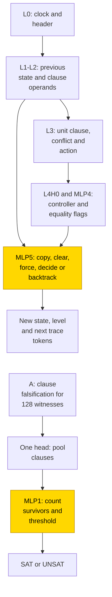
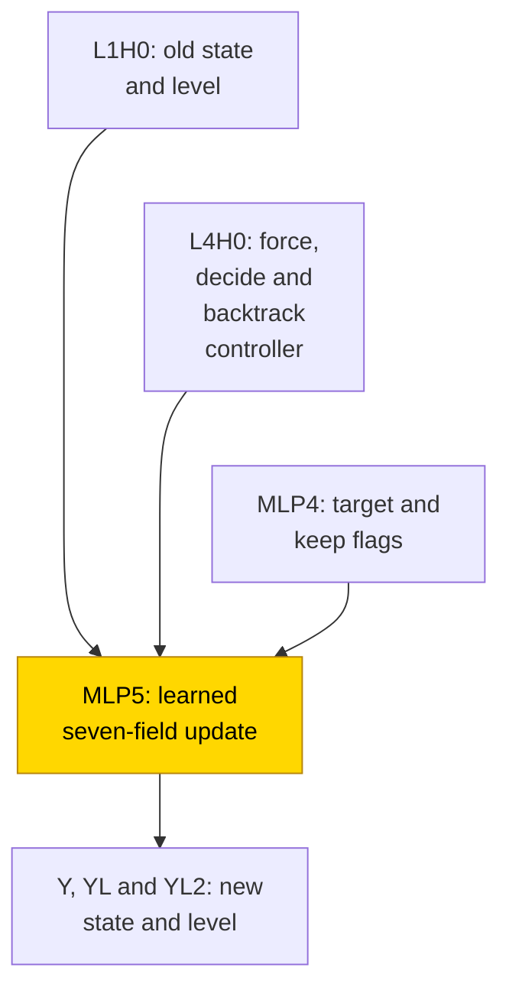

# DPLL search on small Boolean formulas

A Boolean satisfiability solver tries to make every clause in a formula true, making choices and undoing them when they conflict. Here a transformer wrote the intermediate state of DPLL, a search procedure that combines forced assignments, decisions and backtracking. With the search machinery hand-built and frozen, all 10/10 seeds learned its final local update and produced 192/192 exact held-out traces per seed; neither whole-network training format solved the task. The headline local-update cell is solved, with a parameter-free replacement verified by substitution and complement resampling; that replacement also repairs the trained update's errors on the sampled longer formulas.

| Fact | Value |
|---|---|
| Task | Decide whether an ordered 3-SAT formula has a satisfying assignment, optionally writing the DPLL search state. |
| Input → output example | A local step: in (not a or b or c), a true and b false force c true. This is one clause, not a full test formula. |
| Model | Scratchpad: 6-layer transformer, width 160, 5 heads per layer, MLP width 96; only the final MLP is trained in the headline cell. |
| Rungs and seeds | HAND: formula-set weights; PART: one trained stage, 3 seeds per screening format and 10 scratchpad final seeds; TRAIN: all weights trained, 3 seeds per format. |
| Closed form status | Verified (scratchpad PART, 10/10 seeds: substitution 192/192 traces per seed; complement 1.0 versus native 1.0 on 32 traces with 3 draws per seed, above .90 × native). This verifies a local update inside frozen search. |
| Status | Solved (scratchpad PART final, 10/10 at whole-trace exact 1.0 on 192 test formulas per seed); last run 2026-11-08. Whole-network TRAIN remains unsolved. |
| Weights | [Hugging Face: dpll-search](https://huggingface.co/jc1122/circuit-atlas-nets/tree/main/dpll-search) (weights and test evidence archive). |
| Reproduce | Not available yet: training code for this task is not yet in `code/`. |

## 1. Task and data

Each clause in 3-SAT contains three literals, where a literal is a variable or its negation. The tested formulas have n = 4–6 variables and m = 10–25 ordered clauses. DPLL first propagates a forced assignment when only one literal in a clause can still make it true. Otherwise it decides a variable's value; on a conflict, it backtracks to a previous decision and tries the other value.

For a local example, consider (not a or b or c). If a is true and b is false, only c can make the clause true, so propagation forces c true. This illustrates one clause update, not a complete test formula.

*Table 1. Output formats. SAT means satisfiable; UNSAT means no assignment satisfies every clause.*

| Format | Output |
|---|---|
| A, answer only | SAT or UNSAT. |
| T, scratchpad | After each unit-propagation, decision or backtrack step, the assignment, decision levels, tried flags, clock, clause used and conflict flag; then SAT or UNSAT. |

A scratchpad is an output containing intermediate steps before the answer ([glossary](../GLOSSARY.md#task-formats)). Formulas were split train/monitor/test 8:1:1 by a hash of the canonical clause multiset, with 192 test formulas per seed. Fresh, outcome-balanced formulas were drawn during training, 8 per step; UNSAT proposals were enriched with unsatisfiable cores rather than sampled uniformly. Length tests use n = 7, m = 10–17 and 24 formulas per seed. Exact match means every non-PAD output token is correct under teacher forcing, in which each token receives the correct preceding tokens ([glossary](../GLOSSARY.md#task-formats)). For T this is the whole trace, not an unrestricted free-running search.

## 2. Model

### 2.1 Architecture

The model is a GPT-NeoX-shaped decoder with ReLU feed-forward blocks (MLPs), no LayerNorm, no positional embedding, explicit clock tokens and an untied readout ([glossary](../GLOSSARY.md#standard-machine-learning-terms)). The vocabulary contains 1,104 tokens and the context has 16,384 positions. Layer and head indices are zero-based.

*Table 2. Model dimensions by output format.*

| Format | Layers | d_model | Heads per layer | d_head | MLP width |
|---|---|---|---|---|---|
| T | 6 | 160 | 5 | 32 | 96 |
| A | 2 | 272 | 1 | 272 | 128 |

*d_model is the running-vector width; d_head is each attention head's width.*

### 2.2 Frozen parts and trained part

The three rungs are HAND, with every weight set by formula; PART, with HAND frozen except one trained stage; and TRAIN, trained entirely from scratch ([glossary](../GLOSSARY.md#the-three-rungs)). T PART trains only the L5 MLP: W_in [96, 160], b_in [96], W_out [160, 96], b_out [160]. Its input is masked to the old state and level (OLD, OL, OL2), MLP4's equality and keep flags (EQF, EQD, EQB, KEEP), and the controller block CTRL. It writes only the new state and level (Y, YL, YL2). OL2 and YL2 store squared levels. A PART trains only the L1 MLP, reading witness-count channel 258 and writing answer channel 259. TRAIN learns every weight from a seeded initialisation.

### 2.3 Training

AdamW used learning rate 1e-3, weight decay .1, betas (.9, .98), warmup 1000, a cosine schedule and gradient clipping at 1. Evaluation was every 500 steps, checkpoints every 2500. Training stopped when all seeds were test-exact, after a 5k plateau beyond 22.5k steps, or at the 30k budget. PART used fp32 and TRAIN used TF32. The best snapshot was selected on a separate 96-formula monitor set by exact match, then cross-entropy (CE), not by the test set. The screening success criterion was best test exact match ≥ .99; the final PART run stopped with every seed at exact 1.0. TRAIN evaluations used fp32. Each pack used one consumer or rented GPU; diagnostics ran on CPU. Shared conventions are in [METHODS.md](https://github.com/jc1122/mechanistic-interpretability-circuit-atlas/blob/main/METHODS.md).

### 2.4 Reproduction

Reproduce: not available yet: training code for this task is not yet in `code/`; the weights, held-out splits and recorded accuracies are on Hugging Face at [dpll-search](https://huggingface.co/jc1122/circuit-atlas-nets/tree/main/dpll-search). Screening formulas were regenerated from their seed in `config.json`. The final archive instead uses the trainer's stored test split: the manifest's `test_file` and `test_row` select the test rows. Regenerating a nominally equivalent split was not accepted as a round-trip check.

### 2.5 Archive

The safetensors archive at revision `30eb66049a35` contains `hand_{A,T}`, screening `part_{A,T}_{best,final}_s0…2` (four stage tensors to insert into HAND), `train_{A,T}_{best,final}_s0…2` (full networks), config.json and a manifest with seed, rung, steps, recorded and fp32 re-scored accuracy and sha256 fingerprints. `part_T_final_<best|final>_s<0-9>` holds the four MLP5 tensors to insert into `hand_T`, and `test_final_<pack>.json` holds the stored final test splits. The archived networks re-score to their recorded accuracies; T PART best and final are byte-identical. A separate round-trip network count is not reported here.

## 3. Hand-built solution

The T network retrieves the current clock and previous state, checks clauses, chooses an action and applies one local state update. L0 retrieves clock/header information; L1 retrieves the previous state and clause operands (L1H0 supplies the updated variable's old state/level). L2 copies clauses and selects unknown variables or the deepest decision. L3 selects the first unit clause and determines conflict/action. L4 copies the controller through L4H0 and computes equality flags in MLP4. MLP5 conditionally copies, clears or flips the state and level.

In Figure 1, clock and previous-state retrieval feed clause selection, the conflict controller and a local state update. A separate answer-only route tests fixed witnesses, pools clauses and thresholds survivors. Only the update MLP or answer-only threshold MLP is trained in PART; search control and witness computation remain frozen.



*Figure 1. The hand-built search and answer-only circuits. MLP5 is the only trained part in scratchpad PART; A PART trains MLP1. Both are shaded. Clause checks, witness pooling and the search controller remain frozen.*

Clock equality uses a signed binary ID code, preventing a stale conflict from outranking a current clause. Formula weights use gates ±128 and unit steps. T uses 14 heads and 71 neurons [3,12,8,5,11,32]. The answer-only HAND takes a different route: it embeds clause falsification for 128 fixed witness assignments, pools over clauses with one head, then counts surviving witnesses and thresholds the count (> 0 means SAT). It uses 1 head and 130 neurons; only its last MLP is trained in A PART.

A HAND was exact on 128/128 formulas, with minimum logit margin 30. T was exact on 264 stratified traces (172,395 tokens) through n = 7, including 83 trace rows and all actions, plus a free 261-token rollout; its minimum margin was 15. All 216 local clause cells were checked exhaustively, and the solver was checked against an independent SAT oracle. The formula space was sampled, not exhausted.

## 4. What training finds

The final run was analysed on 2026-11-08.

*Table 3. Results on 192 held-out formulas per seed. A solved seed reached whole-output exact 1.0; the T output includes its full teacher-forced trace.*

| Cell | Exact seeds | Best / final test | Grok (first test 1.0) | Stop |
|---|---|---|---|---|
| T PART final | 10/10 | 1.0 / 1.0 every seed | median 4.0k (2.5k–7k); later dips to .67–.92 | 11.5k (s0–2), 15.5k (s3–9) |
| T PART r1 | 3/3 | 1 / 1 | 4.5k, 3k, 5.5k | 5.5k |
| A PART r1 | 3/3 | 1 / 1 | .5k–1k | 1k |
| A TRAIN r1 | 0/3 | .72, .83, .86 / .74, .83, .86 | never | plateau 28k |
| T TRAIN r1 | 0/3 | .010, .005, .005 / .016, 0, .005 | never | budget 30k |

Here r1 means run 1; s identifies a seed and k means thousand steps. The final run had a 30k-step budget: seeds 0–2 stopped at 11.5k and seeds 3–9 at 15.5k. Reaching exact match once was followed by regressions before all seeds were exact together.

T PART final has one circuit type across 10/10 seeds: the frozen HAND path plus a learned seven-field update. MLP5 reads L1H0, L4H0 and MLP4; resampling one of these paths drops exact match to .03–.25 and resampling all three to .00–.06. The seeds reach different weights: interpolation loss barriers .88 and .26 between seed pairs indicate several weight solutions for one mechanism ([glossary](../GLOSSARY.md#analysis-measures)). A PART run 1 (3/3) uses HAND's 4-edge pooling/count/threshold path. Neither A nor T TRAIN has a verified algorithm.

Automatic discovery retained 36 edges in 9 seeds and 34 in seed 7. Its structural precision was .639 (.676 for seed 7), because some retained edges had zero weight. The reported HAND/discovery edge Jaccard is 1.0, an overlap measure; this is not evidence that the noisy masks are minimal. The canonical circuit tested in Section 5 has 36 edges.

## 5. Mechanism and verification

The accepted formula describes a local decision update. Let old = one_hot(argmax OLD), L = clamp(round(OL), 0, 7), and L2 = OL2. The controller flags f, d, b, s = CTRL[0..3] > .5 mean force, decide, backtrack and sign. The flags ef, ed, eb, k = EQF, EQD, EQB, KEEP > .5 mark the target variable and whether to keep its state. BL and DL are the backtrack and current decision levels from CTRL; BL2 and DL2 are their squares.

```text
copy = f(1-ef) + d(1-ed) + b(1-eb)k
Y = copy*old + [b(1-eb)(1-k), d*ed, b*eb, f*ef(1-s), f*ef*s]
YL = copy*L + b*eb*BL + f*ef*DL + d*ed*(DL+1)
YL2 = copy*L2 + b*eb*BL2 + f*ef*DL2 + d*ed*(DL2+2DL+1)
```

Y's states are (U, D0, D1, F0, F1): unassigned, decided false/true and forced false/true. At the target variable, forcing writes F0/F1 at the current level, deciding writes D0 at the next level, and backtracking flips D0 to D1 or clears deeper variables. Elsewhere it copies the old state and level. The formula has no fitted numbers. It preserves the tested decisions after discretising live inputs; it is not a reconstruction of the native neurons or equality of raw activations. Earlier mixed-range screening repairs and rejected continuous-response fits remain in Appendix B.

*Table 4. Verification of the local update in all 10 final T PART seeds. The acceptance share is .90 × native exact match; complement checks used 32 traces and 3 resampling draws per seed.*

| Check | Result |
|---|---|
| Replace MLP5 by the formula | 192/192 = native on every seed; agreement 1.0. |
| Also replace all frozen parts by their formulas | 192/192 on every seed. |
| Resample everything outside the canonical 36-edge circuit | Exact 1.0 versus base 1.0 on 10/10 seeds. |
| Resample the circuit itself; random same-size circuit control | 0; 0. |

Substitution replaces a trained component by its formula; complement resampling scrambles everything outside the proposed circuit using other inputs ([glossary](../GLOSSARY.md#verifying-a-circuit)). Both checks passed, so this local form is verified on 10/10 seeds. The discovery-mask complement also passed, with seed 7 at .969 and the other seeds at 1.0; this is separate from the canonical-circuit test above.

In Figure 2, frozen old-state retrieval, force-decide-backtrack control and equality or keep flags enter MLP5, the sole trained update stage. It writes the next state and level. Substitution and complement resampling verify this local update on the stated traces, not a wholly learned search algorithm; the frozen upstream search remains part of the claim.



*Figure 2. Verified local update in final scratchpad PART, 10/10 seeds. The shaded MLP5 is trained; substitution and complement resampling preserve the tested trace accuracy. Frozen upstream search is part of the claim.*

On n = 7, with 24 longer traces per seed, native whole-trace exact match was .667–.833 and token accuracy .979–.996; substituting the update gave 24/24 on every seed. The older rounded report gave .67–.83 (also .67–.83 in the summary). These repairs locate the sampled longer-trace errors in the learned MLP, rather than the frozen retrieval. The proposed cause, decision level 7 never appearing at n ≤ 6, was not tested. A TRAIN run 1 reached .63–.79 and T TRAIN 0 on this length test.

[Pan et al. (2024)](#references) constructed a transformer that runs DPLL with a chain of thought. This entry tests whether one trained stage recovers its local rule. [Abbe et al. (2024)](#references) provide related theoretical context for inductive scratchpads; neither comparison establishes whole-network learning here. Both PART formats solve, whereas neither TRAIN format does. HAND sizes differ (T 14 + 71, A 1 + 130), so this is not a matched-size format comparison.

## 6. Limitations and open questions

The verification concerns teacher-forced traces and a local update within frozen search. Only one n = 4 free rollout per seed was checked: T PART and TRAIN A gave 1/1, TRAIN T 0/1. The whole formula space was not exhausted, and there is no evidence beyond m = 25. The closed form discretises activations by thresholds, argmax and rounding; it matches decisions rather than raw activations. A PART's threshold form was not substituted.

HAND passed independent-oracle, prefix-causality, right-padding, clock-shift and clause-reversal controls. PART masks preserve the frozen network and the replacements read live activations, never answer labels. Diagnostics used 32 traces per seed. Edge-attribution ranks (EAP-IG) were untrusted because Spearman < .8; interchange and distributed-alignment (DAS) flips were low, so localisation rests on HAND-component interventions and complement resampling, not those screens. Low flip with no eligible examples is untested, not evidence of absence ([glossary](../GLOSSARY.md#analysis-measures)).

Only HAND-a was designed; alternative hand-built search circuits were not compared. The earlier ten-seed-final delay followed four lost launches, not four failed learning seeds. The longer-formula evaluation ran out of memory after saving and was subsequently completed on CPU. TRAIN retries remained inadmissible under the recorded rules: data was already ≥ 3× and a width step required measured train accuracy < 1, which was unavailable. A PART's n = 7 replay and threshold substitution were not run. Later task notes report the final diagnostic wave complete, 53/53, with resumed dynamics at 5/5 checkpoints; these archival completion counts do not add a new mechanism test.

## 7. Prediction record

Before training, the prediction was T PART ≥ 2/3 screening seeds at .99 by 5k, 8–10/10 in the final run, and shared HAND variables. Screening reached 2/3 exact by 5k, with later regressions; the final run reached 10/10, and the shared-basis prediction held. The prediction that closed form required substitution was met by the checks in Section 5. At n = 7, token accuracy ≥ .99 held on 7/10 seeds, only partly matching the prediction of ≥ .99 token accuracy with possibly lower whole-trace accuracy.

The T TRAIN prediction of 1–2/3 failed (0/3). The A PART prediction of ≥ 2/3 held (3/3); A TRAIN ≤ 1/3 held (0/3). These are the recorded predictions, not new extrapolation claims.

## Appendix A. Weights excerpt and reading

The following are slices of L5 MLP weights in the final snapshots. HAND MLP5 has 32 live neurons, W_in values {−128, −1, 1, 2, 128}, Frobenius norm |W_in|_F 652.7, and W_out 90%-energy rank 7. Its input energy sits on the gates (EQ/KEEP .54, CTRL .46).

Trained MLP5, seeds 0–9, has all 96 neurons live, |W_in|_F 7.2–7.5, |W_out|_F 3.3–3.7 and W_out rank 4. Input energy is OLD .39–.44, OL .13–.19, EQ/KEEP .20–.27 and CTRL .17–.20; output energy is 1.00 on Y/YL/YL2. HAND gates a copy with large constants; training implements the same tested decision table with smaller, spread weights that read the old state directly. This in-range agreement does not remove the longer-formula errors of the native trained MLP.

## Appendix B. Detailed evidence

*Table 5. Diagnostic results. Used components have mean-ablation exact-match drop > .05. R² measures linear decodability, r99 counts residual directions explaining 99% of variance, JS is attention divergence from HAND, and n90 is the fewest neurons covering 90% of the squared input-norm-times-output-norm weights ([glossary](../GLOSSARY.md#analysis-measures)).*

| Cell (final snapshot) | Used heads + MLPs | Best probe R² per HAND variable (layer) | Residual r99 / HAND | Attention JS vs HAND | Best / final |
|---|---|---|---|---|---|
| T PART final | 11–12 of 14 HAND heads + MLP1–5; MLP5 n90 24–29 of 96 | clock .94 (L1), variable .76 (L0), action .75 (L6), unit_sign .55 (L0); categorical codes low by design (HAND CKA 1.0 every layer) | 2 / 2 | 0 on all 14 heads | 1.0 / 1.0 |
| A PART r1 | 1 head | witness_count 1.0 (L2) | 6–8 / - | 0 | 1 / 1 |
| A TRAIN r1 | 1 head | sat .16–.31, witness_count ≤ .19 | 2–3 / - | .28–.44 | .72–.86 / .74–.86 |
| T TRAIN r1 | 13–17 heads, 3–55 neurons | step .95–.98 (L3–4), variable .99 (L0), new_state .37–.48 | 19–25 / 2 | .19–.66 | .005–.010 / 0–.016 |

The earlier summary described A TRAIN as .74–.86 and T TRAIN as approximately 0; Table 3 retains their per-seed best/final values. The historical longer-formula summary also used .67–.83; Section 5 preserves the later source precision without pooling test sets.

### Earlier screening evidence

The 2026-11-07 screening audit used the following per-seed precision. Table 3 retains the later compact summary separately; neither table is silently re-rounded. PART A first reached exact at 1k / .5k / .5k and stopped at 1k; PART T at 4.5k / 3k / 5.5k, stopping at 5.5k after earlier regressions. The prose time range for A was 0.5–1k and for T 3–5.5k. Training-set fit was not measured, so a delayed generalisation gap was not established for these screens.

*Table B1. Screening test exact match on 192 formulas per seed, seeds 0 / 1 / 2. The values retain the earlier source precision.*

| Cell | Best test | Final test |
|---|---|---|
| PART A | 1 / 1 / 1 | 1 / 1 / 1 |
| PART T | 1 / 1 / 1 | 1 / 1 / 1 |
| TRAIN A | .719 / .833 / .865 | .745 / .828 / .859 |
| TRAIN T | .010 / .005 / .005 | .016 / 0 / .005 |

*Table B2. Earlier n = 7, m = 10–17 length screen, 24 formulas per seed; seeds 0 / 1 / 2. These are separate from the final ten-seed length test in Section 5.*

| Cell | Exact match |
|---|---|
| PART T | .79 / .92 / .71 |
| TRAIN A | .79 / .63–.67 / .79 |
| TRAIN T | 0 |
| PART A | Not measured. |

The earlier update substitution used 52 fresh complete teacher-forced traces per seed at (n, m) = (4, 10), (5, 17), (6, 20), (6, 25) and (7, 20). Substituting the parameter-free form alone, or also replacing frozen parts by their formulas, gave 52/52 against native 48 / 51 / 48, repairing the native errors. Zero and position-shuffle controls gave 0/52. A 14-scalar affine fit of the discretised fields also gave 52/52 (the audit reported 14 < 2,887 learned parameters). That screening claim was Partial because it lacked a complement test. Final-run complement evidence does not make the screening native errors disappear.

*Table B3. Rejected screening forms. Native and substituted results use each form's recorded diagnostic cohort.*

| Cell | Form | Native | Substituted |
|---|---|---|---|
| T PART MLP5 | 14-scalar raw-activation fit | 96/96 windows | 0/96 windows; 0/52 complete traces |
| TRAIN A | 817-scalar count bottleneck | .70–.84 | .47–.56 |
| TRAIN T | 4,822-scalar update bottleneck | .31–.68 | 0 on its windows |

The failed TRAIN screens had provisional, not verified, groupings: A pooled into a dense classifier; T seeds 0/1 were retrieval-dominated and seed 2 used a late update. A's MLP r99 was 93–102 with no linear witness count (≤ .19). T recovered clock/variable/action better than the new state or conflict. T PART's aligned weight overlap was .84–1 with fit R² 1, whereas TRAIN overlap was ≤ .04 and representation similarity CKA ≤ .34. T TRAIN interpolation barriers were 6.5–6.8. Screening edge-rank correlations ρ .38–.87 did not support trusted wiring; A PART's four-edge path had ρ = 1 and Jaccard 1.

*Table B4. Earlier screening diagnostics. T used 32 windows at n = 6, m = 20; A used 128 answers. Ranges span seeds and best/final snapshots. These are retained alongside Table 5's later summary.*

| Cell | Used heads + neurons | Best probe R² (layer) | Residual r99 | Attention JS | Interchange; DAS | Diagnostic exact |
|---|---|---|---|---|---|---|
| PART A | 1 + 0 each | Witness count 1 (2); SAT ≤ .15 | 6–8 | 0 | 1; 1 | 1 / 1 |
| PART T | 11 + 23, 10 + 23, 9 + 21 | Clock .82–.99; unit sign .55–1 (0); state/level ≤ .39 (6) | 2 (HAND 2) | 0 | 0–.56 (nf 1–9); joint 22-input 1 | 1 / 1 |
| TRAIN A | 1 + 0 each | SAT .16–.31; witness count ≤ .19 | 2–3 | .28–.44 | .64–.93; .87–.90 | .72–.86 |
| TRAIN T | 13–17 + 1–55 | Step .95–.98 (3–4); variable .99 (0); action .87–.91; new state .37–.48; conflict ≤ .51 | 19–25 (HAND 2) | .19–.66 | 0–.8; .87–.90 | .00–.02 |

Used here means a single mean-ablation exact drop > .05, not joint pruning or a minimum. The older 1–55 TRAIN T neuron range and the later 3–55 remain attached to their own summaries. Similarly, PART T's 9–11 heads + 21–23 neurons are single-ablation counts against HAND's structural 14 + 71, not minimal circuits. nf counts eligible swaps, and CKA measures representation similarity ([glossary](../GLOSSARY.md#analysis-measures)).

## What to read next

Compare [grid breadth-first search](grid-bfs.md) for another local update embedded in frozen search machinery. [Rounded Euler decay](euler-decay-ode.md) shows why even a scaffolded local update need not become exact.

## References

- Abbe, E., Bengio, S., Lotfi, A., Sandon, C., & Saremi, O. (2024). How far can transformers reason? The globality barrier and inductive scratchpad. *Advances in Neural Information Processing Systems 37 (NeurIPS 2024)*. https://doi.org/10.52202/079017-0874 ; [arXiv preprint](https://arxiv.org/abs/2406.06467). (Theoretical context for inductive scratchpads.)
- Pan, L., Ganesh, V., Abernethy, J., Esposo, C., & Lee, W. (2024). Can transformers reason logically? A study in SAT solving. *arXiv preprint*. https://arxiv.org/abs/2410.07432 (Constructed DPLL transformer used as related work.)
