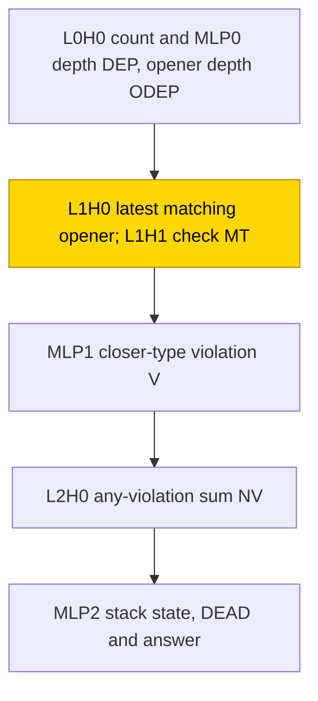
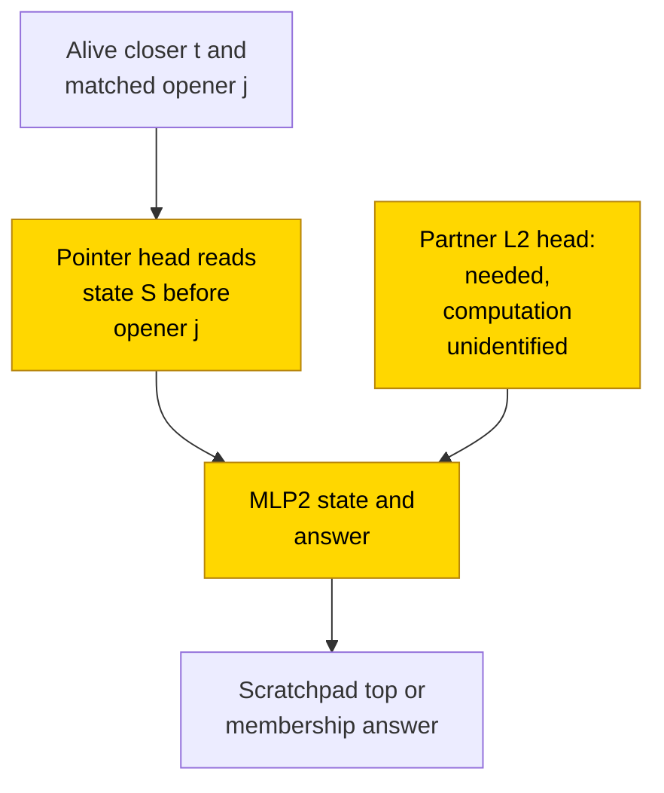

# Dyck-k and subject–verb agreement

Matching brackets requires remembering which bracket type is open; choosing a verb's singular or plural form requires finding its
grammatical subject. Three-layer transformers were tested on both tasks, with and without a scratchpad that recorded the current
bracket or subject state ([glossary](../GLOSSARY.md#task-formats)). The final two-bracket-type scratchpad cell is solved in range, with
10/10 seeds reaching held-out whole-output exact match 1.0; substituting a pointer to the state written before the matching opener
kept .90–1.0 in 8/10 final snapshots. This is only a partial closed form: resampling its needed partner head left .17/.06 exact match
in two tested seeds, and the partner's computation remains unidentified. Agreement without a scratchpad exposed a different
shortcut, copying the first noun, which is valid because this generated grammar always places the main subject first.

## At a glance

| Fact | Value |
|---|---|
| Task | Recognise correctly nested brackets of two or three types and choose a main verb's singular/plural form. |
| Input → output example | `[()]` is correctly nested; `[(])` is not. |
| Model | Three-layer decoder, width 64, two heads per layer, ReLU MLP width 64; no positional embeddings or LayerNorm. |
| Rungs and seeds | HAND-a/-c fix weights; PART retrains match-head attention; TRAIN learns all weights ([rungs](../GLOSSARY.md#the-three-rungs)). Three screening seeds per cell and weight decay; final Dyck-2 scratchpad TRAIN 10 seeds at weight decay .1. |
| Closed form status | Partial (Dyck pointer substitution .90–1.0 in 8/10 final seeds; resampling its partner leaves .17/.06 in two seeds, so no two-head form is accepted; agreement has separate one-seed-per-type complement support). |
| Status | Solved (Dyck-2 scratchpad final TRAIN 10/10 exact; other cells include failures); last run and interpretation 2026-11-11. |
| Weights | [Hugging Face: dyck-k-and-agreement](https://huggingface.co/jc1122/circuit-atlas-nets/tree/main/dyck-k-and-agreement), published revision `0aba437e2661`. |
| Reproduce | Not available yet: training code for this task is not yet in `code/`. |

## 1. Task and data

Dyck-2 and Dyck-3 are correctly nested bracket languages with two and three opener types. Training depth was ≤ 4 and word length `n` was 1..40. For example, `[()]` belongs to Dyck-2; `[(])` does not. Agreement sentences had ≤ 3 subjects and ≤ 2 prepositional-phrase (PP) attractors, nouns whose number can distract from the main subject. The label is the main verb's number. The main subject is always the first noun, so that shortcut is exact for this generator, including the wider tests.

*Table 1. Formats. A scratchpad writes intermediate state before the final answer ([glossary](../GLOSSARY.md#task-formats)).*

| Format | Sequence | Intermediate state |
|---|---|---|
| A, answer only | `BOS s_1..s_n = ANS` | None. |
| B, scratchpad | `BOS s_1 S_1 .. s_n S_n = ANS` | `X` means dead, `E` empty, `C<c>` the top opener type or open subject number. |

Bracket words were drawn fresh each step from balanced words, one-symbol mutations, prefixes and uniform words. Agreement used a fixed pool with ~80% for training. Tests used held-out words under a deterministic hash split; the final substitution test used 2048 words per seed. Solved means final exact match 1.0, every scored token correct given the correct preceding tokens (teacher forcing, [glossary](../GLOSSARY.md#task-formats)); it is not a free-running stack test. Extra evaluations used length 80, length 160, depth 5–8 (`d8`), and agreement `wide`, with 4–5 subjects or 3–4 attractors. These are separate from the in-range criterion.

## 2. Model

### 2.1 Architecture

The decoder uses GPT-NeoX component names ([layout](../GLOSSARY.md#standard-machine-learning-terms)): 3 layers, 2 heads × head width 32, residual width 64, ReLU MLP width 64, no positional embeddings (NoPE) and no LayerNorm. Vocabulary size is 16: 0 BOS, 1 PAD, 2 `=`, 3 Y, 4 N, 5 X, 6 E, `7+c` for `C<c>`, and `10+s` for symbol `s`.

### 2.2 Frozen and trained parts

HAND fixes the network by formula, PART retrains a stage in that scaffold and TRAIN learns every weight ([rungs](../GLOSSARY.md#the-three-rungs)). PART freezes HAND-a except for the match-head attention layer: layer 1 for Dyck and layer 2 for agreement. It retrains `query_key_value [192, 64]` and `dense [64, 64]`, masked to HAND's input and output dimensions. A [match head](../GLOSSARY.md#hand-built-machinery) attends to a token whose key matches the query.

### 2.3 Training

AdamW used learning rate 1e-3, warmup 1000, cosine decay, clipping at 1 and batch 128. TRAIN swept weight decay .1/.3/1; PART used .1. TRAIN used TF32 and PART/evaluations fp32; hardware was consumer CUDA/XPU GPUs. The TRAIN budget was 80k and PART 20k. Screening covered `{dyck2, dyck3, agree} × {A, B} × {PART, TRAIN}`, three seeds per cell and weight decay. Only the final Dyck-2 B weight-decay-.1 cell had ten seeds; its pack stopped solved at 47000.

### 2.4 Reproduction

Reproduce: not available yet: training code for this task is not yet in `code/`; the weights, held-out splits and recorded accuracies are on Hugging Face at [dyck-k-and-agreement](https://huggingface.co/jc1122/circuit-atlas-nets/tree/main/dyck-k-and-agreement). Shared instrumentation and the acceptance rule are in [METHODS.md](../METHODS.md).

### 2.5 Archive

Revision `0aba437e2661` contains HAND-a/-c per language and format, agreement A/B PART, TRAIN cells at the best weight decay (best and final seeds 0–2), and final Dyck-2 B seeds 0–9 best and final. Files are safetensors, config JSON and a manifest recording seed, rung, weight decay, circuit type, accuracy and sha256. This inventory does not claim that every failed weight-decay arm was shipped or that a new archive test was run for this article.

## 3. Hand-built solution

HAND counts nesting depth and reads the opener whose depth matches the current stack position. L0H0 is a BOS-sink count head, using the beginning-of-sequence token as an [attention sink](../GLOSSARY.md#hand-built-machinery). MLP0 writes one-hot depth `DEP_m` and opener depth `ODEP_m` with step pairs. Here depth `b` is the number of brackets still open. For Dyck, L1H0 reads the latest opener at depth `b` (HAND-a), or at depth ≤ `b`
(HAND-c):

```text
score = BETA [ODEP = target] + EPS T
value OT_c -> TOP_c
```

`T` is the position/recency signal, `OT_c` an opener-type indicator and `TOP_c` the stack-top type. L1H1 checks target depth `b + 1` and writes matched type `MT_c`. MLP1 marks violations, L2H0 sums them as `NV`, and MLP2 writes dead and stack-state readouts (`DEAD`, `GC/GE`) and the answer:

```text
MLP1 V = [closer c](1 - MT_c)
OUTY = ReLU(DEP_0 - 4 NV + G EQ - G)
```

`DEAD` marks an invalid prefix; `GC/GE` are the opener-type and empty-stack state readouts. `EQ` indicates the answer query `=`. In agreement, L1H0 reads the latest preposition (`p`) to form a PP flag; L2H0 is the state head and penalises PP nouns by `-2 BETA`. Constants are BETA `1e4`, EPS `20`, G `2000`, K `4` and U `20`.

In Figure 1, count and depth codes feed matching-opener and checking heads, then violation flags, an any-violation sum and the stack-state readout. Dyck PART trains only the match/check attention stage. The separate agreement task instead trains its later state head; all other weights stay frozen.


*Figure 1. The hand-built Dyck network. Layer-1 match/check attention is trained in Dyck PART. Agreement uses a PP-exclusion head and instead trains layer-2 state-head attention; the other weights stay fixed.*

Both formats and both variants were exact on the recorded checks: 113180 Dyck-2 inputs, 83286 Dyck-3 inputs and 62762 agreement inputs. [Yao et al. (2021)](#references) provide the depth-match construction being tested.

## 4. What training finds

### 4.1 Results and learning curves

Agreement A TRAIN solved 9/9 across the three weight decays; PART solved 2/3. Agreement B PART also solved 2/3, while B TRAIN solved 7/9. The failed PART seed 2 was degenerate from initialisation in both formats, not an unexplained removal from the denominator. Dyck A TRAIN solved 4/18 across the two languages. Dyck PART solved none: frozen threshold units block the trained heads' gradient or prevent learned state information reaching the answer.

*Table 2. Learning times from the recorded evaluations. “Test90” is the first evaluation at test exact match ≥ .90; “solve” is exact match 1.0.*

| Cell | Test90 / solve timing |
|---|---|
| Agreement A | Solved at 500–1000. |
| Agreement B TRAIN | Test90 3500–6500; solve 5500–16500. |
| Dyck B TRAIN screening | Test90 4000–12000; solve 13000–33000. |
| Dyck-2 B final | Test90 4000–7000; best exact snapshot 13000–22500. |
| Dyck A | Test90 1000–2000; solve 1000–15000 in solved seeds. |

These times measure test performance, not by themselves a train-before-test grokking gap. PART agreement A reads only the token-1 path. PART agreement B reads MLP1's PP flag (path drop .16 into L2H0). Dyck PART reads no useful answer route: A is constant; B can represent TOP while failing to learn MT. This zero-gradient failure is related to the hard-threshold training issue discussed by [Bengio et al. (2013)](#references); no surrogate-gradient repair was adopted here.

### 4.2 Circuit types

The five recorded labels describe mechanisms; B-pop is a subtype of the broader dense state family, not an extra disjoint population. A-first copies the first noun in all 11/11 solved agreement A seeds (9/9 TRAIN plus 2/2 solved PART). B-HANDa appears in the 2/2 solved agreement B PART seeds. B-pop appears in 8/10 final Dyck-2 B seeds; the other 2/10 are B-dense. Screening at weight decay .1 gave B-pop in Dyck-2 3/3 and Dyck-3 1/3. B-dense includes the other Dyck-3 B 2/3 and agreement B TRAIN's 7/7 solved seeds. Six Dyck seeds at weight decay .3 were untested for the pointer and must not be treated as six proven pointer absences. A-count labels all 4/4 solved Dyck A seeds; their overall solve denominator remains 4/18.

HAND-free discovery found dense state circuits rather than HAND's match/check algorithm. [Gan et al. (2026)](#references), a survey citing earlier work on multiple attention solutions to bounded Dyck, motivated testing alternative pointers rather than assuming depth match.

### 4.3 Generalisation

Final Dyck B exact match was .31–.86 at length 80, .15–.22 at length 160 and .55–.79 at depth 8. B-pop and B-dense had no reported generalisation advantage over one another. The pointer does not establish an unbounded stack algorithm. The earlier screened depth range .41–.73 is retained in the prediction record; it is not the final range. Dyck A count nets generalised better: length 80 .94–1.0, depth 8 ≥ .98. These finite tests do not identify their complete formula.

## 5. Mechanism and verification

### 5.1 Agreement: accepted at the measured scope

Native agreement A TRAIN scored .99–1.0 on wide inputs; the substituted first-noun rule scored 1.0. The rule is exact for this generator, but that does not mean every native wider-input prediction was exact.

A-first uses `ANS = verb of number(s_1)`: a layer-2 head at `=` attends to token 1. Forcing both L2 heads to token 1 kept exact match 1.0 in 11/11 solved seeds. A complement test kept .945 of native 1.0 and was reported accepted. That complement test was on one TRAIN seed, not all eleven: substitution covers eleven, paired complement evidence covers one. Single-head overrides often leave irrelevant heads unchanged, so specificity rests on complement and patching, not on the override alone.

B-HANDa replaces the trained layer-2 attention with HAND-a's state-head formula. Substitution gave 1.0 in the two solved seeds, including wide inputs where the native PART head scored .20–.24. Complement gave 1.0 on one tested PART seed, and the type was reported accepted. Here too, the second solved seed's substitution does not supply an unrun complement. The trained head agrees in range but fails to extend its depth match on wide inputs. These are scaffolded agreement results, not a verified Dyck circuit across ten seeds.

### 5.2 Dyck: a partial pop-pointer description

At an alive closer `t`, a closing bracket before any invalid-prefix flag, matched to opener `j`, the pop pointer reads `S_(j-1)`, the
state written before that opener (the beginning-of-sequence token, BOS, if `j = 1`). It copies that state as the new stack top, the
bracket type now left open. For example, when `]` closes `[` in `([])`, the earlier state says that `(` remains open. It is a [fetch head](../GLOSSARY.md#hand-built-machinery), but it fetches the pre-opener state rather than HAND's depth-matched opener. Pointer substitution kept .90–1.0 exact match in 8/10 final seeds. The pointer sits in layer 2 in seven seeds and is also found in layer 1 in four; multiple heads can carry it. Best snapshots had B-pop in 7/10, versus 8/10 final: seed 5 changed pointer head and seed 7 acquired it after its best snapshot. This placement/snapshot variation is not a count of eight identical layer-2 circuits. A partner layer-2 head was also necessary in the tested joint claims.

With the partner head resampled, the compact final complement results were .17 / .06; source precision was .172 and .060 on seeds 1 and 2, with valid self-checks. Screening had already failed at .27 / .14. The second head is needed at every scored token class. Forcing it to the previous state or to the matched opener failed (paired replacements ≤ .88 in 9/10 in the compact account). The final source distinguishes previous-state pairs .00–.88 and stack-top pairs .27–.85, each in 9/10; the seed-8 exceptions .940/.926 do not identify a general two-head law.

Thus B-pop remains partial: substitution supports one head, but the joint claim fails complement resampling. B-dense and A-count have no accepted closed form. [Sharma et al. (2026)](#references), cited previously as “Sharma & Raval”, provide the comparison with routing to the stack top and with the distinction between decodability and causal use; this pointer reads the state before the opener instead.

In Figure 2, the proposed pointer copies the state before a valid closer's matching opener. A needed partner head also feeds MLP2, but its computation is unidentified. Both heads and the MLP were trained. Status remains partial: pointer substitution supports only the named seeds, partner resampling fails, and native address computation is not proved.


*Figure 2. The B-pop description in final Dyck-2 TRAIN. The shaded heads and MLP2 are trained. Closed-form status is partial: pointer
substitution keeps .90–1.0 in 8/10 final seeds, but resampling the needed partner leaves .17/.06 in the two tested seeds. No two-head
form is accepted. The matched-opener relation describes the tested override, not a proved native address computation.*

B-HANDa follows [Yao et al. (2021)](#references) within the scaffold. From scratch, no analysed net was shown to use that depth-match head. The limited length transfer is consistent with [Bhattamishra et al. (2020)](#references), who report in-range fitting and longer-length failures for Transformers on formal languages.

## 6. Limitations and open questions

Screening used three seeds per cell; ten seeds were run only for Dyck-2 B at weight decay .1. Probes and interchange used 128 rows. A-count rests on four solved seeds and a small interchange (`n_chg = 18`, the number of changed-answer pairs), so absence of a linear TOP readout is not a proof that no nonlinear stack representation exists.

The pop pointer was tested only at weight decay .1. Its second L2 head remains unidentified, the proposed previous-state and stack-top replacements failed, and complement resampling fails. The final seeds do not occupy one basin: LMC loss barriers .81–2.97 ([glossary](../GLOSSARY.md#analysis-measures)). Agreement's accepted labels must retain their measured scope: complement was tested on one seed per type, not all eleven first-noun seeds or both solved B PART seeds. A-first single-head overrides leave unused heads intact; complement and patching provide specificity. Agreement PART seed 2 in both A and B was degenerate from initialisation. Dyck PART failed through frozen step gates; no size-retry result or repaired gradient path is claimed. Longer-word and deeper-bracket failures remain part of the result. Dense discovered circuits do not repair the missing two-head law: the final source gives complement .888–.987, with seed 0 at .888 < .90, and random-same-size controls as low as circuit-resampled controls, so specificity is not shown.

## 7. Prediction record

Predictions were written before run 1. The final ten-seed evaluation tested the same family rather than rewriting those predictions.

*Table 3. Recorded predictions and outcomes.*

| Prediction | Outcome |
|---|---|
| Agreement A solved 3/3 by first-noun shortcut, wide 1.0 | In-range TRAIN solve held; native wide .99–1.0 versus substituted rule 1.0. PART is 2/3 because of the degenerate seed. |
| Dyck B TRAIN solves ≥ 2/3 Dyck-2, ≥ 1/3 Dyck-3 | Held: 6/6 each at weight decay .1/.3. |
| Dyck B length-80 accuracy .3–.9 | Held. |
| Dyck B PART solves | Missed: 0/6, cannot fit. |
| Dyck A TRAIN unsolved through a balance shortcut | Missed: 4/18 solved; type swaps were answered, not just balance. |
| Agreement B TRAIN memorises | Missed as a family: 7/9 solved. |
| Depth-8 accuracy < .3 | Missed: screened .41–.73. |
| Dyck B learns HAND depth match | Missed: none identified. |

## Appendix A. Weights excerpt and reading

The archived `dyck` excerpt prints HAND-a/-c match-head query rows and each head's direct type vote:

```text
(U[o1] - U[o0]) W_O W_V (E[i1] - E[i0])
```

`U` is the output readout, `E` the embedding, and `i0/i1` and `o0/o1` the two compared type symbols and output states. These are weight slices, not a fit of the full mechanism.

*Table A1. Recorded exact excerpt constants and ranges.*

| Network / slice | Reading |
|---|---|
| HAND-a query | One-hot, 11 nonzero entries. |
| HAND-c query | Thermometer, 66 nonzero entries. |
| Both query scales | 56568.5 for Dyck-2, Dyck-3 and agreement. |
| Final Dyck-2 B, 10 seeds | Largest direct type-vote head in L0 has magnitude 1.3–12.3 per seed; every L1/L2 head is within 0.5 of zero. |
| B-dense seeds 0 and 4 | L0 direct votes +2.1 and +8.1. |
| Run-1 agreement A, A-first | Every head within 0.1 of zero; this slice does not reveal the first-noun vote. |
| PART heads | 0.0 throughout this type-vote slice. |

The pop pointer and its partner act through query/key routing rather than a direct type vote in this slice. Seeds of both types look alike here. A-first's complement and patching evidence, rather than an absent direct weight vote, supports its description.

## Appendix B. Detailed evidence

*Table B1. Recorded best-weight-decay cell diagnostics. Used components are heads/MLPs; probes are best-layer R² unless explicitly marked flip; r90 is the number of principal directions containing 90% of variance; JS is attention divergence; IIA is interchange-intervention accuracy against HAND; faith is held-out discovered-circuit resample accuracy ([measures](../GLOSSARY.md#analysis-measures)).*

| Cell | Solved | Best / final test | Used components | Probe R² or flip (layer) | r90, HAND-PC R² | Attention JS or HAND IIA | Discovery edges, faith |
|---|---|---|---|---|---|---|---|
| Agreement A TRAIN .3 | 3/3 | 1 / 1 | 1–7 of 9 | answer .98 (L3), top .39 (L1) | 1, .39 (L3) | JS .26–.51 | 12–26, .96–1.0 |
| Agreement A PART | 2/3 | 1, 1, 0 | 1–2 | answer flip 1.0 (L3) | — | — | 3, 1.0 |
| Agreement B PART | 2/3 | 1, 1, 0 | 6 | top flip 1.0 (L3) | — | HAND-a IIA .91 | 10, .98 |
| Agreement B TRAIN .3 | 3/3 | 1 / 1 | 9 | top flip 1.0 (L3) | — | HAND-a IIA .33 | 36–41, .90–.92 |
| Dyck-2 B TRAIN .1 final, 10 seeds | 10/10 | 1 / 1 | 7–9 | top .93–.98, dead .84–.97 (L3); b .53–.80; MT at L0 value | — | HAND-a IIA .19–.30 | 35–45, .865–.995 |
| Dyck-3 B TRAIN .1 | 3/3 | 1 / 1 | 9 | top .86, dead .95 (L3) | — | — | 45–47, .92–.97 |
| Dyck-2 A TRAIN .1 | 1/3 | .999–1 / .998–1 | 6–8 | answer .85 (L3), top .65 (L0) | — | — | 21–34, .92–.98 |
| Dyck-3 A TRAIN .1 | 2/3 | .999–1 / .999–1 | 6–8 | b .70 (L1), answer .71 (L1) | 1, .72 (L3) | JS .52–.61 | 27–31, .93–.96 |
| Dyck-2/3 A, B PART | 0/6 each format | .47–.73 (A at step 0) | 0 (A), 7 (B) | B top .99 (L2); MT at majority | — | — | 0–10, .04–.11 |

`b` is nesting depth, `top` the current opener/subject type and `dead` the invalid-prefix flag. A high probe does not by itself show use, and a zero-flip-count test is untested. B-pop's partial pointer does not account for the dense circuit's remaining computation.

## What to read next

Read [binding and coreference](binding-coreference.md) for a separate synthetic referent-selection task. [Counter languages](counter-languages.md) provide the simpler count-and-violation comparison without typed bracket matching.

## References

- Bengio, Y., Léonard, N., & Courville, A. (2013). Estimating or propagating gradients through stochastic neurons for conditional computation. *arXiv preprint*. https://doi.org/10.48550/arxiv.1308.3432 (hard-threshold gradients; a surrogate-gradient design was suggested, not run).
- Bhattamishra, S., Ahuja, K., & Goyal, N. (2020). On the ability and limitations of transformers to recognize formal languages. *Proceedings of the 2020 Conference on Empirical Methods in Natural Language Processing (EMNLP), conference paper*. https://doi.org/10.18653/v1/2020.emnlp-main.576 (in-range fitting and length limitations).
- Gan, Z., Ren, R., Yao, W., et al. (2026). Beyond the black box: A survey on the theory and mechanism of large language models. *arXiv preprint*. https://doi.org/10.48550/arxiv.2601.02907 (secondary survey citing Wen et al. 2023; multiple attention patterns for bounded Dyck).
- Sharma, A., Dawes, C., & Raval, S. (2026). Dissociating decodability and causal use in bracket-sequence transformers. *arXiv preprint*. https://doi.org/10.48550/arxiv.2604.22128 (stack-top routing versus the pre-opener-state pointer; causal use).
- Yao, S., Peng, B., Papadimitriou, C., & Narasimhan, K. (2021). Self-attention networks can process bounded hierarchical languages. *arXiv preprint*. https://arxiv.org/abs/2105.11115 (bounded-depth match-head construction).
