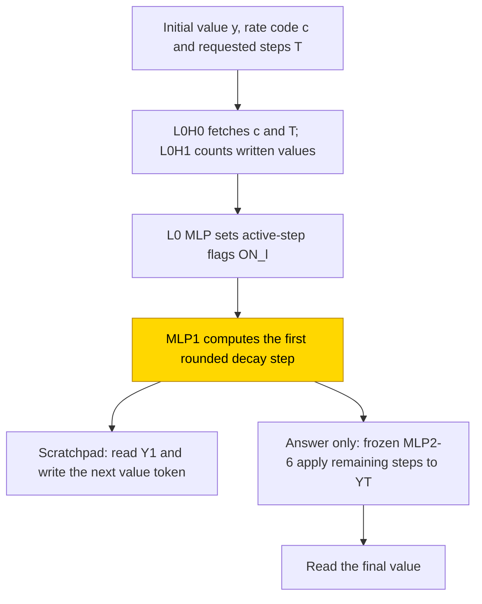
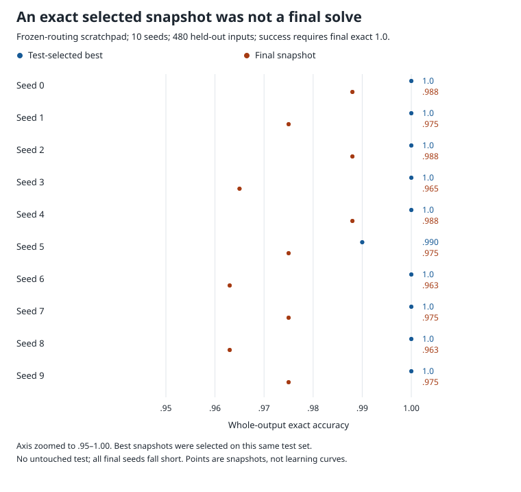

# Rounded decay by Euler steps

This task repeatedly shrinks an integer quantity by a fixed rate and rounds down after each step, a discrete version of exponential decay. Seven-layer transformers were asked either to write each intermediate value or to give only the final value. Even with the hand-built routing frozen and only the first update block trained, none of the ten final independent training runs (seeds, [glossary](../GLOSSARY.md#counting-results)) achieved exact scratchpad output on all 480 held-out inputs: final accuracy was .963–.988. Nine seeds passed through a test-selected exact snapshot but did not retain it, so the result remains unsolved. No proposed formula was substituted for the learned block; separate tests resampling everything outside the claimed circuit (the complement, [glossary](../GLOSSARY.md#verifying-a-circuit)) retained accuracy in most seeds but did not distinguish the route from random same-size controls.

| Fact | Value |
|---|---|
| Task | Repeat the rounded update y_next = floor((8 − c)y/8), then report the final value |
| Input → output example | Starting at 8 with rate code c = 4, two steps give 4, then 2 |
| Model | 7-layer transformer, width 64, 2 heads, MLP width 448; PART trains only the first update block, MLP1 |
| Rungs and seeds | HAND for both formats; PART and TRAIN screens with 3 seeds per setting; final scratchpad PART with 10 seeds |
| Closed form status | None (no solved final cell and no closed-form substitution; discovery/complement tests are separate evidence) |
| Status | Unsolved (final scratchpad PART, 0/10 at final whole-output exact 1.0); last run 2026-11-10 |
| Weights | [Hugging Face: euler-decay-ode](https://huggingface.co/jc1122/circuit-atlas-nets/tree/main/euler-decay-ode) |
| Reproduce | Not available yet: training code for this task is not yet in `code/` |

## 1. Task and data

The motivating equation is y' = −ky, but the actual task is a bounded integer recurrence, y_{t+1} = ⌊(8 − c)y_t/8⌋. Here y is the current amount, c is a rate code from 0…7, and T is the requested number of steps, from 1…6. The initial value y₀ ranges over 0…63. For example, y₀ = 8, c = 4 and T = 2 gives y₁ = 4 and y₂ = 2. This is not a test of solving arbitrary differential equations or continuous-valued trajectories.

The prompt is `BOS C<c> N<T> Y<y₀>`. Each value is a separate token. The two output formats are given in Table 1. A scratchpad is a sequence of intermediate results written before the answer ([glossary](../GLOSSARY.md#task-formats)).

*Table 1. Output formats. The final answer repeats the last intermediate value in the scratchpad format.*

| Format | Output |
|---|---|
| `T`, scratchpad | `Y<y₁> … Y<y_T> R<y_T> EOS` |
| `A`, answer only | `R<y_T> EOS` |

The original domain contains 3,072 inputs. A hash of the (y₀, c) pair assigns all durations T for that pair to the same partition: 2,592 training inputs and 480 held-out inputs. The from-scratch retry widened y₀ to 0…319, giving 12,390 training inputs and 2,970 held-out inputs. The answer-only PART retry kept the original data.

Accuracy requires every output token to be correct under teacher forcing, which supplies the correct preceding tokens while scoring each next token ([glossary](../GLOSSARY.md#task-formats)). A solved seed must have final whole-output exact accuracy 1.0. The best snapshot was selected on this same test set, so an exact selected snapshot does not count as a final solve or an untouched-test result.

## 2. Model

The three [rungs](../GLOSSARY.md#the-three-rungs) are HAND, with every weight set by formula; PART, with the hand-built network frozen except one trained block; and TRAIN, with all weights learned from scratch. Shared methods are in [METHODS.md](../METHODS.md).

### 2.1 Architecture

The GPT-NeoX-shaped decoder has 7 layers, d_model 64, 2 attention heads × 32, a ReLU MLP of width 448, no positional encoding (NoPE), no LayerNorm and an untied readout. It predicts the next token from earlier tokens. Here d_model is the running-state width; an attention head reads information from earlier positions, and an MLP is a feed-forward block acting separately at each position. ReLU keeps positive responses and sets negative ones to zero. NoPE means no added position vectors; LayerNorm would centre and rescale the state. Untied readout means separate input and output weights ([glossary](../GLOSSARY.md#standard-machine-learning-terms)). The vocabulary contains 146 tokens, or 658 in the widened TRAIN retry.

### 2.2 Frozen parts and trained part

PART reinitialises only the layer-1 MLP. Its input matrix W_in [448, 64] is masked to the current-value channel YT, the one-hot rate channels CV_c and the first-step flag ON₀. The other tensors are b_in [448], W_out [64, 448] and b_out [64]. The answer-only retry widened this block to 896 neurons. TRAIN learns all weights.

### 2.3 Training

AdamW used learning rate 1e-3, betas (.9, .98), warmup 1000, cosine decay, clipping at 1 and batch 128 fresh draws, with evaluation every 500 steps. PART used fp32; TRAIN used TF32 updates and fp32 evaluation ([glossary](../GLOSSARY.md#hand-built-machinery)). Runs used one GPU per pack.

*Table 2. Training settings. Run 1 and run 2 are the screen and retry; the final run repeats the selected scratchpad PART setting with ten seeds.*

| Run / cell | Seeds per setting | Budget | Weight decay | Change |
|---|---|---|---|---|
| Run 1 PART A/T | 3 | 20k | .1 | MLP width 448 |
| Run 1 TRAIN A/T | 3 | 40k | .1/.3/1 | Minimum 30k; plateau window 5k |
| Run 2 PART A | 3 | 20k | .03/.1 | MLP width 896 |
| Run 2 TRAIN A/T | 3 | 40k | .1/.3/1 | Initial values up to 319 |
| Final PART T | 10 | 20k | .1 | Original range and MLP width |

### 2.4 Reproduction

Reproduce: not available yet: training code for this task is not yet in `code/`; the weights, held-out splits and recorded accuracies are on Hugging Face at [euler-decay-ode](https://huggingface.co/jc1122/circuit-atlas-nets/tree/main/euler-decay-ode).

The original task-specific settings included `--kinds part --steps 20000 --wd 0.1 --tf32 0 --mask_pos 1` and `--kinds train --steps 40000 --wd 0.1 0.3 1.0`; run 2 added `--ymax 319` for TRAIN and `--part_width 896` for answer-only PART. These are recorded settings, not runnable commands in the public `code/` directory. The headline output keys were `best_test` and `final_test.exact`.

### 2.5 Archive

Published revision `6ca84a561e25` lists `hand_{T,A}`, `part_{T,A}_r1_{best,final}_s0-2`, `part_T_final_{best,final}_s0-9` (4 trained tensors), `train_{T,A}_r1_*`, `train_T_r2_*` (seeds 0–2), a config and a manifest with sha256 fingerprints. Not every retry cell is named in this inventory. The recorded fp32 re-scores agree with the saved best/final accuracies; no new download or model re-score was performed for this article. The full test, diagnostic bank and local weights grid have different sizes, set out in Appendix B.

## 3. Hand-built solution

The reference applies one bounded rounded-decay step at a time. L0H0 fetches c, encoded by one-hot CV_c, and T. L0H1 counts written Y tokens. The layer-0 MLP sets ON_l = [T − lines ≥ l], the flag saying whether step l is active. A step MLP l+1 subtracts ⌈c·YT/8⌉ from the current-value channel YT. It implements that decrement with 224 gated threshold pairs:

`Σ_{τ∈THR_c} [YT ≥ τ]`, using `ReLU(2x − 2τ + 1.5) − ReLU(2x − 2τ + .5)`, gated by CV_c and ON_l with G = 1000.

The readout scores are `Y<v> = 2v·Y1 − v²·ONE` and `R<v> = 2v·YT + (1 − v²)·ONE`. Y1 carries the first-step value and ONE is the reference constant channel. The network is exact on all 3,072 inputs in both formats; the answer-only network is the scratchpad network with its Y output rows removed.

In Figure 1, frozen rate and duration retrieval supplies active-step flags to MLP1, the only trained PART update. Scratchpad scoring supplies the preceding correct value. Answer only instead passes its current-value channel through the remaining frozen updates to the final readout. Closed-form status remains none: no trained update formula was substituted.

*Figure 1. The hand-built rounded-decay solver. Gold MLP1 is the only trained block in PART. The scratchpad supplies each preceding correct value under teacher forcing; answer-only evaluation requires YT to survive the remaining frozen steps. Closed-form status is none: the trained update was not verified by substitution.*

## 4. What training finds

The final interpretation was dated 2026-11-11. The final scratchpad PART cell fell short in every seed despite passing through exact selected snapshots in 9/10 seeds (Figure 2). The test accuracy moved by up to 12 of 480 rows between late evaluations; selection on these same rows is not independent evaluation. There was no delayed test jump after training became exact, the pattern called grokking ([glossary](../GLOSSARY.md#counting-results)).

*Figure 2. Test-selected best and final snapshots on the same 480 held-out inputs in each of ten scratchpad PART seeds. Success requires final exact accuracy 1.0; none met it. The point axis is zoomed to .95–1.00. No untouched-test result is shown, and the closed-form status remains none.*

*Table 3. Whole-output exact accuracy. Ranges are copied from the original run summary; final seed values and the separate diagnostic bank are in Appendix B. “Solved” uses the final 1.0 criterion, not a selected best score.*

| Cell | Solved | Best test | Final test | Train | Stop | T = 1 / T = 6 (final) | Failure |
|---|---|---|---|---|---|---|---|
| T PART final (run 1 screen) | 0/10 (0/3) | 1.0 in 9/10 (test-selected) | .963-.988 (.963-.988) | 1.0 (seed 5 .994, seed 7 .996) | 20k budget | .96-.99, flat in T | Mostly step-1 thresholds, especially c = 5 |
| A PART run 1 / run 2 | 0/3, 0/6 | .44-.50 / .32-.37 | .41-.50 / .11-.35 | .37-.43 / .12-.36 | budget / plateau | .16-.20 / .54-.71 | Cannot fit: YT inexact after step 1 |
| T TRAIN run 1 / run 2 | 0/9, 0/9 | .53-.74 / .41-.57 | .51-.72 / .41-.56 | 1.0 (wd 1: .79-.98) | plateau 35-38k | flat in T | Memorises states; c = 0 exact <= .09 |
| A TRAIN run 1 / run 2 | 0/9, 0/9 | .74-.83 / .64-.77 | .73-.82 / .64-.77 | 1.0 (wd 1: .78-.99) | plateau/budget | .60-.70 / .81-.89 | No T-fold composition |

The final PART networks kept the hand-built five-edge route in all ten seeds. The source classified this failure as memorising: training accuracy was 1.0 in 8/10, yet threshold choices that fitted seen values still gave wrong answers on some unseen inputs. This classification does not imply a delayed grokking transition or a missing routing variable. On the 128-row diagnostic bank, there were 1–5 wrong rows per seed. The first error was on line 1 in 32/33 wrong rows; seed 3 had one line-2 error and also failed c = 3 at .94 exact. This is why the failure is described as mostly the first step and especially c = 5, rather than exclusively either one.

The from-scratch scratchpad networks retained a linearly decodable next value but did not reliably use it as a swappable variable. In the widened retry, held-out identity updates, c = 0, scored exact 0 in 9/9 seeds. Answer-only networks lost the composed current-value code after the early layers. Wider answer-only PART did not repair its inexact YT channel. These are failures in this particular representation and training regime, not impossibility claims for rounded arithmetic.

## 5. Mechanism and verification

The closed-form status is none. No solved cell received a closed-form substitution. Circuit discovery and resampling of a discovered circuit's complement were nevertheless performed; they must not be described as absent.

For the final scratchpad PART cell, discovery recovered HAND's five connections in 10/10 seeds: embedding to L0H0, L0H0 to MLP1, embedding to MLP1, MLP1 to output and embedding to output. Held-out faith, the accuracy retained by resampling outside the discovered circuit ([glossary](../GLOSSARY.md#analysis-measures)), was 1.0 in 9/10; seed 9 kept .958/.977, a share of .98. The full-network and empty-source self-checks passed in every seed. Resampling the circuit itself reduced exact to .005–.026, but a random same-size set also reduced it to .005–.026. That control did not establish specificity.

HAND uses 224 gated threshold pairs per step; the best scratchpad PART snapshots have 353–386 active neurons on the local grid. The trained block used a different value code from HAND. It wrote both Y1 and ONE, so the first-line score `2v·Y1 − v²·ONE` selected a value according to the ratio Y1/ONE. That can produce the right first-line token while the absolute YT channel is unsuitable for the frozen remaining steps. Appendix A gives the measured weights and local readouts. This is a failure interpretation, not an accepted closed-form replacement.

TRAIN scratchpad circuits were dense chains through the MLPs, with 55–147 discovered edges of the form MLPk to MLPk+1 and HAND-T edge Jaccard at most .04. Answer-only TRAIN had HAND-A recall .47–.80 and Jaccard at most .32. Answer-only PART had 4–13 discovered edges around L0H0. None supplies an accepted alternative algorithm.

Underdetermined held-out thresholds are consistent with the general notion of underspecification in [Madras et al. (2019)](#references); no local-ensemble certificate was established here. [Ootani (2026)](#references) and [Zhu et al. (2024)](#references) study training-coverage conditions for grokking, which motivated the recorded data retry. [Kim et al. (2021)](#references) and [Kreitner et al. (2025)](#references) make number representation a relevant comparison: the latter proposes structured single-token number embeddings, so it does not imply that every single-token format must fail.

## 6. Limitations and open questions

Best snapshots were selected on the same held-out set used for reporting. There is no untouched test. Diagnostics use only 128 held-out rows at T = 6, whereas the full original test contains 480 inputs across all durations. The local weights grid has 512 (y, c) combinations and is a different test again.

No T > 6 evaluation exists because there is no N<T> token for longer durations and HAND has only six step layers. The source's fp32 length re-score checked all 20 best/final records, reproducing recorded accuracy: final T = 1 and T = 2..6 both had .9625–.9875. Seed 3 scored .975 at T = 1 and .9625 thereafter; selected-best seed 5 scored .9875 at T ≥ 2 while other best snapshots were exact. These flat-in-T sampled results do not establish unlimited composition. The hand-built probes cover y₀ ≤ 63; their meaning does not extend unchanged to every widened-retry input. Interchange tests for c, previous y and the decrement had nf 0, meaning untested rather than unused ([glossary](../GLOSSARY.md#analysis-measures)).

The discovery/complement random control failed to show specificity. Edge-attribution faithfulness, `spearman_exact`, was .88–1.0 in only 6/10 final PART seeds; the original summary gives .90–.94 for TRAIN. Circuit discovery agrees across all ten PART seeds, but that agreement does not replace a closed-form substitution. No further training or new representation was tested as part of this writing audit.

## 7. Prediction record

Before run 1, scratchpad PART was predicted to remain unsolved at .80–.95. The outcome held, but the range missed: run 1 and final accuracy was .963–.988. Answer-only PART was predicted to reach train accuracy 1.0; the observed .37–.43 falsified that prediction. Scratchpad TRAIN was predicted to fail unless the scalar z = (8 − c)y/8 formed; it failed and no separate z route was recovered. Answer-only TRAIN was predicted to memorise, which held.

For run 2, scratchpad TRAIN was predicted at .60–.90 with c = 0 learned as a rule; the observed .41–.57 and c = 0 exact 0 falsified both. The prediction that answer-only PART would improve with width also failed. The final run had no new advance prediction and was compared with the run-1 scratchpad PART prediction.

## Appendix A. Weights excerpt and reading

The source excerpt routines, `excerpts.py ode` and `excerpt_part.py`, evaluated the archived layer-1 block on `x = embedding row Y<y> + e_CV_c + e_ON₀`, the 512 (y, c) combinations. HAND uses 448 neurons, W_in values {2, 1000}, correct readout on 512/512 and YT error 0. “Active” counts neurons activated by this local grid; it is not the separate n90 mass count.

*Table A1. Local weights-grid evidence. Best and final are saved snapshots, not separate seeds. “YT off” counts absolute errors of at least ¼, the tolerance relevant to the frozen next update.*

| Network | Active neurons | Line-1 readout correct, of 512 | YT off ≥ ¼ | Largest W_out rows, L1 norm |
|---|---|---|---|---|
| T PART final best / final (seeds 0–9) | 353-386 / 354-384 | 506-512 / 509-511 (misses at c 1, 3, 5; final c = 5 in 10/10) | 511-512 | YT 215-242, ONE 133-154, Y1 127-152 |
| T PART run 1 best / final (seeds 0–2) | 360-383 / 365-386 | 507-510 / 509-510 | 512 | YT 216-230, ONE 127-139, Y1 125-133 |
| A PART run 1 final (seeds 0–2) | 321 / 336 / 335 | — | 506 / 509 / 507 | YT 71-94, ONE 58-64 |

The final local-grid misses include c = 1 or 3 in seeds 3, 5 and 7; they are not the same cohort as the held-out T = 6 error bank. The learned step writes ONE about as strongly as Y1. Their ratio can be readable even when YT is inaccurate everywhere, explaining why scratchpad PART can nearly fit while answer-only PART cannot pass the value through its frozen remaining steps.

## Appendix B. Detailed evidence

*Table B1. Diagnostics at weight decay .1 on the best snapshot; the original summary reports final values within .03. R² is the best-layer linear probe, and interchange flip is reported only where nf > 0. CKA is centred kernel alignment to HAND; JS is attention divergence; n90 is the neuron count carrying 90% of MLP mass ([glossary](../GLOSSARY.md#analysis-measures)).*

| Cell | Used blocks; n90 | R² hand_YT / hand_Y1 / y_new / c | Flip (nf > 0) | CKA vs HAND (L7) | Attention JS | Diagnostic exact best / final |
|---|---|---|---|---|---|---|
| T PART final (10) | 2 of 21; 130-160 | .87-.88 / .94 / .91-.96 / .98-.99 (L1) | Y1 .99-1.0 (L1) | .41-.65 | .28 (frozen) | .99-1.0 / .96-.99 |
| A PART run 1 | 1-7; 56-63 | .91-.95 / .94-.96 / — / .96-.98 | YT .36-.51 (L1) | .14-.19 | .20 (frozen) | .57-.72 / .54-.70 |
| T TRAIN run 1 | 16; 1418-1507 | .85-.89 / .91-.95 / .98-.99 / .95-.98 | y_new .69-.85 (L6-7) | .05-.07 | .33-.35 | .61-.70 / .55-.69 |
| T TRAIN run 2 | 14-16; 1348-1450 | .32-.73 / .55-.78 / .96-.99 / .97 | y_new ≤ .07 | .05-.10 | .31-.32 | .49-.57 / .48-.56 |
| A TRAIN run 1 | 17-20; 1044-1159 | .75-.84 / .82-.90 / — / .99-1.0 | YT .31-.50 (L1-2) | .23-.32 | .28-.30 | .87-.90 / .82-.91 |

The final PART n90 range is 130–163, compared with 130–160 at the best snapshot and HAND's 448 neurons. Residual r90 at L7 is 1–2, or 8–13 for retry scratchpad TRAIN. The scratchpad TRAIN value has dictionary correlation .93 but low swap response in the retry: flip ≤ .38 and DAS .15. Answer-only TRAIN loses YT after L3, with R² about .1. PART hand_Y1 remains swappable on wrong rows, with flip 1.0. These measures concern decodability or causal use on the specified banks, not proof of an exact scalar algorithm.

*Table B2. Final scratchpad PART snapshots, ten seeds. The best score is test-selected; the final score determines the 0/10 outcome on 480 held-out inputs.*

| Seed | Best | Final |
|---|---|---|
| 0 | 1.0 | .988 |
| 1 | 1.0 | .975 |
| 2 | 1.0 | .988 |
| 3 | 1.0 | .965 |
| 4 | 1.0 | .988 |
| 5 | .990 | .975 |
| 6 | 1.0 | .963 |
| 7 | 1.0 | .975 |
| 8 | 1.0 | .963 |
| 9 | 1.0 | .975 |

## What to read next

Compare [GCD by repeated subtraction](gcd-euclid.md) for another recurrence whose frozen arithmetic and learned router have different roles. [DPLL search](dpll-search.md) gives a contrasting local-update verification inside frozen machinery.

## References

- Kim, J., Hong, G., Kim, K.-m., Kang, J., & Myaeng, S.-H. (2021). Have You Seen That Number? Investigating Extrapolation in Question Answering Models. *Proceedings of the 2021 Conference on Empirical Methods in Natural Language Processing* (conference paper). https://doi.org/10.18653/v1/2021.emnlp-main.563 (number representation and extrapolation)
- Kreitner, L., Hager, P., Mengedoht, J., Kaissis, G., Rueckert, D., & Menten, M. J. (2025). Efficient numeracy in language models through single-token number embeddings. *arXiv preprint*. https://doi.org/10.48550/arxiv.2510.06824 (structured single-token number encodings)
- Madras, D., Atwood, J., & D'Amour, A. (2019). Detecting Underspecification with Local Ensembles. *arXiv preprint*. https://doi.org/10.48550/arxiv.1910.09573 (training-consistent predictors can disagree on held-out inputs)
- Ootani, Y. (2026). Grokking Is Conditional and Fragile: A Fully-Tractable, Multi-Seed Study at 12K Parameters. *arXiv preprint*. https://doi.org/10.48550/arxiv.2607.05104 (coverage and multi-seed grokking)
- Zhu, X., Fu, Y., Zhou, B., & Lin, Z. (2024). Critical Data Size of Language Models from a Grokking Perspective. *arXiv preprint*. https://doi.org/10.48550/arxiv.2401.10463 (data coverage as motivation for the retry)
