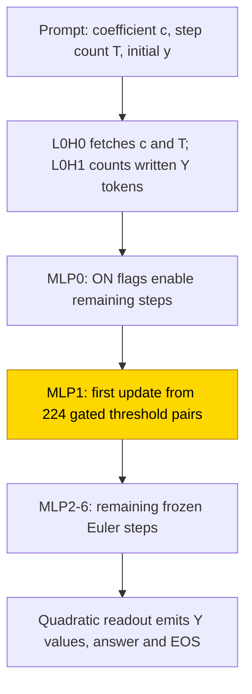
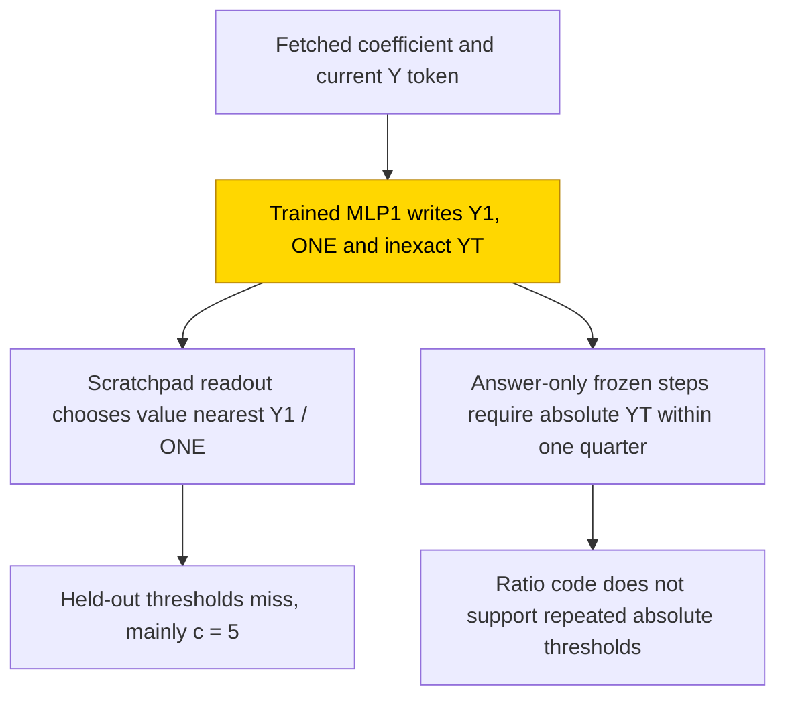

# Explicit Euler for fixed-point decay

This entry studies small transformers that repeatedly apply y_{t+1} = ⌊(8 − c)y_t/8⌋, a fixed-point version of explicit Euler for
exponential decay. No trained cell is solved. With hand-built routing frozen, all 10 final scratchpad seeds retain its five-edge
route but finish at .963–.988 exact match on 480 held-out inputs, usually making their first error at the first update. Networks
trained from scratch memorise individual states instead of a transferable update or repeated composition. The task is unsolved and
has no accepted closed form; test-selected perfect snapshots are not counted as solved final networks.

| Fact | Value |
|---|---|
| Task | Apply y_{t+1} = ⌊(8 − c)y_t/8⌋ for 1–6 steps, c 0–7 and initial y₀ 0–63; answer only or write each intermediate value |
| Input → output example | c = 0 leaves the initial value unchanged at every step |
| Model | GPT-NeoX-shaped, 7 layers, d_model 64, 2 heads × 32, ReLU MLP 448; PART trains only MLP1 on frozen HAND |
| Rungs and seeds | HAND both formats; 3 seeds per screening cell/weight decay; final scratchpad PART 10 seeds |
| Closed form status | None (no solved final cell and no accepted substitution/complement pair; exploratory circuit tests do not certify an update law) |
| Status | Unsolved (final scratchpad PART 0/10 exact; all screening/retry cells unsolved); last run 2026-11-10 |
| Weights | [Hugging Face: euler-decay-ode](https://huggingface.co/jc1122/circuit-atlas-nets/tree/main/euler-decay-ode), published revision `6ca84a561e25` |
| Reproduce | Not available yet: training code for this task is not yet in `code/` |

## 1. Task and data

The prompt is `BOS C<c> N<T> Y<y₀>`. There is one token per value: c ranges from 0 to 7, T from 1 to 6 and y₀ from 0 to 63,
3,072 inputs in total. The update is y_{t+1} = ⌊(8 − c)y_t/8⌋; when c = 0, every update leaves y unchanged. A pair-hash split of
(y₀, c) keeps all T for a pair together: 2,592 training and 480 held-out inputs. The run-2 TRAIN retry widens y₀ to 0–319,
12,390 / 2,970 inputs.

*Table 1. Output formats.*

| Format | Output |
|---|---|
| `T` ([scratchpad](../GLOSSARY.md#task-formats)) | `Y<y₁> … Y<y_T> R<y_T> EOS` |
| `A` (answer only) | `R<y_T> EOS` |

Exact match requires every target token to be right, teacher-forced, with correct previous tokens supplied
([glossary](../GLOSSARY.md#task-formats)). The main diagnostic bank has 128 held-out rows at T = 6. The separate weights audit evaluates
512 local (y, c) interfaces. Neither denominator is the full 480-input test set.

## 2. Model

Shared conventions are in [METHODS.md](../METHODS.md). HAND sets all weights by formula; PART freezes HAND except one trained stage;
TRAIN learns all weights ([rungs](../GLOSSARY.md#the-three-rungs)).

### 2.1 Architecture

The networks are GPT-NeoX-shaped, 7 layers, d_model 64, 2 heads × 32, ReLU MLP 448, no positional encoding, no LayerNorm and untied
readout. Vocabulary size is 146, or 658 for the widened run-2 TRAIN domain. The answer-only PART width retry uses MLP 896.

### 2.2 Frozen parts and trained part

PART re-initialises MLP1: W_in [448, 64] masked to YT (the running scalar), CV_c (a one-hot coefficient code) and ON₀ (the first-step
enable flag), b_in [448], W_out [64, 448] and b_out [64]. The other weights are frozen. TRAIN learns all weights.

### 2.3 Training

AdamW used learning rate 1e-3, betas (.9, .98), warmup 1000, cosine decay, clip 1, fresh batches of 128 and evaluation every 500.
PART used 20k steps, fp32 and weight decay .1; the run-2 answer-only retry used .03/.1 and MLP 896. TRAIN used a 40k budget,
minimum 30k and 5k plateau window, TF32 training and fp32 evaluation, sweeping weight decay .1/.3/1. Packs ran on GPU accelerators.

Run 1 covered both formats and both trained rungs, 3 seeds per cell/weight decay. Run 2 retried A PART and A/T TRAIN. The final
T PART cell ran on 2026-11-10 with 10 seeds, weight decay .1 and 20k steps; all reached budget. A final exact 1.0 snapshot is the solved criterion here.
“Best” is selected on the test set itself and is not a solve: 9/10 final seeds passed through 1.0 on that selected test before falling.
There is no reported delayed solved [grokking](../GLOSSARY.md#counting-results) transition.

### 2.4 Reproduction

Reproduce: not available yet: training code for this task is not yet in `code/`; the weights, held-out splits and recorded
accuracies are on Hugging Face at
[huggingface.co/jc1122/circuit-atlas-nets/tree/main/euler-decay-ode](https://huggingface.co/jc1122/circuit-atlas-nets/tree/main/euler-decay-ode).
The recorded trainer settings include `--kinds part --steps 20000 --wd 0.1 --tf32 0 --mask_pos 1` and
`--kinds train --steps 40000 --wd 0.1 0.3 1.0`; run 2 adds `--ymax 319` or `--part_width 896`. These are configuration records,
not a runnable command supplied in `code/`. Headline keys are `best_test` and `final_test.exact`.

### 2.5 Archive

The published revision is `6ca84a561e25`. The archive lists `hand_{T,A}`, `part_{T,A}_r1_{best,final}_s0-2`,
`part_T_final_{best,final}_s0-9` (four tensors), `train_{T,A}_r1_*`, `train_T_r2_*` (seeds 0–2), configuration and manifest with sha256.
Not every retry cell is named in that inventory. No new download or network re-score was performed for this presentation update.

## 3. Hand-built solution

L0H0 fetches coefficient c into CV_c and step count T; L0H1 counts written Y tokens. MLP0 writes ON_l = [T − lines ≥ l]. Each MLP l+1
applies one Euler step: subtract ⌈c·YT/8⌉ from YT. This decrement is Σ_{τ∈THR_c}[YT ≥ τ], a sum over coefficient-specific thresholds.
The implementation uses 224 gated step pairs,
`ReLU(2x − 2τ + 1.5) − ReLU(2x − 2τ + .5)`, gated by CV_c and ON_l with G 1000. The readout scores are
`Y<v> = 2v·Y1 − v²·ONE` and `R<v> = 2v·YT + (1 − v²)·ONE`, where ONE is a constant channel and Y1 the first update.
HAND is exact on all 3,072 inputs in both formats; answer only removes the intermediate Y rows.

*Figure 1. HAND's fixed-point Euler computation. Shaded MLP1 is the only trained PART stage. In the scratchpad, later lines receive
the correct previous Y token under teacher forcing; this scoring does not certify autonomous rollout.*

## 4. What training finds

The final analysis dated 2026-11-11 remains negative (Table 2). PART scratchpad learns the hand-built route but misses held-out
thresholds, mostly at c = 5. The diagnostic bank has 1–5 wrong rows of 128 per seed, with the first error at line 1 in 32/33 wrong
rows and one line-2 exception. This is not a count of 1–5 errors on the full 480-input test set.

*Table 2. Results. Run 1 and run 2 TRAIN rows pool three seeds at each of three weight decays; the final PART row has ten seeds.*

| Cell | Solved | Best test | Final test | Train | Stop | T = 1 / T = 6, final | Failure |
|---|---|---|---|---|---|---|---|
| T PART final (run-1 screen) | 0/10 (0/3) | 1.0 in 9/10, test-selected | .963–.988 (.963–.988) | 1.0, except seed 5 .994 and seed 7 .996 | 20k budget | .96–.99, flat in T | first-step thresholds, c = 5 |
| A PART run 1 / run 2 | 0/3, 0/6 | .44–.50 / .32–.37 | .41–.50 / .11–.35 | .37–.43 / .12–.36 | budget / plateau | .16–.20 / .54–.71 | inexact YT after step 1 |
| T TRAIN run 1 / run 2 | 0/9, 0/9 | .53–.74 / .41–.57 | .51–.72 / .41–.56 | 1.0; wd 1 .79–.98 | plateau 35–38k | flat in T | state memorisation; held-out c = 0 exact ≤ .09 |
| A TRAIN run 1 / run 2 | 0/9, 0/9 | .74–.83 / .64–.77 | .73–.82 / .64–.77 | 1.0; wd 1 .78–.99 | plateau/budget | .60–.70 / .81–.89 | no T-fold composition |

### 4.1 Failure families

T PART retains the HAND-T five-edge route in 10/10 final seeds: L0H0 and MLP1, discovery faith 1.0 in 9/10 and .98 in seed 9.
T TRAIN instead has a dense MLP chain, 55–147 edges between successive MLPs, with HAND-T Jaccard ≤ .04. A TRAIN has HAND-A recall
.47–.80 and Jaccard ≤ .32; A PART keeps 4–13 edges around L0H0. These describe failed networks, not solved circuit types or accepted
closed forms.

From scratch, T can decode the next value but does not acquire a transferable update. In run 2 it does not use the tested next-value
code and has held-out c = 0 exact 0, rather than the identity rule. A does not compose T updates and loses YT after L3 (R² ~.1).
The distinction between decoding and using a variable matters here.

### 4.2 Diagnostics

*Table 3. Diagnostics at weight decay .1, best snapshot, with final within .03 in the published summary. R² is the best linear probe;
n90 counts neurons carrying 90% of MLP mass; CKA compares representations; JS compares attention.*

| Cell | Used blocks; n90 | R² hand_YT / hand_Y1 / y_new / c | Interchange flip, nf > 0 | CKA with HAND, L7 | JS | Diagnostic best / final |
|---|---|---|---|---|---|---|
| T PART final (10) | 2 of 21; 130–160 | .87–.88 / .94 / .91–.96 / .98–.99 (L1) | Y1 .99–1.0 (L1) | .41–.65 | .28, frozen | .99–1.0 / .96–.99 |
| A PART run 1 | 1–7; 56–63 | .91–.95 / .94–.96 / — / .96–.98 | YT .36–.51 (L1) | .14–.19 | .20, frozen | .57–.72 / .54–.70 |
| T TRAIN run 1 | 16; 1418–1507 | .85–.89 / .91–.95 / .98–.99 / .95–.98 | y_new .69–.85 (L6–7) | .05–.07 | .33–.35 | .61–.70 / .55–.69 |
| T TRAIN run 2 | 14–16; 1348–1450 | .32–.73 / .55–.78 / .96–.99 / .97 | y_new ≤ .07 | .05–.10 | .31–.32 | .49–.57 / .48–.56 |
| A TRAIN run 1 | 17–20; 1044–1159 | .75–.84 / .82–.90 / — / .99–1.0 | YT .31–.50 (L1–2) | .23–.32 | .28–.30 | .87–.90 / .82–.91 |

Probe, rank, interchange and ablation are defined in the [glossary](../GLOSSARY.md#analysis-measures). Interchange swaps a candidate
variable between examples; nf 0 means untested. The source's residual r90 at L7 is 1–2, or 8–13 for run-2 T TRAIN. Coefficient c,
y_prev and decrement have nf 0 in the screening summary. T TRAIN's dictionary correlation .93 for y_new is decodability; the later
low-swap summary gives flip ≤ .38 and DAS .15, not an accepted update law. T PART's hand_Y1 is swappable on wrong rows too, flip 1.0.

## 5. Mechanism and verification

No solved cell has an accepted closed form. The source's statement “no substitution or complement check” refers to the skipped
solved-cell closed-form stage, not to an absence of exploratory circuit diagnostics: the five-edge discovered claim was tested by
resampling, without a successful closed-form substitution. The final exploratory test keeps base under complement resampling in
9/10; circuit-resampled and random same-size controls both drop to .005–.026. The source records this as needed but not specific under
that control. It does not certify the Euler update or repair the final errors.

The PART weights explain why correct routing is insufficient. MLP1 writes ONE about as strongly as Y1; the quadratic readout peaks
at v = Y1/ONE. Scratchpad PART therefore represents line 1 as a ratio while absolute YT is inexact. A PART also uses this code, but
its frozen later steps threshold absolute YT, with tolerance ¼, so they cannot correctly compose the updates (Appendix A).

*Figure 2. The failed PART code, not an accepted formula. Shaded MLP1 is trained; its ratio readout can be nearly accurate while its
absolute-state channel fails. Closed-form status: none; no solved final cell or successful substitution/complement pair.*

This threshold ambiguity is related to underspecification ([Madras et al., 2019](#references)): more than one threshold can fit the
training data while disagreeing on held-out points. Opaque per-value tokens offer no shared digit/bit interpolation structure
([Kim et al., 2021](#references); [Kreitner et al., 2025](#references)). Coverage and critical-data perspectives
([Ootani, 2026](#references); [Fu et al., 2024](#references)) motivate the wider-data retry; its negative result remains negative.
A digit/bit input format would require a new HAND design, not an unreported rescue of these cells.

## 6. Limitations and open questions

Diagnostics use 128 held-out T = 6 rows; hand_* probes are defined for y₀ ≤ 63. No T > 6 test is possible because no corresponding
N<T> token exists. The observed flat-in-T final exactness is .9625–.9875 on the source's length re-score, not evidence for unlimited
steps. Best snapshots are selected on test, so their 1.0 is not a solve or an untouched confirmation set.

The published trusted-edge summary gives spearman_exact .88–1.0 in 6/10 final PART seeds and .90–.94 in TRAIN. Untrusted edge scores
cannot be read as verified wiring. Exploratory complement diagnostics do not provide a closed form and retain the source's
specificity limitation. No trained cell is solved; there is no accepted substitution. The record supplies no public runnable trainer.

## 7. Prediction record

*Table 4. Predictions written before run 1 or the indicated retry.*

| Prediction | Outcome |
|---|---|
| T PART unsolved, test .80–.95 | Unsolved held; range missed: .963–.988 in screen and final |
| A PART reaches train 1.0 | Missed, .37–.43 |
| T TRAIN unsolved unless z = (8 − c)y/8 forms | Held; no accepted z update |
| A TRAIN memorises | Held |
| Run-2 T TRAIN .60–.90 and c = 0 as a rule | Missed, .41–.57 and held-out c = 0 exact 0 |
| A PART improves with width | Missed |

## Appendix A. Weights excerpt and reading

The local interface is x = embedding row Y<y> + e_CV_c + e_ON₀, 512 (y, c) cases. HAND uses 448 neurons, W_in constants {2, 1000},
line-1 readout 512/512 and YT error 0. The source excerpt routines are named `excerpts.py ode` and `excerpt_part.py`.

*Table A1. PART MLP1 excerpts. Active is a weight-response count, not the n90 activation-mass count in Table 3. Output-row magnitudes
are L1 norms.*

| Network | Active neurons | Line-1 readout correct, of 512 | YT off ≥ ¼ | Largest W_out rows |
|---|---|---|---|---|
| T PART final best / final, seeds 0–9 | 353–386 / 354–384 | 506–512 / 509–511; misses c 1, 3, 5; final c = 5 in 10/10 | 511–512 | YT 215–242, ONE 133–154, Y1 127–152 |
| T PART run 1 best / final, seeds 0–2 | 360–383 / 365–386 | 507–510 / 509–510 | 512 | YT 216–230, ONE 127–139, Y1 125–133 |
| A PART run 1 final, seeds 0–2 | 321 / 336 / 335 | not reported | 506 / 509 / 507 | YT 71–94, ONE 58–64 |

The ratio readout, rather than exact absolute YT, explains the difference between scratchpad and answer-only PART. HAND has 224
threshold pairs per step; the learned scratchpad bank has 353–386 active neurons but does not locate every held-out threshold.

## Appendix B. Evaluation scope

The source's final failure count of 1–5 refers to the 128-row diagnostic bank. Full-test exactness is .963–.988 on 480 rows; the local
readout table has 512 interfaces. These tests do not share a denominator. The length re-score checked all 20 best/final records,
reproducing recorded values, but best/final selection does not create independent seeds. No longer-than-6-step token was tested.

## References

- Fu, Zhou, & Lin. (2024). Critical Data Size of Language Models from a Grokking Perspective. *arXiv preprint*. https://doi.org/10.48550/arxiv.2401.10463 (data-coverage perspective)
- Kim et al. (2021). *EMNLP conference paper*. https://doi.org/10.18653/v1/2021.emnlp-main.563 (number representations; the inherited reference does not supply a title)
- Kreitner et al. (2025). *arXiv preprint*. https://doi.org/10.48550/arxiv.2510.06824 (numeric tokenisation; inherited sparse bibliographic record)
- Madras, Atwood, & D'Amour. (2019). Detecting Underspecification with Local Ensembles. *arXiv preprint*. https://doi.org/10.48550/arxiv.1910.09573 (held-out threshold ambiguity)
- Ootani. (2026). Grokking Is Conditional and Fragile. *arXiv preprint*. https://doi.org/10.48550/arxiv.2607.05104 (training coverage)
