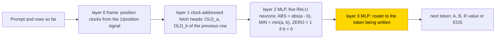

# GCD by subtractive Euclid (with modular inverse and fraction reduction)

This entry studies how small transformers compute the greatest common divisor of two 5- to 7-bit numbers, either answer only or as a
trace of subtractive Euclid rows, with the modular inverse and fraction reduction as side tasks. With the hand-built Euclid layers
frozen, the trained last MLP is only a router that copies the frozen |a − b|, min(a, b) and stop signals into the right output slot:
all 10 final trace seeds reach ≥ .99 (7/10 exact). Trained from scratch, the trace was learned in 1/3 seeds at 6 bits and 2/3 at 7
bits with a distributed token-table code, and answer only in 1/3 at 6 bits; no network extrapolates to 8-bit operands. The task is
partly solved. The closed form is partial: a three-rule router makes all 10 final seeds exact on their test sets and repairs an
8-bit stress set from 10.6% to 100% (seed 5), supported by substitution with the complement not tested, and no complete closed form was found for the networks trained from scratch.

| | |
|---|---|
| Task | Compute gcd(a, b) of two 5- to 7-bit numbers, answer only or as a trace of subtractive Euclid rows; side tasks modular inverse and fraction reduction |
| Input → output example | Answer only: prompt `BOS GCD A:6 B:4 →`, output `R:2 EOS` |
| Model | GPT-NeoX-shaped, 4 layers × 4 heads, d_model 128, ReLU MLP of width 1026–4098; the partly trained networks train only the layer-3 MLP |
| Rungs and seeds | HAND exact in all five published cells; GCD PART A 3 seeds, T 3 screening + 10 final seeds; GCD TRAIN three-seed screens; inverse/fraction PART three-seed screens |
| Closed form status | Partial (PART three-rule router makes all 10 final seeds exact on their test sets; complement not tested; none complete for TRAIN) |
| Status | Partly solved (PART router 10/10 ≥ .99; TRAIN 1/3 at 6 bits, 2/3 at 7 bits); last run 2026-11-06 |
| Weights | [Hugging Face: gcd-euclid](https://huggingface.co/jc1122/circuit-atlas-nets/tree/main/gcd-euclid) (39 networks) |
| Reproduce | Not available yet: training code for this task is not yet in `code/` |

## 1. Task and data

The main task is gcd(a, b), with gcd(0, 0) = 0. The side tasks are the inverse of v mod a prime p (non-units give 0) and the sum
a/b + c/d reduced. Numbers are typed scalar tokens (role × value 0–511, vocabulary 7174), not digit strings. Two formats were studied
(Table 1). In the trace format the network writes subtractive-Euclid rows until b = 0, then the answer; the inverse trace adds the
coefficient registers U and V, and the fraction trace first writes the products N, M and O.

*Table 1. Output formats.*

| Format | Sequence |
|---|---|
| `A` (answer only) | `BOS GCD A:a B:b → R:g EOS` |
| `T` (trace, a [scratchpad](../GLOSSARY.md#task-formats)) | after the prompt, rows `A:\|a−b\| B:min(a,b)` until b = 0, then `R:g EOS` |

Operands have 5 bits for gcd and inverse A and 6 bits for T (data retries: A 6, T 7), and 3 bits for fraction. The split is a per-seed
hash of the whole input tuple, 80/20, and scores use 256 held-out tuples; inverse T also withholds p ∈ {37, 43, 53, 61}. Exact match
means the whole teacher-forced output, including EOS, is right; teacher-forced means each token is scored given the correct previous
tokens ([glossary](../GLOSSARY.md#task-formats)). Magnitude checks used 64 tuples at 7 and 8 bits per seed (A PART: 6 and 8 bits).

## 2. Model

The shared conventions are described in [METHODS.md](../METHODS.md). The three [rungs](../GLOSSARY.md#the-three-rungs) are HAND
(every weight set by formula), PART (frozen hand-built parts with one trained stage) and TRAIN (all weights trained from scratch).

### 2.1 Architecture

All networks are GPT-NeoX-shaped with 4 layers × 4 heads (d_head 32), d_model 128, ReLU MLP, no LayerNorm, no positional encoding,
untied embedding and unembedding, and vocabulary 7174. The MLP width (all layers) is 1026 for gcd A, 1056 for gcd T, 1026 for inverse
A, 2096 for inverse T and 4098 for fraction A. T networks locate rows with a frozen hand-built "frame", a clock built from the
causal-attention 1/position signal, with 520 / 1040 positions for gcd / inverse.

### 2.2 Frozen hand-built network and trained part

PART freezes the HAND network and re-initialises and trains the layer-3 MLP (`dense_h_to_4h` [W, 128] + bias, `dense_4h_to_h`
[128, W] + bias, where W is the MLP width). The files hold these four tensors, to be inserted into `hand_<op>_<fmt>`. TRAIN trains all
weights from the default initialisation, with width 1056 for gcd T (also at 7 bits) and 1026 for gcd A.

### 2.3 Training

The optimiser was AdamW with learning rate 1e-3, weight decay .1, betas (.9, .98), warmup 1000, cosine decay over 30k steps, clip 1
and a batch of 16 fresh tuples per step, with an evaluation every 500 steps. The best snapshot is the one with the highest exact match
on a 128-tuple training monitor (then the lowest loss), not the peak test accuracy. Runs stop at test 1.0 or when exact match gains no
more than .005 over 5k steps after 22.5k. PART ran in fp32 and TRAIN in TF32. All seeds of a cell ran in one process on consumer GPUs;
analysis ran on CPU.

The GCD PART cells had 3 seeds for A and 3 screening + 10 final seeds for T. GCD TRAIN ran three-seed screens (T run 1, T run 2 with
7-bit data, A run 2 with 6-bit data). Inverse and fraction had three-seed PART screens, published for their closed-form substitutions.
Pending at the last run: a 10-seed GCD T TRAIN final cell (running) and causal diagnostics of final-cell PART seeds 3–9 (running). The
networks of a 2x-budget GCD T TRAIN retry (run 3: 3/3 seeds ≥ .99 in its training log) were not retrieved and are not published.

### 2.4 Reproduction

Reproduce: not available yet: training code for this task is not yet in `code/`; the weights, held-out splits and recorded
accuracies are on Hugging Face at
[huggingface.co/jc1122/circuit-atlas-nets/tree/main/gcd-euclid](https://huggingface.co/jc1122/circuit-atlas-nets/tree/main/gcd-euclid)
(39: 5 HAND, 25 PART, 9 TRAIN; each run's test and monitor tuples in `test_<run>`).

### 2.5 Archive

Files are `hand_*`, `part_<op>_<fmt>[_final10]_s<seed>` and `train_gcd_<fmt>_<r1|r2>_s<seed>` (safetensors), with `config.json` and
`manifest.json` (seed, rung, operand bits, best step, recorded and re-scored test accuracy, fresh-tuple accuracy, sha256). After a
re-download all 39 sha256 match the manifest; reloaded networks reproduce the recorded test accuracy in fp32, and the manifest adds
each network's accuracy on 256 fresh held-out-class tuples.

## 3. Hand-built solution

The hand-built answer-only network is a pair-index lookup, a lookup control and not an algorithm. Layer-1 head L1H0 brings both
operands to the answer position; an MLP holds one hinge per (a, b) pair (705 neurons in all at 5 bits) and writes gcd(a, b) as a
scalar; the last MLP routes it to the output token.

The hand-built trace network computes one Euclid step per row (Figure 1). A frozen frame in layer 0 builds position clocks from the
1/position signal of a uniform causal head, and clock-addressed fetch heads in layer 1 read the previous row's a and b. Layer 2
computes the Euclid step with five ReLU neurons on the fetched OLD_a and OLD_b (Appendix A), and layer 3 routes the result to the token
being written. Inverse T adds the coefficient updates (u − v) mod p, and fraction T adds product and division macros.

Formula sizes (heads + neurons with non-zero weights) are gcd A 1 + 705, gcd T 3 + 1572, inverse A 1 + 496, inverse T 6 + 3154 and
fraction A 1 + 2557. Exactness was checked on all inputs of the small domains (gcd A 1024 pairs) plus stratified larger sets (several
hundred extra inputs per cell), with a minimum logit margin of 10, greedy and teacher-forced, and re-checked on each run's 256 test
tuples after archiving (1.000 in all five cells).



*Figure 1. The hand-built trace network for gcd. The frame and fetch heads read the previous row, layer 2 computes the subtractive
Euclid step, and layer 3 routes it to the output. The shaded layer-3 MLP is the part that PART replaces with a trained stage.*

## 4. What training finds

Table 2 gives every archived cell. "Seeds ≥ .99" counts seeds whose best test exact match reached .99, with the exactly solved seeds
in parentheses; "90% test" is the first evaluation at which test exact match reached .9.

*Table 2. Results per cell (run 1 and run 2 are the first run and the retry).*

| Cell | Seeds ≥ .99 (exact) | Test exact, best snapshot | 90% test (k steps) | Fresh 256 tuples | 8-bit (64 tuples) |
|---|---|---|---|---|---|
| gcd A PART | 3/3 (3) | 1, 1, 1 | 2.5, 1.5, 2.5 | 1, 1, 1 | .31–.56 |
| gcd T PART screen | 3/3 (3) | 1, 1, 1 | 22.5, 21.5, 19.5 | 1, .992, .977 | .05–.11 |
| gcd T PART final | 10/10 (7) | 1, 1, 1, .996, .996, 1, 1, 1, 1, .996 | 19.5, 18, 15.5, 17, 21, 13, 22, 22.5, 23.5, 23 | .996–1 | .05–.17 |
| gcd T TRAIN run 1 (6 bits) | 1/3 (0) | .992, .977, .988 | 13.5–18.5 | .992, .953, .984 | .03–.11 |
| gcd T TRAIN run 2 (7 bits) | 2/3 (1) | .988, .992, 1 | 19–22.5 | .988, 1, .996 | .19–.23 |
| gcd A TRAIN run 2 (6 bits) | 1/3 (0) | .938, .996, .949 | 3–6 | .930, .980, .965 | .13–.22 |
| inverse A / fraction A PART | 3/3, 3/3 | 1, 1, 1 / 1, 1, .992 | 2–2.5 / 18–20.5 | ≥ .992 | – |
| inverse T PART | 0/3 | .836, .832, .879 | never | .82–.87 | – |

Some runs were not archived: gcd A TRAIN run 1 (5 bits) reached 0/3 (.898–.926); gcd T TRAIN run 3 (7 bits, 60k steps) reached 3/3
at .996 by its log (networks not retrieved); the fraction T and inverse T TRAIN screens reached ≤ 2/3 (Section 6).

### 4.1 Circuit types

Seeds were grouped by mechanism from ablations. PART A 3/3 and PART T 13/13 (3 screen + 10 final) are one type, frozen hand-built
computation plus a learned router: the trained MLP reads the frozen result channels and does not recompute gcd. TRAIN T has three
solved seed-runs, all needing all four MLPs and using 5–13 of 16 heads; one (run 1) is sensitive to layer-1 heads only, and two (run 2) to layer-0 and layer-1
heads. TRAIN A has one solved seed with causal parity and divisible-by-3 features. These are ablation-defined families on 3-seed
screens, not basin identities.

### 4.2 Learning curve

In the two solved run-2 TRAIN seeds the 90% test step (19k, 19.5k) precedes 99% training-monitor accuracy (23.5k, 24.5k), so these
monitors show no memorise-then-generalise phase, the pattern known as [grokking](../GLOSSARY.md#counting-results)
([Power et al., 2022](#references)).

### 4.3 Diagnostics

TRAIN T computes the hand-built variables. They are decodable, and in run 1 causally used, but the head wiring differs (attention JS
up to .5). In run 2 the next value is decodable, but a linear interchange does not move it, so it is present in a non-linear code
(Table 3). The residual participation ratio at the last layer is 1.09–3.91 for HAND and 13.3–13.9 for the failed inverse T TRAIN.

*Table 3. Diagnostics on 128 teacher-forced tuples of one length per network, best and final snapshots; final-cell seeds 3–9 pending.*

| Setup | Used heads (ablation drop > .05) | Best probe R² (layer) | Attention JS to HAND | Patching |
|---|---|---|---|---|
| gcd T PART | 2 / 3 heads, 2 / 4 MLP blocks (mean / zero ablation) | old a, b, a−b, min = 1 (L3); next value .94–.97 (L4) | 0 | MLP3 patch recovery 1.0 |
| gcd T TRAIN run 1 | 5–10 / 6–12 of 16; all 4 MLPs | a, b .83–.88 (L2–4); a−b .86–.94; min .87–.95; next .87–.97 | .003–.506 | interchange flip of next value, a−b, min = 1 |
| gcd T TRAIN run 2 | 8–11 / 9–13 of 16; all 4 MLPs | next .92–.96 (L2–4); a−b .92–.96 | – | interchange flip of next value .01–.03 |
| gcd A TRAIN run 1 | 0–1 of 16; all 4 MLPs | next value .40–.60 | .23–.24 | interchange flip .84–.90 |

Key: R², JS, interchange flip and patching are defined in the [glossary](../GLOSSARY.md#analysis-measures).

A greedy prune of the solved run-2 seed 2 keeps 15 heads + 2940 neurons (HAND 3 + 1572) at 100% before and 99.2% after pruning on its
native set, but falls to 93.1% on fresh 7-bit tuples, so it is not a minimum and not a faithful circuit outside its selection set.

## 5. Mechanism and verification

### 5.1 The PART router

For gcd the router is three rules. After writing a B token, emit `A:|a−b|` if b > 0, else `R:a`; after an A token, emit `B:min(a,b)`;
after R, emit EOS. The rules read only the frozen OLD, ABS, MIN and ZERO channels and the role channels. Substituted for the trained
MLP3, the router keeps A seed 0 at 100% (100% before) on all 1024 inputs, raises T seed 5 from 99.95% to 100% on all 4096 6-bit inputs
and from 10.6% to 100% on 226 8-bit inputs, and makes the three non-exact final seeds exact on their test sets. The learned routers are
position-sensitive, and that is what breaks at 8 bits. The substitution was not paired with a resample ablation of the complement, so
the closed form is supported by substitution only (status partial).

For inverse A, fraction A and inverse T, the whole MLP3 was replaced by 3 / 5 / 17 hand-built router neurons with 2 / 4 / 10 fitted
output scalars. For inverse T these are f_A = |a−b|, f_B = min(a, b), f_U = (2s−1)(u−v) + pw, f_V = sv + (1−s)u and f_R = u·1[a = 1],
with s = 1[a ≥ b] and w the wrap flag. Over all 18 seed × best/final tests, correct outputs rose from 8822 to 9216 of 9216; inverse T over
all lengths rose from 2614 to 3072 of 3072, with no newly wrong output (independent re-run).

### 5.2 TRAIN: partial closed forms

The front end of TRAIN T (run 2, seed 2, pruned) is a finite token-table code (Figure 2). Head h computes
T_h(q) = Σ_k softmax_k(Q_h(t_q)·K_h(t_k)/√32) O_h(t_k) with per-token tables Q, K and O, and MLP0 neuron j computes
u_j = ReLU(b_j(t_q) + c_j·Σ_h T_h(q)). Replacing all four layer-0 heads and MLP0 by these tables gives 99.2% / 93.0% / 93.8% (native /
fresh 7-bit / all 1024 5-bit), identical to the pruned network's correctness on every input. This is a finite token-table compilation,
a set of content-weighted token histograms, and not a compact Euclid law.

In TRAIN A (run 2, seed 1), 24 layer-0 neurons replaced by α_j + β_j·1[3 | a and 3 | b] give 99.66% before and 99.68% after on all
4096 inputs (mean ablation 96.0%). The period-2 embedding component E2(v) = (−1)^v mean_u[(−1)^u E(u)] keeps 99.66% when substituted
and leaves 74.0% when removed. These are parts, not a whole formula.

Rejected: a categorical-table MLP3 for TRAIN T run 2 (≈ 29.6k fitted scalars) gives 505 / 512 correct (512 before) on seed 1 and
500 / 512 on seed 2, below the .99 bar. Jointly substituting all candidate TRAIN T components gives 1.2% native. The later 11 heads and
MLP1–3 of TRAIN T remain unexplained.


*Figure 2. The front end that training from scratch finds for the gcd trace (run 2, seed 2, pruned). Layer 0 uses token-content
histograms in place of the hand-built position clocks. The token-table substitution matches the pruned network on every input; no
complete closed form exists for the rest of the network.*

### 5.3 Relation to the hand-built network and to published work

PART reuses the hand-built algorithm and learns only its interface. TRAIN T reaches the same variables (|a − b|, min, next value) by a
different route: content-weighted token histograms in layer 0 in place of position clocks, and 5–13 heads in place of 3.
[Charton (2023)](#references) found that transformers trained on the GCD of large integers predict the largest element of a learned
list of divisors (products of divisors of the number base and small primes); the answer-only network here likewise uses divisibility
features (2, 3) and no Euclid trace, on much smaller numbers. Scratchpads help the step computation ([Nye et al., 2021](#references)),
but here, as in the other atlas arithmetic entries, they do not give magnitude or length transfer when the learned stage can read
position ([Kazemnejad et al., 2023](#references)).

## 6. Limitations and open questions

Diagnostics are teacher-forced on one length bucket of 128 tuples, not autonomous rollouts, so perfect buckets do not imply full-trace
exactness. Scalar tokens test magnitude transfer, not unseen digit-string lengths. Magnitude sets have 64 tuples, and the 8-bit stress
sets for the router are stratified. TRAIN cells are 3-seed screens. Used-neuron counts per seed are not measured. Low interchange or
weak probes do not prove a variable absent.

Inverse T TRAIN (runs 2 and 3: 0/3, best .59–.86) and fraction T TRAIN (run 1 2/3; 4-bit run 2 0/3) are not part of this entry's
claims, and one inverse T TRAIN run lost its networks. The scratchpad variant with local register-machine rows (inverse PART 3/3
exact; all TRAIN 0/3) is not published here.

## 7. Prediction record

Five predictions were committed before the first smoke run (Table 4).

*Table 4. Prediction record.*

| | Prediction | Outcome |
|---|---|---|
| (1) | PART T: ≥ 8/10 GCD seeds ≥ .99 within 15k steps; ≥ 5/10 for inverse/fraction | GCD held in count (10/10) but not in time (90% test at 13k–23.5k); inverse/fraction T PART failed (0/3 each, .83–.92) |
| (2) | TRAIN T: GCD ≥ 5/10, inverse/fraction ≤ 4/10 by 30k | open: screens give 1/3 (6 bits), 2/3 (7 bits) and 3/3 (7 bits, 60k steps); the 10-seed final is running |
| (3) | TRAIN A: ≤ 3/10 GCD/inverse, ≤ 2/10 fraction | held for GCD (A run 1 0/3, run 2 1/3) |
| (4) | No format extrapolates reliably to 8-bit operands | held |
| (5) | T degrades less with operand size than A | refuted as stated: at 8 bits A PART scores .31–.56, T PART .05–.17, though A was trained on smaller numbers and its frozen part is a lookup table |

## Appendix A. Weights excerpt and reading

HAND gcd T, layer-2 MLP, the five used neurons (weight slice of `hand_gcd_T`, inputs OLD_a and OLD_b; all other weights 0):

```
n0 = ReLU( OLD_a − OLD_b)          n2 = ReLU(OLD_a)
n1 = ReLU(−OLD_a + OLD_b)          n3 = ReLU(1.5 − 2·OLD_b),   n4 = ReLU(.5 − 2·OLD_b)
ABS = n0 + n1 = |a − b|,   MIN = n2 − n0 = min(a, b),   ZERO = n3 − n4 = 1[b = 0]   (integer b)
```

Layer 3 (7 neurons) only routes ABS, MIN, ZERO and the role flags to the output token.

In the learned A PART seed 0, neuron 439 is described by a least-squares fit of its activation, not by a weight row:
≈ ReLU(.124·ANS·[current = B] + .066·[current = B] + .168·[current = R] + .234). Replacing neurons 439 and 472 by such fits keeps 100%
on all 1024 inputs, and mean-ablating both leaves 91.7%. Reading: the learned router spreads one rule over many neurons.

## Appendix B. Detailed evidence

The per-cell results and diagnostics are given in Tables 2 and 3 of Section 4.

## References

- Charton, F. (2023). Learning the greatest common divisor: Explaining transformer predictions. *ICLR 2024 (arXiv preprint)*.
  https://arxiv.org/abs/2308.15594 (GCD in transformers, divisor lists)
- Kazemnejad, A., Padhi, I., Natesan Ramamurthy, K., Das, P., & Reddy, S. (2023). The impact of positional encoding on length
  generalization in transformers. *Advances in Neural Information Processing Systems 36 (NeurIPS 2023)*.
  https://doi.org/10.52202/075280-1082 (position reading and length transfer)
- Nye, M., Andreassen, A. J., Gur-Ari, G., et al. (2021). Show your work: Scratchpads for intermediate computation with language
  models. *arXiv preprint*. https://arxiv.org/abs/2112.00114 (scratchpads)
- Power, A., Burda, Y., Edwards, H., Babuschkin, I., & Misra, V. (2022). Grokking: Generalization beyond overfitting on small
  algorithmic datasets. *arXiv preprint*. https://arxiv.org/abs/2201.02177 (grokking)
