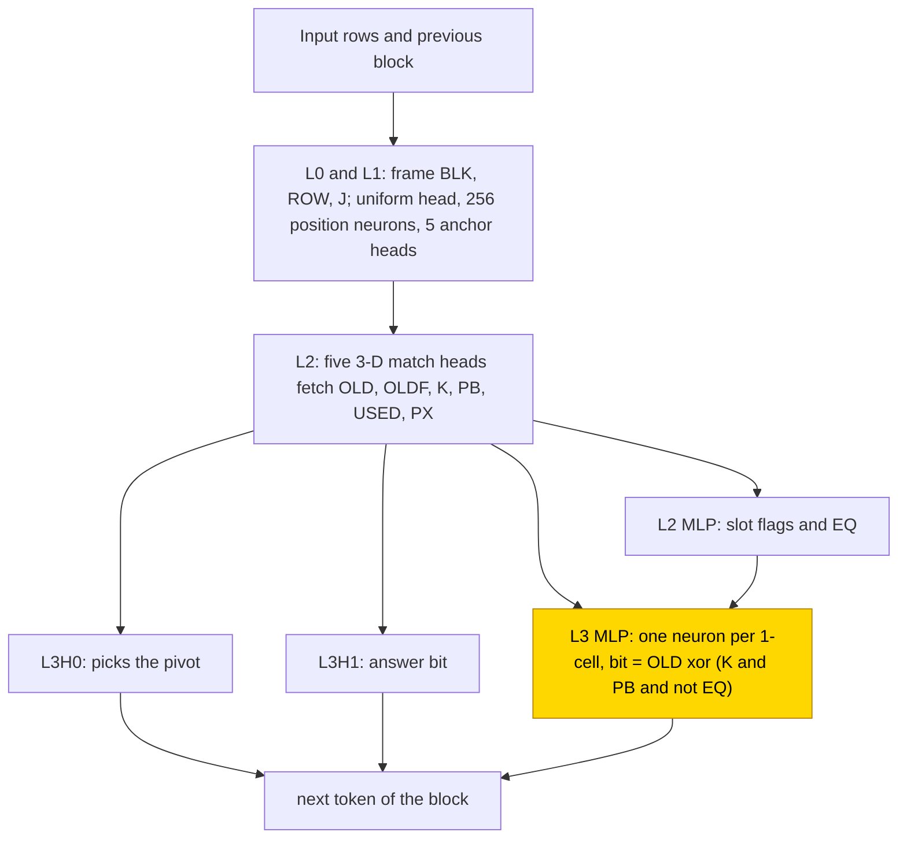
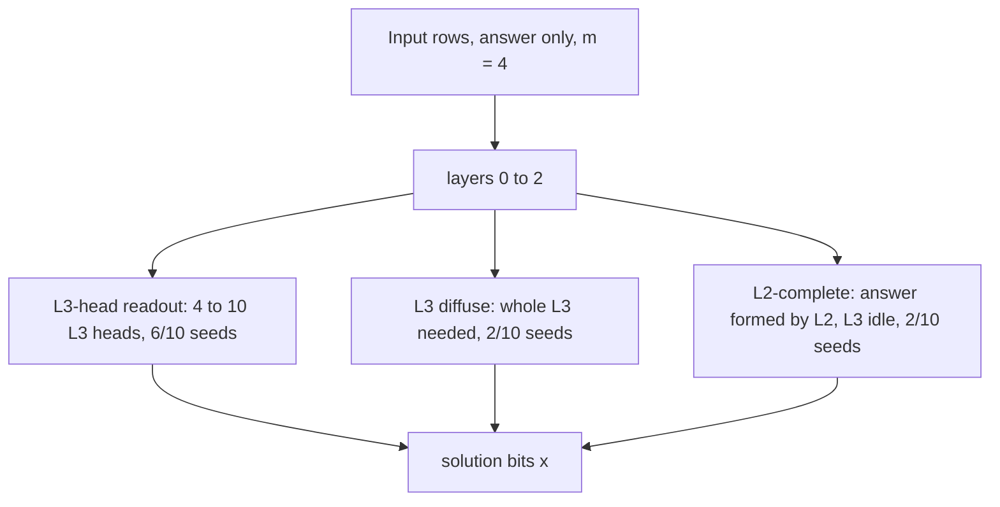

# GF(2) Gauss-Jordan elimination

This entry studies how small transformers solve a linear system A x = b over GF(2), the field of bits with XOR as addition, for an
invertible bit matrix (3×3, later 4×4), writing either only the solution or each elimination step first. The hand-built network fetches
three bits of the previous block with match heads and writes each new row bit in its last MLP as the old bit XOR the pivot-row bit
when the row has a 1 in the pivot column and is not the pivot row. With the hand-built routing frozen, one retrained MLP relearned this
update in 10/10 seeds (1000 steps). From scratch at m = 3 only 5/10 seeds per format solved, and the rest memorised the 118 training
matrices; with 6000 matrices at m = 4, answer only solved 10/10 in three circuit types. Almost nothing transfers to other sizes (Table 2). The task is
partly solved (answer only at m = 4 10/10; from scratch at m = 3 5/10 per format), and the closed form is partial: the table for the retrained
MLP on frozen parts (PART) is accepted by substitution with controls (1.0 = native in 20/20 snapshots; complement not tested, that is, no [resample ablation of everything outside the claimed circuit](../GLOSSARY.md#verifying-a-circuit) was run), and from
scratch only the L2-complete type has one (4/4 snapshots).

| Fact | Value |
|---|---|
| Task | Solve A x = b over GF(2) for an invertible m × m bit matrix (m = 3, later 4); write the solution, or each elimination step first |
| Input → output example | In words: A with rows (1, 1) and (0, 1), b = (1, 1) → x = (0, 1) |
| Model | GPT-NeoX 4 × 12 heads, d_model 384, MLP 256 ReLU, no LayerNorm, NoPE; PART trains the layer-3 MLP, PARTp the layer-3 attention |
| Rungs and seeds | HAND T; m = 3: PART, PARTp, TRAIN T, TRAIN A, 10 seeds each; m = 4 retry 3 seeds per format; final cell A TRAIN m = 4, 10 seeds |
| Closed form status | Partial (PART accepted, 1.0 = native in 20/20 snapshots; from scratch only the L2-complete type, 4/4 snapshots; complement not tested) |
| Status | Partly solved (A TRAIN m = 4 10/10 with 6000 matrices; TRAIN m = 3 5/10 per format, the rest memorise 118 matrices; PART 10/10 in 1000 steps); last run 2026-11-08 |
| Weights | [Hugging Face: gf2-elimination](https://huggingface.co/jc1122/circuit-atlas-nets/tree/main/gf2-elimination) |
| Reproduce | Not available yet: training code for this task is not yet in `code/` |

## 1. Task and data

The task is A x = b over GF(2) with A invertible and m × m. The input is `f r_0 , .. , f r_{m-1} ;`, where row r_i = a_i0 .. a_i,m-1 b_i
is the augmented row and the flag f is `.` for an unused row and `*` for a row already used as pivot. Two formats were studied
(Table 1). In the [scratchpad](../GLOSSARY.md#task-formats) format T, step k writes a block `p_k f r_0 , .. ;`, where the pivot p_k is
the first unused row with a 1 in column k−1 and each row is updated as new_r = old_r ⊕ (old_r[k−1] ∧ [r ≠ p_k]) old_{p_k}; the trace then
ends with `= x_0 .. x_{m-1}`. In the answer-only format A the input is followed by `= x`.

*Table 1. Output formats.*

| Format | Output |
|---|---|
| `T` (scratchpad) | one block per step with the pivot and the updated rows, then the solution |
| `A` (answer only) | the solution x |

The split is 70/30 *by matrix*, so the test set holds unseen matrices. At m = 3 all 168 matrices were used (944 / 400 systems); at
m = 4, 6000 of 20160 matrices were used, giving 67.2k training and 2000 test systems. An output counts as correct only on exact match.
The size axis was tested with 500 systems at m = 2–5.

## 2. Model

The shared architecture and instrumentation are described in [METHODS.md](../METHODS.md). The
[rungs](../GLOSSARY.md#the-three-rungs) are HAND (every weight set by formula), PART (frozen hand-built parts with one trained MLP),
PARTp (the same with a trained attention layer) and TRAIN (all weights trained from scratch).

### 2.1 Architecture

All networks have 4 layers × 12 heads (d_head 32), d_model 384, MLP 256 ReLU, no LayerNorm, no positional encoding and an untied
readout, with a vocabulary of 13 (BOS, `0 1 , ; = . *`, `a`..`e`) and 256 positions.

### 2.2 Frozen parts and trained part

PART re-initialises HAND's L3 MLP (dense_h_to_4h [256, 384], dense_4h_to_h [384, 256], biases); PARTp re-initialises its L3 attention
(query_key_value [1152, 384], dense [384, 384], biases); TRAIN trains all weights.

### 2.3 Training

The optimiser was AdamW with learning rate 1e-3, weight decay .1 and betas (.9, .98), warmup 1000 steps, a cosine schedule, clipping at
1 and batch 256 (m = 4: 6 micro-batches). Test accuracy was evaluated every 500 steps and the best snapshot was kept; a run stopped at
test 1.0 or after a 5k plateau once past min_steps (m = 3 15k, m = 4 22.5k). PART ran 10k and TRAIN 30k steps. PART ran in fp32 and
TRAIN in TF32, on consumer GPUs.

### 2.4 Reproduction

Reproduce: not available yet: training code for this task is not yet in `code/`; the weights, held-out splits and recorded
accuracies are on Hugging Face at
[huggingface.co/jc1122/circuit-atlas-nets/tree/main/gf2-elimination](https://huggingface.co/jc1122/circuit-atlas-nets/tree/main/gf2-elimination).

### 2.5 Archive

The folder `gf2-elimination/` holds hand_T, part_T_m3_s0–9, partp_T_m3_s0–9, train_T_m3_s6/s0, train_A_m3_s4/s3, train_A_m4_s0–9,
split_m3/m4, config.json and manifest.json (seed, rung, step, test, sha256); every file reloads bit-identically.

## 3. Hand-built solution

The hand-built network reads the previous block and rewrites each row bit with one Boolean rule (Figure 1). Layers 0 and 1 build a
frame of block BLK, row ROW and column J, with their next-token versions, from a uniform head, 256 position neurons, five anchor heads
and steps of the form relu(4z+3) − relu(4z+2). In layer 2, five 3-D match heads fetch OLD (the bit's old value), OLDF, K (the row's bit
in the pivot column), PB (the pivot row's bit in this column), USED and PX; the layer-2 MLP writes slot flags and EQ (the row is the
pivot row). In layer 3, head 0 picks the pivot with the score −B·dist² + G·bit − G·USED − A·ROW and head 1 the answer bit. The layer-3
MLP has one neuron per 1-cell of (OLD, K, PB, EQ), relu(Σ ±x + 100 TB − (#ones − 1) − 100), writing Y1 − Y0, plus a TB neuron writing
Y0. Together these write bit = OLD ⊕ (K ∧ PB ∧ ¬EQ). The network has 13 heads, neurons 256/80/14/32 and 1630 non-zero weights, and it
is exact on all systems at m = 2, 3, 4 and on 200 random systems at m = 5.

*Figure 1. The hand-built network for the scratchpad format. Match heads fetch the bits of the previous block, and the layer-3 MLP
writes each new row bit. The shaded layer-3 MLP is the part that PART replaces with a trained stage; PARTp instead replaces the layer-3
attention, which includes L3H0 and L3H1.*

## 4. What training finds

*Table 2. Results per cell (best snapshot; m is the matrix size).*

| Cell | Seeds | Solved | Steps | Size transfer |
|---|---|---|---|---|
| T PART m = 3 | 10 | 10/10 | 1000 | m = 2 1.0 in 6/10; m = 4, 5 0 |
| T PARTp m = 3 | 10 | 10/10 | best 1.5–4k | 0 at m = 4, 5 |
| T TRAIN m = 3 | 10 | 5/10 | train ≥ .99 by 3.5–5k | |
| A TRAIN m = 3 | 10 | 5/10 | train ≥ .99 by 3.5–5k | |
| T, A TRAIN m = 4 retry | 3 per format | A 3/3, T 3/3 (T nets lost) | | |
| A TRAIN m = 4 final | 10 | 10/10, best and final 1.0 | best step 12–21.5k | m = 2 .09–.45, m = 3 .10–.27, m = 5 .03–.10 |

With frozen parts, both stages learned the update: PART forms one circuit type in 10/10 seeds (HAND's fetches and a cell-detector
MLP3), and PARTp forms one type whose attention also carries the update in 7/20 snapshots. Trained from scratch at m = 3, the failed
seeds memorised the 118 training matrices; the networks are distributed, and HAND's inputs are present in another basis (alignment R² < 0,
edge Jaccard .07–.10). The data decided the outcome: 118 matrices memorise and 6000 generalise.

The final answer-only networks at m = 4 fall into three circuit types (Figure 2): an L3-head readout in 6/10 seeds (4–10 L3 heads,
answer R² at L3 ≤ .26), an L3-diffuse readout in 2/10 (no single L3 head used, the whole of L3 needed, R² at L3 .54) and an
L2-complete type in 2/10 (L3 idle, R² at L3 .89). Full diagnostics are in Appendix B.

## 5. Mechanism and verification

### 5.1 Closed forms

For PART, the table μ[OLD, K·PB·¬EQ, query] (the mean stage output per key, on HAND's live registers) replaces MLP3's row-bit write
and gives 1.0 = native in 20/20 snapshots (944 fit / 400 test systems), meaning exact match equal to that of the unmodified (native) network. The [controls](../GLOSSARY.md#verifying-a-circuit) hold: zeroed 0, shuffled ≤ .01, negated 0, and
another seed's table gives 1.0. The closed form is accepted. For PARTp the table also gives 1.0 in 20/20, but the zero and shuffle
controls keep ≥ .2 in 7/20, so it is not accepted.

From scratch at m = 3, Boolean tables reach only .05–.06. For the final A networks, an oracle readout μ_c + (2x_c − 1)g_c holds in 4/10
best and 10/10 final snapshots, but the zero-MLP3 control fails, so it is not accepted. Replacing L3 attention by its
per-slot mean (2000 test systems) gives 1.0 = native in 4/4 snapshots of the L2-complete type (accepted); the L3-diffuse type gives
.38–.48 and the L3-head type .05–.18, so they have no closed form. No resample ablation of the complement was reported for any cell; the
accepted closed forms are supported by substitution with controls, and the status is partial.

*Figure 2. The three circuit types of the final answer-only networks (A TRAIN m = 4). Only the L2-complete type has a closed form
(per-slot mean of L3 attention, accepted in 4/4 snapshots; complement not tested).*

### 5.2 Relation to the hand-built network and to published work

PART computes HAND's update on HAND's bits, as in [gf2-matrix-product](gf2-matrix-product.md); from scratch the networks use 6–19 heads
and all MLPs. Here the amount of data decided whether training memorised or generalised; [Liu et al. (2022)](#references) describe a
critical training fraction for generalisation, and [Charton (2021)](#references) relates generalisation to the diversity of the
training matrices.

## 6. Limitations and open questions

All tests use unseen matrices. Format T at m = 4 had 3 seeds, and its networks were lost. Diagnosed: PART 7/10, PARTp 4/10, T TRAIN m3
6/10, A m3 none, A final 20/20. Probes are linear; there was no neuron ablation, no study of training dynamics and only one width.
Size transfer is exact only at the training m (A final m = 2 .09–.45, m = 3 .10–.27, m = 5 .03–.10).

## 7. Prediction record

Predictions were recorded before the runs. PART 10/10: held. PARTp ≥ 8/10 and 0 at m = 4, 5: held. TRAIN T at m = 3 ≥ 5/10, with the
pivot labels last to reach .99: 5/10 held, but the labels and answers are 1.0 and the misses are row-update bits (refuted). TRAIN A at
m = 3 ≤ 1/10: refuted (5/10).

## Appendix A. Weights excerpt and reading

A HAND L3 cell neuron is relu(Σ ±x + 100·TB − (#ones − 1) − 100), with + on the cell's 1-inputs, writing Y1 − Y0. For PART, the top
|Y1 − Y0| neuron per seed is given as its layer-3 dense_h_to_4h row at OLD, K, PB, EQ, TB divided by the row maximum, followed by
out = the Y1 − Y0 difference of dense_4h_to_h:

- s0 n55 (−1.00, −.71, −1.00, +.47, +.33; −.53) = cell (0,0,0,1), voting 0
- s3 n213 (+.89, +.84, +.71, −1.00, −.16; −.69) = cell (1,1,1,0), voting 0
- s9 n84 (+1.00, −1.00, −.47, −.44, −.11; +.65) = cell (1,0,0,0), voting 1

Reading: in 9/10 seeds the top neuron's signs are one truth-table cell and it votes that cell's bit, which is HAND's form on other
cells; these inputs hold 8.6–10.1% of W_in.

## Appendix B. Detailed evidence

*Table B1. Diagnostics per cell (250 test systems).*

| Cell (diag seeds) | used heads + MLPs | best probe R² per HAND variable (layer) | r99 (HAND 11) | JS | best / final |
|---|---|---|---|---|---|
| T PART (7) | 8 + 2 (frozen fetches, MLP3) | OLD, K, PB, EQ 1 (L3); interchange K 1, EQ, OLD → DAS 1 | 11 | 0 | 1 / 1 |
| T PARTp (4) | 10–13 + 2 | OLD, K, PB, EQ 1 (L3); pivot .92–.96 (L4) | 6–12 | .11 | 1 / 1 |
| T TRAIN m3 (6) | 11–15 + 4 | failed seeds OLD, K, PB, EQ .12–.70 (L3); interchange OLD, K ≥ .97 | 27–36 | .47 | .73–1 / .70–1 |
| A TRAIN m4 final (10 B + 10 F) | 6–19 + 4 (final) | answer .80–.94 (L4); flip .996–1 (L4) | 20–51 | — (no HAND) | 1 / 1 |

Key: used = mean-ablation drop > .05 (neurons not ablated); r99 = rank of the layer-4 residual at 99% of the variance; JS =
Jensen-Shannon divergence of used heads against HAND; B, F = best and final snapshots; in the T PART row, EQ and OLD reach 1 under
distributed alignment search (DAS). Terms are defined in the [glossary](../GLOSSARY.md#analysis-measures).

## References

- Charton, F. (2021). Linear algebra with transformers. *arXiv preprint*. https://doi.org/10.48550/arxiv.2112.01898 (diverse matrices
  generalise)
- Liu, Z., Kitouni, O., Nolte, N., Michaud, E. J., Tegmark, M., & Williams, M. (2022). Towards understanding grokking: An effective
  theory of representation learning. *arXiv preprint*. https://doi.org/10.48550/arxiv.2205.10343 (critical training fraction)
