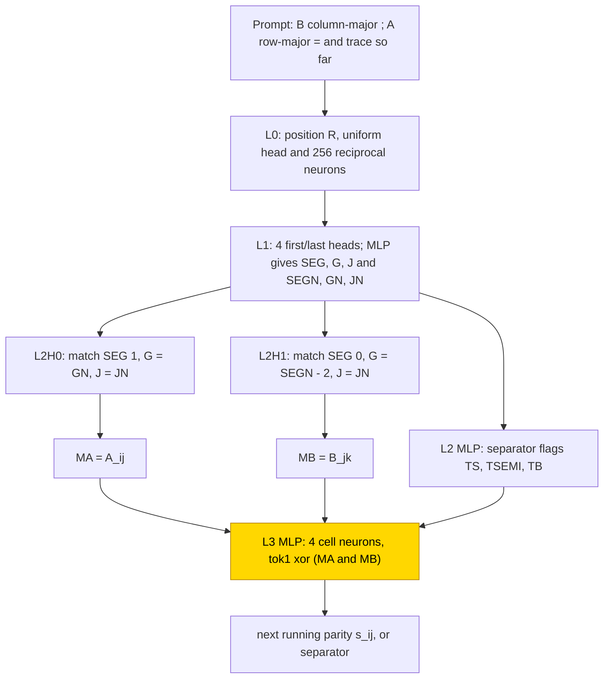
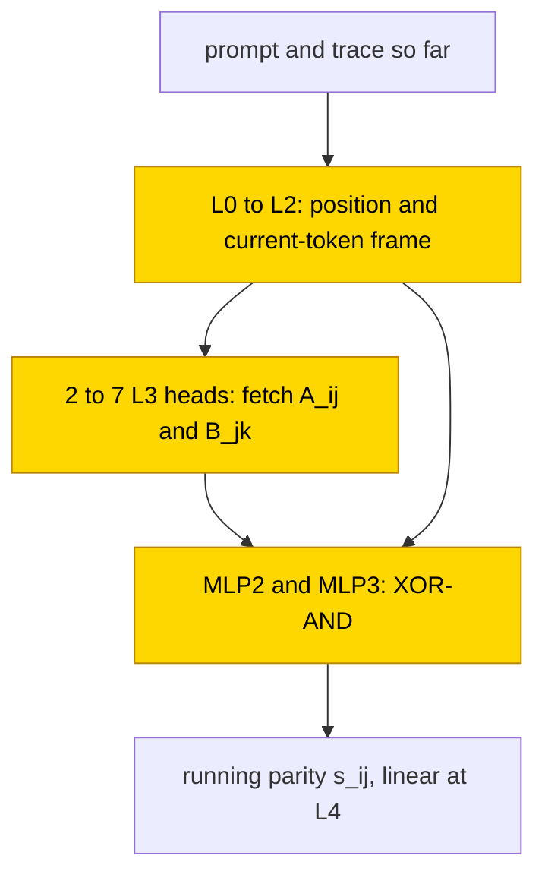

# Binary matrix product over GF(2)

In this version of matrix multiplication, an answer bit is one when an odd number of paired input bits are both one (AND products,
XOR sums, arithmetic over GF(2)). Four-layer transformers learned direct answers and a scratchpad of running parities
for 3×3 matrices: all three reported cells reached held-out whole-output exact match 1.0 in 10/10 seeds. With hand-built retrieval
frozen, the trained stage reduced to a table of the three bits needed for an update; from scratch, the operand bits were fetched one layer later through
different wiring. The fixed-size task is solved, but the lookup with frozen retrieval is partial: substitution preserved answers,
while no test resampled everything outside the claimed circuit. No cell transferred to matrix sizes 4 or 5, and the detailed
matrix-vector interventions reported separately cannot verify this matrix-product mechanism.

| Fact | Value |
|---|---|
| Task | Multiply two 3×3 bit matrices over GF(2) (AND for products, XOR for sums); write the 9 answer bits or a trace of running parities |
| Input → output example | In words: row (1, 1, 0) of A times column (1, 0, 1) of B gives running parities 1, 1, 1, so the entry of C is 1 |
| Model | GPT-NeoX 4 layers × 12 heads, d_model 384, MLP 256 ReLU, no LayerNorm, NoPE; the partly trained networks train only the layer-3 MLP |
| Rungs and seeds | [HAND / PART / TRAIN](../GLOSSARY.md#the-three-rungs): formula-set weights / one trained stage / all weights trained; HAND trace, PART trace, TRAIN trace and direct answer; 10 seeds per trained cell (no retry needed) |
| Closed form status | Partial (PART stage only: substituted 1.0 = native in 20/20 best/final snapshots, zeroed 0, shuffled keys ≤ .002; complement not reported for this form; none for TRAIN) |
| Status | Solved at matrix size 3 (10/10 seeds per reported cell at held-out whole-output exact match 1.0; 0 at sizes 4 and 5); last run 2026-11-05; controls 2026-11-08 |
| Weights | [Hugging Face: gf2-matrix-product](https://huggingface.co/jc1122/circuit-atlas-nets/tree/main/gf2-matrix-product) (15 networks) |
| Reproduce | Not available yet: training code for this task is not yet in `code/` |

## 1. Task and data

The target is C = A B over GF(2) with matrix size m = 3. Each entry is a bit: multiplication is AND (one only if both inputs are one)
and addition is XOR (one if the inputs differ). A running parity starts at zero and flips whenever the next bit product is one.
For example, row (1, 1, 0) times column (1, 0, 1) gives running parities 1, 1, 1 and answer bit 1. The prompt is
`B column-major ; A row-major =`, written as bits with `,` between groups.
Two output formats were studied (Table 1). In the trace format, a [scratchpad](../GLOSSARY.md#task-formats) in which the network writes
intermediate results before the answer, the running parity s_ij = s_i,j−1 ⊕ A_ij B_jk is written per column k (the index j counts from 0), so that s_i2 = C_ik.
Per seed, 100k training and 2k test pairs (A, B) were drawn disjointly at random from the 2^18 possible pairs; 38% of all pairs were
seen in training. An output counts as correct only on exact match of all output tokens, scored teacher-forced: each token is given
the correct previous tokens, not a freely generated trace. Extra evaluations at m = 2, 4, 5 used 500
random pairs each.

*Table 1. Output formats.*

| Format | Output |
|---|---|
| `T` (trace) | per column k a segment of running parities s_ij (`,` between rows, `;` between columns) |
| `A` (answer only) | the 9 bits of C, column-major |

## 2. Model

The shared architecture and instrumentation are described in [METHODS.md](../METHODS.md). The three
[rungs](../GLOSSARY.md#the-three-rungs) are HAND (every weight set by formula), PART (frozen hand-built parts with one trained stage)
and TRAIN (all weights trained from scratch).

### 2.1 Architecture

All networks are GPT-NeoX 4 layers × 12 heads (d_head 32), d_model 384, MLP 256 ReLU, no LayerNorm and no positional encoding (NoPE),
with a vocabulary of 6 (BOS `0 1 , ; =`) and 256 positions, which is 3.16M parameters. HAND T has 1295 non-zero weights; it uses 7
heads and neurons L0 256 / L1 72 / L2 4 / L3 7.

### 2.2 Frozen parts and trained part

PART trains the L3 MLP only (dense_h_to_4h [256, 384] + bias, dense_4h_to_h [384, 256] + bias) on top of the frozen HAND T. TRAIN trains
all weights from the default initialisation.

### 2.3 Training

The optimiser was AdamW with learning rate 1e-3, weight decay .1 and betas (.9, .98), warmup 1000 steps, a cosine schedule (PART 10k,
TRAIN 30k steps), clipping at 1 and batch 256. Test accuracy was evaluated every 500 steps and the best-test snapshot was kept; a run
stopped early at test 1.0 or after a 5k-step plateau once past 15k. PART ran in fp32 and TRAIN in TF32. Runs were on consumer GPUs, with
all seeds of a cell in one process.

### 2.4 Reproduction

Reproduce: not available yet: training code for this task is not yet in `code/`; the weights, held-out splits and recorded
accuracies are on Hugging Face at
[huggingface.co/jc1122/circuit-atlas-nets/tree/main/gf2-matrix-product](https://huggingface.co/jc1122/circuit-atlas-nets/tree/main/gf2-matrix-product)
(15: 1 HAND, 10 PART, 4 TRAIN; the train/test split per seed is in `split.safetensors`).

### 2.5 Archive

The folder `gf2-matrix-product/` holds hand_T, part_T_s0–s9 (stage tensors), train_T_s2/s6 and train_A_s2/s5 (the seeds with the
earliest and latest best step), split.safetensors, config.json and manifest.json (sha256, roundtrip_all_ok true).

## 3. Hand-built solution

The hand-built network locates each operand bit by matching position attributes and then looks up one XOR-AND cell per token
(Figure 1). Layer 0 computes the position R from a uniform head and 256 reciprocal neurons. Layer 1 has 4 first/last heads (first
separator, which gives the row length; first `;`, which gives the segment length; last terminator; last separator), and its MLP uses
clean steps to give the segment SEG, the group G and the offset J, together with their next-token versions SEGN, GN and JN.

In layer 2, head 0 matches (SEG 1, G = GN, J = JN) and returns MA = A_ij; head 1 matches (SEG 0, G = SEGN − 2, J = JN) and returns
MB = B_jk. Each attribute scores 2·20·[match] − 20. SEG names the segment, G its row group and J the offset; a suffix N names the
next token's value. The layer-2 MLP writes separator flags TS (a separator), TSEMI (specifically a semicolon) and TB = 1 − TS
(a bit position). The layer-3 MLP
has 4 neurons relu(±tok1 ± MA ± MB + 100 TB − (#ones − 1) − 100), where tok1 is the current token (the previous running parity), one
for each cell with tok1 ⊕ MA·MB = 1, writing Y1 − Y0, plus a Y0 bias neuron and `,` / `;` neurons. Y0 and Y1 are the output-score
coordinates for bits zero and one. The original task record checks all 2^8 pairs at m = 2 and 300 random pairs at each of m = 3–5,
not every m = 3 pair. A later saved reference control checks all 256 m = 2 pairs, 2,048 random m = 3 pairs and 512 random pairs each
at m = 4 and 5. Earlier public check wording is corrected in Appendix B.

In Figure 1, frozen position and separator frames address two operand-fetch heads. Their bits MA and MB, the preceding parity and separator flags enter MLP3's XOR-of-AND lookup. It writes the next running parity or separator. Only this final stage is trained in PART.

*Figure 1. The hand-built network for the trace format. Layers 0 and 1 build a position frame, two layer-2 heads fetch A_ij and B_jk,
and the layer-3 MLP looks up the XOR-AND cell. The shaded layer-3 MLP is the part that PART replaces with a trained stage.*

## 4. What training finds

Every cell reached held-out whole-output exact match 1.0 in 10/10 seeds, and the best snapshot equalled the final one in every
cell (Table 2).

*Table 2. Results per cell (10 seeds each). t(.5) and t(.9) are the first steps at which test exact match reached .5 and .9.*

| Cell | Solved | t(.5) | t(.9) | Best step | m = 2 | m = 4, 5 |
|---|---|---|---|---|---|---|
| PART T | 10/10, test 1.0 at step 500 | | | | .00–.40 | 0 |
| TRAIN T | 10/10 | 2.5–5.5k | 3–7k | 4.5–7.5k | 0–.05 | 0 |
| TRAIN A | 10/10 (train .99 at 3.5–9k) | 2.5–8k | 2.5–8.5k | 5–11k | .07–.27 | 0 |

PART solved in 500 steps and forms one circuit type in 10/10 seeds: HAND's layer-2 fetch heads with a new layer-3 lookup. Diagnostics found only L2H0, L2H1 and
MLP3 used in 10/10 seeds, with attention divergence (JS) 0 to HAND. TRAIN T showed [grokking](../GLOSSARY.md#counting-results), test
accuracy rising after training accuracy ([Power et al., 2022](#references)): the first evaluation at .9 was 3–7k, and the best step
was 4.5–7.5k. The older 3–7.5k summary combined those different timing criteria. TRAIN computes HAND's variables (the AND and the
running parity s flip with interchange 1.0 at L4), but builds a frame in L0–L2 (the position and current-token features later layers
read), fetches operand bits with 2–7 L3 heads one layer later than HAND, and computes XOR-AND in MLP2/MLP3. The original nine-seed
diagnostic table found 2–7 L3 heads in 9/9 and operand R² ≤ .39 at L3 in 8/9. This is not exclusively late access: a later census
reports seed 5's b probe R² .877 at L3. TRAIN A solves 10/10 with no compact HAND counterpart (13 heads + 4 MLPs on seed 0).

There were no training-size failures. Nothing generalises to m = 4, 5 (0 everywhere). PART keeps HAND's frame, yet m = 4 is 0 because the re-learnt
L3 also keys on m = 3 features (the scale of TB/TS); TRAIN learns absolute separator positions (column and group probes). Full
diagnostics are in Appendix B.

## 5. Mechanism and verification

### 5.1 Closed form of the PART stage

The PART stage was replaced by its mean output per (tok1, MA, MB, TS, TSEMI) key, a table of 24 keys: exact 1.0 and agreement 1.0 with
the network on 2000 test pairs, 10/10 seeds. The controls of 2026-11-08 used 2,048 fit and 2,000 held-out pairs and the best and final
snapshot of all 10 seeds (the two snapshots are identical files). Substituted, the table gives 1.0 = native in 20/20. With the stage
output zeroed accuracy is 0; with the closed form fed shuffled keys it is ≤ .002, with the per-query mean ≤ .016, and with the previous
bit negated 0. Another seed's table also gives 1.0, so these stages share a truth table. The source accepted the form under its
substitution/zero/shuffle controls. It does not pass the current atlas verification rule without complement resampling
([glossary](../GLOSSARY.md#verifying-a-circuit)); the status is partial, supported by substitution with the complement not tested.

For TRAIN there is no shared basis with HAND. The AND and s are linear at L4 (flip 1.0), but the alignment fit on seeds 0 and 1 has
fit_r2 < 0, the QK/OV comparison has mean_ov ≤ .05 and the edge Jaccard against HAND is .09: TRAIN uses HAND's variables without HAND's
wiring. The TRAIN candidates of the earlier audit still lack the zero and shuffle controls.

In Figure 2, trained early layers build a frame, later heads fetch operand bits, and the final MLPs update the running parity. All marked stages were trained. No TRAIN matrix-product formula was accepted; the entry's partial status refers only to the separate PART lookup, whose complement was not tested.

*Figure 2. The circuit type found from scratch in the trace format (TRAIN T). The operand fetch moves to layer 3 and the XOR-AND
spreads over MLP2 and MLP3; all displayed network components are trained and shaded. No trained matrix-product decoder formula was
accepted. The entry's partial status covers only the separate PART lookup, whose complement was not tested.*

### 5.2 Circuit probes

The 2026-11-06 matrix-product seed census supports the early two-fetch plus XOR-AND/separator computation in PART (10/10),
consistent with the partial 24-key readout in Section 5.1. It does not supply a complement test. For trace TRAIN, a Boolean oracle
table suffices in 6 seeds, a query-dependent one in 3 and richer context in 1; these are ten-seed oracle classifications, not
verified internal decoders. For answer-only TRAIN, a count-only oracle suffices in 2, a frame- or weight-dependent one in 2 and
richer context in 6. An oracle key is supplied from the task variables rather than decoded by the trained network.

The detailed size-4 matrix-vector interventions belong to a different experiment. They are retained, with every failed pruning,
scrubbing and size-transfer test, in Appendix B and cannot verify this entry's matrix-product TRAIN circuit.

### 5.3 Relation to the hand-built network and to published work

PART supports the same local truth table as HAND under substitution, with no complement test (partial). Its top neurons take
HAND's cell-detector form for other cells (Appendix A); this is not evidence of identical weights or a verified whole network. TRAIN T computes HAND's variables but moves the
fetch to L3 and spreads the AND/XOR over MLP2–MLP3; TRAIN A needs ≥ 13 heads, consistent with a query-dependent partner per output bit.
Unlike HAND, the trained networks of the matrix-vector probes fetch operands and update in L3, not L2, and add a previous-parity path;
PART keeps HAND's fetches but uses redundant decision neurons. [Charton (2021)](#references) trained transformers on real-valued matrix
products; here the field is GF(2) and the trace makes each step a 3-bit lookup. The interchange flips follow
[Geiger et al. (2023)](#references).

## 6. Limitations and open questions

Only m = 3 was trained, and 38% of all pairs were seen in training. Probes are linear, diagnostics use 250 pairs, and JS ties on
uniform heads. The original Table B1 records nine TRAIN trace best snapshots; its old seed-4-pending label is stale. The task
directory now contains all ten best trace reports, including seed 4, and a later source-qualified census reports ten best / three
final trace reports for each of PART and TRAIN. It reports two best / no final answer-only reports; seeds 2–9 remain undiagnosed
there. These coverage updates do not silently replace the older diagnostic ranges. No complement was reported for the PART form.
Open questions include the early frame code, answer-only TRAIN decoders and the neural macro of matrix-product TRAIN.

## 7. Prediction record

The prediction was recorded in the task specification before any PART or TRAIN run: PART 10/10 at m = 3 and < .1 at m = 2, 4, 5;
TRAIN T ≥ 8/10 with grokking at 5–15k; TRAIN A ≥ 6/10; nothing > .2 at m = 4, 5. It held except for PART at m = 2 (up to .40,
predicted < .1); TRAIN T grokked earlier than predicted (best 4.5–7.5k).

## Appendix A. Weights excerpt and reading

HAND L3 cell neuron 0 is relu(−tok1 + MA + MB + 100 TB − 101); it fires only at (s_i,j−1, A_ij, B_jk) = (0, 1, 1) and writes Y1 − Y0.

In PART only 5.2–6.1% of the stage's W_in norm lies on HAND's six L3 inputs. The strongest Y1 − Y0 neuron per seed, with W_in divided
by its row maximum, is s0 n243 (+.60 tok1, −1.00 MA, −.61 MB, +.26 TB; out +.26), s7 n46 (−.54, +.93, +.96; out +.24) and s3 n209
(−.45, −.76, −1.00; out −.27). Reading: in 10/10 seeds the top neuron weighs tok1, MA and MB at ≥ .45 of its row maximum with the sign
pattern of one truth-table cell and votes that cell's answer: (1,0,0) to 1 in 5 seeds, (0,1,1) to 1 in 3, and (0,0,0) to 0 and
(0,0,1) to 0 in one each. This is the same cell-detector form as HAND, on different cells.

## Appendix B. Detailed evidence

*Table B1. Original diagnostics per cell (250 test pairs, best snapshots). Later coverage is described below; these ranges were not
recomputed.*

| Cell (diag seeds) | used heads + MLPs | best probe R² (layer); interchange flip | r99 L4 | JS used heads | best / final |
|---|---|---|---|---|---|
| PART T (10) | 2 + 1: L2H0, L2H1, MLP3 (10/10) | a, b, prev 1 (L3); and .87–.92, s .92–.96 (L4); flip and 1 (L3), s .81–.92 | 7 (HAND frame) | 0 | 1.0 / 1.0 |
| TRAIN T (9 in this original table) | 2–9 + 2–4 | a .85–.99, b .93–.99, and .89–.99, s .93–.99 (L4); flip and, s 1 (L4) | 1–14 | .00–.60 | 1.0 / 1.0 |
| TRAIN A (2: s0, s1) | 13–14 + 4 | out .95–.96, cnt .96–.98 (L4); flip out 1, cnt .79 (L4) | 24–28 | — (no HAND) | 1.0 / 1.0 |

Key: s = seed in the first column and the running parity elsewhere; a, b = operand bits; prev = previous parity; and = A_ij ∧ B_jk;
out, cnt = output bit and count; probes are best-layer R² or accuracy; interchange flips as in [Geiger et al. (2023)](#references);
r99 L4 = rank of the layer-4 residual at 99% of the variance; JS = Jensen-Shannon divergence of used heads to the closest HAND head.
Terms are defined in the [glossary](../GLOSSARY.md#analysis-measures) and [METHODS.md](../METHODS.md).

### Check provenance and diagnostic coverage

The earlier public description claimed every m = 3 HAND pair was checked, alongside all 2^8 m = 2 pairs and 2000 random m = 4, 5
pairs. The original task record instead gives random 300 checks at m = 3–5; the later saved reference control gives 2,048 random
m = 3 checks and 512 each at m = 4 and 5. The exhaustive-m = 3 claim was not established by those records. These are HAND/reference
checks, not trained-net substitution scores.

### Related matrix-vector experiment (not matrix product)

Circuit probes were run on 2026-11-06 on a matrix-vector variant, trace s_i,j = s_i,j−1 ⊕ (M_ij ∧ v_j), at matrix size 4 in the same
network family. Their historical label “verified” meant a causal intervention plus an accuracy-preserving substitution, weaker than
the atlas rule; it is described here as substitution-supported, not atlas-verified. “Supported” meant causal evidence only. Exact
is teacher-forced complete-sequence accuracy, and layers are zero-based. This entry's matrix-product cells had a seed census only.

The matrix-vector probes (best TRAIN seed 0, replicate seed 8) are in Table B2. Taken together, the TRAIN forms (hard M/v routes, the
μ[query, prev] head and the MLP3 table, where μ is the training conditional-mean contribution at the replaced boundary) give 100%
in seeds 0 and 8, also on 2000 fresh instances: a dense substitution-supported decision macro, not exact amplitudes or a closed form
of the early layers. The eight-cell (AND, prev, sep) macro holds in 1/10 TRAIN seeds and the separate-operand macro in 8/10.

It is supported that L0–L2 form a position and current-token frame (dense whole scrub 100 / 99.85–99.90%); the same account fails on
the pruned circuits (69.2–71.0% seed 0, 88.7–89.8% seed 8), so it is not a complete minimal mechanism. By size, the joint
mean-ablation local minima at ≥ 99% of native are seed 0 35 heads + 284 neurons and seed 8 33 + 272, against the matrix-vector HAND
6 + 364; on fresh instances they give 98.70 / 98.45%, below 99%. Joint substitution on the pruned circuits gives seed 0 54.5% and
seed 8 100%.

Size transfer in the matrix-vector variant: count-parity and separator-relative tables restore A PART m = 6, 8 and T PART
m = 2, 3, 5, 6, 8 from 0 to 1 (repairs). The learned stage keys on absolute separator positions, as Section 4 describes for the
matrix-product task. This separate matrix-vector evidence does not verify matrix-product TRAIN.

*Table B2. Circuit probes on the separate matrix-vector trace, best TRAIN (seed 0, replicate seed 8), and on PART.*

| Component | Role | Evidence (substitution-supported, not atlas-verified) |
|---|---|---|
| L3H6 / L3H2 | matrix / vector bit transport | donor bit patches flip 64/64 each; hard positional routes separately and jointly 1.0, drop 0 |
| L3H4 | previous-parity message, conditioned on the query | previous-token donor flips 64/64, M/v donors 0/64; zeroed .012; μ[query, prev] substitution 1.0 |
| MLP3 | s = prev ⊕ (M ∧ v), plus separator | μ[M̂, v̂, prev, sep] substitution 1.0, drop 0; no single neuron necessary |
| PART L2H0/H1 → MLP2 | same macro one layer earlier, on frozen fetches | operand donor flips 64/64 in all ten seeds; 8- and 16-cell substitutions 1.0 (seed 0) |
| A PART MLP3 | parity of the count c = round(1/X − 1) | MLP3 zeroed 0; μ[c] substitution 1.0 in 10/10 seeds (seed 3 .9955 → 1 is a repair) |

Key: μ = training conditional-mean contribution at the replaced boundary; hats (M̂, v̂) = live neural decoders; a donor patch copies a
component's activation from another input.

## What to read next

Compare [binary elimination](gf2-elimination.md) for a related row-update computation. [Integer matrix–vector products](integer-matvec.md) provide a comparison in ordinary integer arithmetic, rather than binary-field arithmetic.

## References

- Charton, F. (2021). Linear algebra with transformers. *arXiv preprint*. https://doi.org/10.48550/arxiv.2112.01898 (transformers on
  real-valued matrix products)
- Geiger, A., Wu, Z., Potts, C., Icard, T., & Goodman, N. D. (2023). Finding alignments between interpretable causal variables and
  distributed neural representations. *arXiv preprint*. https://doi.org/10.48550/arxiv.2303.02536 (interchange interventions)
- Power, A., Burda, Y., Edwards, H., Babuschkin, I., & Misra, V. (2022). Grokking: Generalization beyond overfitting on small
  algorithmic datasets. *arXiv preprint*. https://doi.org/10.48550/arxiv.2201.02177 (grokking)
