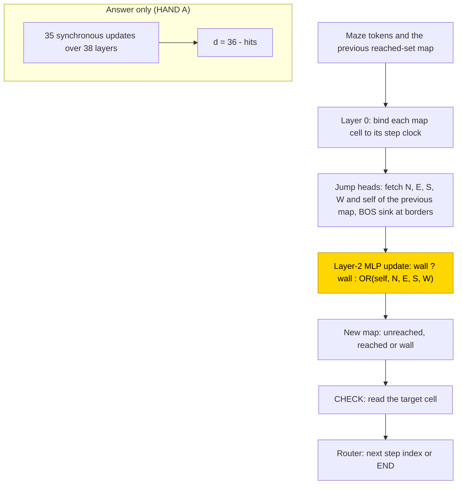
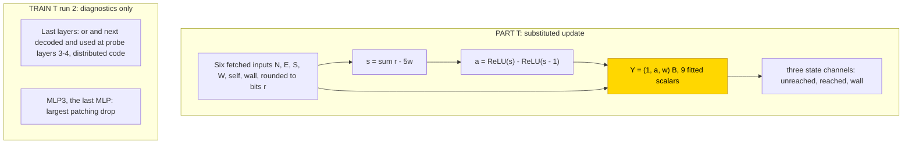

# Grid BFS

This entry studies how small transformers find the shortest-path distance between two squares of a 6×6 maze, either writing the
distance directly (answer only) or first writing the set of reached squares after every breadth-first search (BFS) step (a
scratchpad). With a scratchpad and 3× fresh data, a 4-layer network trained from scratch learned the task in 3/3 seeds (test exact
match ≥ .99, grokking at 63.5–72k steps), while answer only failed in 0/3 seeds at the same size and data (test .93–.95; exact up to
distance 3, falling with distance). A stage trained on frozen hand-built addressing solved the scratchpad in 3/3 seeds within 500
steps. The task is partly solved (scratchpad from scratch 3/3, answer only 0/3; the ten-seed final was not run). The closed form is
partial: the trained update of the frozen-parts network is replaced by a three-input hinge with 176/176 kept on all seeds, which is
supported by substitution with zero and shuffle controls open and the complement not tested; the solved from-scratch networks have no
substitution test yet.

| Fact | Value |
|---|---|
| Task | Shortest-path distance (0–10) between a start and a target square on a four-neighbour 6×6 maze with at most 14 walls |
| Input → output example | Start and target side by side with no wall between them → 1 (in words; square tokens encode coordinates) |
| Model | GPT-NeoX-shaped, ReLU, no LayerNorm, no positional encoding; PART trains only the layer-2 MLP of the 3-layer hand-built network; TRAIN trains a 4-layer network with d_model 256 |
| Rungs and seeds | HAND T (3 layers) and A (38 layers); PART T 3 seeds; TRAIN A and T 3 seeds each in run 1 (30k steps) and run 2 (90k steps, 3× fresh data) |
| Closed form status | Partial: PART three-input hinge Y = (1, a, w)·B keeps 176/176 on all seeds, best and final; supported by substitution, zero/shuffle controls open, complement not tested; no TRAIN closed form |
| Status | Partly solved (scratchpad TRAIN 3/3, answer only TRAIN 0/3; ten-seed final not run); last run 2026-11-07 |
| Weights | [Hugging Face: grid-bfs](https://huggingface.co/jc1122/circuit-atlas-nets/tree/main/grid-bfs) |
| Reproduce | Not available yet: training code for this task is not yet in `code/` |

## 1. Task and data

Each maze is a four-neighbour 6×6 grid with at most 14 walls and a start and a target that are free and connected; the label is the
shortest-path distance, 0–10. Square tokens encode coordinates. Mazes are split 80/10/10 by a hash of the wall mask, and fresh mazes are drawn for every batch. The test set holds 16 mazes per distance, 176 per seed. An output
counts as correct on exact match of the whole [teacher-forced](../GLOSSARY.md#task-formats) output, that is, every token scored given
the correct previous tokens; in format T this includes END. Out-of-distribution tests (distance 11–20 and 8×8 grids) were planned but
not measured for TRAIN.

*Table 1. Output formats.*

| Format | Output |
|---|---|
| `A` (answer only) | one distance token |
| `T` ([scratchpad](../GLOSSARY.md#task-formats)) | after each BFS step, the reached-set map (every square marked unreached, reached or wall), a CHECK of the target, then the next step index or END |

## 2. Model

The shared conventions are described in [METHODS.md](../METHODS.md). The three [rungs](../GLOSSARY.md#the-three-rungs) are HAND (every
weight set by formula), PART (frozen hand-built parts with one trained stage) and TRAIN (all weights trained from scratch).

### 2.1 Architecture

All networks are GPT-NeoX-shaped with ReLU, no LayerNorm, no positional encoding and untied embeddings, with a vocabulary of 565 tokens
and a context of 8192. Table 2 gives the sizes; "used" counts components whose mean ablation costs more than .05 of exact match.

*Table 2. Network sizes.*

| Network | Layers | d_model | Heads | MLP width | Used |
|---|---|---|---|---|---|
| HAND T | 3 | 80 | 5 | 24 | 7 heads + 10 neurons |
| HAND A | 38 | 384 | 3 | 144 | 2 heads + 5,258 neurons |
| TRAIN A and T | 4 | 256 | 8 | 512 | all weights trained |

### 2.2 Frozen parts and trained part

PART T is HAND T with the layer-2 MLP retrained: W_in [24, 80], b_in [24], W_out [80, 24] and b_out [80]. Its input is masked to six
bits fetched by the frozen heads (the north, east, south and west neighbours, the square itself, and the wall flag; N, E, S, W, self,
wall) and its output to the three state channels (unreached, reached, wall). Everything else is frozen at the hand-built values.

### 2.3 Training

The optimiser was AdamW with learning rate 1e-3 and weight decay .1, warmup 1,000 steps, a cosine schedule and gradient clip 1. Each
step used a batch of 8 fresh mazes (bounded by memory on long maps). Test accuracy was evaluated every 500 steps and checkpoints were
saved every 2,500. PART ran in [fp32](../GLOSSARY.md#hand-built-machinery); TRAIN used TF32 updates and fp32 evaluations. Success is a
best test exact match ≥ .99. Training ran on GPU accelerators, and re-scoring on CPU in fp32. Table 3 gives the runs.

*Table 3. Runs.*

| Run | Budget | Data | End |
|---|---|---|---|
| PART T run 1 | 10k | fresh mazes | stopped solved at 500 |
| TRAIN A and T run 1 | 30k | fresh mazes | budget |
| TRAIN A and T run 2 (retry rule: data) | 90k | 3× fresh data | T stopped solved at 79k; A ran to budget |

### 2.4 Reproduction

Reproduce: not available yet: training code for this task is not yet in `code/`; the weights, held-out splits and recorded
accuracies are on Hugging Face at
[huggingface.co/jc1122/circuit-atlas-nets/tree/main/grid-bfs](https://huggingface.co/jc1122/circuit-atlas-nets/tree/main/grid-bfs).
The test mazes are regenerated from their seed (see `config.json`).

### 2.5 Archive

The Hugging Face folder holds `hand_{T,A}`; `part_T_{best,final}_s0…2` (the 4 MLP tensors, to be inserted into `hand_T`);
`train_{T,A}_{best,final}_s0…2` (full state dicts of run 2); `config.json`; and `manifest.json` (seed, steps, recorded and fp32
re-scored exact match, sha256). The archived networks re-score to the recorded accuracies. The failed run-1 TRAIN networks are not
archived, being superseded by run 2.

## 3. Hand-built solution

The hand-built T network runs one BFS step per map and writes it out (Figure 1). Layer 0 binds each map cell to its step clock. Jump
heads (attention heads that fetch a cell of the previous map) fetch the north, east, south, west and self cells of the previous map, with the BOS token as an attention sink at the borders.
Three neurons compute the update: a wall square stays a wall, and any other square becomes `OR(self, N, E, S, W)`, so a square is
reached if it or a neighbour was reached. The hinge rows over (N, E, S, W, self, wall) are (1, 1, 1, 1, 1, −5) with biases 0 / −1, and the reached outputs are +1 / −1;
a wall copy and an unreached bias 1 complete the three channels. CHECK reads the target cell, and a router emits the next step index or
END.

The hand-built A network performs 35 synchronous updates over 38 layers and then writes d = 36 − hits.

Both were verified on stratified full-network tests plus exhaustive local and tiny-grid checks, not by enumerating all mazes: T on
184/184 cases and A on 41/41, with a minimum logit margin of 30.

*Figure 1. The hand-built networks. In format T the frozen heads fetch the five local cells of the previous map and three neurons apply
the BFS update; HAND A unrolls 35 updates in depth. The shaded layer-2 MLP is the only part that PART retrains.*

## 4. What training finds

Table 4 gives every cell. The [grok step](../GLOSSARY.md#counting-results) is the first evaluation at which test exact match reached
.99.

*Table 4. Results per cell. Test exact match on 176 mazes per seed, given for seeds 0 / 1 / 2.*

| Cell | Solved | Best → final test (s0 / s1 / s2) | ≥ .99 step |
|---|---|---|---|
| PART T run 1 | 3/3 | 1 / 1 / 1 → 1 / 1 / 1 | 500 |
| TRAIN T run 1, 30k | 0/3 | .716 / .381 / .761 → same | none |
| TRAIN A run 1, 30k | 0/3 | .898 / .807 / .898 → .898 / .807 / .892 | none |
| TRAIN T run 2, 90k, 3× data | 3/3 | 1 / 1 / 1 → 1 / 1 / 1 (stop 79k) | 72.0k / 63.5k / 67.5k |
| TRAIN A run 2, 90k, 3× data | 0/3 | .943 / .926 / .955 → .932 / .915 / .943 | none; d ≤ 3 exact, d 10 .62 / .50 / .88 |
| T final, 10 seeds | not run | | |

Key: s = seed; d = distance.

In run 2 the scratchpad solved 3/3 (test exact match ≥ .99 first reached at 63.5–72k steps) and answer only 0/3 (test .93–.95) at the
same network size. PART reached ≥ .99 at the first evaluation, step 500. Because every batch is fresh, there is no
memorisation step. Answer only is exact for distance ≤ 3 and worse with every further step (distance 10: .50–.88), the signature of a
fixed-depth network that cannot unroll 10 serial BFS steps; the hand-built A needs 38 layers.

The networks fall into one circuit type per cell. PART forms one type in 3/3 seeds: frozen fetch plus a learned local update. TRAIN T
in run 2 forms one type by diagnostics in 3/3 seeds: the update variables `or` and `next` (named after the hand-built OR of self and
neighbours and the square's next state) are decoded and causally used in layers 3–4, and the last MLP is needed. TRAIN A is unsolved and limited by
distance.

The failures are explained by the diagnostics (Appendix B). In TRAIN T run 1 the errors are CHECK decisions between a step index and
END; every map cell is correct, and in seed 0 an [interchange](../GLOSSARY.md#analysis-measures) on `or` and `next` at layer 4 flips
the output 1 and .88 of the time (nf 72 and 77 swaps tested), so the update variables are used and the failure lies in the stop and
route decision. TRAIN A fails by distance (exact to d = 3, falling to d = 10). TRAIN T run 2 seeds 1 and 2 score 1.0 on the 176 test
mazes but .94–.97 on the 32-maze diagnostic batch, so "solved" means the ≥ .99 bar on the test set, not exactness on all mazes.

## 5. Mechanism and verification

### 5.1 Closed form of the PART update

The PART update has a closed form that was accepted at the substitution bar. The six fetched inputs are rounded and clamped to bits r;
then s = Σr − 5w, where w is the wall bit, and a = ReLU(s) − ReLU(s − 1), and the whole MLP2 output is replaced by Y = (1, a, w)·B in the three state channels
(zero elsewhere). B (9 scalars) is fitted to the MLP's outputs on all 64 local interfaces, never to maze answers. In all three seeds,
best and final, exact match stays at 176/176 (from 176/176 native), with agreement 176/176 against a bar of ≥ .99 × native. This is
output equivalence on valid inputs: the learned local argmax matches the hand-built rule on 48/48 valid tuples (53 / 59 / 53 of all 64
for seeds 0 / 1 / 2). The matched zero and shuffle controls are open, and no
[resample ablation of the complement](../GLOSSARY.md#verifying-a-circuit) was run, so the closed form is supported by substitution with
the complement not tested (status partial).

The learned update is a different but equivalent hinge sum (Figure 2; weights in Appendix A). The trained neurons mix neighbour, self
and wall evidence; only their sum reproduces the hand-built rule (walls stay walls, other squares
take `OR(neighbours, self)`).

### 5.2 TRAIN

Two candidate closed forms fitted on the run-1 TRAIN networks were rejected (Table 5): for T an OR of decoded bits with an affine
encoding, and for A a tent function of the decoded distance. The solved run-2 TRAIN networks have no substitution test yet. TRAIN T
learns the same per-step update variables as the hand-built network (decoded at layer 4 and used by interchange), but in a distributed,
high-rank code unrelated to the hand-built basis (hand-built CKA, a similarity of representations, ≤ .02).

*Table 5. Rejected TRAIN closed forms: test exact (of 176), native and then substituted, seeds 0 / 1 / 2.*

| Cell | Candidate | Native → substituted |
|---|---|---|
| T run 1 | OR of decoded bits, affine encoding | fresh 104 → 2, 70 → 0, 135 → 1 |
| A run 1 | decoded-distance tent | 156 → 37, 149 → 56, 156 → 32 |

*Figure 2. The circuits training finds. Top: the closed form that replaces the PART update, supported by substitution with zero and
shuffle controls open and the complement not tested (partial). The shaded node replaces the trained PART MLP. Bottom: TRAIN T run 2 as read from
diagnostics; it has no substitution test.*

### 5.3 Relation to the hand-built network and to published work

PART keeps the hand-built algorithm in the hand-built basis (JS 0, PR ≈ 1) and learns the update as a different but equivalent hinge
sum. TRAIN T learns the same per-step update variables in a distributed code (hand-built CKA ≤ .02). The scratchpad supplies the serial
BFS steps that a fixed-depth answer-only network lacks. This is consistent with depth-bounded results for graph connectivity
([Ye et al., 2025](#references)) and with fixed-depth limits of log-precision transformers
([Merrill & Sabharwal, 2023](#references)); scratchpads as intermediate computation follow [Nye et al. (2021)](#references).

## 6. Limitations and open questions

The ten-seed final cell (T PART and T TRAIN) has not run, so the seed counts are screening counts (3)
([glossary](../GLOSSARY.md#counting-results)). T scores are teacher-forced; greedy rollout and out-of-distribution tests (distance
11–20, 8×8 grids) are unmeasured for TRAIN. There is no hand-built T+ cell and no A PART cell. Size counts are small-batch
mean-ablation counts, not minimal circuits.

Open questions:

- the TRAIN A rung is unsolved (0/3 after the data retry); the retry with depth 8 or a distance curriculum is proposed, not run;
- the TRAIN A run-2 diagnostics and 7 of the 12 run-2 diagnostics have not landed;
- the solved run-2 TRAIN networks have no substitution test;
- public code is pending.

## 7. Prediction record

The predictions were recorded before the runs. PART would reach 3/3 within 2.5k steps: confirmed (500 steps). TRAIN T would reach
≥ 2/3 within 5–25k steps: refuted in run 1 (0/3 at 30k); run 2 reached 3/3 only at 63.5–72k with 3× data. TRAIN A would reach ≤ 1/3:
confirmed (0/3 in run 1 and run 2).

## Appendix A. Weights excerpt and reading

The hand-built update rows over (N, E, S, W, self, wall) are (1, 1, 1, 1, 1, −5), with biases 0 / −1. Table A1 gives the fitted PART B
rows over the outputs (unreached, reached, wall), from a least-squares fit, rounded to 4 decimals; best and final are equal within each
seed.

*Table A1. Fitted B per seed.*

| Seed | b (constant) | a (reached hinge) | w (wall) |
|---:|---|---|---|
| 0 | .2154, .0521, .0225 | −.4179, .3165, .0402 | −.4173, .1637, .2909 |
| 1 | .2118, .0417, −.0276 | −.3765, .2925, .1149 | −.5479, .2123, .3715 |
| 2 | .2034, .0461, .0129 | −.3393, .2704, .0555 | −.4075, .1781, .2830 |

Table A2 shows three neurons of the trained PART seed 0 layer-2 MLP (`part_T_best_s0.safetensors`): W_in[j, 34:40] over (N, E, S, W,
self, wall), b_in[j], and W_out[40:43, j].

*Table A2. Trained PART seed 0, selected neurons.*

| Neuron | Input row | Bias | Output (unreached, reached, wall) |
|---:|---|---:|---|
| 2 | .0473, .0498, .0494, .0501, −.0517, .1399 | −.0002 | −.1453, −.0856, .1214 |
| 4 | .1252, .1286, .1081, .1362, .0936, .1428 | .0001 | −.1406, .0551, .1290 |
| 19 | .0762, .1075, .0851, .0831, .0490, .1213 | .1068 | .0878, .0926, .1203 |

The learned rows mix neighbour, self and wall evidence across neurons rather than reproducing the two hand-built hinges. Neuron 2
opposes self to the neighbours and favours the wall output; neuron 4 suppresses unreached; neuron 19 is a shared offset. Only their sum
is the rule: in B, a raises reached and lowers unreached by .27–.42 and w raises wall, so the argmax gives the hand-built
rule (walls stay walls, other squares take `OR(neighbours, self)`) on every valid tuple.

## Appendix B. Detailed evidence

*Table B1. Diagnostics per cell. Diagnostic batch n = 32 at one distance.*

| Cell | Used | Best probe R² (layer) | PR; hand-built CKA | JS | Patch rank 1 | Best / final |
|---|---|---|---|---|---|---|
| PART T s0–2 run 1 | 7/7 heads (= HAND) | clock .91 (1), square .92 (0) | 1–1.13; HAND-PC R² 1 | 0 | MLP2 .95 | 1 / 1 |
| TRAIN T s0–2 run 1 | 24 / 15 / 25 of 32 heads | relative step .89–.94 (3), `or` .72–.80 (4), `next` .66–.77 (4) | 16–32; < .04 | .44–.65 | MLP3 .93–.96 | .38–.76 |
| TRAIN A s0 run 1 | 9/32 | wall .85 (1), target .84 (3) | 1–3.5; .15–.57 | .08–.42 | MLP0 | .90 / .90 |
| TRAIN T run 2 (s0 b/f, s1 b, s2 b/f) | 17–20 of 27–30 | `or` .78–.84 (4), `next` .74–.84 (4), self .66–.71 (4) | 18–32; ≤ .02 | .64–.67 | MLP3 .90–.98 | 1 / 1 (diag batch s1/s2 .94–.97) |
| TRAIN A run 2 | not landed | | | | | .94 / .93 |

Key: used = components whose mean ablation drops exact match by > .05, of 32 heads + 4 MLPs; R² = best linear
[probe](../GLOSSARY.md#analysis-measures) (layer); PR = residual participation ratio; CKA = centred kernel alignment, a similarity
between the network's and the hand-built network's representations; HAND-PC R² = R² against the hand-built network's principal components (as the label reads); JS = attention divergence to the closest
hand-built head; patch = shuffle-batch activation patching, the component with the largest drop; s = seed; b/f = best/final snapshot.

## References

- Merrill, W., & Sabharwal, A. (2023). The parallelism tradeoff: Limitations of log-precision transformers. *Transactions of the
  Association for Computational Linguistics, 11*. https://doi.org/10.1162/tacl_a_00562 (fixed-depth limits of log-precision
  transformers)
- Nye, M., Andreassen, A. J., Gur-Ari, G., et al. (2021). Show your work: Scratchpads for intermediate computation with language
  models. *arXiv preprint*. https://doi.org/10.48550/arXiv.2112.00114 (scratchpads as intermediate computation)
- Ye, Q., Fu, D., Jia, R., & Sharan, V. (2025). Transformers provably learn algorithmic solutions for graph connectivity, but only
  with the right data. *arXiv preprint*. https://doi.org/10.48550/arXiv.2510.19753 (depth-bounded results for graph connectivity)
