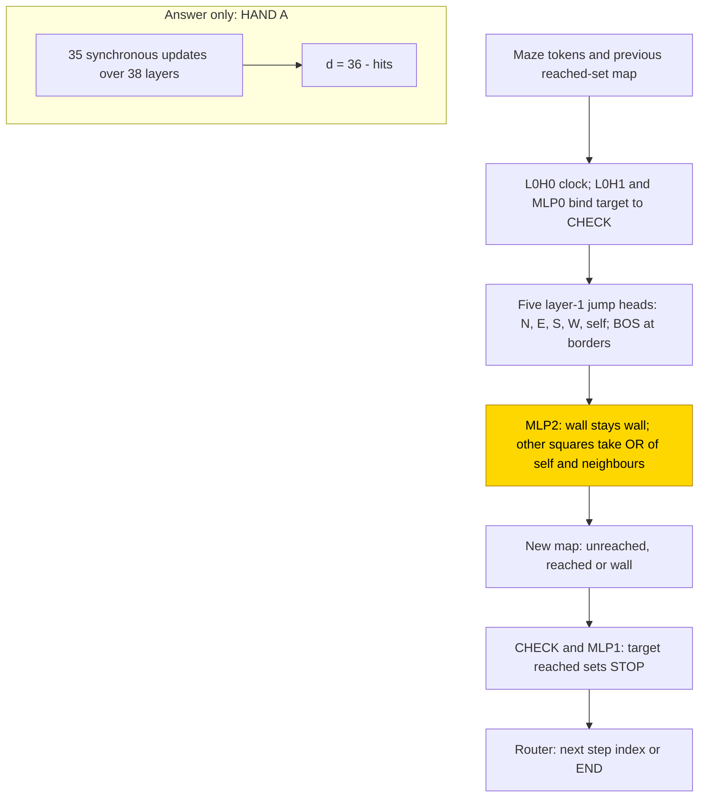
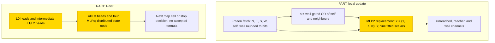

# Grid BFS

This entry studies how small transformers find the shortest-path distance across a maze, either answering directly or first writing
which squares have been reached after each breadth-first search (BFS) step. With this intermediate scratchpad, all 10 final seeds
trained from scratch reach exact match 1.0 on the 176 held-out mazes per seed; answer-only cells remain unsolved. Frozen hand-built
routing makes the local update easier: all 10 partly trained seeds are exact at the first evaluation, step 500. The task is partly
solved. The closed form is partial at the cell level: a nine-number PART update substitutes in all ten seeds, but complement tests
cover only three; no complete closed form is accepted for TRAIN.

| Fact | Value |
|---|---|
| Task | Shortest-path distance 0–10 on a four-neighbour 6×6 maze, at most 14 walls, connected free endpoints |
| Input → output example | Start and target side by side with no wall between them → 1 |
| Model | GPT-NeoX-shaped, ReLU, no LayerNorm or positional encoding; PART trains MLP2 of a 3-layer HAND; TRAIN has 4 layers, d_model 256 |
| Rungs and seeds | HAND trace and answer only; PART trace 3 screening + 10 final seeds; TRAIN trace 3-seed screens + 10 final; answer-only retries and a separate depth trial |
| Closed form status | Partial (PART 176/176 substitution in 10/10 seeds; complement 1.0 on three tested seeds only; TRAIN form rejected) |
| Status | Partly solved (scratchpad TRAIN 10/10 exact, PART 10/10 exact; answer-only run 2 0/3 ≥ .99); last run 2026-11-12 |
| Weights | [Hugging Face: grid-bfs](https://huggingface.co/jc1122/circuit-atlas-nets/tree/main/grid-bfs), published revision `e417b9b92a75` |
| Reproduce | Not available yet: training code for this task is not yet in `code/` |

## 1. Task and data

Each maze is a four-neighbour 6×6 grid with at most 14 walls. The start and target are free and connected; the label is the
shortest-path distance, 0–10. For example, neighbouring endpoints with no wall between them have distance 1. Square tokens encode
coordinates. The split is 80/10/10 by a hash of the wall mask, and every batch draws fresh mazes. The test set holds 16 mazes per
distance, 176 per seed.

An output is correct only if the whole teacher-forced sequence is correct, including END in the trace format. Teacher-forced means
that each token is scored given the correct previous tokens ([glossary](../GLOSSARY.md#task-formats)). The scratchpad writes the
reached set, the squares reached within the current number of BFS steps, before answering.

*Table 1. Output formats.*

| Format | Output |
|---|---|
| `A` (answer only) | one distance token |
| `T` ([scratchpad](../GLOSSARY.md#task-formats)) | after every BFS step, a map marking each square unreached, reached or wall, a CHECK of the target, then the next step index or END |

The earlier 2026-11-07 report left longer-distance and 8×8 tests unmeasured for TRAIN. Final tests now cover sampled distances 11, 16,
17 and 20 on 6×6 grids, with 16 mazes per sampled distance, and 8×8 grids at distances 0–10 (Section 4). The published labels
“d11–16” and “d17–20” summarise sampled endpoints, not every distance in those intervals.

## 2. Model

Shared conventions are in [METHODS.md](../METHODS.md). The three [rungs](../GLOSSARY.md#the-three-rungs) are HAND (all weights set by
formula), PART (HAND with one trained stage) and TRAIN (all weights trained from scratch).

### 2.1 Architecture

All networks are GPT-NeoX-shaped with ReLU, no LayerNorm, no positional encoding, untied embeddings, vocabulary 565 and context 8192.
“Used” in Table 2 counts components whose mean ablation costs more than .05 of exact match, not a minimum circuit.

*Table 2. Network sizes.*

| Network | Layers | d_model | Heads | MLP width | Used in HAND |
|---|---|---|---|---|---|
| HAND T | 3 | 80 | 5 (d_head 16) | 24 | 7 heads + 10 neurons |
| HAND A | 38 | 384 | 3 | 144 | 2 heads + 5,258 neurons |
| TRAIN A and T | 4 | 256 | 8 (d_head 32) | 512 | all weights trained |

### 2.2 Frozen parts and trained part

PART retrains only HAND T's layer-2 MLP: W_in [24, 80], b_in [24], W_out [80, 24] and b_out [80]. Its input is masked to six fetched
bits: north, east, south, west, self and wall (N, E, S, W, self, wall). Its output is masked to three state channels: unreached,
reached and wall. Everything else stays at its hand-built value.

### 2.3 Training

AdamW used learning rate 1e-3, weight decay .1, warmup 1,000, cosine decay and gradient clip 1. Batches contained 8 fresh mazes,
bounded by memory on long maps. Evaluation was every 500 steps and checkpoints every 2,500. The plateau stop was 5,000 after 75% of
the budget. PART ran in fp32; TRAIN used TF32 updates and fp32 evaluation. Training used GPU accelerators; diagnostics and substitution
used CPU fp32. The task's success bar is best test exact match ≥ .99; both final trace cells also have exact 1.0 final snapshots.

*Table 3. Runs. The depth comparison is a separately labelled trial, not another TRAIN retry.*

| Run | Budget / configuration | End |
|---|---|---|
| PART T run 1 | 10k; fresh mazes; 3 seeds | solved at 500 |
| TRAIN A and T run 1 | 30k; fresh mazes; 3 seeds | budget |
| TRAIN A and T run 2 | 90k; 3× fresh data; 3 seeds | T solved at 79k; A reached budget |
| Final T PART and TRAIN | 90k; 10 seeds each; only weight decay .1 | PART solved at 500; TRAIN solved at 84.5k |
| A TRAIN run 3 | 4 layers, width 512; 90k; weight decays .1 and .03, 3 seeds each | 0/6 reached criterion; closed |
| Depth trial | 8 versus 4 layers, width 256; fp32; 10 seeds per arm | 0/10 + 0/10; closed failed trial outcomes |

### 2.4 Reproduction

Reproduce: not available yet: training code for this task is not yet in `code/`; the weights, held-out splits and recorded
accuracies are on Hugging Face at
[huggingface.co/jc1122/circuit-atlas-nets/tree/main/grid-bfs](https://huggingface.co/jc1122/circuit-atlas-nets/tree/main/grid-bfs).
Test mazes are regenerated from their seed (see `config.json`). Public runnable code is pending.

### 2.5 Archive

The published archive revision is `e417b9b92a75`. It contains `hand_T`, `part_T_final10_{best,final}_s0-9`,
`train_T_final10_{best,final}_s0-2`, screening networks, `config.json` and `manifest.json` with seed, rung, circuit type, accuracy and
sha256. Ten TRAIN seeds were analysed, but the listed final TRAIN archive covers seeds 0–2, not all ten. The recorded publication check
found 46 files with no missing or mismatched hashes; the checked PART seed 3 final and TRAIN seed 1 final reproduced recorded 1.0.
These are prior publication checks, not a new re-score for this article's presentation update.

The earlier archive held `hand_{T,A}`, `part_T_{best,final}_s0…2` (four MLP tensors inserted into `hand_T`) and
`train_{T,A}_{best,final}_s0…2` (full run-2 networks). Its manifest records steps, recorded and fp32 re-scored exact match and sha256;
those networks re-scored to recorded accuracy. Failed run-1 TRAIN weights were not archived, having been superseded by run 2.

## 3. Hand-built solution

HAND T performs one BFS step per written map (Figure 1). L0H0 binds each square to its step clock; L0H1 and MLP0 bind the target to
CHECK. Five layer-1 jump heads fetch north, east, south, west and self from the previous map. Their score is
`20000 - 40(squared coordinate + clock mismatch)`; BOS is an attention sink at borders. MLP1 sets STOP = CHECK·target reached.

Three update neurons keep walls fixed and set every other square to `OR(self, N, E, S, W)`. The hinge rows over (N, E, S, W, self,
wall) are (1, 1, 1, 1, 1, −5), with biases 0 / −1 and reached outputs +1 / −1. A wall copy and an unreached bias 1 complete the
channels. CHECK reads the target cell; a router emits the next index or END. HAND A instead performs 35 synchronous updates over
38 layers and writes d = 36 − hits.

Both passed stratified full-network tests plus exhaustive local/tiny-grid checks: T 184/184 and A 41/41, minimum logit margin 30.
This does not enumerate all mazes. The current analysis uses one design, HAND-a; no alternative HAND design is compared.

*Figure 1. The hand-built networks. Trace heads fetch the five local cells and MLP2 applies the BFS update; answer only unrolls the
updates in depth. Shaded MLP2 is the only trained PART stage.*

## 4. What training finds

The final analysis dated 2026-11-12 finds all ten scratchpad TRAIN seeds exact on their test sets (Table 4), replacing the earlier three-seed result. Answer-only
training remains unsolved after the data and width retries and the separate depth trial. Exactness up to distance 3 and declining
accuracy beyond it describe the screening outcome; they do not prove that these networks implement exactly three BFS steps.

*Table 4. Final results on 176 test mazes per seed. Grok step means first test exact match ≥ .99
([glossary](../GLOSSARY.md#counting-results)). Longer-distance columns retain the published endpoint-summary labels.*

| Cell | Solved | Best / final test | First ≥ .99 | “d11–16” / “d17–20” / 8×8, final |
|---|---|---|---|---|
| PART T | 10/10 | 1.0 / 1.0 | 500 all | 1.0 / 1.0 / 1.0 |
| TRAIN T | 10/10 | 1.0 / 1.0 | 60.5–72.5k, median 68k | .66–1.0 / .41–.78 / 0–.09 |
| TRAIN A, run 2 / run 3 / depth trial | 0/3 / 0/6 / 0/10+0/10 | published compact summary .89–.95 | never | d11+ 0 |

The final length tests sampled endpoints, not every distance in each interval. PART is 1.0 at d11, d16, d17 and d20 in every seed.
TRAIN is .81–1.0 at d11, .50–1.0 at d16, .44–.88 at d17 and .31–.75 at d20. The source's recorded endpoint means are the .66–1.0 and
.41–.78 summaries in Table 4; they are not new averages calculated here. Best-snapshot summaries are lower: .59–.84 and .19–.63.
On 8×8 grids at distances 0–10, TRAIN scores 0 except seeds 7–9 at .09, from distance-0 mazes only. The final greedy check is restricted
to d = 2: 20/20 rollouts correct (10/10 per cell), not general free-rollout success.

### 4.1 Circuit types and learning

PART forms the HAND-a type in 10/10 seeds: discovery keeps HAND's 13 edges, Jaccard 1.0. TRAIN forms one distributed type, T-dist,
in 10/10: 7–8 of 8 L0 heads, all 8 L3 heads, all four MLPs and 1–7 seed-dependent L1/L2 heads. The compact description “all layer-0
heads” is therefore a near-complete dependence, not eight used heads in every seed. Discovery keeps 130–233 of 591 edges but only
.33–.71 held-out faithfulness, below the .90 bar; no faithful sparse circuit was found. Head sets vary without a diagnostic split into
separate mechanism classes.

Earlier screening found one PART type in 3/3 and one run-2 TRAIN type in 3/3. In that TRAIN screen, the update variables `or` (OR of
self and neighbours) and `next` (the square's next state) were decoded and causally used at probe layers 3–4. Run-1 errors were CHECK
choices between a step index and END while every map cell was right: seed 0's layer-4 interchange flips were 1 for `or` and .88 for
`next` (nf 72 and 77 answer-changing swaps). Interchange tests causal use by swapping candidate variables between examples
([glossary](../GLOSSARY.md#analysis-measures)).

Run 2's test ≥ .99 steps were 63.5–72k, not the predicted 5–25k. Fresh batches give no fixed training set on which to define a
memorisation step. The final report records no memorisation phase. Run-2 TRAIN seeds 1 and 2 are exact on 176 test mazes but .94–.97
on the 32-maze diagnostic bank: “solved” is a test criterion, not exactness on every maze.

### 4.2 Final diagnostics

*Table 5. Final diagnostics at n = 32 mazes, d = 5. Used means mean-ablation drop > .05. R² is the best linear probe at the stated
layer; PR is residual participation ratio; CKA compares representations with HAND; JS is attention divergence to the nearest HAND head.*

| Cell | Used | Best probe R² (layer) | PR; HAND CKA | JS | Best / final |
|---|---|---|---|---|---|
| PART T seeds 0–9 | 7 heads (= HAND) + MLP0, MLP2 | clock .91 (1), square .92 (0) | 1.0–1.15; 1.0 | 0 | 1 / 1 |
| TRAIN T seeds 0–9 | 19–28 heads (L0 7–8, L1 1–5, L2 1–7, L3 8) + 4 MLPs | or .77–.84 (4), next .72–.81 (4), stop .67–.92 (4), W .64–.71 (4), N/E/S .51–.63 (4), wall .37–.67 (4) | 9.7–34.9; ≤ .03 | .52–.65 | 1 / 1 (seed 3 diagnostic .97) |
| TRAIN A run 2 seeds 0–2 | 6–9 heads + 2–3 MLPs | wall count .61–.91 (1), target .48–.92 (1) | –; – | – | .93–.96 / .92–.94 |

The earlier answer-only diagnosis was failure by distance: exact at d ≤ 3, .50–.88 at d = 10. The fixed-distance diagnostic bank has
no valid distance code or answer-changing corruption, so it cannot localise a causal distance/frontier variable. The later depth trial
also lacks reach-set, target-hit and first-hitting-time labels; unavailable causal tests are not evidence that those computations are
absent. Its 8-layer causal diagnostics are unavailable because the loader was fixed to 4 layers. These limits prevent a depth
impossibility conclusion.

## 5. Mechanism and verification

### 5.1 PART update

Round the six fetched inputs to bits. With w = wall and a = (1 − w)·OR(N, E, S, W, self), replace MLP2 by Y = (1, a, w)·B in the three
state channels, zero elsewhere. B contains 9 scalars fitted to the MLP's responses on all 64 local interfaces, never to maze answers.
All 18 tested replacements (individual components, layers, cumulative and whole-network forms) keep 176/176 from 176/176 in 10/10
seeds, including replacing every other component by its formula.

Complement and path tests cover only seeds 0–2, n = 32 at d = 5. The tested claim retains the 13 HAND-a edges plus L0H1, MLP0 and MLP1,
47 of 160 edges in the expanded claim. Resample exact match is 1.0 = base; random same-size and circuit-resampled controls are 0,
as are zero/mean controls. Thus the paired test accepts the PART form in those tested seeds. The cell-level status is partial, not
ten independent complement certificates. Zero and shuffle controls were open in the older substitution-only screen; the later named
controls do not silently supply an unreported matched shuffle test.

The earlier fitted expression rounded/clamped the six fetched inputs to bits r, set s = Σr − 5w and a = ReLU(s) − ReLU(s − 1), then
used Y = (1, a, w)·B. It kept 176/176 in all three screen seeds, best/final, with agreement 176/176 at a ≥ .99 × native bar. The local
argmax matched HAND on 48/48 valid tuples (53 / 59 / 53 of all 64 for seeds 0 / 1 / 2). This is output equivalence on valid inputs,
not equality of raw neuron activations: the later final fit explains R² .35–.47 of raw outputs. The individual trained hinges mix
neighbour, self and wall evidence; their summed decision is the rule (Appendix A).

### 5.2 TRAIN: rejected forms

No complete TRAIN form is accepted. The final candidate replaces map-cell MLP3 with a square lookup plus decoded state code. Even
using true state labels, the compact result falls from 176 to 16 correct of 176 in all ten seeds. The detailed test gives native
174–176/176 and the same 16/176 for decoded bits, decoded state, oracle labels and a state-ignoring mean control; seed 9 is the reported
exception at 22/17/27/16 respectively. The 16 are distance-0 mazes, which have no map-cell updates. The state code explains only
R² .51–.57 of MLP3 output, so it omits decision-relevant content; failure does not refute the BFS rule itself.

Resampling the middle-layer heads in the proposed node claim keeps 0 of base 1.0 on seeds 0–2. Those seed-dependent heads are needed.
Earlier run-1 candidates also failed (Table 6); the old report's “run 2 has no substitution test yet” is historical, not the current
state of the final cell. The distributed code is high-rank and unrelated to HAND's basis (screening CKA ≤ .02), despite decoding the
same per-step variables.

*Table 6. Rejected screening forms. Test exact counts of 176; seed order 0 / 1 / 2.*

| Cell | Candidate | Native → substituted |
|---|---|---|
| T run 1 | OR of decoded bits, affine encoding | fresh 104 → 2, 70 → 0, 135 → 1 |
| A run 1 | decoded-distance tent | 156 → 37, 149 → 56, 156 → 32 |

*Figure 2. PART and TRAIN descriptions. Shaded Y replaces the trained PART MLP2; shaded TRAIN blocks were all trained. The closed-form
status is partial: PART substitutes in ten seeds but complement tests cover only three; the TRAIN state-code candidate is rejected.*

### 5.3 Relation to published work

PART retains the hand-built algorithm and its basis (JS 0, PR ≈ 1); TRAIN represents similar per-step variables in a distributed code
and transfers partly to more BFS steps, not larger grids. Scratchpads supply serial intermediate computation
([Nye et al., 2021](#references)). Search-trace supervision appears in [Lehnert et al. (2024)](#references), and intermediate BFS
supervision in [Veličković et al. (2019)](#references). Parallel expansion and capacity-dependent graph learning are studied by
[Saparov et al. (2024)](#references) and [Ye et al. (2025)](#references); depth scaling by [Sanford et al. (2024)](#references).
[Merrill and Sabharwal (2023)](#references) give conditional complexity limits, not an impossibility proof for these finite grids.

Maze-transformer studies find structured maps ([Ivanitskiy et al., 2023, Structured World Representations](#references)) and causal edge
features ([Spies et al., 2024](#references)); the maze-generation library is described by
[Ivanitskiy et al. (2023, A Configurable Library)](#references). [Nolte et al. (2024)](#references) study multi-step prediction and
[Wang, S. et al. (2024)](#references) autoregressive planning. Sparse BFS/shortest-path GNN circuits are recovered by
[He et al. (2026)](#references), whereas this TRAIN circuit remains distributed. [Gao et al. (2025)](#references) study weight-sparse
circuits more generally. A weight-sparse arm or feature-level analysis is a proposed trial, not an observed fix here.

Earlier neural maze planning includes [Dracopoulos (1998)](#references) and [Ilin et al. (2007)](#references). Value-iteration
architectures include [Tamar et al. (2016)](#references), [Niu et al. (2018)](#references), [Shen et al. (2020)](#references),
[Cai et al. (2023)](#references) and both [Wang, Y. et al. (2024)](#references) studies. Neural A* and its reproduction are described by
[Yonetani et al. (2020)](#references) and [Bhatt et al. (2022)](#references). The hybrid maze DQN and GNN application are separate
approaches ([Chen, H.-Y. et al., 2024](#references); [Chen, X., 2026](#references)), not circuit evidence for these transformers.

Graph-reasoning generalisation is studied by [Xu et al. (2019)](#references), [Xu et al. (2020)](#references),
[Nerem et al. (2025)](#references) and [Zhang et al. (2024)](#references). Algorithmic-learning benchmarks and variants include
[Veličković et al. (2022)](#references), [Ibarz et al. (2022)](#references), [Minder et al. (2023)](#references),
[Bevilacqua et al. (2023)](#references), [Bohde et al. (2024)](#references), [Rodionov and Prokhorenkova (2024)](#references),
[Li et al. (2024)](#references), [Huang et al. (2026)](#references) and [Yu et al. (2026)](#references). These are related training and
representation settings, not validations of the present closed form.

Recurrent solvers can extrapolate with more iterations ([Schwarzschild et al., 2021](#references)); further recurrent/equilibrium
approaches include [Bansal et al. (2022)](#references), [Anil et al. (2022)](#references), [Wang, G. et al. (2025)](#references),
[Jolicoeur-Martineau (2025)](#references), [Kamiya et al. (2026)](#references) and [Es'kin and Smorkalov (2026)](#references).
Learned maze dynamics need not be generic search ([Knutson et al., 2026](#references)). Abstract-token curriculum is another
separately studied approach ([Gatmiry et al., 2026](#references)), not an adopted rescue for this cell.

## 6. Limitations and open questions

Trace scores are teacher-forced; greedy rollout is measured only at distance 2. Final longer-distance tests sample endpoints rather
than all distances 11–20. The larger-grid failure includes unseen square tokens. There is one compared HAND design, no published
T+ cell and no A PART cell. Size counts are small-batch mean-ablation counts, not minimal circuits; TRAIN neuron counts were not
measured, only whole MLPs ablated. The prediction about more TRAIN neurons is therefore untested, even though more heads are used.

Substitution covers all ten final seeds; complement/paths cover three per cell. The PART zero/shuffle screening-control gap is not
silently filled by unnamed controls. TRAIN's state-code form fails even with oracle labels. The earlier report lacked TRAIN A run-2
and 7 of 12 run-2 diagnostic reports; later final diagnostics do not retroactively fill every missing screen report.

Answer only remains unsolved. The old depth-8 or distance-curriculum proposal was not a completed retry at the screening date; the
subsequent separately labelled depth trial failed in both arms. No distance curriculum rescue is adopted. The fixed-distance bank
cannot support the old “one serial BFS step per layer” causal explanation. Missing reach/target-hit/first-hit labels and unavailable
8-layer causal diagnostics leave the exact answer-only bottleneck unresolved. Public code remains pending, and final TRAIN weights
listed in the archive cover only seeds 0–2.

## 7. Prediction record

*Table 7. Predictions recorded before training and their measured outcomes.*

| Prediction | Outcome |
|---|---|
| PART all seeds within 2.5k; initial screen 3/3 | Confirmed: 10/10 final at 500; earlier 3/3 also at 500 |
| TRAIN T ≥ 2/3 in the screen and ≥ 8/10 final, within 5–25k | Count held in run 2 (3/3) and final (10/10); timing refuted: run 1 0/3 at 30k, run 2 63.5–72k with 3× data, final 60.5–72.5k |
| TRAIN T uses more neurons than HAND | Not measured for neurons; more heads observed, 19–28 versus 7 |
| TRAIN T “d11–16” ≥ .9 in half the seeds | Narrowly refuted, 4/10 on the published sampled-endpoint summary |
| TRAIN T “d17–20” < .5 | Refuted: only 2/10 below .5 on that summary |
| TRAIN T 8×8 < .5 | Confirmed, 0–.09 |
| TRAIN A ≤ 1/3 | Confirmed, 0/3 in runs 1 and 2 |

## Appendix A. Weights excerpt and reading

The hand-built rows over (N, E, S, W, self, wall) are (1, 1, 1, 1, 1, −5), biases 0 / −1. Table A1 retains the earlier four-decimal
least-squares fits of B; best and final are equal within each seed.

*Table A1. Fitted B, columns unreached, reached, wall; rows constant, a and w.*

| Seed | b (constant) | a (reached hinge) | w (wall) |
|---:|---|---|---|
| 0 | .2154, .0521, .0225 | −.4179, .3165, .0402 | −.4173, .1637, .2909 |
| 1 | .2118, .0417, −.0276 | −.3765, .2925, .1149 | −.5479, .2123, .3715 |
| 2 | .2034, .0461, .0129 | −.3393, .2704, .0555 | −.4075, .1781, .2830 |

The later publication gives a separate compact precision for the same seed-0–2 final/screening fits (Table A2). Both are kept as
recorded; the values have not been rounded anew or silently substituted for each other.

*Table A2. Published compact B table, fitted on 64 MLP2 responses per seed.*

| Seed | constant | a (reached) | w (wall) |
|---:|---|---|---|
| 0 | .215, .052, .023 | −.418, .316, .040 | −.417, .164, .291 |
| 1 | .212, .042, −.028 | −.377, .293, .115 | −.548, .212, .371 |
| 2 | .203, .046, .013 | −.339, .270, .056 | −.407, .178, .283 |

*Table A3. Selected neurons from trained PART seed 0 MLP2, `part_T_best_s0.safetensors`. Inputs are W_in[j, 34:40], output is
W_out[40:43, j].*

| Neuron | Input row (N, E, S, W, self, wall) | Bias | Output (unreached, reached, wall) |
|---:|---|---:|---|
| 2 | .0473, .0498, .0494, .0501, −.0517, .1399 | −.0002 | −.1453, −.0856, .1214 |
| 4 | .1252, .1286, .1081, .1362, .0936, .1428 | .0001 | −.1406, .0551, .1290 |
| 19 | .0762, .1075, .0851, .0831, .0490, .1213 | .1068 | .0878, .0926, .1203 |

Neuron 2 opposes self to neighbours and favours wall; neuron 4 suppresses unreached; neuron 19 supplies a shared offset. Their sum,
not each neuron, implements the rule: a raises reached and lowers unreached by .27–.42, while w raises wall most. The argmax matches
HAND on all 48 valid inputs although individual hinges differ.

## Appendix B. Detailed historical evidence

*Table B1. Screening results, 176 mazes per seed; seed order 0 / 1 / 2.*

| Cell | Solved ≥ .99 | Best → final test | First ≥ .99 |
|---|---|---|---|
| PART T run 1 | 3/3 | 1 / 1 / 1 → 1 / 1 / 1 | 500 |
| TRAIN T run 1, 30k | 0/3 | .716 / .381 / .761 → same | none |
| TRAIN A run 1, 30k | 0/3 | .898 / .807 / .898 → .898 / .807 / .892 | none |
| TRAIN T run 2, 90k, 3× data | 3/3 | 1 / 1 / 1 → 1 / 1 / 1, stop 79k | 72.0k / 63.5k / 67.5k |
| TRAIN A run 2, 90k, 3× data | 0/3 | .943 / .926 / .955 → .932 / .915 / .943 | none; d ≤ 3 exact, d10 .62 / .50 / .88 |

The earlier prose summarised answer-only test as .93–.95. This coarser range remains separate from the precise per-seed table above.
Its wording “failed in 0/3” was ambiguous; 0/3 reached the criterion, not zero failed seeds.

*Table B2. Screening diagnostics, n = 32 mazes at one distance. These are the earlier recorded measures, not replacements for Table 5.*

| Cell | Used | Best probe R² (layer) | PR; HAND CKA | JS | Patch rank 1 | Best / final |
|---|---|---|---|---|---|---|
| PART T seeds 0–2 run 1 | 7/7 heads (= HAND) | clock .91 (1), square .92 (0) | 1–1.13; HAND-PC R² 1 | 0 | MLP2 .95 | 1 / 1 |
| TRAIN T seeds 0–2 run 1 | 24 / 15 / 25 of 32 heads | relative step .89–.94 (3), or .72–.80 (4), next .66–.77 (4) | 16–32; < .04 | .44–.65 | MLP3 .93–.96 | .38–.76 |
| TRAIN A seed 0 run 1 | 9/32 | wall .85 (1), target .84 (3) | 1–3.5; .15–.57 | .08–.42 | MLP0 | .90 / .90 |
| TRAIN T run 2 (seed 0 best/final, seed 1 best, seed 2 best/final) | 17–20 of 27–30 | or .78–.84 (4), next .74–.84 (4), self .66–.71 (4) | 18–32; ≤ .02 | .64–.67 | MLP3 .90–.98 | 1 / 1; diagnostic seeds 1/2 .94–.97 |
| TRAIN A run 2, earlier pending row | not landed then | | | | | .94 / .93 |

Key: used = mean-ablation drop > .05, of 32 heads + 4 MLPs; HAND-PC R² compares with HAND principal components; patch = shuffle-batch
activation patching's largest-drop component. Probe, interchange, patching, rank and JS are defined in the
[glossary](../GLOSSARY.md#analysis-measures).

## References

- Anil et al. (2022). Path Independent Equilibrium Models Can Better Exploit Test-Time Computation. *arXiv preprint*. https://arxiv.org/abs/2211.09961 (equilibrium models)
- Bansal et al. (2022). End-to-end Algorithm Synthesis with Recurrent Networks. *arXiv preprint*. https://arxiv.org/abs/2202.05826 (recurrent algorithm learning)
- Bevilacqua et al. (2023). Neural Algorithmic Reasoning with Causal Regularisation. *arXiv preprint*. https://arxiv.org/abs/2302.10258 (algorithmic-learning variant)
- Bhatt et al. (2022). Reproducibility Report: Path Planning using Neural A* Search. *arXiv preprint*. https://arxiv.org/abs/2208.04153 (Neural A* reproduction)
- Bohde et al. (2024). On the Markov Property of Neural Algorithmic Reasoning. *arXiv preprint*. https://arxiv.org/abs/2403.04929 (algorithmic state)
- Cai et al. (2023). Value Iteration Networks With Gated Summarization Module. *Journal article*. https://doi.org/10.1109/access.2023.3286729 (value iteration)
- Chen, H.-Y. et al. (2024). Deep Q-learning with hybrid quantum neural network on solving maze problems. *Journal article*. https://doi.org/10.1007/s42484-023-00137-w (maze DQN)
- Chen, X. (2026). The Application of Graph Neural Networks in Maze Problem. *Journal article*. https://doi.org/10.54097/gq83vf96 (maze GNN application)
- Dracopoulos. (1998). Neural robot path planning: The maze problem. *Journal article*. https://doi.org/10.1007/bf01414163 (earlier neural planning)
- Es'kin & Smorkalov. (2026). Dynamical Systems Theory Behind a Hierarchical Reasoning Model. *arXiv preprint*. https://arxiv.org/abs/2603.22871 (recurrent dynamics)
- Gao et al. (2025). Weight-sparse transformers have interpretable circuits. *arXiv preprint*. https://arxiv.org/abs/2511.13653 (weight-sparse circuit comparison)
- Gatmiry et al. (2026). Learn Your Own Thoughts: Abstract Token Curriculum. *arXiv preprint*. https://arxiv.org/abs/2609.19717 (separate training approach)
- He et al. (2026). MINAR: Mechanistic Interpretability for Neural Algorithmic Reasoning. *arXiv preprint*. https://arxiv.org/abs/2602.21442 (sparse GNN circuits)
- Huang et al. (2026). Richer Representations for Neural Algorithmic Reasoning via Auxiliary Reconstruction. *arXiv preprint*. https://arxiv.org/abs/2606.00559 (algorithmic-learning representations)
- Ibarz et al. (2022). A Generalist Neural Algorithmic Learner. *arXiv preprint*. https://arxiv.org/abs/2209.11142 (generalist algorithms)
- Ilin, Kozma, & Werbos. (2007). Efficient Learning in Cellular Simultaneous Recurrent Neural Networks. *Conference paper*. https://doi.org/10.1109/adprl.2007.368206 (earlier recurrent learning)
- Ivanitskiy et al. (2023). A Configurable Library for Generating and Manipulating Maze Datasets. *arXiv preprint*. https://arxiv.org/abs/2309.10498 (maze generation)
- Ivanitskiy et al. (2023). Structured World Representations in Maze-Solving Transformers. *arXiv preprint*. https://arxiv.org/abs/2312.02566 (structured maze maps)
- Jolicoeur-Martineau. (2025). Less is More: Recursive Reasoning with Tiny Networks. *arXiv preprint*. https://arxiv.org/abs/2510.04871 (recursive reasoning)
- Kamiya et al. (2026). Steering Recurrent Reasoners at Inference Time with Readout Feedback. *arXiv preprint*. https://arxiv.org/abs/2608.24136 (inference-time recurrence)
- Knutson et al. (2026). On Logical Extrapolation for Mazes with Recurrent and Implicit Networks. *Conference paper*. https://doi.org/10.1609/aaai.v40i27.39424 (limits of learned maze dynamics)
- Lehnert et al. (2024). Beyond A*: Better Planning with Transformers via Search Dynamics Bootstrapping. *arXiv preprint*. https://arxiv.org/abs/2402.14083 (search-trace supervision)
- Li et al. (2024). Open-Book Neural Algorithmic Reasoning. *Conference paper*. https://doi.org/10.52202/079017-0314 (algorithmic-learning variant)
- Merrill, W., & Sabharwal, A. (2023). The parallelism tradeoff: Limitations of log-precision transformers. *Transactions of the Association for Computational Linguistics, 11*. https://doi.org/10.1162/tacl_a_00562 (conditional complexity limits)
- Minder et al. (2023). SALSA-CLRS: A Sparse and Scalable Benchmark for Algorithmic Reasoning. *arXiv preprint*. https://arxiv.org/abs/2309.12253 (algorithmic benchmark)
- Nerem et al. (2025). Graph neural networks extrapolate out-of-distribution for shortest paths. *arXiv preprint*. https://arxiv.org/abs/2503.19173 (graph extrapolation)
- Niu et al. (2018). Generalized Value Iteration Networks: Life Beyond Lattices. *Conference paper*. https://doi.org/10.1609/aaai.v32i1.12081 (value iteration)
- Nolte et al. (2024). Transformers Can Navigate Mazes With Multi-Step Prediction. *arXiv preprint*. https://arxiv.org/abs/2412.05117 (maze prediction)
- Nye, M., Andreassen, A. J., Gur-Ari, G., et al. (2021). Show your work: Scratchpads for intermediate computation with language models. *arXiv preprint*. https://arxiv.org/abs/2112.00114 ; https://doi.org/10.48550/arXiv.2112.00114 (scratchpad computation; both inherited links)
- Rodionov & Prokhorenkova. (2024). Discrete Neural Algorithmic Reasoning. *arXiv preprint*. https://arxiv.org/abs/2402.11628 (algorithmic-learning variant)
- Sanford et al. (2024). Understanding Transformer Reasoning Capabilities via Graph Algorithms. *arXiv preprint*. https://arxiv.org/abs/2405.18512 (depth scaling)
- Saparov et al. (2024). Transformers Struggle to Learn to Search. *arXiv preprint*. https://arxiv.org/abs/2412.04703 (reachability expansion)
- Schwarzschild et al. (2021). Can You Learn an Algorithm? Generalizing from Easy to Hard Problems with Recurrent Networks. *arXiv preprint*. https://arxiv.org/abs/2106.04537 (iterative extrapolation)
- Shen et al. (2020). Transfer Value Iteration Networks. *Conference paper*. https://doi.org/10.1609/aaai.v34i04.6022 (value iteration)
- Spies et al. (2024). Transformers Use Causal World Models in Maze-Solving Tasks. *arXiv preprint*. https://arxiv.org/abs/2412.11867 (causal maze features)
- Tamar et al. (2016). Value Iteration Networks. *arXiv preprint*. https://arxiv.org/abs/1602.02867 (value iteration)
- Veličković et al. (2019). Neural Execution of Graph Algorithms. *arXiv preprint*. https://arxiv.org/abs/1910.10593 (intermediate BFS supervision)
- Veličković et al. (2022). The CLRS Algorithmic Reasoning Benchmark. *arXiv preprint*. https://arxiv.org/abs/2205.15659 (algorithmic benchmark)
- Wang, G. et al. (2025). Hierarchical Reasoning Model. *arXiv preprint*. https://arxiv.org/abs/2506.21734 (recurrent reasoning)
- Wang, S. et al. (2024). ALPINE: Unveiling the Planning Capability of Autoregressive Learning in Language Models. *arXiv preprint*. https://arxiv.org/abs/2405.09220 (autoregressive planning)
- Wang, Y. et al. (2024). Highway Value Iteration Networks. *arXiv preprint*. https://arxiv.org/abs/2406.03485 (value iteration)
- Wang, Y. et al. (2024). Scaling Value Iteration Networks to 5000 Layers for Extreme Long-Term Planning. *arXiv preprint*. https://arxiv.org/abs/2406.08404 (value-iteration depth)
- Xu et al. (2019). What Can Neural Networks Reason About? *arXiv preprint*. https://arxiv.org/abs/1905.13211 (graph reasoning)
- Xu et al. (2020). How Neural Networks Extrapolate: From Feedforward to Graph Neural Networks. *arXiv preprint*. https://arxiv.org/abs/2009.11848 (extrapolation)
- Ye, Q., Fu, D., Jia, R., & Sharan, V. (2025). Transformers provably learn algorithmic solutions for graph connectivity, but only with the right data. *arXiv preprint*. https://arxiv.org/abs/2510.19753 ; https://doi.org/10.48550/arXiv.2510.19753 (capacity and data; both inherited links)
- Yonetani et al. (2020). Path Planning using Neural A* Search. *arXiv preprint*. https://arxiv.org/abs/2009.07476 (neural search)
- Yu, Zeng, & Ye. (2026). FloydNet: A Learning Paradigm for Global Relational Reasoning. *arXiv preprint*. https://arxiv.org/abs/2601.19094 (global relational reasoning)
- Zhang et al. (2024). Can LLM Graph Reasoning Generalize beyond Pattern Memorization? *arXiv preprint*. https://arxiv.org/abs/2406.15992 (graph generalisation)
