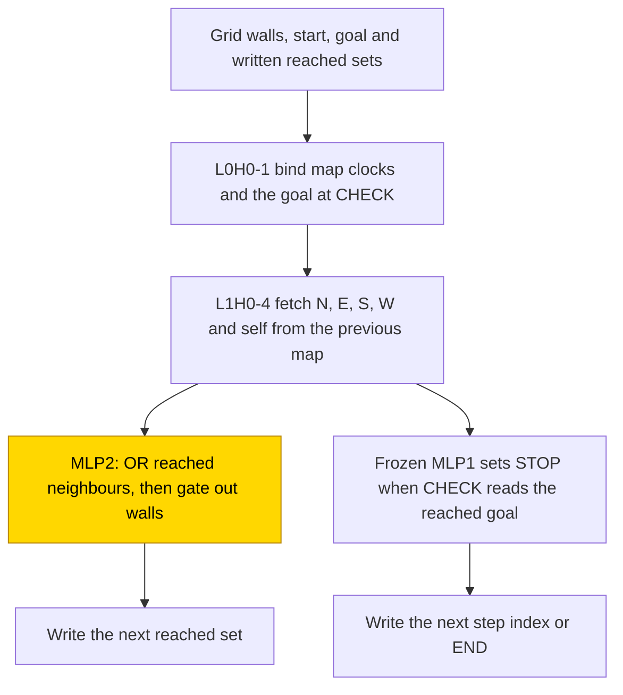
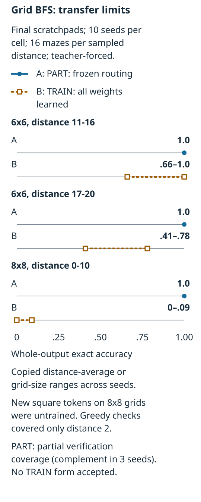
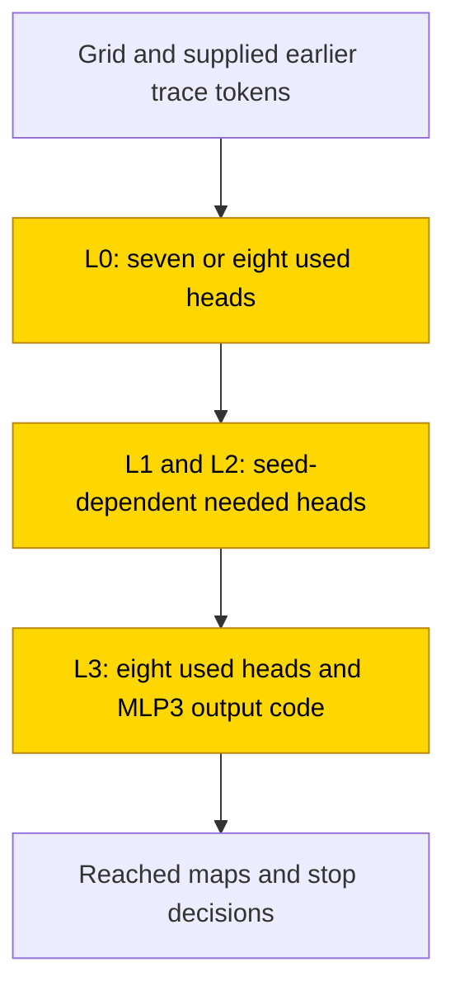

# Shortest paths on a grid

Breadth-first search finds a shortest path by expanding the squares reached from a start, one step at a time. Four-layer transformers learned to write these reached-set maps on 6×6 mazes: all 10 final independent from-scratch runs (seeds, [glossary](../GLOSSARY.md#counting-results)) were reported exact on 176 held-out traces per seed with the correct earlier tokens supplied. A separate fresh bank scored the unmodified networks at 174–176/176, and no tested replacement formula reproduced their distributed computation. With hand-built routing frozen, all 10 networks also scored 176/176; their nine-number local update has partial verification coverage because replacing the learned block with its formula passed in all ten seeds, but tests resampling everything outside the claimed circuit (the complement, [glossary](../GLOSSARY.md#verifying-a-circuit)) covered only three. The final scratchpad cell is solved under its teacher-forced criterion, while answer-only runs remained unsolved and the from-scratch map writers transferred poorly to 8×8 grids.

| Fact | Value |
|---|---|
| Task | Find the shortest distance between two connected free squares in a four-neighbour maze |
| Input → output example | A start that is already the goal has distance 0; otherwise see the local update in Section 3 |
| Model | One learned update on frozen routing, or a four-layer transformer trained from scratch |
| Rungs and seeds | HAND: formula weights; PART: one trained update; TRAIN: all weights learned. Final map-writing cells used 10 seeds each; screening used 3 per cell. |
| Closed form status | Partial (PART substitution 176/176 in 10/10; complement tested in seeds 0–2 only; TRAIN candidates rejected) |
| Status | Solved (final scratchpad TRAIN 10/10 at test exact match 1.0 on 176 traces per seed, teacher-forced); last run 2026-11-12 |
| Weights | [Hugging Face: grid-bfs](https://huggingface.co/jc1122/circuit-atlas-nets/tree/main/grid-bfs) |
| Reproduce | Not available yet: training code for this task is not yet in `code/` |

## 1. Task and data

A maze is a grid of free squares and walls. A move goes north, east, south or west; it cannot cross a wall. The shortest-path distance is the smallest number of moves from start to goal. If start equals goal, distance is 0. The study used connected free endpoints on 6×6 grids with at most 14 walls and distances 0–10.

The scratchpad writes the whole reached set after each search step. “Reached” means reachable within the number of steps so far, including squares reached earlier; it is different from the frontier of newly reached squares. The first reached map is supplied in the prompt. Each later map is followed by a CHECK of the goal and either the next step index or END.

*Table 1. Output formats. A scratchpad is intermediate working written before the answer ([glossary](../GLOSSARY.md#task-formats)).*

| Format | Output | Trained cells |
|---|---|---|
| A: answer only | One distance token | TRAIN |
| T: reached-set scratchpad | Each next map, with unreached/reached/wall states, CHECK and step-index/END decisions | PART and TRAIN |
| T+: optional path | The trace plus a shortest path | Hand-built reference only; no trained T+ cell |

Wall-mask hashes partitioned mazes 80/10/10 into training, monitoring and test sets. Fresh mazes were generated for each training batch. The test contained 16 mazes per distance, 176 per seed. Exact match requires the whole teacher-forced output, including END: correct earlier trace tokens are supplied at every scored step ([glossary](../GLOSSARY.md#task-formats)). This is not autonomous generation of a complete search trace.

The final cell used a test exact-match success screen ≥ .99 and reported 1.0 for all ten seeds. Longer-distance and larger-grid tests used 16 mazes per sampled distance; the source-reported interval summaries and endpoint scores are distinguished in Section 4. Greedy generation, feeding back the network's own tokens, was checked only at d = 2 in the final comparison.

## 2. Model

### 2.1 Architecture

All networks used GPT-NeoX-shaped decoders: transformers that predict from earlier tokens, with attention followed by feed-forward MLP blocks ([glossary](../GLOSSARY.md#standard-machine-learning-terms)). ReLU keeps positive inputs and sets negative ones to zero. There was no LayerNorm, which would centre and rescale the running state, or positional encoding, meaning no added position vectors. An attention head reads information from earlier positions. Embedding and output weights were untied, meaning separate matrices rather than one shared matrix. The vocabulary had 565 tokens and the context limit was 8192 tokens in the principal cells.

*Table 2. Architectures. d_model is the running-state width; d_head is each attention head's width; MLP is the feed-forward width. Component layers are zero-based.*

| Cell | Layers | d_model | Heads per layer (d_head) | MLP | Reference used size |
|---|---|---|---|---|---|
| HAND/PART T | 3 | 80 | 5 (16) | 24 | HAND: 7 heads + 10 neurons |
| HAND T+ | 3 | 80 | 5 (16) | 24 | 8 heads + 36 neurons |
| HAND A | 38 | 384 | 3 (128) | 144 | 2 heads + 5,258 neurons |
| TRAIN T/A | 4 | 256 | 8 (32) | 512 | Learned used sizes in Appendix B; TRAIN neurons unmeasured |

The HAND answer-only network carries out many internal updates. Its size is a reference construction, not a lower bound on networks that could solve the task. General definitions and acceptance rules are in [METHODS.md](../METHODS.md).

### 2.2 Frozen parts and trained part

HAND has all weights set by formula, PART freezes its routing while learning one update, and TRAIN learns all weights from scratch ([glossary](../GLOSSARY.md#the-three-rungs)). In PART T only MLP2 is retrained: W_in [24, 80], W_out [80, 24] and their biases. Its input is masked to six bounded bits and its output to three map-state channels. Thus it cannot use a large unbounded number or absolute sequence position as an update shortcut.

*Table 3. The PART update interface.*

| Variable | Meaning |
|---|---|
| N, E, S, W | Whether each cardinal neighbour was reached in the preceding map |
| self | Whether this square was already reached |
| w or wall | Whether this square is a wall |
| Y | Three scores: unreached, reached and wall |

A score is called a logit; the largest score selects the state ([glossary](../GLOSSARY.md#standard-machine-learning-terms)). MLP0 binds the goal, MLP1 sets the stopping flag and five L1 heads fetch the local neighbourhood. They remain frozen in PART.

### 2.3 Training

AdamW used learning rate 1e-3, weight decay .1, warmup 1,000, a cosine schedule and clip 1, with batch 8 fresh mazes. Evaluation was every 500 steps and checkpoints every 2,500. The plateau stop was 5,000 after 75% of the budget. Warmup raises the learning rate before cosine decay; clipping limits update size ([glossary](../GLOSSARY.md#standard-machine-learning-terms)).

*Table 4. Run sequence. All outcomes are kept; depth trials are separate from the retry ladder.*

| Run | Seeds | Budget and outcome |
|---|---|---|
| Run 1 screen | 3 per cell | 10k PART, 30k TRAIN; PART 3/3 at 500; TRAIN T 0/3; TRAIN A 0/3 |
| Run 2 exposure retry | 3 per TRAIN cell | 90k, 3× exposure; T 3/3, stopped at 79k; A 0/3 |
| Final T cells | 10 PART and 10 TRAIN | 90k budget, weight decay .1; PART stopped solved at 500, TRAIN at 84.5k |
| Answer-only run 3 width retry | 3 at each of two decays | 4 layers, width 512; 90k; decays .1/.03; 0/6 solved; retry closed |
| Answer-only depth trial | 10 per arm | fp32, width 256, 8 layers versus 4 layers; 0/10 versus 0/10, no seed reached .99 |

PART used fp32, full-precision arithmetic; principal TRAIN runs used TF32 matrix products with fp32 evaluation ([glossary](../GLOSSARY.md#hand-built-machinery)). The depth trial was fp32 and must not be pooled with its earlier failed TF32 eight-layer attempt. GPU accelerators trained the networks; diagnostics and substitutions used CPU fp32. The final run was recorded on 2026-11-12.

### 2.4 Reproduction

Reproduce: not available yet: training code for this task is not yet in `code/`; the weights, held-out splits and recorded accuracies are on Hugging Face at [grid-bfs](https://huggingface.co/jc1122/circuit-atlas-nets/tree/main/grid-bfs). No runnable task-specific public training command is claimed.

### 2.5 Archive

Published revision `e417b9b92a75` contains `hand_T`, `part_T_final10_{best,final}_s0-9`, `train_T_final10_{best,final}_s0-2` and screening networks. Configurations and `manifest.json` record seed, rung, circuit type, accuracy and sha256 fingerprints. Weights use lossless safetensors. The publication check found 46 files, no missing or mismatched hashes, and reproduced recorded 1.0 in PART final seed 3 and TRAIN final seed 1. These are earlier checks, not new downloads or model evaluations; they do not mean every final TRAIN seed is publicly archived.

The earlier inventory held `hand_{T,A}`, `part_T_{best,final}_s0…2` (four MLP tensors inserted into HAND T) and `train_{T,A}_{best,final}_s0…2` (full run-2 networks). Its manifest records steps, recorded and fp32 re-scored exact match and sha256; those re-scores matched. Failed run-1 TRAIN weights were not archived, having been superseded by run 2. Best/final snapshots and fresh substitution banks are separate evidence.

## 3. Hand-built solution

The local rule is simple: a wall stays a wall; a free square becomes reached if it or any cardinal neighbour was reached. Repeating that rule expands the reached set one move at a time. CHECK stops at the first map that reaches the goal, giving the shortest distance.

L0H0 binds each map cell to its step clock; L0H1 and MLP0 bind the goal to the CHECK query. The five L1 fetch heads copy N/E/S/W/self from the preceding map. Their score is 20000 − 40 times squared coordinate and clock mismatch; a beginning-of-sequence (BOS) sink handles missing border neighbours. A fetch head copies one selected token, and a sink contributes no task value ([glossary](../GLOSSARY.md#hand-built-machinery)). MLP1 sets STOP = CHECK·target reached. The three MLP2 neurons implement the wall-gated OR.

On the six bits, write s = N + E + S + W + self − 5w. The hinge response a = ReLU(s) − ReLU(s − 1) is 1 exactly when a free square is reached, and Y = (1 − a − w, a, w) selects unreached, reached or wall. HAND uses hinge rows (1, 1, 1, 1, 1, −5), biases 0 / −1 and readout margin 30. T+ selects an earlier-reached neighbour to walk back along a shortest path. HAND A instead gathers a vector, makes 35 synchronous updates over 38 layers and computes d = 36 − hits from the goal-hit count.

*Figure 1. The hand-built breadth-first search update. Gold MLP2 is the only trained PART block. The learned nine-number update has partial status at the ten-seed scope: substitution passed in all ten, but complement and path tests covered only seeds 0–2. This is not a diagram of the wholly trained search mechanism.*

HAND T passed 184/184 stratified cases and HAND A 41/41, with minimum logit margin 30. The T harness exhausts the 64 six-bit update interfaces and tiny-grid cases, then stratifies random 6×6/8×8 mazes. It is not an enumeration of every larger maze. Induction over valid maps establishes the Boolean rule separately from the empirical margin; that measured margin is not a worst-case numerical certificate for every maze.

## 4. What training finds

### 4.1 Final scratchpad cells

Both final T cells met their training-test criterion in 10/10 seeds. PART learned quickly; TRAIN took much longer and used more heads without yielding a faithful formula. Grokking means test improvement after fitting training examples ([glossary](../GLOSSARY.md#counting-results)); the table's crossing times are measured thresholds, not by themselves proof of a memorisation phase. Fresh training data and diagnostics showed no sustained train-exact/test-low phase.

*Table 5. Final cells, 10 seeds each, 176 held-out teacher-forced traces per seed. Criterion is test exact ≥ .99; the reported best and final values were 1.0.*

| Cell | Solved | Best / final | First test ≥ .99 | Longer/larger final summaries |
|---|---|---|---|---|
| PART T | 10/10 | 1.0 / 1.0 | 500 all | 1.0 / 1.0 / 1.0 |
| TRAIN T | 10/10 | 1.0 / 1.0 | 60.5–72.5k, median 68k | .66–1.0 / .41–.78 / 0–.09 |

The last column gives d11–16 / d17–20 / 8×8 in the original summary. A separate fresh substitution bank scored native TRAIN at 174–176/176. The diagnostic d = 5 bank had one wrong row in seed 3, reported .969 in the detailed source and .97 in the original overview; this does not disappear because the trainer's test was exact.

All ten PART networks matched the only tested HAND circuit, called HAND-a. HAND-free discovery retained its 13 edges with Jaccard 1.0. All ten TRAIN networks were grouped as T-dist, meaning distributed map-writing computation with no faithful HAND match. They used 7–8 L0 heads, all eight L3 heads and all four MLPs. Middle-layer used-head counts varied; this variation and different weight-space basins did not establish different algorithms. The original shorthand is “1–7 seed-dependent middle heads”; the layer-wise counts in Appendix B make its scope explicit.

### 4.2 More steps are different from a larger grid

PART preserved the local update when moved to longer traces or larger grids. TRAIN transferred partly to more steps on the same 6×6 grid, but larger grids introduced square tokens never trained. That token shift is a confound, not evidence that the learned local rule alone fails because the board is larger.

*Figure 2. Final teacher-forced transfer, 10 seeds per cell and 16 mazes per sampled distance. The d11–16 and d17–20 values are the source's reported ranges of distance-averaged exact match, not a new aggregate; the 8×8 values are copied from its grid-size summary. Closed-form status remains partial for PART because complement tests covered three seeds; no TRAIN form was accepted. This is a data figure, so no node is marked as trained.*

*Table 6. Original endpoint and summary displays, final snapshots, 16 mazes per sampled distance.*

| Cell | d11 / d16 | Reported mean over d11–16 | d17 / d20 | Reported mean over d17–20 | 8×8, d0–10 |
|---|---|---|---|---|---|
| PART T, 10 seeds | 1.0 / 1.0 | 1.0 | 1.0 / 1.0 | 1.0 | 1.0 |
| TRAIN T, 10 seeds | .81–1.0 / .50–1.0 | .66–1.0 | .44–.88 / .31–.75 | .41–.78 | 0, except seeds 7–9 .09 on d0 only |

TRAIN best snapshots had lower reported interval scores: d11–16 .59–.84 and d17–20 .19–.63. Final greedy d = 2 tests passed in both cells, 10/10 each, also reported as 20/20 combined. Those short rollouts do not measure a population of autonomous longer searches.

### 4.3 Answer-only runs and the failed depth prediction

Answer-only TRAIN remained unsolved through run 1, run 2, the width retry and both depth-trial arms. The original overview reports .89–.95 best accuracy across its selected answer-only comparisons and d11+ exact 0. Run 2 had 0/3 solved, run 3 0/6, and the fp32 depth trial 0/10 + 0/10. These are distinct cohorts, not a pooled seed success rate.

Run 2 was exact at d ≤ 3, falling to .50–.88 at d = 10; this motivated an explanation in terms of too few serial updates. Later evidence did not establish “four layers implement exactly three BFS steps”. The eight-layer trial did not shift errors as predicted, and constant-distance diagnostic banks could not test the distance representation. Its 0/10 versus 0/10 result is no detected benefit in that trial, not proof of equivalence or a depth impossibility theorem.

*Table 7. fp32 answer-only depth trial, 10 matched seeds per arm. Values are copied, not pooled with TF32.*

| Arm | Best exact range | Final exact range | Outcome and limitations |
|---|---|---|---|
| 8 layers | .897727–.948864 | .863636–.937500 | 0/10; causal network diagnostics unavailable because the adapter assumed four layers |
| 4-layer control | .886364–.954545 | .880682–.937500 | 0/10; diagnostic bank lacks reached-state and target-hit labels |

The L4 bank consisted of 88 mazes all at d = 5. Its varying labels were wall count and target-square identity, not individual walls or whether the goal had been reached. Distance was constant, making its R² invalid. Every reported answer-fixing intervention count nf was 0, meaning untested, not unused ([glossary](../GLOSSARY.md#analysis-measures)). Full corruption retained the answer, so empty or random circuits could appear faithful; discovery did not pass specificity. No accepted answer-only mechanism follows from these diagnostics.

## 5. Mechanism and verification

### 5.1 The nine-number PART rule: partial coverage

Round the six fetched inputs to bits and let a = (1 − w)·OR(N, E, S, W, self). The substitute for all of MLP2 is Y = (1, a, w)·B in the three state channels, zero elsewhere. B contains 9 fitted numbers per seed, obtained from the 64 local interfaces without maze labels. These coefficients encode three state-score vectors; they do not specify the learned neurons individually.

In all ten final seeds, the frozen tensors matched HAND and all 18 tested component/layer/cumulative/whole-network forms kept 176/176 on fresh mazes, with 16 per distance 0–10. That includes replacing embeddings, heads and MLPs by formulas. Complement resampling tests then replaced everything outside the claimed circuit with activations from other inputs ([glossary](../GLOSSARY.md#verifying-a-circuit)). These covered only seeds 0–2, on 32 mazes at d = 5. Exact remained 1.0 = base in all three draws; circuit-resampled, random-same-size and zero/mean controls scored 0, with valid checks. The claimed set included 47 of 160 edges: the 13 HAND edges plus the required clock/goal/stop routes.

The earlier screening form rounded and clamped the six fetched bits r, set s = Σr − 5w and a = ReLU(s) − ReLU(s − 1), then used Y = (1, a, w)·B. In all three screening seeds, best and final substitutes and network agreement were 176/176, at a ≥ .99 × native bar. The local argmax matched HAND on 48/48 valid inputs; counts across all 64 inputs were 53 / 59 / 53 for seeds 0 / 1 / 2. The older open zero/shuffle-control gap is historical: the later named zero/mean and random controls do not supply an unreported matched shuffle test.

The source calls the PART form accepted, with both retention shares 1.0 ≥ .90 in its tested coverage. Under the page's ten-seed headline, status is partial because the complement was not tested in the other seeds. Path tests were similarly limited: L0H0-to-output carried .99 of the corruption effect for clock/index decisions; stencil-to-MLP2-to-output paths carried .005 each on this fixed-distance, map-token log-probability test. Those shares are not a general importance ranking for every distance.

### 5.2 The TRAIN substitute was rejected

The candidate replaced MLP3 at map-cell queries by a square-specific table plus an affine encoding of the reached/wall state. Square identity decoded at accuracy 1.0; a HAND rule on decoded bits scored .91–.95 on calibration, and decoded states .91–.96. The reported fit used 9,252 + 1,542 + 9,984 numbers for its square decoder, bit decoder and encoder. Yet that encoding explained only R² .51–.57 of MLP3's output.

*Table 8. Fresh whole-trace substitutions, 176 mazes per seed. The seed-9 exception corrects the original shorthand “176 to 16 in all ten”.*

| Tested form | Native count | Most-seed substituted count | Seed 9 substituted count |
|---|---|---|---|
| Decoded bits plus HAND rule | 174–176/176 | 16/176 | 22/176 |
| Decoded state | 174–176/176 | 16/176 | 17/176 |
| Oracle: true HAND state labels | 174–176/176 | 16/176 | 27/176 |
| State-ignoring mean | 174–176/176 | 16/176 | 16/176 |

Every candidate failed in all ten seeds; the common 16 cases were d = 0, which required no new map. Even supplying true labels did not rescue the proposed internal output code. This rejects the tested state encoding, not the BFS label rule itself or every possible compact circuit.

A proposed TRAIN node set kept all L0/L3 heads and all four MLPs while resampling L1/L2 heads, 343 of 591 edges. It retained exact 0.0 from base 1.0 in seeds 0–2, with valid checks. The varying middle-layer heads were therefore needed for that claim. Its path drops were MLP3-to-output .51–.55, L3-heads-to-MLP3 .28–.38, embeddings-to-L0-heads .20–.45 and MLP2-to-output 0. Separately discovered circuits retained .47–.79 in the all-row complement tests and only .33–.71 held out. No TRAIN closed form was accepted.

*Figure 3. The diagnostic T-dist family in all ten final TRAIN seeds. Gold marks wholly trained layers, not a single PART block; all four MLPs were used. Closed-form status is rejected for the tested TRAIN substitute: oracle state labels did not preserve whole traces, and middle-head resampling failed in the three tested seeds. The page's overall partial status refers only to PART verification coverage; this is not a recovered TRAIN formula.*

### 5.3 Relation to other studies

Intermediate supervision gives a comparison with [Nye et al. (2021)](#references), search traces with [Lehnert et al. (2024)](#references), and BFS-step supervision in graph neural networks with [Veličković et al. (2019)](#references). A graph neural network updates states at graph nodes and passes information along edges. These studies motivate task designs; they do not establish scratchpad necessity or this TRAIN mechanism.

[Saparov et al. (2024)](#references) analyse learned parallel reachability; [Ye et al. (2025)](#references) study capacity-dependent connectivity learning; [Sanford et al. (2024)](#references) study graph-algorithm resource bounds. [Merrill and Sabharwal (2023)](#references) give conditional complexity limits, not a finite-grid impossibility result. [Ivanitskiy et al. (2023, structured representations)](#references) and [Spies et al. (2024)](#references) analyse maze representations and causal edge features. [He et al. (2026)](#references) recover sparse graph-algorithm circuits; [Gao et al. (2025)](#references) examine weight-sparse transformers more generally. None verifies a feature-level explanation of the dense TRAIN networks here. Broader preserved maze-planning references are organised in Appendix B rather than presented as evidence for this circuit.

## 6. Limitations and open questions

T exactness is teacher-forced; final greedy checks cover only d = 2. Only one HAND design was tested, with no alternative circuit hypotheses. TRAIN neuron counts were not measured: whole MLPs, not individual neurons, were ablated. Ten-seed substitutions do not expand the three-seed complement/path coverage. Fresh-bank native errors remain alongside the trainer's exact outcome.

The HAND harness is stratified rather than an exhaustive enumeration of larger mazes; its margin is measured, not a universal numerical certificate. Longer-distance and larger-grid evaluations use small sampled banks. New square tokens on 8×8 grids were untrained, so grid-size and token-vocabulary effects are confounded.

Answer-only distance/serial-depth explanations remain unverified. Constant-distance probes are invalid for distance, nf = 0 interventions test no answer-changing cases, and corruption that preserves every answer prevents accepted specificity claims. L8 causal diagnostics remain unavailable; L4 results cannot be transferred to those networks. A late test plateau alone does not identify a missing HAND variable. The earlier report lacked TRAIN A run-2 diagnostics and 7 of 12 run-2 reports; later final diagnostics do not retroactively complete those screening records. Seven final TRAIN dynamics reports were incomplete, and no PART checkpoint dynamics exists for the 500-step run. There is no accepted whole TRAIN formula, feature-level circuit or global minimum circuit size.

Open questions concern endogenous state encoding, the stopping decision and larger-grid transfer. A mixed-distance answer-only bank with reached-state and target-hit counterfactuals, and a configuration-aware L8 diagnostic loader, would be needed to test the depth hypothesis. These are proposed checks, not results or new training plans.

## 7. Prediction record

The before-training record predicted all PART seeds within 2.5k steps, TRAIN T ≥ 8/10 final seeds, TRAIN T within 5–25k, more used neurons than HAND, and specific longer-distance/grid-size outcomes. Table 9 retains the original hit/miss counts while separating the unmeasured neuron claim from observed head counts.

*Table 9. Prediction checks. Transfer uses the source's reported per-seed summaries, not an extrapolated guarantee.*

| Prediction | Observed result | Reading |
|---|---|---|
| PART all seeds within 2.5k | 10/10 at 500 | Confirmed |
| Screening TRAIN T ≥ 2/3; final ≥ 8/10 | Run 2 3/3; final 10/10 | Confirmed |
| TRAIN T within 5–25k | 60.5–72.5k; run 1 0/3 at 30k | Refuted |
| More TRAIN neurons than HAND | Neurons unmeasured; heads 19–28 versus 7 | Neuron prediction untested; head counts are separate |
| d11–16 ≥ .9 in half the TRAIN seeds | 4/10 | Narrowly refuted |
| d17–20 < .5 | 2/10 below .5 | Refuted |
| 8×8 < .5 | 0–.09 | Confirmed in sampled tests |
| TRAIN A ≤ 1/3 | 0/3 in the compared screen/retry | Compatible; not an impossibility proof |

The earlier 2026-11-07 report left TRAIN longer-distance and larger-grid tests unmeasured; the final results supersede that pending status. Run 2's first ≥ .99 steps were summarised as 63.5–72k; the precise seed displays are retained in Appendix B. The later eight-layer depth trial missed its predicted shift in error distance. This did not turn the proposed serial-step mechanism into a measured finding. All final training and prediction counts above concern their named cohorts, not autonomous rollout success.

## Appendix A. Weights excerpt and reading

B was fitted by least squares to the 64 responses of each archived final PART MLP2. Rows are the constant, reached indicator a and wall indicator w; columns are unreached, reached and wall. The first three final seeds matched the screening coefficients in the displayed rounding. These are fitted output parameters, not a claim that individual learned neurons have HAND's weights.

*Table A1. Original coefficient display, copied without new rounding.*

| Seed | Constant | a: reached | w: wall |
|---|---|---|---|
| 0 | .215, .052, .023 | −.418, .316, .040 | −.417, .164, .291 |
| 1 | .212, .042, −.028 | −.377, .293, .115 | −.548, .212, .371 |
| 2 | .203, .046, .013 | −.339, .270, .056 | −.407, .178, .283 |

The original reading gives a .27–.42 decrease/increase scale for the unreached/reached scores and a wall row that favours the wall score. Selection by largest score, called argmax, matches HAND on all 48 valid local inputs; invalid combinations can include a square simultaneously reached and a wall. The fit explains only R² .35–.47 of raw outputs, so this is decision-equivalent, not neuron-equivalent. Status remains partial at ten-seed verification scope, with complement tested in three seeds.

The older publication also gave four-decimal coefficients and individual trained-neuron rows. Both precisions are kept as recorded, without rounding one anew into the other.

*Table A2. Earlier fitted B coefficients on 64 local interfaces; best and final were equal within each screening seed. Columns are unreached, reached and wall.*

| Seed | Constant | a: reached | w: wall |
|---|---|---|---|
| 0 | .2154, .0521, .0225 | −.4179, .3165, .0402 | −.4173, .1637, .2909 |
| 1 | .2118, .0417, −.0276 | −.3765, .2925, .1149 | −.5479, .2123, .3715 |
| 2 | .2034, .0461, .0129 | −.3393, .2704, .0555 | −.4075, .1781, .2830 |

*Table A3. Selected MLP2 neurons from PART seed 0, `part_T_best_s0.safetensors`. Inputs are W_in[j, 34:40], output W_out[40:43, j]. These are weight excerpts, not minimal causal neuron counts.*

| Neuron | Input (N, E, S, W, self, wall) | Bias | Output (unreached, reached, wall) |
|---|---|---|---|
| 2 | .0473, .0498, .0494, .0501, −.0517, .1399 | −.0002 | −.1453, −.0856, .1214 |
| 4 | .1252, .1286, .1081, .1362, .0936, .1428 | .0001 | −.1406, .0551, .1290 |
| 19 | .0762, .1075, .0851, .0831, .0490, .1213 | .1068 | .0878, .0926, .1203 |

Neuron 2 opposes self to neighbours and favours wall; neuron 4 suppresses unreached; neuron 19 contributes a shared offset. The summed decision matches the rule on valid inputs, although individual hinges differ.

## Appendix B. Detailed evidence

### B.1 Final diagnostics

Used components have mean-ablation exact-match drop > .05. R² is a linear probe's decoding score, not causal use; PR is residual participation ratio, an effective dimension; CKA compares representation geometry; JS is attention divergence to a closest HAND head ([glossary](../GLOSSARY.md#analysis-measures)). Residual L4 follows the fourth block, whereas L3H denotes a head inside zero-based block 3.

*Table B1. Original final diagnostic overview. T bank: 32 mazes at d = 5; answer-only run-2 values concern three seeds, with its bank limitations described in the body.*

| Cell | Used | Best probe R² (layer) | Rank; HAND CKA | JS | Best / final |
|---|---|---|---|---|---|
| PART T seeds 0–9 | 7 heads, MLP0 and MLP2 | Clock .91 (1), square .92 (0) | PR 1.0–1.15; CKA 1.0 | 0 | 1 / 1 |
| TRAIN T seeds 0–9 | 19–28 heads: L0 7–8, L1 1–5, L2 1–7, L3 8; 4 MLPs | OR .77–.84 (4), next .72–.81 (4), stop .67–.92 (4), W .64–.71 (4), N/E/S .51–.63 (4), wall .37–.67 (4) | PR 9.7–34.9; CKA ≤ .03 | .52–.65 | 1 / 1; seed 3 diagnostic .97 |
| TRAIN A run 2 seeds 0–2 | 6–9 heads + 2–3 MLPs | Wall count .61–.91 (1), target .48–.92 (1) | Not reported in overview | Not reported | .93–.96 / .92–.94 |

*Table B2. TRAIN T final used-head counts and first test ≥ .99, in seed order. All four MLPs were used in every seed; no TRAIN neuron count was measured.*

| Seed | L0/L1/L2/L3 heads | First ≥ .99 |
|---|---|---|
| 0 | 8/5/2/8 | 67.5k |
| 1 | 8/5/7/8 | 60.5k |
| 2 | 8/2/6/8 | 70.5k |
| 3 | 8/2/1/8 | 72.5k |
| 4 | 8/3/4/8 | 64k |
| 5 | 8/1/2/8 | 68.5k |
| 6 | 7/4/6/8 | 65k |
| 7 | 8/1/3/8 | 69.5k |
| 8 | 8/4/4/8 | 68.5k |
| 9 | 7/1/3/8 | 67.5k |

Discovery kept 130–233 of 591 TRAIN edges with held-out faith .33–.71, below the .90 acceptance share. Faith is exact match retained when everything outside a fitted circuit is resampled. PART kept 13/160, structurally matching HAND-a, with held-out 1.0. TRAIN's different internal basins did not distinguish mechanisms: recorded interpolation barriers were 2.44 / 2.73, versus PART .006 / .015. These are weight-space observations, not certificates of algorithm identity.

### B.2 Historical screening results and rejected forms

*Table B3. Screening exact match on 176 mazes per seed, seed order 0 / 1 / 2. Solved means test exact ≥ .99.*

| Cell | Solved | Best / final test | First ≥ .99 |
|---|---|---|---|
| PART T run 1 | 3/3 | 1 / 1 / 1 at both snapshots | 500 |
| TRAIN T run 1, 30k | 0/3 | .716 / .381 / .761 at both snapshots | None |
| TRAIN A run 1, 30k | 0/3 | .898 / .807 / .898; final .898 / .807 / .892 | None |
| TRAIN T run 2, 90k, 3× data | 3/3 | 1 / 1 / 1 at both snapshots, stop 79k | 72.0k / 63.5k / 67.5k |
| TRAIN A run 2, 90k, 3× data | 0/3 | .943 / .926 / .955; final .932 / .915 / .943 | None; d ≤ 3 exact, d10 .62 / .50 / .88 |

The earlier prose summary .93–.95 for answer-only test is retained separately from the precise per-seed values. Its phrase “failed in 0/3” meant 0/3 reached criterion, not that no seeds failed.

*Table B4. Earlier compact screening diagnostics, retained separately from the final overview. T uses 32 mazes at d = 5; A uses 88 mazes. Used means mean-ablation drop > .05, not a minimal circuit. Patch names the largest-drop component under the recorded shuffle-batch test.*

| Cell | Used heads | Best probe R² (layer) | PR; HAND comparison | Attention JS | Patch | Diagnostic score |
|---|---|---|---|---|---|---|
| PART T run 1, seeds 0–2 | 7/7 (= HAND) | Clock .91 (1), square .92 (0) | PR 1–1.13; HAND-PC R² 1 | 0 | MLP2 .95 | 1 / 1 |
| TRAIN T run 1, seeds 0–2 | Compact best-snapshot display 24 / 15 / 25 of 32 heads | Relative step .89–.94 (3), OR .72–.80 (4), next .66–.77 (4) | PR 16–32; CKA < .04 | .44–.65 | MLP3 .93–.96 | Compact .38–.76 |
| TRAIN A run 1, seed 0 | 9/32 | Wall .85 (1), target .84 (3) | PR 1–3.5; CKA .15–.57 | .08–.42 | MLP0 | .90 / .90 |
| TRAIN T run 2, available best/final reports | Earlier compact display 17–20 of 27–30 | OR .78–.84 (4), next .74–.84 (4), self .66–.71 (4) | PR 18–32; CKA ≤ .02 | .64–.67 | MLP3 .90–.98 | 1 / 1; seeds 1/2 .94–.97 |
| TRAIN A run 2, earlier pending row | Not landed then | Not reported then | Not reported then | Not reported then | Not reported then | .94 / .93 |

The compact screening head displays above are historical summaries, not the later final cell. The primary run-2 analysis separately reports 23 / 25 / 24 final heads plus four MLPs; those counts must not be silently substituted for the earlier compact display. Run-1 final heads were 17 / 15 / 26. Its seed-0 OR interchange flip was .514 on nf 72 answer-changing swaps, with DAS 1.0; next was .429 on nf 77. Thus the older description of OR flip 1 conflated the rotated DAS test with the direct interchange. N/E/S had nf 0, meaning untested. Run 2's exact training-test result coexisted with the .94–.97 diagnostic-bank scores.

*Table B5. Rejected run-1 formulas on fresh banks of 176 mazes per seed; seed order 0 / 1 / 2. No row is an accepted mechanism.*

| Cell | Candidate | Native count | Substituted count |
|---|---|---|---|
| TRAIN T | OR of decoded bits with affine state code | 104 / 70 / 135 | 2 / 0 / 1 |
| TRAIN A | Decoded-distance tent readout | 156 / 149 / 156 | 37 / 56 / 32 |

The old statement that run 2 had no substitution test was a dated screening status; it does not negate the final rejected TRAIN tests in Section 5.

### B.3 Broader task literature retained from the original entry

The works below are comparisons of tasks, supervision or architectures, not additional experimental evidence for this atlas mechanism. Earlier learned maze planners include [Dracopoulos (1998)](#references) and [Ilin et al. (2007)](#references). Iterative learned planning includes [Tamar et al. (2016)](#references), [Niu et al. (2018)](#references), [Shen et al. (2020)](#references), [Cai et al. (2023)](#references), and the Highway and deep value-iteration studies by [Wang et al. (2024)](#references). Neural A* and its reproduction are [Yonetani et al. (2020)](#references) and [Bhatt et al. (2022)](#references); [Chen et al. (2024)](#references) study hybrid quantum/classical maze learning.

Algorithmic alignment and extrapolation are studied by [Xu et al. (2019)](#references), [Xu et al. (2020)](#references) and [Nerem et al. (2025)](#references). [Chen (2026)](#references) studies learned maze distances and policies with graph neural networks. Recurrent extra-step computation is compared in [Schwarzschild et al. (2021)](#references), [Bansal et al. (2022)](#references) and [Anil et al. (2022)](#references). [Knutson et al. (2026)](#references) caution that learned maze dynamics need not implement generic search.

Graph-algorithm benchmarks and learners include [Veličković et al. (2022)](#references), [Ibarz et al. (2022)](#references), [Minder et al. (2023)](#references), [Bevilacqua et al. (2023)](#references), [Bohde et al. (2024)](#references), [Rodionov and Prokhorenkova (2024)](#references), [Li et al. (2024)](#references), [Huang et al. (2026)](#references) and [Yu et al. (2026)](#references). These are distinct architectures and data distributions.

The maze-data library by [Ivanitskiy et al. (2023)](#references) is related software/data work, not the generator used here. [Nolte et al. (2024)](#references) study multi-step maze prediction; ALPINE by [Wang et al. (2024)](#references) and [Zhang et al. (2024)](#references) study other autoregressive graph reasoning. Hierarchical/recursive models and their analyses include [Wang et al. (2025)](#references), [Jolicoeur-Martineau (2025)](#references), [Es'kin and Smorkalov (2026)](#references) and [Kamiya et al. (2026)](#references). [Gatmiry et al. (2026)](#references) study learned abstract intermediate tokens. No curriculum intervention from those works was run as part of the final atlas cell.

## References

- Anil, C., Pokle, A., Liang, K., et al. (2022). Path Independent Equilibrium Models Can Better Exploit Test-Time Computation. *arXiv preprint*. https://arxiv.org/abs/2211.09961 (recurrent maze generalisation)
- Bansal, A., Schwarzschild, A., Borgnia, E., et al. (2022). End-to-end Algorithm Synthesis with Recurrent Networks: Logical Extrapolation Without Overthinking. *arXiv preprint*. https://arxiv.org/abs/2202.05826 (recurrent maze solving)
- Bevilacqua, B., Nikiforou, K., Ibarz, B., et al. (2023). Neural Algorithmic Reasoning with Causal Regularisation. *arXiv preprint*. https://arxiv.org/abs/2302.10258 (graph-algorithm supervision)
- Bhatt, S., Jain, A., Maheshwari, P., Jha, A., & Chakravarty, D. (2022). [Reproducibility Report] Path Planning using Neural A* Search. *arXiv preprint*. https://arxiv.org/abs/2208.04153 (independent reproduction of learned grid search)
- Bohde, M., Liu, M., Saxton, A., & Ji, S. (2024). On the Markov Property of Neural Algorithmic Reasoning: Analyses and Methods. *arXiv preprint*. https://arxiv.org/abs/2403.04929 (recurrent graph-algorithm state)
- Cai, J., Li, J., Zhang, M., & Tei, K. (2023). Value Iteration Networks With Gated Summarization Module. *IEEE Access* (journal article). https://doi.org/10.1109/access.2023.3286729 (iterative grid planning)
- Chen, H.-Y., Chang, Y.-J., Liao, S.-W., & Chang, C.-R. (2024). Deep Q-learning with hybrid quantum neural network on solving maze problems. *Quantum Machine Intelligence* (journal article). https://doi.org/10.1007/s42484-023-00137-w (hybrid neural maze learning)
- Chen, X. (2026). The Application of Graph Neural Networks in Maze Problem. *Mathematical Modeling and Algorithm Application* (journal article). https://doi.org/10.54097/gq83vf96 (maze-distance and policy learning)
- Dracopoulos, D. C. (1998). Neural robot path planning: The maze problem. *Neural Computing & Applications* (journal article). https://doi.org/10.1007/bf01414163 (early learned maze planning)
- Es'kin, V. A., & Smorkalov, M. E. (2026). Dynamical Systems Theory Behind a Hierarchical Reasoning Model. *arXiv preprint*. https://arxiv.org/abs/2603.22871 (recurrent-model dynamics)
- Gao, L., Rajaram, A., Coxon, J., Govande, S. V., Baker, B., & Mossing, D. (2025). Weight-sparse transformers have interpretable circuits. *arXiv preprint*. https://arxiv.org/abs/2511.13653 (weight-sparse circuits, not verification of these dense networks)
- Gatmiry, K., Ghosh, A., Mirtaheri, P., et al. (2026). Learn Your Own Thoughts: Abstract Token Curriculum. *arXiv preprint*. https://arxiv.org/abs/2609.19717 (learned intermediate-token supervision)
- He, J., Jenne, H., Vargas, M., et al. (2026). MINAR: Mechanistic Interpretability for Neural Algorithmic Reasoning. *arXiv preprint*. https://arxiv.org/abs/2602.21442 (causal BFS and shortest-path circuit discovery)
- Huang, J., Peng, C., Xu, C., et al. (2026). Richer Representations for Neural Algorithmic Reasoning via Auxiliary Reconstruction. *arXiv preprint*. https://arxiv.org/abs/2606.00559 (graph-algorithm representations)
- Ibarz, B., Kurin, V., Papamakarios, G., et al. (2022). A Generalist Neural Algorithmic Learner. *arXiv preprint*. https://arxiv.org/abs/2209.11142 (multitask graph-algorithm learning)
- Ilin, R., Kozma, R., & Werbos, P. J. (2007). Efficient Learning in Cellular Simultaneous Recurrent Neural Networks - The Case of Maze Navigation Problem. *IEEE conference paper*. https://doi.org/10.1109/adprl.2007.368206 (cellular recurrent maze navigation)
- Ivanitskiy, M. I., Shah, R., Spies, A. F., et al. (2023). A Configurable Library for Generating and Manipulating Maze Datasets. *arXiv preprint*. https://arxiv.org/abs/2309.10498 (related maze-data software, not this study's generator)
- Ivanitskiy, M. I., Spies, A. F., Räuker, T., et al. (2023). Structured World Representations in Maze-Solving Transformers. *arXiv preprint*. https://arxiv.org/abs/2312.02566 (maze representations and adjacency heads)
- Jolicoeur-Martineau, A. (2025). Less is More: Recursive Reasoning with Tiny Networks. *arXiv preprint*. https://arxiv.org/abs/2510.04871 (recursive maze-solving architecture)
- Kamiya, S., Koyama, M., Jeong, S., et al. (2026). Steering Recurrent Reasoners at Inference Time with Readout Feedback. *arXiv preprint*. https://arxiv.org/abs/2608.24136 (recurrent-network readout interventions)
- Knutson, B., Chyba Rabeendran, A., Ivanitskiy, M., et al. (2026). On Logical Extrapolation for Mazes with Recurrent and Implicit Networks. *Proceedings of the AAAI Conference on Artificial Intelligence* (conference paper). https://doi.org/10.1609/aaai.v40i27.39424 (limits of generic-search interpretations of maze dynamics)
- Lehnert, L., Sukhbaatar, S., Su, D., et al. (2024). Beyond A*: Better Planning with Transformers via Search Dynamics Bootstrapping. *arXiv preprint*. https://arxiv.org/abs/2402.14083 (search-trace supervision)
- Li, H., Peng, C., Xu, C., & Yang, Z. (2024). Open-Book Neural Algorithmic Reasoning. *Advances in Neural Information Processing Systems 37* (conference paper). https://doi.org/10.52202/079017-0314 (graph-algorithm learning)
- Merrill, W., & Sabharwal, A. (2023). The parallelism tradeoff: Limitations of log-precision transformers. *Transactions of the Association for Computational Linguistics, 11*. https://doi.org/10.1162/tacl_a_00562 (conditional complexity limits, not a finite-maze impossibility theorem)
- Minder, J., Grötschla, F., Mathys, J., & Wattenhofer, R. (2023). SALSA-CLRS: A Sparse and Scalable Benchmark for Algorithmic Reasoning. *arXiv preprint*. https://arxiv.org/abs/2309.12253 (sparse graph-algorithm benchmark)
- Nerem, R. R., Chen, S., Dasgupta, S., & Wang, Y. (2025). Graph neural networks extrapolate out-of-distribution for shortest paths. *arXiv preprint*. https://arxiv.org/abs/2503.19173 (shortest-path extrapolation)
- Niu, S., Chen, S., Guo, H., Targonski, C., Smith, M., & Kovačević, J. (2018). Generalized Value Iteration Networks: Life Beyond Lattices. *Proceedings of the AAAI Conference on Artificial Intelligence* (conference paper). https://doi.org/10.1609/aaai.v32i1.12081 (maze and graph planning)
- Nolte, N., Kitouni, O., Williams, A., Rabbat, M., & Ibrahim, M. (2024). Transformers Can Navigate Mazes With Multi-Step Prediction. *arXiv preprint*. https://arxiv.org/abs/2412.05117 (multi-step maze prediction)
- Nye, M., Andreassen, A. J., Gur-Ari, G., et al. (2021). Show your work: Scratchpads for intermediate computation with language models. *arXiv preprint*. https://arxiv.org/abs/2112.00114; https://doi.org/10.48550/arXiv.2112.00114 (intermediate-state supervision; both inherited links)
- Rodionov, G., & Prokhorenkova, L. (2024). Discrete Neural Algorithmic Reasoning. *arXiv preprint*. https://arxiv.org/abs/2402.11628 (discrete graph-algorithm execution)
- Sanford, C., Fatemi, B., Hall, E., et al. (2024). Understanding Transformer Reasoning Capabilities via Graph Algorithms. *arXiv preprint*. https://arxiv.org/abs/2405.18512 (graph-algorithm depth/width/token bounds)
- Saparov, A., Pawar, S., Pimpalgaonkar, S., et al. (2024). Transformers Struggle to Learn to Search. *arXiv preprint*. https://arxiv.org/abs/2412.04703 (learned reachability mechanisms)
- Schwarzschild, A., Borgnia, E., Gupta, A., et al. (2021). Can You Learn an Algorithm? Generalizing from Easy to Hard Problems with Recurrent Networks. *arXiv preprint*. https://arxiv.org/abs/2106.04537 (extra-iteration maze generalisation)
- Shen, J., Zhuo, H. H., Xu, J., Zhong, B., & Pan, S. (2020). Transfer Value Iteration Networks. *Proceedings of the AAAI Conference on Artificial Intelligence* (conference paper). https://doi.org/10.1609/aaai.v34i04.6022 (transferred maze planning)
- Spies, A. F., Edwards, W., Ivanitskiy, M. I., et al. (2024). Transformers Use Causal World Models in Maze-Solving Tasks. *arXiv preprint*. https://arxiv.org/abs/2412.11867 (causal maze features)
- Tamar, A., Wu, Y., Thomas, G., Levine, S., & Abbeel, P. (2016). Value Iteration Networks. *arXiv preprint*. https://arxiv.org/abs/1602.02867 (iterative learned grid planning)
- Veličković, P., Ying, R., Padovano, M., Hadsell, R., & Blundell, C. (2019). Neural Execution of Graph Algorithms. *arXiv preprint*. https://arxiv.org/abs/1910.10593 (BFS-step supervision in graph neural networks)
- Veličković, P., Badia, A. P., Budden, D., et al. (2022). The CLRS Algorithmic Reasoning Benchmark. *arXiv preprint*. https://arxiv.org/abs/2205.15659 (BFS trajectory benchmark)
- Wang, G., Li, J., Sun, Y., et al. (2025). Hierarchical Reasoning Model. *arXiv preprint*. https://arxiv.org/abs/2506.21734 (hierarchical maze-solving architecture)
- Wang, S., Shen, Y., Feng, S., Sun, H., Teng, S.-H., & Chen, W. (2024). ALPINE: Unveiling the Planning Capability of Autoregressive Learning in Language Models. *arXiv preprint*. https://arxiv.org/abs/2405.09220 (autoregressive graph planning)
- Wang, Y., Li, W., Faccio, F., Wu, Q., & Schmidhuber, J. (2024). Highway Value Iteration Networks. *arXiv preprint*. https://arxiv.org/abs/2406.03485 (iterative maze planning)
- Wang, Y., Wu, Q., Ashley, D. R., et al. (2024). Scaling Value Iteration Networks to 5000 Layers for Extreme Long-Term Planning. *arXiv preprint*. https://arxiv.org/abs/2406.08404 (deep iterative maze planning)
- Xu, K., Li, J., Zhang, M., Du, S. S., Kawarabayashi, K.-i., & Jegelka, S. (2019). What Can Neural Networks Reason About? *arXiv preprint*. https://arxiv.org/abs/1905.13211 (algorithmic-alignment theory)
- Xu, K., Zhang, M., Li, J., Du, S. S., Kawarabayashi, K.-i., & Jegelka, S. (2020). How Neural Networks Extrapolate: From Feedforward to Graph Neural Networks. *arXiv preprint*. https://arxiv.org/abs/2009.11848 (shortest-path extrapolation)
- Ye, Q., Fu, D., Jia, R., & Sharan, V. (2025). Transformers provably learn algorithmic solutions for graph connectivity, but only with the right data. *arXiv preprint*. https://arxiv.org/abs/2510.19753; https://doi.org/10.48550/arXiv.2510.19753 (capacity and data support, not diagnosis of these grid networks; both inherited links)
- Yonetani, R., Taniai, T., Barekatain, M., Nishimura, M., & Kanezaki, A. (2020). Path Planning using Neural A* Search. *arXiv preprint*. https://arxiv.org/abs/2009.07476 (differentiable grid search)
- Yu, J., Zeng, M., & Ye, Q. (2026). FloydNet: A Learning Paradigm for Global Relational Reasoning. *arXiv preprint*. https://arxiv.org/abs/2601.19094 (graph-algorithm learning)
- Zhang, Y., Wang, H., Feng, S., et al. (2024). Can LLM Graph Reasoning Generalize beyond Pattern Memorization? *arXiv preprint*. https://arxiv.org/abs/2406.15992 (instruction-tuned graph reasoning)
