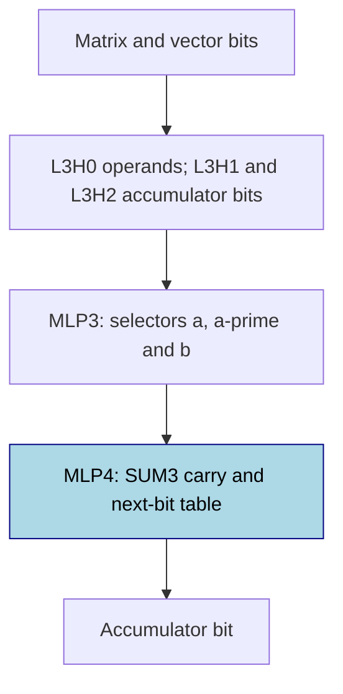
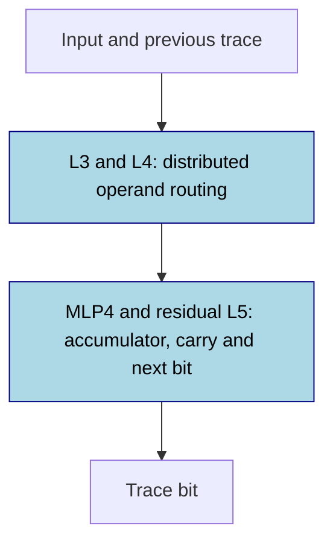

# Integer matrix-vector product

Matrix-vector multiplication forms each answer by adding the products in one matrix row. A five-layer transformer that wrote partial row sums on a [scratchpad](../GLOSSARY.md#task-formats), a record of intermediate working, reached final whole-output exact match 1.0 in 8/10 seeds on 2,000 held-out inputs per seed; answer-only training reached 1/3 after the budget grew from 30k to 120k steps across three rounds. The scratchpad models used current-bit and carry information at the final layer, yet substituting the tested arithmetic formula on linearly decoded values failed in every seed. The task is partly solved, with a partial formula for the frozen-scaffold model (substitution 3/3, complement evidence on two tested seeds only) and no accepted from-scratch form. Every final scratchpad model scored exact match 0 at matrix sizes m=2 and m=4 on 256 inputs per size.

## At a glance

| Fact | Value |
|---|---|
| Task | Multiply a square matrix M by a vector v; m=3, entries 0..7; emit nine least-significant-bit-first bits per row |
| Input → output example | The identity matrix leaves the vector unchanged |
| Model | 5 layers, 4 heads × width 32, d_model 128, ReLU MLP 640; no positional encoding or LayerNorm |
| Rungs and seeds | HAND references for both formats; PART and TRAIN screening cells: 3 seeds; scratchpad TRAIN final: 10 seeds |
| Closed form status | Partial: PART substitution 1.0 in 3/3 on 2,000 saved inputs per seed; causal scrubbing 100% on two tested seeds; TRAIN forms rejected |
| Status | Partly solved (scratchpad TRAIN 8/10 at final exact match 1.0; answer-only TRAIN 1/3); last run 2026-11-12 |
| Weights | [Hugging Face: integer-matvec](https://huggingface.co/jc1122/circuit-atlas-nets/tree/main/integer-matvec), revision `b9c5bae`; PART nets not archived |
| Reproduce | Not available yet: training code for this task is not yet in `code/` |

HAND sets every weight by formula, PART trains one stage on frozen HAND parts, and TRAIN learns all weights ([rungs](../GLOSSARY.md#the-three-rungs)). A scratchpad writes intermediate results before the answer; scores here are teacher-forced, with correct previous tokens supplied ([task formats](../GLOSSARY.md#task-formats)). Exact match requires the whole output to be correct, not just its final answer.

Read next: [Results](#4-what-training-finds) and [verification](#5-mechanism-and-verification), then [binary multiplication](multiplication.md) for the local carry step, or [finite-field linear systems](linear-systems-finite-fields.md) for row-update traces.

## 1. Task and data

The task is y = Mv, where M is a square matrix, v is a vector and m=3 is the row and column count. Entries are 0..7, and each y_i is written as nine least-significant-bit-first (LSB-first) bits: the units bit comes before the twos bit. The previously published bound is <= 196. The identity matrix leaves the vector unchanged. The scalar accumulator range is 0..147 at m=3 and 0..196 at m=4; the published <= 196 bound covers the size tests, rather than being the tight m=3 bound. Fresh inputs are drawn every batch; each seed has a disjoint 2,000-input test set.

*Table 1. Output formats. LSB-first means the least significant bit is written first.*

| Format | Output | Length at m=3 |
|---|---|---|
| A, answer only | The m answers | 46 tokens |
| T, scratchpad | Row accumulator after every shifted partial product | 27 steps, 286 tokens |

## 2. Model

### 2.1 Architecture

The GPT-NeoX-shaped decoder reads left to right ([glossary](../GLOSSARY.md#standard-machine-learning-terms)). It has 5 layers, 4 heads x d_head 32, d_model 128, ReLU MLP 640, vocab 15 (BOS, unk, d0-d7, bits 0/1, `; , =`), no positional encoding (NoPE) and no LayerNorm (LN).

### 2.2 Frozen and trained parts

PART trains only L4 MLP (W_in [640,128], W_out [128,640]); TRAIN trains all weights. The MLP is the feed-forward block applied at each position ([glossary](../GLOSSARY.md#standard-machine-learning-terms)). PART's preceding hand-built routing stays frozen.

### 2.3 Training

Shared methods: [METHODS.md](../METHODS.md). AdamW lr 1e-3, wd .1, betas (.9,.98), warmup 1000, cosine, clip 1, plateau 5000, ckpt 2500. Learning rate (lr), weight decay (wd) and schedule terms are defined in the [glossary](../GLOSSARY.md#standard-machine-learning-terms).

PART re-initialises the last MLP and uses fp32; TRAIN uses a TF32 flag with fp32 master weights ([precision](../GLOSSARY.md#hand-built-machinery)). The 2026-11-12 final run used T TRAIN, 10 seeds, 30k steps; other cells are three-seed screens.

*Table 2. Training budgets. A budget is planned; plateau stopping can end it earlier.*

| Cell | Steps | Batch | Examples per seed / stop |
|---|---|---|---|
| T TRAIN final | 30k | 256 | 7.68M |
| A TRAIN run 1 | 30k | 128 | Budget completed; 0/3 exact |
| A TRAIN run 2 | 60k | 128 | Budget completed; 0/3 exact |
| A TRAIN run 3 | 120k planned | 128 | Plateau stop 93k; 1/3 exact |
| A PART | 30k | Not stated here | Closed after the failed screen |

### 2.4 Reproduction

Reproduce: not available yet: training code for this task is not yet in `code/`; the weights, held-out splits and recorded accuracies are on [Hugging Face](https://huggingface.co/jc1122/circuit-atlas-nets/tree/main/integer-matvec). Archived networks re-score to the recorded accuracies.

### 2.5 Archive

Revision `b9c5bae` contains `hand_A`, `hand_T`, TRAIN best + final snapshots of T r1 s0-2, A r3 s0-2 and T final s0-9. PART nets are not archived. The `manifest.json` records seed, round, circuit type, accuracy and sha256, a content fingerprint ([glossary](../GLOSSARY.md#standard-machine-learning-terms)).

## 3. Hand-built solution

An accumulator is the running row sum. A carry transfers an overflow from one bit position into the next. A fetch head copies an operand to the position that uses it; a binary staircase alternates thresholds to extract a bit ([hand-built machinery](../GLOSSARY.md#hand-built-machinery)). HAND-a first forms products and then a row sum. HAND-b instead updates a bitwise accumulator after each shifted product.

HAND-a uses vector-bit fetch heads and gated products relu(M_ij + 8 bit(v_j,b) - 8). Uniform row attention takes their mean; rescaling by m gives the row sum, and a binary staircase reads its bits. It uses 6 heads and 769 neurons.

HAND-b builds a position frame from BOS frequency, then uses delimiter heads, operand fetch L3H0 and accumulator-bit fetches L3H1/H2. MLP3 selects a, a' and b; MLP4 applies a 32-neuron SUM3 table. It uses 8 heads and 1,205 neurons. Both references were exact on 770/1,410/2,306 stratified inputs at m=2/3/4, with minimum logit margin ~29.7/30.0. No third HAND was designed.

For the scratchpad, x and x' denote the previous accumulator's current and previous bits; a and a' denote shifted matrix-entry bits; b is the selected vector bit, and s' is the already-written previous bit of the current field. SUM3 is the local carry/parity table, not a separate learned algorithm.

*Figure 1. HAND-b's scratchpad route. MLP4 is the only trained part in PART; HAND-a's answer-only product/sum route is described above.*

## 4. What training finds

T TRAIN reached final exact match 1.0 in 8/10 seeds (seed 7 .9995, seed 9 .815); T PART reached it in 3/3 and A PART in 0/3. A TRAIN reached 1/3 after the 4x budget. Every solved T TRAIN net uses HAND-b's accumulator bit x, carry and next bit only at the last layer, with its own dense circuit and no HAND edge match. No TRAIN closed form passes substitution: linear decoders of the operands miss. No trained T net works at m=2 or m=4.

*Table 3. Solved means final whole-output exact match 1.0 on 2,000 held-out inputs per seed. Best and final snapshots are distinct.*
| cell | solved (exact 1.0) | best / final test | grok step (first 1.0) | circuit type (seeds) |
|---|---|---|---|---|
| PART T | 3/3 | 1 / 1 | <= 1,000 | T1 frozen HAND-b routing + carry/parity voter bank (3/3) |
| PART A | 0/3 | .078-.12 / .078-.11 | none (22.5k) | none: staircase readout of bits 0-3 missing |
| TRAIN T (final) | 8/10 | 1 x9, .815 / 1 x8, .9995, .815 | median 17.5k among terminal-exact seeds; 11.5k-29k among ever-exact seeds | T2 family (8/10): s0, s3, s4 three stitch-distinct types (1 each), 5 untested; s9 unsolved |
| TRAIN A (r3) | 1/3 | best .9585/1/.9995; final .9555/1/.999 | s1 78.5k (gradual) | A1 exact products + 2-d nonlinear row-sum code (1/3; s2 best .9995 same) |

### Diagnostic summary

Probe R² measures how well a linear readout recovers a named variable. A ridge decoder is such a readout fitted with a penalty on large coefficients; its errors can accumulate over a long trace. Distributed alignment search (DAS) learns a rotation in which to swap variables between inputs, and interchange flip measures whether that swap changes the output as the task rule predicts ([analysis measures](../GLOSSARY.md#analysis-measures)). L5 is the residual after the last layer, not a sixth transformer layer. Effective rank (r90) counts directions needed for 90% of variance or matrix energy; attention JS measures divergence from HAND. A discovered circuit's faith is held-out accuracy under complement resampling; edge Jaccard measures overlap with HAND's connections. Stitching tests whether representations can be mapped between seeds without losing accuracy; a zero score does not itself prove different algorithms.

*Table 4. Published diagnostics. Compact s labels mean seed; r means run; OV is an attention value/output map. Used heads and whole MLPs were ablated; individual used neurons were not.*
| cell (seeds) | used heads; MLPs | best probe R² (L5 unless noted) | eff. rank (OV r90; MLP4 in r90) vs HAND | attn JS to HAND | best / final |
|---|---|---|---|---|---|
| PART T (s0-2) | 8 (= HAND); 5 | x,x',a,a' >= .9999 (L4); nextbit .86-.88 | OV = HAND; MLP4 95-96 vs 5 | 0 (frozen) | 1 / 1 |
| TRAIN T final s0,s4,s8 | 11, 9, 13; 5 | x .93/.91/.91, carry .66/.60/.62, nextbit .87/.84/.89, a .49/.44/.46 | 3-4; 39-46 vs 5 | 0-.63 | 1 / 1 |
| TRAIN T final s1-3,s5,s6 | 17-19; 5 | x .62-.90, carry .27-.61, nextbit .59-.86, a .35-.44 | 3-4; 35-39 vs 5 | 0-.63 | 1 / 1 |
| TRAIN T final s7 / s9 | 20 / 20; 5 | x .88/.51, carry .38/.35, nextbit .63/.57 | 3; 38/41 vs 5 | 0-.62 | 1/.9995; .815/.815 |
| TRAIN A s1 (r3) | 6: L3H0,L3H3,L4H0-3; 5 | vector .996 (L4), product .998 (L4), row_sum .70 | not measured | .28-.42 | 1 / 1 |
Causal (T final): x, nextbit, carry flip .92-1 at L5 only (2-d DAS .994-1); circuits 83-283 of 321 edges, all 5 MLPs, HAND-b edge Jaccard .03-.07;
faith >= .90 only s3 (.927); s0/s3/s4 do not stitch from L2 on (score 0, map R² .85-.99). A: row_sum flip .19-.39, 2-d DAS .997 at L5; HAND-a J .05.
## 5. Mechanism and verification

A closed form must survive substitution and complement resampling to count as verified ([acceptance rule](../GLOSSARY.md#verifying-a-circuit)). The population status here is partial: PART's substitution covers 3/3, but the reported equivalent resample test covers two seeds, not all three. The published entry calls T1 accepted; that label is retained at its tested scope.

### T1: partly trained carry/parity bank

The replacement is `c=[x'+b·a'-s'>=1], y=(x+b·a+c) mod 2`: reconstruct the incoming carry c, then take the next bit y as parity, whether the sum is odd. Substituting it for MLP4 gives exact 1.0 on 2,000 saved m3 inputs per seed (3/3); causal scrubbing, which replaces other activations with fresh donor values, gives 100% on two tested seeds. The published entry calls it accepted. The generic complement diagnostic was not run, and the source summary does not give the donor-scrub row count. This supports the resample side for those two seeds, not a third-seed certificate; the population status stays partial.

### T2: from-scratch scratchpad family

The same formula on ridge-decoded x,x',a,a',b,s' at L5 gives exact 0-.006 on 500 scored rows per seed (1000 saved, 500 fit and 500 scored). Operand bits a/a'/b decode at .69-.95, near the majority rate. The discovered-circuit complement gives .932 in seed 3 (passes) and .839 in seed 4 (fails). The formula is not accepted.

### A1: answer-only circuit

Using y_i = sum_j p_ij on decoded products gives .52 in seed 1 versus native 1.0 and is not accepted; p_ij denotes a decoded row product.
The published shorthand compares the failed T2 formula (exact 0-.006) with net 1.0 “on all 10 seeds”. The underlying scored substitution set instead has native 1.0 in nine seeds and .836 in seed 9; the headline final 2,000-row set has seed 7 at .9995 and seed 9 at .815. These are different evaluations, not interchangeable exact-match claims.

*Figure 2. The T2 family trained from scratch; routing and readout nodes are trained. Status: rejected for the TRAIN closed form, with substitution exact 0-.006; the PART result remains partial because complement evidence covers two tested seeds only. Shared variables do not establish shared wiring or one stitch-compatible code.*

### Relation to published work

Scratchpad PART learns a redundant bank of HAND-b's local carry/parity variables. In TRAIN the fetch is spread over L3–L4, and the last MLP has 35–46 directions at 90% input-matrix energy, rather than HAND's 32 active neurons. Effective rank is a weight-concentration measure, not a count of used neurons. The answer-only circuit recovers HAND-a's products without its aggregation code.

[Charton (2021)](#references) trains real-valued matvec transformers with tolerance scoring; [Getu (2021)](#references) bounds and trains ReLU matvec approximators; [Ma et al. (2025)](#references) construct matvec transformer operators. [Sworna et al. (2016)](#references) and [Babu (2022)](#references) describe learned lookup-table matrix products. A lookup table lists a result for each discrete input combination. These are related tasks or constructions, not replications of this bitwise held-out exact-match test.

[Giannou et al. (2023)](#references) construct softmax-based matrix products; [Mereghetti and Palano (2000)](#references) and [Parekh et al. (2018)](#references) analyse threshold-circuit variants. [Telgarsky (2016)](#references) supplies the depth/threshold comparison, not a claim that these five layers are necessary. For adjacent empirical work, [Bai et al. (2025)](#references) report long-range dependency failures in scalar multiplication and [Nye et al. (2021)](#references) study scratchpad supervision.
## 6. Limitations and open questions

Final run only for T TRAIN (wd .1, one hardware setup, TF32 flag); other cells 3 seeds. Length: T TRAIN m=2 and m=4 exact 0 in all 10 seeds (token acc .42-.88);
lower/high-bit value slices of m3 .98-1 (s9 .32 high-bit). Teacher-forced metrics; not exhaustive at m=4 (8^20 inputs). Individual used neurons not
ablated. Failing linear decoders do not show a variable is absent ([Geiger et al., 2021](#references)); a DAS-aligned substitution was not run. Seed 9's carry is accessible under DAS, so its incomplete low-bit computation is not evidence of a missing carry representation. Seed 7's 64 diagnostic traces were all exact despite its one error on the 2,000-input final test: that error has not been localised. The legacy weight-decay sweep was not run, so all reported grok rates here are at wd .1. PART weights remain unarchived. The logged stall alerts in seeds 2, 6 and 9 had no supplied checkpoint inspection; error-containing diagnostics for seed 7 and stitching for the other solved seeds remain missing.
## 7. Prediction record

Committed: PART T 10/10 and A >= 8/10 by 10k; TRAIN T >= 7/10, A <= 3/10 by 30k; no TRAIN seed > .5 at m=4. Held: T PART (3/3 by 1k), T TRAIN (9/10 >= .99, 8/10 exact by 30k), A TRAIN <= 3/10 at 30k (0/3), m=4 (0 in all 10 T seeds). Missed: A PART (0/3). Held-out-value arm not run.

## Appendix A. Weights excerpt and reading

T PART seed 0 neuron 258 (fitted response): h=[.016 - .068 z_BB + .037 z_TERM - .028 z_R2 + .028 z_X + ...]+, vote +24.6. This threshold mixes clock and arithmetic coordinates; it is not an isolated carry gate. BB is the selected multiplier bit, TERM and R2 are trace-position coordinates, and X is the previous accumulator bit. These are the fitted response's feature names, not exact weight entries.

In TRAIN (archived final nets, L4 direct bit vote), the top 5 of 640 neurons carry only .027-.077 of the |vote| in T (final seed 6: n6 -43.9, n25 +37.3), .098-.116 in A, against HAND T's 32 active neurons. The readout is spread over many neurons, rather than a few carry gates.

## Appendix B. Detailed evaluation scopes

*Table 5. Failed T2 substitution versus native accuracy. These data come from the final-run interpretation, not the headline final test.*

| Evaluation | Rows | Result |
|---|---|---|
| Ridge-decoded SUM3 substitution | 1000 saved per seed; 500 fit, 500 scored | Exact 0-.006 in all 10 seeds; native 1.0 in nine seeds, .836 in seed 9 |
| Discovered-circuit complements | 64 rows, 3 draws | Seed 3 .932 passes; seed 4 .839 fails |
| Size and value tests | 256 rows per axis | At m=2 and m=4, exact 0 in all 10 seeds |

The published summary describes “three 2x budget retries (30k -> 120k)”. The training record instead identifies run 3 as retry 2: run 1 used 30k, run 2 used 60k and run 3 used 120k. This is two budget doublings across three rounds, not three retries; the old wording is retained here as a correction record. The final budget was 4x the first.

First-exact timing also has two cohorts: median 17.5k among the eight terminal-exact seeds, versus median 21k and range 11.5k-29k among the nine seeds that were ever exact. Seed 7's late regression explains why those cohorts differ.

The diagnostic table and narrative retain their original ranges, including 83-283 edges in the narrative versus 83-238 in the source's circuit-type table. Neither is a certified minimum. Linear-decoder failure does not demonstrate variable absence; a DAS-aligned substitution was not run.

## References

- Babu, H. M. H. (2022). LUT-based matrix multiplication using neural networks. *VLSI Circuits and Embedded Systems*. https://doi.org/10.1201/9781003269182-15 (book chapter; learned lookup tables).
- Bai, X., Pres, I., Deng, Y., et al. (2025). Why can't transformers learn multiplication? Reverse-engineering reveals long-range dependency pitfalls. *arXiv preprint*. https://arxiv.org/abs/2510.00184 (scalar-multiplication comparison).
- Charton, F. (2021). Linear algebra with transformers. *arXiv preprint*. https://arxiv.org/abs/2112.01898 (real-valued matvec with tolerance scoring).
- Geiger, A., Lu, H., Icard, T., & Potts, C. (2021). Causal abstractions of neural networks. *arXiv preprint*. https://arxiv.org/abs/2106.02997 (arXiv preprint; decodability versus causal representation).
- Getu, T. M. (2021). Error bounds for a matrix-vector product approximation with deep ReLU neural networks. *arXiv preprint*. https://arxiv.org/abs/2111.12963 (arXiv preprint; ReLU matvec approximators).
- Giannou, A., Rajput, S., Sohn, J.-y., Lee, K., Lee, J. D., & Papailiopoulos, D. (2023). Looped transformers as programmable computers. *arXiv preprint*. https://arxiv.org/abs/2301.13196 (arXiv preprint; matrix-product construction).
- Ma, Z., Gao, Y., & Ng, M. K. (2025). NLAFormer: Transformers learn numerical linear algebra operations. *arXiv preprint*. https://arxiv.org/abs/2508.19557 (arXiv preprint; transformer matvec operators).
- Mereghetti, C., & Palano, B. (2000). Threshold circuits for iterated matrix product and powering. *RAIRO - Theoretical Informatics and Applications*. https://doi.org/10.1051/ita:2000105 (journal article; threshold-circuit construction).
- Nye, M., Andreassen, A. J., Gur-Ari, G., et al. (2021). Show your work: Scratchpads for intermediate computation with language models. *arXiv preprint*. https://arxiv.org/abs/2112.00114 (scratchpad supervision).
- Parekh, O., Phillips, C. A., James, C. D., & Aimone, J. B. (2018). Constant-depth and subcubic-size threshold circuits for matrix multiplication. *Symposium on Parallelism in Algorithms and Architectures*. https://doi.org/10.1145/3210377.3210410 (conference paper; threshold-circuit comparison).
- Sworna, Z. T., Ul Haque, M., & Babu, H. M. H. (2016). A LUT-based matrix multiplication using neural networks. *IEEE International Symposium on Circuits and Systems (ISCAS)*. https://doi.org/10.1109/ISCAS.2016.7538964 (conference paper; learned lookup tables).
- Telgarsky, M. (2016). Benefits of depth in neural networks. *arXiv preprint*. https://arxiv.org/abs/1602.04485 (arXiv preprint; depth/threshold context).
