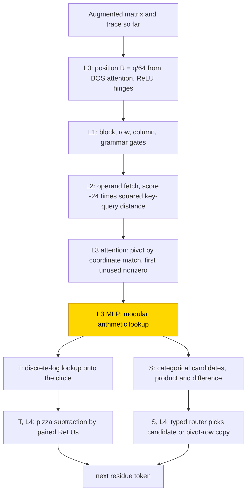
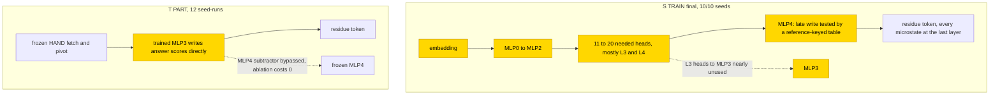

# Linear systems over F₅ and F₇

These transformers solved small linear systems with arithmetic that wraps modulo 5 or 7. Writing each intermediate multiplication and subtraction made the detailed-trace format learnable: all 10/10 final seeds reached whole-output exact 1.0 on 2000 held-out systems, while answer-only training solved none of its screening cells. Training completed the arithmetic in a late, distributed lookup rather than following the hand-built network's layer-by-layer decomposition. The task is partly solved, and the final lookup is Sufficient readout only: substitution with reference-computed operand keys gives 1.0 in 3/3 tested seeds, but complement resampling on 128 systems per seed fails (.00–.30 for the claimed circuit, .79–.89 for discovered circuits, below .90). A separate replacement for the partly trained update stage is Partial and repairs failed networks; it does not explain their native errors.

| Fact | Value |
|---|---|
| Task | Solve an invertible system Ax = b using arithmetic modulo 5 or 7 (F₅ or F₇), dimension m = 2 or 3, one residue per token |
| Input → output example | In words, over F₅: A with rows (1, 2) and (0, 1), b = (3, 1) → x = (1, 1) |
| Model | GPT-NeoX, 5 layers, ReLU, no LayerNorm, no positional encoding; PART trains only the layer-3 MLP of the frozen hand-built network |
| Rungs and seeds | HAND T and S exact; three-seed screens of PART T/S and TRAIN T/S/A in four cells (T TRAIN retries 60k or double width); ten-seed final F₅m2 S TRAIN (10/10) |
| Closed form status | Sufficient readout only (final S TRAIN: reference-keyed MLP4 table 1.0 in 3/3 tested seeds on 2000 held-out systems; complement on 128 systems per seed .00–.30 claimed / .79–.89 discovered, below .90). T PART repair surrogate: Partial, 1024/1024 in all 24 snapshots, complement untested. S PART candidate: 1024/1024 in 8 snapshots, shuffle missing, not accepted. |
| Status | Partly solved (F₅m2 S TRAIN 10/10, transfer to m = 3 0.0 in 10/10; answer only 0/3 in every screen); last run 2026-11-08 |
| Weights | [Hugging Face: linear-systems-finite-fields](https://huggingface.co/jc1122/circuit-atlas-nets/tree/main/linear-systems-finite-fields) (weights and held-out evidence archive; 158 nets) |
| Reproduce | Not available yet: training code for this task is not yet in `code/` |

## 1. Task and data

The network solves an invertible system Ax = b over F₅ or F₇ of dimension m = 2 or 3. These finite fields use integers with addition and multiplication wrapping modulo the named prime; for example, over F₅, rows (1, 2) and (0, 1) with b = (3, 1) give x = (1, 1). Gauss–Jordan elimination normalises one pivot row at a time and subtracts its contribution from other rows, here choosing the first unused nonzero pivot and writing one residue per token. Three formats were studied (Table 1). In format S the network also writes the microstates of
each update: the inverse d⁻¹ of the pivot entry d, the normalised value pb·d⁻¹ (pb is the pivot-row entry), the product k·(pb·d⁻¹) (k is the
row's entry in the pivot column), and the updated entry old − product, or the normalised value on the pivot row. These written
intermediate steps make T and S scratchpad formats, outputs with working before the answer ([glossary](../GLOSSARY.md#task-formats)). A microstep is one of these intermediate arithmetic operations, rather than a complete matrix update.

*Table 1. Output formats and output lengths in tokens.*

| Format | Output | Length m = 2 | Length m = 3 |
|---|---|---|---|
| `A` | answer only (the solution) | 2 | 3 |
| `T` | every updated augmented matrix | 25 | 61 |
| `S` | T plus the microstates of each update (inverse, normalised pivot value, product, updated entry) | 61 | 169 |

Fresh systems were drawn every batch. A seed-specific matrix hash (mod 5 = 0) selects the held-out matrices, all of whose right-hand
sides are excluded from training; there are 2,000 held-out systems per seed. Exact match means the whole
teacher-forced continuation is correct: each token receives the correct earlier tokens ([glossary](../GLOSSARY.md#task-formats)). Cells are named by field and dimension, for example F₅m2 for
F₅ with m = 2.

## 2. Model

The shared conventions are described in [METHODS.md](../METHODS.md). The [rungs](../GLOSSARY.md#the-three-rungs) are HAND (every
weight set by formula), PART (frozen hand-built parts with one trained stage) and TRAIN (all weights trained from scratch).

### 2.1 Architecture

All networks use the GPT-NeoX decoder layout with attention heads reading earlier positions and feed-forward MLP blocks transforming each position's running vector ([glossary](../GLOSSARY.md#standard-machine-learning-terms)). They have 5 layers, ReLU, no LayerNorm, no positional encoding (position is built from BOS attention, as in HAND)
and an untied read-out. T and A use d_model 96, 6 heads of 16, MLP 128, vocabulary 16 and context 128 (width retry: d_model 192,
heads of 32, MLP 256). S uses d_model 176, 11 heads of 16, MLP 223, vocabulary 37 and context 256.

### 2.2 Frozen parts and trained part

TRAIN learns every tensor; A has no HAND. In PART, HAND is frozen and the layer-3 MLP is re-initialised and trained. In T this is
W_in [128, 96] and W_out [96, 128] with biases, 24,800 parameters. In S it is W_in [223, 176] and W_out [176, 223], with inputs and
outputs masked to the blocks of Table 2.

*Table 2. Input and output blocks of the trained S PART stage (zero-based residual indices).*

| Side | Block | Indices |
|---|---|---|
| input | typed-token blocks | 16–22/23–29/30–36 |
| input | PB/K/OLD | 106–112/113–119/120–126 |
| output | NORMAL/PROD/DIFF | 148–154/155–161/162–168 |

Key: PB, K and OLD hold the pivot-row entry pb, the row's entry k in the pivot column and the old entry; NORMAL, PROD and DIFF
hold the normalised value, the product and the updated entry defined in Section 1.

### 2.3 Training

The optimiser was AdamW with learning rate 1e-3, weight decay .1 and betas (.9, .98), warmup 1,000 steps, a cosine schedule, clipping
at 1 and batch 64 (F₅m3 S TRAIN 16 after a memory failure). The networks were evaluated every 500 steps on the held-out systems, and
the best snapshot is the one with the highest held-out exact match; checkpoints were saved every 2,500 steps. A run stopped when solved
or on a 5k plateau after 75% of the steps. The screens ran 30k steps. T budget retries ran 60k steps; m = 3 width retries doubled d_head
and the MLP. The final F₅m2 S TRAIN cell ran seeds 0-9 in two packed runs with a 30k budget and stopped solved at 11.5k/14.5k. PART ran
in fp32 and TRAIN in TF32 on consumer GPUs, and re-scores were run in fp32 on CPU. Diagnostics used 128 held-out rows per net (256 for
T/A).

### 2.4 Reproduction

Reproduce: not available yet: training code for this task is not yet in `code/`; the weights, held-out splits and recorded
accuracies are on Hugging Face at
[huggingface.co/jc1122/circuit-atlas-nets/tree/main/linear-systems-finite-fields](https://huggingface.co/jc1122/circuit-atlas-nets/tree/main/linear-systems-finite-fields).

### 2.5 Archive

The folder holds 158 nets: the best and final snapshot of every available pack, including the F₅m2 S final seeds and the F₇m2 T width
retry, as full state dicts; each run's held-out systems are in `test_<run>_p
_m<m>`. Files
`<rung>_F
m<m>_<fmt>_<run>_<best|final>_s<seed>` hold full state dicts (PART includes the frozen HAND; `trained_keys` in
`manifest.json`), with per-net config, seed, steps, recorded and re-scored exact, and sha256. Reloaded as GPT-NeoX in fp32, all 158
reproduce their recorded held-out exact (TF32 nets within 3/2000). Lost and not relaunched: the initial F₅m2 A/T TRAIN nets and the
unfinished F₇m3 S PART run.

## 3. Hand-built solution

Attention picks the pivot and fetches the operands, a lookup does the modular arithmetic (a circle code in T, one-hot candidates in S),
and the last layer subtracts or routes (Figure 1). Layer 0 builds a position R = q/64 from uniform-BOS attention and ReLU hinges;
layer 1 derives block, row and column and grammar gates; layer 2 fetches operands with scores −24‖key − query‖²; layer 3 picks the
pivot by coordinate match plus 120[nz] − 120[used] − 20r.

In T, a discrete logarithm is an exponent of a fixed field generator g, turning multiplication of nonzero residues into addition of exponents. The arithmetic is a scalar discrete-log lookup g^(log k + log pb + log d⁻¹) (zero handled separately) onto the circle
(cos 2πt/p, −sin 2πt/p), and layer 4 subtracts by paired ReLUs on |⟨(e(old) + e(−t))/2, e(c/2)⟩|, the "pizza" subtraction of
[Zhong et al. (2023)](#references), a trigonometric readout from the sum of two number-circle vectors ([glossary](../GLOSSARY.md#analysis-measures)). S instead uses one-hot residue indicators e_a and e_b (one active coordinate per value) to write categorical candidates ReLU(e_a + e_b − 1), mapped to e_(ab mod p) or
e_(a−b mod p), and a frozen typed router selects the candidate belonging to the current microstep or copies the pivot row. The formula-nonzero size is T 14 heads +
195/211 neurons and S 15 + 400/482 (F₅/F₇). HAND is exact on all 12,000/98,784 m = 2 systems, on exhaustive local arithmetic, on
stratified m = 3 fixtures and in greedy rollouts (m = 3 not exhausted).

*Figure 1. The hand-built networks for formats T and S. Attention builds positions, fetches operands and picks the pivot; the layer-3
MLP does the modular arithmetic and layer 4 subtracts (T) or routes (S). The shaded layer-3 MLP is the part that PART replaces with a
trained stage.*

## 4. What training finds

The final run was analysed on 2026-11-08.

*Table 3. Seeds with best held-out exact ≥ .99 in the screens (initial run, then each retry).*

| Cell | PART T | PART S | TRAIN T | TRAIN S | TRAIN A |
|---|---|---|---|---|---|
| F₅m2 | 0/3 | 2/3 | 0/3 → 3/3 (60k) | 3/3; ten-seed final 10/10 | 0/3 |
| F₅m3 | 3/3 | not run | 0/3 → 0/3 | 3/3 | 0/3 → 0/3 |
| F₇m2 | 0/3 | 2/3 | 0/3 → 2/3 (60k) → 0/3 (width 2) | 3/3 | 0/3 → 0/3 |
| F₇m3 | 0/3 | run lost | 0/3 → 0/3 | 3/3 (stop 22.5k) | 0/3 → 0/3 |

From scratch, S solved every screen (3/3 in all four cells) and the F₅m2 ten-seed final (10/10), with best and final exact 1.0 on 2000 held-out systems per seed; T solved only after a budget retry at
m = 2 (F₅ 3/3, F₇ 2/3; a further width retry at F₇m2 0/3), and A never. Transfer from m = 2 to m = 3 is 0.0 in 10/10.

The learning curves are as follows. In the F₅m2 S TRAIN final, onset (test > .01) came at 3.5–4.5k and the first exact at 8.0–11.5k
(median 8.75k), with train and test rising together (no memorisation phase). F₇m3 S TRAIN reached ≥ .99 in its first seed at 10.5k
and in all seeds at 18.5k. F₅m3 T PART reached ≥ .5/.9/.99 at 9.5k/18.5k/21.5k. The F₅m2 T retry reached ≥ .99 in all seeds at
46.5k, and the F₇m2 T width retry plateaued at .47–.50 (closed).

### 4.1 Stage trained on frozen parts (PART)

With the fused update-trace format T, training only the update MLP on frozen hand-built routing learns a direct readout that bypasses
the frozen subtractor. All 12 diagnosed T PART seed-runs, failures included, form this one bypass family: patching MLP3 gives
recovery/drop 1/1, and dropping MLP4 costs 0. It solved 3/3 only at F₅m3 (F₅, dimension 3). With the microstep format S, PART keeps
the hand-built decomposition (multiply and subtract candidates, then a typed router): the 4 solved S PART seed-runs keep the router,
and the 2 failed seeds keep the wiring but mis-map categories (the failed F₇m2 S PART emits 0/136 correct NORMAL4 tokens despite
near-perfect decoding).

### 4.2 Trained from scratch (TRAIN)

The ten final F₅m2 S TRAIN nets share one circuit type, a distributed late lookup that matches no hand-built circuit (10/10). All 5
MLPs are needed (mean ablation gives exact 0–.09), and 11–20 heads are needed, mostly in L3–L4; the L0/L1 heads are needed only as a
group. Every HAND arithmetic variable is causal only at the last residual (interchange flip ≥ .92 at L5, the share of outputs that
change as predicted when the variable is swapped between inputs); the pivot is not interchangeable (flip ≤ .13 in 9 seeds). The
path drops (Table 4) show that HAND's route through L3 heads and MLP3 is nearly unused. Linear-mode-connectivity barriers (the loss rise along the straight line between
two seeds' weights) of 2.1–2.3 place the seeds in different basins with the same mechanism family.
Discovered circuits (188–548 of 1,616 edges) match HAND in no seed (edge Jaccard .03–.12). Full diagnostics are in Appendix B.

*Table 4. Path drops in the final S TRAIN nets (share of the full corruption effect; `*` is the wildcard target as recorded, read here as any target).*

| Path | Drop |
|---|---|
| embedding | 1.0 |
| MLP0–2 | .91–.95 |
| L4 heads + MLP4 → out | .83–.98 |
| MLP3 → * | .04–.21 |
| L3 heads → MLP3 | ≤ .05 |

## 5. Mechanism and verification

### 5.1 T PART: partial decision surrogate and repair

Let n = pb·d⁻¹ and t = k·n, with f = n on the pivot row and old − t elsewhere (mod p). The whole MLP3 is replaced by
m̂₃(x) = ι_R θ[g(x)], keeping MLP4. Here g = (equal, f) at value slots and otherwise a prefix-derived grammar category; θ is the mean
native response in that category (fit on 1,024 fresh train-partition systems); and R is the 16 token-score coordinates plus OC, OS,
PC, PS, TB, EQ (22). The map ι_R writes the table response only into R. OC/OS are the old entry's circle coordinates, PC/PS the product's circle coordinates, TB flags a value slot and EQ a pivot-row match. On 1,024 fresh held-matrix systems per snapshot, all 24 best/final snapshots of the four T PART cells score
1024/1024 (bar ≥ .99 × native), with 484/506/616/638 scalars (F₅m2/F₅m3/F₇m2/F₇m3) against 24,800. Independently re-run with new fit
and test salts on the F₅m3/F₇m2 snapshots, 12/12 pass. The solved F₅m3 native scores 1022–1024, so the replacement is a decision surrogate, reproducing the correct output decisions on reachable inputs without matching continuous responses ([glossary](../GLOSSARY.md#verifying-a-circuit)). It also repairs native errors, including in failed cells, so it is not a faithful explanation of those errors. Controls: zero MLP3 and shifted arithmetic give 0/1024;
zero MLP4 keeps native accuracy. No resample ablation of the complement was reported for this stage. Its status is Partial, supported by substitution only; the source's accepted label applies to this limited decision-surrogate claim.

### 5.2 S PART: candidate (not accepted)

The written tokens I_a, N_a and M_b label an inverse a, a normalised pivot value a and a product b. MLP3 is replaced by a three-map form that sends I_a to NORMAL_(a·pb), N_a to PROD_(a·k) and M_b to DIFF_(old − b), with MLP4 kept. It scores
1024/1024 with token agreement 1 in all 8 snapshots of the 4 solved seeds, and zero MLP3/MLP4 give 0, but the substitute-shuffle control
is missing, so it is not accepted.

### 5.3 S TRAIN final: sufficient readout only

MLP4 at microstep q is approximated by θ₄[phase, operands], where θ₄ is the fit-mean MLP4 output (2,048 training systems) keyed on
phase 1: d; 2: (d⁻¹, pb); 3: (pb·d⁻¹, k); 4: (equal-row, old, product, normalised); 91 cells. Phase and operand keys are computed by the reference elimination algorithm from each input system, not decoded from the trained network. Substitution therefore tests a reference-keyed readout, not an internally recovered operand computation. On 2000 held-out systems per seed it gives exact 1.0 in seeds 0, 3 and 9 (native 1.0); a shuffled key gives 0 and zero gives 0. MLP3 is not an operand table (.01/.34/.15); a joint MLP3+MLP4
table holds in seeds 3 and 9 (1.0/.9995), not in seed 0 (.14). The
[resample ablation of the complement](../GLOSSARY.md#verifying-a-circuit), which replaces everything outside a circuit with its
values on other inputs, uses 128 systems per seed in all 10 final seeds. It gives .00–.30 for the claimed circuit and .79–.89 for the discovered ones, both under .90, so the net outside
MLP4 has no closed form here and no whole-net closed form passes the circuit check. The operand table is Sufficient readout only, despite its successful local substitution. An earlier phase-conditioned additive MLP4
formula on the screen nets was rejected (2/18 numerical passes, none on solved snapshots).

*Figure 2. S TRAIN's late operand table is Sufficient readout only: reference-keyed substitution gives 1.0 on 2000 systems in 3/3 tested seeds, but complement .00–.30 / .79–.89 on 128 systems per seed fails the .90 circuit check. The native computational nodes in that panel are trained; the substitution keys are supplied by the reference algorithm, not decoded network state. In T PART only MLP3 is shaded and trained; its Partial decision surrogate repairs errors and bypasses the frozen subtractor, with complement untested.*

### 5.4 Relation to the hand-built network and to published work

S PART keeps HAND's factorisation and T PART bypasses it. TRAIN makes the arithmetic variables causally available at the last residual. MLP4 admits a reference-keyed operand-table replacement, Sufficient readout only because the complement test fails; this does not recover the network's own operand extraction. HAND instead uses a layer-3 lookup followed by the layer-4 router. S beats answer only in the completed screens, but its larger
width, longer output and one smaller batch prevent a causal conclusion about the format alone. HAND's subtraction is the "pizza"
construction of [Zhong et al. (2023)](#references); the written microstates follow scratchpad computation
([Nye et al., 2021](#references)). With p = 5 only two Fourier frequencies exist, and no Fourier structure is claimed.

## 6. Limitations and open questions

Scoring is teacher-forced only. The T surrogate is a reachable-input decision surrogate, not continuous-response equality. Not
established: a TRAIN arithmetic formula or circuit closed form, an S PART formula, coefficient-holdout transfer, and length
generalisation (from m2 to m3: T PART 0/3 per field, S TRAIN 0/10). Circuit discovery picks one of many valid subgraphs
([Bayat Makou et al., 2026](#references)), and an edge-level claim of a core shared across seeds is untested. Mean tables can overstate
a component's role ([Li & Janson, 2024](#references)). Lost: the initial F₅m2 A/T TRAIN nets and F₇m3 S PART. Pending: diagnostics of
the F₇m2 T width retry, and public code. The later diagnostic rerun found no memorisation or stall alert in 7/7 final seeds with checkpoint dynamics. Seeds 0–2 have no step checkpoints; the log-only dynamics pass and geometry/weight-decay probes are missing. Seed 2's best-snapshot diagnostics were deliberately omitted because its best and final steps coincide. These gaps are not evidence of a complete dynamics census.

## 7. Prediction record

Predictions were recorded before the runs: T PART ≥ 9/10 solved by 10k; T TRAIN ≥ 7/10 at m = 2 and ≥ 5/10 at m = 3, with pivots the
bottleneck; S PART 3/3 by 5k with cross-dimension transfer. These were not confirmed: T PART solves 3/12 seed-runs, updates (not pivot
choice) dominate the failures, S PART solves 4/6 with categorical mapping holes, and T PART transfer from m2 to m3 is 0/3 in each field.

For the S cells, recorded before the S runs: S TRAIN F₅m2 ≥ 2/3 at ≥ .99 within 30k (hit, 10/10 by 14.5k); S beats T (hit); TRAIN
cross-m exact < .2 (hit, 0.0); no number circle required, and a clock label needs a causal substitution (hit: circle RSA, the representational similarity between an
embedding and a number circle, > .5 in 1/8 embeddings); training may move the arithmetic to other layers (hit: causal only at the last residual).

## Appendix A. Weights excerpt and reading

*Table A1. F₅m3 T PART seed 1 best, MLP3, raw float32 weight slices (Y₀/Y₁ = residue 0/1 score rows).*

| Neuron | Input weights (bias) | Output weights |
|---|---|---|
| 61 | TS .17479, TSEMI −.21531, TB −.24831 (−.02143) | Y_comma .14114 |
| 97 | KZ .32052, PZ .30478, OZ −.22918 (−.01176) | Y₀ −.30414, Y₁ .24864 |

The fitted category means θ[g = (nonpivot, 0), Y₀] for seeds 0/1/2 are F₅m3 .0641, .0609, .0422 and F₇m2 .0351, .0409, .0396.

TS flags a separator, TSEMI a semicolon and TB a value slot. KZ/PZ/OZ flag zero values of k, pb and old. Neuron 61 favours comma over semicolon and value contexts; neuron 97 mixes zero-operand flags with old-state information and
writes residue scores directly. Neither is an isolated arithmetic gate. Where HAND writes product-circle coordinates for MLP4's paired
subtraction, the trained stage writes answer scores itself, and deleting MLP4 costs nothing (the causal bypass evidence). In the final
S TRAIN nets all 223 neurons are live in every MLP (no sparse lookup, unlike HAND's 70 live MLP3 neurons with input weights 1.0), and
the top heads by ‖W_O‖ grow with depth (L4 2.7–3.0), matching the late readout.

## Appendix B. Detailed evidence

*Table B1. Diagnostics per setup (best and final snapshots).*

| Setup (best/final) | Heads / MLPs needed | Product R² | Residual r90 vs HAND | MLP3 in/out r90; attention JS | Exact B → F |
|---|---|---|---|---|---|
| F₅m3 T PART | 9 / 2 | .75–.78 | 4 vs 5 | 16–21 / 6–20; 0 | 1 → 1 |
| F₇m2 S PART | 10 / 3 | .98–1.0 | 19–20 vs 22 | 28–30 / 15–17; 0 | .56–1 → .56–1 |
| F₅m2 T TRAIN retry | 16–21 / 5 | .50–.52 | 16–22 vs 9 | 20–24 / 23–29; 0–.52 | 1 → 1 |
| F₅m2 S TRAIN final (10 seeds) | 11–20 / 5 | .87–.94 | 17–23 vs 17 | max JS .50–.58, mean .19–.30 | 1 → 1 |

Key: product R² = R² of a linear probe for the product k·(pb·d⁻¹) (read from the diagnostics key); needed = an individual mean ablation costs > .05 exact (neurons not counted individually); r90 = rank at 90% of the variance; JS =
Jensen-Shannon divergence of attention against HAND; B, F = best and final snapshot. Terms are defined in the
[glossary](../GLOSSARY.md#analysis-measures).

A 128-system zero-ablation audit of the solved F₅m3 T PART needs 14 heads + 151–175 neurons and no MLP4 neuron (not a joint minimum).
In the final S TRAIN nets the best probe R² (all at L5) is diag .93–.98, normalised .82–.94, out .83–.95, old .75–.90, pb .76–.91,
difference .76–.94, k .72–.84 and inverse .69–.97; pivot .61–.91 (L4/L5); HAND-component R² at L5 .84–.94; m = 3 transfer 0.0 / 0.0.

## References

- Bayat Makou, A., Niu, J., Dutta, S., & Gurevych, I. (2026). Many circuits, one mechanism: Input variation and evaluation granularity
  in circuit discovery. *Transactions on Machine Learning Research (2026)*. https://doi.org/10.48550/arxiv.2606.06267 (circuit
  equivalence classes); https://arxiv.org/abs/2606.06267
- Li, M., & Janson, L. (2024). Optimal ablation for interpretability. *arXiv preprint*. https://doi.org/10.48550/arxiv.2409.09951
  (ablation baselines); https://arxiv.org/abs/2409.09951
- Nye, M., Andreassen, A. J., Gur-Ari, G., et al. (2021). Show your work: Scratchpads for intermediate computation with language
  models. *arXiv preprint*. https://arxiv.org/abs/2112.00114 (scratchpad computation)
- Zhong, Z., Liu, Z., Tegmark, M., & Andreas, J. (2023). The clock and the pizza: Two stories in mechanistic explanation of neural
  networks. *Advances in Neural Information Processing Systems 36 (NeurIPS 2023)*. https://arxiv.org/abs/2306.17844 (the "pizza"
  modular-arithmetic circuit); https://doi.org/10.52202/075280-1186
