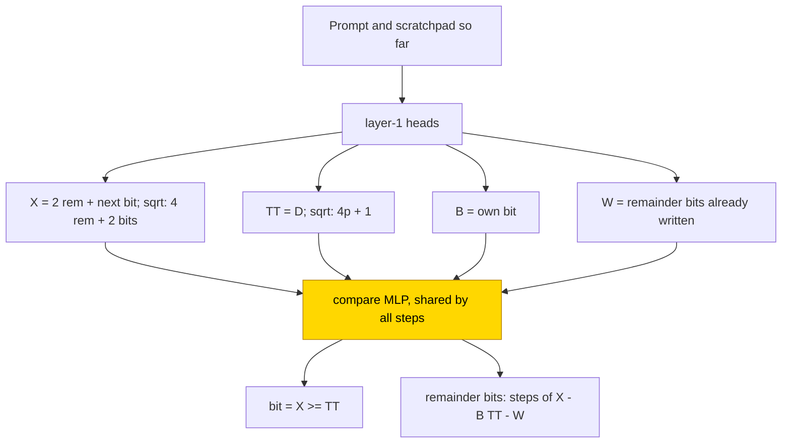
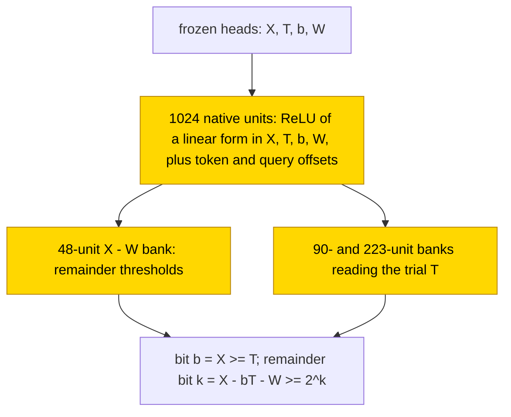

# Binary long division and long-hand square root

This entry studies binary long division (an 8-bit dividend by a 4-bit divisor) and the long-hand square root of an 8-bit number, with
wider ranges as well, each written either answer only or with a per-step scratchpad. Both operations share one hand-built step:
compare the working value x with a threshold T for the next quotient or root bit, then subtract. With a scratchpad, a stage trained on
frozen hand-built parts reproduced this step as one circuit shared by all steps (division 10/10 exact at both ranges, square root
.985–.992 at the wide range), while the answer-only stage failed (≤ .29). Networks trained from scratch memorised at 8 bits (train 1.0,
test ≤ .81) but generalised at the wide range with 16–90x more data (division answer only .995–1.0). The task is partly solved, and no
trained network is exact on all inputs. The closed form is partial: the hand-built compare-and-subtract substitutes exactly for the
trained scratchpad stage on all inputs at both ranges (supported by substitution; complement not tested), and there is none for answer
only or for networks trained from scratch.

| Fact | Value |
|---|---|
| Task | Divide an 8-bit by a 4-bit binary number, or take the long-hand square root of an 8-bit number (and wider ranges), answer only or with a per-step scratchpad |
| Input → output example | Division: 7 / 2 → quotient 3, remainder 1 |
| Model | GPT-NeoX-shaped, 3 layers × 4 heads, d_model 256, MLP 1024 ReLU; the partly trained networks train one MLP (layer 1 at 8 bits, layer 2 at the wide range) |
| Rungs and seeds | HAND exact in all 8 cells; PART and TRAIN 10 seeds per cell; every failed cell retried (all runs kept) |
| Closed form status | Partial (PART scratchpad stage only: the hand-built compare-and-subtract substitutes exactly on all inputs at both ranges; complement not tested; none for answer only or from scratch) |
| Status | Partly solved (scratchpad PART division 10/10; no trained network is exact on all inputs); last run 2026-11-05 |
| Weights | [Hugging Face: long-division-square-root](https://huggingface.co/jc1122/circuit-atlas-nets/tree/main/long-division-square-root) (202 networks) |
| Reproduce | Not available yet: training code for this task is not yet in `code/` |

## 1. Task and data

Division takes the prompt `n..n0 / d3..d0 =`, the dividend bits and the divisor bits; square root takes `n..n0 =`. Two output formats
were studied (Table 1); in the scratchpad format each division step writes its quotient bit and the remainder bits
[q_i, r3..r0]. At the 8-bit range the dividend N has 8 bits and the divisor D 4 bits (3840 pairs), and the square root takes
N of 8 bits (256 numbers), both with train fraction .5. At the wide range division takes N of 12 bits (61440 pairs, train .5) and
square root N of 14 bits (16384 numbers, train .7). An output counts as correct only on exact match of the whole answer on the
held-out split. The widths are fixed, so there is no length test.

*Table 1. Output formats.*

| Format | Division | Square root |
|---|---|---|
| `A` (answer only) | quotient bits, remainder bits | root bits, remainder bits |
| `B` ([scratchpad](../GLOSSARY.md#task-formats)) | per step [q_i, r3..r0] | per step [b_i, remainder bits] |

## 2. Model

The shared architecture and instrumentation are described in [METHODS.md](../METHODS.md). The three
[rungs](../GLOSSARY.md#the-three-rungs) are HAND (every weight set by formula), PART (frozen hand-built parts with one trained stage)
and TRAIN (all weights trained from scratch).

### 2.1 Architecture

All networks are GPT-NeoX-shaped with 3 layers × 4 heads (d_head 64), d_model 256, MLP 1024 ReLU, no LayerNorm and no positional
encoding (NoPE). The size ladder's step 1 has hidden size 512 (d_model 512, d_head 128). The vocabulary has 5 tokens (BOS, `0 1 / =`).

### 2.2 Frozen hand-built network and trained part

PART re-initialises and trains the compare stage on top of the frozen HAND: the layer-1 MLP at 8 bits and the layer-2 MLP at the wide
range (dense_h_to_4h [1024, 256] + bias, dense_4h_to_h [256, 1024] + bias). Second attempts at 8 bits also train layers 1 and 2. In
format B the stage reads the four registers that the hand-built heads write: X, TT, B and W (Section 3). TRAIN trains all weights.

### 2.3 Training

All runs used AdamW with betas (.9, .98) and batch 256, evaluated every 250 steps, and kept the best and the final snapshot. Runs were
on consumer GPUs (8–24 GB). Wide-range evaluations during training use a 2048-item subset; reported accuracies are on the full test
split. Table 2 gives the per-run settings.

*Table 2. Training settings.*

| Rung | Precision | Learning rate | Weight decay | Schedule | Steps |
|---|---|---|---|---|---|
| PART | fp32, frozen HAND | 1e-3 | 1 | constant | 10k |
| PART retry | fp32 | 1e-3 | 1 | warmup 1000, cosine, clip 1 | 30k |
| TRAIN | TF32, default initialisation | 1e-3 | .1 | warmup 1000, cosine, clip 1 | 30–60k, stop on a 5k plateau after 15k |
| TRAIN 8-bit, extra runs | TF32 | constant lr with wd 1, and lr 3e-4 | | | |

Pending at the last run: the 2x-width division B seeds 0–4; the square root B TRAIN 2x-width rerun; and continued runs (+30k steps from
the final networks at lr 3e-4) of the cells still rising at their budget, which are division B and square root B TRAIN (wide), square
root A PART (wide, annealed) and square root B PART (8-bit).

### 2.4 Reproduction

Reproduce: not available yet: training code for this task is not yet in `code/`; the weights, held-out splits and recorded
accuracies are on Hugging Face at
[huggingface.co/jc1122/circuit-atlas-nets/tree/main/long-division-square-root](https://huggingface.co/jc1122/circuit-atlas-nets/tree/main/long-division-square-root)
(202: 8 HAND, 160 PART, 34 TRAIN; continued runs added when finished).

### 2.5 Archive

The Hugging Face folder holds `hand_<op>_<F>[_wide]` (HAND state dicts); `part_<op>_<F><run>_s<seed>` (all PART seeds; the stage
tensors); `train_<op>_<F><run>_s<seed>` (full networks, best and worst seed per run); `config.json`; and `manifest.json` (seed, rung,
shape, fp32 test accuracy, recorded accuracy, sha256). Each file was reloaded bit-identically.

## 3. Hand-built solution

The hand-built networks are exact on all inputs at both ranges (fp32, margin 10), in all 8 cells (2 operations × 2 formats × 2
ranges). The scratchpad step needs 14–34 neurons, while answer only needs tables of compares. A scratchpad shrinks the circuit: division needs 14 against 186 neurons and square root 20 against 46 (8-bit).

In format B (Figure 1), layer-1 heads write four registers: X = 2·rem + next bit (square root: 4·rem + 2 bits), the working value;
TT = D (square root: 4p + 1, where p is the root so far), the threshold; B, the step's own bit; and W, the remainder bits already
written. One MLP serves all steps: bit = [X ≥ TT], and the remainder bits are steps of X − B·TT − W. Sizes are 4 heads + 14 neurons
for 8-bit division, 4 + 20 for 8-bit square root, and 7 + 18 and 7 + 34 at the wide range.

In format A at 8 bits, the layer-1 MLP holds all thresholds: division uses 255 compares [N − mD ≥ 0] to give the quotient Q (5 heads
+ 186 neurons), and square root 15 compares [N ≥ m²] (2 + 46). At the wide range format A is sequential, and each output reads the
prefix already written. A division quotient bit is [N − d(Wq + 2^j) ≥ 0] gated by the one-hot of D (4 + 525); square root uses one
step [N − SQ − T ≥ 0] for all outputs (4 + 3).

*Figure 1. The hand-built scratchpad step (format B), shared by division and square root. Frozen heads write the registers X, TT, B
and W; one MLP compares and subtracts. The shaded MLP (layer 1 at 8 bits, layer 2 at the wide range) is the part that PART replaces
with a trained stage.*

## 4. What training finds

Table 3 summarises the cells. With a scratchpad, the trained PART stage reproduces the hand-built per-step compare-and-subtract
(square root B .985–.992 at the wide range). Answer-only PART stages fail at every range and schedule (≤ .29): they get every input
exactly but cannot place unit-resolution thresholds on 2^8–2^14-scale values. TRAIN memorises at 8 bits (train 1.0, test ≤ .81) and generalises only at the
wide range, with 16–90x the data, even answer only (division A .995–1.0).

*Table 3. Results per cell (ranges over seeds; exact match on the held-out split).*

| Cell | Test exact match | Notes |
|---|---|---|
| division B PART, 8-bit and wide | 10/10 exact | 90% test by step 250–500 |
| square root B PART, 8-bit (annealed) | .91–1.0 (2/10 = 1.0) | all errors at the last step |
| square root B PART, wide | .985–.992 | all errors at the last step (largest x, T) |
| A PART, 8-bit | ≤ .16 | Q exact 4 %, r0 = n0 ⊕ b0 at chance |
| A PART, wide, constant lr | ≤ .006 | |
| square root A PART, wide, annealed | .12–.29 | rises only as lr → 0 |
| division A PART, wide, annealed | .04–.06 | q0 .59, r0 .60 |
| TRAIN 8-bit | division A ≤ .81, division B ≤ .69, square root ≤ .28 | train 1.0; 128 training numbers for square root |
| division A TRAIN, wide | .995–1.0 (10/10 ≥ .99) | |
| square root A TRAIN, wide | .981–.993 (2/10; 6/10 at 2x width) | |
| division B TRAIN, wide | .88–.999 (7/10) | 2x width, seeds 5–9: .969–.998, 3/5 ≥ .99 |
| square root B TRAIN, wide | .21–.95 at the 30k budget | still rising |

### 4.1 Scratchpad, partly trained

The PART B stage is one per-step circuit shared by all steps. The step Jaccard, the overlap between the neuron sets used at different steps, is
.985 for 8-bit division (7.9 of 8 steps per neuron), .98 for wide division (11.9/12) and .87 for square root (6.5/7). The stage reads
the hand-built heads and uses 600–700 neurons, against HAND's 14–34. In square root B every error falls at the last step, where x and T
are largest.

### 4.2 Answer only, partly trained

The PART A stage inputs are exact (N, x and T at R² 1.0), but the stage does not place unit-resolution thresholds on values of scale
2^8–2^14. Every hand-built variable is linear at the stage input and only the threshold readout is missed, worst where the operands are
largest: constant-learning-rate AdamW moves a breakpoint by far more than one unit per step. Annealing helps square root and does not
help division, with its 15 gated compare families.

### 4.3 Trained from scratch

At 8 bits TRAIN reaches train 1.0 and computes a lookup, in which x − T is never linear; it memorises for lack of data. 16–90x more
data fixes this, and 2x width adds little. At the wide range, division A errs only at q1, q0 and r3 and has no linear Q (quotient
R² ≤ .86). Division B errs at the late steps with x − T R² ≤ .67, a nonlinear route; at 2x width (seeds 5–9) it reaches .969–.998 with
the same probes. Square root A errs at b0 and the top remainder bits and uses 11 heads + 700–1100 neurons, against HAND's 4 + 3. Square
root B at 30k errs at steps 6–7 only (T R² 1.0, x − T ≤ .73) and is still rising, so it is under-trained, not memorising.

### 4.4 Causal summary

Two networks were analysed per cell (Appendix B). No solved PART network has a trusted edge graph (0/14), so there is no wiring
verdict for PART. TRAIN is wired differently from HAND (Jaccard .06-.12; heads not aligned, which raises a different-wiring flag). The
component with the largest patching drop is the compare head L1H0 in PART B (18/22 solved PART networks) and MLP2 in TRAIN (17/25).
Some variables are present but not linear: the PART B bit (interchange .70-.86, DAS .96-1) and the wide square root B x−T (.74 /
.89-.97; HAND .45 / .99). DAS adds nothing where interchange is already ≥ .95. Interchange and DAS are defined in the
[glossary](../GLOSSARY.md#analysis-measures).

## 5. Mechanism and verification

### 5.1 Closed form of the scratchpad step

In format B the closed form is bit = [x ≥ T] and remainder = x − bit·T, with T = D or 4p + 1. Substituted for the trained stage, this
is the hand-built stage: it is exact on all inputs at both ranges (1.0), against the networks' 1.0 (division B) and .985–.992 (wide
square root B), and was accepted. Agreement with the networks on all (step, x, T) grid states is .989 for division B (unseen states
.94, across steps .98) and .989–.991 for square root B (.991, .984). Every division B disagreement lies on a state that no input
reaches (test 1.0). Format A has no closed form. The acceptance rests on substitution; a resample ablation of the complement of the
PART stage was not reported, so the status is partial.

### 5.2 Circuit probes

Circuit probes were run on 2026-11-06 (Table 4). **Verified** here means a causal intervention plus an actual substitution on the
stated domain; **supported** means causal evidence only. Exact is whole-sequence accuracy, and layers and heads are zero-based. The
representatives are wide division B PART (seed 0, best), 8-bit square root B PART, and wide division A TRAIN (seed 0, final; repeated on
seed 3).

*Table 4. Components probed.*

| Component | Role | Evidence (verified in the probe sense above) |
|---|---|---|
| Division B PART L1H0/H1 | frozen low/high partial-remainder readers | mean lesion exact 0 / 0; position-only attention substitutes 1 / 1 |
| Square root B PART L1H0–H3 | frozen X / 4p / decision bit / remainder prefix | lesion exact 0 / .031 / .010 / .010; every position-only substitute 1 |
| Division B PART L2, 48-unit X − W bank | remainder thresholds | erasing X / W terms: exact 0 / .115; bank substitution 768/768, drop 0 |
| Division / square root B PART, all 1024 stage neurons | state/token/query-dependent ReLUs; 90- / 223-unit banks use the trial T | erasing T: .042 / .031; all-neuron substitution 768/768 and 128/128 |
| B PART learned stage | the hand-built compare/subtract on real inputs | division 61,440/61,440 inputs (3,686,400 tokens); square root 256/256 (6,144 tokens); drop 0 |
| TRAIN final-MLP output projection | behavioural control only, not a native comparator | division A final-MLP lesion exact 0; external-sign substitution 1.0 in all 37 TRAIN seed-runs |

In PART, X = 2r + next bit (division) or 4r + next pair (square root), T = D or 4p + 1, b = [X ≥ T] and r′ = X − bT; remainder bit k
is [X − bT − W ≥ 2^k], where p is the written root and W the written remainder prefix. Native units of the form
`a_j = ReLU(α_j X + β_j T + γ_j b + δ_j W + η_{j,token} + κ_{j,query})` substitute for all 1024 neurons with drop 0 (Figure 2), but
they keep learned step-dependent offsets: averaging the query intercepts across steps leaves .841 (division) / .164 (square root), and
snapping the normals to (1, −1, −1) gives .404 / .813.

*Figure 2. The scratchpad stage that PART training finds. The trained units are ReLUs of the hand-built registers with step-dependent
offsets, grouped into banks that compute X − W and compare with T. The hand-built compare-and-subtract substitutes exactly; the status
is partial (substitution only, complement not tested).*

For TRAIN only a behavioural control exists: `c = −w·x + K(2s − 1)`, with s = [m ≥ −.5] and w = unembed('1') − unembed('0'), where the
margin m is computed externally from the operands and the tokens already written (division A: N − D(P + 2^j) at quotient queries,
N − DQ − W − 2^k at remainder queries). The fitted cancellation `c = −w·x + a_q + b_q s` is exact in 35/37 seed-runs and sign-only in
11/37. This supplies the arithmetic; it does not find it.

Supported, causal only (division A TRAIN seed 0): value swaps at the divisor through L1H2 leave exact .156, at the dividend through
L2H0/H2 .052 / .042, and at the written prefix through L2H3 .094. In division B, swaps of the previous remainder through L2H1/H3 leave
.031 / .031; in square root A, dividend swaps through L1H3/L2H1 leave .208 / .208. These heads use their sources causally but are not
clean scalar readers: affine single-scalar head replacements score .05–.42 (division B 0).

The whole hypothesis is rejected for division A TRAIN: resampling every head, neuron and residual PC within its one-scalar role class gives 2.9%
(seed 0) and 1.8% (seed 3). Replacing all four affine readers together gives 0/768 and 4/768, but 768/768 once the external readout is
added, so a working output surrogate can hide a wrong upstream story. Size bounds, from a budgeted greedy search at ≥ .99 × native
accuracy on all 30,720 test inputs and not minima, are 12 heads + 1646 neurons for division A TRAIN seed 0 and 11 + 1097 for seed 3 (of
12 + 3072); HAND counted the same way, including the position frame, needs 5 + 558.

A seed census covered 78 solved seed-runs (the 41 PART stages below and the 37 TRAIN seed-runs of Table 5); it records readout phenotypes, not circuit types, and repeated seeds across retries are not
independent (Table 5). All 41 PART stages accept the hand-built compare/subtract substitute (division B 8-bit 10, wide 10; square root
B 21 over five schedules). Solved square root B TRAIN weights were unavailable (not tested).

*Table 5. TRAIN readout phenotypes (seed-runs).*

| Cell | sign-only | fixed cancellation | neither |
|---|---|---|---|
| division A | 2 | 7 | 1 |
| division B (wide and width 512) | 0 | 13 | 1 |
| square root A | 10 | 3 | 0 |

In the failed square root A PART network (wide, annealed), replacing only the learned L2 MLP by [N − SQ − T ≥ 0] raises 225/768 to
768/768. Its neurons read N, SQ, T and two increments with misweighted coefficients (a five-register substitution keeps 225/768, drop
0). This is a misplaced readout, consistent with Section 4.2.

### 5.3 Relation to the hand-built network and to published work

PART B is the hand-built compare-and-subtract reused at every step without absolute position (cross-step agreement .98), with 20–40×
HAND's neurons. The scratchpad step is the same brick as the [multiplication](multiplication.md) scratchpad, one shared per-step stage;
scratchpads for intermediate computation were introduced by [Nye et al. (2021)](#references), and output order and scratchpads in
arithmetic were studied by [Lee et al. (2023)](#references). Data decides TRAIN (square root A .10–.28 at 128 numbers, .98–.99 at
11468), as grokking needs enough data ([Power et al., 2022](#references)) and grokking time scales with data far more than with width
([Kataria, 2026](#references)); 2x width adds little. Exact-threshold placement on raw magnitudes is the PART limit; [Nogueira et al. (2021)](#references)
found that number representation decides arithmetic learnability. The annealed retries use
cosine decay ([Loshchilov & Hutter, 2016](#references)).

## 6. Limitations and open questions

The widths are fixed, so there is no length test. Probes are linear only. TRAIN networks were trained in TF32 and re-score in fp32
within ±1 item.

Open questions:

- TRAIN's nonlinear comparator code;
- minimal jointly sufficient circuits;
- behaviour on intervened registers (native/HAND agreement under single-register perturbations is only .956–1 for division and
  .844–1 for square root) and on unseen lengths.

## 7. Prediction record

Predictions were recorded before the runs, for the 8-bit range and again for the wide range (Table 6).

*Table 6. Prediction record.*

| Range | Prediction | Outcome |
|---|---|---|
| 8-bit | division A PART < .5 | held |
| 8-bit | division A/B TRAIN < .3 | broken (.64–.81 / .53–.69) |
| 8-bit | division B errors grow with the step | held |
| wide | PART division B 10/10 | held |
| wide | PART square root B ≥ 8/10 | broken (1/10 ≥ .99) |
| wide | PART square root A 10/10 and division A ≥ 5/10 | broken (≤ .29) |
| wide | TRAIN division B ≥ 5/10 | held (7/10) |
| wide | TRAIN square root B ≥ 3/10 | broken at 30k (0/10 ≥ .99, 3/10 ≥ .9; continuation pending) |
| wide | answer-only TRAIN < .5 | broken (division A .995+, square root A .98+) |

## Appendix A. Weights excerpt and reading

The numbers are computed from the archived 8-bit PART stage tensors: W_in rows restricted to the read dimensions [X, TT, B, W],
divided by the row maximum, then the bias. HAND's step neurons are all (2, −2, ·, ·): X − TT, a ±1000·B gate, and −2·W.

In division B the trained stage has a median w_W / w_X of −.91 to −1.00 over the 50 strongest neurons (by ‖W_out column‖ × ‖W_in
row‖) in 10/10 seeds. For example, seed 0 neuron 915 is (−.69, 0, 1, .69 | −.05), that is (W − X) gated by B, HAND's remainder neuron;
compare neurons keep TT, as in seed 0 neuron 326 (−1, −.56, .80, −.16 | .51). In square root B, seed 3 neuron 794 (−.12, −.74, .26, −1
| .73) reads −(TT + W) with B. 63–66 % (division) and 95–97 % (square root) of the W_in energy lies on HAND's read dimensions.

Reading: the trained stage computes the same differences as HAND (X − TT for the bit, X − W for the remainder) with many redundant
neurons.

## Appendix B. Diagnostics per cell

*Table B1. Diagnostics (best and worst seed, final / best snapshot).*

| cell | used components | probes | PR | JS | best / final | patch (nets) | inter/DAS | edges (trusted) |
|---|---|---|---|---|---|---|---|---|
| division B PART 8-bit / wide | 4–8 | x, T, x−T 1.00 (L2), bit .76–.81 | 1.9 | 0 | 1 / 1 | L1H0 2 / MLP2 2 | bit .70/– / .76/1 | untrusted |
| square root B PART 8-bit / wide (annealed) | 4–8 | x, T, x−T 1.00 (L2), bit .57–.71 | 1.3–1.4 | 0 | .98–.99 / .98–.99 | L1H0 2 / L1H0 2 | bit .85/.99 / x 1/1, x−T .74/.89, bit .86/.96 | untrusted |
| division A PART 8-bit / wide (annealed) | 0–6 | N 1.00, D .67–1.0, quotient .51–.86 | 1.0–1.7 | 0–.31 | ≤ .22 / ≤ .13 | * MLP1 3, MLP2 1 / MLP2 2 | quot .47/– / .31/– | – |
| square root A PART 8-bit / wide (annealed) | 0–7 | N 1.00, root .70–.97 | 1.0–1.5 | 0–.34 | ≤ .30 / ≤ .28 | * L1H0 2, MLP1 2 / L1H0 2 | N .52/.52 / N .53/.78, root .32/.57 | .75/1 (3) / untrusted |
| division A / B TRAIN 8-bit | 14–15 | quotient .82–.85; x−T .74–.76, bit .58–.66 | 1.1–1.4 | .5–.6 | ≤ .84 / ≤ .81 | * MLP2 2 / MLP2, MLP0 | quot .99/– / bit .88/– | – |
| division A / B TRAIN wide | 14–15 | quotient .80–.86; x−T .64–.67, bit .50–.70 | 1.0–2.0 | .2–.7 | .88–1.0 / .88–1.0 | MLP2, MLP1 / MLP2 (1 solved) | quot .98/1 / bit .98/1 | .08/.14 (1) / .10/.36 (1) |
| division B TRAIN 2x width (seeds 5–9) | 15 | x .77–.79, T .99, x−T .72–.73, bit .61–.63 | 1.1–1.2 | .55 | .97–1.0 / .97–1.0 | MLP2 2 (+ MLP0 1) | bit .85-.95/1 | untrusted |
| square root A TRAIN wide / 2x width | 13–15 | N .92–.98, root .92–.98 (L2) | 1.0–1.6 | .5 | .98–.99 / .98–.99 | MLP2 2 / MLP2 2 | N .99/1, root 1/1 / N .77/1, root .80/1 | .12/.27 (2) / untrusted |
| square root B TRAIN wide (30k) | 15 | x .87–.91, T .98–1.0, x−T .63–.73, bit .73–.77 | 1.0–1.2 | .58 | .21–.96 / .21–.95 | MLP0 (1 solved) | x 1/1, x−T .99/1, bit 1/1 | .06/.22 (1) |

Key: probes = best-layer ridge R²; PR = residual participation ratio at layer 3 (HAND 1.0–1.9); JS = attention divergence of HAND's
heads; patch = the component with the largest patching drop (number of networks); * marks a cell without a solved network, where all
networks are counted; inter/DAS = linear interchange / DAS flip at the best layer; edges = EAP-IG Jaccard/hand_recall against HAND over
networks with spearman_exact ≥ .8 (number of trusted networks). Two networks, the best and the worst seed, were analysed per cell, so
the ranges here cover those two seeds only.
Terms are defined in the [glossary](../GLOSSARY.md#analysis-measures).

## References

- Kataria, A. (2026). Quantifying the memorization-to-generalization transition: Scaling laws and phase structure in grokking.
  *arXiv preprint*. https://doi.org/10.48550/arxiv.2609.10657 (grokking time scales with data more than width)
- Lee, N., Sreenivasan, K., Lee, J. D., Lee, K., & Papailiopoulos, D. (2023). Teaching arithmetic to small transformers.
  *arXiv preprint*. https://doi.org/10.48550/arxiv.2307.03381 (output order, scratchpads)
- Loshchilov, I., & Hutter, F. (2016). SGDR: Stochastic gradient descent with warm restarts. *arXiv preprint*.
  https://doi.org/10.48550/arxiv.1608.03983 (cosine decay)
- Nogueira, R., Jiang, Z., & Lin, J. (2021). Investigating the limitations of transformers with simple arithmetic tasks.
  *arXiv preprint*. https://doi.org/10.48550/arxiv.2102.13019 (number representation decides learnability)
- Nye, M., Andreassen, A. J., Gur-Ari, G., et al. (2021). Show your work: Scratchpads for intermediate computation with language
  models. *arXiv preprint*. https://doi.org/10.48550/arxiv.2112.00114 (scratchpads)
- Power, A., Burda, Y., Edwards, H., Babuschkin, I., & Misra, V. (2022). Grokking: Generalization beyond overfitting on small
  algorithmic datasets. *arXiv preprint*. https://doi.org/10.48550/arxiv.2201.02177 (grokking needs enough data)
