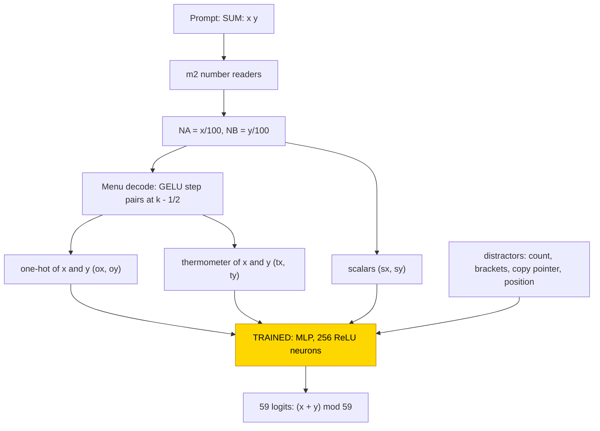
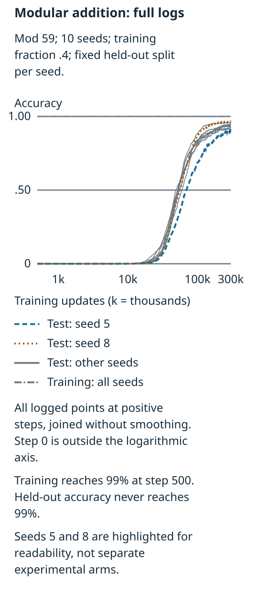
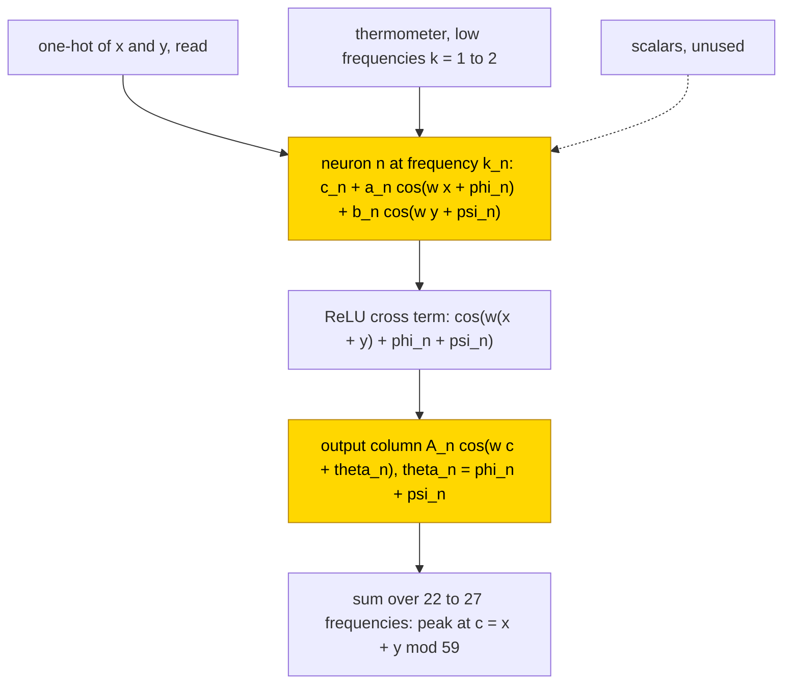

# Modular addition mod 59

This entry asks how a small network adds two numbers modulo 59. A frozen transformer whose every weight was set by formula only reads
the two numbers into a menu of encodings (scalar, one-hot, thermometer); there is no hand-built adder, and a one-layer MLP with 256
ReLU neurons was trained on top at train fraction .4. All 10 trained networks built the Fourier clock circuit of a wide MLP: one
frequency per neuron, spread over 22–27 of 29 frequencies, with an output phase rule; they read the one-hot encoding and ignore the
scalar. Test accuracy rose long after training accuracy had reached 99% (grokking) and ended at .91–.97. The task is partly solved (10/10
networks use the clock circuit, but their test accuracy ends below 99%). The per-neuron closed form scores .996–1.000 on all pairs
when substituted (agreement with the networks .94–.98); it is supported by substitution with the complement not tested, so its status
is partial.

| Fact | Value |
|---|---|
| Task | Add two numbers modulo 59 (both 0..58) |
| Input → output example | `SUM: 58 2\nANSWER: ` → `1` (60 mod 59) |
| Model | Frozen hand-built 6-layer transformer and a frozen 310-wide menu of encodings; trained: one MLP layer, 256 ReLU neurons, 59 outputs |
| Rungs and seeds | Hand-built network reads the numbers only (no hand-built adder); MLP trained on frozen hand-built parts, 10 seeds at train fraction .4, 300,000 steps each; 6 control runs |
| Closed form status | Partial: per-neuron Fourier clock, substitution .996–1.000 on all pairs, agreement .94–.98 (supported by substitution; complement not tested) |
| Status | Partly solved (clock circuit 10/10; test .91–.97, below 99%); last run 2026-11-04 |
| Weights | [Hugging Face: modular-addition-mlp](https://huggingface.co/jc1122/circuit-atlas-nets/tree/main/modular-addition-mlp) (hand-built base in `_shared/m2`) |
| Reproduce | [Commands](#24-reproduction), run from `code/` |

## 1. Task and data

The prompt is `SUM: x y\nANSWER: ` with x, y in 0..58, and the answer (x + y) mod 59 is read at the answer position, so there are 59
classes. Train fraction .4 of all 59² = 3481 pairs was used for training (1392 training pairs); the seed sets both the initialisation
and the split. Accuracy is the share of held-out pairs answered correctly. Grok steps are the first evaluation (every 500 steps) with
test accuracy ≥ 50% or ≥ 90%.

## 2. Model

The shared architecture, optimiser and instrumentation are described in [METHODS.md](../METHODS.md); this section gives only what is
specific to the task.

### 2.1 Frozen hand-built network

The base is [m2](../GLOSSARY.md#hand-built-machinery), a GPT-NeoX-shaped decoder with 6 layers, d_model 528 and 4 heads (d_head 132),
MLP width 512, exact GELU, fixed-gain LayerNorm (eps 1e-5), no positional embedding and no rotary embedding, a sequential residual
stream and a character vocabulary of 70 ids. It has 10,041,408 parameters, of which 13,443 are non-zero, and nothing in it was
trained. It is read at the last prompt position, from the residual stream before the final LayerNorm. `code/m2.py` rebuilds it bit for
bit (safetensors sha256 `3dbb5226…cd9a6a`). Its number readers give NA = x/100 and NB = y/100, exact to 2e-4.

### 2.2 Frozen menu and trained part

The [menu](../GLOSSARY.md#hand-built-machinery) is a frozen layer, defined by formula with no learned parameters, that places three
encodings of each number at the answer position: the scalars x/100 and y/100, one-hot codes of x and y (59 + 59 dims) and thermometer
codes [x ≥ k] and [y ≥ k] (58 + 58 dims), together with distractors: a copy pointer, a position value, a counter and a bracket
balance (the last two are constant on this prompt). Each block is centred and divided by its rms row norm, so every block has rms 1.
Table 1 lists the blocks of the 310-wide input. The question is which encodings the trained stage reads and which algorithm it builds
from them.

*Table 1. Input blocks of the frozen menu (index ranges of the 310-wide input).*

| Block | Indices | Content |
|---|---|---|
| sx, sy | 0, 1 | scalars NA, NB |
| ox | 2–60 | one-hot x, `step(100 NA; k − ½) − step(100 NA; k + ½)` |
| oy | 61–119 | one-hot y |
| tx | 120–177 | thermometer x, `step(100 NA; k − ½)`, k = 1..58 |
| ty | 178–235 | thermometer y |
| count, brackets (distractors) | 236, 237–238 | constant here, so 0 |
| copy pointer (distractor) | 239–308 | |
| position (distractor) | 309 | |

The trained stage is one MLP, `logits = W2 ReLU(W1 x + b1) + b2`, with W1 [256, 310], b1 [256], W2 [59, 256] and b2 [59], which is
94,779 parameters. Only this stage is trained, from the default PyTorch initialisation.

### 2.3 Training

The trained stage was optimised with AdamW, learning rate 1e-3, weight decay 1.0 and betas (.9, .98), on the full batch for 300,000
steps (300k), with no early stop and an evaluation every 500 steps. Ten seeds were run. Two controls, a random frozen base and a
scalar-only menu, were run with 3 seeds each (6 control runs). Runs were on CPU, 14-29 minutes per network.

### 2.4 Reproduction

The commands below run from `code/`, one network per call; add seeds as needed:

```
python run.py modadd --seeds 0 1 2 3 4 5 6 7 8 9                 # menu, 10 seeds (headline: neuron_formula_acc .996-1.000)
python run.py modadd --kind random --seeds 0 1 2                  # controls
python run.py modadd --kind scalar --seeds 0 1 2
```

Each run prints the learning-curve steps, the circuit type, `dd`, the phase error and the substitution accuracies, and writes
`out/*.json`.

### 2.5 Archive

Each network is stored as one safetensors file (`W1`, `b1`, `W2`, `b2`, `test_idx`), with `config.json`, `inputs.safetensors` (the
frozen menu rows X, the integers and the labels) and `manifest.json` (seed, rung, train fraction, accuracy, circuit type, sha256). Every
file was re-loaded, and its forward pass reproduces the recorded test accuracy exactly. The 10 networks (`s0_f40` … `s9_f40`, train
fraction .4) are published on Hugging Face at
[huggingface.co/jc1122/circuit-atlas-nets/tree/main/modular-addition-mlp](https://huggingface.co/jc1122/circuit-atlas-nets/tree/main/modular-addition-mlp).

## 3. Hand-built solution

The hand-built network reads the two numbers and re-encodes them; it contains no adder (Figure 1). m2's number readers write the
scalars NA = x/100 and NB = y/100 at the answer position, exact to 2e-4. The menu decodes each scalar with pairs of GELU steps
(`step`, defined in [count mod 5](count-mod-5.md#3-hand-built-solution)): the thermometer unit k is `step(100 NA; k − ½)` for k = 1..58,
and the one-hot unit is the difference of two neighbouring steps, `step(100 NA; k − ½) − step(100 NA; k + ½)`. The modular sum
itself is left entirely to the trained stage.



*Figure 1. The hand-built network and the trained stage. Frozen parts, set by formula, read x and y and re-encode each as a scalar, a
one-hot and a thermometer code in the 310-wide menu; there is no hand-built adder. The shaded MLP is the only trained part.*

## 4. What training finds

Training accuracy reached 99% at step 500. Test accuracy stayed at chance (.02) to step 20k, reached 50% at 49–69k and 90% at
105–295k, and ended at .91–.97 (Table 2, Figure 3). Generalisation is delayed but gradual, without a sharp jump; this is
[grokking](../GLOSSARY.md#counting-results). The weight norm rose from 10 to 101 during memorisation and then decayed to 85.

*Table 2. Results (ranges over 10 seeds; train fraction .4).*

| Cell | Seeds | Train 99% step | Test 50% step | Test 90% step | Final test | Circuit type |
|---|---|---|---|---|---|---|
| MLP on the frozen hand-built menu | 10 | 500 | 49–69k | 105–295k | .91–.97 | Fourier clock, 10/10 |
| Control: random frozen base | 3 | | | | .25 (flat) | memorises, no phase rule |
| Control: scalar-only menu | 3 | | | | | cannot fit (train .47–.50) |



*Figure 3. Test accuracy of the 10 seeds against training step. Training accuracy fits by step 500; test accuracy rises from chance
after about 20k steps.*

All 10 networks fall into one [circuit type](../GLOSSARY.md#counting-results), the [Fourier "clock"](../GLOSSARY.md#analysis-measures)
(10/10; no pizza, no lookup table): the correct logit does not depend on x − y. The neurons spread over 22–27 of the 29 frequencies in
every network, so there is no sparse key set. Frequencies 1 and 2 are in the logit top-5 of all 10 networks; the rest are seed-specific
(mean Jaccard overlap of the top-5 sets .37).

Table 3 shows which encodings are read. Mean-ablating a block replaces it by its mean over inputs; the full network scores .94.

*Table 3. Test accuracy after mean-ablating each input block, or keeping only that pair of blocks (full network .94).*

| Block | Ablated (x / y) | Kept alone (pair) |
|---|---|---|
| one-hot x / y | .08 / .02 | .65–.79 |
| thermometer x / y | .89 / .87 | .08–.11 |
| scalar x / y | .93 / .94 | .02–.03 |
| copy / position distractors | .86 / .89 | |

The one-hot code is necessary and nearly sufficient. The thermometer supplies the low frequencies k = 1–2 (73–77% of its contribution
at k = 1), and the scalar is unused.

## 5. Mechanism and verification

For neuron n with frequency k_n (ω_n = 2πk_n/59) the closed form is

h_n(x, y) = ReLU(c_n + a_n cos(ω_n x + φ_n) + b_n cos(ω_n y + ψ_n)),
logit_c = Σ_n A_n cos(ω_n c + φ_n + ψ_n) · h_n(x, y).

The phase rule θ_n = φ_n + ψ_n, where θ_n is the phase of the neuron's output column, holds with median error .04–.05 rad. The convex
ReLU turns the sum of cosines into a cross term cos(ω_n(x + y − c)), which peaks at c = x + y mod 59. Fitting k, φ and ψ from the DFTs
of the input weights and substituting the formula for the trained layer gives .996–1.000 accuracy on all pairs, higher than the
networks themselves (.94–.98); the agreement with the networks is .94–.98. The residual errors of the networks are memorisation not yet removed by
weight decay.

The closed form is supported by substitution. No [resample ablation of the complement](../GLOSSARY.md#verifying-a-circuit) was
reported, so under the atlas acceptance rule the status is partial.



*Figure 2. The circuit training finds. Each hidden neuron is tuned to one frequency of x and y, its ReLU forms the product term, and
its output column follows the phase rule, so the sum over neurons peaks at the modular sum; the closed form is supported by
substitution, with the complement not tested.*

Relation to the hand-built design and to published work. No hand-built adder was given, so the circuit is entirely the trained stage's.
It matches the analytic solution of a wide MLP by [Gromov (2023)](#references) and the clock algorithm of [Zhong et al. (2023)](#references).
Unlike the sparse key-frequency transformer circuit of [Nanda et al. (2023)](#references), the original modular-addition Fourier
circuit, a wide MLP uses many frequencies; [Chughtai et al. (2023)](#references) studied how networks learn group operations more
generally. New here is that, given a menu of encodings, training consistently selects the one-hot plus a low-frequency thermometer
helper and ignores the scalar.

## 6. Limitations and open questions

One modulus, one width and one hyperparameter set were run. The 300k steps did not reach 99% test accuracy, and longer training was not
run. In the controls, a random frozen base (same shape, random weights) memorises, its test accuracy
stays flat at .25 and it shows no phase rule; a scalar-only menu cannot fit the training set (train .47–.50).

## 7. Prediction record

No prediction was recorded before these runs; the entry predates the prediction record. A retrospective prediction, labelled as such,
is that the published analytic solution of a wide MLP ([Gromov, 2023](#references)) predicts one frequency per neuron and the phase
rule θ = φ + ψ; this held in 10/10 networks. Not predicted were which encodings training reads (one-hot plus thermometer, scalar
unused) and the spread over 22–27 frequencies.

## Appendix A. Weights excerpt and reading

Table A1 lists the 8 neurons of seed 0 with the largest output-weight norm. E_x(x) = pre(x, 0) and E_y(y) = pre(0, y), both centred;
k is the dominant DFT frequency of E_x; (a, φ), (b, ψ) and (A, θ) are the amplitude and phase at k of E_x, of E_y and of the neuron's
output column W2[:, n] over c.

*Table A1. The 8 strongest neurons of seed 0.*

| neuron | k | a, φ | b, ψ | A, θ | θ − φ − ψ |
|---|---|---|---|---|---|
| 178 | 29 | .60, −1.51 | .61, +.64 | .74, −.94 | −.07 |
| 149 | 22 | .59, +2.13 | .60, +2.60 | .73, −1.56 | −.01 |
| 55 | 25 | .59, −.58 | .59, −1.85 | .73, −2.37 | +.06 |
| 42 | 5 | .74, +.42 | .71, +.10 | .72, +.50 | −.02 |
| 76 | 12 | .59, −.33 | .59, −2.51 | .73, −2.85 | −.02 |
| 217 | 28 | .59, +3.06 | .59, +.71 | .71, −2.53 | −.02 |
| 9 | 13 | .61, −2.60 | .61, −1.05 | .71, +2.59 | −.04 |
| 231 | 29 | .58, +1.85 | .57, −2.76 | .71, −.88 | +.03 |

The median |θ − φ − ψ| over the live neurons is .047 rad. One input curve against its fit (neuron 42, x = 0..11):

```
E_x(x)                 .60  .60  .22 -.18 -.43 -.71 -.65 -.43  .15  .63  .60  .60
.74 cos(2π·5x/59+.42)  .67  .43  .06 -.32 -.61 -.74 -.66 -.39 -.02  .35  .63  .74
```

Reading. Every neuron is tuned to one frequency with nearly equal input amplitudes for x and y (a ≈ b ≈ .6), so its pre-activation is
c_n + .6 cos(ωx + φ) + .6 cos(ωy + ψ). The ReLU's quadratic part contains the product of the two cosines, that is, a term
cos(ω(x + y) + φ + ψ). The output column is A cos(ωc + θ) with θ = φ + ψ, so the product term contributes ∝ cos(ω(x + y − c)) to logit
c, maximal at c = x + y mod 59; summing over neurons with different k cancels every other c. The measured E_x is a cosine flattened at
its crests (x = 0, 1, 10, 11), which the single-cosine closed form ignores at no cost in accuracy.

## References

- Chughtai, B., Chan, L., & Nanda, N. (2023). A toy model of universality: Reverse engineering how networks learn group operations.
  *ICML 2023 (arXiv preprint)*. https://doi.org/10.48550/arxiv.2302.03025 (group operations across networks)
- Gromov, A. (2023). Grokking modular arithmetic. *arXiv preprint*. https://doi.org/10.48550/arxiv.2301.02679 (analytic clock solution
  of a wide MLP)
- Nanda, N., Chan, L., Lieberum, T., Smith, J., & Steinhardt, J. (2023). Progress measures for grokking via mechanistic
  interpretability. *ICLR 2023 (arXiv preprint)*. https://doi.org/10.48550/arxiv.2301.05217 (original modular-addition Fourier
  circuit)
- Zhong, Z., Liu, Z., Tegmark, M., & Andreas, J. (2023). The clock and the pizza: Two stories in mechanistic explanation of neural
  networks. *Advances in Neural Information Processing Systems 36 (NeurIPS 2023)*. https://doi.org/10.52202/075280-1186 (clock and
  pizza algorithms)
