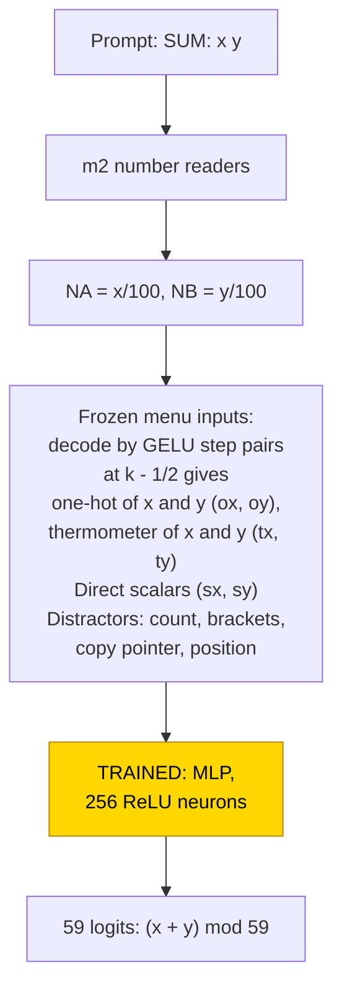
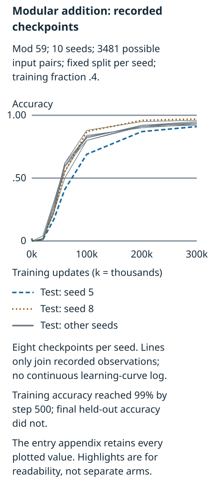
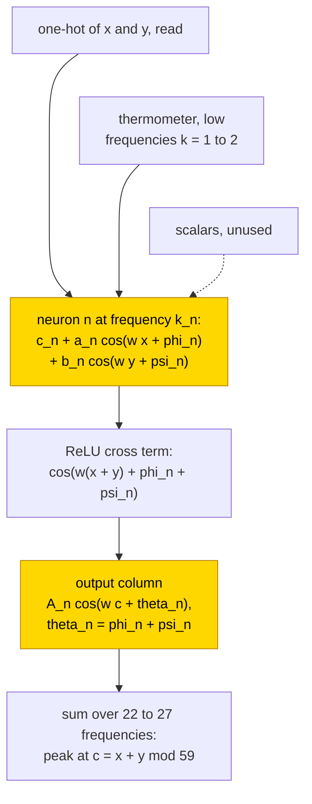

# Modular addition mod 59

Adding modulo 59 means wrapping back to zero after 58. A frozen transformer read the operands into several number encodings, and a feed-forward network ([MLP](../GLOSSARY.md#standard-machine-learning-terms)) learned the arithmetic. All 10 independent training runs (seeds, [glossary](../GLOSSARY.md#counting-results)) built a Fourier clock, a rule that combines periodic responses to the operands, yet their final held-out accuracy stayed at .91–.97 after 300,000 steps. Replacing the learned layer with its fitted cosine formula gave .996–1.000 accuracy on all 3481 operand pairs, compared with the networks' .94–.98 on that same all-pairs bank. The task remains unsolved at the 99% held-out criterion, which no seed reached; its proposed formula, or closed form, has partial status because replacement passed but resampling everything outside the claimed circuit (the complement, [glossary](../GLOSSARY.md#verifying-a-circuit)) was not tested.

| Fact | Value |
|---|---|
| Task | Add two numbers modulo 59 (both 0..58) |
| Input → output example | `SUM: 58 2\nANSWER: ` → `1` (60 mod 59) |
| Model | Frozen hand-built 6-layer transformer and a frozen 310-wide menu of encodings; trained: one MLP layer, 256 ReLU neurons, 59 outputs |
| Rungs and seeds | Hand-built network reads the numbers only (no hand-built adder); MLP trained on frozen hand-built parts, 10 seeds at train fraction .4, 300,000 steps each; 6 control runs |
| Closed form status | Partial: per-neuron Fourier clock, substitution .996–1.000 on all pairs, agreement .94–.98 (supported by substitution; complement not tested) |
| Status | Unsolved (0/10 with held-out accuracy ≥ 99%; clock circuit 10/10; test .91–.97); last run 2026-11-04 |
| Weights | [Hugging Face: modular-addition-mlp](https://huggingface.co/jc1122/circuit-atlas-nets/tree/main/modular-addition-mlp) (hand-built base in `_shared/m2`) |
| Reproduce | [Commands](#24-reproduction), run from `code/` |

Read next: [Results](#4-what-training-finds) and [verification](#5-mechanism-and-verification), then [open-bracket count](open-bracket-count.md) for another approximate periodic readout, or [mod-97 arithmetic](modular-arithmetic-mod-97.md) for different number formats.

## 1. Task and data

The prompt is `SUM: x y\nANSWER: ` with x, y in 0..58, and the answer (x + y) mod 59 is read at the answer position, so there are 59
classes. For example, `SUM: 58 2\nANSWER: ` has answer `1`, because 60 mod 59 is 1. Train fraction .4 of all 59² = 3481 pairs was used
for training (1392 training pairs); a seed is an independent run with a different initialisation and split
([glossary](../GLOSSARY.md#counting-results)). Held-out accuracy counts pairs outside that seed's training split; all-pairs accuracy
also includes its training pairs. Grok steps are the first evaluation (every 500 steps) with test accuracy ≥ 50% or ≥ 90%.

## 2. Model

The shared architecture, optimiser and instrumentation are described in [METHODS.md](../METHODS.md); this section gives only what is
specific to the task.

### 2.1 Frozen hand-built network

The base is [m2](../GLOSSARY.md#hand-built-machinery), a GPT-NeoX-shaped decoder with 6 layers, d_model 528 and 4 heads (d_head 132),
MLP width 512, exact GELU, fixed-gain LayerNorm (eps 1e-5), no positional embedding and no rotary embedding, a sequential residual
stream and a character vocabulary of 70 ids. Here d_model is the running-state width and d_head each attention head's vector width. GELU is a smooth threshold response, and LayerNorm centres and rescales the state. The sequential residual stream adds attention and MLP outputs to that state in turn ([glossary](../GLOSSARY.md#standard-machine-learning-terms)). It has 10,041,408 parameters, of which 13,443 are non-zero, and nothing in it was
trained. It is read at the last prompt position, from the residual stream before the final LayerNorm. `code/m2.py` rebuilds it bit for
bit (safetensors sha256 `3dbb5226…cd9a6a`). Its number readers give NA = x/100 and NB = y/100, exact to 2e-4.

### 2.2 Frozen menu and trained part

The [menu](../GLOSSARY.md#hand-built-machinery) is a frozen layer, defined by formula with no learned parameters, that places three
encodings of each number at the answer position: the scalars x/100 and y/100, one-hot codes with one active category per value
(59 + 59 dimensions), and thermometer codes that activate every passed threshold, [x ≥ k] and [y ≥ k] (58 + 58 dimensions). These
encodings are defined in the [glossary](../GLOSSARY.md#standard-machine-learning-terms). The menu also supplies a copy pointer, a
position value, a counter and a bracket balance. The last two are constant on this prompt and become 0 after centring; every
nonconstant block is centred and scaled to root-mean-square (rms) norm 1.
Table 1 lists the blocks of the 310-wide input. The question is which encodings the trained stage reads and which algorithm it builds
from them.

*Table 1. Input blocks of the frozen menu (index ranges of the 310-wide input).*

| Block | Indices | Content |
|---|---|---|
| sx, sy | 0, 1 | scalars NA, NB |
| ox | 2–60 | one-hot x, `step(100 NA; k − ½) − step(100 NA; k + ½)` |
| oy | 61–119 | one-hot y |
| tx | 120–177 | thermometer x, `step(100 NA; k − ½)`, k = 1..58 |
| ty | 178–235 | thermometer y |
| count, brackets (distractors) | 236, 237–238 | constant here, so 0 |
| copy pointer (distractor) | 239–308 | |
| position (distractor) | 309 | |

The trained stage is one MLP, `logits = W2 ReLU(W1 x + b1) + b2`, with W1 [256, 310], b1 [256], W2 [59, 256] and b2 [59], which is
94,779 parameters. ReLU keeps positive inputs and sets negative ones to zero; logits are the competing output scores, with the largest selecting the answer ([glossary](../GLOSSARY.md#standard-machine-learning-terms)). Only this stage is trained, from the default PyTorch initialisation.

### 2.3 Training

The runs were recorded on 2026-11-04. The trained stage was optimised with AdamW, learning rate 1e-3, weight decay 1.0 and betas
(.9, .98), on the full batch for 300,000
steps (300k), with no early stop and an evaluation every 500 steps. Ten seeds were run. Two controls, a random frozen base and a
scalar-only menu, were run with 3 seeds each (6 control runs). Runs were on CPU, 14-29 minutes per network.

### 2.4 Reproduction

The commands below run from `code/` and train one network per listed seed:

```
python run.py modadd --seeds 0 1 2 3 4 5 6 7 8 9                 # menu, 10 seeds (headline: analytic_acc .996-1.000)
python run.py modadd --kind random --seeds 0 1 2                  # controls
python run.py modadd --kind scalar --seeds 0 1 2
```

Each run writes `out/*.json` and prints the learning-curve steps, circuit type, phase error and substitution accuracies. The
`analysis.analytic_acc` field is the fully analytic layer's all-pairs accuracy; `analysis.neuron_formula_acc` keeps the learned output
weights instead and scores .997–1.000 in the recorded runs. The `dd` diagnostic is the share of correct-answer score variance explained
by the operand difference x − y. It was .02–.03 in all 10 runs, supporting the clock classification.

### 2.5 Archive

Each network is stored as one safetensors file (`W1`, `b1`, `W2`, `b2`, `test_idx`), with `config.json`, `inputs.safetensors` (the
frozen menu rows X, the integers and the labels) and `manifest.json` (seed, rung, train fraction, accuracy, circuit type, sha256). Every
file was re-loaded, and its forward pass reproduces the recorded test accuracy exactly. The 10 networks (`s0_f40` … `s9_f40`, train
fraction .4) are published on Hugging Face at
[huggingface.co/jc1122/circuit-atlas-nets/tree/main/modular-addition-mlp](https://huggingface.co/jc1122/circuit-atlas-nets/tree/main/modular-addition-mlp).

## 3. Hand-built solution

The hand-built network reads the two numbers and re-encodes them; it contains no adder (Figure 1). m2's number readers write the
scalars NA = x/100 and NB = y/100 at the answer position, exact to 2e-4. The menu decodes each scalar with pairs of GELU steps
(`step`, defined in [count mod 5](count-mod-5.md#3-hand-built-solution)): the thermometer unit k is `step(100 NA; k − ½)` for k = 1..58,
and the one-hot unit is the difference of two neighbouring steps, `step(100 NA; k − ½) − step(100 NA; k + ½)`. The modular sum
itself is left entirely to the trained stage.



*Figure 1. The frozen readers and menu; there is no hand-built adder. The gold 256-neuron MLP is the only trained part (PART). The
Fourier clock formula has partial status: substitution is supported, but the proposed circuit's complement was not tested.*

## 4. What training finds

Training fitted the data before held-out answers became reliable. Training accuracy reached 99% at step 500 in all 10 seeds; the
original overview described test accuracy as staying at chance (.02) to step 20k, reaching 50% at 49–69k and 90% at 105–295k, and
ending at .91–.97 (Table 2, Figure 2). These are legacy overview ranges, not newly rounded endpoints: the per-seed record gives the
first 50% crossing as 49.5k and the last as 69.0k (Appendix B). This delayed generalisation is
[grokking](../GLOSSARY.md#counting-results), although the rise was gradual. The recorded weight-norm summary rose from 10 to 101
during memorisation and then decayed to 85.

*Table 2. Results (ranges over 10 seeds; train fraction .4).*

| Cell | Seeds | Train 99% step | Test 50% step | Test 90% step | Final test | Circuit type |
|---|---|---|---|---|---|---|
| MLP on the frozen hand-built menu | 10 | 500 | 49–69k | 105–295k | .91–.97 | Fourier clock, 10/10 |
| Control: random frozen base | 3 | 500 | never | never | .25–.26 (overview; earlier prose .25) | memorises, no phase rule |
| Control: scalar-only menu | 3 | never | never | never | .16–.19 | cannot fit (train .47–.50) |



*Figure 2. Held-out accuracy at eight recorded checkpoints in each of 10 seeds, using each seed's fixed split of the 3481 pairs
(train fraction .4). Lines join recorded observations, not a reconstructed continuous learning curve. Training accuracy reached 99%
by step 500; none of the final held-out scores reached 99%. Appendix B gives the plotted values.*

[Open Figure 2 at full size](../figures/modular-addition-recorded-checkpoints.svg).

All 10 networks fall into one [circuit type](../GLOSSARY.md#counting-results), the [Fourier "clock"](../GLOSSARY.md#analysis-measures)
(10/10; no pizza, no lookup table). Here the pizza alternative would make the correct-answer score depend strongly on x − y; the
recorded dependence was small (dd .02–.03), rather than mathematically zero. The neurons spread over 22–27 of the 29 frequencies in
every network, so there is no sparse key set. Frequencies 1 and 2 are in the logit top-5 of all 10 networks; the rest are seed-specific
(mean Jaccard overlap of the top-5 sets .37).

The one-hot categories carry most of the answer information. Mean ablation replaces an input block by its average value, removing
its input-specific information ([glossary](../GLOSSARY.md#verifying-a-circuit)). The ablated-column values in Table 3 are recorded
means over 10 networks; their unmodified mean is .938, displayed as .94 in the earlier entry. The keep-pair column instead gives the
recorded range over those networks when only the x and y blocks of that encoding remain.

*Table 3. Held-out accuracy after mean-ablating a single operand block (mean over 10 networks), or keeping both operand blocks of
one encoding (range over 10). Full-network mean .938; earlier display .94.*

| Block | Ablated (x / y) | Kept alone (pair) |
|---|---|---|
| one-hot x / y | .08 / .02 | .65–.79 |
| thermometer x / y | .89 / .87 | .08–.11 |
| scalar x / y | .93 / .94 | .02–.03 |
| copy / position distractors | .86 / .89 | |

Removing the one-hot code sharply reduced accuracy, but that pair alone remained imperfect at .65–.79. The thermometer supplies
the low frequencies k = 1–2 (73–77% of its contribution at k = 1), while scalar ablations showed little dependence on that input.

## 5. Mechanism and verification

A periodic response assigns a repeating cosine pattern to the possible input values. A discrete Fourier transform (DFT) measures
which such patterns occur in a weight vector ([glossary](../GLOSSARY.md#analysis-measures)). For neuron n, k_n is its fitted frequency,
ω_n = 2πk_n/59, a_n and b_n are input amplitudes, φ_n and ψ_n their phases, c_n a constant offset, and A_n the output amplitude. A
candidate answer c has score logit_c; the largest score determines the prediction. The partial closed form, supported by substitution
with the complement not tested, is

h_n(x, y) = ReLU(c_n + a_n cos(ω_n x + φ_n) + b_n cos(ω_n y + ψ_n)),
logit_c = Σ_n A_n cos(ω_n c + φ_n + ψ_n) · h_n(x, y).

The phase rule θ_n = φ_n + ψ_n, where θ_n is the phase of the neuron's output column, holds with median error .04–.05 rad. The convex
ReLU turns the sum of cosines into a cross term cos(ω_n(x + y − c)), which peaks at c = x + y mod 59. Fitting k, φ and ψ from the DFTs
of the input weights and substituting the formula for the trained layer gives .996–1.000 accuracy on all pairs, higher than the
networks themselves (.94–.98); the agreement with the networks is .94–.98. The source interprets the residual errors as memorisation
terms not yet removed by weight decay. Only 52–56% of native logit variance was a function of x + y − c, so the cosine formula is a
high-accuracy replacement rather than an exact identity for the learned layer.

The closed form is supported by substitution. No [resample ablation of the complement](../GLOSSARY.md#verifying-a-circuit) was
reported, so under the atlas acceptance rule the status is partial.



*Figure 3. The fitted periodic readout. Gold nodes are the trained hidden responses and output weights. Closed-form status is
partial: substitution gives .996–1.000 on all 3481 pairs in 10 seeds, but the proposed circuit's complement was not tested. The
formula does not reproduce every native answer.*

Relation to the hand-built design and to published work. No hand-built adder was given, so the circuit is entirely the trained stage's.
It matches the analytic solution of a wide MLP by [Gromov (2023)](#references) and the clock algorithm of [Zhong et al. (2023)](#references).
Unlike the sparse key-frequency transformer circuit of [Nanda et al. (2023)](#references), the original modular-addition Fourier
circuit, a wide MLP uses many frequencies; [Chughtai et al. (2023)](#references) studied how networks learn group operations more
generally. New here is that, given a menu of encodings, training consistently selects the one-hot plus a low-frequency thermometer
helper and ignores the scalar.

## 6. Limitations and open questions

One modulus, one width and one hyperparameter set were run. At 300k steps, 0/10 seeds reached 99% test accuracy, and longer training was not
run. The source proposed that longer training could remove the residual memorisation, but that prediction was not tested.
In the controls, a random frozen base (same shape, random weights) memorises, its test accuracy
stays near the earlier display .25 (the result overview gives .25–.26) and it shows no phase rule. A scalar-only menu cannot fit the
training set (train .47–.50, test .16–.19). Constant count and bracket-balance blocks test nothing about feature selection; only the
copy and position distractors vary. These varying features are operand-correlated, so removing them is not a test with independent
noise. No complement-resample test established that the fitted periodic terms are the complete native mechanism.

## 7. Prediction record

No prediction was recorded before these runs; the entry predates the prediction record. A retrospective prediction, labelled as such,
is that the published analytic solution of a wide MLP ([Gromov, 2023](#references)) predicts one frequency per neuron and the phase
rule θ = φ + ψ; this held in 10/10 networks. Not predicted were which encodings training reads (one-hot plus thermometer, scalar
unused) and the spread over 22–27 frequencies.

## Appendix A. Weights excerpt and reading

Table A1 lists the 8 neurons of seed 0 with the largest output-weight norm. E_x(x) = pre(x, 0) and E_y(y) = pre(0, y), both centred;
k is the dominant DFT frequency of E_x; (a, φ), (b, ψ) and (A, θ) are the amplitude and phase at k of E_x, of E_y and of the neuron's
output column W2[:, n] over c.

*Table A1. The 8 strongest neurons of seed 0.*

| neuron | k | a, φ | b, ψ | A, θ | θ − φ − ψ |
|---|---|---|---|---|---|
| 178 | 29 | .60, −1.51 | .61, +.64 | .74, −.94 | −.07 |
| 149 | 22 | .59, +2.13 | .60, +2.60 | .73, −1.56 | −.01 |
| 55 | 25 | .59, −.58 | .59, −1.85 | .73, −2.37 | +.06 |
| 42 | 5 | .74, +.42 | .71, +.10 | .72, +.50 | −.02 |
| 76 | 12 | .59, −.33 | .59, −2.51 | .73, −2.85 | −.02 |
| 217 | 28 | .59, +3.06 | .59, +.71 | .71, −2.53 | −.02 |
| 9 | 13 | .61, −2.60 | .61, −1.05 | .71, +2.59 | −.04 |
| 231 | 29 | .58, +1.85 | .57, −2.76 | .71, −.88 | +.03 |

The median |θ − φ − ψ| over the live neurons is .047 rad. One input curve against its fit (neuron 42, x = 0..11):

```
E_x(x)                 .60  .60  .22 -.18 -.43 -.71 -.65 -.43  .15  .63  .60  .60
.74 cos(2π·5x/59+.42)  .67  .43  .06 -.32 -.61 -.74 -.66 -.39 -.02  .35  .63  .74
```

Reading. Every neuron is tuned to one frequency with nearly equal input amplitudes for x and y (a ≈ b ≈ .6), so its pre-activation is
c_n + .6 cos(ωx + φ) + .6 cos(ωy + ψ). The source's cross-term account treats rectification as producing interactions between the
two cosine inputs, including a term cos(ω(x + y) + φ + ψ); it is an explanation of the fitted approximation, not an exact polynomial
identity for ReLU. The output column is A cos(ωc + θ) with θ = φ + ψ, so the product term contributes ∝ cos(ω(x + y − c)) to logit
c, maximal at c = x + y mod 59. Summing over frequencies favours that answer, but the fitted formula's .996–1.000 accuracy does
not establish exact cancellation of every wrong score on every pair. The measured E_x is a cosine flattened at
its crests (x = 0, 1, 10, 11), which the single-cosine closed form ignores at no cost in accuracy.

## Appendix B. Detailed evidence

*Table B1. Per-seed results copied from the result overview. Crossing steps are the first recorded held-out accuracy ≥ 50% / ≥ 90%;
no seed reached 99%. Both formula columns use all 3481 pairs. Agreement is the analytic layer's share of predictions equal to the
native network, not accuracy against the labels.*

| Seed | Test 50% / 90% step | Final held-out | Frequencies represented | Median phase error (rad) | Learned-output formula / analytic layer | Analytic agreement |
|---|---|---|---|---|---|---|
| 0 | 54.0k / 166k | .950 | 22 | .05 | .999 / .999 | .97 |
| 1 | 52.0k / 173k | .935 | 26 | .05 | .998 / .998 | .96 |
| 2 | 54.0k / 164k | .917 | 26 | .05 | .998 / .997 | .95 |
| 3 | 52.0k / 171k | .934 | 26 | .04 | .998 / 1.000 | .96 |
| 4 | 60.0k / 182k | .944 | 27 | .04 | 1.000 / .998 | .97 |
| 5 | 69.0k / 295k | .906 | 25 | .05 | .997 / .999 | .94 |
| 6 | 49.5k / 135k | .943 | 22 | .05 | .999 / .997 | .96 |
| 7 | 55.5k / 202k | .926 | 23 | .04 | .997 / .996 | .95 |
| 8 | 56.5k / 111k | .969 | 27 | .04 | 1.000 / .998 | .98 |
| 9 | 54.5k / 105k | .959 | 22 | .04 | .999 / .999 | .97 |

Key: a represented frequency holds ≥ 2% of the neurons. The detailed summary records 90% crossings of 172500, 170500, 134500 and
201500 for seeds 1, 3, 6 and 7; Table B1 retains the result overview's 173k, 171k, 135k and 202k displays rather than silently
replacing them. The earlier prose range 49–69k and the result overview's 50–69k are also retained as historical summaries; seed 6's
recorded first 50% crossing is 49.5k.

*Table B2. Recorded held-out accuracy at the checkpoints plotted in Figure 2 (10 seeds; fixed split per seed). Values are copied
from the detailed summary, not interpolated from the crossing times.*

| Seed | 0k | 1k | 20k | 40k | 60k | 100k | 200k | 300k |
|---|---|---|---|---|---|---|---|---|
| 0 | .02 | .00 | .02 | .22 | .59 | .80 | .92 | .95 |
| 1 | .02 | .00 | .02 | .27 | .62 | .83 | .91 | .94 |
| 2 | .02 | .00 | .01 | .24 | .60 | .83 | .91 | .92 |
| 3 | .02 | .00 | .04 | .31 | .60 | .82 | .92 | .93 |
| 4 | .02 | .00 | .01 | .23 | .50 | .80 | .91 | .94 |
| 5 | .02 | .00 | .01 | .17 | .41 | .69 | .87 | .91 |
| 6 | .02 | .00 | .01 | .30 | .60 | .82 | .92 | .94 |
| 7 | .02 | .00 | .01 | .27 | .55 | .84 | .90 | .93 |
| 8 | .02 | .00 | .01 | .23 | .55 | .87 | .96 | .97 |
| 9 | .02 | .00 | .01 | .27 | .62 | .88 | .95 | .96 |

The final checkpoint displays use the source's two-decimal precision; Table B1 retains its three-decimal final scores. No new
rounding was performed here. The random-base final scores in the detailed summary are .254/.247/.255, alongside the overview's
.25–.26. These are separate recorded displays, not a newly computed control range.

## References

- Chughtai, B., Chan, L., & Nanda, N. (2023). A toy model of universality: Reverse engineering how networks learn group operations.
  *Proceedings of the 40th International Conference on Machine Learning (ICML 2023), PMLR 202* (conference paper).
  https://arxiv.org/abs/2302.03025; https://doi.org/10.48550/arxiv.2302.03025 (group operations across networks)
- Gromov, A. (2023). Grokking modular arithmetic. *arXiv preprint*. https://doi.org/10.48550/arxiv.2301.02679 (analytic clock solution
  of a wide MLP)
- Nanda, N., Chan, L., Lieberum, T., Smith, J., & Steinhardt, J. (2023). Progress measures for grokking via mechanistic
  interpretability. *International Conference on Learning Representations (ICLR 2023)* (conference paper).
  https://arxiv.org/abs/2301.05217; https://doi.org/10.48550/arxiv.2301.05217 (original modular-addition Fourier circuit)
- Zhong, Z., Liu, Z., Tegmark, M., & Andreas, J. (2023). The clock and the pizza: Two stories in mechanistic explanation of neural
  networks. *Advances in Neural Information Processing Systems 36 (NeurIPS 2023)* (conference paper). https://doi.org/10.52202/075280-1186 (clock and
  pizza algorithms)
