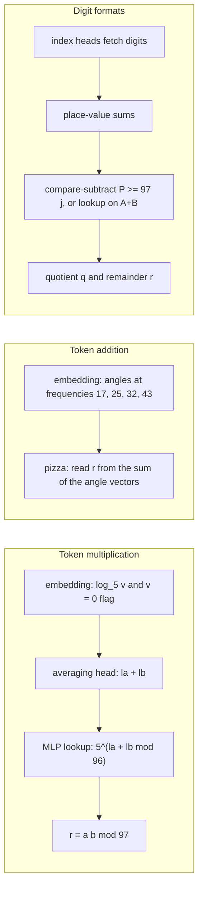
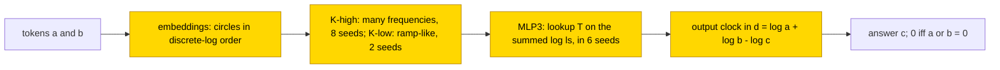

# Modular arithmetic mod 97 in six number formats

This entry asks how small transformers trained from scratch compute a + b, a·b or x² modulo 97, and how the answer depends on how the
numbers are written: as one token per residue, in binary, decimal or hexadecimal, or with a decimal scratchpad. Seventeen hand-built
networks, every weight set by formula, are exact on all 9409 inputs and serve as references. Token multiplication, trained on 90% of
the pairs, embeds the residues as circles in discrete-log order in 10/10 seeds (multi-frequency K-high clock in 8, ramp-like K-low
clock in 2), and 6/10 seeds reach test ≥ .99; token addition is a Fourier clock in 10/10. No network on a binary, decimal or
hexadecimal format carries a circular code, and binary multiplication and hexadecimal squaring memorise (test .013–.077). The task is
partly solved (token multiplication 6/10 seeds ≥ .99 at fraction .9, 0/10 at .3; digit multiplication memorises). The closed form is
partial and output-level only: substituted for the network output, it keeps the accuracy on all 9216 nonzero pairs of each of the 8
token-multiplication seeds that score ≥ .98, but it uses the true discrete log, and the complement was not tested.

| | |
|---|---|
| Task | Compute a + b, a·b (a, b in 0..96) or x² mod 97, with the numbers written in one of six formats |
| Input → output example | a = 96, b = 2, addition: (96 + 2) mod 97 = 1 |
| Model | GPT-NeoX, 4 layers × 4 heads, d_model 256, MLP 512 ReLU, no LayerNorm, no positional encoding; all weights trained from scratch |
| Rungs and seeds | HAND: 17 networks, exact on all 9409 inputs; TRAIN: 10 seeds in each of 6 final cells, after 3-seed rounds |
| Closed form status | Partial (output-level only: a clock in d = log a + log b − log c keeps the accuracy on all 9216 nonzero pairs in each of the 8 token-multiplication seeds that score ≥ .98; uses the true discrete log; complement not tested) |
| Status | Partly solved (token multiplication 6/10 ≥ .99 at fraction .9, 0/10 at .3; token addition 10/10 ≥ .99; digit multiplication memorises); last run 2026-11-08 |
| Weights | [Hugging Face: modular-arithmetic-formats](https://huggingface.co/jc1122/circuit-atlas-nets/tree/main/modular-arithmetic-formats) (earlier round: [modular-arithmetic-mod-97](https://huggingface.co/jc1122/circuit-atlas-nets/tree/main/modular-arithmetic-mod-97)) |
| Reproduce | Not available yet: training code for this task is not yet in `code/` |

## 1. Task and data

Three operations were studied: a + b and a·b with a, b in 0..96, and x² with x in 0..9408, each mod 97. Every operation has 9409 inputs,
all of which were used. The answer is r = S mod 97, where S is the exact sum, product or square, and an output is correct only on exact
match. Table 1 lists the six number formats.

*Table 1. Number formats.*

| Format | Numbers written as |
|---|---|
| `tok` | one token per residue |
| `b2l` / `b2m` | binary, least / most significant bit first |
| `b10` | decimal digits |
| `b16` | hexadecimal digits |
| `s10` | decimal [scratchpad](../GLOSSARY.md#task-formats): S `;` S div 97 `;` r |

The split was drawn per seed at train fraction .3 (2823 training inputs) or .9 (8468 training, 941 test inputs). In the cell names,
x3 means three times the data, that is, fraction .9 instead of .3; "mul", "add" and "sq" are multiplication, addition and squaring.
Length generalisation is not defined, because the domain is fixed.

## 2. Model

The shared architecture and instrumentation are described in [METHODS.md](../METHODS.md). Two [rungs](../GLOSSARY.md#the-three-rungs)
were run: HAND (every weight set by formula) and TRAIN (all weights trained from scratch).

### 2.1 Architecture

The trained networks are GPT-NeoX-shaped with 4 layers x 4 heads (d_head 64), d_model 256, MLP 512 ReLU, no LayerNorm, no positional
encoding (NoPE) and an untied readout. The vocabulary has 103 tokens: BOS, 97 residues or digits, and `+ * ^ = ;`. All parameters are
trained. The hand-built networks are 8 layers x 8 heads with d_model 512 and the same vocabulary, with every weight set by formula.
In probe locations, L0 is the embedding.

### 2.2 Frozen parts and trained part

No part is frozen: TRAIN trains every weight, and HAND trains none.

### 2.3 Training

All runs used AdamW with learning rate 1e-3, weight decay 1.0 (.1 in the `x3wd` cells), betas (.9, .98), a warmup of 1000 steps,
a cosine schedule over 40k steps, gradient clipping at 1 and batch 512, in TF32. A run stopped early at test accuracy 1.0 or after a
5k-step plateau. The best-training and final snapshots were kept, with checkpoints every 2500 steps. Training ran on consumer and rented
GPUs; diagnostics and substitutions ran on CPU in fp32. The final run trained 10 seeds in each of six cells: mul tok x3 (the headline
cell), add tok x3, add b16, add s10, mul b2l and sq b16.

### 2.4 Reproduction

Reproduction is not available yet, because the training code for this task is not yet in `code/`; the weights, held-out splits and recorded
accuracies are on Hugging Face at
[huggingface.co/jc1122/circuit-atlas-nets/tree/main/modular-arithmetic-formats](https://huggingface.co/jc1122/circuit-atlas-nets/tree/main/modular-arithmetic-formats)
(earlier round: huggingface.co/jc1122/circuit-atlas-nets/tree/main/modular-arithmetic-mod-97).

### 2.5 Archive

The folder `modular-arithmetic-formats/` holds `hand_{mul,add}_tok` (HAND state dicts),
`train_{mul,add}_tok_f90_{best,final}_s<seed>` (multiplication seeds 0, 1, 2, 4, 7, 9; addition seeds 0–2), `split_{mul,add}_tok`
(permutation, number of training inputs, seeds), `config.json` and `manifest.json` (seed, rung, circuit type, fp32 accuracy, sha256).

## 3. Hand-built solution

The 17 hand-built networks use one algorithm per operation and format (Figure 1). All 17 are exact on all 9409 inputs, with a logit
margin ≥ 23.6.

Token addition is a pizza, the variant of the Fourier clock described by [Zhong et al. (2023)](#references) in which the answer is read
from the sum of the two angle vectors, at frequencies 17, 25, 32 and 43. Token multiplication is a discrete-log adder. Every nonzero
residue mod 97 is a power of 5, v = 5^l, so multiplying residues is adding their discrete logs l = log_5 v mod 96. The embedding writes
log_5 v and [v = 0], one averaging head adds the two logs, and an MLP looks up 5^(la+lb mod 96), where la and lb are the logs of a and
b.

In the digit formats, index heads fetch the digits and form place-value sums. Addition is a lookup on A+B, the sum of the two
operands. Multiplication builds thermometer partial products and then compares and subtracts, [P >= 97j], to give the quotient q and
the remainder r. Squaring compares and subtracts on x and then looks up the square.

*Figure 1. The hand-built networks. In token multiplication the embedding writes the discrete log, one head adds the logs and the MLP
looks up the power of 5; token addition is a pizza; the digit formats fetch digits, sum place values and compare and subtract. No part
is trained in these networks; the trained networks are trained from scratch.*

## 4. What training finds

Table 2 summarises the final cells. Exact match is on held-out inputs; "≥ .99" counts seeds whose test exact match reached .99.

*Table 2. Results of the final run (10 seeds per cell; seeds named s0..s9).*

| cell (final, 10 seeds) | exact / ≥ .99 | test range | circuit types (seeds) |
|---|---|---|---|
| mul tok x3 | 4 / 6 | .425-1 | K-high log clock 8 (s0,2-8), K-low ramp-clock 2 (s1,s9) |
| add tok x3 | 6 / 10 | .998-1 | Fourier clock on Z_97 10 |
| add b16 | 0 / 9 | .990-.999 | r read at L4 (DAS .47-.72): r-only 9, S+r 1 |
| add s10 | 7 / 9 | .988-1 | q-transfer route (3/3 measured) |
| mul b2l, sq b16 | 0 / 0 | .013-.077 | memorised (failed); 3-seed rounds: mul b10/b16 memorise at every data/wd |

Key: K-high and K-low = the two clock types as labelled in the run records, a multi-frequency clock and a ramp-like clock; DAS = [distributed alignment
search](../GLOSSARY.md#analysis-measures); r-only, S+r = which of the HAND variables the network reads at layer 4; q-transfer = a route
through the quotient q; data/wd = training fraction and weight decay.

Token formats are the only ones in which a network carries a circular code of a or r. Token multiplication at fraction .9 embeds
the residues as circles in discrete-log order in 10/10 seeds: 8 seeds form a multi-frequency clock (K-high) and 2 a ramp-like clock
with few frequencies (K-low). Six of them reach test ≥ .99. In 6 seeds the step at which test exact match reached .9 (recorded as
te90; reading of the label) was 21k–30.5k. No HAND variable reaches probe R² .9 at any checkpoint. Token addition is a [Fourier
clock](../GLOSSARY.md#analysis-measures) on Z_97 in 10/10 seeds.

In the digit formats no network forms circles. The solved addition networks read r out as a categorical code at layer 4: in add b16 9
seeds read r only and 1 reads S and r; in add s10 the measured networks follow a q-transfer route (3/3 measured). Binary
multiplication and hexadecimal squaring memorise (test .013–.077), and in the 3-seed rounds decimal and hexadecimal multiplication
memorised at every training fraction and weight decay tried.

Per-cell diagnostics (used heads, probes, effective rank, attention divergence) are in Appendix B.

## 5. Mechanism and verification

For token multiplication (both circuit types) the closed form is a clock in the difference of discrete logs:

logit(c) = Σ_{k ∈ K} α_k cos(2πk d/96) + β_k sin(2πk d/96),  d = (log5 a + log5 b − log5 c) mod 96, c ≠ 0,

with answer 0 iff a or b = 0. K is the set of the top-m frequencies of the network's mean logit against d, and α, β are fitted on the
training rows. Substituted for the network output, it keeps the accuracy on all 9216 nonzero pairs for every seed that scores ≥ .98 (8
seeds), with the smallest m per seed s4 1, s5 1, s2 2, s8 2, s9 3, and s0/s1/s3 6. Its agreement with the network equals the network's
accuracy (≥ .99 on the six seeds that reach ≥ .99). Seed 6 (.838) agrees on .837, and seed 7 has no fit. For token addition the same form on
Z_97 with d = (a + b − c) mod 97 is proposed; its substitution was not yet measured.

The closed form is output-level only: it uses the true discrete log, not a variable read from the network. Internally, replacing MLP3
by a lookup T[ls] on the summed log ls keeps accuracy in seeds 0, 2, 4, 5, 6 and 9. No [resample ablation of the
complement](../GLOSSARY.md#verifying-a-circuit) was reported, so the status is partial.

*Figure 2. The circuit training finds in token multiplication. The embeddings place the residues on circles in discrete-log order and
the output is a clock in the difference of logs; the closed form is output-level only and partial, with the complement not tested.*

Relation to the hand-built design and to published work. The hand-built token multiplier and the trained networks share the
isomorphism Z_97* ≅ Z_96 but not the code: the hand-built network uses a ramp and a lookup, the trained networks use circles. The
trained code is the clock of [Nanda et al. (2023)](#references) and [Zhong et al. (2023)](#references) moved by the discrete log; the
clock solution of modular arithmetic was also derived analytically by [Gromov (2023)](#references). Digit formats never form circles;
the solved digit networks read r out as a categorical code at layer 4.

## 6. Limitations and open questions

The Fourier label was checked on all 17 hand-built networks (token addition F, the other 16 L, as recorded). The closed form is
output-level with the oracle log. The seeds differ in their weights (loss barrier, LMC, 12–19). The run-1 networks for add b16 and add
s10 were lost (only their logged numbers remain); the final-run networks exist. Neuron counts and an alignment of TRAIN with HAND
(`align`) were not measured, and the substitution of the addition closed form is open.

## 7. Prediction record

The prediction was recorded before training: token addition would be Fourier, token multiplication Fourier in log coordinates, the
digit formats would carry no p-periodic code, and s10 would beat b10. It held, except that fraction .3 was below the grokking data
threshold for token addition (3/10) and token multiplication (0/10); three times the data (fraction .9) fixed both. That
representational priors control the delay of grokking was studied by [Howe (2026)](#references).

## Appendix A. Weights excerpt and reading

Table A1 gives the clock frequencies K and the amplitudes √(α² + β²) per seed, from the final snapshots (`clock_fit`).

*Table A1. Clock frequencies and amplitudes per seed, token multiplication.*

| seed | frequencies k | amplitudes |
|---|---|---|
| s4 | 43 | 23.5 |
| s5 | 7 | 39.2 |
| s2 | 38, 29 | 16.5, 8.3 |
| s8 | 17, 16 | 9.5, 6.4 |
| s9 | 6, 2, 9 | 28.8, 9.9, 9.3 |
| s1 | 6, 4, 8, 2, 10, 1 | 52.4 ... 7.4 |

The top log-order frequencies of the embeddings are computed by `excerpts.py modp` (DFT over the residues sorted by log_5, power
share). Reading: each seed rotates log a and log b on a few circles and reads cos(k(la + lb − lc)).

## Appendix B. Detailed evidence

*Table B1. Diagnostics per cell (final snapshot, ranges over seeds).*

| cell | used heads + MLPs | best probe R² per HAND var @L | eff. rank (PR) vs HAND | attn JS | best / final test |
|---|---|---|---|---|---|
| mul tok x3 | 11-16 h + 4 M | A/B/S/q/r <= .12; la .62, lb .40, ls .78 (K-low) @3-4 | U vs 1.01 | .17-.37 | .425-1 / .425-1 |
| add tok x3 | 13-16 h + 4 M | A, B, S, q <= .04; r <= .31 @4 | 4.1-8.7 vs 4.41 | .26-.28 | .997-1 / .998-1 |
| add b16 | 9-16 h + 4 M | S .99, q .93, r .93 @4; A .88, B .80 | 3.1-6.4 vs 4.02 | .15-.26 | .993-.999 / .990-.999 |
| add s10 | 7-8 h + 4 M | S .86, q .89, r .57 @4 | 5.0-7.1 vs 7.04 | .18-.24 | .997-1 / .988-1 |
| mul b16 (r1/x3) | 0-4 h | A .80, B .72, S .80 @4; r .49 @0 (chance) | 37-43 vs 1 | .19-.26 | .02-.25 |

Key: L0 = embedding; h = heads, M = MLPs (neuron counts unmeasured, whole MLPs only); probe R² per HAND variable at the best layer
(@L), with A, B the operands, S the exact result, q the quotient, r the remainder, and la, lb, ls the discrete logs of a, b and their
sum; PR = [participation ratio](../GLOSSARY.md#analysis-measures) of the residual stream against HAND's (U as recorded); attn JS =
attention divergence from the closest HAND head; r1/x3 = run 1 and the three-times-data run.

## References

- Gromov, A. (2023). Grokking modular arithmetic. *arXiv preprint*. https://doi.org/10.48550/arxiv.2301.02679 (analytic clock
  solution)
- Howe, G. L. (2026). Structure-specific representational priors causally control the grokking delay. *arXiv preprint*.
  https://doi.org/10.48550/arxiv.2607.04333 (grokking delay)
- Nanda, N., Chan, L., Lieberum, T., Smith, J., & Steinhardt, J. (2023). Progress measures for grokking via mechanistic
  interpretability. *ICLR 2023 (arXiv preprint)*. https://doi.org/10.48550/arxiv.2301.05217 (the modular-addition clock)
- Zhong, Z., Liu, Z., Tegmark, M., & Andreas, J. (2023). The clock and the pizza: Two stories in mechanistic explanation of neural
  networks. *Advances in Neural Information Processing Systems 36 (NeurIPS 2023)*. https://doi.org/10.52202/075280-1186, arXiv
  https://doi.org/10.48550/arxiv.2306.17844 (clock and pizza algorithms)
