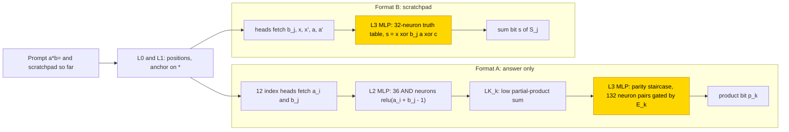
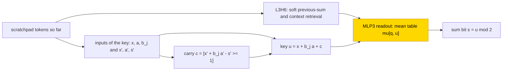

# Binary multiplication

This entry studies how small transformers multiply two 6-bit binary numbers, either writing the product directly (answer only) or
first writing the running sums of long multiplication (a scratchpad). With the scratchpad, a stage trained on frozen hand-built parts
learned the step of a binary adder, a lookup on x + b_j·a + carry, in 10/10 seeds, and networks trained from scratch reached exact
match 1.0 on held-out pairs in 8/10 seeds on the retry. Answer only never trained: the stage on frozen parts could not fit the
hand-built [parity staircase](../GLOSSARY.md#hand-built-machinery), a layer of paired ReLU steps that turns the partial-product sum into one product bit by stepping up and
down at alternate thresholds (best held-out exact match .10–.19 in the second run), although its input was linearly present, and
networks trained from scratch memorised the training pairs (train 1.0, test ≤ .80). The task is partly solved (scratchpad yes, answer
only no). The closed forms reproduce the networks, but an audit on 2026-11-07 found that none passes the full bar, the audit's
acceptance rule (Section 5.1), so they are sufficient readouts and not verified mechanisms.

| | |
|---|---|
| Task | Multiply two 6-bit numbers given as `a*b=`, answer only or with a scratchpad of running sums S_0 .. S_5 |
| Input → output example | Answer only: a = 5, b = 3 → `000000001111` (15) |
| Model | GPT-NeoX-shaped, 4 layers × 12 heads, d_model 384, MLP 256 ReLU; the partly trained networks train only the layer-3 MLP |
| Rungs and seeds | HAND A, B; PART and TRAIN 10 seeds per format; failed cells retried once (both runs kept) |
| Closed form status | Sufficient readout only (substitution 1.00 in 10/10 frozen-part nets; per the 2026-11-07 audit no closed form passes the full bar) |
| Status | Partly solved (scratchpad yes, answer only no); last run 2026-11-05; audit 2026-11-07 |
| Weights | [Hugging Face: binary-multiplication](https://huggingface.co/jc1122/circuit-atlas-nets/tree/main/binary-multiplication) (41 networks) |
| Reproduce | Not available yet: training code for this task is not yet in `code/` |

## 1. Task and data

The prompt is `a*b=` and the target is a·b, where a and b are 6-bit numbers. All 4096 pairs were used, with train fraction .6: 2457
pairs for training and 1639 for testing per seed. Two output formats were studied (Table 1); the
[scratchpad](../GLOSSARY.md#task-formats) format writes the intermediate results of long multiplication before the answer. A cell
counts an output as correct only on exact match of all output tokens. Length generalisation was tested at 7 and 12 bits.

*Table 1. Output formats.*

| Format | Output |
|---|---|
| `A` (answer only) | 12-bit product p_11..p_0, most significant bit first (MSB first) |
| `B` (scratchpad) | running sums S_0 `;` S_1 .. `;` S_5 with S_j = S_{j−1} + b_j (a << j), each 12 bits, least significant bit first (LSB first); S_5 = a·b |

## 2. Model

The shared architecture and instrumentation are described in [METHODS.md](../METHODS.md). The three
[rungs](../GLOSSARY.md#the-three-rungs) are HAND (every weight set by formula), PART (frozen hand-built parts with one trained stage)
and TRAIN (all weights trained from scratch).

### 2.1 Architecture

All networks are GPT-NeoX-shaped with 4 layers × 12 heads, d_model 384, d_head 32, MLP 256 ReLU, no LayerNorm and no positional
encoding (NoPE). The vocabulary has 7 tokens (BOS, unk, `0 1 * = ;`). Layers are numbered from zero, so L3 is the last layer.
TRAIN trains all 3.2M weights.

### 2.2 Frozen hand-built network and trained part

PART trains the L3 MLP only (dense_h_to_4h [256, 384] + bias, dense_4h_to_h [384, 256] + bias), on top of the frozen HAND layers 0–2
and the frozen L3 attention. In format A the trained stage reads E_k (the one-hot of the output bit being written), LK_k (the low
partial-product sum, 12 dims, defined in Section 3) and the fetched bits. In format B it reads x = S_{j−1}[k] and x' = S_{j−1}[k−1]
(the current and preceding bit of the previous running sum), the multiplier bit b_j, a = a_{k−j} and a' = a_{k−j−1} (the current and
preceding addend bits) and its own previous token s'.

### 2.3 Training

All runs used fp32 throughout, because HAND's index scores (~1e5) lose their ±20 margin under TF32. The optimiser was AdamW with betas
(.9, .98); test accuracy was evaluated every 500 steps and the best-test snapshot was kept. The batch size was 256 (B 64). Runs were
on consumer GPUs. Table 2 gives the per-run settings.

*Table 2. Training settings per run. Steps are the maximum; a plateau stop ends a run with no test improvement over the stated window.*

| Run | Learning rate | Weight decay | Schedule | Steps | Stop |
|---|---|---|---|---|---|
| PART run 1 | 1e-3 | 1 | constant | 10k | 2k-plateau stop |
| PART A run 2 (design fix: inputs scaled by 1024, the scaled variant of Section 3) | as run 1 | as run 1 | + warmup 1000, cosine, clip 1 | 30k | 10k-plateau stop |
| TRAIN run 1 | 1e-3 | 1 | constant | 20k | |
| TRAIN run 2 | 3e-4 | .1 | warmup 1000, cosine, clip 1 | 30k | |

### 2.4 Reproduction

Reproduce: not available yet: training code for this task is not yet in `code/`; the weights, held-out splits and recorded
accuracies are on Hugging Face at
[huggingface.co/jc1122/circuit-atlas-nets/tree/main/binary-multiplication](https://huggingface.co/jc1122/circuit-atlas-nets/tree/main/binary-multiplication)
(41: 3 HAND, 30 PART, 8 TRAIN).

### 2.5 Archive

The Hugging Face folder holds `hand_A`, `hand_A_scaled` and `hand_B` (HAND state dicts); `part_<F>_s<seed>` (all PART seeds; the four
stage tensors; A from both runs); `train_<F>_r1_s<seed>` / `train_<F>_r2_s<seed>` (full nets, best and worst seed per run);
`config.json`; and `manifest.json` (sha256, fp32 re-score). Each file was reloaded bit-identically.

## 3. Hand-built solution

Both hand-built networks share their first two layers: L0 and L1 compute positions and anchor on `*`. They differ in what the last
two layers compute (Figure 1).

Format A (exact for n ≤ 6, 14 heads). Twelve [index heads](../GLOSSARY.md#hand-built-machinery), attention heads that each copy the token at one computed position, fetch
the operand bits a_i and b_j. The L2 MLP has 36 AND neurons, relu(a_i + b_j − 1), each of which outputs 1 only when both bits are 1,
and their outputs are summed into the low partial-product sum LK_k = Σ_{i+j≤k} a_i b_j 2^{i+j}. The L3 MLP writes the
product bit p_k = parity(⌊LK_k / 2^k⌋) as a gated staircase of 132 neuron pairs (the parity staircase),
relu(LK_k − m2^k + 1 − M(1−E_k)) − relu(LK_k − m2^k − M(1−E_k)) with M = 2^13, where E_k gates the pair to output bit k. This handles
all partial products at once in one threshold layer. The scaled variant writes E_k as 1024 E_k plus a constant dimension 1024, so the
same staircase has O(1) weights (gate 8, constant coefficient ≤ 12); it is still exact.

Format B (exact for n ≤ 7, 7 heads, L2 55 + L3 33 neurons). Heads fetch b_j, x, x', a and a'. The L3 MLP is a 32-neuron truth table
of the sum bit s = x ⊕ b_j a ⊕ c, with the carry recomputed from the previous column, c = [x' + b_j a' − s' ≥ 1]. Its neurons are
conjunctions over the six inputs (x, b_j, a, x', a', s'), as the HAND neuron n25 in Appendix A shows. There are no carry tokens and no
carry chain: each scratchpad step is one binary-adder column.

*Figure 1. The hand-built networks for both formats. Layers 0 and 1 locate positions; in format A the operand bits are multiplied by
AND neurons and summed into LK_k, whose bits are read by a parity staircase; in format B each step is one adder column. The shaded L3
MLPs are the parts that PART replaces with a trained stage.*

## 4. What training finds

Table 3 summarises every cell. Exact match is on the held-out pairs; "steps to .9" is the first evaluation at which test exact match
reached .9.

*Table 3. Results per cell (ranges over seeds; run 2 is the retry).*

| Cell | Test exact match | Steps to .9 | Length 7 | Other |
|---|---|---|---|---|
| B PART | 10/10 = 1.0 | 500 | 7 bits 1.0 (HAND B is exact to n = 7; 12 bits 0) | HAND's 5 fetch heads (attention substitution 1.0) + 34–68 neurons; f(add) 10/10 |
| A PART run 1 | .02–.04 | | | MLP3 unused: no ablation drop |
| A PART run 2 (scaled) | best .10–.19 at 1.5–2.5k, final .00–.08 | | | train ≤ .18; MLP3 used (72–146 neurons) |
| A TRAIN run 1 | ≤ .34 | | | |
| A TRAIN run 2 | best .65–.80, final .60–.76 | never | ≤ .12 | train 1.0 from ~15k |
| B TRAIN run 1 | ≤ .034 | | | |
| B TRAIN run 2 | 8/10 = 1.0; 9/10 ≥ .99 (seed 1 .9994); seed 2 .755 | 7.5–16.5k | ≤ .002 | 7–30 heads + 569–763 neurons (HAND 7 + 88) |

Key: best = highest held-out exact match during training; final = at the end of training; f(add) = MLP3 replaced by its mean output
given the adder key (Section 4.1). The diagnostics table (Table B1) gives slightly different ranges for some of these quantities (A PART
run 2 best .10–.20, A TRAIN run 2 best .66–.79, B TRAIN run 2 7–29 used heads); the record does not say why, and both are kept.

### 4.1 Scratchpad (format B)

The trained PART stage is the binary adder's step, a lookup on x + b_j a_{k−j} + carry (substitution 1.00, 10/10). It reuses HAND's
five fetch heads (the heads that copy b_j, x, x', a and a', Section 3) and carries to 7 bits. Trained from scratch, run 1 never
started (≤ .034), and run 2 reached exact match 1.0 in 8/10 seeds and ≥ .99 in 9/10 (seed 1 .9994). In run 2 the L3 MLP has a closed
form in 8/10 seeds, the adder key itself in 5/10. Each circuit-type label names the key on which MLP3 is replaced by its mean output:
f(add) uses the adder key x + b_j a + c, f(6-input table) the six inputs (x, b_j, a, x', a', s') jointly, and f(x, y, c) the addend
bit x, the second addend bit y = b_j a and the carry c as separate values. By circuit type the seeds split into f(add) 5, f(6-input
table) 2, f(x, y, c) 1 and none 2. HAND's fetch roles were found for 1–2 of the 5 heads in 7/10 seeds. The failed seed 2 fitted late
(train 1.0 at 25k); it has the weakest probes (x .62, a .50), the most used parts (33) and errors only in the middle bits of S_4 and
S_5 (token accuracy .88–.94).

### 4.2 Answer only (format A)

Answer only never trained. PART failed both with HAND's input scale (run 1, .02–.04) and after the input was rescaled to O(1) weights
(run 2, best .10–.19): it cannot fit HAND's parity staircase on the low partial-product sum LK_k, although LK_k is linearly present
(probe R² 1.0 for k ≥ 4; Table B1 gives the mean over all bits, .91–.92). In run 2 MLP3 was used, keyed on the low partial-product sum
(substitution .17–.51, above the network), and per-bit accuracy was worst on the middle bits p_7..p_4 (.52–.74), with p_11 at .99. The
inputs are complete in both PART runs (LK_k R² 1.0 for k ≥ 4 at the stage input), but the target is a square wave in LK_k, with ~10
unit steps per bit, densest in the worst middle bits. O(1) weights made the MLP used but not fitted (train ≤ .18), so this is an
optimisation failure. Trained from scratch, A memorised (train 1.0, test ≤ .80, 35–44 heads; Table B1 counts 32–40 used heads and 4
used MLPs in run 2): run 2 fits the training pairs with full-rank MLPs (LK .82–.86) and has no
closed form.

Per-cell diagnostics (probes, effective rank, attention divergence, patching, interchange and edges) are in Appendix B.

## 5. Mechanism and verification

### 5.1 Closed forms

For PART B, the stage was replaced by its mean output given x + b_j a + c: accuracy 1.00 (equal to the network) in 10/10 seeds; the
6-input table and the (x, y, c) keys also give 1.00. The sum bit is s = (x + b_j a + c) mod 2. For TRAIN B run 2 the same key works
in 5/10 seeds, and a 6-input table or (x, y, c) key in 3 more. Format A has no closed form.

These are [sufficient readouts](../GLOSSARY.md#verifying-a-circuit), not verified mechanisms. The audit of 2026-11-07 found that none
of the closed forms passes the [full bar](../GLOSSARY.md#verifying-a-circuit) (best and final snapshots; native/zero/shuffle exact controls, that is, exact match of the
unmodified network next to the same test with the part set to zero and with shuffled values in its place; fewer fitted reals than the
replaced component); they are keyed on task-derived labels and stay sufficient-readout results.

### 5.2 Wiring

Edge attribution (EAP-IG) agrees with the hand-built wiring for PART B: jaccard and hand_recall (defined under Table B1) are 1/1 in
7/7 trusted nets. TRAIN B run 2 is wired differently (jaccard .04; heads not aligned, which raises a different-wiring flag). The
interchange variables X and X2 are HAND B's fetched bits x = S_{j−1}[k] and x' = S_{j−1}[k−1]; an interchange variable is one whose
value is swapped between two inputs to test whether the network uses it ([glossary](../GLOSSARY.md#analysis-measures)). X2 is present
but not linear in HAND B (interchange 0, DAS 1.0); in PART it scores .81/1 and in TRAIN .96/1. In format A, where no network solved
the task, LK_k is partly linear (HAND .48-.57 / DAS .42-.60).

### 5.3 Circuit probes

Circuit probes were run on 2026-11-06 (Table 4). The probes used two labels of their own: a component passed when a causal
intervention and an accepted substitution held on disjoint non-training pairs (or the full grid), and was supported when only causal
evidence was found. The first label lacks a resample ablation of the complement, so it does not meet the atlas acceptance rule and
is not called verified here. Exact is teacher-forced whole-output
accuracy, ablation numbers are accuracy retained, and layers are zero-based.

*Table 4. Components probed in one examined seed per cell.*

| Component | Role | Evidence (passed the probes' substitution test) |
|---|---|---|
| B TRAIN run 2 seed 0: MLP3 | query-conditioned adder-step readout | m3 = μ[q, u] 1.000, drop 0 (187 observed keys); five position-free prototypes .9988, rejected as exact |
| A PART run 2 (scaled) seed 3: MLP3 | live-register bit decoder (repair, not the learned rule) | full 4,096-pair grid .179 → 1.000 |

In B TRAIN, with x and a the current addend bits, x′, a′ and s′ the preceding-bit inputs and output, and b_j the multiplier bit, the
carry is c = [x′ + b_j a′ − s′ ≥ 1] and the key is u = x + b_j a + c; MLP3 is replaced by μ[q, u], the mean MLP3 output vector over
the fit pairs that share the output-query index q (which output token the position writes) and the key u, where the separator has its
own key (Figure 2). This is the adder step at the readout boundary, as in the f(add) cells of Section 5.1, not HAND's five clean fetch
heads or 32 truth-table neurons. The head L3H6 (layer 3, head 6) is supported as a soft previous-sum and context retrieval: mean
ablation leaves .031, and a hard previous-sum fetch keeps only .719. MLP3 neurons 182 and 67 (n182, n67) affect the step output but
are not pure sum units.

In the failed A PART network, the frozen heads and 36 AND neurons already compute LK_k = Σ_{i+j≤k} a_i b_j 2^(i+j). Replacing only
MLP3 by t = Σ_k round(E_k/1024)·(⌊round(LK_k)/2^k⌋ mod 2), where E_k is the scaled bit-query register, with Y_0 = 1 − t and Y_1 = t
and no operand or answer labels, gives 1.000 on all inputs. The products are therefore present and the learned readout is the
bottleneck, consistent with Section 4.2. The network's MLP3 neurons n193 and n172 track partial sums (R² .80 / .96) but miss the
alternating thresholds; one hypothesis is misplaced or cancelling hinges.

*Figure 2. The readout that training finds in format B (TRAIN run 2, seed 0). MLP3 output is reproduced by a mean table on the query q
and the adder key u; the wiring differs from the hand-built network (Section 5.2), and the table is a sufficient readout, not a
verified mechanism (Sections 5.1 and 6).*

### 5.4 Relation to the hand-built network and to published work

PART B and 8/10 TRAIN B run 2 networks compute HAND's step (the 5 f(add) seeds and the 3 whose MLP3 is keyed on the 6-input table or
on (x, y, c); Section 4.1), an adder column as in
[binary-addition](binary-addition.md); the AND b_j·a is spread over neurons. Format A has no learnable one-layer analogue of HAND's
carry-save staircase here; in these runs long multiplication was learned only with the intermediate sums written out. Failures of
transformers on multi-digit multiplication have been reported by [Dziri et al. (2023)](#references); [Bai et al. (2025)](#references)
reverse-engineered a model that multiplies through implicit chain of thought and analysed why answer-only training fails; [Lee et al.
(2023)](#references) studied output order and scratchpads in arithmetic.

## 6. Limitations and open questions

Only n = 6 was trained (length tested at 7 and 12; PART B at 2n is beyond HAND B's exact range). Train = 60% of all pairs, so TRAIN A
can memorise. Probes are linear. Same-(q, u) individual donors keep only .584 exact (token .993) although the mean table is exact,
so MLP3 = f(q, u) is a sufficient readout, not an activation-level causal abstraction. A seed census is pending; one seed per cell
was examined in the circuit probes.

Open questions: the widened-range (10,000-pair) multiplication ten-seed final is not finished; the failed B retry seed 2 keeps X / X2
(DAS .99 / 1 at L4), so a missing running sum does not explain its failure; shuffle-control and final-snapshot substitutions are not
run; the within-key amplitude and context dependence of MLP3; and the native threshold placement of the failed multiplier.

## 7. Prediction record

The prediction was recorded in the hand-built design notes before the runs: HAND B's L3 = f(x + y + c), "the scratchpad step IS the
adder's sum-of-bits function", with the open question "does B learn where A fails?". It held: PART B is f(add) in 10/10, and A fails
in every setup. No grokking or length prediction was recorded.

## Appendix A. Weights excerpt and reading

The numbers are computed from the archived PART B stage tensors: W_in rows on (x, b_j, a, x', a', s') divided by the row maximum, then
the bias. HAND neuron n25 is (x, b_j, a, x', a', s') = (1, −1, −1, 1, 1, 1 | −3), a conjunction. In the trained stages 75–81% of the
stage W_in norm lies on these 6 dimensions; for example seed 1 neuron n254 is (−1, −.41, −.60, −.49, −.50, .46 | .27) and seed 0
neuron n81 is (1, .20, −.83, .73, .70, −.71 | −.27). In both, x' and a' enter with equal weight and s' with the opposite sign, which
is HAND's carry key x' + a' − s' next to x and a, that is, the adder's (x, y, carry) inputs.

## Appendix B. Diagnostics per cell

Diagnostics use the best-layer ridge R²; AB = bit products, LK = low sums (means over bits); residual PR at L4; attention JS of used
heads; W_in r99 = rank at 99% energy. Terms are defined in the [glossary](../GLOSSARY.md#analysis-measures).

*Table B1. Diagnostics per cell.*

| cell | used heads+MLPs | probes | PR L4 | JS | W_in r99 | test best | patch (nets) | inter/DAS | edges (trusted) |
|---|---|---|---|---|---|---|---|---|---|
| A PART run 1 | 0+0 (MLP3 unused) | AB .28–.30, LK .91–.92 | 1.1 | 0 | – | .02–.04 | * L0H0 9, MLP3 1 | LK1-11 .50-.56/.51-.76 | .93/1 (1) |
| A PART run 2 (scaled) | 11–12+2 | AB .32–.35, LK .91–.92 | 2.3–2.5 | 0 | 11–216 | .10–.20 | * MLP3 10/10 | LK1-11 .45-.54/– | – |
| A TRAIN run 1 | 0–24+0–4 | AB .48–.55, LK .75–.82 | 1.2–1.7 | 0–.21 | 5–95 | .04–.34 | * MLP3 8, MLP0 2 | LK1-11 .52-.91/.73-.89 | .07/.17 (1) |
| A TRAIN run 2 | 32–40+4 | AB .56–.62, LK .82–.86 | 2.0–4.7 | .12–.18 | 194–210 | .66–.79 | * MLP3 7, MLP0 3 | LK0-11 .40-1/.30-.99 | .04/.12 (1) |
| B PART | 5+1 | x, x', b_j, a 1.00 | 1.03 | 0 | 10–11 | 1 | MLP3 9/9 | X 1/1, X2 .81/1 | 1/1 (7) |
| B TRAIN run 1 | 0+0 | x .34–.38, b_j .16 | 1.7–2.4 | 0 | – | 0 | * MLP2 (1 of 2) | X2 1/1 | – |
| B TRAIN run 2 | 7–29+4 | x .55–.96, b_j .67–.86, a .51–.88 | 2.5–4.0 | .29–.41 | 191–214 | .71–1 | MLP0 6, MLP3 1 (9 solved) | X 1/1, X2 .96/1 | .04/.17 (5) |

Key: used heads+MLPs = number of used heads + number of used MLPs (32–40+4 is 32–40 heads and 4 MLPs); test best = held-out exact
match as recorded in the diagnostics table (some ranges differ slightly from Table 3); patch = the component with the
largest patching drop over solved nets (exact ≥ .9); * = no solved net, all nets; X, X2 = HAND B's fetched bits x and x'; inter/DAS =
linear interchange / DAS flip, best layer, median; edges = EAP-IG jaccard/hand_recall against HAND, over nets with
spearman_exact ≥ .8. Jaccard is the overlap between the net's top edges and HAND's edges; hand_recall is the share of HAND's edges
found among the net's top edges; spearman_exact is the rank agreement between the attribution scores and exact edge patching, the
exactness check that makes the edges trusted.

## References

- Bai, X., Pres, I., Deng, Y., et al. (2025). Why can't transformers learn multiplication? Reverse-engineering reveals long-range
  dependency pitfalls. *arXiv preprint*. https://doi.org/10.48550/arxiv.2510.00184 (implicit-CoT multiplication mechanism;
  answer-only failure)
- Dziri, N., Lu, X., Sclar, M., et al. (2023). Faith and fate: Limits of transformers on compositionality. *arXiv preprint*.
  https://doi.org/10.48550/arxiv.2305.18654 (multi-digit multiplication failures)
- Lee, N., Sreenivasan, K., Lee, J. D., Lee, K., & Papailiopoulos, D. (2023). Teaching arithmetic to small transformers.
  *arXiv preprint*. https://doi.org/10.48550/arxiv.2307.03381 (output order, scratchpads)
