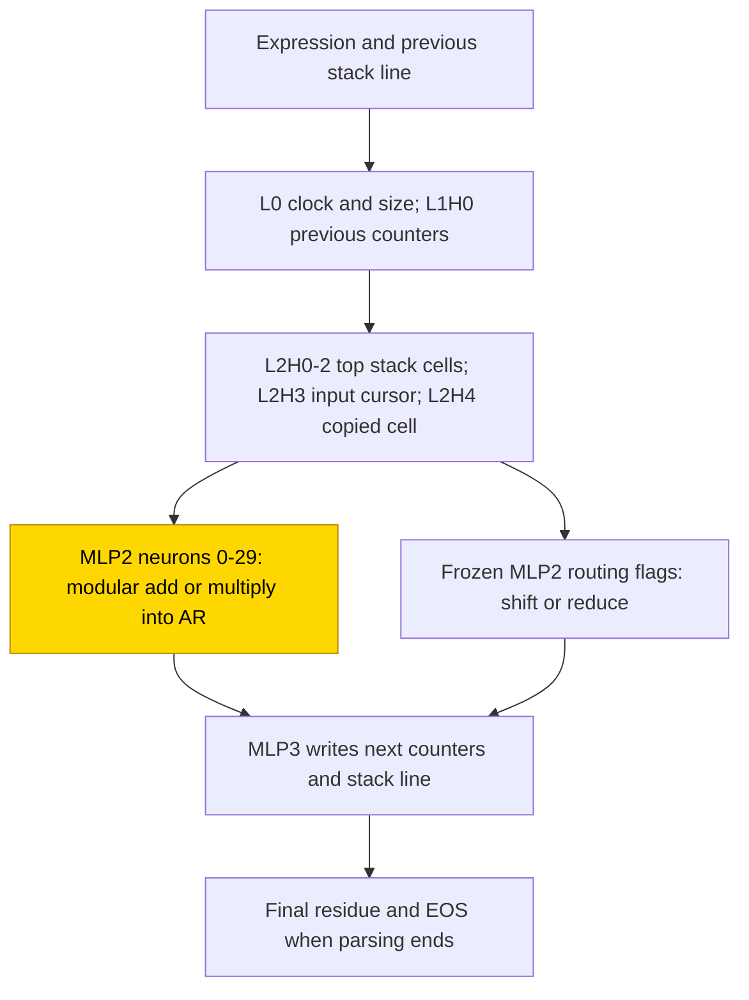
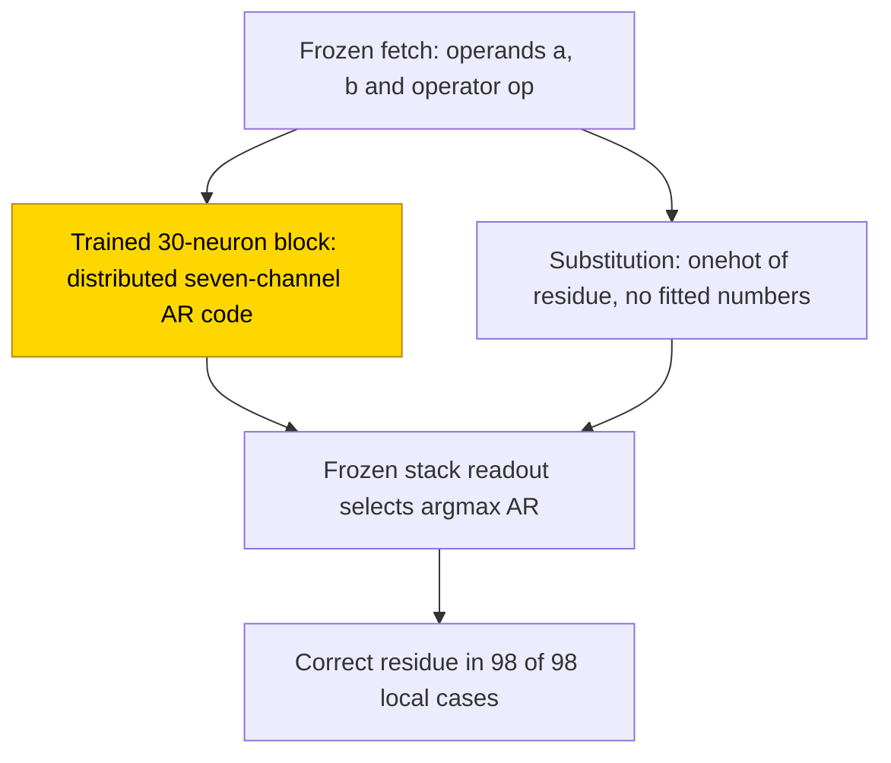

# Nested expressions modulo 7

This entry studies how a small transformer evaluates fully parenthesised addition and multiplication modulo 7. With a hand-built
parser frozen, its trained arithmetic block solves all 10 final seeds: the correct residue is the largest of seven output channels
in all 98 local cases, although the channels do not reproduce the hand-built one-hot code. Replacing that block by the exact residue
one-hot keeps 260/260 held-out expressions and 16/16 on each tested longer/deeper set per seed; resampling the claimed circuit's
complement keeps 1.0 in all ten seeds. The task is partly solved because fully trained cells fail the held-out single-literal stratum.
The closed form is verified for the PART arithmetic block on the measured inputs, not for an independently learned parser.

| Fact | Value |
|---|---|
| Task | Evaluate fully parenthesised sums and products over residues 0–6, modulo 7 |
| Input → output example | One literal as input → the same literal as output |
| Model | 4-layer NeoX-shaped transformer, d_model 256, 8 heads per layer, ReLU MLP 192; PART trains 30 arithmetic neurons and residue bias, 727 parameters |
| Rungs and seeds | HAND trace parser; PART trace 3 screening + 10 final seeds; TRAIN trace and answer only 3 seeds each, answer only after one retry |
| Closed form status | Verified (PART arithmetic only: 260/260 substitution, 16/16 per tested OOD set and complement 1.0 in 10/10; parser remains hand-built) |
| Status | Partly solved (PART final 10/10 exact; TRAIN trace/answer-only screens 0/3 exact); last run 2026-11-10 |
| Weights | [Hugging Face: nested-expressions-mod-7](https://huggingface.co/jc1122/circuit-atlas-nets/tree/main/nested-expressions-mod-7), published revision `b293821` |
| Reproduce | Not available yet: training code for this task is not yet in `code/` |

## 1. Task and data

Expressions follow `E := 0|…|6|(E+E)|(E*E)`, with all arithmetic modulo 7, the finite field F₇. Tokens couple an input symbol and its
index. Training uses 0–4 operators, depth ≤ 3 and fresh expressions every batch. The content-hash split holds out approximately 20%,
260 rows per seed. Singletons, expressions containing only one literal and no operators, use `(literal+seed)%5==0` as the held-out
rule. Out-of-distribution tests include depth 4 at n = 4 operators, lengths n = 5/7, and both changes together.

*Table 1. Output formats.*

| Format | Output |
|---|---|
| `T` ([scratchpad](../GLOSSARY.md#task-formats)) | after each shift/reduce action, clock, cursor, height, origin and all 13 stack cells, then `= value EOS` |
| `A` (answer only) | `= value EOS` |

Exact match requires every teacher-forced generated token to be right. Teacher forcing supplies correct previous tokens
([glossary](../GLOSSARY.md#task-formats)); scoring only the final answer in T would merely test copying the supplied gold state and
is not the metric. OOD substitution sets have 16 rows each; other OOD/diagnostic sets have 16–32 rows per seed. These are sampled
sets, not exhaustive tests of all larger expressions.

## 2. Model

Shared conventions are in [METHODS.md](../METHODS.md), also linked in the original source as
[Shared methods](https://github.com/jc1122/mechanistic-interpretability-circuit-atlas/blob/main/METHODS.md). HAND sets all weights by
formula; PART trains one block on frozen HAND; TRAIN learns all weights ([rungs](../GLOSSARY.md#the-three-rungs)).

### 2.1 Architecture

The NeoX-shaped model has 4 layers, d_model 256, 8 heads per layer (d_head 32), ReLU MLP 192, vocabulary 595 and context 1024.
It has no LayerNorm or positional embedding and uses an untied output.

### 2.2 Frozen parts and trained part

PART freezes HAND T except L2 `dense_h_to_4h` rows 0–29 and their bias, the corresponding `dense_4h_to_h` [7 AR rows, 30] and AR bias,
727 trained parameters. AR denotes seven arithmetic-residue channels. The input is restricted to 16 fetched coordinates: T1 digits
0–6, T3 digits 0–6 and T2 `+`/`*`; T1/T2/T3 are the top three stack cells, so T1 and T3 supply operands and T2 supplies the operator.
Other parser/routing weights remain frozen. TRAIN learns all weights.

### 2.3 Training

AdamW used learning rate 1e-3, weight decay .1 (the only decay run), betas (.9, .98), warmup 1000, cosine decay, clip 1 and batches
of 256 fresh draws. T accumulated 32 chunks of 8. Evaluation was every 500, checkpoints every 2500, and the plateau window 5000 after
75% of a 30k budget, with solved stopping. Screening seeds were 0–2; the final PART run packed seeds 0–9. PART ran in fp32 and TRAIN
in TF32 on GPU accelerators. The final run stopped solved at 5.5k, exact in 10/10; first-exact steps were 2000–5500, median 2500.

TRAIN T closed after its screen; TRAIN A closed after one retry. Validation rows were reused for best-snapshot selection, so no
untouched confirmation test is available. The recorded grok step is first reaching the stated test criterion
([glossary](../GLOSSARY.md#counting-results)), not proof of a delayed memorisation transition.

### 2.4 Reproduction

Reproduce: not available yet: training code for this task is not yet in `code/`; the weights, held-out splits and recorded
accuracies are on Hugging Face at
[huggingface.co/jc1122/circuit-atlas-nets/tree/main/nested-expressions-mod-7](https://huggingface.co/jc1122/circuit-atlas-nets/tree/main/nested-expressions-mod-7).

### 2.5 Archive

Published revision `b293821` holds `hand_T`, PART screening seeds 0–2 and final seeds 0–9 (four trained tensors), full TRAIN T/A
seeds 0–2, best/final, configuration and manifest with seed, rung, accuracy and sha256. The publication record reports 38 trained
networks plus HAND, fp32 re-score equal to recorded in 38/38 and 39/39 hashes matching. The checked PART final seed 6 reproduced 1.0;
TRAIN A retry final seed 1 reproduced .9962 in that archive check, a separately recorded precision from the .996 summary below.
These are source-recorded checks, not a new re-score during this presentation update.

## 3. Hand-built solution

The parser eagerly reduces `a op b` to `(a op b) mod 7`, otherwise reduces `( v )` to v, otherwise shifts `input[cursor]`.
L0 reads clock and size; L1H0 retrieves previous counters. L2H0–2 fetch the top three stack cells, L2H3 reads input at the cursor and
L2H4 reads a copied cell. MLP2 contains 30 arithmetic neurons: triangular hinges on a+b for addition, on log₃a+log₃b for multiplication,
and a zero branch. Its other neurons form routing flags; MLP3 writes the next line.

HAND passed 1845/1845 cases with minimum margin 30: exhaustive expressions through ≤ 1 operator at all 13 origins, stratified cases
through n = 7/depth 4. Its support is 8 heads + 216 neurons, not a demonstrated minimum. Only HAND-a was compared.

*Figure 1. The hand-built shift/reduce parser. Only the shaded arithmetic block, MLP2 neurons 0–29 and its AR bias, is trained in
PART; stack addressing, routing and line writing remain frozen.*

## 4. What training finds

The final run dated 2026-11-10 solves PART in 10/10 seeds (Table 2). The trained block has the correct residue argmax in 98/98 local
operand/operator cases, but not HAND's thresholded one-hot code. Fully trained cells fit in-range expressions with at least one
operator while failing the held-out singleton stratum. Only answer-only seed 1 answers held-out singletons; even that cell is not
fully exact. This is a split artefact, not evidence of ordinary train-set memorisation.

*Table 2. Results; three seeds in each screen/retry, ten in final PART. Test has 260 held-out rows per seed.*

| Cell | Held-out exact, best / final | n ≥ 1 strata | OOD depth4 / n5 / n7, final | Circuit description |
|---|---|---|---|---|
| PART T final, seeds 0–9 | 1.0 ×10 / 1.0 ×10; stop 5500, first exact 2000–5500, median 2500 | 1.0 | 1.0 ×10 each | HAND-a parser + trained argmax residue block, 10/10 |
| PART T screening, seeds 0–2 | 1/1/1 / 1/1/1; stop 3500 | 1.0 | 1/1/1 each | same, 3/3 |
| TRAIN T | .800/.800/.808 / .800/.800/.796 | ~1.0; n = 1 seed 2 misses 1 row | 0 each | dense scratchpad parser, no HAND match, 3/3 |
| TRAIN A retry | .800/.992/.800 / .800/.996/.800 | 208/208, 207/208, 208/208 | .31–.56 / .22–.44 / .19–.31 | dense value code read by MLP3, 3/3 |

TRAIN T's OOD failures occur in counter roles: unseen height, clock and cursor values. Height has R² .75–.77 versus HAND .99. TRAIN A
beats TRAIN T on OOD but remains below .6. These failures stay separate from PART's measured depth/length transfer.

### 4.1 Diagnostics

*Table 3. Diagnostics. Used means mean-ablation drop > .05; R² is linear decodability, not use. Residual r99 is rank at 99% energy,
L0–L4; JS is attention divergence to the best HAND head.*

| Cell | Used heads + neurons | Best probe R² per variable, layer | Residual r99 / JS | Causal evidence | Best / final |
|---|---|---|---|---|---|
| HAND T | 8 heads + 216 neurons | by construction | — | — | 1 / 1 |
| PART final, seeds 0–9 | L1H0, L2H0–4 + MLP2/3 ×10, as HAND | cursor/clock/origin ~1.0 L2, height .99 L2–4, op .63–.75 L3, action .71–.73 L3, a .31–.42, b .29–.47 L3, value .49–.59 L4 | frozen parser, HAND-PC R² 1 / JS 0 on HAND heads | HAND's 22 discovered edges ×10, faith 1.0; value interchange .57–.93 L4 | 1 / 1 |
| TRAIN T, seeds 0–2 | 25–28 heads + all MLPs, 587–594 neurons | cursor .96–.98, clock .97–.99, height .75–.77 L4, value .40–.59 L4; a/b/op < 0 | 72–77/27–36/29–37/46–60/81–94 / ≥ .56 every head | discovery 191–242 edges, faith .25–.65; DAS cursor/height 1.0 L4 | .80 / .80 |
| TRAIN A, seeds 0–2 | 10–13 heads + all MLPs, 547–566 neurons | value −.02/.61/.17 L4, no answer-only HAND | 1–2/10–15/15–26/25–36/31–34 / n/a | value interchange .60–1.0 L4; MLP3 recovery .96–.97; discovery 218–273, faith .50–.56 | Table 2 |

Key: probe, interchange, DAS, patch recovery, rank and JS are defined in the [glossary](../GLOSSARY.md#analysis-measures). TRAIN T's
edge Jaccard with HAND is .07; neither TRAIN cell has a sparse faithful circuit. Low linear a/b/operator probes do not prove those
variables absent in every representation.

## 5. Mechanism and verification

Write the trained arithmetic output as AR(a, op, b) = α·e_{(a op b) mod 7} + β + ε: e_r is the one-hot vector for residue r, β a shared
offset and ε the remaining deviation. The input operands are argmax T1/T3 and the operator argmax T2. This affine expression is a
summary, not an exact native-neuron identity; downstream reads only the largest AR channel.

Replacing the trained block, L2 neurons 0–29 plus AR bias, by `onehot((a op b) mod 7)` with α = 1, β = 0 and 0 fitted numbers keeps
260/260 held-out and 16/16 depth4/n5/n7 per set in 10/10 final seeds. Fitting α and β gives the same result. Removing the block gives
52/260, only n = 0 rows surviving. The earlier screen also passed in 3/3 seeds.

Resampling the complement of the 22 claimed edges keeps exact 1.0 from base 1.0 in 10/10, with circuit-resampled, random same-size and
zero controls all 0 and self-checks passed. This circuit matches automatic discovery. Complement/paths use 32 IID rows. Corrupting
only the operand-fetch path L2H0–2-to-MLP2 or the residue-write path MLP2-to-MLP3 drops exactness to 0 in every seed, even though their
log-probability-effect shares are small, approximately .05 / .22. Both acceptance shares pass .90. The closed form is verified for
the PART arithmetic block on these measured inputs; parser exactness is inherited from HAND.

*Figure 2. The PART arithmetic interface. Shaded M is trained; the substitution replaces the whole block, not individual native
neurons. Closed-form status: verified by substitution and complement tests in ten seeds on measured inputs, with the parser frozen.*

### 5.1 Relation to the hand-built design and published work

PART keeps HAND-a's 22-edge parser circuit but uses a distributed argmax table rather than HAND's thresholded one-hot arithmetic.
All 30 neurons are live; 12–25 read both operators by the stated weight criterion (Appendix A), whereas HAND separates addition and
multiplication. This is a different code at the same interface, not an independent learned parser.

Scratchpad intermediate computation follows [Nye et al. (2021)](#references). Coupled position structure is related to
[Cho et al. (2024)](#references). Dense TRAIN circuits are consistent with the low-overlap, non-unique circuits discussed by
[Chen et al. (2026)](#references). The held-out singleton combination is interpreted as a split artefact, with concept-combination
background from [Jeong et al. (2026)](#references), not silently removed from task accuracy. Presentation follows the inherited
[atlas template](https://github.com/jc1122/mechanistic-interpretability-circuit-atlas/blob/main/TEMPLATE.md).

## 6. Limitations and open questions

Validation rows are reused for best-snapshot selection; there is no untouched confirmation test. The singleton stratum is a held-out
combination of seen concepts and is reported separately, not excluded from the whole-output metric. Substitution covers the trained
arithmetic block only; the parser is hand-built. Complement/paths have 32 IID rows and OOD sets 16–32 per seed. Cyclic layout rotation
is weaker than arbitrary permutation.

Final perm-only mode-connectivity barrier .03 supports one basin with this frozen shared parser; it does not show all independently
trained parsers converge. TRAIN has no faithful sparse circuit or accepted closed form. Sampled transfer through n = 7/depth 4 is
not unbounded nesting. Public training/analysis code is not available in `code/`.

## 7. Prediction record

*Table 4. Predictions committed before training, with screening and final outcomes distinguished.*

| Prediction | Outcome |
|---|---|
| PART ≥ .99 in every seed | Held, 3/3 screening and 10/10 final |
| PART within 5k | Screening held, 3500; final missed for 1/10, seed 6 first exact 5500, median 2500 |
| Depth4/n4 ≥ .99 | Held, 1.0 ×10 final |
| TRAIN T ≥ 2/3 | Failed as scored, .80 due to singleton stratum; held on n ≥ 1 |
| TRAIN A ≤ 3/10 and worse than T | Held for the recorded 0/3 exact screen; T > A in range, A > T on OOD |
| PART reads two fetched residues and operator, flat table or low-frequency code | Inputs confirmed; code is an argmax table, not Fourier |

## Appendix A. Weights excerpt and reading

*Table A1. Final PART block evaluated on the 98 one-hot (a, op, b) basis inputs. Fitted α is mean gold-channel minus mean other-channel
response; β is mean other-channel response. Gold min / other max are across different cases, not an error on a single case.*

| PART final | seed 0 | seed 1 | seed 2 | seed 3 | seed 4 | seed 5 | seed 6 | seed 7 | seed 8 | seed 9 |
|---|---|---|---|---|---|---|---|---|---|---|
| α / β | .96/.13 | .95/.21 | .98/.16 | .64/.16 | .98/.20 | .91/.13 | .28/.39 | .91/.19 | .97/.14 | .91/.17 |
| Gold min / other max | .68/1.10 | .58/1.28 | .72/1.00 | .51/1.01 | .68/1.04 | .71/.90 | .42/.77 | .71/.95 | .69/1.02 | .71/.98 |
| R² versus affine one-hot | .19 | .13 | .26 | .23 | .18 | .30 | .24 | .28 | .17 | .29 |

Every seed has argmax correct in 98/98. HAND's stricter per-channel threshold, gold > 0 and others ≤ 0, holds in only 0–3 of 98 cases.
An incorrect channel's maximum exceeds the gold minimum in every seed, so HAND's threshold readout would fail, but the stack-cell
argmax is exact. All 30 neurons are live; 12–25 of 30 read both `+` and `*` (absolute W_in > .05 for each), screening counts 12/13/22
and final range 13–25. HAND instead has 15 addition and 15 multiplication hinges, each reading one operator. The HAND router slice
is `W_in[AR_v, AT, RED] = (1, 32, 32)`, bias −64, where AT and RED are routing flags. These are weights/response fits, not a compressed
identity for the native trained block.

## Appendix B. Scope of the accepted form

The 98-case interface test, 260-row in-range test, 16-row-per-set substitution tests and 32-row complement/path bank are distinct.
The largest reported final ext set is n7/depth4, 1.0 ×10. The exact symbolic residue replaces the trained block's decision interface;
it does not claim its real-valued activations are the same as HAND or fit every arbitrary residual vector.

## References

- Chen, Jin, & Niu. (2026). *arXiv preprint*. https://doi.org/10.48550/arxiv.2605.12671 (dense, non-unique circuits; inherited sparse bibliographic record)
- Cho, H., Cha, J., Awasthi, P., Bhojanapalli, S., Gupta, A., & Yun, C. (2024). Position coupling: Improving length generalization of arithmetic transformers using task structure. *arXiv preprint*. https://arxiv.org/abs/2405.20671 (coupled position structure)
- Jeong et al. (2026). *arXiv preprint*. https://doi.org/10.48550/arxiv.2605.00273 (held-out concept combinations; inherited sparse bibliographic record)
- Nye, M., Andreassen, A. J., Gur-Ari, G., et al. (2021). Show your work: Scratchpads for intermediate computation with language models. *arXiv preprint*. https://arxiv.org/abs/2112.00114 (intermediate computation)
- The circuit atlas. (n.d.). Entry template. *Specification*. https://github.com/jc1122/mechanistic-interpretability-circuit-atlas/blob/main/TEMPLATE.md (article structure)
