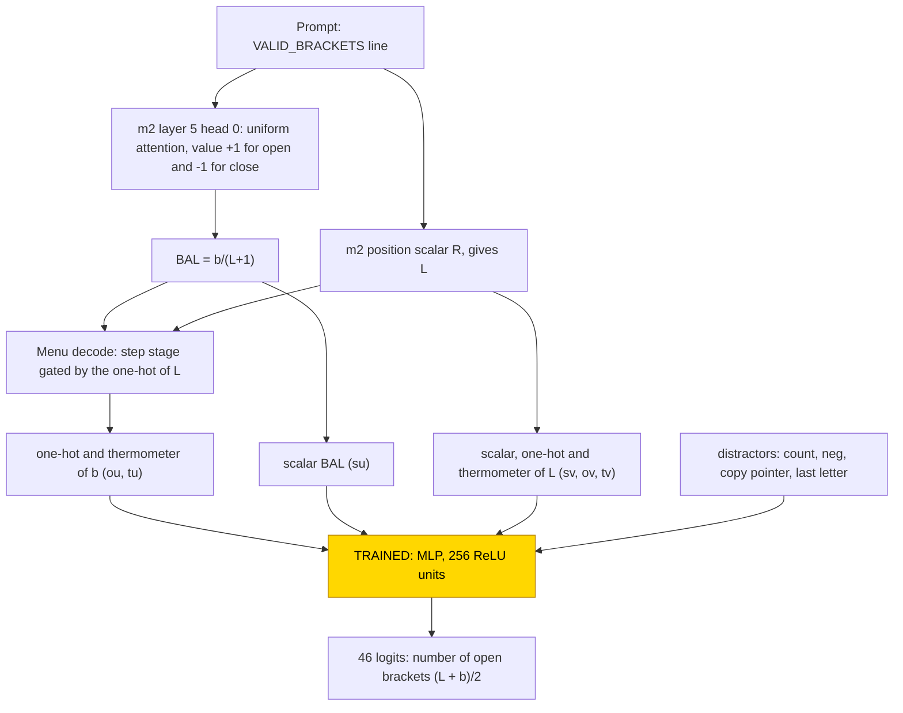
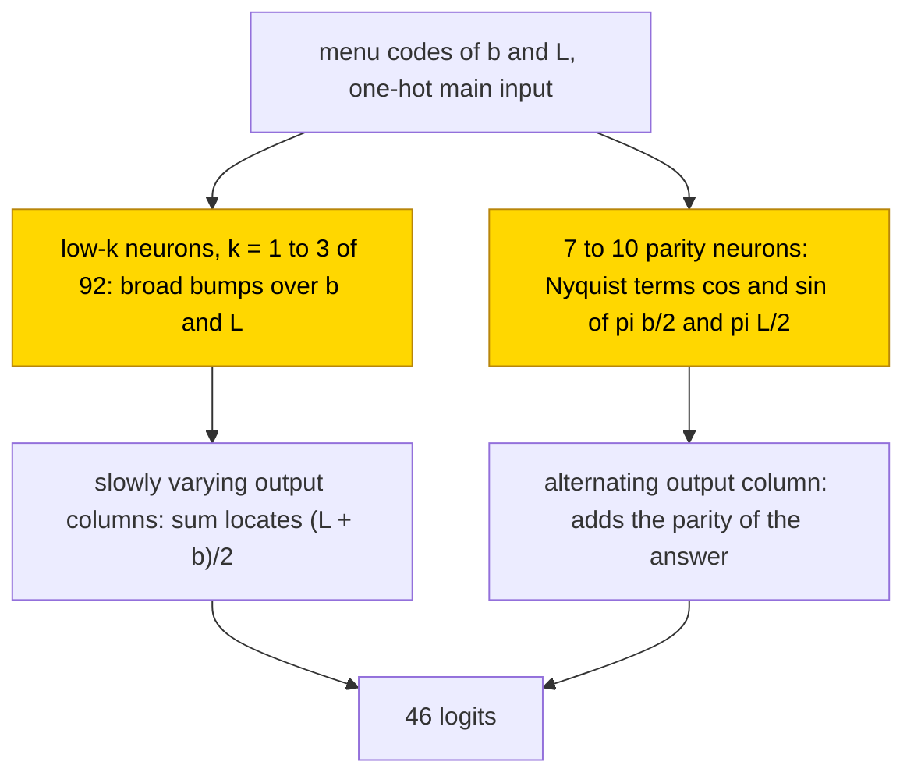

# Open-bracket count

This entry asks how a small network counts the opening brackets in a line of up to 45 brackets. A frozen transformer whose every
weight was set by formula supplies the depth ratio b/(L+1), where b is the final depth, and the line length L, re-encoded in three
ways; only a one-layer MLP on top was trained, and no hand-built reader for the count itself was given. With 80% of the cells in
training, 10/10 networks grokked into a low-frequency trigonometric sum (frequencies k = 1–3 of 92, a clock) plus a small parity
channel and reached test .78–.88; with 40% or 60% all 20 networks memorised. The task is partly solved (fraction .8: clock sum in 10/10 networks,
none reaches 90%; fractions .4 and .6: memorisation in 20/20). The closed form is partial: it is supported by substitution (accuracy
.91–.93, agreement .88–.92, where the networks score .96–.98 on all cells), and the complement was not tested.

| Fact | Value |
|---|---|
| Task | Count the `(` in a line of up to 45 brackets (46 possible answers) |
| Input → output example | `(()` → `2` |
| Model | Frozen hand-built 6-layer transformer and a frozen 416-wide menu of encodings; trained: one MLP layer, 256 ReLU units, 46 outputs |
| Rungs and seeds | Hand-built network supplies b/(L+1) and L (no hand-built count reader); MLP trained on frozen hand-built parts, 10 seeds × train fractions .4/.6/.8 (30 networks), 200,000 steps each; 18 control runs |
| Closed form status | Partial: per-neuron cosine sum, accuracy .91–.93, agreement .88–.92 (networks .96–.98 on all cells; supported by substitution; complement not tested) |
| Status | Partly solved (fraction .8: clock sum in 10/10 networks, none reaches 90%; fractions .4 and .6: memorisation in 20/20); last run 2026-11-04 |
| Weights | [Hugging Face: open-bracket-count](https://huggingface.co/jc1122/circuit-atlas-nets/tree/main/open-bracket-count) (hand-built base in `_shared/m2`) |
| Reproduce | [Commands](#24-reproduction), run from `code/` |

## 1. Task and data

Each prompt holds a fixed one-shot example followed by the query line:
`VALID_BRACKETS: ()\nANSWER: YES\nVALID_BRACKETS: <line>\nANSWER: `. The answer is the number of `(`, which is (L + b)/2, where b is the
final depth (#`(` − #`)`) and L the length; there are 46 classes. The data cover every cell with L = 1..45 and b = −L..L in steps of
2, which gives 1080 cells with one shuffled line each. The split into training and test data is over cells, with train fractions .4,
.6 and .8. Accuracy is the share of held-out cells answered correctly; some figures are also given on all cells.

## 2. Model

The shared architecture, optimiser and instrumentation are described in [METHODS.md](../METHODS.md); this section gives only what is
specific to the task.

### 2.1 Frozen hand-built network

The base is [m2](../GLOSSARY.md#hand-built-machinery), a GPT-NeoX-shaped decoder with 6 layers, d_model 528 and 4 heads (d_head 132),
MLP width 512, exact GELU, fixed-gain LayerNorm (eps 1e-5), no positional embedding and no rotary embedding, a sequential residual
stream and a character vocabulary of 70 ids. It has 10,041,408 parameters, of which 13,443 are non-zero, and nothing in it was
trained. It is read at the last prompt position, from the residual stream before the final LayerNorm. `code/m2.py` rebuilds it bit for
bit (safetensors sha256 `3dbb5226…cd9a6a`). On the bracket prompt it supplies the depth ratio BAL = b/(L+1) and the position scalar R,
which gives L (Section 3).

### 2.2 Frozen menu and trained part

The [menu](../GLOSSARY.md#hand-built-machinery) is a frozen layer, defined by formula, that places three encodings of each integer at
the answer position: the raw scalar (here BAL for b and R for L), a one-hot code and a thermometer code (a vector whose k-th unit is [n ≥ k]), together with
distractor features. Here the two integers are u = b, the depth from the bracket head's b/(L+1), and v = L. Each block is centred and
divided by its rms row norm. Table 1 lists the blocks of the 416-wide input.

*Table 1. Input blocks of the frozen menu (index ranges of the 416-wide input).*

| Block | Indices | Content |
|---|---|---|
| su | 0 | BAL |
| sv | 1 | R |
| ou | 2–92 | one-hot b = −45..45 |
| ov | 93–138 | one-hot L = 0..45 |
| tu | 139–228 | [b ≥ k], k = −44..45 |
| tv | 229–273 | [L ≥ k] |
| count, neg (distractors) | 274, 275 | constant here, so 0 |
| copy pointer (distractor) | 276–345 | |
| last letter (distractor) | 346–415 | |

The trained stage is one MLP, `logits = W2 ReLU(W1 x + b1) + b2`, with W1 [256, 416], b1 [256], W2 [46, 256] and b2 [46], which is
118,574 parameters.

### 2.3 Training

Training followed [count mod 5](count-mod-5.md): hidden width 256, 46 outputs, 200,000 steps, an evaluation every 500 steps, and 10
seeds at each train fraction .4 / .6 / .8. Two controls, a random frozen base of the same shape and a menu holding only the scalars,
were run with 3 seeds each at each fraction, which gives 18 control runs.

### 2.4 Reproduction

The commands below run from `code/`; the clock sum appears at fraction .8:

```
python run.py atlas --task open_count --frac 0.8 --seeds 0 1 2 3 4 5 6 7 8 9    # also --frac 0.4 and 0.6
python run.py atlas --task open_count --kind random --seeds 0 1 2 --probe
python run.py atlas --task open_count --kind scalar --seeds 0 1 2
python run.py table out/open_count_*.json
```

The headline numbers of each network are in the output keys `final` (test accuracy), `t50` (the first evaluation with test accuracy
≥ 50%), `form_clock` / `form_clock_agree` (substitution accuracy and agreement) and `clock_k_top` (the dominant frequencies).

### 2.5 Archive

Each network is stored as one safetensors file (`W1`, `b1`, `W2`, `b2`, `test_idx`), with `config.json`, `inputs.safetensors` (the
frozen menu rows X, the integers and the labels) and `manifest.json` (seed, rung, train fraction, accuracy, circuit type, sha256). Every
file was re-loaded, and its forward pass reproduces the recorded test accuracy exactly. The 30 networks (`s<seed>_f<40|60|80>`; the
clock sum is in the `_f80` files) are published on Hugging Face at
[huggingface.co/jc1122/circuit-atlas-nets/tree/main/open-bracket-count](https://huggingface.co/jc1122/circuit-atlas-nets/tree/main/open-bracket-count).

## 3. Hand-built solution

The hand-built network supplies the inputs of the count but not the count itself (Figure 1).

The depth ratio is computed by layer 5, head 0 of m2. It attends uniformly over the bracket tokens and the newline of the current
line, with value +1 for `(` and −1 for `)`, so it writes BAL = b/(L+1). The length L comes from the position scalar R.

The menu decodes BAL into a thermometer code of b with a second step stage gated by the one-hot of L:
[b ≥ k] = Σ_L step(BAL + 100(onehot_L − 1); (k − ½)/(L+1), 40(L+1)), where `step` is the GELU step pair of
[count mod 5](count-mod-5.md#3-hand-built-solution). The one-hot of b is the difference of neighbouring thermometer units.

No hand-built open-count brick was given. The nearest hand-built design adds the two integers linearly in the residual stream and reads
the sum (L + b)/2 with step staircases.



*Figure 1. The hand-built network and the trained stage. Frozen parts, set by formula, compute the depth ratio b/(L+1) through layer
5, head 0 of m2 and re-encode b and the line length L in the 416-wide menu; there is no hand-built count reader. The shaded MLP is the
only trained part.*

## 4. What training finds

This is the only task in this set of menu tasks that [groks](../GLOSSARY.md#counting-results) (test accuracy rises long after training accuracy is
perfect), and only with 80% of the cells in training. Train accuracy was 100% at step 500 in every run (Table 2).

*Table 2. Results per train fraction (ranges over 10 seeds).*

| Fraction | Train 100% step | Test 50% step | Final test | Circuit type |
|---|---|---|---|---|
| .4 | 500 | | .006–.019 (below chance) | memorisation |
| .6 | 500 | | .04–.11 | memorisation |
| .8 | 500 | 20.5k–28.5k | .78–.88, flat from ~150k | low-frequency clock sum, 10/10 |

At fraction .4 the wrong answers are neighbouring cells' answers. At fraction .8, test accuracy was .02–.05 at 10k steps, reached 50%
at 20.5k–28.5k and then stayed flat at .78–.88 from about 150k steps, while the weight norm fell from 80 to 73. None reaches 90%.

The circuit types are a low-frequency clock sum in 10/10 networks at fraction .8 and memorisation in 20/20 at .4 and .6. At fraction .8
all three encodings are used together, the one-hot as the main input; the distractors have no effect.

The controls are summarised in Table 3. The random base is better than the menu at fractions .4 and .6; its residual stream holds b and
L linearly (ridge R² 1.000). A menu holding only the scalars reached .35–.56.

*Table 3. Random frozen base control (test accuracy, ranges over 3 seeds).*

| Control | Fraction .4 | Fraction .6 | Fraction .8 |
|---|---|---|---|
| Random frozen base | .57–.60 | .72–.77 | .81–.86 |

## 5. Mechanism and verification

Each hidden neuron n was fitted with the closed form

pre_n = c_n + a_n cos(ω_n b/2 + φ_n) + a′_n cos(ω_n L/2 + ψ_n),  ω_n = 2πk_n/92,

with k_n ∈ 1..45 chosen per neuron (most often 1–3) and the trained output weights kept. Substituted for the network, it reaches
accuracy .91–.93 (the networks score .96–.98 on all cells) and agrees with the network on .88–.92 of cells. The pre-activation separates
into a b part plus an L part (substitution .95–.98) but is not linear: a straight-line form scores .09–.11. The low-k wavelengths (31–92)
exceed half the domain, so those cosines do not alias. The closed form is supported by substitution; no [resample ablation of the
complement](../GLOSSARY.md#verifying-a-circuit) was reported, so the status is partial.

The networks combine two channels (Figure 2; numbers in Appendix A). The low-k neurons are smooth, broad bumps over b and L (their
single-cosine R² is only .15–.47, so "one cosine per neuron" is a coarse description); with output columns that vary slowly over the 46
classes, their sum locates the answer (L + b)/2. Without the parity neurons the networks still score .92–.96 on all cells. A parity
channel, found in the archived weights of 10/10 networks at fraction .8, resolves the remaining ambiguity between neighbouring answers:
7–10 neurons whose output column alternates with the class parity. They use the Nyquist frequency, the highest frequency the grid can
carry (one sign change per step): (−1)^((L+b)/2) = cos(π(L+b)/2) = cos(πL/2)cos(πb/2) − sin(πL/2)sin(πb/2) is a product of Nyquist
terms that the ReLU forms, and their alternating output column adds ± the parity to every class. Removing them lowers the all-cell
accuracy by .01–.05; the networks get the parity of the answer right on .98–.99 of cells.



*Figure 2. The circuit training finds at fraction .8. Low-frequency neurons form a trigonometric sum that locates the answer, and a
small set of parity neurons adds the parity of the answer; the cosine-sum closed form is supported by substitution, with the complement
not tested.*

Relation to the hand-built design and to published work. The nearest hand-built design forms the sum linearly and reads it with step
staircases; the trained stage never forms the sum linearly and builds a trigonometric sum instead. This is a Gromov-style clock
([Gromov, 2023](#references)) on a non-modular domain. Modular addition (x + y mod 59, [modular-addition-mlp](modular-addition-mlp.md))
used 22–27 frequencies; this non-modular task uses only k = 1–3. Bracket and automaton tasks in transformers were studied as bounded
Dyck languages by [Yao et al. (2021)](#references), as shortcuts to automata by [Liu et al. (2022)](#references), and for the
difference between decodable and causally used depth by [Sharma et al. (2026)](#references).

## 6. Limitations and open questions

It is open whether a 90% clock is reachable with more data or a lower weight decay; more steps do not help, since accuracy and weight
norm are flat after about 150k steps.

## 7. Prediction record

No prediction was recorded before these runs; the entry predates the prediction record. A retrospective prediction, labelled as such,
follows from the nearest hand-built design, which adds the two integers linearly and reads the sum with step staircases: it predicts a
linear sum, which did not occur (a straight-line form scores .09–.11). The parity channel was not predicted.

## Appendix A. Weights excerpt and reading

For seed 0 at fraction .8, each neuron's pre-activation was split into c_n + E_b(b) + E_L(L) and fitted by one frequency k ∈ 1..45 per
neuron (ω = 2πk/92, E_b ≈ a cos(ωb/2 + φ), E_L ≈ a′ cos(ωL/2 + ψ)). Neurons per best k: k = 1: 58, k = 2: 43, k = 3: 14, k = 4: 7; the
other 134 spread over k = 6..45 (k = 45: 10, k = 23: 11). Table A1 lists the strongest low-k neurons by W2 column norm.

*Table A1. Strongest low-k neurons, seed 0, fraction .8.*

| neuron | k | a, φ | a′, ψ | fit R² | W2 column, classes 0, 9, 18, 27, 36, 45 |
|---|---|---|---|---|---|
| 216 | 1 | .49, −1.75 | .05, −2.52 | .30 | .17, −.68, .21, .56, −.41, .00 |
| 231 | 1 | .97, −1.81 | .86, −2.36 | .47 | .45, .55, .56, −.60, .29, −.01 |
| 47 | 1 | .27, +1.70 | .21, +.78 | .22 | −.17, −.60, −.51, .39, −.36, .00 |
| 171 | 2 | .28, +.67 | .37, +3.12 | .30 | −.42, .26, .11, .62, −.37, −.01 |

The parity neurons of seed 0 include neuron 58, whose output column over classes 0..9 is −.67, .75, −.72, .70, −.73, .74, −.74, .76,
−.75, .73. The pre-activations of the parity neurons are fitted by cos/sin(πb/2), cos/sin(πL/2) and their products with median R²
.96–.99. Removing them lowers the all-cell accuracy of seed 0 from .956 to .934.

Reading. The low-k neurons carry the coarse location of the answer through output columns that vary slowly over the classes; the
parity neurons, whose output column alternates in sign from class to class (neuron 58), separate neighbouring answers.

## References

- Gromov, A. (2023). Grokking modular arithmetic. *arXiv preprint*. https://doi.org/10.48550/arxiv.2301.02679 (the clock solution of
  a wide MLP)
- Liu, B., Ash, J. T., Goel, S., Krishnamurthy, A., & Zhang, C. (2022). Transformers learn shortcuts to automata. *arXiv preprint*.
  https://doi.org/10.48550/arxiv.2210.10749 (automaton tasks)
- Sharma, A., Dawes, C., & Raval, S. (2026). Dissociating decodability and causal use in bracket-sequence transformers. *arXiv
  preprint*. https://doi.org/10.48550/arxiv.2604.22128 (Dyck depth, top of stack)
- Yao, S., Peng, B., Papadimitriou, C., & Narasimhan, K. (2021). Self-attention networks can process bounded hierarchical languages.
  *arXiv preprint*. https://doi.org/10.48550/arxiv.2105.11115 (bounded Dyck)
