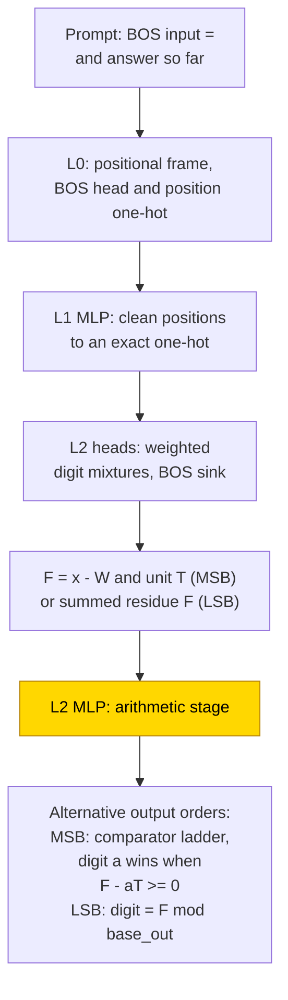
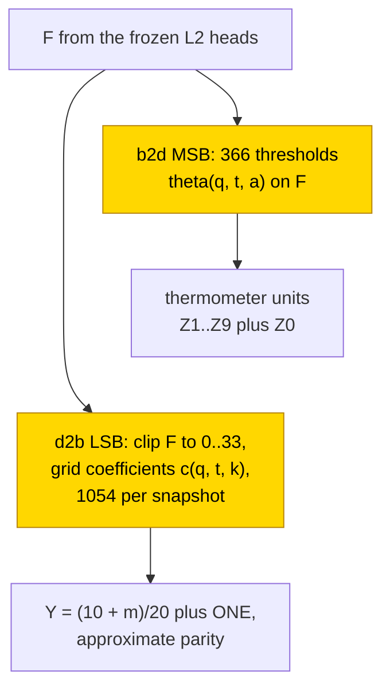

# Output order in 16-bit base conversion

Converting a number between decimal and binary preserves its value, but the order of the output digits changes the computation a model must learn. The hand-built solution writes the largest place first by comparing the remaining magnitude with place-value thresholds; units-first output instead needs a remainder calculation, which the trained answer-only stages often miss. Exact success also depends on reporting precision: in a later seven-seed decimal-to-binary completion, rounded stop labels say 3/7 solved while only 1/7 is exactly correct on all 6554 held-out integers. A scratchpad of intermediate steps solved the completed binary-to-decimal frozen-routing comparison in 10/10 seeds per order, not every scratchpad cell. The task is partly solved and the formulas are Partial: local partly trained stages retain identical token predictions in 12/12 tested snapshots, including their errors, but complement resampling was not tested and no whole-network formula is accepted.

| Fact | Value |
|---|---|
| Task | Convert an integer 0…65535 from 5 decimal digits to 16 bits or back, answer written MSB-first or LSB-first |
| Input → output example | Decimal to binary: 00012 → 0000000000001100 (MSB-first) or 0011000000000000 (LSB-first); decimal 65535 → sixteen 1 bits |
| Model | GPT-NeoX-shaped, 3 layers, d_model 512, 4 heads of 128, MLP 256 ReLU, no LayerNorm, no positional encoding; PART trains only the layer-2 MLP |
| Rungs and seeds | HAND exact in all 8 cells; legacy PART/TRAIN cells report 10 seeds (scratchpad TRAIN: 10 trained, 3 archived), plus a 3-seed repeat. Later answer-only results separate run-2 seeds 0–2 from final-completion seeds 3–9; no new pooled rate is inferred. |
| Closed form status | Partial (PART only: identical token predictions on 1024 held-out integers in 12/12 tested snapshots of seeds 0–2; supported by substitution, complement not tested; TRAIN scalar template rejected, 0/12) |
| Status | Partly solved (final-completion decimal-to-binary largest-place-first TRAIN: 3/7 protocol / 1/7 strict full-test exact; binary-to-decimal PART/TRAIN 0/7 strict; completed binary-to-decimal scratchpad PART 10/10 per order); latest analysed completion 2026-11-11. |
| Weights | [Hugging Face: output-order-base-conversion](https://huggingface.co/jc1122/circuit-atlas-nets/tree/main/output-order-base-conversion) (weights and held-out evidence archive). |
| Reproduce | Not available yet: training code for this task is not yet in `code/` |

MSB-first means largest place first; LSB-first means units first ([formats](../GLOSSARY.md#task-formats)). HAND sets every weight by formula, PART learns one stage on a frozen scaffold, and TRAIN learns all weights ([rungs](../GLOSSARY.md#the-three-rungs)).

Read next: [Results](#4-what-training-finds) and [verification](#5-mechanism-and-verification), then [base conversion](base-conversion.md) for the companion task, or [multiplication across bases](multiplication-base-order.md) for digit-order effects in multiplication.

## 1. Task and data

An integer x = 0…65535 is converted between 5 decimal digits and 16 bits in both directions: decimal to binary (d2b) and binary to
decimal (b2d). Decimal 00012 is binary 0000000000001100 in largest-place-first order and 0011000000000000 in units-first order; decimal 65535 is sixteen 1 bits. The prompt is `BOS input =` and the vocabulary has 18 tokens. Most-significant-first (MSB) means largest place first; least-significant-first (LSB) means units first
([glossary](../GLOSSARY.md#task-formats)). Two output formats were studied (Table 1). The scratchpad format, in which the network
writes intermediate results before the answer ([glossary](../GLOSSARY.md#task-formats)), writes 16 lines first and then copies the
answer from them.

*Table 1. Output formats.*

| Format | Output |
|---|---|
| `A` (answer only) | the converted number, MSB-first or LSB-first |
| `B` (scratchpad) | 16 scratchpad lines, then the answer copied from them. Decimal to binary: halving lines `r_{k−1} q_k`, q_k = x >> k; binary to decimal: doubling lines v_k = x >> (16−k) |

The operator `>> k` means integer division by 2^k. In a halving line, r_{k−1} is the discarded remainder bit and q_k the remaining quotient; v_k is the value accumulated by the doubling trace.

The split is made per seed: a random permutation of all 65536 integers, 90% for training (58982) and 10% for testing (6554). A row
counts as exact when every teacher-forced output token of the row is right (teacher-forced: each token is scored given the correct
previous tokens; [glossary](../GLOSSARY.md#task-formats)). Cells are named by direction, format and order, for example "d2b A MSB".

Published here are the answer-only cells b2d MSB (PART, TRAIN 10 seeds), d2b MSB (PART, TRAIN 10), d2b LSB (PART, TRAIN 10) and b2d LSB
(PART 10, failed), and the scratchpad cells d2b MSB, b2d MSB and b2d LSB (10 seeds trained, seeds 0–2 archived). This is the legacy published census. Later analysis separates the three-seed run-2 cohort from the seven-seed final completion in Section 4. The interrupted d2b B LSB cell, controlled-routing scratchpad format and full ten-seed substitution coverage remain incomplete; the Newton square-root trace is a separate companion task, not another conversion cohort.

## 2. Model

The shared conventions are described in [METHODS.md](../METHODS.md). The three [rungs](../GLOSSARY.md#the-three-rungs) are HAND (every
weight set by formula), PART (frozen hand-built parts with one trained stage) and TRAIN (all weights trained from scratch).

### 2.1 Architecture

All networks are GPT-NeoX-shaped decoders, with attention heads reading earlier positions and feed-forward MLP blocks transforming each position's running vector ([glossary](../GLOSSARY.md#standard-machine-learning-terms)). They have 3 layers, d_model 512, 4 heads of 128, MLP 256, ReLU, no LayerNorm, no positional encoding (causal
mask only) and an untied read-out. The vocabulary has 18 tokens and positions run up to 256. Sequence lengths are 23 for A, 120 for d2b
B and 104 for b2d B. TRAIN learns every tensor of this shape; the b2d A LSB width retry, with d_model
1024, is not archived.

### 2.2 Frozen parts and trained part

PART keeps HAND frozen and re-initialises the layer-2 MLP (`dense_h_to_4h` [256, 512] + bias, `dense_4h_to_h` [512, 256] + bias;
normal .02, bias 0), which is then trained. Its inputs are the residual blocks in Table 2, where L is the sequence length.

*Table 2. PART input blocks (inclusive residual indices).*

| Block | Indices |
|---|---|
| TOK (token one-hot) | 0–17 |
| frame scalar | 18 |
| raw positions | 19…L+17 |
| cleaned positions | L+18…2L+16 |
| task scalars | from 2L+17. A: F = 63; b2d MSB unit T = 64, thermometer Z = 65–74; d2b LSB parity-response coordinate Y = 64, constant coordinate ONE = 65 |

### 2.3 Training

The optimiser was AdamW with learning rate 1e-3, weight decay .1, betas (.9, .98), warmup 1000, a cosine schedule over the run and
gradient clipping at 1, with batch 128 from the training split. Test accuracy was evaluated every 250 steps on the first 2048 test
integers (the best snapshot is the highest there), and on the full test split at the end. A run stopped when all seeds were exact or on
a 5k plateau after the minimum number of steps. Table 3 gives the budgets. PART ran in fp32 and TRAIN in TF32
([glossary](../GLOSSARY.md#hand-built-machinery)); all seeds of a cell ran in one process on consumer GPUs, and re-scores were in fp32
on CPU. The later logs lack event-defined best/final/train records: their maximum periodic test, final full-test and last periodic train are explicitly different quantities. Periodic evaluation used 2048 integers and final full-test evaluation 6554. Rounded three-decimal stop labels can call a non-exact network solved; Section 4 retains the protocol label alongside strict unrounded full-test exactness.

*Table 3. Step budgets.*

| Cells | PART | TRAIN |
|---|---|---|
| A | 20k (d2b MSB 10k) | 80k |
| B | 10k | 40k |

### 2.4 Reproduction

Reproduce: not available yet: training code for this task is not yet in `code/`; the weights, held-out splits and recorded
accuracies are on Hugging Face at
[huggingface.co/jc1122/circuit-atlas-nets/tree/main/output-order-base-conversion](https://huggingface.co/jc1122/circuit-atlas-nets/tree/main/output-order-base-conversion).

### 2.5 Archive

The Hugging Face folder holds 88 networks and 7 HAND networks (best snapshots): `hand_<cell>`, `part_<cell>_s<seed>` (the 4 trained
tensors, to be inserted into the HAND), `train_<cell>_s<seed>` (full state dicts), `test_<run>` (the held-out integers of each run, per
seed), `config.json` (Hugging Face configs, split, optimiser) and `manifest.json` (seed, best step, recorded and re-scored exact,
full-test best/final, sha256). Reloaded in fp32, every network reproduces its recorded evaluation-subset exact match (TF32 networks
within 3/2048), and every HAND scores 1.0.

## 3. Hand-built solution

All hand-built networks share their routing (Figure 1). L0 builds a positional frame (a BOS head and a position one-hot), the L1 MLP
cleans positions to an exact one-hot, and L2 heads fetch exact weighted mixtures of input digits, with BOS as an attention sink. The L2
MLP is the arithmetic stage.

For MSB-first output, each digit subtracts the place value already written from the original number and compares what remains with candidate place-value multiples. The heads form the remaining magnitude F = x − W, where W is the value of the higher digits already written, and a per-row
unit T (2^i or 10^k). Digit a wins when F − aT ≥ 0. Each test is a comparator ReLU(s+1) − ReLU(s) with s = F − aT, and the read-out
telescopes this thermometer, a vector whose a-th unit is [F ≥ aT], to a digit. This is a threshold ladder on F.

For LSB-first output, the next digit depends on a remainder modulo the output base. The heads form F = (Σ_j digit_j·(base_in^j mod base_out^(q+1)) − W)/base_out^q, which is an integer, and the digit is F mod
base_out. For binary output the parity is computed by alternating signed hinges; for decimal output by a thermometer followed by a
mod-10 read-out. This is a periodic read-out of a summed residue.

In the scratchpad, local halving or doubling rules produce each scratch line, and the answer copies the last scratch digits (a reversed table
for B MSB).

The exhaustive check gives 65536/65536 integers in every cell. Non-zero heads and neurons, including the frame, are d2b A MSB 3+67,
A LSB 3+99; b2d A MSB 3+83, A LSB 3+215; d2b B 3+382 and b2d B 2+346.

*Figure 1. The hand-built answer-only network. Layers 0 and 1 build a clean position code, the layer-2 heads compute the magnitude F
(and the unit T for MSB-first), and the layer-2 MLP turns F into the output digit. The shaded MLP is the part that PART replaces with a
trained stage.*

## 4. What training finds

Table 4 retains the legacy 2026-11-07 full-test summary (6554 integers per seed), reported on the best snapshot unless marked, with 10 seeds per cell (B TRAIN: 10 trained, 3 archived). These older rounded ranges are not a new pooled analysis of the later three- and seven-seed cohorts. In particular, the historical d2b MSB TRAIN description was 10/10 ≥ .996; the later final completion includes .995728 and only one strict exact success.

*Table 4. Legacy published cell ranges; later unrounded outcomes are separated below.*

| Cell | PART | TRAIN | Reading |
|---|---:|---:|---|
| d2b A MSB | .999–1 | .996–1 | threshold on F |
| b2d A MSB | .993–.997 | .77–.9997 (3 seeds ≥ .998) | thermometer on F (PART); TRAIN not identified |
| d2b A LSB | .46–.59 | .21–1 (3/10 ≥ .9995); r3 repeat 0/3 | PART keeps F but misses parity precision; TRAIN fails on a middle bit band |
| b2d A LSB | .18–.38 | .03–.045 (also d_model 1024) | decimal residue never read out |
| d2b B MSB | .89–1 (7/10 = 1) | .999–1 | scratchpad |
| b2d B MSB / LSB | 1 in 10/10 (5.3k / 5.5k steps) | .9986–1 / .9985–1 | scratchpad |

*Key: r3 = the third run, a TRAIN repeat with 3 seeds.*

Answer order changes difficulty in the opposite direction from the recorded prediction (Section 7). MSB-first answer-only conversion
needs one threshold ladder on F and was learned; LSB-first answer-only conversion needs a periodic read-out (u mod base) of a summed
residue and mostly failed, also at 2x width for TRAIN b2d. With a scratchpad, b2d was solved by PART in 10/10 seeds in both orders.

### 4.1 Later answer-only cohorts and rounding

The completion and the run-2 re-analysis were recorded on 2026-11-11.

*Table 4a. Separate legacy run-2 and final-completion cohorts, weight decay .1. The maximum periodic score uses 2048 integers; final full-test uses 6554. Protocol counts copy the rounded stop record; strict counts require unrounded full-test exact 1.0. These are not a new combined ten-seed success rate.*

| Cohort and cell | Seeds | Protocol / strict exact | Maximum periodic test | Final full-test |
|---|---|---|---|---|
| Run 2 d2b A MSB TRAIN | 0–2, n = 3 | 2/3 / 1/3 | .999023–1 | .998169–1 |
| Final completion d2b A MSB TRAIN | 3–9, n = 7 | 3/7 / 1/7 | .996094–1 | .995728–1 |
| Run 2 b2d A MSB PART | 0–2, n = 3 | 0/3 / 0/3 | .996094–.998535 | .994812–.997254 |
| Final completion b2d A MSB PART | 3–9, n = 7 | 0/7 / 0/7 | .993164–.997070 | .993287–.996948 |
| Run 2 b2d A MSB TRAIN | 0–2, n = 3 | 1/3 / 0/3 | .898926–1 | .888770–.999695 |
| Final completion b2d A MSB TRAIN | 3–9, n = 7 | 0/7 / 0/7 | .781738–.998047 | .755874–.998627 |

In final d2b, seeds 4 and 8 round to 1 but their full-test scores are .999847412 and .999542236; only seed 9 is truly 1. Run-2 d2b seed 1 is .999847412 and b2d seed 2 is .999694824, likewise not exact. The logs' first periodic 1 is a proxy, not proof of full-test exactness or delayed generalisation after a training plateau. Only weight decay .1 ran, so no weight-decay sweep or device-effect conclusion follows.

### 4.2 Learning curves

For b2d B TRAIN, the first evaluations at which test accuracy crossed 50%, 90% and 99% were 9.3–12.8k, 13.5–19.5k and 24.8–30k steps
(MSB) and 9–11k, 14.3–17.3k and 23.3–28k (LSB). There was no separate memorisation phase.

### 4.3 Which variables the networks use

PART reuses the hand-built variable. In PART b2d MSB and d2b LSB (diagnostics on 1000 rows, seeds 0–2), a linear probe decodes F with R²
= 1 at L3 ([glossary](../GLOSSARY.md#analysis-measures)), 2 heads matter, patching the L2 MLP drops or recovers everything, the attention
divergence to HAND is 0, and the residual rank at 99% of the variance (rank99) is 2 / 15, equal to HAND. TRAIN networks carry F but
spread it over many heads: TRAIN b2d MSB decodes F with R² .978–.985 at L3, 12 heads matter, rank99 is 49–97 against HAND's 2 and the
attention JS (Jensen-Shannon divergence of the attention patterns from HAND's) is .18–.21; TRAIN d2b decodes F with R² .75–.92 at L2, 9–12
heads matter, rank99 is 20–38 against 15 and JS is .32–.37. The number of neurons that suffice in TRAIN networks was not measured. A later calibration found low F interchange even in the exact HAND: b2d MSB F flip .083 and DAS .077. The final PART F flips .070–.079 and DAS .024–.039 therefore do not establish non-use. Linear decodability, a failed scalar swap and an exact arithmetic mechanism are different claims; the observed errors and patching instead locate an imperfect readout.

### 4.4 The failed LSB-first cells

The repeat of TRAIN d2b A LSB (r3, 3 seeds, the same 80k schedule) solved 0/3 (best / final .08 / .07 for seed 0 and .29 / .26 for seed
2; 4–7 heads matter; F R² .75 / .91 at L2). The failure can be located bit by bit. All 7 failed TRAIN d2b A LSB snapshots (seeds 0–2 of
the first run and r3 seeds 0 and 2, best and final) are exact on bits b0–b2 and b7–b15 and at chance (.48–.53) on 1–4 bits inside b3–b6.
No failed network lacks F (R² ≥ .75, DAS high; DAS is distributed alignment search, [glossary](../GLOSSARY.md#analysis-measures)). Bit b3
is the first bit whose residue x mod 16 needs 4 decimal digits, and from b7 on F/2ᵏ is coarse enough (≤ 2⁹ bins) for a magnitude read.
The hard part is the middle band, where neither a few-digit residue nor a coarse threshold suffices.

## 5. Mechanism and verification

### 5.1 Closed forms for PART

Two closed forms were derived from the weights of the trained stage (Figure 2). For PART b2d MSB the magnitude stage (3/3 measured
seeds) is

M′ = e_Z0 + Σ_{a=1..9} e_Za·[F ≥ θ(q, t, a)],

where q is the query position, t the preceding symbol and e_Za the output direction of thermometer unit Za. Its 366 thresholds per
snapshot were found by bisection on the component's own response, with no label fitting.

For the failed PART d2b LSB parity (3/3), with f = clip(F, 0, 33), k = min(⌊f⌋, 32) and r = f − k,

m = (1−r)c(q,t,k) + r·c(q,t,k+1),  M′ = e_ONE + ((10+m)/20)e_Y,

with 1054 weight-derived grid coefficients c per snapshot. It reproduces a failing read-out, not exact parity.

The whole L2 MLP output was replaced by the closed form, calibrated on 512 integers and evaluated on 1024 disjoint integers, with an acceptance bar of ≥ .99 × native exact match. Table 5
gives native and substituted correct rows. Every token prediction agrees in 12/12 snapshots (9362/12288 rows correct both ways), and
zeroing the MLP scores 0. The closed forms are therefore supported by substitution; the resample ablation of the complement
([glossary](../GLOSSARY.md#verifying-a-circuit)) was not run, and seeds 3–9 are untested, so the status is partial.

*Table 5. Substitution of the PART closed forms: correct rows out of 1024, best/final snapshot; native = substituted in every case.*

| Cell | Seed 0 | Seed 1 | Seed 2 |
|---|---|---|---|
| b2d A MSB | 1024/1024 | 1020/1019 | 1018/1018 |
| d2b A LSB | 585/562 | 563/566 | 493/470 |

*Figure 2. The two closed forms of the trained PART stage. In b2d MSB the stage is a threshold thermometer on F; in d2b LSB it is a
piecewise-linear spline on F that approximates parity with wrong bands. Both are supported by substitution on seeds 0–2, with the
complement not tested, so their status is Partial. The shaded thresholds and spline are the trained PART stage; all routing is frozen.*

### 5.2 The template rejected for TRAIN

For TRAIN, a scalar û_q = h_q·w_q + b_q was decoded from the hidden state h_q and the L2 MLP was replaced by query × digit mean logit
profiles. This passes in 0/12 snapshots (b2d .002–.009 against native .93–1; d2b .009–.18 against .25–.90). This rejects this template,
not every scalar algorithm.

### 5.3 Relation to the hand-built network and to published work

PART uses the same variable as HAND (F decodable at R² = 1, the same heads, the same residual rank) and, for MSB, the same threshold
algorithm. For LSB, PART keeps F but fails the periodic read-out. TRAIN networks carry F with many more heads and a higher-rank code.
The output-order advantage reported for reversed addition by [Lee et al. (2023)](#references) does not transfer to base conversion,
where LSB-first needs a mod on a sum and is harder in the reported answer-only comparisons. The completed b2d PART scratchpad comparison removes the order effect, in line with scratchpad and inductive
scratchpad results ([Abbe et al., 2024](#references)). Length and padding controls of the kind studied by
[Zhou et al. (2024)](#references) were not run here, because the width is fixed.

## 6. Limitations and open questions

The HAND controls are exact. The substitutions used calibration and evaluation sets disjoint from the earlier fit sets, and the zeroed
stage control scores 0. The substitution covers six cell/seed units (best and final), not twelve independent seeds; seeds 3–9 are
untested for substitution. Displayed 1.000 values from logs are rounded; per-seed full-test values are in the manifest. Length transfer
was not tested (fixed width).

The completed scratchpad contrast is binary-to-decimal PART in both orders. Decimal-to-binary B MSB PART is only 7/10 exactly 1 in the legacy table, and d2b B LSB remains interrupted. There is no universal scratchpad-success claim.

The later conversion audit has missing final diagnostics for b2d TRAIN seed 9, incomplete discovery for b2d TRAIN seed 3, and missing Method-v2 additions for d2b TRAIN seed 3. Seven conversion checkpoint-dynamics tails remain incomplete. Distinct-best causal/discovery additions, embedding and initial-drift checks, log-event instrumentation and neuron-wise ablations are missing. An empty used-component list at low exact match is a floor-limited .05-drop screen, not a zero-size circuit; a fitted discovery mask without held-out exact retention is not accepted.

The r4 PART retry packs each used 10 seeds. The b2d LSB budget retry at 40k steps gave test .13–.42; the d2b LSB MLP-width-512 retries gave .61–.71 at weight decay .03 and .55–.66 at .1. These are reported test ranges, not exact successes. The large TRAIN packs were stopped while queued by the owner. These are separate follow-ups, not silent updates of the earlier cohorts and not live training. No relaunch is implied.

The Newton square-root trace is a separate companion task. Its historical summary was PART failure and TRAIN .85–.95 in 5 seeds; the later five-seed completion also failed strict exactness. It is not pooled into conversion. Still incomplete are d2b B LSB, the controlled-routing scratchpad format, full diagnostics and checkpoint dynamics, and public code.

## 7. Prediction record

The prediction was recorded before the runs: PART answer-only MSB fails, LSB succeeds, B succeeds 10/10; TRAIN LSB at least as good as
MSB, B ≥ 8/10. The answer-only order result is the reverse (MSB learned, LSB fails). The B prediction held for b2d in both orders.

## Appendix A. Weights excerpt and reading

In the hand-built MSB stage, a hinge pair has input coefficients (F, T) = (1, −a), biases (1, 0), output (+1, −1) and read-out scale
10. The binary parity stage has input F = 1, biases −a, and output 1 at a = 0 and 2(−1)^a after.

Table A1 gives fitted response parameters of the trained PART stages on final snapshots (not raw entries).

*Table A1. Fitted response parameters, PART final snapshots.*

| Seed | b2d θ(q=0, t='=', a=1) | d2b c(q=2, t='0', k=14…17) |
|---|---:|---|
| 0 | 9999.44 | (−1.305, −.310, .017, .325) |
| 1 | 10001.96 | (.488, −.131, −.750, −.641) |
| 2 | 9999.44 | (−1.323, −1.275, −1.235, −1.246) |

Table A2 gives raw weights of seed 0, final snapshot. W_in columns are slices of `dense_h_to_4h.weight`; β is the bias plus the remaining
inputs at q = 0, t = '=', F = 0; the last column is (U_1 − U_0)·W_out[:, j], the actual output column projected on the digit-1 minus
digit-0 unembedding.

*Table A2. Raw weights, seed 0, final snapshot.*

| Neuron | W_in[j, F] | W_in[j, T] | β | (U₁−U₀)W_out[:, j] |
|---|---:|---:|---:|---:|
| b2d 87 | −.22669 | .21495 | 2149.97 | −20.42 |
| b2d 22 | −.20950 | .19968 | 1997.30 | −17.36 |
| d2b 252 | −.43030 | — | .654 | 103.86 |
| d2b 164 | −.21479 | — | .641 | −102.91 |

Reading. The b2d neurons are decreasing hinges in F with a T-scaled offset, that is, a ladder of cuts at multiples of the place value
(θ ≈ 10^4 for the leading digit); their negative writes release evidence for the larger digit as F rises. The d2b pair writes opposite
signs and makes oscillations in F, but their sum has wrong bands (c changes sign irregularly across k), so the learned parity is
approximate. Only the whole-block substitution was tested; a detector identity for single neurons was not.

## Appendix B. Detailed evidence

The variable-use diagnostics of Section 4.3 used 1000 rows and seeds 0–2. The per-seed full-test best and final values are in `manifest.json`.

## References

- Abbe, E., Bengio, S., Lotfi, A., Sandon, C., & Saremi, O. (2024). How far can transformers reason? The globality barrier and
  inductive scratchpad. *Advances in Neural Information Processing Systems 37 (NeurIPS 2024)* (conference paper). https://doi.org/10.52202/079017-0874
  (arXiv: https://arxiv.org/abs/2406.06467) (scratchpad motivation)
- Lee, N., Sreenivasan, K., Lee, J. D., Lee, K., & Papailiopoulos, D. (2023). Teaching arithmetic to small transformers.
  *arXiv preprint*. https://arxiv.org/abs/2307.03381 (output-order context)
- Zhou, Y., Alon, U., Chen, X., Wang, X., Agarwal, R., & Zhou, D. (2024). Transformers can achieve length generalization but not
  robustly. *arXiv preprint*. https://arxiv.org/abs/2402.09371 (length and padding controls)
