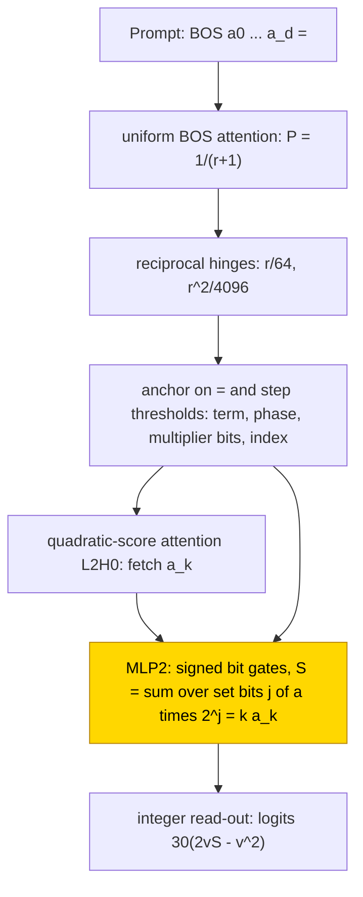
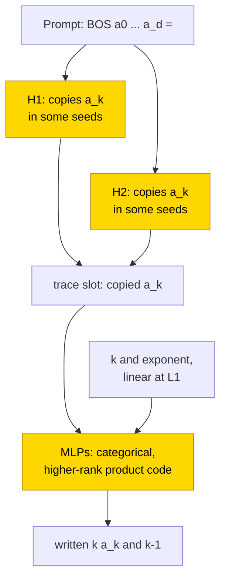

# Polynomial differentiation

Differentiating a polynomial means multiplying each coefficient by its power and reducing that power by one. A 3-layer transformer was trained on degree-3 polynomials, either answering directly or first writing intermediate coefficients in a [scratchpad](../GLOSSARY.md#task-formats). With coefficient-fetching machinery frozen, the arithmetic stage reached exact whole-output accuracy in all 10 independent training runs (seeds, [glossary](../GLOSSARY.md#counting-results)) per format within 2–3k steps, on 1024 held-out draws per evaluation. From scratch, only 6/10 seeds in the final scratchpad cell were exact; the other final seeds made errors only when copying coefficients, despite correct product and exponent tokens under teacher forcing (the preceding correct trace tokens were supplied). The task is partly solved; the frozen-stage formula is partial, with replacement accuracy 1.000 on 40/40 snapshots but no test resampling everything outside the claimed circuit (the complement, [glossary](../GLOSSARY.md#verifying-a-circuit)), while the from-scratch substitute is only a numerical compression, a smaller fitted model checked in 4 of the 6 solved final seeds.

| Fact | Value |
|---|---|
| Task | Differentiate Σ a_k x^k (degree 3) term by term, one token per integer |
| Input → output example | Answer only: `BOS 5 4 1 1 =` (coefficients a_0 to a_3) → `4 0 2 1 3 2`, the pairs (k·a_k, k−1) |
| Model | 3 layers × 1 attention head, base running-state width 16, feed-forward width 48; no state normalisation or added position vectors. The final from-scratch cell doubles both widths; the frozen-routing cell trains only the masked layer-2 feed-forward block (MLP2) |
| Rungs and seeds | Hand-built reference (HAND), frozen-routing stage (PART) with 10 seeds per format, and from-scratch networks (TRAIN): 3-seed screens at width 1 and 2, then a 10-seed scratchpad final at width 2 for 60k steps |
| Closed form status | Partial (PART: MLP2 = k·a on the two observed bits, 1.000 on 40/40 snapshots on substitution; complement not tested. TRAIN: numerical compression only, 4 of 6 solved final seeds) |
| Status | Partly solved (PART 10/10 per format exact; TRAIN scratchpad width 2 final 6/10 exact); last run 2026-11-08 |
| Weights | [Hugging Face: polynomial-differentiation](https://huggingface.co/jc1122/circuit-atlas-nets/tree/main/polynomial-differentiation) |
| Reproduce | Not available yet: training code for this task is not yet in `code/` |

Read next: [Results](#4-what-training-finds) and [verification](#5-mechanism-and-verification), then [polynomial integration](polynomial-integration.md) for reduced-fraction outputs, or [polynomial addition and multiplication](polynomial-add-mul.md) for coefficient operations.

## 1. Task and data

The input is `BOS a0 … a_d =`, where a_k is the coefficient of x^k and d is the degree. The derivative replaces each nonconstant
term a_k x^k by (k·a_k)x^(k−1), in ascending k, with no zero trimming. Each integer is one token. Two output formats were studied (Table 1); the [scratchpad](../GLOSSARY.md#task-formats) format writes the exponent and the
copied coefficient before each product.

*Table 1. Output formats.*

| Format | Output per term |
|---|---|
| `A` (answer only) | (k·a_k, k−1) |
| `T` (scratchpad) | (k, a_k, k·a_k, k−1) |

For the example `BOS 5 4 1 1 =`, format `A` writes `4 0 2 1 3 2` and format `T` writes `1 4 4 0 2 1 2 1 3 1 3 2`.

The hand-built network was checked on degree 1–6 and coefficients −15..15. Training used degree 3 and coefficients −9..9; the pairs
(k, a) = (2, ±3) and (3, ±2) were withheld as inputs, although their product labels still occur elsewhere. Training data were fresh
hash-disjoint draws with replacement from 104329 primary polynomials, split into 103251 for training and 1078 for testing. An output
counts as correct only on exact match of the whole teacher-forced output ([glossary](../GLOSSARY.md#task-formats)). Each evaluation samples 1024 held-out draws with replacement, rather than exhaustively scoring the 1078 distinct test polynomials.

## 2. Model

The shared architecture and instrumentation are described in [METHODS.md](../METHODS.md). The three
[rungs](../GLOSSARY.md#the-three-rungs) are HAND (every weight set by formula), PART (frozen hand-built parts with one trained stage)
and TRAIN (all weights trained from scratch).

### 2.1 Architecture

All networks are GPT-NeoX-shaped decoders, transformers that predict the next token from earlier tokens, with 3 layers × 1 head, d_model = d_head 16 and a ReLU MLP of width 48, a vocabulary of 183, context
64, an untied read-out, no LayerNorm and no positional encoding. TRAIN at width 2 doubles d_model and the MLP to 32/96.

Here d_model is the running-state width and d_head each head's vector width. A head reads earlier positions; an MLP is a feed-forward block at each position, and ReLU keeps positive responses and sets negative ones to zero. Untied read-out means separate input and output weights. LayerNorm would centre and rescale the state; positional encoding would add position vectors ([glossary](../GLOSSARY.md#standard-machine-learning-terms)).

### 2.2 Frozen parts and trained part

PART freezes everything except a masked MLP2, the layer-2 feed-forward block
([MLP](../GLOSSARY.md#standard-machine-learning-terms)). W_in 48×16 reads only the input columns AA = 12 (the fetched coefficient)
and the multiplier bits 9–11, and the output writes only column S = 13. Each multiplier bit says whether a power of two is present
in k; only the two lowest bits occur at training degree 3. The mask leaves 289 free scalars.

### 2.3 Training

The final mechanism report was dated 2026-11-08. The optimiser was AdamW with learning rate 1e-3, weight decay .1, warmup 1000,
a cosine schedule, gradient clip 1 and batch 256.
Evaluation used 1024 draws every 500 steps, with a checkpoint every 2500 steps. PART ran in fp32 with a 30k budget; TRAIN used TF32
updates and fp32 evaluations. The selected TRAIN final ran format `T` at width 2 for up to 60000 steps (minimum 45000, plateau stop
5000, seeds 3 … 12), which is 14.72M draws per seed; it stopped on the plateau at 57.5k. The PART final ran seeds 0–9.

### 2.4 Reproduction

Reproduce: not available yet: training code for this task is not yet in `code/`; the weights, held-out splits and recorded
accuracies are on Hugging Face at
[huggingface.co/jc1122/circuit-atlas-nets/tree/main/polynomial-differentiation](https://huggingface.co/jc1122/circuit-atlas-nets/tree/main/polynomial-differentiation).
The training command of the selected final, for reference, was
`train.py --fmts T --kinds train --width 2 --steps 60000 --min_steps 45000 --plateau 5000 --tf32 1 --seeds 3 … 12`
(`launch_final_train.sh`); the PART final was `launch_final_part.sh`, seeds 0–9.

### 2.5 Archive

Base diagnostics covered all 108/108 trained best and final snapshots plus 2 HAND controls. This does not mean that all received
the later mechanism interpretation: the final TRAIN copy-routing analysis and numerical substitute cover only 4 of 6 solved seeds.
The public archive is linked above; no additional round-trip result is claimed here.

## 3. Hand-built solution

The hand-built network builds a position frame, fetches each coefficient by position and multiplies it by k with signed bit gates
(Figure 1).

Uniform attention to BOS gives P = 1/(r+1) at position r. Reciprocal hinges recover r/64 and r²/4096. An anchor on `=` and
relative-step thresholds write the term and phase, the multiplier bits of k and the index of the coefficient to fetch.
Quadratic-score attention, with score 24[2(k+1)t − t²], fetches a_k. Six signed bit gates, each passing ±a only when bit j of k is
set, sum a·2^j into S = k·a_k, and an integer read-out with logits 30(2vS − v²) picks the integer closest to S. The sizes are 3 heads
+ 48 neurons in format `A` and 3H+82N in format `T`. The network is exact on 34320 polynomials per format (exhaustive at degree 1 and
2, stratified at 3–6) and on 217 primitive products, with minimum margin 30.0 (`A`) and 29.9998 (`T`).

*Figure 1. The hand-built differentiator. The layer-2 head L2H0 fetches a_k, then gold MLP2 forms k·a_k; MLP2 is the only trained
PART block. Its closed form has partial status: substitution passed on 40/40 snapshots, but complement resampling was not reported.
The trained rule covers the two multiplier bits seen at degree 3, not an unseen bit or larger-degree routing.*

## 4. What training finds

Table 2 gives every cell; its success counts use held-out whole-output exact match ≥ .99. The selected final cell's 6/10 successful
seeds also reached exact 1.0. The column labelled "grok" records the first evaluation at that threshold
([glossary](../GLOSSARY.md#counting-results)); it is a crossing time, not evidence of a delayed-generalisation phase. Fresh draws kept
train and test performance similar, and the recorded diagnostics did not show memorisation.

*Table 2. Results per cell. Seeds in brackets; best and final held-out (IID) exact match, per seed where three are listed.*

| Cell (seeds) | Solved | Best → final IID exact | grok (≥ .99), k steps |
|---|---|---|---|
| PART A / T final (0–9) | 10/10 each | 1 → 1 | 2–3 |
| TRAIN w1 A / T (0–2), 30k | 0/3 / 1/3 | A ≤ .09; T .007/.998/.073 | T s1 26 |
| TRAIN w2 A / T (0–2), 30k | 1/3 / 0/3 | A .29/.89/1; T .17/.83/.22 | A s2 14.5 |
| TRAIN w2 A / T (0–2), 60k | 2/3 / 2/3 | A .56/1/1; T .34/1/1 | A 19–22; T 21–27 |
| TRAIN w2 T final (3–12), 60k | 6/10 | solved 1; s3/4/9/11 final .33/.33/.11/.35 | 16.5–49 |

Key: w1, w2 = width 1 (d_model 16) and width 2 (d_model 32); s1 = seed 1.

Neither format won uniformly: at width 1 the scratchpad solved 1/3 against 0/3 for answer only, at width 2 with 30k steps 0/3 against
1/3, and at width 2 with 60k steps 2/3 each.

### 4.1 Circuit types

Circuit types were assigned by donor-flip query patches on the copied a_k: an activation was taken from another input and patched
into one query position to test which head carried that coefficient. The products read the trace: for k = 2 and 3, the trace
flip is .56–1 against ≤ .14 for the input. PART has one [circuit type](../GLOSSARY.md#counting-results), a masked bit-gate
multiplier, in 10/10 seeds per format. In the TRAIN `T` final, 4 of the 6 solved seeds were analysed (the best snapshot has the same
type as the final one), and they split by copy routing (H1 and H2 are the attention heads of layers 1 and 2): split copies (a_1 by H1, a_2 and a_3 by H2) 1/4; first copy by H2, later
copies by H1 1/4; H1 copies with H2 mixed or idle 2/4. The screens add early-fetch and late-fetch types in format `A` and a late-copy
type in format `T`, so there is no single TRAIN circuit.

### 4.2 Why TRAIN fails

The selected final scratchpad cell failed at coefficient copying. This diagnosis does not cover every answer-only screen, whose
run-1 errors occurred at product positions. In the final cell (err/tok_acc on the final 10), seeds 3, 4 and 11
are wrong only at token 1, the copy of a_1 (token accuracy .32–.35), with all 11 other tokens at 1.0; seed 9 also fails at token 5, the
copy of a_2 (.45). The failed width-2 60k `T` seed 0 shows the same pattern. Answer interchange stays at .81–.89 and patching needs all
six components, so the product and exponent path works; the missing variable is the a_k fetch at the copy slot. This is
consistent with the index–operand alignment bottleneck discussed by [Cho et al. (2024)](#references). The solved TRAIN networks carry k and
the exponent linearly (R² > .9 at L1) but a and the product only weakly (< .5): their code is categorical and of higher rank, unlike
HAND's scalar code (hand_cka, the CKA similarity to HAND's activations, ≤ .06). Full diagnostics are in Appendix B.

### 4.3 Length and range

On the length and out-of-distribution sets (final 10 TRAIN seeds, 256 rows), degree 1, 2, 4, 5 and 6, the unseen pairs and wide
coefficients all score 0–.016 exact at the final snapshot (best ≤ .062) in all ten seeds, solved ones included. Summarised over these sets (degree 1, 2
and 4–6, unseen pairs, wide coefficients), the solved TRAIN networks do not extrapolate (≤ .06). PART scores 1.0 at degree 1 and 2 and 1.0 on the unseen pairs in 9/10 seeds per format; the exceptions are answer-only seed 6 at
.24 and scratchpad seed 2 at .73. Wide-coefficient tests score 0 because they require unseen output labels. Under degree extension,
PART keeps the old terms exact and fails when the unseen multiplier bit becomes active (degree 4 .05, degree 5 and 6 0). The unseen
bit, output-vocabulary shift and TRAIN's addressing failures are distinct limitations.

## 5. Mechanism and verification

### 5.1 PART closed form

The partial formula describes only the trained arithmetic block, with substitution supported and the complement not tested. Let a
be the fetched coefficient, b0 and b1 the two observed bits of k, S the product channel, and c, u, v fitted constants. MLP2's whole
write is ΔS = c + u·g(a, b0) + v·g(a, b1), with g = ReLU(a + 32b − 32) − ReLU(−a + 32b − 32) = a·b on the stated operand bound, and the fit gives
(c, u, v) ≈ (0, 1, 2). On the same 1024 held-out draws, in 40/40 snapshots, the substituted form scores 1.000, equal to the network.
The controls fail: zero or mean replacement 0, a row shuffle of (a, b0, b1) .002, and flipping u and v 0. Seed-swapped constants or
HAND's (0, 1, 2) also score 1.000, so ΔS = a·(b0 + 2b1) = k·a. The circuit is the frame plus 4 gates and 3 constants (3H+46N in `A`,
3H+80N in `T`), valid only in-distribution at degree 3, because bit b2 never occurs in training. The closed form is supported by
substitution; no [resample ablation of the complement](../GLOSSARY.md#verifying-a-circuit) was reported, so its status is partial.

### 5.2 TRAIN numerical substitute

For TRAIN, every head was replaced by A = causal_softmax((zQ_L)(zQ_R)ᵀ), ΔH = (A zO_L)O_R + b, and every MLP by
ΔM = ReLU(zI_L I_R)O_L O_R + b, with z = [x; 1] and low-rank factors fitted on internal activations. With all six components replaced
together, seed 7 keeps .997/.998, seed 8 .997/1, seed 10 .9985/1 and seed 12 1/1 (best/final; 2048 draws, 909 unique test
polynomials), with 8956–15908 of 31488 scalars. The original summary called native accuracy 1; the detailed source records the
exception of seed 8's best snapshot at .9995. All 8/8 final-cell substitutions kept ≥ .99 × native, and originals zeroed after
replacement gave identical predictions. In the screens, 12/12 substitutions kept ≥ .99 × native. This is a compression and not a
recovered power-rule algebra.

*Figure 2. The diagnosed from-scratch scratchpad route, covering 4 of the 6 solved final seeds. Gold nodes are wholly trained
components, not a separate PART stage. Copy routing differs by seed, and the products read the supplied trace. The entry's
closed-form status is partial for PART only; for TRAIN, a numerical compression substitutes successfully, but no power-rule algebra
or complement-resample verification was recovered.*

### 5.3 Relation to the hand-built network

PART reproduces HAND's function in HAND's basis (JS 0, rank 3, probes equal to HAND's); its degree-extension failure activates a
multiplier bit it never saw. This does not explain its separate wide-coefficient output-label failure. TRAIN finds a different,
higher-rank code with seed-dependent copy routing. In the final scratchpad cell, copying is the diagnosed bottleneck and the
product tokens remain exact under teacher forcing.

## 6. Limitations and open questions

Scores in format `T` are teacher-forced; a greedy rollout was checked only for PART and for the solved screening `T` networks. There
are no checkpoint dynamics on the final 10 seeds. The TRAIN circuit types and the numerical substitute cover 4 of the 6 solved final
seeds; interpretation of seeds 5 and 6 never started because of the compute queue. Complement resampling of the claimed PART
formula was not reported, so its successful local substitution is not full mechanism verification. Repeated seed labels across cells are not independent replications.

## 7. Prediction record

The prediction was recorded before training (commit in Appendix B). PART 3/3 within 5k steps, keeping the old
terms under extension and failing the unseen multiplier bit, was confirmed. TRAIN ≥ 2/3 per format by 30k was refuted (`A` 0/3, `T`
1/3); TRAIN needed width 2 and 60k steps (screening `A` 2/3, `T` 2/3; `T` final 6/10).

## Appendix A. Weights excerpt and reading

HAND gate rows have (W_AA, W_bit, bias) = (±1, 32, −32) and outgoing S weights ±2^j; the fetch score is 24[2(k+1)t − t²] and the integer
logits are 30(2vS − v²). Gate j passes ±a only when bit j of k is set, S sums a·2^j = k·a, and the read-out picks the integer closest
to S.

In the PART final networks (MLP2 rows with the 4 largest |W_out[S]|, all 20 nets), W_AA is ±.06–.11, W_b0 and W_b1 are .0–1.16, W_b2
≈ 0 (|.04| at most), the bias is −.46…−.96 and the output to S is ±1.10–1.48, with sign(W_AA) = sign(out S). These are the same
±a·bit gates spread over many soft rows (a small a-slope, with the bias cancelling the bit weight); no row reads the unseen bit b2.

## Appendix B. Detailed evidence

*Table B1. Diagnostics per cell.*

| Cell | Used H+MLP | R² k / a / product / multiplier | rank | JS | best → final |
|---|---|---|---|---|---|
| HAND A / T (formula 3H) | 1+1 | 1/1/1/1 (A); 1/1/.87/.999 (T) | 3 | 0 | 1 → 1 |
| PART A, T (13 seeds each) | 1+1 | = HAND to 3 decimals | 3 | 0 | 1 → 1 |
| TRAIN w1 T (0–2) | 3+3 | .27–.90 / .10–.25 / .07–.17 / .31–.37 | 3–4 | .45–.66 | Table 2 |
| TRAIN w2-60k A (0–2) | 3+3 | .94–.98 / .13–.23 / .14–.20 / .85–.93 | 2–11 | .29–.47 | .56/1/1 → .56/1/1 |
| TRAIN w2-60k T (0–2) | 3+3 | .94–.96 / .24–.37 / .18–.29 / .46–.58 | 6–9 | .52–.60 | .34/1/1 → .32/1/1 |
| TRAIN w2 T final solved (5,6,7,8,10,12) | 3+3 | .91–.97 (L1) / .23–.49 / .16–.43 / .41–.59 | 2–12 | .53–.62 | 1 → 1 all |
| TRAIN w2 T final failed (3,4,9,11) | 3+3 | .89–.95 (L1) / .20–.32 / .17–.25 / .51–.62 | 5–13 | .54–.59 | Table 2 |

Key: R² = best linear-probe R² over layers ([glossary](../GLOSSARY.md#analysis-measures)); rank = residual r99 at L3 (HAND 3); JS =
L2H0 attention divergence to the same-index HAND head; Used = heads and MLPs whose mean-ablation drop is > .05 (neurons not counted).
The HAND and PART frames survive mean ablation, so only H2 and MLP2 show as used. TRAIN interchange on `answer` at L3 gives flip
.81–1.0, with distributed alignment search (DAS, an interchange in a learned rotated subspace) ≈ interchange. Edge attribution
patching with integrated gradients (EAP-IG) estimates connection importance; its Spearman rank-agreement check against exact
single-edge tests is .49–.99. Seed 8 scores .49, so its edges are not trusted
([glossary](../GLOSSARY.md#analysis-measures)).

The prediction file was committed as 61df19ce in the project repository.

## References

- Cho, H., Cha, J., Awasthi, P., Bhojanapalli, S., Gupta, A., & Yun, C. (2024). Position coupling: Improving length generalization of
  arithmetic transformers using task structure. *arXiv preprint*. https://doi.org/10.48550/arXiv.2405.20671 (index–operand alignment
  as the arithmetic bottleneck)
