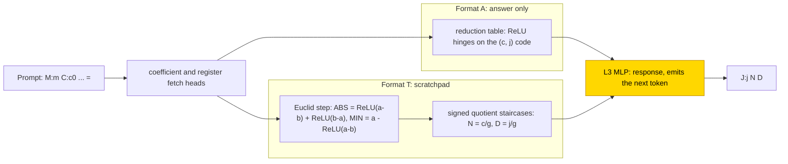
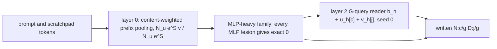

# Polynomial integration with reduced fractions (integ)

This entry studies how a 4-layer transformer integrates an integer polynomial and writes each integrated coefficient as a reduced
fraction, either directly (answer only) or after writing every row of a subtractive Euclid algorithm for the gcd (a scratchpad).
With the scratchpad, networks trained from scratch solved 9/10 seeds in the final cell; the one failure (.875 at the 30k budget) fails
exactly at numerator emission. A last-stage MLP trained on frozen hand-built parts learned the scratchpad format in 3/3 seeds by
5,500 steps, and it alone transferred to withheld fractions (1.0); answer-only networks solved in range 3/3 (frozen parts and from
scratch) but did not transfer (frozen parts 0, from scratch 0–.19). The task is partly solved (scratchpad from scratch, 9/10). The
closed form is partial: a layer-0 prefix-pooling formula substitutes exactly in 20/20 snapshots, a layer-2 reader passes in seed 0
and fails in seed 2, no gcd or division form was found, and the complement was not tested.

| | |
|---|---|
| Task | Integrate an integer polynomial and write each coefficient as a reduced fraction |
| Input → output example | Answer only: `BOS M:2 C:4 C:6 =` (4 + 6x) → `J:1 N:4 D:1 J:2 N:3 D:1` (4x + 3x²) |
| Model | GPT-NeoX-shaped, 4 layers, d_model 64, 4 heads × 16, ReLU MLP 384 (`A`) / 448 (`T`), NoPE, no LayerNorm; PART trains only the L3 MLP |
| Rungs and seeds | HAND `A` and `T`; screen 3 seeds × {`A`, `T`} × {PART, TRAIN}; final TRAIN `T` 10 seeds |
| Closed form status | Partial (TRAIN `T` layer-0 prefix pooling exact in 20/20 snapshots on substitution; layer-2 reader passes seed 0, fails seed 2; no gcd/division form; complement not tested) |
| Status | Partly solved (TRAIN `T` final 9/10); last run 2026-11-08 |
| Weights | [Hugging Face: polynomial-integration](https://huggingface.co/jc1122/circuit-atlas-nets/tree/main/polynomial-integration) |
| Reproduce | Not available yet: training code for this task is not yet in `code/` |

## 1. Task and data

The prompt is `BOS M:m C:c₀ … C:cₘ₋₁ =`, where m is the number of terms and c_j the coefficients, in typed integer tokens. For each
term j the network writes `J:j N:c/g D:j/g`, with g = gcd(|c_{j−1}|, j); a zero coefficient is written 0/1. For the example
`BOS M:2 C:4 C:6 =`, which is 4 + 6x, the integral is 4x + 3x²: term 1 is 4/1 and term 2 is 6/2 = 3/1.

Two output formats were studied (Table 1). The [scratchpad](../GLOSSARY.md#task-formats) format writes every row of the
subtractive Euclid algorithm, which maps (a, b) to (|a − b|, min(a, b)), until b = 0, then the gcd and the fraction.

*Table 1. Output formats.*

| Format | Output per term |
|---|---|
| `A` (answer only) | `J:j N D`, the reduced fraction |
| `T` (scratchpad, main format) | Euclid rows `A:a B:b`, then `G:g N D` |

Training used 2–4 terms and coefficients c ∈ −9…9 without ±8; the fractions ±2/3 and ±3/4 were withheld. The split is about 80/20 by
a hash of the whole polynomial, with 256 held-out polynomials per seed. An output counts as correct only on exact match of the whole
teacher-forced output ([glossary](../GLOSSARY.md#task-formats)).

## 2. Model

The shared architecture and instrumentation are described in [METHODS.md](../METHODS.md). The three
[rungs](../GLOSSARY.md#the-three-rungs) are HAND (every weight set by formula), PART (frozen hand-built parts with one trained stage)
and TRAIN (all weights trained from scratch).

### 2.1 Architecture

All networks are GPT-NeoX-shaped with 4 layers, d_model 64, 4 heads × 16, a ReLU MLP of width 384 (`A`) or 448 (`T`), no LayerNorm and
no positional encoding (NoPE), a vocabulary of 130 and context ≤ 218. TRAIN learns all weights (`A` 16 heads + 1,536 neurons, `T`
16 + 1,792).

### 2.2 Frozen parts and trained part

PART freezes HAND and re-initialises and trains the L3 MLP, with W_in masked to the columns HAND uses.

### 2.3 Training

The optimiser was AdamW with learning rate 1e-3, weight decay .1, warmup 1,000, a cosine schedule over 30k steps, gradient clip 1 and
batches of 16 fresh draws per step. Evaluation ran every 500 steps and checkpoints every 2,500; a run stopped on a 5k plateau after
22.5k. PART ran in fp32 and TRAIN in TF32, re-scored in fp32. The four run identifiers are listed in Appendix B. Each pack of seeds ran on one GPU; diagnostics and substitutions
ran on CPU.

### 2.4 Reproduction

Reproduce: not available yet: training code for this task is not yet in `code/`; the weights, held-out splits and recorded
accuracies are on Hugging Face at
[huggingface.co/jc1122/circuit-atlas-nets/tree/main/polynomial-integration](https://huggingface.co/jc1122/circuit-atlas-nets/tree/main/polynomial-integration).

### 2.5 Archive

The archive holds `hand_{A,T}` and `{part,train}_{fmt}_{best,final}_s<k>` safetensors, with a config and a manifest (seed, rung, fp32
re-score, sha256).

## 3. Hand-built solution

The two hand-built networks reduce the fraction in different ways (Figure 1). Format `A` uses a reduction table: ReLU hinges on the
(c, j) code select the reduced fraction directly, with 4 heads + 428 neurons. Format `T` fetches the coefficient and the registers,
runs the Euclid step with ABS = ReLU(a−b) + ReLU(b−a) and MIN = a − ReLU(a−b), and divides with signed quotient staircases, with 6
heads + 769 neurons (665 of them framing). Both are exact on 2,804 polynomials per format, with margin ≥ 10.

*Figure 1. The hand-built networks. Format `A` looks the reduced fraction up from the (c, j) code; format `T` runs subtractive Euclid
rows and divides by the gcd with quotient staircases. The shaded L3 MLP is the part PART re-initialises and trains; the layers of the
other HAND bricks are not recorded, so they are drawn without layer labels.*

## 4. What training finds

Table 2 gives every cell. The 3-seed screens solved every cell, and the final T TRAIN cell solved 9/10 (seed 4 .875
at the 30k budget). The scratchpad cut the stop of PART from 26,000 to 5,500 steps and slowed TRAIN from 14,500 to 27,000.

*Table 2. Results per cell (first evaluation at ≥ 90% held-out exact and first exact, per seed).*

| Cell | Solved | First ≥ 90% test (per seed) | First exact (per seed) | Stop | 5 terms | withheld fractions |
|---|---|---|---|---|---|---|
| A PART | 3/3 | 19.5k, 22.0k, 20.0k | 24.5k, 23.0k, 20.0k | 26.0k | .05–.12 | 0 |
| T PART | 3/3 | 2.0k, 2.0k, 2.5k | 3.5k, 2.0k, 3.0k | 5.5k | .59–.88 | 1.0 |
| A TRAIN | 3/3 | 8.0k, 7.5k, 11.5k | 11.5k, 10.0k, 14.0k | 14.5k | 0 | 0–.19 |
| T TRAIN final | 9/10 | s0–2 16.0k, 16.0k, 22.0k; s3–9 14.5k, —, 18.0k, 22.0k, 16.5k, 20.5k, 17.5k | 19.0k, 24.0k, 27.0k, 17.5k, —, 22.5k, 27.0k, 22.0k, 24.5k, 20.5k | 27k / 30k | 0 | 0 |

Key: s0–2 = seeds 0–2; a dash = never reached.

TRAIN networks solve in distribution with a distributed, MLP-heavy code unlike HAND's (an `align` fit of HAND's variables has R² < 0;
CKA ≤ .27). The Euclid state is used by ≤ 2.5–5k steps, and the signed numerator is the last variable learned (interchange flip at
5–12.5k; 90% test at 14.5–22k). No memorisation or stall alert was raised in any of 11 trajectories; these alerts are meant to catch the
memorise-then-generalise pattern of grokking ([Power et al., 2022](#references)).

### 4.1 Out of distribution

On the out-of-distribution sets (best snapshot, 64 per seed), every TRAIN network scores 0 at 5, 6 and 8 terms and on forced ±8. These
sets introduce new M and J token ids, so they are not a pure length test.

### 4.2 The failed seed

Seed 4 of the final cell (best = final = step 30k) reaches exact .875; its numerator token accuracy is .972 and every other role is
≥ .999. Its numerator interchange is .933 (nf 75, the number of flips tested), DAS .920, and gcd DAS .984. The state is present, and
the selection of the signed numerator at the step from G to N fails.

### 4.3 Circuit types

Each seed was assigned once. A PART is a frozen reader with a learned response (3/3), T PART a frozen Euclid interface with a
response (3/3). A TRAIN is a distributed four-MLP type (3/3), with a sign bottleneck in L3 in seeds 0 and 2 and in L2H3 in seed 1.
T TRAIN is one MLP-heavy family (10/10), in which every MLP lesion gives exact 0; its sign-transport subtypes are 1/1/1 in seeds 0–2.
Full diagnostics are in Appendix B.

## 5. Mechanism and verification

### 5.1 Closed forms

The layer-0 attention of T TRAIN is a content-weighted prefix pooling:
`P_h(t) = Σ_u N_u e^{S_h[t,u]} v_h[u] / Σ_u N_u e^{S_h[t,u]}`, with S = Q(E_t)·K(E_u)/4, v = OV(E_u) and N_u the count of token u in
the prefix. Substituted for layer 0 it keeps every prediction in 20/20 snapshots of seeds 0–9 (error ≤ 1.8e-7). The layer-2 G-query
reader `b_h + u_h[c] + v_h[j]` passes in seed 0 (512/512, and also as a hard fetch `1[k=j+1]`) and for head H1 only in seed 1, and fails
in seed 2 (≤ 502/512); the bar is ≥ .99 × native on 512 fresh polynomials. No gcd or division form was found. Both forms are supported
by substitution only; no [resample ablation of the complement](../GLOSSARY.md#verifying-a-circuit) was reported, so the status is
partial.

*Figure 2. The circuit family training from scratch finds in format `T` (10/10 seeds). Layer 0 pools the prefix by token counts; the
coefficient reader of layer 2 passes substitution in seed 0 and fails in seed 2. Both forms are supported by substitution only, with
the complement not tested; no gcd or division form was found.*

### 5.2 Relation to the hand-built network and to published work

HAND `T` uses 6 heads + 769 neurons; T TRAIN uses 12–16 heads and ≤ 1.4–1.6k active neurons with a different code. The scratchpad gives
the fastest PART and the only cell that transfers (withheld fractions 1.0, 5 terms .59–.88), and a slower TRAIN, 9/10 at 30k. Answer-only `A` TRAIN learns faster (14.5k) but
never transfers. Transformers were trained on symbolic integration by [Lample & Charton (2019)](#references); writing intermediate
steps as a scratchpad follows [Nye et al. (2021)](#references).

## 6. Limitations and open questions

Edge attribution passes its gates only in format `A`: A PART has Jaccard .5 and recall 1 against HAND, A TRAIN Jaccard .2 and recall
.33. The `T` edges fail the HAND gate, so no wiring claim is made for `T`. Linear-mode-connectivity loss barriers between TRAIN seeds are 3.5–9.4 nats, read as
separate basins. Neuron counts are upper bounds. The sign subtypes of seeds 3–9 are unassigned, and 8 of 19 trajectories
lack dynamics.

## 7. Prediction record

The predictions were recorded before training (commit in Appendix B). PART `T` ≥ 2/3 by 10k held (5.5k). PART `A`
≤ 1/3 by 30k was refuted (3/3, 26k). TRAIN `T` ≥ 2/3 by 25k held (screen 2/3 at 24k; final 7/10 first exact ≤ 24.5k). TRAIN `A` ≥ 1/3
held (3/3, 14.5k). PART length transfer ≥ .90 was refuted (.59–.88). `T` above `A` on withheld fractions held for PART only.

## Appendix A. Weights excerpt and reading

The excerpt is a raw float32 weight slice of T TRAIN seed 0, best snapshot, layer 0 head 0, columns 0:3.

*Table A1. Layer-0 head-0 weights, T TRAIN seed 0 (columns 0:3, and the bias).*

| Matrix | Columns 0, 1, 2 | Bias |
|---|---|---|
| Q₀ | −0.0403, −0.1027, −0.0268 | .0550 |
| K₀ | −0.0468, −0.0292, −0.2562 | .0424 |
| V₀ | .0778, .0074, −0.0265 | −.0091 |

The scores S₀[G:1, C:{−3,0,3}] are [−.222, .185, −.345]: tokens count by prefix and by a lexical score, with no scalar coordinate. The
MLPs have r90 17–21, against HAND's 3/6.

## Appendix B. Detailed evidence

*Table B1. Diagnostics per cell (best snapshot; best and final agree unless noted).*

| Cell | Heads mean/zero-sensitive; neurons | Probe R² (layer): num / den / gcd / next | Inter flip num / den / gcd | r90 res L4 (HAND 1); MLP3 in/out | L3 JS | Best / final |
|---|---|---|---|---|---|---|
| A PART | 1/4; ≤ 380–394 | .90–.91 / .84–.85 / — / .49–.53 (4) | 1 (s2) / .35–.44 / — | 1; 4–5/4 | 0 | 1 / 1 |
| T PART | 4/6; ≤ 667–687 | .86–.91 / .59–.67 / .42–.61 (4) | U– / .77–.98 / .56–.90 | 1; 10/10–11 | 0 | 1 / 1 |
| A TRAIN | 2–7/8–9; ≤ 1324–1358 | .49–.88 / .93–.95 / — / .39–.81 (4) | 1 / 1 / — | 7–8; 13–15/13–15 | .10–.56 | 1 / 1 |
| T TRAIN solved | 12–15/15–16; ≤ 1360–1573 (s0–2) | .27–.74 / .96–.99 / .84–.96 (3–4) | 1 / .89–1 / .29–1 | 9–15; 17–21/17–19 | .39–.60 | 1 / 1 |
| T TRAIN s4 | 16/16; ? | .42 / .97 / .80 (2–4) | .93 / .97 / .94 | 9; 15/17 | .47–.55 | .875 / .875 |

Key: neurons = N, a guarded activity upper bound and not a joint minimum; num, den, gcd, next = numerator, denominator, gcd and next
token; inter flip = interchange flip ([glossary](../GLOSSARY.md#analysis-measures)); r90 res L4 = rank of the layer-4 residual at 90%
variance; MLP3 in/out = r90 of the L3 MLP weights; JS = attention divergence to HAND at L3; the entries U– and the question mark are copied as recorded, without a stated meaning. HAND controls: `A`
numerator/denominator R² .999/.915, denominator interchange 1; HAND `T` JS 0. A low TRAIN numerator R² with interchange 1 means the
numerator is used and coded non-linearly.

Run identifiers: PART `train-37a3d5`, `A` TRAIN `train-36ab3a`, `T` TRAIN `train-b23cca` (seeds 0–2) and `train-2c76ff` (seeds 3–9).
The prediction file was committed as 0e88b126 in the project repository.

## References

- Lample, G., & Charton, F. (2019). Deep learning for symbolic mathematics. *arXiv preprint*. https://arxiv.org/abs/1912.01412
  (transformers trained on symbolic integration)
- Nye, M., Andreassen, A. J., Gur-Ari, G., et al. (2021). Show your work: Scratchpads for intermediate computation with language
  models. *arXiv preprint*. https://arxiv.org/abs/2112.00114 (scratchpad)
- Power, A., Burda, Y., Edwards, H., Babuschkin, I., & Misra, V. (2022). Grokking: Generalization beyond overfitting on small
  algorithmic datasets. *arXiv preprint*. https://arxiv.org/abs/2201.02177 (grokking, delayed generalisation)
