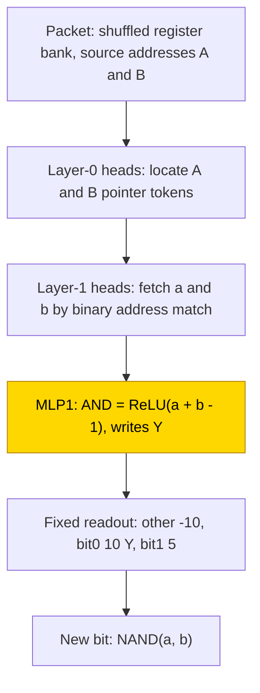
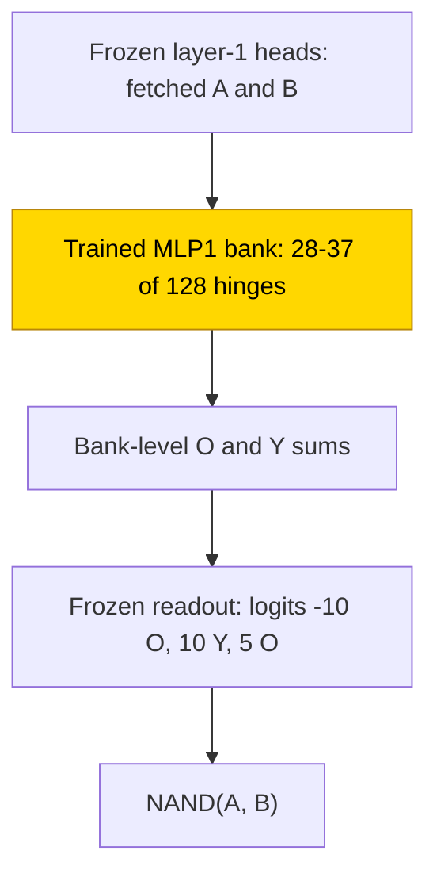

# Quadratic roots

This entry studies whether small transformers can compute the discriminant, integer square root and floored roots of x² + bx + c.
The only learned format is a scaffolded executor: a supplied program breaks the calculation into Boolean NAND updates, and a trained
MLP on frozen register-fetching heads solves all 10 final seeds at step 500. The same executor trained from scratch at twice the width
solves 0/10, and all answer-only and parent-trace cells remain unsolved. The task is partly solved. The executor's closed form is
verified on the measured inputs: replacing its trained MLP by one AND neuron keeps 1,792/1,792 held-out packets per seed, and resampling
the claimed circuit's complement keeps 1.0 in all ten seeds; this is not a from-scratch quadratic solver.

| Fact | Value |
|---|---|
| Task | For integer b, c, output D = b² − 4c, s = ⌊√max(D, 0)⌋, two floored roots and a negative / integer / other-real flag |
| Input → output example | b = −3, c = 2 → D = 1, s = 1, roots 1 and 2, flag integer |
| Model | GPT-NeoX-shaped, ReLU, no LayerNorm or positions; parent formats have 4 layers, d_model 768; executor has 2 layers, d_model 128, with MLP1 trained in PART |
| Rungs and seeds | HAND answer only, sub-result, trace and executor; executor PART/TRAIN finals 10 seeds each; parent rounds and retries, with 3–10 seeds in reported subsets |
| Closed form status | Verified (executor PART only: 1,792/1,792 substitution per seed and complement 1.0 in 10/10; decision equivalence on measured inputs, not raw-logit identity) |
| Status | Partly solved (executor PART 10/10 exact, TRAIN 0/10; parent answer-only n 6/R 63 final 0/10); last run 2026-11-12 |
| Weights | [Hugging Face: quadratic-roots](https://huggingface.co/jc1122/circuit-atlas-nets/tree/main/quadratic-roots), published revision `e417b9b92a75` |
| Reproduce | Not available yet: training code for this task is not yet in `code/` |

## 1. Task and data

Coefficients are integers with |b|, |c| ≤ R, written in binary sign/magnitude: n = 5 bits gives R 15 (961 pairs) or R 31 (3,969),
and n = 6 gives R 63 (16,129). The prompt is `BOS sb |b| sc |c| =`, with coefficient-sign tokens sb and sc; the answer contains
`f sr- |r-| sr+ |r+|`, with a flag f and root-sign tokens sr− and sr+. Outputs are specified integers, not exact irrational roots:
D = b² − 4c, s = ⌊√max(D, 0)⌋ and r∓ = ⌊(−b ∓ s)/2⌋. The flag N/I/R means negative discriminant / integer roots / other real roots.
For example, b = −3 and c = 2 give D = 1, s = 1, roots 1 and 2 and the integer flag.

Exact match means every output token is correct, teacher-forced, with the correct previous tokens supplied
([glossary](../GLOSSARY.md#task-formats)). The parent formats are A, S and T; S_exec (also written S-exec) is the executor (Table 1).

*Table 1. Output formats; parent output lengths are at n 5.*

| Format | Output |
|---|---|
| `A` (answer only) | answer, 29 tokens |
| `S` (sub-result) | D and s, then answer, 49 tokens |
| `T` (full trace) | every arithmetic step, 170 tokens |
| `S_exec` (executor [scratchpad](../GLOSSARY.md#task-formats)) | an input-independent Boolean NAND program on a register file, one update per step |

Each executor packet supplies a shuffled register bank and the gate's two source addresses; the network predicts the new bit.
Training used 12,903/16,129 R 63 coefficient pairs, an 80/20 pair split saved in `split_S_exec`, with fresh reachable register states
in batches of 128, mixed widths 3–6, shuffled memory and renamed addresses. The program, source/destination addresses and state copying
are supplied. Parent cells train on .5 of coefficient pairs: 480/961 at R 15 and 1,984/3,969 at R 31.

The executor has four tests. Local is next-bit exact on 1,024 held-out packets. Trace is every update of a whole program for held-out
pairs (8 per cell at n 5/R 15, n 5/R 31 and n 6/R 63). Width transfer is n 7/8. Rollout feeds the network's predictions back through
a whole program and checks the answer with a verifier. The separate substitution audit uses 1,792 held-out packets per seed
(Section 5), not the local test's denominator.

## 2. Model

Shared conventions are in [METHODS.md](../METHODS.md). The [rungs](../GLOSSARY.md#the-three-rungs) are HAND (all weights set by
formula), PART (HAND with one trained stage) and TRAIN (all weights trained from scratch).

### 2.1 Architecture

All networks are GPT-NeoX-shaped with ReLU, no LayerNorm, no positional encoding and untied embeddings. Parent A/S/T has 4 layers,
d_model 768, 12 heads (d_head 64), MLP 512, vocabulary 10 and context 512. At n 6, answer only has d_model 1,024, 16 heads and MLP
1,024. The executor has 2 layers, d_model 128, 2 heads × 64, MLP 128, vocabulary 1,029 for register/address tokens and context 512.
The twice-width TRAIN executor has d_model 256, 4 heads and MLP 256.

### 2.2 Frozen parts and trained part

Parent PART trains one MLP on frozen HAND: layer 2 for A, layer 1 for S/T. Executor PART trains MLP1: W_in [128, 128] masked to fetched
A/B residual columns, b_in [128], W_out [128, 128] and b_out [128]. Everything else is frozen. TRAIN learns all weights.

### 2.3 Training

Cross-entropy is applied to output tokens. AdamW used learning rate 1e-3, weight decay .1, betas (.9, .98), warmup 1,000, cosine decay
and clip 1. Finals packed 10 seeds per process, with each seed determining initialisation and split: 40k budget, minimum 30k,
5k plateau stop, evaluation every 500 and checkpoints every 2,500. Executor batches contained 128 fresh packets at widths 3–6 with
register renaming. Early parent retries, run 1 to run 3, used constant learning rate and weight decay 1. PART ran in fp32; TRAIN used
TF32 updates with fp32 evaluations on GPU accelerators.

The final answer-only n 6/R 63 result is a continuation, not fresh training. The original host was lost at 23.5k, with saved weights
through 22.5k and test .91–.93. Recovery decayed from that snapshot with fresh optimiser moments, learning rate 1e-4, warmup 1000 and
a cosine tail over the lost 17.5k steps, on the same splits. It stopped at a 13.5k plateau with test .929–.944, 0/10 exact. This
historical recovery is not an adopted continuation retry recipe.

### 2.4 Reproduction

Reproduce: not available yet: training code for this task is not yet in `code/`; the weights, held-out splits and recorded
accuracies are on Hugging Face at
[huggingface.co/jc1122/circuit-atlas-nets/tree/main/quadratic-roots](https://huggingface.co/jc1122/circuit-atlas-nets/tree/main/quadratic-roots).
The source record names `launch_final.sh`, the parent and executor `test_hand.py` harnesses and `subst_check.py`; these are recorded
artifact names, not commands available in this repository. Headline output keys are `test` and `local`.

### 2.5 Archive

Published revision `e417b9b92a75` holds `hand_{A,S,T}`, `hand_T_compact`, `hand_S_exec`, `part_S_exec_final_s0…9` (four MLP tensors
inserted into `hand_S_exec`), `train_S_exec_final_s0…2` (full networks), `part_T_R15_{r1,r2}_s0…9`, `split_S_exec`, `config.json` and
`manifest.json` with recorded/fp32 re-scored accuracy and sha256. The publication hash check covered 42 files, with no missing or
mismatched files. Executor PART best/final weights are byte-identical; these are ten networks, not twenty independent replications.
For TRAIN executor the best was the step-0 initialisation, which was not kept; the listed final archive covers seeds 0–2, although
ten were analysed.

Most parent networks (A/S TRAIN, T TRAIN and S/T PART runs 2 and 3) were lost with rented compute. Their recorded diagnostics, not
newly reloadable originals, support those cells. The earlier “answer-only decay finals missing” status is superseded by the completed
final analysis; it does not restore the other lost networks. Public reproduction code is still pending.

## 3. Hand-built solution

Parent networks read a position signal 1/(1 + position) from BOS in layer 0, then turn it into a position one-hot. Table heads read
a written number as a weighted token sum. Bit k of V is [V − W ≥ 2ᵏ], computed as ReLU(2u + 1.5) − ReLU(2u + .5), gated by −G per
failed condition. A computes b² in layer 1, isqrt [D ≥ m²] in layer 2 and roots in layer 3; S computes b² and isqrt of written |D| in
layer 1; T puts all rules in layer 1 on token values. Compact T moves bit thresholds into query-position weights, reducing arithmetic
to 62 neurons for every n, versus roughly 6R for A. The published approximate design crossover n* ≈ 3 concerns hand-built sizes,
not a trained size-crossover result.

The executor (Figure 1) uses address codes Cⱼ(a) = 2·bitⱼ(a) − 1. Layer-0 heads find A/B pointer tokens; layer-1 heads fetch registers
a and b by binary-address match, with a wrong code bit costing 40 logits. One neuron AND = ReLU(a + b − 1) writes Y. The fixed readout
(other −10, bit0 10·Y, bit1 5) emits NAND. It is exact at n 3–8 with margin 5 (also recorded as 5.0).

*Table 2. Hand-built sizes: designed heads (h) and neurons / ablation-used heads + neurons.*

| n (R) | A designed / used | S | T | T compact | S_exec |
|---|---|---|---|---|---|
| 5 (31) | 6h 217 / 7h + 194 | 9h 321 / 10h + 260 | 9h 322 / 10h + 187 | 9h 62 / 10h + 44 | 4h + 1 |
| 6 (63) | 6h 385, exact | 9h 507 | not exact | untested | 4h + 1, 1,806 → 2,296 steps |

Used means ordered ablation minima on 200–300 rows, with frame head included and frame neurons excluded, not global minima. A, S, T
and executor are exact at n 3–5. The later reference reports A/S exact on all pairs through n 6, excluding T n 6; that T cell is
not exact and is closed. The compact n-6 T cell remains untested in the earlier size record.

*Figure 1. The hand-built register executor. Frozen heads locate and fetch the two operands; one AND neuron and a fixed readout write
NAND. Shaded MLP1 is the only stage trained in PART. The program and state copying are supplied.*

## 4. What training finds

Only executor PART solves (Table 3). Its rule transfers to n 7/8 and predicted-state rollouts. Executor TRAIN outputs a constant
majority bit in all 10 seeds, with P(NAND = 1) ≈ .61: its heads never attend to addressed registers (attention JS .65), so it does
not read a and b. Answer-only and parent-trace cells memorise or underfit; there is no solved delayed-grokking transition there.

*Table 3. Final round, ten seeds per cell. Test is full held-out exact match; local means next-bit accuracy.*

| Cell | Best / final test | Train | Stop | Solved | Reading |
|---|---|---|---|---|---|
| S_exec PART | trace 1 / 1; n 7/8 and rollout R 15/31/63 1 | 1 | solved 500 | 10/10 | AND-hinge bank read as NAND |
| S_exec TRAIN width 2 | trace 0 / 0, best = step 0; local .58–.62 | .58–.62 | plateau 30k | 0/10 | constant output |
| A n 6/R 63 TRAIN, decay continuation | .929–.944 / same | .97–1 at recovery snapshot | plateau 13.5k | 0/10 | memorised late lookup |

### 4.1 Executor circuit type

Executor PART has one functional type in 10/10: addressed-bit NAND implemented by a bank of 28–37 of 128 hinges. Aligned
[linear mode connectivity](../GLOSSARY.md#analysis-measures), which tests loss between aligned weights, has barrier .001–.007; this
supports one basin up to neuron permutation. The bank has two causal subgroups, 7/10 OR-pool-sufficient and 3/10 mixed
OR/affine/complement. These are partitions of the bank, not different algorithms; both have the same substituted closed form.

Earlier prose called each component a “rescaled AND hinge”. The native response is pooled across a bank and some biases are positive;
the exact one-neuron AND formula describes the substituted decision, not an identity for every native neuron (Appendix A).

*Table 4. Later diagnostics. Executor uses 128 held-out packets per seed; parent n-6 diagnostics use 200 rows. Rank99 is effective
rank at 99% energy; JS compares attention with HAND; R² measures linear decodability, not causal use.*

| Cell | Used heads + neurons | Best probe R² (layer) | Rank99 versus HAND | JS | Best / final diagnostic |
|---|---|---|---|---|---|
| S_exec PART (10) | 4h + 28–37 of 128 hinges, HAND 1 hinge | a, b, sum 1; NAND .998 (L2) | MLP1 2, L2 17; HAND 1 / 18 | 0, frozen | 1 / 1 |
| S_exec TRAIN width 2 (10) | none, any ablation within ±.01 | a, b, sum, NAND ≤ 0 | L1–L2 2–3 | .65, ln 2 .69 | 0 / 0 |
| A n 6/R 63 decay (10) | 5–9 heads + 4 MLPs | s .95–.97, D .92–.96, b² .93–.96 (L3) | MLP1 W_in 582, seed 0; HAND overlap ~0 | .38 (L0) | .945–.975 / .93–.98, 200 rows |
| S R 31 PART run 2 (3) | stage only, patch drop 1.0 | D .97, s .97, b² .88 (L2) | W_in 41; HAND overlap .03 | 0, frozen | .06 / .025–.035 |

The older 2026-11-07 diagnostic summary is retained separately in Appendix B: it gives NAND .994–.999, TRAIN a/b ≤ .011 and residual rank 2–4,
rather than the later compact .998, ≤ 0 and 2–3. Neither metric summary is silently substituted for the other.

### 4.2 Parent failures

Every trained parent cell remains at 0/10 in the ten-seed records; the later compact record groups audited subsets of 3–10 seeds
across runs 1–4 as 0/n. A PART must place unit-resolution thresholds on scalars up to ~2¹¹. S R 31 PART decodes D (earlier R² .96),
but fails the bits 2⁵…2⁰ at .47–.77 on |D| ≤ 1,085. T PART fails high-value, borrow and late-square-root thresholds, without missing
D. A TRAIN decodes D late/nonlinearly (DAS rescues D in 3/6 earlier audited seeds), without an early D-to-isqrt path.

The n-6 decay final has a dense HAND-free circuit, 38–55% of 1935 edges and .29–.42 overlap with HAND's discovered circuit. D is
causally available only at L4 in the reported alignment; the late decodability in Table 4 does not recover the earlier staged
D-to-isqrt computation. Diagnostic accuracy .93–.98 on 200 rows is not the full-test .929–.944, and neither result solves the cell.
Earlier A TRAIN run 2 crosses 50% test at median 1,750 steps and 99% train at 6,125 / 10,375; this is not a delayed solved
[grokking](../GLOSSARY.md#counting-results) transition.

### 4.3 Earlier executor causal checks

Query-mean ablation of every executor PART head lowers accuracy to .63–.88; MLP1 patching drop and recovery are both 1. Interchange on
sum / NAND flips .93–1 / .57–.84, with 25–38 answer-fixing pairs tested. A and B have no answer-fixing pairs in that bank, meaning
untested, not unused. Interchange and patching are defined in the [glossary](../GLOSSARY.md#analysis-measures).

## 5. Mechanism and verification

### 5.1 Executor closed form

The native bank is hⱼ = ReLU(cⱼ + aⱼA + bⱼB), O = 1 + β_O + Σuⱼhⱼ and Y = β_Y + Σvⱼhⱼ, with logits (−10·O, 10·Y, 5·O) for
other / bit0 / bit1. These expressions are direct tensor slices, not fitted laws. The closed form replaces all four trained MLP1
tensors with MLP1(x) = e_Y ReLU(A + B − 1): one HAND neuron, 0 fitted scalars, writing only Y with the frozen readout unchanged.

Substitution keeps 1,792/1,792 from native 1,792/1,792 held-out packets in each of 10 seeds, agreement 1.0, at the ≥ .99 × native bar
(17,920 unique packets). Packets balance four Boolean cases at register counts 3–256 and include equal-address controls.
Native/substituted predicted-state execution agrees at every update across 507,680 unique updates: 2–8 held-out pairs per width/range
at n 5–6 and 4 boundary/sign/zero pairs at n 7/8. Best/final weights are byte-identical; they are not independent samples. A later
512-packet test with n 6/7/8 rollouts also keeps native/substituted minima 1.0 over 20/20 best/final records.

The 2026-11-12 resample test closes the earlier complement gap. On 512 rows and 3 draws, resampling everything outside HAND's 9 edges
of 26 keeps exact 1.0 = base in 10/10 seeds, above the .90 acceptance share. Resampling those 9 edges gives .49–.54; a random 9 gives
.52–.55. HAND-free discovery keeps the same 9 edges in 10/10 seeds, held-out faith 1.0. The closed form is therefore verified for the
executor stage's decisions on measured inputs. This is not equality of native logits, a neuron-by-neuron identity or a learned
quadratic algorithm without supplied routing and microcode.

*Figure 2. The trained executor stage. Shaded MLP1 pools a bank of hinges, with a 7/10 OR-pool and 3/10 mixed-bank sub-split. One AND
neuron replaces the whole bank. Closed-form status: verified for decisions on measured inputs by substitution and complement tests
in ten seeds, not a native-neuron identity or a from-scratch quadratic solver.*

### 5.2 Parent cells

No complete form is accepted for parent formats. Earlier contextual-bank substitutions on seven parent finals only preserved their
errors; those originals are unavailable for fresh checks. The executor avoids their large-scalar thresholds by making each step a
bounded-bit rule. This does not support a trained size-crossover claim: its program, routing and state copying are supplied.

### 5.3 Relation to published work

Scratchpads as supervised intermediate computation follow [Nye et al. (2021)](#references). Training curves alone are not circuit
evidence ([Nanda et al., 2023](#references)). That study concerns modular addition; [Qiu et al. (2026)](#references) concern integer
arithmetic, neither being quadratic-root mechanism evidence.

Prior quadratic variants include fuzzy-coefficient solutions ([Buckley and Eslami, 1997](#references); [Buckley et al., 2002](#references)),
sequence-model polynomial roots ([Saxton et al., 2019](#references)), numerical root approximation ([Freitas et al., 2021](#references))
and worked solutions ([Hendrycks et al., 2021](#references)). [Palermo et al. (2021)](#references) train solving programs rather than
NAND traces. [Thomas and Bani-Yaghoub (2026)](#references) study root-type classification rather than bitwise root extraction.

Earlier polynomial-root neural methods include the complex-root and decomposition studies of
[Huang and Chi (2001)](#references), close/ordered roots ([Huang et al., 2003](#references)), constructive and root-moment approaches
([Huang, 2004](#references); [Huang et al., 2004](#references)) and constrained learning ([Huang et al., 2005](#references)). Root-count
and real-root variants include [Epitropakis and Vrahatis (2005)](#references), [Mourrain et al. (2006)](#references) and
[Das and Seal (2012)](#references). Phase-retrieval roots ([Dilanian et al., 2006](#references)), multiplicity and simultaneous-root
methods ([Zhang et al., 2008](#references); [Zhu et al., 2008](#references); [Zhang and Zeng, 2009](#references)) are further task
variants, not evidence of the present circuit. [Bukhsh et al. (2022)](#references) analyse an LSTM root approximator;
[Nunley (2026)](#references) study broad mathematics training including roots; [Wang et al. (2026)](#references) study a numerical
root estimator. None is silently equated with exact quadratic bit outputs.

## 6. Limitations and open questions

Mean pruning is ordered, calibrated on 256 balanced packets and validated on 1,792 per seed; it is not a global minimum. Head
ablations are query-mean, not token-global minima. Executor checks are sampled traces and rollouts, not all 16,129 coefficient traces.
The accepted closed form is a decision rule on measured distributions, not logit equality or proof that every native hinge is AND.
The bank sub-split is causal, not separate algorithms.

The answer-only n-6 result is a decay continuation from 22.5k after infrastructure loss, not a fresh 40k run. Its diagnostics use
200 rows; full-test .929–.944 and diagnostic .93–.98 have different denominators. Parent TRAIN curves used TF32 without full-test
fp32 confirmation. Most parent TRAIN and run-2/run-3 originals remain lost. Executor TRAIN best step-0 weights were not retained, and
the listed archived final TRAIN subset is only seeds 0–2. Public reproduction code is pending. The supplied program and state copying
preclude a claim of an independently learned quadratic solver.

## 7. Prediction record

*Table 5. Predictions recorded before the runs; earlier and final outcomes are distinguished.*

| Prediction | Outcome |
|---|---|
| PART A 10/10 | Refuted: best .05–.31; run 2 .58–.62 |
| PART S ≥ 7/10 | Refuted: run 2 .03–.06 |
| PART T 10/10 | Refuted: run 2 .61, run 3 .83, memorised |
| TRAIN A ≤ 2/10 and T ≤ 3/10 | Confirmed, 0/10 |
| HAND T ~62 neurons versus A ~6R | Confirmed for designed sizes, not a trained crossover |
| S_exec PART 3/3 within 2.5k | Confirmed at 500, then 10/10 final |
| S_exec TRAIN ≥ 2/3 at local .999 | Refuted: 0/3, then 0/10 |

## Appendix A. Weights excerpt and reading

HAND constants are BIG 40 (table-attention score offset), U 10 (readout scale) and C_POS 128 (position-signal scale); the threshold step
pair is (2, 1.5) / (2, .5). The executor stage row (A, B, bias) is (1, 1, −1), writing Y with weight 1; all other stage entries are
zero. Its bit0/bit1 readout is (10h, 5).

For trained PART, Table A1 gives the neuron with largest contribution wΔ = 5u − 10v to the bit1 − bit0 margin, where u and v are output
weights into O and Y. These are archive slices from `part_S_exec_final_s<seed>`, W_in columns A = 37 and B = 38.

*Table A1. Strongest margin neuron per seed and mean-pruned hinge count.*

| Seed / neuron | bias c | a | b | wΔ | Mean-pruned hinges |
|---|---:|---:|---:|---:|---:|
| 0 / 25 | −.0044 | .1240 | .0926 | −1.346 | 33 |
| 1 / 56 | −.0128 | .0842 | .0894 | −1.509 | 35 |
| 2 / 71 | −.0099 | .1286 | .0833 | −1.283 | 37 |
| 3 / 42 | .0034 | .1217 | .1214 | −1.160 | 31 |
| 6 / 110 | −.0061 | .1198 | .1646 | −1.050 | 31 |
| 9 / 45 | −.0086 | .1146 | .1118 | −1.365 | 29 |

Seed 0's response at (00, 01, 10, 11) is (0, .088, .120, .212), writing ONE / Y with −.056 / .107. The later compact excerpt gives
neuron 25 A .124, B .093, c −.004 and margin −1.35, rather than replacing the more precise values above. Its summary of top hinges
is A/B .04–.16, c ~0, margins −1.05 to −1.60; it describes ~33 hinges sharing HAND's work. The earlier prose said “about 30”; both
are descriptions of the 28–37 retained-hinge bank, not a new count. Positive operands suppress the bit1 margin most at 11. Seeds 3/4
have small positive biases, so not every hinge is off at 00. The decision is a bank-level sum, not a separate exact AND law per neuron.
The source excerpt routine is named `excerpts.py quad`; it is not shipped here.

## Appendix B. Detailed historical evidence

*Table B1. Earlier parent results. Ten seeds in these cell records; medians where reported. All cells have 0/10 exact solved seeds.*

| Cell | Best → final test | Train | Stop / reading |
|---|---|---|---|
| A PART R 15 run 1 / run 2; R 31 run 2 | .34 → .17 / .59 → .58; .63 → .62, medians | | unsolved |
| A TRAIN run 2 R 15 / R 31 | .73 → .70 / .88 → .87 | 1 | plateau, memorised |
| S R 31 PART / TRAIN run 2 | .06 / .86 best | .09–.17 / 1 | 60k / 40k, underfit / memorised |
| T R 15 PART run 2 / run 3; T R 31 PART run 2 | .63 → .61 / .85 → .83; .65 → .62 | 1; 1; .71 | budget, memorised / underfit |
| T R 31 TRAIN run 2 | .80 | 1 | budget, memorised |
| A n 6/R 63 original run | .91–.93 at 22.5k | .97–1 | host lost 23.5k; now followed by the decay final |

The later compact earlier-cell summary gives A R31 TRAIN .88, S R31 PART .06, T R31 TRAIN .80 and T R15 PART run 3 .83, with training
values 1; .13; 1; 1 and 0 solved. The scalar .13 training summary stays distinct from the earlier .09–.17 range.

*Table B2. Earlier diagnostics. Executor: 128 held-out packets per seed; original n-6 answer-only: 200 rows.*

| Cell | Used | Best probe R² (layer) | Rank (HAND) | JS | Best / final |
|---|---|---|---|---|---|
| S_exec PART (10) | 4 heads + 28–37 of 128 hinges, HAND 4 + 1 | a, b, sum 1; NAND .994–.999 (2) | stage input 2 (1); residual 17–18 (17–18) | 0 | 1 / 1 |
| S_exec TRAIN width 2 (10) | none, every ablation within ±.01 | a, b ≤ .011 | residual 2–4 (17–18) | .65, uniform .69 | 0 / local .58–.62 |
| S R 31 PART run 2, seeds 0–2 | stage only, patch drop 1 | D .96, s .97, b² .88 (2) | stage W_in 41 | 0, frozen | .06 / .05 |
| A n 6/R 63 at 22.5k, seeds 0–2 | 10–12 heads + MLPs | s .94–.95, b² .93–.94, D .92–.94 | W_in 362–634 | n/a | .945–.955, 200 rows |
| A R 31 TRAIN run 2 (3) | 14 heads + 4 MLPs | b² .96, D .95, s .94 (3) | W_in 300 | .44–.49 | .88 / .87 |
| T R 15 PART run 2, seeds 0–2 | 9 heads + 1 MLP | D ≈ .94 (2) | stage input 80 (51) | 0 | .63 / .61 |

Key: used = mean-ablation dependence; rank = effective rank at 99% energy; JS = attention divergence to HAND. Earlier and later S PART
probe/final summaries are both retained (.96 versus .97 for D; .05 versus .025–.035 final); their recorded summaries do not specify
an evaluation reconciliation, so none is invented here.

## References

- Buckley & Eslami. (1997). Neural net solutions to fuzzy problems: the quadratic equation. *Journal article*. https://doi.org/10.1016/S0165-0114(95)00412-2 (fuzzy quadratics)
- Buckley et al. (2002). Fuzzy equations using evolutionary algorithms and neural nets. *Journal article*. https://doi.org/10.1007/s005000100147 (fuzzy-equation variant)
- Bukhsh et al. (2022). LSTM interpretation for approximating polynomial roots. *Journal article*. https://doi.org/10.1109/ACCESS.2022.3157306 (root approximation, not a causal-circuit certificate)
- Das & Seal. (2012). Real polynomial roots with feedforward networks. *Conference paper*. https://doi.org/10.1109/NCCCS.2012.6413004 (real-root variant)
- Dilanian et al. (2006). Neural polynomial-root finding for phase-retrieval diffractometry. *Journal article*. https://doi.org/10.1063/1.2201447 (application variant)
- Epitropakis & Vrahatis. (2005). Neural root finding and approximation. *Journal article*. https://doi.org/10.1145/1140378.1140382 (root/count variant)
- Freitas et al. (2021). Neural approximation of arbitrary polynomial roots. *Journal article*. https://doi.org/10.3390/math9040317 (numerical approximation)
- Hendrycks et al. (2021). Measuring mathematical problem solving with the MATH dataset. *arXiv preprint*. https://doi.org/10.48550/arXiv.2103.03874 (worked solutions)
- Huang & Chi. (2001). Complex polynomial roots by feedforward networks. *Conference paper*. https://doi.org/10.1109/IJCNN.2001.1016716 (complex-root variant)
- Huang & Chi. (2001). Problem decomposition for real polynomial roots. *Conference paper*. https://doi.org/10.1109/IJCNN.2001.1016718 (decomposition variant)
- Huang et al. (2003). Dilation for close polynomial roots. *Journal article*. https://doi.org/10.1016/S0375-9601(03)00216-0 (close roots)
- Huang et al. (2003). Ordered polynomial roots by constrained partitioning networks. *Conference paper*. https://doi.org/10.1109/IJCNN.2003.1223844 (ordered roots)
- Huang. (2004). Constructive neural polynomial-root finding. *Journal article*. https://doi.org/10.1109/TNN.2004.824424 (constructive method)
- Huang et al. (2004). Neural root finder based on root moments. *Journal article*. https://doi.org/10.1162/089976604774201668 (root moments)
- Huang et al. (2005). Constrained-learning neural root finders. *Journal article*. https://doi.org/10.1016/j.amc.2004.04.070 (constrained learning)
- Mourrain et al. (2006). Counting real polynomial roots through neural networks. *Journal article*. https://doi.org/10.1016/j.camwa.2005.07.012 (root-count variant)
- Nanda, N., Chan, L., Lieberum, T., Smith, J., & Steinhardt, J. (2023). Progress measures for grokking via mechanistic interpretability. *International Conference on Learning Representations (ICLR 2023)*. https://doi.org/10.48550/arXiv.2301.05217 (modular-addition background, not quadratic-root evidence)
- Nunley. (2026). TANGO: Treating tokens as operators. *arXiv preprint*. https://doi.org/10.48550/arXiv.2608.22117 (broad mathematics training)
- Nye, M., Andreassen, A. J., Gur-Ari, G., et al. (2021). Show your work: Scratchpads for intermediate computation with language models. *arXiv preprint*. https://doi.org/10.48550/arXiv.2112.00114 (supervised intermediate computation)
- Palermo et al. (2021). Mathematical reasoning via program synthesis. *arXiv preprint*. https://doi.org/10.48550/arXiv.2107.07373 (solving programs)
- Qiu et al. (2026). Explaining and tuning arithmetic transformers with human strategies. *arXiv preprint*. https://doi.org/10.48550/arXiv.2607.17166 (integer-arithmetic background)
- Saxton et al. (2019). Analysing mathematical reasoning abilities of neural models. *arXiv preprint*. https://doi.org/10.48550/arXiv.1904.01557 (sequence-model roots)
- Thomas & Bani-Yaghoub. (2026). Limits of interpretable learning in quintic root classification. *arXiv preprint*. https://doi.org/10.48550/arXiv.2602.23467 (includes root-type classification, not extraction)
- Wang et al. (2026). Function-conditioned neural Caputo King–Neta root estimator. *Journal article*. https://doi.org/10.3390/fractalfract10100669 (numerical root estimator)
- Zhang et al. (2008). Multiple real roots using polynomial discrimination. *Conference paper*. https://doi.org/10.1109/ICCIS.2008.4670918 (multiplicity variant)
- Zhang & Zeng. (2009). Neural simultaneous extraction of polynomial roots. *Conference paper*. https://doi.org/10.1109/CIS.2009.78 (simultaneous roots)
- Zhu et al. (2008). Fast neural extraction of all polynomial roots. *Conference paper*. https://doi.org/10.1109/ICOSP.2008.4697750 (all-roots variant)
