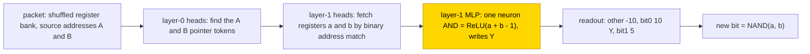
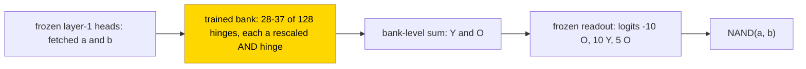

# Quadratic roots

This entry studies whether small transformers can compute, for x² + bx + c with integers b and c, the discriminant D = b² − 4c, its
integer square root s, the two floored roots and a flag. Four hand-built networks (answer only, sub-result, full trace and a register
executor) are exact at n 3–5. Only the scaffolded executor, which runs the whole computation as a fixed program of Boolean NAND updates,
was learned: with frozen hand-built routing a trained MLP learned it in 500 steps on 10/10 seeds, while trained from scratch at 2× width
it reached 0/10 and never learned to fetch the addressed registers. Every trained stage for the parent formats memorised or underfit
(0/10 in every cell). The task is partly solved (answer only at n 6 pending). The closed form is partial: the whole trained executor
MLP can be replaced by one neuron, ReLU(A + B − 1), keeping 1,792/1,792 packets per seed (supported by substitution; complement not
tested), and no closed form was accepted for the parent cells.

| | |
|---|---|
| Task | For x² + bx + c with integer b, c, output D = b² − 4c, s = ⌊√max(D, 0)⌋, the two floored roots and a flag (negative / integer / other real) |
| Input → output example | b = −3, c = 2 → D = 1, s = 1, roots 1 and 2, flag integer |
| Model | GPT-NeoX-shaped, ReLU, no LayerNorm, no positions; parent formats 4 layers, d_model 768, one stage MLP trained; executor 2 layers, d_model 128, the layer-1 MLP trained |
| Rungs and seeds | HAND A/S/T/S_exec exact at n 3–5; ten-seed finals S_exec PART and S_exec TRAIN (2× width); parent cells 10 seeds per cell with retries run 1 to run 3 |
| Closed form status | Partial (accepted for the executor stage only, 1,792/1,792 packets kept per seed; complement not tested; none for the parent cells) |
| Status | Partly solved (executor with frozen routing 10/10, from scratch 0/10; answer only at n 6 pending); last run 2026-11-07 |
| Weights | [Hugging Face: quadratic-roots](https://huggingface.co/jc1122/circuit-atlas-nets/tree/main/quadratic-roots) |
| Reproduce | Not available yet: training code for this task is not yet in `code/` |

## 1. Task and data

The coefficients are integers with |b|, |c| ≤ R, written in binary sign/magnitude: n = 5 bits gives R 15 (961 pairs) or R 31 (3,969),
and n = 6 gives R 63 (16,129). Outputs are specified integers, not exact irrational roots: D = b² − 4c, s = ⌊√max(D, 0)⌋, the floored
roots r∓ = ⌊(−b ∓ s)/2⌋, and a flag (negative / integer / other real). An output is exact when every output token is correct, teacher
forced, that is, each token is scored given the correct previous tokens ([glossary](../GLOSSARY.md#task-formats)). Four formats were
studied (Table 1).

*Table 1. Output formats (output length in tokens at n 5).*

| Format | Output |
|---|---|
| `A` (answer only) | the answer (29 tokens) |
| `S` (sub-result) | D and s first, then the answer (49) |
| `T` (full trace) | every arithmetic step (170) |
| `S_exec` (executor [scratchpad](../GLOSSARY.md#task-formats)) | the whole computation as an input-independent program of Boolean NAND updates on a register file, one update per step |

In S_exec each packet supplies the shuffled register bank and the gate's two source addresses, and the network predicts the new bit.
Training used 12,903/16,129 R 63 coefficient pairs (held-out pairs per seed in `split_S_exec`), fresh reachable register states every
batch (128), mixed widths 3–6, shuffled memory and renamed addresses; the program, the source and destination addresses and the state
copying are supplied. The parent grids train on 480/961 (R 15) and 1,984/3,969 (R 31) pairs.

S_exec was tested four ways. Local is next-bit exact on 1,024 held-out packets. Trace is all updates of a whole program for held-out
pairs (8 per cell at n 5/R 15, n 5/R 31 and n 6/R 63). Length is n 7/8. Rollout feeds the network's own predictions back through a
whole program and checks the answer with a verifier.

## 2. Model

The shared conventions are described in [METHODS.md](../METHODS.md). The three [rungs](../GLOSSARY.md#the-three-rungs) are HAND
(every weight set by formula), PART (frozen hand-built parts with one trained stage) and TRAIN (all weights trained from scratch).

### 2.1 Architecture

All networks are GPT-NeoX-shaped with ReLU, no LayerNorm, no positional encoding and untied embeddings. The parent A/S/T networks have
4 layers, d_model 768, 12 heads (d_head 64), MLP 512, vocabulary 10 and context 512 (n 6 A: d_model 1,024, 16 heads, MLP 1,024). The
S_exec networks have 2 layers, d_model 128, 2 heads, MLP 128, vocabulary 1,029 (register and address tokens) and context 512. TRAIN
width 2 is d_model 256, 4 heads and MLP 256.

### 2.2 Frozen hand-built network and trained part

In the parent formats PART trains one stage MLP on the frozen HAND (A: layer 2; S/T: layer 1). In S_exec PART trains the layer-1 MLP
(W_in [128, 128] masked to the A/B residual columns, W_out [128, 128], both biases). TRAIN trains all weights.

### 2.3 Training

The optimiser was AdamW with learning rate 1e-3, weight decay .1, betas (.9, .98), warmup 1,000, cosine decay and clip 1. Finals used
10 seeds (seed = initialisation + split), a 40k budget, a 5k plateau stop with a minimum of 30k, and checkpoints every 2,500 steps. The
early parent retries, run 1 to run 3, used a constant learning rate and weight decay 1. PART ran in fp32; TRAIN used TF32 updates with
fp32 evaluations.

### 2.4 Reproduction

Reproduce: not available yet: training code for this task is not yet in `code/`; the weights, held-out splits and recorded
accuracies are on Hugging Face at
[huggingface.co/jc1122/circuit-atlas-nets/tree/main/quadratic-roots](https://huggingface.co/jc1122/circuit-atlas-nets/tree/main/quadratic-roots).
Public reproduction code is pending.

### 2.5 Archive

The Hugging Face folder holds `hand_{A,S,T}`, `hand_T_compact` and `hand_S_exec`; `part_S_exec_final_s0…9` (the 4 MLP tensors, to be
inserted into `hand_S_exec`; best and final are byte-identical); `train_S_exec_final_s0…2` (full state dicts; the best is the step-0
initialisation, which was not kept); `part_T_R15_{r1,r2}_s0…9` (early parent PART); `split_S_exec`; `config.json`; and `manifest.json`
(recorded and fp32 re-scored accuracy, sha256). Most parent-format networks (A/S TRAIN, T TRAIN, S/T PART run 2 and run 3) were lost
with rented hosts, so for those cells the run-time diagnostics in Section 4 are the evidence and the networks are not archived.

## 3. Hand-built solution

In the parent networks, a layer-0 frame head reads 1/(1 + position) from BOS and an MLP turns it into a position one-hot; table heads
read a written number as a weighted token sum. Bit k of V is [V − W ≥ 2ᵏ], computed as ReLU(2u + 1.5) − ReLU(2u + .5) and gated by −G
per failed condition. Format A computes b² in layer 1, isqrt [D ≥ m²] in layer 2 and the roots in layer 3; S computes b² and the isqrt
of the written |D| in layer 1; T puts all rules in layer 1 on token values. Compact T moves the bit thresholds into query-position
weights, which shrinks the arithmetic to 62 neurons for every n, against roughly 6R for answer-only A.

The executor (Figure 1) uses address codes Cⱼ(a) = 2·bitⱼ(a) − 1. Layer-0 heads find the A and B pointer tokens, and layer-1 heads
fetch registers a and b by binary address match, where a wrong code bit costs 40 logits. One neuron, AND = ReLU(a + b − 1), writes Y,
and the readout (other −10, bit0 10·Y, bit1 5) emits the complement, NAND. The executor is exact at n 3–8 with margin 5. Table 2 gives
the sizes.

*Table 2. Size of the hand-built networks: designed heads (h) and neurons / used heads + neurons.*

| n (R) | A designed / used | S | T | T compact | S_exec |
|---|---|---|---|---|---|
| 5 (31) | 6h 217 / 7h + 194 | 9h 321 / 10h + 260 | 9h 322 / 10h + 187 | 9h 62 / 10h + 44 | 4h + 1 |
| 6 (63) | 6h 385 (exact) | 9h 507 | not exact | untested | 4h + 1 (1,806 → 2,296 steps) |

Used = ablation minima (heads + neurons, frame head included, frame neurons excluded) on 200–300 rows. HAND A, S, T and S_exec are
exact at n 3–5; T is not exact at n 6, and that cell is closed.

*Figure 1. The hand-built register executor (format S_exec). Frozen heads locate and fetch the two addressed registers; one AND neuron
and a fixed readout write their NAND. The shaded layer-1 MLP is the part that PART trains.*

## 4. What training finds

Table 3 summarises the cells. Arrows give the best and then the final test accuracy.

*Table 3. Results per cell (10 seeds; medians where marked).*

| Cell | Format | Best / final test (10 seeds) | Train | Stop | Verdict |
|---|---|---|---|---|---|
| S_exec PART final | scratchpad | trace 1 / 1 (10/10); n 7/8 and rollouts R 15/31/63 1 | 1 | solved 500 | solved |
| S_exec TRAIN width 2 final | scratchpad | trace 0 (best = step 0); local .58–.62 | .58–.62 | plateau 30k | constant output |
| A n 6 R 63 TRAIN | answer only | .91–.93 at 22.5k; final pending (decay) | .97–1 | host lost 23.5k | memorising slowly |
| A PART R 15 r1 / r2; R 31 r2 | answer only | .34 → .17 / .59 → .58; .63 → .62 (medians) | | | 0/10 each |
| A TRAIN r2 R 15 / R 31 | answer only | .73 → .70 / .88 → .87 | 1 | plateau | memorised, 0/10 |
| S R 31 PART / TRAIN r2 | sub-result | .06 / .86 best | .09–.17 / 1 | 60k / 40k | underfit / memorised |
| T R 15 PART r2 / r3; T R 31 PART r2 | trace | .63 → .61 / .85 → .83; .65 → .62 | 1; 1; .71 | budget | memorised; underfit |
| T R 31 TRAIN r2 | trace | .80 | 1 | budget | memorised |

Key: r1, r2, r3 = run 1 to run 3 of a cell. The answer-only A cell at n 6 / R 63 is open: its 40k run's host was lost at 23.5k with
test .91–.93, and the cosine tail is being rerun as a decay from the 22.5k snapshot.

### 4.1 Executor

PART learns the executor's single rule in 500 steps on 10/10 seeds, and the rule transfers to n 7/8. PART keeps it exact at widths 7 and 8 and in its own
predicted-state rollouts. The S_exec PART networks form one functional family, an addressed AND-hinge bank with a NAND readout, in
10/10 seeds. S_exec TRAIN gives a constant majority output in 10/10: it predicts the majority bit (P(NAND = 1) ≈ .61) everywhere,
because its heads never attend to the addressed registers (JS .65), so a and b are never read.

### 4.2 Parent formats

No answer-only or parent-trace cell solves at any rung (0/10 in every cell); every trained parent cell memorises or underfits. A
PART stage here is one MLP on frozen parts that must place unit-resolution thresholds on scalars up to ~2¹¹. There is no solved delayed-grokking transition in the
parent cells: A TRAIN run 2 crosses 50% test at a median of 1,750 steps and 99% train at 6,125 / 10,375
([grokking](../GLOSSARY.md#counting-results) is test accuracy rising long after training accuracy is perfect).

The failures are explained from diagnostics (Table B1). S R 31 PART decodes D (R² .96), but bits 2⁵…2⁰ fail (.47–.77, where the first
errors fall): these are unit thresholds on |D| ≤ 1,085. T PART fails on inexact high-value, borrow and late-sqrt thresholds and does
not miss D. In A TRAIN, D is decodable late and non-linearly (DAS rescues D in 3/6 audited seeds), and there is no early D-to-isqrt
path.

### 4.3 Executor causal checks

In S_exec PART, the query-mean ablation of every head lowers accuracy to .63–.88; the MLP1 patching drop and recovery are both 1; and
interchange on the sum / NAND variables flips .93–1 / .57–.84 (answer-fixing n 25–38). A and B have no answer-fixing pairs, which
means untested, not unused. Interchange and patching are defined in the [glossary](../GLOSSARY.md#analysis-measures).

## 5. Mechanism and verification

### 5.1 Executor closed form

The native bank of S_exec PART is hⱼ = ReLU(cⱼ + aⱼA + bⱼB), O = 1 + β_O + Σuⱼhⱼ and Y = β_Y + Σvⱼhⱼ, with logits (−10·O, 10·Y, 5·O)
for other / bit0 / bit1; these are direct tensor slices, not a fit. Overwriting all trained MLP tensors with h = ReLU(A + B − 1)
writing only Y (frozen readout unchanged) takes the fresh held-out packets per seed from 1,792/1,792 (native) to 1,792/1,792, with
agreement 1, on 10/10 seeds (17,920 unique packets; bar ≥ .99 × native). The packets balance the four Boolean cases at register counts 3–256 and
add equal-address controls. In predicted-state execution the native and substituted networks agree at every update (507,680 unique
updates; 2–8 held-out pairs per width/range at n 5–6, 4 boundary/sign/zero pairs at n 7/8). Best and final weights are identical, so
this is one set of 10 networks, not 20.

The substitution certifies the decision on the tested distribution, not logit equality or one basin. It was accepted for the executor
stage; no resample ablation of the complement was reported, so the closed form status is partial. The learned part is an
addressed-NAND stage inside supplied routing and microcode, not a from-scratch quadratic solver.

*Figure 2. The executor stage that PART training finds. About 30 rescaled AND hinges share the work of HAND's single neuron, and the
decision is a bank-level sum. The one-neuron closed form substitutes for the whole bank; the status is partial (substitution only,
complement not tested).*

### 5.2 Parent cells

No complete form was accepted for the parent cells. Earlier contextual-bank substitutions on seven parent finals only preserved their
errors, and those originals are no longer available for fresh checks.

### 5.3 Relation to published work

Answer-only and parent-trace stages need unit-resolution thresholds on large scalars. The executor scratchpad turns each step into one
bounded-bit rule, which a frozen-parts MLP learns at once (500 steps, 10/10) and a from-scratch network of 2× width does not, because it never learns the
addressing. Scratchpads as supervised intermediate computation follow [Nye et al. (2021)](#references); training curves alone are not
circuit evidence ([Nanda et al., 2023](#references)). Because the program, routing and state copying are supplied, the results support
neither a size-crossover claim nor a claim of a from-scratch quadratic solver.

## 6. Limitations and open questions

Mean pruning is ordered and calibrated on 256 balanced packets and validated on 1,792 per seed, so it is not a global minimum. Head
ablations are query-mean, not token-global minima. Executor checks are sampled traces and rollouts (not all 16,129 traces), not an
exhaustive sweep of the coefficient grid. Parent TRAIN curves used TF32 without full-test fp32 confirmation.

Missing:

- the A n 6 decay finals;
- the archived parent TRAIN and run 2 / run 3 networks (lost);
- public reproduction code.

## 7. Prediction record

Predictions were recorded before the runs (Table 4).

*Table 4. Prediction record.*

| Prediction | Outcome |
|---|---|
| PART A 10/10 | refuted (best .05–.31; r2 .58–.62) |
| PART S ≥ 7/10 | refuted (r2 .03–.06) |
| PART T 10/10 | refuted (r2 .61, r3 .83, memorised) |
| TRAIN A ≤ 2/10 and T ≤ 3/10 | confirmed (0/10) |
| HAND T ~62 neurons vs A ~6R | confirmed |
| S_exec PART 3/3 within 2.5k | confirmed (500) |
| S_exec TRAIN ≥ 2/3 at local .999 | refuted (0/3, then 0/10) |

## Appendix A. Weights excerpt and reading

The HAND stage row (A, B, bias) is (1, 1, −1), writing Y with weight 1; all other stage entries are zero. For the trained PART, Table A1
gives per seed the neuron with the largest contribution wΔ = 5u − 10v to the bit1 − bit0 margin (`part_S_exec_final_s<seed>`; W_in
columns A = 37, B = 38).

*Table A1. Strongest margin neuron per seed and the number of hinges kept by mean pruning.*

| Seed / neuron | bias c | a | b | wΔ | mean-pruned hinges |
|---|---:|---:|---:|---:|---:|
| 0 / 25 | −.0044 | .1240 | .0926 | −1.346 | 33 |
| 1 / 56 | −.0128 | .0842 | .0894 | −1.509 | 35 |
| 2 / 71 | −.0099 | .1286 | .0833 | −1.283 | 37 |
| 3 / 42 | .0034 | .1217 | .1214 | −1.160 | 31 |
| 6 / 110 | −.0061 | .1198 | .1646 | −1.050 | 31 |
| 9 / 45 | −.0086 | .1146 | .1118 | −1.365 | 29 |

Reading: seed 0's neuron responds (00, 01, 10, 11) = (0, .088, .120, .212) and writes ONE / Y with −.056 / .107. Positive operand
weights raise the suppression of the bit1 margin, strongest at 11, so the neuron is a rescaled AND hinge whose readout gives NAND.
About 30 such hinges share what HAND does with one. Seeds 3/4 have small positive biases, so not every hinge is off at 00. The decision
is a bank-level sum.

## Appendix B. Diagnostics per cell

*Table B1. Diagnostics. S_exec on 128 held-out packets per seed.*

| Cell | Used | Best probe R² (layer) | Rank (HAND) | JS | Best / final |
|---|---|---|---|---|---|
| S_exec PART (10) | 4 heads + 28–37 of 128 hinges (HAND 4 + 1) | a, b, sum 1; NAND .994–.999 (2) | stage input 2 (1); residual 17–18 (17–18) | 0 | 1 / 1 |
| S_exec TRAIN width 2 (10) | none (every ablation within ±.01) | a, b ≤ .011 | residual 2–4 (17–18) | .65 (uniform = .69) | 0 / local .58–.62 |
| S R 31 PART r2 (s0–2) | stage only (patch drop 1) | D .96, s .97, b² .88 (2) | stage W_in 41 | 0 (frozen) | .06 / .05 |
| A n 6 R 63 at 22.5k (s0–2) | 10–12 heads + MLPs | s .94–.95, b² .93–.94, D .92–.94 | W_in 362–634 | n/a | .945–.955 (200 rows) |
| A R 31 TRAIN r2 (3) | 14 heads + 4 MLPs | b² .96, D .95, s .94 (3) | W_in 300 | .44–.49 | .88 / .87 |
| T R 15 PART r2 (s0–2) | 9 heads + 1 MLP block | D ≈ .94 (2) | stage input 80 (51) | 0 | .63 / .61 |

Key: used = components with a mean-ablation drop; R² = best linear probe (layer); rank = effective rank at 99% energy; JS = attention
divergence to the HAND head; s0–2 = seeds 0 to 2.

## References

- Nanda, N., Chan, L., Lieberum, T., Smith, J., & Steinhardt, J. (2023). Progress measures for grokking via mechanistic
  interpretability. *ICLR 2023 (arXiv preprint)*. https://doi.org/10.48550/arXiv.2301.05217 (training curves are not circuit evidence)
- Nye, M., Andreassen, A. J., Gur-Ari, G., et al. (2021). Show your work: Scratchpads for intermediate computation with language
  models. *arXiv preprint*. https://doi.org/10.48550/arXiv.2112.00114 (scratchpads as supervised intermediate computation)
