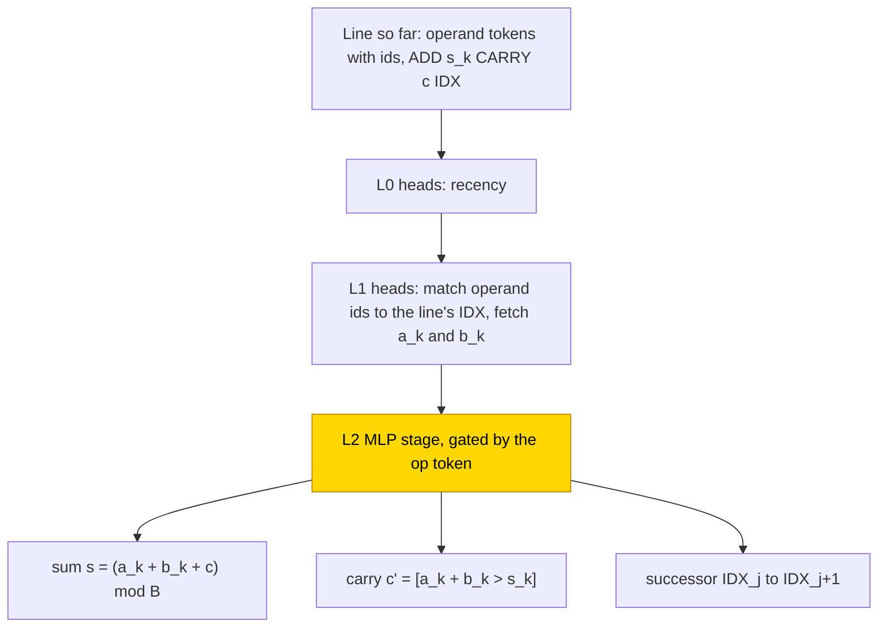
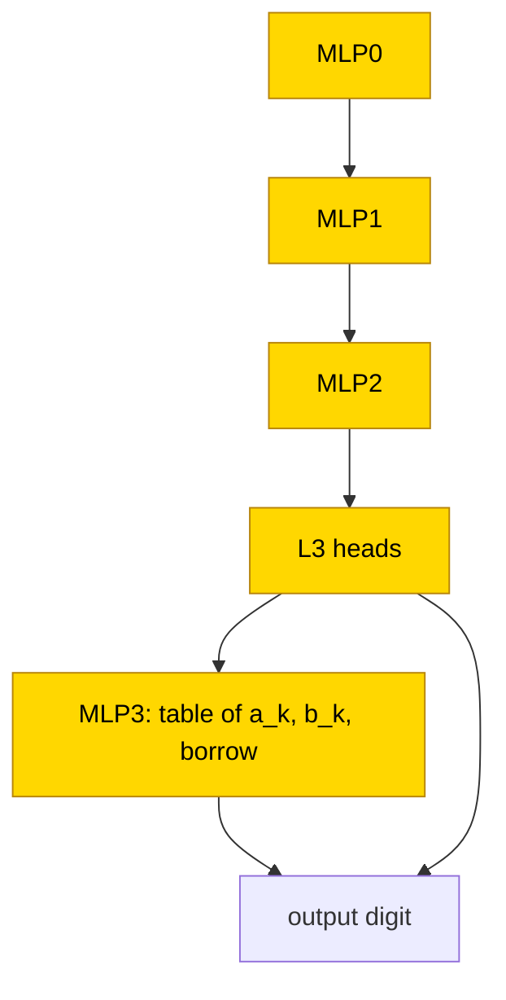

# Long addition with a router scratchpad (and a subtraction final run)

This entry asks whether a scratchpad that tags every operand token with a column id, so that each output step can look up its operands
by id (a router scratchpad), lets small transformers add long numbers beyond the trained length. Numbers of up to 16 bits or 6 decimal
digits were added in four formats, and a final run subtracted. With the hand-built upstream layers frozen and only the per-column step
stage trained, the router and position-masked cells were solved in 10/10 seeds, and the hand-built stage, with 0 fitted reals,
substitutes at 1.0 on 60 snapshots; the stage length-generalises when it cannot read position. Trained from scratch, the router format
was solved in range in 10/10 seeds (binary answer-only most-significant-first in 0/10), but no format reached twice the trained length
(router 2N = 0). The task is partly solved. The closed form status is
partial: the stage substitutes on 60 snapshots with zero, mean and shuffle controls, and the subtraction table passes a resample
ablation of the complement on two best snapshots but not on one final snapshot; there is no closed form for addition trained from
scratch.

| Fact | Value |
|---|---|
| Task | Add two n-digit numbers (base 2 up to N = 16 digits, base 10 up to N = 6; the final run subtracts), tested at N, N+1 and 2N |
| Input → output example | Base 10, answer only, most significant digit first: 5 + 7 → 12 |
| Model | GPT-NeoX-shaped, 4 layers, d_model 256, 4 heads × 64, MLP 512 ReLU, no LayerNorm, no position embedding; PART trains one stage MLP (layer 2 or 3) |
| Rungs and seeds | HAND exact in all 8 cells; PART and TRAIN 10 seeds per cell; final subtraction run TRAIN AL 10 seeds |
| Closed form status | Partial (PART step stage substitutes at 1 on 60 snapshots, controls ≤ .002; subtraction table complement .902 / .950 on two best snapshots but .127 on one final; no closed form for TRAIN addition) |
| Status | Partly solved (router format from scratch: 10/10 in range, 2N = 0); last run not dated in the entry |
| Weights | [Hugging Face: router-addition](https://huggingface.co/jc1122/circuit-atlas-nets/tree/main/router-addition) |
| Reproduce | Not available yet: training code for this task is not yet in `code/` |

## 1. Task and data

The task is a + b (in the final run a - b) with n-digit operands written most significant digit first, in base 2 (N 16) or base 10 (N 6),
where N is the trained length. The length n is drawn as n ~ U[1, N], and fresh pairs are drawn for every batch. Four formats were studied
(Table 1). In the scratchpad formats ([glossary](../GLOSSARY.md#task-formats)) each output step writes one column; the ids are the column
number plus a random offset.

*Table 1. Output formats.*

| Format | Output |
|---|---|
| `AM` / `AL` (answer only) | the sum, most / least significant digit first |
| `I` (index scratchpad) | per step `s_k c_(k+1) IDX_(k+1)`: sum digit, carry, next id |
| `R` (router scratchpad) | operand tokens carry a coupled id; per step `ADD s_k CARRY c_(k+1) IDX_(k+1)` |

The test sets are 1000 pairs each at n = N, N+1 and 2N. An output counts as exact only when every token is right; exact match is
scored teacher-forced, that is, each token given the correct previous tokens.

## 2. Model

The shared architecture is described in [METHODS.md](../METHODS.md). The three [rungs](../GLOSSARY.md#the-three-rungs) are HAND (every
weight set by formula), PART (frozen hand-built parts with one trained stage) and TRAIN (all weights trained from scratch).

### 2.1 Architecture

All networks are GPT-NeoX-shaped with 4 layers (4L), d_model 256, 4 heads x 64, MLP 512 ReLU, no LayerNorm and no position embedding.
The vocabulary has 12 specials, B digits, K ids (K 40 / 20) and B*K operand tokens (134 / 242 in total, for base 2 / base 10). Layers are
numbered from zero, so L3 is the last layer.

### 2.2 Frozen parts and trained part

PART keeps HAND frozen and re-initialises and trains the stage MLP: layer 2 in I and R, layer 3 in AM and AL (W_in [512, 256], W_out
[256, 512] + biases). The masked arm holds the stage's inputs on HAND's position dimensions at 0, so that the stage cannot read position.
TRAIN trains every tensor.

### 2.3 Training

All runs used AdamW with learning rate 1e-3, weight decay .1, betas (.9, .98), warmup 1k, a cosine schedule, clipping at 1 and batch size
(bs) 256. PART ran in fp32 for 10k-20k steps and TRAIN in TF32 for 30k ([glossary](../GLOSSARY.md#hand-built-machinery)). Accuracy was
evaluated every 500 steps, and a run stopped at in-range accuracy 1.0 or on a 5k plateau after 75% of the steps. Seeds 0-9 were packed
per GPU process. The controls were zero, mean and shuffle substitutions and the position-masked PART arms. The headline output keys are
`best`, `best_step` and `log`.

### 2.4 Reproduction

Reproduce: not available yet: training code for this task is not yet in `code/`; the weights, held-out splits and recorded
accuracies are on Hugging Face at
[huggingface.co/jc1122/circuit-atlas-nets/tree/main/router-addition](https://huggingface.co/jc1122/circuit-atlas-nets/tree/main/router-addition).
The runs used the following command of the project's training script, which is not part of `code/`:

```
python train.py --op add|sub --base 2|10 --kind part|train --fmts AM AL I R --seeds 0 1 2 3 4 5 6 7 8 9 --steps 30000
```

### 2.5 Archive

The archive holds HAND per (base, format), all PART seeds of the solved arms, 2-4 TRAIN seeds per cell and the final-run seeds, each as
safetensors with `config.json` and a manifest (seed, rung, accuracy, sha256). The networks are on Hugging Face (circuit-atlas-nets,
entry router-addition).

## 3. Hand-built solution

Every format uses one shared column step per output step (Figure 1). In R, the L0 heads attend by recency, and the L1 heads match the
operand ids to the line's IDX, with no absolute position. The L2 MLP stage is gated by the op token. It writes the sum s = (a_k + b_k + c)
mod B (9 / 57 neurons for base 2 / 10), the carry c' = [a_k + b_k > s_k], read from the digit just written (3 neurons), and the
successor IDX_j -> IDX_(j+1) (one neuron per id).

I uses the same stage, with slot flags computed from r - r(last IDX), where r is the position. The answer-only formats use index heads on
a derived position; AM adds a lookahead thermometer and is exact for n <= 30. All HAND networks are exact (margin 30) on all pairs, or on
500 pairs per n, for n <= N+1 and at 2N, except binary AM (exact for n <= 30 only). For subtraction the stage writes s = a - b - c with the borrow [b - a + s >= 1].



*Figure 1. The hand-built router network (format R). The layer-1 heads fetch the operand digits whose id matches the current step id,
and the layer-2 MLP writes the sum digit, the carry and the next id. The shaded MLP is the stage that PART replaces with a trained MLP.*

## 4. What training finds

Table 2 gives the number of steps to the first in-range exact result and the length results. Appendix B gives the diagnostics per cell.

*Table 2. Steps to the first in-range exact result (thousands of steps, ranges over seeds) and TRAIN length.*

| Cell | b2 | b10 | Length N+1 / 2N |
|---|---|---|---|
| PART R | 1.5-3 | 3.5-5 | |
| PART I masked | 3.5-4.5 | 8.5-10 | masked 2N = 1 |
| PART AM / AL masked | | 5.5-9.5 | masked 2N = 1 |
| TRAIN I | 20-25 | 8.5-16 | .99 / 0 (b2), .55 / 0 (b10) |
| TRAIN AL | 23-29.5 | 13.5-16 | .45 / 0 |
| TRAIN AM | | | .25 / 0 |
| TRAIN R | | 11.5-16.5 | .65 / 0 |
| Final: subtraction TRAIN AL | | see text | .21 / 0 |

*Key: b2, b10 = base 2, base 10.*

### 4.1 Stage on frozen parts (PART)

The per-column step is one shared stage. PART stages solve 10/10 in every router (R) or masked cell. The stage length-generalises when it
cannot read position (R; masked I and A 2N = 1). Unmasked PART I fails at the sum slot (.74-.91). The parts read are R L1H0 (drop
.955-.991) and A L2H0/L2H1 (.89-.95).

### 4.2 Training from scratch (TRAIN)

In range, binary AM fails (0/10), and A-LSB, I and R solve (I 10/10, AL b10 10/10 and b2 8/10, R 10/10). No format reaches 2N, so the
router token alone does not buy length. TRAIN networks use HAND's causal variables through seed-specific code, and the parts read include
MLP3 (.995-1).

In the final subtraction run (TRAIN AL, base 10), 9 seeds passed 50% at 7-14k steps, 90% at 8.5-15k and exact at 14-19.5k; seed 4 stuck
at .11, with all errors in answer column 1. In the 9 solved seeds MLP3 is a table of (a_k, b_k, borrow).

### 4.3 Circuit types

Table 3 groups the diagnosed seeds by mechanism. A loss barrier (LMC) between seeds ≥ 2.63 shows that the TRAIN I networks reach different
solutions ([glossary](../GLOSSARY.md#analysis-measures)).

*Table 3. Circuit types of the diagnosed seeds.*

| Circuit type | Seeds |
|---|---|
| R-frozen-stage | 18 of 18 (one basin up to permutation) |
| I-masked-stage | 5 of 5 |
| A-frozen-readout (out = T[a_k + b_k + c]) | 18 |
| TRAIN sum/carry/successor (I) | 20 (lmc barrier >= 2.63: different solutions) |
| TRAIN answer-only sum/carry | 19 (AL 10, AM 9) |
| final cell: sub-digit-table | 9 of 9 solved (MLP3 a table of a_k, b_k, borrow, not a - b - c alone) |

## 5. Mechanism and verification

### 5.1 Closed forms

For the PART R stage the closed form is HAND's stage: s = (a + b + c) mod B, c' = [a + b > s] and the successor, with 0 fitted reals. For
the masked PART AL read-out it is a spline, out = sum_j C[j, d] max(0, 1 - |u - j|) with u = a_k + b_k + c (200 reals). Both give 1,
against the original networks' .996-1, on 60 snapshots; the zero, mean and shuffle controls give <= .002.

For the final subtraction cell, MLP3 out := T[a_k, b_k, c_k] (200 x 256 means) gives .944-1 on 18/18 solved snapshots, T[a - b - c] alone
8/18, and the controls <= .002. A resample ablation of everything except the MLP3>out path among the direct writes
([glossary](../GLOSSARY.md#verifying-a-circuit)) keeps .902 / .950 on the best snapshots of seeds 0 and 3, which was accepted, but only
.127 on the final snapshot of seed 1, whose L3 heads also write the answer to the logits. The table is keyed on the true variables, so it
bypasses the upstream computation. There is no closed form for TRAIN addition.

### 5.2 Discovered circuit

Automatic circuit discovery on the final cell found MLP0 -> MLP1 -> MLP2 -> L3 heads -> MLP3 (+ L3 heads -> out), with 22-32 edges and
faithfulness .95-.98 on all 3 (Figure 2).



*Figure 2. The circuit discovered in the subtraction final cell (TRAIN AL, base 10), 22-32 edges, faithfulness .95-.98. MLP3 is replaced
by a table of (a_k, b_k, borrow), partial: the complement resample is accepted on two best snapshots (.902 / .950) and fails on one final
snapshot (.127), where the L3 heads also write the answer.*

### 5.3 Relation to the hand-built network and to published work

R and I share HAND's stage; upstream they differ (id match against index heads). The coupled ids act like masking, and they resemble
position coupling ([Cho et al., 2024](#references)) and abacus-style embeddings ([McLeish et al., 2024](#references)), which also tie
each digit to its column. Trained from scratch, retrieval loses the operands at 2N (b_k R^2 <= .06). Scratchpads and output order in
arithmetic were studied by [Lee et al. (2023)](#references), inductive scratchpads by [Abbe et al. (2024)](#references), and quantitative
bounds for length generalisation by [Izzo et al. (2025)](#references).

## 6. Limitations and open questions

Binary AM HAND is exact only for n <= 30. Exact match is teacher-forced. There is no closed form for TRAIN addition, and the final-cell
table is keyed on true variables, so it bypasses the upstream computation. Routing visible as disjoint ADD and CARRY neuron sets was not
tested, because there was no neuron-level ablation.

## 7. Prediction record

The predictions were recorded in advance (Table 4).

*Table 4. Predictions and outcomes.*

| Prediction | Outcome |
|---|---|
| PART R length-generalises, I/A only when masked | HELD (masked 2N = 1; R .80 / .999) |
| TRAIN in range: binary A-MSB fails | HELD, 0/10 |
| TRAIN in range: A-LSB, I, R solve | HELD: I 10/10, AL b10 10/10 and b2 8/10, R 10/10 |
| TRAIN length: only R generalises | REFUTED (R 2N = 0) |
| Routing visible as disjoint ADD/CARRY neuron sets | NOT TESTED (no neuron-level ablation) |

## Appendix A. Weights excerpt and reading

The excerpt file `router` holds the HAND R stage neurons and their inputs, the W_in energy share on them for each PART R seed, and, for
the final cell, the neurons that carry 90% of ||W_U W_out(MLP3)||^2. The entry does not quote values from it.

## Appendix B. Detailed evidence

*Table B1. Diagnostics per cell.*

| Cell | Used heads / neurons | Best probe R^2 (layer) a, b, s, cout, k | Eff. rank L4 net / HAND | Attn JS | Best / final N |
|---|---|---|---|---|---|
| PART R b10 / b2 | 4 / - | 1, 1, .79, .93, 1 (4,4,4,4,2) / - | 4.22 / 2.65 | 0 | 1 / 1 |
| PART I masked b2 / b10; AM / AL b2 | 5; 3 / 4 / - | - | - | 0 | 1 / 1; 1 / .89 |
| PART AL masked b10 | 4 / - | 1.0, 1.0, .70, .88, 1.0 (3,3,4,4,1) | 1.03 / 1.02 | 0 | 1 / 1 |
| TRAIN I b10 / b2 | 4-7 / 4-9 / - | .54, .46, .95, .97, 1.0 (4,4,4,4,3) / - | 9.52 / 1.00 | 0-.51 | 1 / 1 |
| TRAIN AL / AM b10; R b10 / b2 | 3-4 / 4-8 / -; - | - | - | 0-.50 | 1 / 1; .998 / .997; 1 / 1 |
| Final: sub TRAIN AL b10 | 5 (L3H0-3 + one L2) / MLP3 n90 206-229 | s4 (failed): .72, .68, .72, .70, 1.0 (4,4,4,4,1) | - | s4 L3 .38-.43 | 9/10 at 1; s4 .114 / .099 |

*Key: "-" = not measured; cout = carry out; Eff. rank = effective rank of the residual at L4; Attn JS = Jensen-Shannon
divergence of attention to HAND; n90 = neurons carrying 90% of the MLP3 write; s4 = seed 4; Best / final N = exact at n = N, best and
final snapshot.*

## References

- Abbe, E., Bengio, S., Lotfi, A., Sandon, C., & Saremi, O. (2024). How far can transformers reason? The globality barrier and
  inductive scratchpad. *Advances in Neural Information Processing Systems 37 (NeurIPS 2024)*. https://doi.org/10.52202/079017-0874
  (inductive scratchpad)
- Cho, H., Cha, J., Awasthi, P., Bhojanapalli, S., Gupta, A., & Yun, C. (2024). Position coupling: Improving length generalization of
  arithmetic transformers using task structure. *arXiv preprint*. https://doi.org/10.48550/arxiv.2405.20671 (position coupling)
- Izzo, Z., Nichani, E., & Lee, J. D. (2025). Quantitative bounds for length generalization in transformers. *arXiv preprint*.
  https://doi.org/10.48550/arxiv.2510.27015 (length generalisation bounds)
- Lee, N., Sreenivasan, K., Lee, J. D., Lee, K., & Papailiopoulos, D. (2023). Teaching arithmetic to small transformers.
  *arXiv preprint*. https://doi.org/10.48550/arxiv.2307.03381 (scratchpads and output order)
- McLeish, S., Bansal, A., Stein, A., et al. (2024). Transformers can do arithmetic with the right embeddings. *arXiv preprint*.
  https://doi.org/10.48550/arxiv.2405.17399 (abacus-style embeddings)
