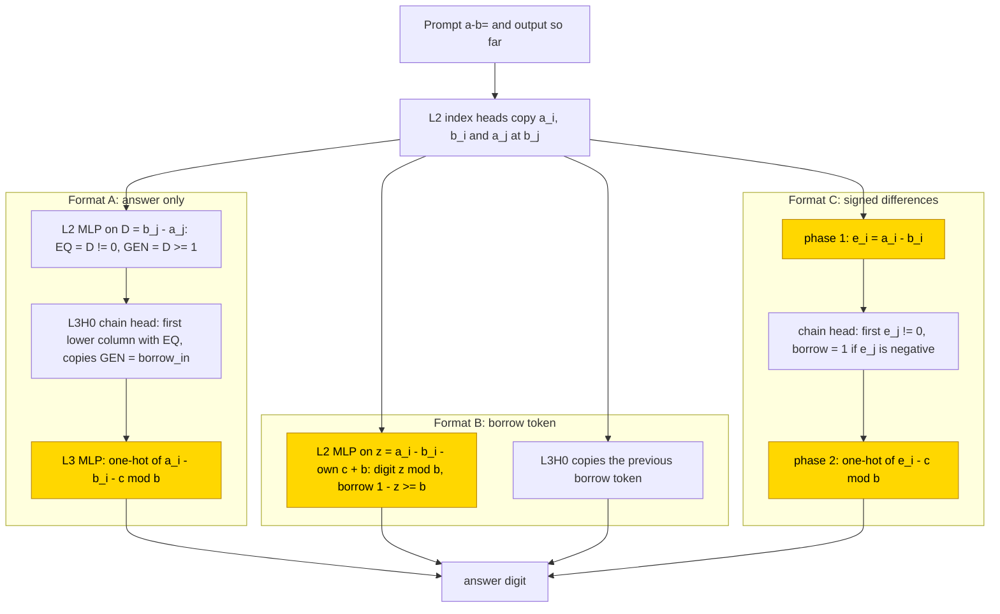
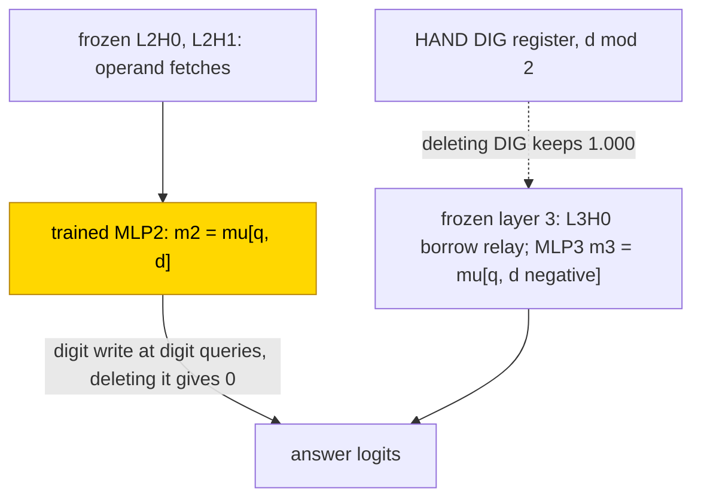

# Subtraction (base 10 and 2)

This entry studies how small transformers subtract b from a (a ≥ b) for 3-digit decimal and 6-bit binary numbers, in three output
formats: answer only, with a borrow token, and with signed column differences written first. A stage trained on frozen hand-built
parts learned a lookup on the column difference a − b − borrow (the borrow is 1 when the next lower column had to take one from this column, else 0) in 10/10 seeds in base 10 formats A and B and base 2 formats A and C,
9/10 in base 10 C and 8/10 in base 2 B. Networks trained from scratch solved every retried cell 10/10 (base 10 A and C, base 2 A and
C), and their last MLP uses the same key in 34/40 retry networks, but no network trained from scratch generalises to longer inputs.
The task is partly solved. The closed forms reproduce the networks, but an audit on 2026-11-07 found that none passes the full bar,
so they are sufficient readouts and not verified mechanisms.

| Fact | Value |
|---|---|
| Task | Subtract b from a (a ≥ b), 3-digit decimal or 6-bit binary, written as `a-b=` followed by the difference |
| Input → output example | Base 10, answer only: 742 − 358 → `384` |
| Model | GPT-NeoX-shaped, 4 layers × 4 heads, d_model 256, MLP 256 ReLU; the partly trained networks train one MLP (layer 3 in A, layer 2 in B and C) |
| Rungs and seeds | HAND per base × format (6 cells); PART and TRAIN 10 seeds per cell; failed cells retried once (both runs kept) |
| Closed form status | Sufficient readout only (f(a − b − borrow) substitution equals network accuracy; per the 2026-11-07 audit no closed form passes the full bar) |
| Status | Partly solved (retried TRAIN cells 10/10; no TRAIN network generalises to longer inputs); last run 2026-11-05; audit 2026-11-07 |
| Weights | [Hugging Face: subtraction](https://huggingface.co/jc1122/circuit-atlas-nets/tree/main/subtraction) (112 networks) |
| Reproduce | Not available yet: training code for this task is not yet in `code/` |

## 1. Task and data

The prompt is `a-b=` and the target is a − b with a ≥ b. In base 10 the operands have 3 digits and each seed draws 20k random
training pairs and 2k test pairs. In base 2 the operands have 6 bits; of the 2080 pairs with a ≥ b, a train fraction of .6 gives 1248
training and 832 test pairs. An output counts as correct only on exact match of all output tokens. Length generalisation, accuracy on
operands longer than any seen in training ([glossary](../GLOSSARY.md#task-formats)), was tested at n + 1 and 2n, that is 4 and 6 digits in base 10 and 7
and 12 bits in base 2. Three output formats were studied (Table 1); B and C are [scratchpad](../GLOSSARY.md#task-formats) formats, in
which the network writes intermediate results before or between the answer digits.

*Table 1. Output formats (n = number of digits, k = borrow token).*

| Format | Output |
|---|---|
| `A` (answer only) | n answer digits, most significant first (MSB first) |
| `B` (borrow token) | d_0 k_1 d_1 .. k_n, least significant first (LSB first) |
| `C` (signed differences) | the signed column differences e_i = a_i − b_i (n tokens), `=`, then d_{n−1}..d_0 |

## 2. Model

The shared architecture and instrumentation are described in [METHODS.md](../METHODS.md). The three
[rungs](../GLOSSARY.md#the-three-rungs) are HAND (every weight set by formula), PART (frozen hand-built parts with one trained stage)
and TRAIN (all weights trained from scratch).

### 2.1 Architecture

All networks are GPT-NeoX-shaped with 4 layers × 4 heads, d_model 256, d_head 64, MLP 256 ReLU, no LayerNorm and no positional
encoding (NoPE). The vocabulary holds BOS, unk, the 2b − 1 signed values −(b−1)..b−1 for base b, and `- = . c`: 25 tokens in base 10
and 9 in base 2. Layers are numbered from zero. TRAIN trains all 1.6M weights from initialisation.

### 2.2 Frozen hand-built network and trained part

PART trains the stage MLP only, in layer 3 for format A and in layer 2 for formats B and C (dense_h_to_4h [256, 256] + bias,
dense_4h_to_h [256, 256] + bias), on top of the frozen hand-built layers. The stage reads the token embedding TOK, the fetched column
digits X1, X2 and X3, the borrow CY, the phase flags PH and EQS of format C, and the position blocks P, R, R2, T, RP and VT.

### 2.3 Training

The optimiser was AdamW with learning rate 1e-3, weight decay 1, betas (.9, .98) and batch 256, in TF32, with test accuracy evaluated
every 500 steps and the best-test snapshot kept. PART and TRAIN used 10 seeds per cell. Runs were on consumer GPUs. Table 2 gives the per-run settings. A control repeated
PART with the stage's position inputs held at 0.

*Table 2. Training settings per run.*

| Run | Steps | Schedule | Weight decay | Stop |
|---|---|---|---|---|
| PART | 10k | constant | 1 | on 1.0 or a 2k plateau (base 2: 20k) |
| TRAIN run 1 | 20k | constant | 1 | on 1.0 or a 2k plateau (base 2: 20k) |
| TRAIN run 2 (retry) | 30k | warmup 1000, cosine, clip 1 | base 2: 1; base 10: .1 | |

### 2.4 Reproduction

Reproduce: not available yet: training code for this task is not yet in `code/`; the weights, held-out splits and recorded
accuracies are on Hugging Face at
[huggingface.co/jc1122/circuit-atlas-nets/tree/main/subtraction](https://huggingface.co/jc1122/circuit-atlas-nets/tree/main/subtraction)
(112: 6 HAND, 60 PART, 30 PART with position mask, 16 TRAIN).

### 2.5 Archive

The Hugging Face folder holds `hand_b<base>_<F>` (HAND state dicts); `part_b<base>_<F>_s<seed>` (all PART seeds; the four stage
tensors); `part_b10_<F>_maskpos_s<seed>` (the position control); `train_b<base>_<F>[_r2]_s<seed>` (full networks, best and worst seed
per cell and run; `_r2` marks the retry); `config.json`; and `manifest.json` (sha256, fp32 re-score). Each file was reloaded
bit-identically.

## 3. Hand-built solution

The hand-built networks reuse the bricks of [decimal-hex-addition](decimal-hex-addition.md), with a borrow in place of the carry.
Each answer digit is (a_i − b_i − borrow) mod b, and the formats differ in where the borrow comes from (Figure 1).

In format A, layer-2 index heads, which attend to one operand position and copy its digit, copy a_i and b_i, and a_j at b_j's
position. The L2 MLP reads D = b_j − a_j and writes EQ = [D ≠ 0] and GEN = [D ≥ 1]. The chain head L3H0 attends to the first lower
column with EQ set and copies its GEN, which is the incoming borrow borrow_in. The L3 MLP writes the one-hot of (a_i − b_i − c) mod b,
where c is the borrow, with 2b hinge triangles. In format B the L2 MLP reads z = a_i − b_i − [own token `c`] + b and gives the digit
z mod b and the outgoing borrow 1 − [z ≥ b]; L3H0 copies the previous borrow token. In format C, phase 1 writes e_i = a_i − b_i, the
chain head finds the first e_j ≠ 0 (borrow = [e_j < 0]), and phase 2 writes the one-hot of (e_i − c) mod b. All six networks are exact
for n = 1..12 in both bases. Table 3 gives their sizes.

*Table 3. Size of the base 10 hand-built networks (heads; neurons in L0/L1/L2/L3).*

| Format | Base 10 |
|---|---|
| A | 6; 64/114/4/22 |
| B | 5; 64/64/3/14 |
| C | 5; 64/119/43/0 |

For base 2 the record gives only the compact note "L3 6/6/0, L2 4/3/11", without saying which formats these counts belong to.

*Figure 1. The hand-built networks for the three formats. Index heads fetch the column digits; the borrow comes from a chain head that
finds the first lower column where the digits differ (A, C) or from the previous borrow token (B). The shaded MLPs (layer 3 in A,
layer 2 in B and C, which in C writes both phases) are the parts that PART replaces with a trained stage.*

## 4. What training finds

Table 4 summarises the cells. Exact match is on held-out pairs; "steps to .9" is the first evaluation at which test exact match
reached .9.

*Table 4. Results per cell (ranges over seeds; "position masked" = the stage's position inputs held at 0; run 2 is the retry).*

| Cell | Test exact match | Steps to .9 | Length n + 1 | Length 2n |
|---|---|---|---|---|
| PART base 10 A / B / C | 1.0 / .995–1 / .97–1 | ≤ 1k | A .80–.98, B ≤ .20, C ≤ .02 | A .80–.96, B ≤ .04, C 0 |
| PART base 10, position masked, A / B / C | | | A .99–1, B .87–.98, C .95–.99 | A .98–1, B .39–.60, C .52–.59 |
| PART base 2 A / B / C | A, B 1.0, C .93–.95 (fp32 re-score 1.0) | | A .78, B 0–.82, C .13–.42 | ≤ .67 |
| TRAIN base 10 run 1, best (final) | A .72–.99 (.01–.90), B .94–1 (.01–1), C .48–1 (0–.98); seeds ≥ .9: 7, 10, 9 | 3–12k | ≤ .06 | ≤ .001 |
| TRAIN base 2 run 1 | A .40–.95 (1/10 ≥ .9), B .79–1 (9/10), C .55–.95 (4/10) | | ≤ .35 | ≤ .001 |
| TRAIN run 2: base 10 A, C; base 2 A, C | 10/10 = 1.0 each (final = best) | base 10 A 2.5–5.5k, C 2–4.5k; base 2 A 8.5–14.5k, C 6–11.5k | base 10 ≤ .06, base 2 ≤ .35 | ≤ .001 |

### 4.1 Partly trained networks

Every PART stage that works computes its digit as a lookup keyed on diff = a_i − b_i − borrow_in, the closed form f(diff), and the
adder's key a + b + c never substitutes (≤ .01 in base 10, ≤ .88 in base 2), except in binary A, where the two keys coincide. PART
reads all the HAND heads it needs (attention substitution 1.0). PART A extrapolates to 4 and 6 digits; B and C do not, because their
trained stage reads absolute position. Holding the stage's position inputs at 0 restores length (B .87–.98 at n + 1); the errors that
remain at 2n fall on new joint (value, role) inputs. Clamping those inputs to their mean drops accuracy at n = 3 to ~.01, which locates
the length failure of PART B and C in the stage's position read.

### 4.2 Networks trained from scratch

In run 1 the base 10 cells reached .9 in 7, 10 and 9 seeds (A, B, C), and the failures of A and C oscillate under weight decay 1 with
a constant learning rate, so the final accuracy is far below the best. The retries with warmup, cosine decay and clipping solved every
seed (base 2 C at weight decay 1, base 10 at weight decay .1). Failed TRAIN networks keep the stage key (diff R² .84–.98) but carry a,
b and the borrow only partly linearly (R² .3–.9). No TRAIN network generalises to longer inputs.

TRAIN uses 3–16 heads + 300–980 neurons, against HAND's 5–6 + 75–230. HAND's fetch roles (the L2 index heads) are re-found in the
retries in base 10 A 9/10, C 9/10, base 2 C 9/10 and base 2 A 2/10 seeds, with 3–16 heads + 226–762 neurons.

### 4.3 Circuit types

Seeds were grouped into circuit types by the key whose substitution for the last MLP keeps accuracy within .01 of the network
(substitution ≥ net − .01; Table 5). Over all cells, the last MLP of TRAIN uses f(diff) in 21/30 networks in base 10 run 1, 29/30 in
base 2 run 1 and 34/40 in the retries. Earlier TRAIN MLPs have no closed form.

*Table 5. Circuit types per cell (seed counts out of 10). f(a, b, c) = a lookup on the pair of digits and the borrow.*

| Cell | Base 10 | Base 2 |
|---|---|---|
| PART A | f(diff) 10 | f(diff) 10 |
| PART B | f(diff) 10 | f(diff) 8 + f(a, b, c) 2 (its frozen MLP3 takes f(diff) in all 10) |
| PART C | f(diff) 9 + f(a, b, c) 1 | f(diff) 10 |
| TRAIN run 1 A | f(diff) 7 | f(diff) 9 |
| TRAIN run 1 B | f(diff) 8 | f(diff) 10 |
| TRAIN run 1 C | f(diff) 6 + f(a, b, c) pair lookup 4 (the compact 3–4-head networks) | f(diff) 10 |
| TRAIN retry A | f(diff) 10 (substitution ≥ .99) | f(diff) 6 + f(a, b, c) 2 + unclassified 2 |
| TRAIN retry C | f(diff) 8 + f(a, b, c) 2 | f(diff) 10 |

Per-cell diagnostics (probes, participation ratio, attention divergence, patching, interchange and edges) are in Appendix B.

## 5. Mechanism and verification

### 5.1 Closed forms

The last MLP was replaced by its mean output given diff = a_i − b_i − c (in phase 1 of format C, given a_i − b_i). Accuracy equalled
network accuracy: PART .97–1, TRAIN f(diff) networks within ± .01, base 2 C retry 1.00. The digit is (a_i − b_i − c) mod b and the
outgoing borrow is [a_i − b_i − c < 0].

These are [sufficient readouts](../GLOSSARY.md#verifying-a-circuit), not verified mechanisms. The audit of 2026-11-07 found that none
of the closed forms passes the full bar (best and final snapshots, native/zero/shuffle exact controls, fewer fitted reals than the replaced
component); they
are keyed on task-derived labels and stay sufficient-readout results.

A fresh check on 2026-11-07 fitted a tent-spline table F_q(z) on z = a_i − b_i − c on 4,000 pairs and evaluated it on 2,000 new pairs,
with a bar of ≥ .99 × the network's accuracy (Table 6). The TRAIN f(diff) claim is not universal: TRAIN seed 8 fails it, its
f(a, b, c) table fails too (.014) and would need 204,800 fitted reals, more than the MLP's 131,584. A decimal B rank-six readout card
also fails exact.

*Table 6. Fresh check of the tent-spline table. Accuracy cells show the network, then the substituted network.*

| Stage | Passing seeds | Accuracy |
|---|---|---|
| binary A PART MLP3 | 10/10 | 1 → 1 |
| decimal B PART MLP2 | 10/10 | .92–.99 → .99–1 (a repair) |
| decimal B final TRAIN MLP3 | 9/10 | |
| decimal B TRAIN seed 8 (final) | counterexample | 23/2,000 correct → 22/2,000 |
| decimal B rank-six readout card | fails exact | .9987 → .9827 |

### 5.2 Wiring and causal tests

The component with the largest patching drop in PART is the stage MLP in 60/60 networks. Edge attribution (EAP-IG) recovers HAND's
wiring in PART (hand_recall 1.0; Jaccard overlap 1.0 in A and C, .60-.80 in B; 51/60 networks trusted). TRAIN is wired differently
(Jaccard 0-.20; heads not aligned, which raises a different-wiring flag). The borrow-chain variable X2 of format C is present but not
linear: it flips .00-.06 by linear interchange in every rung, against a DAS flip of 1.0 (base 2), .97 (base 10 TRAIN retry) and .36
(base 10 PART). In base 10 PART B the digit flips .32 by interchange and .96 by DAS. The [glossary](../GLOSSARY.md#analysis-measures)
defines patching, interchange, DAS and edges.

### 5.3 Circuit probes

Circuit probes were run on 2026-11-06 on seed-0 best snapshots unless noted (Table 7). **Verified** here means a causal intervention
plus an accepted substitution fitted and tested on disjoint non-training pairs; **supported** means causal evidence only. Exact is
teacher-forced whole-output accuracy, ablation numbers are accuracy retained, and layers are zero-based. In the table d = a_i − b_i −
c_i, q is the index of the output query, and μ[key] is the mean MLP-output vector over the fit set for each value of the key.

*Table 7. Components probed (seed 0 unless noted).*

| Component | Role | Evidence (verified in the probe sense above) |
|---|---|---|
| Base 10 A PART: L2H0/H1/H2, L3H0 | HAND operand, comparison-column and borrow routes | exact HAND route substitutions 1.000 each; mean ablation 0 / 0 / .602 / .313 |
| Base 2 B PART: L2H0/H1, L3H0 | operand fetches, borrow relay | hard routes 1.000 each; mean ablation .016 / .031 / .391 |
| Base 2 B PART: trained MLP2 → answer logits | digit path bypasses HAND's DIG register | deleting its digit write at digit queries: 0; deleting DIG: 1.000; m2 = μ[q, d] 1.000 |
| Base 10 A PART / TRAIN retry: MLP3 | final digit readout | m3 = μ[q, d] 1.000 / 1.000 on 2,000 fresh pairs; μ[d mod 10] (ten vectors) 1.000 / 1.000 |
| Base 2 B TRAIN: MLP3 | four-template digit/borrow decoder | m3 = μ[p, v] 1.000, drop 0, in 2/2 solved seeds tested |

In base 2 B PART the trained MLP2 writes the digit straight to the answer logits and bypasses HAND's digit register DIG (Figure 2).
At digit queries m2 = μ[q, d], and the final m3 = μ[q, [d < 0]] (1.000 each). Keeping only the HAND-like registers DIG = d mod 2 and
MAJ = [d < 0] at digit queries gives .423, so the learned borrow calibration matters. In base 2 B TRAIN, MLP3 is four vectors indexed
by the phase p = 0 (digit) / 1 (borrow) and v = (1 − p)(d mod 2) + p[d < 0], with no column dependence. These keys use external
arithmetic labels: they verify a local readout, not how earlier layers compute d.

Supported, causal only: TRAIN operand receivers are context-sensitive and do not act as copies. In the base 10 A TRAIN retry, hard
a/b routing keeps .602 / .273 (mean ablation .117 / .031); in base 2 B TRAIN, hard routing of L3H0/H2 keeps .977 / .984 (mean
ablation .281 / .016). Needed populations are 95 pair-selective neurons in base 2 B PART (ablated .051) and 164 difference-selective
neurons in base 2 B TRAIN (.012).

Size was measured by finite-set 1-minimal keep-sets at ≥ .99, which are order-dependent and not global minima, with the pruning set
reused for selection. Base 2 B TRAIN seed 0 keeps 14 heads + 516 neurons and seed 3 keeps 12 + 550 (of 16 + 1,024), with full-grid
exact .967 / .977, so neither is 99%-faithful on the whole domain. HAND under the same search keeps 3 + 5 (1.000; unablated nonzero
wiring 5 + 137).

The whole hypothesis is rejected: resampling every retained head, neuron population and residual coordinate within its claimed role
class gives .938 / .933 (seeds 0 / 3), and same-key individual donors keep only .957 for the base 10 TRAIN readout although its mean
table is exact. A complete endogenous TRAIN algorithm is not verified. A seed census is pending; the phenotypes above come from one or
two examined seeds per cell and are not frequencies.

Section 4.2 reports HAND's L2 fetch roles re-found in 9/10 base 10 A retry seeds by attention mass. In the probed seed the receivers
sit in L3 and forcing HAND's hard b route keeps only .273, so attention-mass labels overstate copy behaviour. The base 2 B PART bypass
refines the stage-level f(diff) closed form and does not contradict it.

*Figure 2. The digit path that training finds in base 2 format B (PART, seed 0). The trained MLP2 writes the digit straight to the
answer logits and bypasses the hand-built DIG register. The mean tables are a local readout on task-derived labels; the stage-level
closed form remains a sufficient readout, not a verified mechanism (Section 5.1).*

### 5.4 Relation to the hand-built network and to published work

PART reproduces HAND's diff lookup with a wider stage. TRAIN finds diff lookups without HAND's chain head. In
[decimal-hex-addition](decimal-hex-addition.md) and [binary-addition](binary-addition.md) the trained stages compute f(sum), so the
column key follows the operation; the position shortcut of formats B and C and its mask control match binary addition. A shared
skeleton for addition and subtraction with a borrow was described by [Quirke et al. (2024)](#references), and causal mediation analysis
of arithmetic in language models by [Stolfo et al. (2023)](#references).

## 6. Limitations and open questions

One training length was used per base; the position-masked PART is the length control. Probes are linear. Networks were trained in
TF32; the fp32 re-score gives base 10 B PART .91–.99 and base 2 C PART 1.0. Binary A cannot separate diff from a + b + c, because the
keys coincide mod 2.

Open questions:

- shuffle-control and final-snapshot substitutions;
- complete best and final packs per cell (only the best and worst seeds are archived for TRAIN);
- neuron-level necessity and training dynamics;
- the endogenous difference and borrow computation, including the borrow compensation in B PART;
- the causes of the donor failures, and seed frequencies of the probed phenotypes.

## 7. Prediction record

The prediction was recorded in the hand-built design notes before the runs: "per column (a − b − c) mod b", with the binary digit
a XOR b XOR borrow, and the open question "does TRAIN reuse the adder shape (f(a + b + c))?". It held: PART and most TRAIN last MLPs
compute f(diff), and the adder shape is not reused. Nothing was recorded about grokking time or length.

## Appendix A. Weights excerpt and reading

The numbers are computed from the archived PART base 10 stage tensors: the W_in rows on X2, X1 and CY (format B: X1, X2 and the token
`c`), with neurons weighted by ||W_out column|| × ||W_in row||. HAND A's L3 hinges read (a, b, c) = (1, −1, −1) with bias −v (n18/n19:
−7, −8). In the trained PART stages, the output-norm-weighted |cos| of each neuron's (w_a, w_b, w_c) with (1, −1, −1) is .88–.93 in A
and .72–.78 in B; in phase 2 of C, (e, c) gives .63–.68. Examples are A s0 n16 (.04, −.39, −.39), A s2 n7 (−.05, .05, .06) and B s2
n142 (−.20, −.21, −.19) with bias .02.

Reading: the A and B neurons are hinges on the line a − b − c, with b and c weighted equally as in HAND, so the stage is a function of
diff. B mixes in sum-like neurons (cos .72) that the borrow token disambiguates.

## Appendix B. Diagnostics per cell

*Table B1. Diagnostics per cell. Each cell lists used heads + MLPs; the best-layer linear-probe R² of a, b (X1/X2 or a_i/b_i), the
borrow c and diff; the residual participation ratio PR at L4; the attention JS of used heads to the matching HAND head; test best
(final); then, after ‖, the causal results.*

| cell | PART | TRAIN best (final) |
|---|---|---|
| b10 A | 4+2; a, b, c 1; PR 3.4–3.6; JS 0; 1 ‖ MLP3 10/10; edges 1/1 (2; mask 3) | 4–16+4; a .74–.90, b .70–.89, c .52–.62; PR 2.1–3.2; JS .09–.35; .72–.98 (.01–.90). Retry 4–8+4; a .75–.88, b .79–.92, c .59–.74; JS .16–.39; 1 (1) ‖ r1 7 solved: MLP3 4, MLP0 3; edges .11/.20 (7). Retry MLP3 8, L3H0 1; edges .11/.20 (8) |
| b10 B | 2–3+2; a, b .83–.86, c .64–.67, diff .85–.91; JS 0–.16; .91–.99 ‖ MLP2 10/10; diff .99/.94, digit .32/.96, borrow_out .80/.99; edges .60/1 (9) | 10–16+4; a .58–.84, c .65–.86, diff .85–.98; JS .08–.19; .94–1 (.01–1) ‖ MLP3 8, MLP0 2; diff 1/1, digit .98/1, borrow_out .92/1; edges .14/.33 (10) |
| b10 C | 3+1; a, b, c, phase 1; JS 0; .97–1 ‖ MLP2 10/10; X2 .03/.36; edges 1/1 (10) | 3–16+4; a .61–.83, b .55–.73, c .65–.89; PR 2.5–4.7; JS .08–.39; .48–1 (0–.97). Retry 3–15+3–4; a .70–.81, c .80–.96; JS .10–.34; 1 (1) ‖ r1 8 solved: MLP3 7, MLP0 1; X2 .04/.83; edges 0/0 (8). Retry MLP3 10/10; X2 .06/.97; edges 0/0 (10) |
| b2 A | 4+2; a, b, c 1; PR 5.4; JS 0; 1 ‖ MLP3 10/10; edges 1/1 (10) | 11–16+4; a .39–.50, b .58–.70, c .28–.38; JS .04–.14; .39–.95. Retry 6–16+4; a .41–.68, b .61–.75, c .32–.48; JS .08–.31; 1 (1) ‖ r1 1 solved: MLP0; edges .20/.50 (1). Retry MLP0 9, MLP3 1; edges .20/.33 (10) |
| b2 B | 3+2; a, b .79–.84, c .72–.83, diff .89–1; JS .15–.17; 1 ‖ MLP2 10/10; diff .93/.95, digit 1/1, borrow_out .86/1; edges .80/1 (10) | 5–13+4; a .47–.72, c .58–.85, diff .84–.94; JS .05–.19; .79–1 ‖ 9 solved: MLP3 7, MLP1 1; diff .99/1, digit .75/1, borrow_out 1/1; edges .20/.44 (8) |
| b2 C | 3+1; a, b, c, phase 1; JS 0; 1 ‖ MLP2 10/10; X2 0/1; edges 1/1 (10) | run 1 6–16+4; c .50–.64; .54–.95. Retry 3–9+3–4; a .56–.75, c .51–.89; JS .18–.38; 1 (1) ‖ r1 4 solved: MLP3 4; edges 0/0 (4). Retry MLP3 9, MLP1 1; X2 0/1; edges 0/0 (8) |

Key: b10 / b2 = base 10 / base 2; r1 = run 1. After ‖, medians over solved networks (exact ≥ .9): the component with the largest
patching drop (number of networks); var inter/DAS = linear interchange / DAS flip at the best layer; edges = EAP-IG Jaccard/hand_recall
against HAND over trusted networks (spearman_exact ≥ .8), with the count of
trusted networks in parentheses. HAND reference values: b10 B diff 1/.37, digit 1/.17, borrow_out 1/1; b10 C X2 0/.01; b2 B diff
.31/.31; b2 C X2 0/1; format A has no answer-fixing variable. Some test accuracies in this table (b10 C TRAIN final 0–.97, b2 C TRAIN
run 1 .54–.95, b2 A TRAIN .39–.95, b10 B PART .91–.99) differ from the values in Table 4 (0–.98, .55–.95, .40–.95, .995–1); the
records do not say why, and both are kept as recorded. The b10 B PART value equals the fp32 re-score given in Section 6.

## References

- Quirke, P., Neo, C., & Barez, F. (2024). Understanding addition and subtraction in transformers. *arXiv preprint*.
  https://doi.org/10.48550/arxiv.2402.02619 (shared addition/subtraction skeleton, borrow)
- Stolfo, A., Belinkov, Y., & Sachan, M. (2023). A mechanistic interpretation of arithmetic reasoning in language models using causal
  mediation analysis. *arXiv preprint*. https://doi.org/10.48550/arxiv.2305.15054 (causal mediation analysis of arithmetic)
