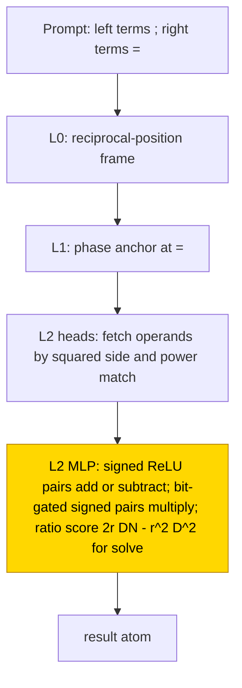
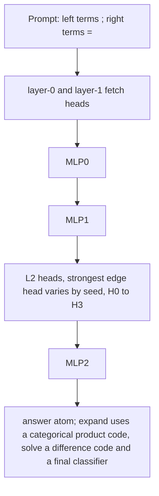

# Symbol-level algebra: collection, expansion and linear equations

This entry studies how 3-layer transformers do algebra on structured term atoms (side, power, coefficient): collecting like terms,
expanding a binomial product and solving a linear equation ax+b=cx+d, either writing the answer directly (answer only) or with a
scratchpad of intermediate atoms. Every scratchpad operation trained to exact in at least one rung: collect with frozen hand-built
parts and one trained MLP 10/10, expand from scratch 10/10 at 60k steps (best snapshot; 9/10 final), solve from scratch 10/10.
Answer-only expand and solve never did (from scratch: expand ≤ .126, solve best .997; with frozen parts 0/3 too). The partly trained
collect stage keeps the hand-built addition, while networks trained from scratch build a different MLP chain with categorical codes.
The task is partly solved (scratchpad 10/10 in three cells; answer-only expand and solve 0/3). The closed form is partial: the
collect closed form substitutes exactly in 13/13 seeds (prediction agreement 1.0), with the complement not tested, and no closed form from scratch was accepted.

| Fact | Value |
|---|---|
| Task | Collect like terms, expand (a x+b)(c x+d) or solve ax+b=cx+d on (side, power, coefficient) term atoms |
| Input → output example | Expand, in words: (2x+1)(3x+4) → 6x² + 11x + 4 |
| Model | GPT-NeoX-shaped, 3 layers, d_model 64, 4 heads × 16, MLP 256 ReLU, NoPE, no LayerNorm; PART trains only the last MLP |
| Rungs and seeds | HAND in all 6 cells; PART and TRAIN 3 seeds in all 6 cells (30k; retries 60k); 10-seed finals: PART collect `T`, TRAIN expand `T`, TRAIN solve `T` |
| Closed form status | Partial (PART collect: S = a + b, exact 1.0 → 1.0 in 13/13 seeds on substitution; complement not tested; no TRAIN closed form accepted) |
| Status | Partly solved (scratchpad 10/10 in three cells; answer-only expand and solve 0/3); last run 2026-11-08 |
| Weights | [Hugging Face: symbolic-algebra-atoms](https://huggingface.co/jc1122/circuit-atlas-nets/tree/main/symbolic-algebra-atoms) |
| Reproduce | Not available yet: training code for this task is not yet in `code/` |

## 1. Task and data

The inputs are structured `(side,power,coefficient)` term atoms. The prompt is `BOS <left terms> ; <right terms> =`, with the terms
permuted per batch. Three operations were studied: collect like terms, expand `(a x+b)(c x+d)` and solve `ax+b=cx+d`. Outputs are
integer or reduced-rational atoms; there is no digit arithmetic and no parsing. Each side has two terms, and coefficients range over
−9…9 without ±8, which are held out. The test set is hash-disjoint (mod 97). An output counts as correct only on exact match of the
whole teacher-forced output ([glossary](../GLOSSARY.md#task-formats)).

Two output formats were studied for each operation (Table 1); the [scratchpad](../GLOSSARY.md#task-formats) format writes
intermediate atoms before the answer.

*Table 1. Output formats.*

| Format | Output |
|---|---|
| `A` (answer only) | the result atoms |
| `T` (scratchpad) | expand: 4 products then 3 coefficients; collect: copy/copy/sum triples; solve: `D N ; solution` |

## 2. Model

The shared conventions are described in [METHODS.md](../METHODS.md). The three [rungs](../GLOSSARY.md#the-three-rungs) are HAND
(every weight set by formula), PART (frozen hand-built parts with one trained stage) and TRAIN (all weights trained from scratch).

### 2.1 Architecture

All networks are GPT-NeoX-shaped with ReLU, no LayerNorm and no positions (NoPE); the vocabulary has 2328 tokens, d_model 64, 4 heads
× 16, d_mlp 256 and 3 layers (HAND solve `A`: 2). TRAIN learns everything from the HF initialisation.

### 2.2 Frozen parts and trained part

PART trains only the last MLP (`layers.2.mlp`, W_in [256, 64], W_out [64, 256]; in solve `A` `layers.1`). Its non-arithmetic input
columns and output rows are masked to zero.

### 2.3 Training

Training drew fresh hash-disjoint batches (≤ 3.84M draws per seed at 30k). The optimiser was AdamW with learning rate 1e-3, weight
decay .1, batch 128, warmup 1000, a cosine schedule and gradient clip 1. Evaluation ran every 500 steps on 1000 saved test rows per
seed, with checkpoints every 2500 steps and a plateau stop of 5000 steps after 75% of the budget. PART ran in fp32 and TRAIN in TF32;
the runs used CPU fp32 and TF32 GPU (TRAIN). Seeds 0–2 form the screen and seeds 3–9 the final. Some failed cells were retried with a 60k budget (Table 3); the budget retry
was motivated by the analysis of learning-rate budgets in [Wen et al. (2024)](#references).

### 2.4 Reproduction

Reproduce: not available yet: training code for this task is not yet in `code/`; the weights, held-out splits and recorded
accuracies are on Hugging Face at
[huggingface.co/jc1122/circuit-atlas-nets/tree/main/symbolic-algebra-atoms](https://huggingface.co/jc1122/circuit-atlas-nets/tree/main/symbolic-algebra-atoms).

### 2.5 Archive

The archive holds `hand_<op>_<fmt>.safetensors`, `part_*/train_*_s<seed>.safetensors` (best snapshots), `test_<run>.safetensors`,
`config.json` and `manifest.json` (seed, rung, accuracy, sha256).

## 3. Hand-built solution

The hand-built networks fetch each operand atom by matching side and power and then combine the coefficients with signed ReLU pairs
(Figure 1). Layer 0 (L0) builds a reciprocal-position frame, L1 places a phase anchor at `=`, and L2 fetches the operands by a squared
side and power match, with score `−24(side−s)²−24(power−p)²+256·is_term`. Signed ReLU pairs add or subtract; multiplication uses
bit-gated signed pairs with weights 1, 2, 4, 8, −16 (a signed bit code). In format `T`, expand reuses the written products. Solve
classifies bounded rationals with the ratio score `2r·DN − r²D²` (plus ALL and NONE classes).

*Table 2. HAND sizes (heads + neurons).*

| Operation | `A` | `T` |
|---|---|---|
| expand | 6+41 | 5+60 |
| collect | 4+22 | 4+147 |
| solve | 4+244 | 6+270 |

HAND is exact in all 6 cells: 34,454 checks pass (exhaustive primitives and all 3,721 solve states), with minimum margin .0011 in solve
and 1 elsewhere.

*Figure 1. The hand-built network. L0 and L1 build the frame and the phase, L2 heads fetch each operand by side and power,
and the last MLP combines the coefficients. The shaded MLP is the only part PART trains (`layers.2.mlp`; `layers.1` in solve `A`).*

## 4. What training finds

Table 3 gives every cell. Every scratchpad operation reached saved-test exact = 1 in at least one rung, while answer-only expand and
solve never did (expand `A` ≤ .126; solve `A` best .997/.506/.439 at 60k).

*Table 3. Results per cell (3 seeds unless stated; ranges over seeds).*

| Cell | PART best/final (perfect) | TRAIN best/final (perfect) | Retry / 10-seed final | first exact (k steps) |
|---|---|---|---|---|
| expand A | .796–.903 / .795–.895 (0/3) | .112–.126 / .090–.106 (0/3) | PART 60k .884–.959 (0/3) | — |
| expand T | .710–.782 / .698–.782 (0/3) | 30k: .112–.986 (0/3) | TRAIN 60k: 10/10 best = 1 (final s3 .998) | 29.5–44 |
| collect A | 1 / 1 (3/3) | .996–1 (2/3) | — | PART .5; TRAIN 11–13.5 |
| collect T | 1 / 1 (3/3); final 10/10 | 1 / 1 (3/3) | — | PART 1; TRAIN 17.5–22.5 |
| solve A | .959–.971 (0/3) | .289–.973 (0/3) | TRAIN 60k .997/.506/.439 (0/3) | — |
| solve T | .386–.405 (0/3) | 1 / 1 (3/3) | TRAIN 30k: 10/10 best = final = 1 | 24–26.5 |

Key: perfect = seeds at exact 1; s3 = seed 3; a dash = not run or never reached.

The 10-seed finals (weight decay .1) gave PART collect `T` 10/10, TRAIN expand `T` (60k) 10/10 on the best snapshot (9/10 on the final
snapshot: seed 3 .998) and TRAIN solve `T` (30k) 10/10.

### 4.1 Circuit types

Circuit types were clustered by edges, patching, ablation and interchange. PART collect `A` is HAND's scalar add (3/3) and PART collect
`T` HAND's phase-gated copy/copy/sum (10/10). TRAIN collect `A` is pooled same-power routing (2/2 solved) and TRAIN collect `T`
written-operand reuse (3/3). TRAIN expand `T` is an MLP-chain categorical product (10/10). TRAIN solve `T` is fetch, then an MLP
difference code, then L2, then a classifier (10/10); D and N are linearly decodable in 9/10, and seed 4 encodes them non-linearly with
the same edges and patch profile. The strongest L2 edge head varies by seed (H0–H3), but resample ablation of any single head or MLP
drops exact match by .01–1 in all 20 nets, so the circuit is the whole network. PART reads the frozen L2H0/H1 fetch heads (patch drop
.65–1); the other frozen parts have patch drop 0.

### 4.2 Failures

PART expand and solve fail on learned MLP precision: the product R² is .9994–.9999 and the quadratics .61–.92, below unit resolution.
TRAIN expand `A` never fetches the operands (R² ≤ .12 at every layer). TRAIN solve `A` lacks D and N (seed 2) or DN (seed 0). The
scratchpad supplies the missing intermediate. Full diagnostics are in Appendix B.

### 4.3 Length and range

Expand and solve are fixed at two terms per side; the grammar has no longer inputs. Collect PART keeps exact 1.0 at n = 1…6 terms per
side (512 fresh rows per n, 13/13 seeds, native and closed form; trained at n = 2), while collect TRAIN (run 1) scores exact 0 at
n = 3…6. Out of range (256 rows, TRAIN `T` finals), the held-out ±8 score exact 0–.008, wider coefficients .08–.09 and reordered terms
.996–1. Nothing generalises to the untrained ±8 coefficients (exact ≤ .008).

## 5. Mechanism and verification

### 5.1 PART collect closed form

The closed form reads the frozen fetched slots A0 and B0: in collect `A`, `S = a + b`; in collect `T`,
`S = (g0+g2)·a + (g1+g2)·b`, with g the one-hot of the rewrite phase and every other MLP2 output 0. Substituted for the whole trained
MLP2 output, it keeps exact 1.0 (native 1.0) in 13/13 seeds (`A` 3, `T` 10) on the 1000 saved and 4096 fresh test rows, with prediction
agreement 1.0 with the network. The trained S output differs from the formula by at most .13–.39 at answer positions, below the
half-unit read-out margin. The closed form is supported by substitution; no
[resample ablation of the complement](../GLOSSARY.md#verifying-a-circuit) of the PART circuit was reported, so its status is partial.

### 5.2 TRAIN: component-level circuits only

No TRAIN closed form was accepted. In collect `A`, a joint analytic substitute for seed 1 scored 0/1000; the expand and solve `T`
circuits are stated at component level only. TRAIN expand `T` and solve `T` each form one circuit type in 10/10 seeds: an MLP chain
(MLP0, MLP1, L2 heads, MLP2) on top of layer-0 and layer-1 fetch heads, with a categorical product code (expand) or a difference code
(solve) instead of HAND's bit-gated scalars (Figure 2). Every head and MLP is needed under resample ablation.

The causal evidence: in expand `T` the `product` interchange flip is 1.00 at L3 (nf 493–508, the number of flips tested; 10/10), with
DAS at k16 .79–.98; the written_mean flip is ≤ .005 (seeds 1 and 4), so HAND's reuse of written products is not used. In solve `T` the
difference and coefficient flips are 1.00 at L3 (nf 240–253, 10/10), with DAS at k16 .85–.94; internal layers are untested (nf 0).
Edges pass their check (spearman_exact .87–.96) on all 20 TRAIN finals, with Jaccard .14–.27 against HAND; PART edges equal HAND's
(Jaccard 1).

*Figure 2. The circuit type training from scratch finds in expand `T` and solve `T` (10/10 seeds each). Every head and MLP is needed
under resample ablation; the circuit is stated at component level only, and no closed form was accepted.*

### 5.3 Relation to the hand-built network and to published work

PART keeps HAND's algorithm (the same edges and the same closed form), with distributed hinges in place of HAND's 2-neuron signed
pair. TRAIN does not use HAND's algorithm: it uses 9–12 heads against 5–6, codes products and differences categorically (no linear
bits; JS .08–.20) and does not reuse written products. Answer only against scratchpad (TRAIN): expand 0 against 10 of 10, solve 0
against 10 of 10, collect 2/3 against 3/3 (answer only is faster). This is consistent with scratchpad results for multi-step
computation ([Nye et al., 2021](#references)) and with intermediate supervision making composite tasks learnable
([Wies et al., 2022](#references)). The circuit analysis follows the methods context of [Nanda et al. (2023)](#references).

## 6. Limitations and open questions

Saved-test exact match is on 1000 sampled rows per seed and is not exhaustive. The entry makes no claim of natural-notation parsing,
learned fraction reduction or unseen coefficient tokens; the ±8 embeddings never train. Probe R² does not show use; an interchange
flip with nf > 0 is the test of use, and nf 0 means untested.

## 7. Prediction record

The predictions were recorded before training (criterion E ≥ .99; the record is identified in Appendix B): collect PART 3/3 by
5k and TRAIN 3/3 by 15k; expand PART ≥ 2/3 and expand `T` TRAIN ≥ 2/3 by 15k; solve `A` ≤ 1/3 and solve `T` TRAIN ≥ 2/3; the quotient as
the bottleneck of solve. Collect PART (final 10/10 at 1000 steps), solve `A` and solve `T` (10/10) held. Expand PART failed (0/6),
expand `T` TRAIN needed 60k (0/7 exact by 30k), and collect `T` TRAIN crossed later (17.5–22.5k). The mechanism fields (product reuse,
quotient errors) were not observable, because the best networks make no errors.

## Appendix A. Weights excerpt and reading

Table A1 gives layer-2 MLP rows as weight slices of the archived files: the input weights on a = A0, b = B0 and ONE, the bias, and the
output weight into S.

*Table A1. Layer-2 MLP rows, [W_in on a, b, ONE] | bias and W_out[S].*

| Network | Neuron | W_in [a, b, ONE] | bias | W_out[S] |
|---|---|---|---|---|
| HAND collect A | n0 | [1, 1, 0] | 0 | 1 |
| HAND collect A | n1 | [−1, −1, 0] | 0 | −1 |
| HAND collect T | gated rows on a (two) | [±1, 0, 0] | −1024 | ±1 |
| HAND collect T | gated rows on b (two) | [0, ±1, 0] | −1024 | ±1 |
| PART collect A s0 | n165 | [−.08, −.12, 0] | .02 | −.134 |
| PART collect A s0 | n199 | [−.08, −.11, 0] | .02 | −.131 |
| PART collect A s0 | n241 | [−.10, −.10, 0] | .02 | −.116 |
| PART collect T s3 | n111 | [−.05, −.07, 0] | .02 | −.247 |
| PART collect T s3 | n231 | [.08, .06, 0] | −.02 | .200 |

Key: PART rows are the top-3 of 256 by |W_out[S]|·|W_in[a,b]|; s0 = seed 0.

HAND collect `A` computes S = ReLU(a+b) − ReLU(−a−b) = a+b. In HAND collect `T` the phase gate lifts the −1024 bias. In the trained
PART stages many small hinges read a and b with similar weight and sum to S (equal-weight share of the top 20: `A` .40–.45, `T`
.10–.20, where phase-gated copy rows read a or b alone). The network's S stays within .39 of the closed form, so the integer read-out
picks the same atom.

## Appendix B. Detailed evidence

The prediction record (Section 7) is commit 4c558035 of the project repository.

*Table B1. Diagnostics per cell (final nets).*

| Cell (seeds) | Used | Best probe R² (layer) | r99 (HAND) | JS | Best/final exact |
|---|---|---|---|---|---|
| PART collect A (3) | 4H + M2 | l/r/sum 1 @3, power 1 @0 | 3 (3) | 0 | 1 / 1 |
| PART collect T (10) | 4H + M2 | l/r/sum 1 @3, power/phase 1 @2 | 5 (5) | 0 | 1 / 1 |
| TRAIN expand T (10) | 12H + 3 MLP (resample; 9–12H by mean) | power .98–.99 @1–2, rewrite .82–.97 @2, written_mean .11–.53, coefficient .15–.58, product ≤ .49 | 25–32 (5) | .17–.20 | 1 / 1 (s3 final .998) |
| TRAIN solve T (10) | 12H + 3 MLP (resample; 6–12H by mean) | difference .99–1 @1–3, D/N .66–.98 @1–2 (s4 ≤ 0), DN .38–.76 | 8–13 (7) | .08–.13 | 1 / 1 |

Key: Used = heads (of 12) + MLP blocks whose single resample ablation (donor = another test row) drops exact match by ≥ .01, with the
mean-ablation count (drop > .05) in brackets; PART rows use zero-ablation of the frozen HAND heads + trained MLP2. Probe = best R²
(layer), range over seeds ([glossary](../GLOSSARY.md#analysis-measures)). r99 = L3 residual PCA rank at 99% variance, with HAND's rank in brackets. JS = mean
nearest-HAND attention JS. HAND head and neuron sizes for comparison are in Table 2.

## References

- Nanda, N., Chan, L., Lieberum, T., Smith, J., & Steinhardt, J. (2023). Progress measures for grokking via mechanistic
  interpretability. *ICLR 2023 (arXiv preprint)*. https://arxiv.org/abs/2301.05217 (methods context)
- Nye, M., Andreassen, A. J., Gur-Ari, G., et al. (2021). Show your work: Scratchpads for intermediate computation with language
  models. *arXiv preprint*. https://doi.org/10.48550/arxiv.2112.00114 (scratchpad)
- Wen, K., Li, Z., Wang, J., Hall, D., Liang, P., & Ma, T. (2024). Understanding warmup-stable-decay learning rates: A river valley
  loss landscape perspective. *arXiv preprint*. https://arxiv.org/abs/2410.05192 (budget-retry motivation)
- Wies, N., Levine, Y., & Shashua, A. (2022). Sub-task decomposition enables learning in sequence to sequence tasks. *arXiv preprint*.
  https://doi.org/10.48550/arxiv.2204.02892 (intermediate supervision)
